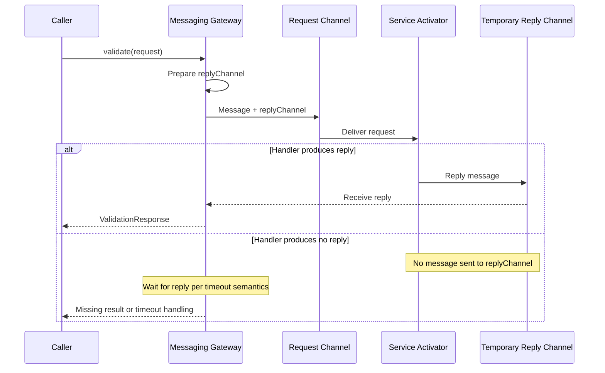
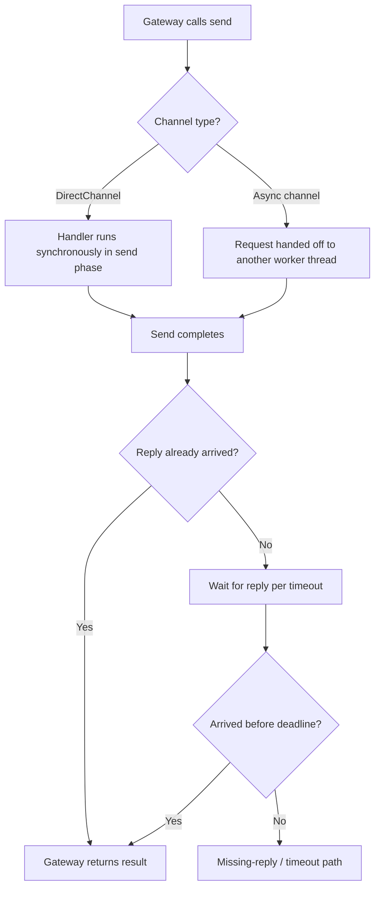

# No Handler Returning a Reply in Spring Integration Request–Reply

## 1. The Problem: Request Sent, No Reply Received

In the **Request–Reply** model, the caller sends a request and expects a corresponding reply. With **Spring Integration**, a request may be dispatched through a `Messaging Gateway`, enter a `MessageChannel`, pass through one or more flow components, and return a result to the Gateway via `replyChannel`.

A common bug is that **a component receives or processes the request, yet no reply is ever produced**. The caller may wait until timeout, receive `null`, or receive an error if the flow is configured to require a reply. The observed behavior also depends on the Gateway type, timeout settings, message path, and where any error occurs.

This topic belongs to the **Request reply** chapter of the **SPRING_INTEGRATION_PATTERN** module. Knowledge of Router, Filter, Transformer, Splitter, Aggregator, Gateway, retry, error channel, and correlation all applies here: if even one branch fails to produce a result or loses the reply path, the request–reply contract breaks.

After studying this lesson, you can:

- Distinguish **no handler receiving the request** from **a handler receiving it without producing a reply**.
- Explain the roles of `replyChannel`, temporary reply channel, and reply timeout.
- Build an example reproducing the symptom where a Gateway receives no reply.
- Use `requiresReply`, business reply branches, error flows, and tests to handle this intentionally.
- Investigate a request missing its reply without confusing timeouts with processing errors.

## 2. How Does Request–Reply Work?

For a Gateway method expecting a return value, the typical flow includes:

1. The Gateway builds a `Message` containing the payload and required headers.
2. The Gateway sends the message to the request channel while specifying the reply-receiving channel; many configurations use a **temporary reply channel** per invocation.
3. A message handler receives and processes the request.
4. The processor produces a reply (payload or message) and the framework routes it back to the appropriate channel.
5. The Gateway reads the reply and returns the result to the Java caller.



**Key point:** delivering a request to a handler **does not mean** request–reply is complete. An invocation with a return type needs either a final result or an explicitly designed error notification mechanism.

### A Temporary Reply Channel Does Not Create Replies by Itself

A temporary reply channel only provides a place to receive the result for one invocation. It does not generate payloads, invoke a missing handler, or fix a branch that filtered out the request. If every component in the flow finishes without producing a reply, the reply channel still has no message to return.

### Where Does the `replyChannel` Header Matter?

The `replyChannel` header identifies the destination for sending replies. When a `ServiceActivator` returns an object, the framework uses the incoming message context to route the result back to the Gateway. If an intermediate step builds a brand-new message and drops required headers or overrides routing, the reply may go to the wrong destination or never reach the caller.

## 3. Distinguishing Errors Often Lumped Together as "No Reply"

| Scenario | Did Request Reach Handler? | Typical Symptom | Investigation Direction |
|---|---|---|---|
| **No subscriber/handler on request channel** | No | With `DirectChannel`, sending the request usually fails immediately with a delivery error | Check channel names, bean registration, subscriptions, component scan |
| **Handler returns `null` or emits no output** | Yes | Gateway may wait until reply timeout and receive an empty result | Check return values and `requiresReply` |
| **Filter drops the request** | May be blocked before downstream handlers | No reply unless a discard/rejection branch is designed | Check filter predicate, `discardChannel`, or rejection policy |
| **Router routes to a branch with no terminal reply** | Possibly | Caller does not receive the expected result | Check all branches and routing targets |
| **Reply sent to the wrong channel** | Yes | Handler produced a result, yet Gateway never receives it | Check `replyChannel`, `outputChannel`, and manual sending code |
| **Handler throws an error handled elsewhere** | Yes | Gateway receives an exception or keeps waiting, depending on error flow | Check exceptions, error channel, and error handling |
| **Handler runs too slowly** | Running or completed | Wait expires or caller blocks in synchronous processing | Check thread boundaries and real timeouts |
| **Multiple replies for one request** | Yes | First reply is used; remaining replies violate the contract | Design an Aggregator or collect results before returning |

The first two scenarios are especially important:

- **No handler subscribed:** the request may never have been dispatched successfully. This is a dispatch/subscription issue.
- **Handler received it but returned nothing:** the request was consumed; the issue lies in the output contract, reply routing, or processing duration.

Therefore, before tuning `replyTimeout`, verify whether the request actually reached the handler.

## 4. Reproducing the Issue: Service Activator Returning `null`

Let's build a simple order-validation flow. Orders with `orderId = "SILENT"` intentionally produce no reply so we can observe the effect on the Gateway. This is an **error-simulation branch for learning**, not a recommended way to handle orders.

The example uses Java 17+, Spring Boot, Spring Integration, and compatible Spring Boot Test. The classes below belong in the same package `com.example.requestreply`.

### 4.1. Request and Response

```java
// ValidationRequest.java
package com.example.requestreply;

public record ValidationRequest(String orderId, int quantity) {
}
```

```java
// ValidationResponse.java
package com.example.requestreply;

public record ValidationResponse(
        String orderId,
        boolean accepted,
        String reason) {
}
```

The response includes `accepted` and `reason` so that later we can represent business rejections while still returning a complete result.

### 4.2. Request Channel

```java
// ValidationChannels.java
package com.example.requestreply;

import org.springframework.context.annotation.Bean;
import org.springframework.context.annotation.Configuration;
import org.springframework.integration.channel.DirectChannel;
import org.springframework.messaging.MessageChannel;

@Configuration
public class ValidationChannels {

    @Bean
    public MessageChannel validationRequests() {
        return new DirectChannel();
    }
}
```

`DirectChannel` dispatches messages directly to a subscriber on the caller thread unless another asynchronous bridge exists. It has an essential requirement: **a subscribed handler must exist** for request dispatch to succeed.

### 4.3. Messaging Gateway

```java
// ValidationGateway.java
package com.example.requestreply;

import org.springframework.integration.annotation.MessagingGateway;

@MessagingGateway(
        defaultRequestChannel = "validationRequests",
        defaultReplyTimeout = "750"
)
public interface ValidationGateway {

    ValidationResponse validate(ValidationRequest request);
}
```

Returning `ValidationResponse` indicates the caller expects a result. Here we configure a 750 ms reply timeout for the exercise; in production, choose a value based on flow latency, business requirements, and sync/async execution model.

### 4.4. Handler with a Branch Producing No Reply

```java
// ValidationService.java
package com.example.requestreply;

import org.springframework.integration.annotation.ServiceActivator;
import org.springframework.stereotype.Component;

@Component
public class ValidationService {

    @ServiceActivator(inputChannel = "validationRequests")
    public ValidationResponse validate(ValidationRequest request) {
        if ("SILENT".equals(request.orderId())) {
            // Error simulation: request was received, but no reply is produced.
            return null;
        }

        if (request.quantity() <= 0) {
            return new ValidationResponse(
                    request.orderId(), false, "Quantity must be positive");
        }

        return new ValidationResponse(
                request.orderId(), true, "Accepted");
    }
}
```

Three branches can be observed:

1. A normal order with positive quantity → returns `ValidationResponse(..., true, ...)`.
2. An invalid quantity → still returns `ValidationResponse(..., false, ...)`, expressing a business rejection.
3. Code `SILENT` → returns `null`; by default, a Service Activator does not require a reply and emits no reply message from this branch.

Case 2 expresses rejection within the request–reply contract. Case 3 leaves the contract unfulfilled.

### 4.5. Enabling Spring Integration

```java
// RequestReplyApplication.java
package com.example.requestreply;

import org.springframework.boot.SpringApplication;
import org.springframework.boot.autoconfigure.SpringBootApplication;
import org.springframework.integration.annotation.IntegrationComponentScan;
import org.springframework.integration.config.EnableIntegration;

@SpringBootApplication
@EnableIntegration
@IntegrationComponentScan
public class RequestReplyApplication {

    public static void main(String[] args) {
        SpringApplication.run(RequestReplyApplication.class, args);
    }
}
```

`@IntegrationComponentScan` registers the Gateway interface, `@ServiceActivator` is discovered via component scanning, and the `validationRequests` channel is created in configuration.

### 4.6. Testing the Reply Path and the Missing-Reply Path

```java
// ValidationGatewayTest.java
package com.example.requestreply;

import static org.junit.jupiter.api.Assertions.assertEquals;
import static org.junit.jupiter.api.Assertions.assertNull;

import org.junit.jupiter.api.Test;
import org.springframework.beans.factory.annotation.Autowired;
import org.springframework.boot.test.context.SpringBootTest;

@SpringBootTest
class ValidationGatewayTest {

    @Autowired
    ValidationGateway gateway;

    @Test
    void returnsBusinessReplyWhenHandlerProducesOne() {
        ValidationResponse reply =
                gateway.validate(new ValidationRequest("A-101", 2));

        assertEquals(
                new ValidationResponse("A-101", true, "Accepted"),
                reply);
    }

    @Test
    void missingReplyCanEndWithNullAfterReplyTimeout() {
        ValidationResponse reply =
                gateway.validate(new ValidationRequest("SILENT", 2));

        assertNull(reply);
    }
}
```

In this illustrative flow, `validate("SILENT")` produces no reply and the Gateway can return `null` when the wait period ends. This test is written for the exact configuration declared above; in another flow, the outcome might be an exception if `requiresReply` is enabled, a different error flow is configured, or sending the request fails immediately.

**Note:** the test above is meant to reproduce the bug. Tests in a real application should verify that business-rejected cases **receive an explicit response**, rather than treating `null` as a normal business state.

## 5. Fix 1: Always Produce a Business Result

For request–reply methods with a non-void return type, the clearest solution is to **define a reply contract for every valid business branch**. For example, replace the `SILENT` branch with:

```java
if ("SILENT".equals(request.orderId())) {
    return new ValidationResponse(
            request.orderId(),
            false,
            "Order cannot be validated");
}
```

Here the response represents a *rejected* outcome. Unlike producing no reply, the caller can log it, display the error, retry per business rules, or stop processing cleanly.

Advantages of structured responses:

- Callers distinguish success, business rejection, and infrastructure failure.
- No need to wait for a reply timeout to learn a business decision has already been made.
- Every branch can be thoroughly tested with assertions on `accepted` and `reason`.
- Easy mapping to HTTP responses, events, or external service layers.

Never emit a fake success response just to escape a timeout. If a downstream dependency actually fails, represent the failure according to an agreed policy or let an exception propagate to an appropriate error-handling path.

## 6. Fix 2: Require the Service Activator to Produce a Reply

If a Service Activator **must always produce a reply by design**, configure `requiresReply` to catch handlers returning `null` early:

```java
@ServiceActivator(
        inputChannel = "validationRequests",
        requiresReply = "true"
)
public ValidationResponse validate(ValidationRequest request) {
    if ("SILENT".equals(request.orderId())) {
        return null;
    }

    return new ValidationResponse(
            request.orderId(), true, "Accepted");
}
```

This is an **alternative version** of the handler in Section 4, not a second handler subscribed to `validationRequests` simultaneously. When a branch returns `null`, the framework can throw `ReplyRequiredException` instead of silently finishing without a reply.

Semantic difference:

| Handler Setting | Handler Returns `null` | Meaning |
|---|---|---|
| `requiresReply` disabled | No reply emitted | Fine for some one-way consumers, but prone to causing timeouts on Gateways expecting results |
| `requiresReply = "true"` | Raises missing-reply error | Useful when contract violations should fail fast |

This setting does not mean every error becomes a business response. In synchronous flows, errors may propagate to the caller; in asynchronous flows, how errors are caught and routed depends on the error channel and its configuration. Choose an explicit exception-handling policy.

## 7. Filter, Router, and Splitter Can Also "Lose" Replies

### 7.1. Filter Rejects the Request

A `Filter` can drop a message before it reaches downstream handlers. In request–reply, a dropped message without a reply policy creates a branch with no result.

There are three common approaches:

- **Return a rejection response:** route the discard branch to a handler that builds a structured response.
- **Throw an error on rejection:** enable the Filter's throw-on-rejection option, then map the error per the application contract.
- **Accept no reply:** only when the call truly has one-way semantics or the caller has a defined timeout policy.

Business example: an order with invalid quantity should return `ValidationResponse(accepted=false)`; never silently drop the message and force the caller to guess why after a timeout.

### 7.2. Router Chooses a Branch That Produces No Reply

A Router can direct requests to different processing channels. If branch A has a Service Activator returning a response while branch B merely logs and ends, only requests routed to A fulfill the request–reply contract.

Check **every branch**: success, validation error, unknown type, default route, and exception path. When no route matches, return an explicit error rather than silently dropping the request.

### 7.3. Splitter Produces Multiple Messages, Aggregator Never Completes

After splitting one request into multiple messages, do not let each branch reply directly to the Gateway's temporary reply channel. If the contract expects **one consolidated result**, use an Aggregator with proper correlation and release strategy to emit one final reply.

If the Aggregator is missing a fragment or its release condition is never met, the Gateway waits in vain. Check `correlationId`, `sequenceSize`, release conditions, timeouts, and policies for incomplete groups.

### 7.4. Transformer or Custom MessageHandler Drops `replyChannel`

Code that constructs a `Message` manually without keeping headers from the original request loses the reply address. When manual message creation is necessary, preserve routing/correlation headers per the flow contract.

```java
import org.springframework.messaging.Message;
import org.springframework.messaging.support.MessageBuilder;

// incoming: original message; result: new payload.
Message<?> outgoing = MessageBuilder.withPayload(result)
        .copyHeaders(incoming.getHeaders())
        .build();
```

This illustrates preserving headers in an internal flow. When crossing a broker or external service, do not blindly forward all headers: select and map only permitted headers. Replies returning through external systems typically need a durable correlation ID instead of an in-memory channel reference.

## 8. Timeout: Why "750 ms" May Not Cap the Whole Call

A Gateway usually has two critical phases:

1. **Sending the request:** placing the message on the request channel, which can include synchronous handler execution.
2. **Waiting for the reply:** waiting for a reply message on the reply channel up to the configured limit.

With `DirectChannel`, the handler runs synchronously on the sending thread. If the handler runs a five-second query before returning `null`, the call may block for five seconds in the send phase; a 750 ms reply timeout **does not automatically abort** the query or cut off the entire call at 750 ms.



This diagram simplifies the timeline; actual send/reply mechanics depend on channel and gateway types.

To enforce a meaningful end-to-end deadline, combine timeouts at the right layers—such as I/O, HTTP client, database, async task, and cancellation policies. Do not simply raise reply timeout to mask a handler that emits no output.

### What About Late Replies?

Once a caller has timed out, the temporary reply channel tied to that call may no longer accept replies as before. A late reply may cause a send error or enter error handling; exact behavior depends on channel type, timing, and framework configuration.

If business logic permits processing longer than a call's lifetime, use an asynchronous design with `requestId`/correlation ID, job status, result storage, and status lookup or notifications; do not rely on a temporary reply channel for durable result storage.

## 9. Processing Errors and Error Channels Differ from "No Reply"

Suppose the handler throws `IllegalStateException`:

```java
if ("BROKEN".equals(request.orderId())) {
    throw new IllegalStateException("Validation service failed");
}
```

This is an **execution error**, not a handler returning `null`. On a synchronous path, exceptions usually propagate back to the Gateway and caller. On an asynchronous path, errors may be wrapped in an `ErrorMessage` and sent to an error channel. If the error flow only logs without returning a result to the caller, the call may still time out waiting for a reply.

| Case | What to Inspect |
|---|---|
| Handler returns `null` | Whether any output reply exists, `requiresReply` setting |
| Handler throws exception | Stack trace, exception wrapping, error channel |
| Request send fails | Channel subscriptions, dispatcher, send timeout |
| Reply produced but lost | `replyChannel` header, output channel, reply send errors |
| Late reply | Timestamps of request, processing, reply, and deadline |

An error channel does not automatically double as a reply channel. If an error response must return through the Gateway, design a path that converts errors into responses or propagates exceptions properly.

## 10. Practical Diagnostic Workflow

When someone reports "the API hangs and gets no result," follow this order.

### Step 1: Confirm the Gateway Contract

- Does the method return `void` or a result type?
- Does the caller expect one reply, a collection of results, or only request acknowledgment?
- Is the request channel named and registered properly?
- Is `defaultReplyTimeout`/`replyTimeout` set explicitly?
- Is a `defaultReplyChannel` or another fixed reply/output channel configured?

For one-way `void` methods, not waiting for a reply may be intentional. Only diagnose a missing-reply bug when the contract genuinely requires a result.

### Step 2: Check How Far the Request Traveled

Add logging before and after key processing points (Gateway, Router, Filter, Service Activator). Log business or correlation IDs with timestamps—never print sensitive payloads. If the request never entered the handler, inspect dispatchers and subscriptions first.

### Step 3: Inspect Every Termination Path

Look for `return null`, `void` methods, Filter discards, unmatched Router branches, stalled Aggregators, and `catch` blocks that only log. Every valid request–reply path should end in either a **reply** or an **intentional error**.

### Step 4: Inspect Reply Sending

If the handler produced output, trace how the framework resolves the destination. Check places that construct `Message` manually, alter headers, send manually to other channels, or cross external integrations that might strip reply addresses.

### Step 5: Identify Which Phase Timed Out

For synchronous processing, measure handler execution time. For asynchronous processing, track when the request was dispatched, when processing started, when it ended, and when the reply was sent. Only then adjust deadlines rationally.

### Step 6: Handle Late Replies

Determine whether retries create duplicate requests, whether stale results still matter, and how callbacks/error flows record late replies. Use an idempotency key or request ID whenever an operation may be retried.

## 11. Essential Test Matrix

| Test Case | Input / Trigger | Expected Result |
|---|---|---|
| Successful reply | Valid request | Expected response received, including business correlation if used |
| Business rejection | `quantity <= 0` | Response `accepted=false` with reason received |
| Handler returns `null` | `SILENT` branch | Timeout/empty result observed per test configuration |
| Reply required | `requiresReply` enabled, handler returns `null` | Missing-reply error raised; not treated as success |
| Channel has no subscriber | Send request to unsubscribed `DirectChannel` | Send/dispatch failure observed |
| Filter drops message | Request fails predicate | Configured discard or error policy executes |
| Router missing branch | Unhandled request type | Request is not silently lost |
| Slow synchronous execution | Handler sleeps / waits on I/O | Real deadline measured, I/O-layer timeout verified |
| Async + slow | Reply arrives after deadline | Caller and error flow handle it intentionally |
| Multiple concurrent requests | Multiple request IDs | No reply cross-talk; one final reply per request |

You do not need `Thread.sleep` across the entire test suite. For timeout branches, use synchronization primitives or controlled test fixtures to avoid flaky CI timing. Testing directly against the Gateway contract is far more valuable than mocking the handler and merely asserting a method was called.

## 12. Mistakes to Avoid

**Mistake 1: Raising reply timeout for every request.** If a handler branch emits no reply, longer timeouts just make callers wait longer. Fix the processing flow first.

**Mistake 2: Treating `null` as a valid business outcome without documentation.** When `null` simultaneously means timeout, missing output, or "not found," callers cannot distinguish causes and monitoring suffers. Explicit responses or intentional exceptions eliminate ambiguity.

**Mistake 3: Assuming every Service Activator must return a value.** Some one-way flows intentionally emit no output. Configure `requiresReply` to match the contract rather than enabling it blindly on every consumer.

**Mistake 4: Confusing a missing subscriber with a missing-reply timeout.** On `DirectChannel`, no subscriber usually causes an immediate dispatch failure; that is a different investigation from a handler receiving the message and returning `null`.

**Mistake 5: Assuming the error channel automatically returns responses to the Gateway.** Error flows might only log or forward failures elsewhere. Specify explicitly which errors return to callers and in what format.

**Mistake 6: Having every Splitter branch reply directly.** A typical request–reply Gateway expects one result. With multiple branches, define aggregation and correlation before producing the final reply.

## 13. Review Questions

1. How does a `DirectChannel` with no subscriber differ from a Service Activator that received a message and returned `null`?
2. Why can't a temporary reply channel solve a missing reply on its own?
3. Why can a Filter cause a Gateway to time out even when the handler throws no exception?
4. How does `requiresReply = "true"` change behavior when a Service Activator returns `null`?
5. With a handler running on `DirectChannel`, why doesn't reply timeout necessarily cap the entire Gateway call duration?
6. Should validation failures return a business response `accepted=false` or drop the request? Why?
7. When a handler produced a response but the caller did not receive it, which headers and channels should you inspect?
8. With Splitter/Aggregator, what conditions guarantee exactly one final reply is returned per request?

## 14. Project Adoption Checklist

- [ ] Gateway has a clearly documented one-way or two-way contract.
- [ ] Every business branch requiring a response produces a reply or an explicit error.
- [ ] Filters/Routers define policies for rejections or unmatched routes.
- [ ] Handlers requiring replies set `requiresReply` appropriately.
- [ ] Reply addresses and correlation headers are preserved across necessary steps.
- [ ] Timeouts are set properly for send, I/O processing, and reply wait phases.
- [ ] Async branches and error channels are tested alongside happy paths.
- [ ] Logs/traces are sufficient to follow requests and replies by business ID.
- [ ] Missing-reply, exception, and late-reply scenarios all have tests.

**Key takeaway:** "No handler returning a reply" describes a **gap in the Request–Reply contract**, and you must pinpoint exactly where that gap occurs. If the request has no subscriber, fix dispatch. If the handler emits no output, define a reply or throw an explicit error. If the reply exists but never reaches the caller, inspect channels, headers, and execution duration. Spring Integration provides the messaging primitives; ensuring every request reaches a proper outcome remains the responsibility of integration flow design.
