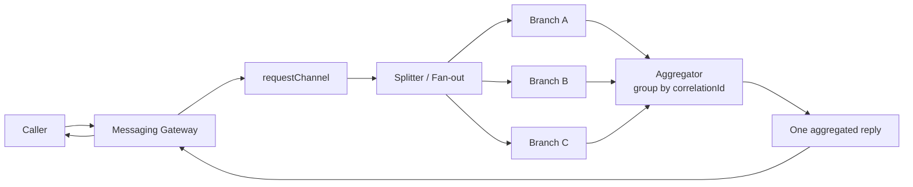

# Multiple Replies for One Request in Spring Integration

## Lesson Objectives

After this lesson, you can:

- Distinguish **one request – one reply** from **one request – multiple replies**, including returning multiple individual results versus aggregating into one consolidated result.
- Explain how **Splitter**, **Publish–Subscribe**, **Recipient List Router**, and **Aggregator** participate in a multi-reply request flow.
- Identify the roles of `correlationId`, `sequenceNumber`, `sequenceSize`, and `replyChannel` when multiple requests run concurrently.
- Build a Spring Integration flow in which one request fans out into multiple tasks, multiple results are aggregated, and one final reply returns to the Gateway.
- Design completion policies when all results arrive, when a quorum is reached, or upon timeout; handle error, late, missing, and duplicate replies.
- Test grouping correctness and track each request's lifecycle.

This topic belongs to the **Request reply** chapter of the **SPRING_INTEGRATION_PATTERN** module: practicing Enterprise Integration Patterns with Spring Integration to create loosely coupled, extensible message flows. Concepts across Router, Filter, Transformer, Splitter, Aggregator, Gateway, retry, error channel, and correlation come together in one concrete problem: **multiple parties process the same request and results must return to the exact original context**.

## 1. What Does "Multiple Replies" Actually Mean?

Suppose an e-commerce system queries shipping quotes for an order from three carriers `A`, `B`, and `C`. Each carrier returns one result, which may complete in any order:

| Illustrative Timestamp | Event | Associated Request |
| --- | --- | --- |
| 0 ms | Send request `Q-101` to A, B, C | `Q-101` |
| 70 ms | B returns price 36,000 VND | `Q-101` |
| 130 ms | New request `Q-102` arrives | `Q-102` |
| 180 ms | C returns price 41,000 VND | `Q-101` |
| 210 ms | A returns price 39,000 VND | `Q-101` |
| 250 ms | A returns result for another request | `Q-102` |

Timestamps are illustrative only; reply order is **not** a matching mechanism. `Q-101` must receive only results belonging to `Q-101`, never confusing them with `Q-102`'s results.

There are three common reply contracts:

| Contract | What the Caller Sees | Appropriate Technique |
| --- | --- | --- |
| **Collect all** | Waits for results and receives **one** consolidated response | Splitter/Fan-out → Aggregator → Gateway |
| **Quorum / first acceptable** | Returns one response once enough votes or an acceptable result arrives | Aggregator with a suitable release strategy, plus late-reply policy |
| **Streaming multiple events** | Receives each reply as it arrives, followed by a completion signal | Event channel, SSE, WebSocket, broker, or reactive stream, with correlation ID |

In a standard Gateway method returning `QuoteSummary`, the contract is **one result per invocation**. Replies from multiple branches should be **aggregated into one final message** before returning to the Gateway. If the caller must receive three messages one by one, design a streaming API or a subscription mechanism; never assume a Gateway returning a single object automatically turns into a multi-reply stream.

## 2. Components Participating in Grouping

A typical structure:



**Splitter** divides one request message into multiple child messages. Spring Integration can attach sequence metadata so child messages can be recombined:

| Header / Key | Meaning | Notes |
| --- | --- | --- |
| `MessageHeaders.CORRELATION_ID` | Identifies a group of messages sharing the same processing origin | Splitter normally generates correlation from the parent message; not identical to a business ID |
| `MessageHeaders.SEQUENCE_NUMBER` | Position of an item within the group | Useful when logical ordering needs to be restored |
| `MessageHeaders.SEQUENCE_SIZE` | Expected number of items in the group | Enables the default release strategy to know when all items have arrived, provided metadata is preserved intact |
| `MessageHeaders.REPLY_CHANNEL` | Where the result is sent after processing | Gateway typically supplies the reply path; not used as the grouping key |
| Business `requestId` | Application-generated request identifier, such as `Q-101` | Used for tracing, idempotency, and reconciliation across processes/brokers |

**Aggregator** holds messages sharing a correlation key in a *message group* and decides when to emit the result. For a sequence emitted by a Splitter with `sequenceSize` intact, the default Aggregator setup can wait until all members arrive. The Aggregator also needs a strategy to compute the consolidated result (*message group processor*) and storage for group state (*message group store*).

**Publish–Subscribe** or **Recipient List Router** fits when broadcasting the same request to multiple distinct recipients. In that case, **do not assume** every fan-out mechanism automatically attaches sequence numbers/group size like Splitter. If you plan to aggregate with an Aggregator, configure corresponding group metadata generation/preservation or define custom correlation and release strategies.

**Gateway** converts a Java call into a request message and awaits a reply per the method contract. In the example below, the Aggregator produces the final reply; each vendor only produces an **intermediate result**.

## 3. Sample Flow: Gathering Quotes from Three Vendors and Picking the Cheapest

We build an in-process flow using Java 17+ and Spring Integration 6.x. The example mocks three vendors; each request splits into three `VendorTask`s, yields three `VendorReply` objects, and produces one `QuoteSummary`.

The Java snippets belong in the **same package**, with each `public record`, interface, or class in its own Java file. The Spring Boot app needs Spring Integration and Spring Boot Test dependencies matching the project version; the example focuses on flow organization.

### 3.1. Data Types

```java
// QuoteRequest.java
public record QuoteRequest(
        String requestId,
        String productCode,
        int quantity
) {}

// VendorTask.java
public record VendorTask(
        String requestId,
        String vendor,
        String productCode,
        int quantity
) {}

// VendorReply.java
import java.math.BigDecimal;

public record VendorReply(
        String requestId,
        String vendor,
        BigDecimal total,
        String errorCode
) {
    public boolean successful() {
        return total != null && errorCode == null;
    }
}

// QuoteSummary.java
import java.util.List;

public record QuoteSummary(
        String requestId,
        List<VendorReply> replies,
        VendorReply cheapest
) {}
```

Each `VendorReply` carries `requestId` for reconciliation, even if messages traverse multiple systems. `errorCode` illustrates a branch returning a structured failure result. In production code, prefer an explicit result type (e.g., sealed result or status enum) instead of relying on informal conventions over valid/null fields.

### 3.2. Channels, Executor, and Gateway

```java
// MultiReplyConfig.java
import org.springframework.context.annotation.Bean;
import org.springframework.context.annotation.Configuration;
import org.springframework.core.task.TaskExecutor;
import org.springframework.integration.annotation.IntegrationComponentScan;
import org.springframework.integration.channel.DirectChannel;
import org.springframework.integration.channel.ExecutorChannel;
import org.springframework.integration.config.EnableIntegration;
import org.springframework.messaging.MessageChannel;
import org.springframework.scheduling.concurrent.ThreadPoolTaskExecutor;

@Configuration
@EnableIntegration
@IntegrationComponentScan
public class MultiReplyConfig {

    @Bean
    public MessageChannel quoteRequests() {
        return new DirectChannel();
    }

    @Bean
    public TaskExecutor vendorTaskExecutor() {
        ThreadPoolTaskExecutor pool = new ThreadPoolTaskExecutor();
        pool.setCorePoolSize(4);
        pool.setMaxPoolSize(8);
        pool.setQueueCapacity(100);
        pool.setThreadNamePrefix("vendor-quote-");
        pool.initialize();
        return pool;
    }

    @Bean
    public MessageChannel vendorTasks(TaskExecutor vendorTaskExecutor) {
        return new ExecutorChannel(vendorTaskExecutor);
    }

    @Bean
    public MessageChannel vendorReplies() {
        return new DirectChannel();
    }
}
```

`ExecutorChannel` lets subtasks run on a thread pool, so replies from A/B/C may arrive out of order. `DirectChannel` at the entry and before the Aggregator keeps message routing straightforward to follow.

```java
// MultiQuoteGateway.java
import org.springframework.integration.annotation.MessagingGateway;

@MessagingGateway(
    defaultRequestChannel = "quoteRequests",
    defaultReplyTimeout = "5000"
)
public interface MultiQuoteGateway {
    QuoteSummary compare(QuoteRequest request);
}
```

The Gateway waits for **one aggregated reply**, up to the Gateway's configured timeout once entering the reply-wait phase. A reply timeout **does not mean** tasks in the executor are canceled. Overall policy also requires I/O timeouts per vendor and group retention limits on the Aggregator.

### 3.3. Splitter Creating Three Child Messages

```java
// VendorQuoteFlow.java
import java.math.BigDecimal;
import java.util.Comparator;
import java.util.List;
import org.springframework.integration.annotation.Aggregator;
import org.springframework.integration.annotation.ServiceActivator;
import org.springframework.integration.annotation.Splitter;
import org.springframework.stereotype.Component;

@Component
public class VendorQuoteFlow {

    @Splitter(inputChannel = "quoteRequests", outputChannel = "vendorTasks")
    public List<VendorTask> split(QuoteRequest request) {
        if (request.quantity() <= 0) {
            throw new IllegalArgumentException("quantity must be positive");
        }
        return List.of(
            new VendorTask(
                request.requestId(), "A", request.productCode(), request.quantity()),
            new VendorTask(
                request.requestId(), "B", request.productCode(), request.quantity()),
            new VendorTask(
                request.requestId(), "C", request.productCode(), request.quantity())
        );
    }

    @ServiceActivator(inputChannel = "vendorTasks",
                      outputChannel = "vendorReplies")
    public VendorReply askVendor(VendorTask task) {
        try {
            // Mock adapter: replace with REST/JMS/HTTP gateway in production.
            BigDecimal unitPrice = switch (task.vendor()) {
                case "A" -> new BigDecimal("120000");
                case "B" -> new BigDecimal("118000");
                case "C" -> new BigDecimal("125000");
                default -> throw new IllegalArgumentException("Unknown vendor");
            };
            BigDecimal total = unitPrice.multiply(
                BigDecimal.valueOf(task.quantity()));
            return new VendorReply(task.requestId(), task.vendor(), total, null);
        } catch (RuntimeException ex) {
            // Return a failure result so the group still receives all expected replies.
            return new VendorReply(
                task.requestId(), task.vendor(), null, "QUOTE_FAILED");
        }
    }

    @Aggregator(inputChannel = "vendorReplies")
    public QuoteSummary gather(List<VendorReply> replies) {
        List<VendorReply> ordered = replies.stream()
            .sorted(Comparator.comparing(VendorReply::vendor))
            .toList();

        VendorReply cheapest = ordered.stream()
            .filter(VendorReply::successful)
            .min(Comparator.comparing(VendorReply::total))
            .orElse(null);

        return new QuoteSummary(
            ordered.get(0).requestId(), ordered, cheapest);
    }
}
```

In this flow, the Splitter emits items sharing a **correlation ID** and corresponding sequence metadata. Each `VendorTask` goes to `vendorTasks`, a worker computes the price and sends `VendorReply` to `vendorReplies`. The default Aggregator uses the Splitter's correlation and sequence-size metadata to gather all three replies before calling `gather(...)`, then sends the final reply back along the Gateway's reply path.

**Important point:** `requestId` inside `VendorReply` is our custom business key; the default Aggregator grouping in this example relies on **message headers created by the Splitter**, not the `requestId` field inside the payload. If you manually construct a brand-new `Message`, swap adapters, or cross a broker, ensure correlation metadata is preserved; otherwise, declare explicit correlation and release strategies.

The `gather(...)` method sorts by vendor because arrival order can vary. For request `Q-101`, quantity 2, and the mock prices above, the three totals are A = 240,000, B = 236,000, and C = 250,000 VND. The chosen vendor is B at 236,000 VND. When every vendor fails, `cheapest` is `null`; production APIs should express a **NO_VALID_QUOTE** state explicitly.

### 3.4. Caller Receiving One Aggregated Result

```java
import org.springframework.stereotype.Service;

@Service
public class ShippingQuoteService {
    private final MultiQuoteGateway gateway;

    public ShippingQuoteService(MultiQuoteGateway gateway) {
        this.gateway = gateway;
    }

    public QuoteSummary quoteShipping() {
        return gateway.compare(
            new QuoteRequest("Q-101", "BOOK-01", 2));
    }
}
```

The method returns **one** `QuoteSummary` containing **multiple** `VendorReply` objects. At the API boundary, the caller does not need to know how many internal tasks ran.

## 4. Completion Conditions: Wait for All, Quorum, or First Result?

How many replies may be produced differs from **when the final result may be emitted**. That is the responsibility of the *release strategy*.

| Strategy | Emission Condition | Advantage | Issue to Handle |
| --- | --- | --- | --- |
| **All replies** | Receive all `N` transport-valid results | Full comparison possible | One hung branch stalls the entire group |
| **Quorum** | E.g., 2 out of 3 vendors respond | Reduces wait time | Where does the third reply go, and could it change the decision? |
| **First acceptable** | Any result meets business threshold | Low latency | Might miss a better quote arriving later |
| **Deadline / partial** | Timeout expires with at least one reply | Meets SLA | Must explicitly indicate the result is incomplete |

In the Java example above, each branch typically emits **exactly one** `VendorReply`, even when pricing fails. That lets the default "wait for all Splitter elements" strategy complete. If a branch truly **emits no message**, the group does not automatically count as complete merely because the Gateway timed out.

When applying a quota/quorum or group time limit, configure the Aggregator with an appropriate **custom release strategy** and **group timeout/expiry**. When returning partial results, the response should include fields like `receivedCount`, `expectedCount`, `complete`, and `deadlineReached` so callers interpret the result accurately. Any reply arriving after the group has released needs a clear policy: log and discard, save for reconciliation, or emit a separate update event; never push it blindly back to an already-finished Gateway call.

Illustrative contract for a partial result:

```json
{
  "requestId": "Q-101",
  "expectedCount": 3,
  "receivedCount": 2,
  "complete": false,
  "deadlineReached": true,
  "replies": [
    {"vendor": "B", "total": 236000},
    {"vendor": "A", "total": 240000}
  ]
}
```

The JSON above is an **illustrative contract** for a system accepting partial results; it is not the output of `QuoteSummary` in the default example.

## 5. When a Request Is Broadcast to Multiple Recipients

The example above used a Splitter because one request turned into three tasks with distinct content (`vendor=A/B/C`). Another flow might deliver the **same payload** to three handlers using:

- **Publish–Subscribe Channel:** broadcasts a message to multiple subscribers; `applySequence` can be enabled to support grouping when compatible with subscriber configuration.
- **Recipient List Router:** selects target destinations based on request content, e.g., additionally routing to vendor D for orders in a special region.
- **Scatter–Gather:** scatters one request across branches and gathers replies back; in Spring Integration this can be built from Publish–Subscribe/Router and an Aggregator.

When branch count varies per request, never hardcode `expectedCount = 3` or assume there are always three subscribers. The flow designer must know how many branches were actually dispatched, pick the right group key, and configure how group completion is determined. With Publish–Subscribe, when subscribers register and whether they run synchronously or asynchronously also affect reply expectations.

A **Filter** can drop messages. If a Filter blocks a branch without emitting a reply or an intentional `SKIPPED` result, an Aggregator waiting for `sequenceSize` may never finish. Define one of three options: count failure/rejection responses as results, adjust the completion strategy, or use a timeout to close the group.

## 6. Correlation When Multiple Requests Interleave

Imagine two requests fanning out simultaneously:

```text
Q-101 -> A1, B1, C1   (correlation: group-101)
Q-102 -> A2, B2, C2   (correlation: group-102)

Arrival order: B2, C1, A2, B1, C2, A1

Aggregator group-101 = [C1, B1, A1] -> summary for Q-101
Aggregator group-102 = [B2, A2, C2] -> summary for Q-102
```

In Spring Integration, every message has its own `id`. The ID of a child message or new reply is not automatically a cross-system group key. The Splitter generates correlation/sequence metadata for the in-example chain; when using external services or brokers, the group identifier must be **serialized and restored** by convention.

Distinguish three kinds of IDs:

1. **Message ID:** identifies a specific message inside Spring Messaging.
2. **Correlation ID:** identifies the group to aggregate, typically used by Aggregator or other correlation components.
3. **Business request ID:** identifies a business task across multiple services and across retries.

These three IDs may relate to one another, but should not be conflated out of habit. A multi-service protocol must specify who generates the request ID, wire field names, uniqueness scope, tracing rules, and retention lifetime. If deriving `correlationId` from the business request ID, ensure it does not collide with other internal correlation groups such as nested Splitters/Aggregators.

## 7. Edge Cases That Must Be Designed Upfront

| Edge Case | Risk | Mitigation |
| --- | --- | --- |
| One branch emits no reply | Gateway expires; group stays incomplete | I/O and group timeouts; return partial/failure per contract |
| One branch replies twice due to retry | Group overcounts; duplicate results | Deduplicate by `requestId + vendor` or stable branch ID |
| Reply arrives after release | No caller waiting; group may be recreated unintentionally | Late-reply policy, bounded idempotency/tombstone retention |
| Too many concurrent requests | Many message groups held in memory; thread pool exhaustion | Concurrency limits, backpressure, group expiry, store capacity monitoring |
| Branch throws exception in executor | Missing reply; Gateway times out despite worker error | Route `errorChannel` properly or convert errors into structured results |
| Branches have side effects | Retries can place duplicate orders or double charges | Idempotency, transaction boundaries, bounded retries |
| Flow spans instances/brokers | Correlation and group state lost on restart | Persistent/distributed message group store and proper reply routing |

**Caution with error channel:** synchronous exceptions can propagate straight to the caller; in async segments, errors may convert to an `ErrorMessage` on a configured error channel. If a worker throws before sending `VendorReply`, the Aggregator will not automatically treat that error as the third result. Design an adapter that converts errors into failed `VendorReply` objects, or route errors into a flow with defined group-completion rules.

**Caution with group store:** the Aggregator must hold message groups before completion. The default store works well for many single-JVM examples, but do not assume it is durable enough for multi-instance services. When persisting state durably, also handle duplicates, group expiry, and restarts.

## 8. When Should You Return *Each* Reply Instead of Aggregating?

For AI recommendation engines, multi-source queries, or real-time price search, callers may want each result immediately:

```text
POST /quotes -> 202 Accepted, requestId=Q-101
event: quote.received  {requestId:"Q-101", vendor:"B", total:236000}
event: quote.received  {requestId:"Q-101", vendor:"A", total:240000}
event: quote.received  {requestId:"Q-101", vendor:"C", total:250000}
event: quote.completed {requestId:"Q-101", received:3, expected:3}
```

This is an **event contract** (implementable via SSE, WebSocket, or broker), unlike `MultiQuoteGateway.compare(...)` returning a single `QuoteSummary`. Here, every event must carry the request ID/correlation ID; subscribers filter by request and detect stream completion. Account for client disconnects, redelivered events, reconnect replay, request-scoped authorization, and completion events on timeout.

Another option is returning **202 Accepted + requestId**, then letting the caller poll progress via a status API. This works well for long-running processes where keeping a continuous client connection open cannot be guaranteed.

## 9. Testing to Catch Mismatched Groups and Stuck Groups

Minimal integration test for the declared components:

```java
import static org.assertj.core.api.Assertions.assertThat;

import java.util.List;
import org.junit.jupiter.api.Test;
import org.springframework.beans.factory.annotation.Autowired;
import org.springframework.boot.test.context.SpringBootTest;

@SpringBootTest
class MultiQuoteFlowTest {
    @Autowired
    private MultiQuoteGateway gateway;

    @Test
    void oneRequestProducesThreeRepliesAndOneSummary() {
        QuoteSummary summary = gateway.compare(
            new QuoteRequest("Q-101", "BOOK-01", 2));

        assertThat(summary).isNotNull();
        assertThat(summary.requestId()).isEqualTo("Q-101");
        assertThat(summary.replies()).hasSize(3);
        assertThat(summary.replies())
            .extracting(VendorReply::vendor)
            .containsExactly("A", "B", "C");
        assertThat(summary.cheapest().vendor()).isEqualTo("B");
        assertThat(summary.cheapest().total())
            .isEqualByComparingTo("236000");
    }
}
```

To test concurrency and correlation, you can expand the same test class:

```java
import java.util.concurrent.ExecutorService;
import java.util.concurrent.Executors;
import java.util.concurrent.TimeUnit;
import java.util.stream.IntStream;
import java.util.concurrent.Future;

@Test
void concurrentRequestsAreNotMixed() throws Exception {
    ExecutorService callers = Executors.newFixedThreadPool(6);
    try {
        List<Future<QuoteSummary>> futures = IntStream.range(0, 20)
            .mapToObj(i -> callers.submit(() -> gateway.compare(
                new QuoteRequest("Q-" + i, "BOOK-01", i + 1))))
            .toList();

        for (int i = 0; i < futures.size(); i++) {
            QuoteSummary summary = futures.get(i).get(10, TimeUnit.SECONDS);
            String expectedRequestId = "Q-" + i;
            assertThat(summary).isNotNull();
            assertThat(summary.requestId()).isEqualTo(expectedRequestId);
            assertThat(summary.replies()).hasSize(3)
                .allMatch(reply ->
                    expectedRequestId.equals(reply.requestId()));
        }
    } finally {
        callers.shutdownNow();
    }
}
```

The snippet above adds imports and a method to the previous test class. Timeout values in tests are illustrative; CI environments need suitable time budgets. The crucial assertion is that **no reply from another request leaks into the current summary**.

When testing errors/timeouts, include scenarios that intentionally block one branch, make one branch emit two replies, and make one branch finish after the deadline. Verify the published API status, policy-based group cleanup, and logging of errors/late replies. For collect-all flows, verify the Aggregator does not emit early when only 2/3 replies arrive.

In production monitoring, attach `requestId`, correlation ID, vendor, status, send/receive timestamps, and collected reply count to traces/logs/metrics. Useful metrics include:

- Pending group count, group lifetime, group expiration rate.
- Per-vendor latency, end-to-end request latency, p95/p99, and Gateway timeout rate.
- Late replies, duplicate replies, replies with unknown groups, and reply send failures.

You do not need to log full payloads containing sensitive data; correlation keys and metrics are usually enough to diagnose root causes.

## 10. Pre-Production Design Checklist

1. **What does the caller receive?** One final summary, a partial summary, or multiple sequential events?
2. **How many branches actually run?** Fixed list, dynamic via Router, or subscriber-dependent?
3. **Which key groups them?** Splitter's correlation ID or an application-defined key? Are headers preserved across adapters?
4. **When does release happen?** All `N` items, quorum, first acceptable result, or deadline?
5. **Do failures count as replies?** Will a failing or filtered branch leave the group waiting forever?
6. **How are late/duplicate replies handled?** Are deduplication, retry, and group cleanup policies explicit?
7. **How are resources bounded?** Are thread pools, active group counts, message store, deadlines, and restart behavior accounted for?

## Conclusion

**Multiple replies for one request** requires both fanning out multiple tasks and matching their results accurately regardless of completion order. In Spring Integration, **Splitter or fan-out**, **correlation metadata**, **Aggregator**, and **Messaging Gateway** form a manageable collect-all flow. When you need early completion or event-stream delivery, explicitly define the release strategy and communication contract; handling timeouts, branch failures, late replies, and duplicates is inseparable from correctness.
