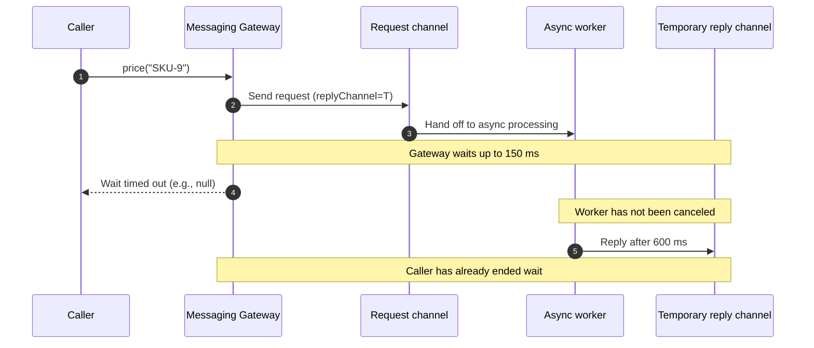
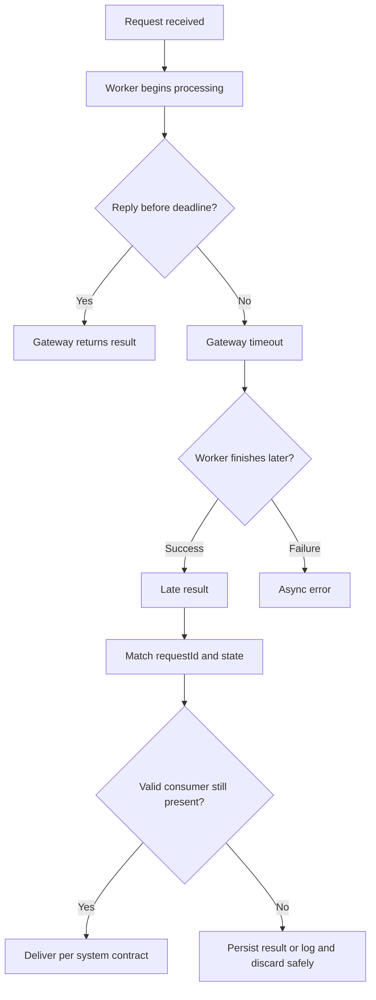
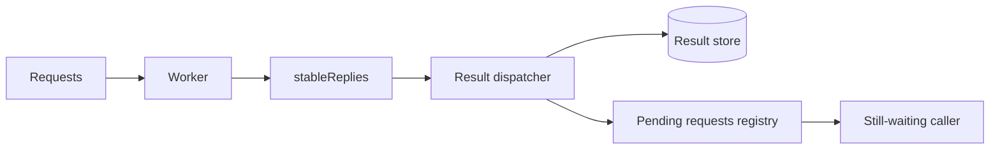

# Request Reply — Late Reply After Gateway Timeout

## Learning Objectives

After this lesson, you can:

- Explain what a **late reply** is and why downstream processing can still complete after a Messaging Gateway stops waiting.
- Distinguish `requestTimeout`, `replyTimeout`, actual processing duration, and **task cancellation**.
- Predict differences between a flow using `DirectChannel` and a flow with an asynchronous boundary such as `ExecutorChannel`.
- Set up a Spring Integration example where a reply arrives after the deadline, observe a gateway timeout, and verify the task still finishes.
- Design correlation, timeouts, retries, idempotency, error channels, and late-result handling to prevent data loss or incorrect state updates.

This lesson belongs to the **Request reply** chapter in the **SPRING_INTEGRATION_PATTERN** module. The module practices Enterprise Integration Patterns with Spring Integration to create loosely coupled, extensible, and observable message flows. Late replies commonly arise when Request–Reply passes through Routers, Filters, Transformers, Service Activators, Gateways, brokers, retries, or parallel steps. The lesson focuses on the reply path and the decisions needed once the caller's wait limit expires.

## 1. What Is a Late Reply?

In Request–Reply, a caller sends a request and waits for a reply. Suppose the gateway waits at most 150 ms, whereas the handler needs 600 ms to compute:

1. Caller invokes the gateway; the gateway sends the request into the Spring Integration flow.
2. An asynchronous worker begins processing the request.
3. After 150 ms with no reply, the gateway **stops waiting** and ends the call per its timeout contract.
4. The worker continues executing; around 600 ms, it produces a reply.
5. This reply appears **after the original call is no longer waiting for a result**. That is a *late reply*.



**Important point:** *Gateway timeout* describes the **caller's wait limit**; it does not automatically confirm the task failed, rolled back, or was canceled. An order placement, database write, or payment API call may succeed after the timeout point. Uncontrolled retries can therefore trigger duplicate side effects.

### Distinguishing States

| Term | Meaning |
| --- | --- |
| **On-time reply** | Result is routed to the receiver while the caller is still waiting. |
| **Late reply** | Result appears after the limit allowed by the caller/gateway. |
| **Gateway timeout** | Gateway receives no valid reply in time; return value/error reporting depends on method signature and configuration. |
| **Processing failure** | Worker actually failed while processing. Can occur before or after timeout. |
| **Cancellation** | Separate mechanism requesting work to stop; a timeout alone does not guarantee it. |
| **Error message** | A message describing an exception, typically routed via an error channel; not necessarily a business reply. |

Do not collapse all of these states into a single `FAILED` label. For instance, from the caller's perspective it is `TIMED_OUT`, whereas on the backend the request may still be `PROCESSING` and then transition to `SUCCEEDED`.

## 2. Which Timeout Is Actually Applied?

Spring Integration has two common settings on a Messaging Gateway:

| Setting | What Does It Bound? | What Does It Not Guarantee? |
| --- | --- | --- |
| `requestTimeout` | How long the gateway may wait to **send** the request into a channel when sending supports timeouts. | Not a cap on total handler execution time. |
| `replyTimeout` | How long the gateway waits to **receive** a reply after sending the request per gateway semantics. | Does not automatically interrupt workers, abort transactions, or recall dispatched messages. |

On `@Gateway`, timeouts are declared as **strings**, e.g., `replyTimeout = "150"`, defaulting to **milliseconds**. `@MessagingGateway` also lets you configure defaults across methods, such as `defaultReplyTimeout = "150"`.

### Why Does the Same `replyTimeout` Yield Different Call Durations?

When the entire handler runs synchronously on a `DirectChannel`, the `send()` call may block until the handler finishes. A handler taking 600 ms can hold the gateway thread for roughly 600 ms *before the separate reply-wait step even becomes meaningful*. Do not treat `replyTimeout = "150"` as a promise that every call ends after exactly 150 ms.

When you add an asynchronous boundary, such as `ExecutorChannel`, the request can be handed off to a worker and the send operation returns control to the gateway early. The gateway can then wait for the reply per `replyTimeout` while the worker continues running behind the scenes.

```text
Flow A — DirectChannel (synchronous)
Gateway --> DirectChannel --> Handler 600 ms --> Reply
             send() may block for handler duration

Flow B — ExecutorChannel (asynchronous)
Gateway --> DirectChannel --> ExecutorChannel --> Worker 600 ms
                send() returns early          |
Gateway waits replyTimeout 150 ms             +--> Late reply
```

Actual timing depends on schedulers, channels, adapters, runtime environment, and reply emission mechanics. The numbers in this lesson illustrate scenarios, not absolute timing guarantees.

## 3. How Does a Gateway Handle a Late Reply?

With a **typical request–reply Messaging Gateway**, Spring Integration creates or manages a dedicated reply-waiting path per call. The request carries `replyChannel` metadata so downstream components know where to send results. A handler without a fixed output channel can usually return a value and let the framework route the reply using this header.

Once the gateway times out:

- The caller invocation has left the waiting state. A reply appearing afterward **cannot automatically become the return value of that old call**.
- The worker may still attempt to send the reply to the reply path attached to the request.
- Whether the late reply is rejected, logged, raises an exception, or behaves otherwise depends on reply channel type, endpoint, version, and error handling. Never write business logic assuming every late reply is automatically persisted or delivered to the next invocation.
- If the flow uses a **shared fixed reply channel** instead of a per-call waiting channel, correlation and a dispatcher are required so other receivers do not accidentally pick up stale results.

The standard `MessageHeaders.REPLY_CHANNEL` header specifies the **reply destination**, whereas a business correlation key (such as `requestId`) specifies **which request the reply belongs to**. They solve two distinct problems.

> A late result is not inherently a computation error. It simply arrived past the chosen synchronous deadline.

## 4. Spring Integration Example: Reply Arriving Past the Deadline

The example uses Spring Integration Java DSL, a Messaging Gateway returning `String`, an `ExecutorChannel`, and a latch-controlled service to simulate slow work. The classes below belong in the same application package. Main dependencies are Spring Integration and Spring Context; tests use JUnit 5 and Spring Test.

### 4.1. Declaring the Gateway Interface

`PricingGateway.java`:

```java
import org.springframework.integration.annotation.Gateway;
import org.springframework.integration.annotation.MessagingGateway;

@MessagingGateway
public interface PricingGateway {

    @Gateway(requestChannel = "pricingRequests", replyTimeout = "150")
    String price(String sku);
}
```

`replyTimeout = "150"` tells the gateway to wait at most 150 ms during the reply-wait phase. For a method returning `String`, failing to receive a reply within the limit typically returns `null`. When using other return types, advice, or configurations, verify the actual timeout contract; never assume every gateway always returns `null`.

### 4.2. Configuring Channels and IntegrationFlow

`PricingFlowConfig.java`:

```java
import java.util.concurrent.ExecutorService;
import java.util.concurrent.Executors;

import org.springframework.beans.factory.annotation.Qualifier;
import org.springframework.context.annotation.Bean;
import org.springframework.context.annotation.Configuration;
import org.springframework.integration.annotation.EnableIntegration;
import org.springframework.integration.annotation.IntegrationComponentScan;
import org.springframework.integration.channel.DirectChannel;
import org.springframework.integration.channel.ExecutorChannel;
import org.springframework.integration.dsl.IntegrationFlow;
import org.springframework.messaging.MessageChannel;

@Configuration
@EnableIntegration
@IntegrationComponentScan(basePackageClasses = PricingGateway.class)
public class PricingFlowConfig {

    @Bean("pricingRequests")
    public MessageChannel pricingRequests() {
        return new DirectChannel();
    }

    @Bean(name = "pricingExecutor", destroyMethod = "shutdown")
    public ExecutorService pricingExecutor() {
        return Executors.newFixedThreadPool(2);
    }

    @Bean("pricingWorkers")
    public MessageChannel pricingWorkers(
            @Qualifier("pricingExecutor") ExecutorService executor) {
        return new ExecutorChannel(executor);
    }

    @Bean
    public ControlledPricingService controlledPricingService() {
        return new ControlledPricingService();
    }

    @Bean
    public IntegrationFlow pricingFlow(ControlledPricingService service) {
        return IntegrationFlow.from("pricingRequests")
            // Hand message off to worker; caller does not wait for handler completion.
            .channel("pricingWorkers")
            .handle(String.class, (sku, headers) -> service.calculate(sku))
            // No fixed output channel declared:
            // handler can reply via the request's replyChannel.
            .get();
    }
}
```

`DirectChannel` at the entry lets the gateway submit requests into the flow. `ExecutorChannel` creates an asynchronous boundary between caller and handler so gateway reply timeouts can occur while the worker is still busy.

When the handler returns a `String`, Spring Integration tries to route the return value as a reply per the request's reply channel metadata. When the gateway has already stopped waiting, this is the exact late-reply situation we want to observe.

### 4.3. Service Controlled by CountDownLatch

`ControlledPricingService.java`:

```java
import java.util.concurrent.CountDownLatch;
import java.util.concurrent.TimeUnit;

public class ControlledPricingService {

    private final CountDownLatch started = new CountDownLatch(1);
    private final CountDownLatch allowCompletion = new CountDownLatch(1);
    private final CountDownLatch computed = new CountDownLatch(1);

    public String calculate(String sku) {
        started.countDown();
        try {
            if (!allowCompletion.await(5, TimeUnit.SECONDS)) {
                throw new IllegalStateException("Worker was not released");
            }
            return "PRICE:" + sku;
        } catch (InterruptedException ex) {
            Thread.currentThread().interrupt();
            throw new IllegalStateException("Worker interrupted", ex);
        } finally {
            computed.countDown();
        }
    }

    public boolean awaitStarted() throws InterruptedException {
        return started.await(2, TimeUnit.SECONDS);
    }

    public void release() {
        allowCompletion.countDown();
    }

    public boolean awaitComputed() throws InterruptedException {
        return computed.await(2, TimeUnit.SECONDS);
    }
}
```

Here `CountDownLatch` lets the test precisely control when the worker is released, avoiding pure dependence on `Thread.sleep()`. `computed` records that the business method finished—it **does not prove the reply was successfully delivered to the caller**. That distinction matters when diagnosing late replies.

### 4.4. Integration Test

`LateReplyIntegrationTest.java`:

```java
import static org.junit.jupiter.api.Assertions.assertNull;
import static org.junit.jupiter.api.Assertions.assertTrue;

import org.junit.jupiter.api.Test;
import org.springframework.beans.factory.annotation.Autowired;
import org.springframework.test.context.junit.jupiter.SpringJUnitConfig;

@SpringJUnitConfig(PricingFlowConfig.class)
class LateReplyIntegrationTest {

    @Autowired
    PricingGateway gateway;

    @Autowired
    ControlledPricingService service;

    @Test
    void processingCanFinishAfterGatewayReplyTimeout() throws Exception {
        // Worker is blocked on latch, longer than 150 ms replyTimeout.
        String reply = gateway.price("SKU-9");

        try {
            // Gateway received no reply within the wait window.
            assertNull(reply);
            assertTrue(service.awaitStarted());
        } finally {
            // Ensure worker is released even if an assertion fails.
            service.release();
        }

        // Handler still completes after the gateway timed out.
        assertTrue(service.awaitComputed());
    }
}
```

**What this test proves:** the gateway stopping its wait does not automatically cancel downstream computation. It **does not prove** the reply reached the caller after timeout: on a finished synchronous call, there is no longer a receiver to return that result to. To verify how your runtime system handles late replies, add observation of logs/error channels or a dedicated result-collection point depending on deployment architecture.

In real projects, do not reuse a single `ControlledPricingService` holding one-shot latches across multiple independent test cases without resetting state. The test above intentionally demonstrates one controlled request.

## 5. What Can Happen After a Timeout?

Separate the **caller's wait state** from **business execution state**:



Several variants to recognize:

| Scenario | What Does Caller Know at Timeout? | What Might Backend Have Done? |
| --- | --- | --- |
| Worker still computing | No result yet | Still running; may succeed |
| DB commit done, reply not yet arrived | No confirmation received | Data write already succeeded |
| Downstream HTTP slow | Reply not received in time | External service may already have completed |
| Filter drops message | No reply received | Request dropped per config; no normal reply |
| Handler throws exception after timeout | No reply received | Real error; may appear on error channel |
| Retry resends same business action | New call has separate state | Side effect may execute twice without idempotency |

Therefore, **a transport-level timeout is insufficient evidence to conclude a transaction failed**. Before resending a command with side effects, query status using a system-recorded idempotency key or request ID.

## 6. Designing Late-Reply Handling

No single policy fits every business domain. Choose explicit behavior before putting a flow into production.

### Approach 1 — Controlled Discard of Late Replies

Applies to safely repeatable queries, such as recommendation lookups or side-effect-free reads. When the caller is no longer waiting:

- Record a `late_reply_total` metric and how far past the deadline it arrived.
- Never route a stale reply to a new call merely because it shares a request type or channel.
- Accept discarding the result if business rules permit; the worker may still consume resources until it finishes.

Decide where discarding occurs: if the gateway owns a temporary wait channel, do not assume the framework stores every late reply for you. For explicit control, use an **application-owned output channel/dispatcher** and enforce late-result policies there.

### Approach 2 — Persist Results Durably, Let Callers Query Back

Fits long-running work, side-effecting commands, or mandatory result retention. Switch the API to an asynchronous model:

1. Caller submits command with a stable `requestId` or `idempotencyKey`.
2. System acknowledges receipt, returning `202 Accepted` with `requestId` (over HTTP) or an equivalent receipt.
3. Worker processes and writes `PROCESSING / SUCCEEDED / FAILED` state to persistent storage.
4. Caller polls `GET /operations/{requestId}`, or receives a webhook/event upon completion.
5. Results arriving past any client timeout are never confused with a pending synchronous reply; they are handled by ID and business state.

```text
Client --submit(idempotencyKey)--> Command API
Client <--requestId----------- Command API

Command API --> Queue --> Worker --> Results store
Client --GET /operations/id--------------> Results store
Client <--PENDING / SUCCEEDED / FAILED---- Results store
```

Prefer this model whenever work frequently exceeds synchronous wait budgets, especially for payments, report exports, batch processing, or external integrations.

### Approach 3 — Fixed Reply Channel and Correlation Dispatcher

When maintaining an internal messaging architecture, workers can emit results to an **application-managed stable result channel**; a single consumer reads results and correlates by `requestId`.



The dispatcher should perform these steps consistently:

```java
// Pseudocode illustrating policy; not a built-in Spring Integration API.
void onResult(Result result) {
    Result saved = resultStore.completeOnce(
        result.requestId(), result
    ); // Prevents duplicate completion and persists durable state.

    PendingCall pending = pendingCalls.remove(result.requestId());
    if (pending != null && clock.instant().isBefore(pending.deadline())) {
        pending.deliver(saved);
    } else {
        metrics.increment("late_reply_total");
        // Do not deliver to an expired gateway call.
        // Client can fetch the result from resultStore using requestId.
    }
}
```

`completeOnce`, `PendingCall`, and `resultStore` here are **application-designed APIs**, not built-in Spring Integration classes. A production implementation must handle races between timeout and near-deadline replies, protect state transitions atomically, evict expired registry entries, bound memory usage, and recover across restarts.

**Note on output channels:** a fixed `outputChannel` on an endpoint can override the request's `replyChannel` for reply emission. If you send replies to `stableReplies`, design a dispatcher responsible for delivering results to the right recipients rather than expecting the gateway to magically listen on an unconfigured channel.

### Approach 4 — Adjust Deadlines or Retry

If most requests miss the timeout only slightly, you can increase `replyTimeout` based on observed latency and SLOs. However, longer waits increase concurrent waiting threads/connections.

When retrying:

- Send the **same idempotency key** for the same business operation instead of generating an unrelated command.
- Bound retry attempts, total budget, and backoff.
- Check operation status before retrying commands with side effects.
- If the first attempt's reply arrives after the second attempt starts, correlate `requestId` and attempt version to prevent stale data from overwriting newer state/UI.
- For side effects like debiting money or creating orders, enforce idempotency at the **data/transaction owner**, not only at the caller.

## 7. Correlation, Headers, and Error Channels

An observable system must preserve enough metadata linking send, receipt, and outcome.

| Field | Purpose | Notes |
| --- | --- | --- |
| `requestId` | Identifies a business request across steps | Assign before sending; use in status lookups and logs |
| `idempotencyKey` | Prevents duplicate execution of the same command | Business-scoped key; checked atomically |
| `replyChannel` | Specifies reply destination inside a flow | A gateway's temporary channel is not a durable result store |
| `errorChannel` | Error-routing path for flows supporting `ErrorMessage` | Not equivalent to a normal reply |
| `deadline` | Cutoff after which caller no longer needs a synchronous reply | Use consistent clocks/time semantics across machines |
| `attempt` | Distinguishes retry attempts in diagnostics | Keep the same idempotency key for the same operation |

**Do not assume headers survive every adapter.** Within a single application flow, Spring Integration usually carries headers across compatible endpoints, whereas custom Transformers or HTTP/JMS/Kafka bridges may alter, map, filter, or fail to serialize certain headers. Specifically, an in-memory Java `MessageChannel` object in a header never becomes a valid reply address in another process. Across brokers, design transport-appropriate reply destinations and correlation.

Distinguish these two failure modes:

- **Handler throws an exception before returning a reply:** in synchronous flows, exceptions normally propagate to the caller; in async flows, errors may route to `errorChannel` if the endpoint/adapter supports and configures it.
- **Handler finishes, but emitting the late reply fails:** business data may already be saved, while sending the message to an expired wait destination may error or leave traces depending on implementation.

Accordingly, `errorChannel` and a durable result channel serve different purposes. The error channel aids technical failure analysis; the result store and correlation confirm **final business state**.

## 8. Production Observability and Diagnostics

To tell timeouts apart from failed processing, record these timestamps under the same `requestId`:

```text
request.accepted_at
request.dispatched_at
worker.started_at
gateway.deadline_at
gateway.timeout_at         // if caller timed out
worker.completed_at        // may be after timeout
reply.dispatch_attempt_at
result.persisted_at
```

Essential metrics include `gateway_timeout_total`, `late_reply_total`, `worker_error_total`, `reply_delivery_error_total`, p50/p95/p99 latency, active in-flight requests, and age of pending requests. A request timing out at the gateway is not necessarily a failed job; dashboards should separate these states.

Example structured logs:

```json
{"event":"gateway_timeout","requestId":"req-91","replyTimeoutMs":150}
{"event":"worker_complete","requestId":"req-91","processingMs":610}
{"event":"late_result_saved","requestId":"req-91","status":"SUCCEEDED"}
```

Log only correlation IDs and essential metadata; avoid logging payloads with personal data or business secrets. With retries, logging `attempt` explains why multiple executions map to one command.

## 9. Common Design Mistakes

| Mistake | Risk | Fix |
| --- | --- | --- |
| Treating `replyTimeout` as a worker-kill switch | Worker keeps running after caller stops waiting | Use explicit cancellation where supported, and handle already-committed cases |
| Retrying order creation after timeout without checking | Duplicate orders or double charges | Idempotency key, final status lookup |
| Sharing a `QueueChannel` across callers calling `receive()` | Caller A reads Caller B's reply | Correlation dispatcher or per-request reply channels |
| Raising timeouts without tracking latency | Ties up resources, hides root causes of slowness | Measure p95/p99, budget deadlines per stage |
| Assuming late replies are automatically saved | Lost results or send errors to temporary channels | Stable result channel, persist results, and monitor clearly |
| Relying solely on `replyChannel` for correlation | Fails under branching, retries, or brokers | Dedicated `requestId` header preserved by contract |
| Filter drops requests without a rejection path | Gateway observes only timeout | Return business error reply or configure discard/error flow |
| Using correlation IDs without guarding state updates | Stale result overwrites newer state | Conditional updates checking attempt/version and terminal state |

## 10. Practice Exercises

1. Run `PricingGateway` with the async flow from Section 4. Use the latch to hold the worker past `replyTimeout`, then release it and verify the worker finishes.
2. Replace `ExecutorChannel` with direct synchronous processing. Compare total gateway call duration against the configured `replyTimeout`, and explain why the behavior differs.
3. Generate a `requestId` at flow entry and log `gateway_timeout` and `worker_complete` events. Present a trace for a request completing after the deadline.
4. Design a `stableReplies` channel and mock result store. When the caller has already timed out, have the dispatcher persist the result without sending a reply back to the expired call.
5. Resend the same command with the same `idempotencyKey`; verify the backend executes the side effect only once even if both calls time out.
6. Add a technical-error branch after timeout and observe the error channel. Clearly distinguish **task failed** from **task succeeded with late reply**.

**Completion criteria:** for a concrete request, identify when the gateway expired, when the worker completed, which channel the handler tried to send the reply to, where the final result is stored, and how retries are prevented from duplicating side effects.

## 11. Key Takeaways

- A **late reply** is a reply arriving after the caller/gateway stops waiting; timing out does not cancel work automatically.
- `requestTimeout` bounds sending where supported, while `replyTimeout` bounds reply waiting. With synchronous processing, call duration can exceed `replyTimeout`.
- Request–reply Gateways normally use dedicated reply wait paths; once a call times out, a late reply cannot be treated as that synchronous call's return value.
- Safe operation requires **correlation, idempotency, state tracking, error handling**, and an upfront late-reply policy.
- For long-running work or critical side effects, prefer **returning a request ID and persisting results durably** so callers can poll or receive completion notifications.
