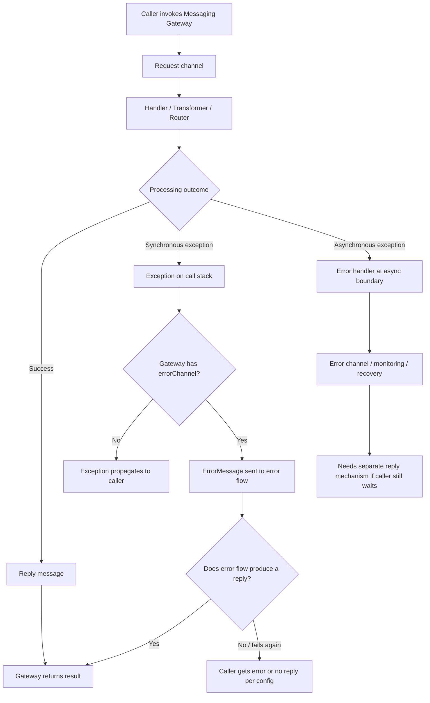
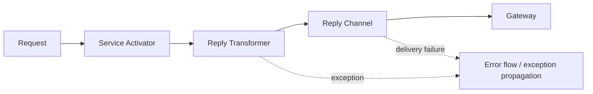

# Handling Exceptions in the Reply Flow with Spring Integration

## 1. Problem Statement: When a Reply Flow Does Not Return a Normal Result

In the **Request reply** chapter of the **SPRING_INTEGRATION_PATTERN** module, a component sends a request and waits for a reply from a message-processing flow. Spring Integration connects components via **Enterprise Integration Patterns** such as Gateway, Router, Filter, Transformer, Splitter, Aggregator, and Service Activator, while supporting retries, error channels, correlation, and flow observability.

Yet request–reply is not just "got a reply" vs. "got no reply." When processing fails, exceptions can arise at many points:

- A handler throws an exception while processing the request.
- A transformer fails to convert the payload or data type.
- A router finds no valid target; a channel fails to deliver the message.
- An adapter hits a network, database, broker, or external-service error.
- An aggregator cannot combine reply parts, or one branch fails.
- A reply is produced but cannot be sent back to the reply channel.
- An error handler itself fails, or fails to reply in time for the gateway to receive it.

Without explicit design, the caller may observe an exception, `null`, a business error reply, or simply a timeout. Each of these outcomes has a **different meaning** and must be controlled intentionally.

**Lesson objective:** understand how exceptions travel through request–reply, distinguish exceptions from business replies and timeouts, configure error handling at the right boundary, design clean reply contracts, and test error paths.

## 2. Which Path Do Exceptions Follow?

The basic model:



The diagram highlights two critical factors: **thread boundary** and **error destination**. Exceptions thrown directly on the gateway's thread can unwind the call stack; exceptions on a worker thread cannot automatically "jump" back onto the caller's thread.

### 2.1. Outcomes to Distinguish

| Scenario | What Gateway/Caller May Observe | Meaning |
| --- | --- | --- |
| Handler returns successful reply | Reply object or message | Work completed per contract |
| Handler rejects on business grounds and emits `REJECTED` reply | Structured reply object | Request was processed and explicitly rejected |
| Synchronous exception with no custom error handling | Exception propagated to caller (often wrapped by Spring Messaging) | Processing flow encountered an error |
| Exception routed to error flow producing a substitute reply | Fallback/error-status reply | Error policy was applied |
| Async-thread error without a valid reply | Gateway may wait until `replyTimeout` | Final outcome remains unknown to caller |
| Late reply or reply delivery failure | Caller may receive nothing | Must reconcile actual task state |

**An exception does not equal a failed business reply.** An exception may indicate it is unknown whether a transaction succeeded. For example, a network timeout after a payment system accepted an order is not proof that money was not debited.

### 2.2. Common Exception Types

- `MessageHandlingException`: failure while a handler processes a message.
- `MessageDeliveryException`: failure delivering a message to a destination, such as a channel lacking a matching subscriber or a send failure.
- `MessageTransformationException` and specialized exceptions: errors during transformation steps, depending on endpoint and scenario.
- Application-defined business exceptions, such as `InvalidAmountException`, `InsufficientStockException`.
- Downstream library exceptions such as connection errors, timeouts, or data constraints.

Many exceptions are wrapped in `org.springframework.messaging.MessagingException`, where `getFailedMessage()` helps trace the related message. Therefore, when classifying failures, inspect the **`cause` chain** and original message rather than comparing only the outermost exception class name.

## 3. Sync and Async Boundaries Determine How Errors Are Caught

### DirectChannel: Errors on the Same Call Stack

```text
Caller -> Gateway -> DirectChannel -> Handler
                                   X throw exception
Caller <- Gateway <- exception ------+
```

`DirectChannel` normally invokes subscribers on the sender's thread. If a handler throws an exception before producing a reply, the error unwinds back to the gateway and caller. You can:

1. Let the error propagate and catch it at the application layer.
2. Configure an `errorChannel` on the gateway to route exceptions into an error-handling flow.
3. Catch expected business exceptions inside the handler and return a reply with a well-defined status.

### ExecutorChannel: Errors on a Worker Thread

```text
Caller -> Gateway -> ExecutorChannel --enqueue--> Worker -> Handler
                         |                         X exception
                         |                          |
                         v                          v
                   wait for reply             error handler
                         |                          |
                    replyTimeout             error channel/log
```

`ExecutorChannel` offloads execution to an executor. Exceptions from the handler occur on the worker thread, so an error handler must catch them and send them to the right error channel. If nothing replies along the path the gateway awaits, the caller may just get `null` or a timeout outcome, depending on the gateway contract.

**Do not assume setting `errorChannel` on the gateway catches errors on every thread.** Verify error handling at every asynchronous boundary—including channels, executors, adapters, brokers, and reply routing. When a message carries an `errorChannel` header, components supporting error handling can prioritize that specified channel; when none is present, fallback behavior depends on endpoint type and application setup.

One more point: `DirectChannel` can block the caller inside the handler call itself. In that case, the gateway's `replyTimeout` **does not cap total handler execution time**, because sending the request has not completed in the synchronous call sense. To let the gateway stop waiting independently of handler execution time, place an asynchronous boundary in the right spot.

## 4. Spring Integration Error-Handling Tools

### 4.1. `errorChannel` and `ErrorMessage`

Spring Integration represents errors as a message wrapping a `Throwable`. `org.springframework.messaging.support.ErrorMessage` carries the exception as its payload and may also reference the original message.

Example error-handler signature:

```java
import org.springframework.integration.annotation.ServiceActivator;
import org.springframework.messaging.Message;
import org.springframework.messaging.MessagingException;
import org.springframework.messaging.support.ErrorMessage;

@ServiceActivator(inputChannel = "myGatewayErrors")
public void inspect(ErrorMessage errorMessage) {
    Throwable error = errorMessage.getPayload();
    Message<?> source = errorMessage.getOriginalMessage();

    if (source == null && error instanceof MessagingException me) {
        source = me.getFailedMessage();
    }

    // Log correlation ID and error category; proceed per policy.
}
```

This snippet illustrates consuming an `ErrorMessage`. A `void` method **produces no substitute reply**, so by itself it cannot guarantee a gateway method receives a result. Design the error path for your requirements: logging only, emitting events, retrying, dead-lettering, returning a fallback reply, or propagating an exception to the caller.

### 4.2. Gateway-Level Error Channel

A messaging gateway can configure its own error channel, such as `@MessagingGateway(errorChannel = "myGatewayErrors")`. When synchronous errors from the request flow are routed here by the gateway, the error flow can classify them and supply a substitute reply.

This works well when callers expect a **consistent reply contract**. The error flow must return a value compatible with the gateway method's return type to supply a substitute object. If the error flow merely logs, stops processing, or rethrows an exception, the caller cannot expect a fallback return value.

### 4.3. Global Error Channel and Dedicated Error Flows

A Spring Integration application may define a shared error channel named `errorChannel`. It serves as a common collection point for `ErrorMessage`s, especially for failures emitted via message-driven/async mechanisms. How messages reach the global error channel depends on endpoints and error-handler configuration; not **every** exception on every call stack is published there automatically.

For domains with distinct contracts, use explicit channel names such as `paymentGatewayErrors` or `reservationWorkerErrors`. That keeps errors from flows with different SLAs, retry rules, and reply contracts separate.

### 4.4. RequestHandlerAdvice and Retries

Spring Integration supports advice around handlers, such as retry advice and expression-evaluating advice for success/failure. These work well for enforcing per-handler policies. However:

- Retries increase total latency and may let the gateway time out while processing continues.
- Retrying side-effecting operations requires an `idempotencyKey` to avoid duplicate execution.
- Advice that sends error messages to a channel **does not automatically turn them into gateway replies**.
- Define advice ordering, exception wrapping behavior, and exact retry eligibility conditions.

## 5. Complete Example: Returning Structured Error Replies from a Gateway

Suppose a system processes payment commands. When an amount is invalid, callers must receive a clear rejection. When an error leaves the outcome uncertain, the system must not falsely assert the transaction failed.

The example below uses **`DirectChannel`** to keep exceptions on the same call stack. This illustrates a gateway routing synchronous errors to an error flow that builds a reply. In a real app, place each `public` type in its own Java file, organize packages cleanly, and replace mock logic with real business/transactional handling.

### Step 1 — Define the Contract

```java
public record PaymentCommand(
    String requestId,
    long amountCents
) {}

public record PaymentResult(
    String requestId,
    String status,
    String code
) {}
```

Pick consistent states:

| `status` | When Used | What Caller Should Do |
| --- | --- | --- |
| `SUCCEEDED` | Evidence confirms processing completed | Proceed along success path |
| `REJECTED` | Business rules explicitly rejected the command | Display valid rejection reason; usually do not retry |
| `UNKNOWN` | Error left actual outcome uncertain | Poll status via `requestId`; avoid blindly resending |

Crucially, `UNKNOWN` is not a synonym for `FAILED`. It requires an independent reconciliation mechanism.

### Step 2 — Configure Channels and Gateway

```java
import org.springframework.context.annotation.Bean;
import org.springframework.context.annotation.Configuration;
import org.springframework.integration.annotation.IntegrationComponentScan;
import org.springframework.integration.channel.DirectChannel;
import org.springframework.integration.config.EnableIntegration;
import org.springframework.messaging.MessageChannel;

@Configuration
@EnableIntegration
@IntegrationComponentScan
public class PaymentIntegrationConfig {

    @Bean("paymentRequests")
    public MessageChannel paymentRequests() {
        return new DirectChannel();
    }

    @Bean("paymentGatewayErrors")
    public MessageChannel paymentGatewayErrors() {
        return new DirectChannel();
    }
}
```

```java
import org.springframework.integration.annotation.MessagingGateway;

@MessagingGateway(
    defaultRequestChannel = "paymentRequests",
    errorChannel = "paymentGatewayErrors",
    defaultReplyTimeout = "3000"
)
public interface PaymentGateway {

    PaymentResult pay(PaymentCommand command);
}
```

`defaultReplyTimeout` is in milliseconds. The gateway receives a `PaymentResult` reply either when the handler succeeds normally or when the error flow builds a valid reply. Here `errorChannel` handles gateway exceptions for the synchronous flow; it does not replace error handling across other asynchronous boundaries.

### Step 3 — Process Requests

```java
import org.springframework.integration.annotation.ServiceActivator;
import org.springframework.stereotype.Component;

@Component
public class PaymentHandler {

    @ServiceActivator(inputChannel = "paymentRequests")
    public PaymentResult process(PaymentCommand command) {
        if (command.amountCents() <= 0) {
            throw new InvalidAmountException("Amount must be positive");
        }

        // Illustration: only return result after business operation
        // is genuinely confirmed successful.
        return new PaymentResult(
            command.requestId(),
            "SUCCEEDED",
            "OK"
        );
    }
}

class InvalidAmountException extends RuntimeException {
    InvalidAmountException(String message) {
        super(message);
    }
}
```

`InvalidAmountException` illustrates a business exception. In this flow, the handler throws instead of returning a reply; the gateway is configured to forward synchronous errors to `paymentGatewayErrors`.

### Step 4 — Turn Selected Exceptions into Replies

```java
import org.springframework.integration.annotation.ServiceActivator;
import org.springframework.messaging.Message;
import org.springframework.messaging.MessagingException;
import org.springframework.messaging.support.ErrorMessage;
import org.springframework.stereotype.Component;

@Component
public class PaymentErrorReplyHandler {

    @ServiceActivator(inputChannel = "paymentGatewayErrors")
    public PaymentResult handle(ErrorMessage errorMessage) {
        Throwable cause = deepestCause(errorMessage.getPayload());

        Message<?> failed = errorMessage.getOriginalMessage();
        if (failed == null
                && errorMessage.getPayload() instanceof MessagingException me) {
            failed = me.getFailedMessage();
        }

        String requestId = "UNKNOWN_REQUEST";
        if (failed != null
                && failed.getPayload() instanceof PaymentCommand command) {
            requestId = command.requestId();
        }

        if (cause instanceof InvalidAmountException) {
            return new PaymentResult(
                requestId,
                "REJECTED",
                "INVALID_AMOUNT"
            );
        }

        // For unknown errors, do not claim the payment failed.
        return new PaymentResult(
            requestId,
            "UNKNOWN",
            "PROCESSING_UNCERTAIN"
        );
    }

    private static Throwable deepestCause(Throwable error) {
        Throwable current = error;
        while (current.getCause() != null
                && current.getCause() != current) {
            current = current.getCause();
        }
        return current;
    }
}
```

**Why trace `failedMessage`?** The error flow receives an `ErrorMessage`, whereas the request ID lived on the original request. `MessagingException#getFailedMessage()` and `ErrorMessage#getOriginalMessage()` are two sources that can provide context. They are not guaranteed to be populated for every exception type, so in production store `requestId` in both requests and reconciliation data sources rather than relying purely on exception structure.

**Why not return raw exception text to callers?** Technical exception messages and stack traces are unstable, and can leak internal details or sensitive data. Public replies should use controlled error codes; internal logs hold stack traces and technical diagnostics.

**Limitation of the example:** if a branch already completed payment but lost connectivity before confirmation, an `UNKNOWN` reply reflects only what the caller knows; it does not roll back or cancel the transaction. A real payment app must persist state, enforce idempotency keys, and offer a reconciliation API.

### Step 5 — Caller Consuming the Result

```java
PaymentResult result = gateway.pay(
    new PaymentCommand("pay-2048", -100)
);

switch (result.status()) {
    case "SUCCEEDED" -> {
        // Proceed to success confirmation step.
    }
    case "REJECTED" -> {
        // Request violated business rules; report rejection code.
    }
    case "UNKNOWN" -> {
        // Query status using requestId.
        // Do not blindly issue a new payment command.
    }
    default -> throw new IllegalStateException(
        "Unexpected payment status: " + result.status()
    );
}
```

The calling layer must also handle **missing replies** and exceptions thrown inside the error flow itself. If a gateway method returns a nullable object and reply waiting expires, `null` can occur; production code must check for null before calling `result.status()`. You can wrap an adapter at the application boundary to unify exceptions, `null`, and replies into one consistent API contract.

## 6. What If Errors Happen in the Reply Flow Instead of the Request Handler?

A "reply flow" may include several steps after core processing completes: a transformer formatting the response, header enrichment, an aggregator gathering results, a router picking a reply channel, or an adapter sending results out.

Example:



### 6.1. Transformer Fails While Converting the Reply

Suppose the handler returned valid data, yet the reply transformer fails to parse/format it. If everything runs on the same thread via `DirectChannel`, the exception may travel back to the gateway and enter the gateway error channel. **Never treat that as proof the business handler did not run.**

Solutions:

- Trace `requestId` and the exact failing step.
- Separate error codes for "business processing failed" vs. "failed to build response."
- Persist business outcomes in independent storage when side effects occur.
- Test conversion/serialization separately to minimize losing replies after commit.

### 6.2. Reply Header Lost When Rebuilding Messages

A reply flow may rely on `replyChannel` or correlation metadata to deliver results to the right caller. If code constructs a new `Message` manually and drops needed headers, the reply may go to the wrong channel or never reach the waiter. In normal handlers Spring Integration forwards reply-channel routing automatically, but when writing custom components or bridging through brokers, explicitly verify header preservation rules.

Example preserving headers from the original message during controlled payload conversion:

```java
import org.springframework.messaging.Message;
import org.springframework.messaging.support.MessageBuilder;

public Message<?> convertReply(Message<?> original, Object newPayload) {
    return MessageBuilder.fromMessage(original)
        .setPayload(newPayload)
        .build();
}
```

Never copy all headers verbatim across untrusted boundaries. Across brokers or service boundaries, some headers hold internal channel objects that cannot be serialized like business data. Use transmittable correlation IDs and configure transport-appropriate reply destinations.

### 6.3. Aggregator Missing Fragments or Failing

In a Splitter–Aggregator model, the gateway may be waiting for one consolidated result. At least three distinct failure modes exist:

- A child branch throws an exception.
- Branches are valid, but some fragments fail to arrive before the deadline.
- All fragments arrive, yet the aggregation logic itself throws an exception.

Aggregator timeouts/partial-result emission **differ** from the gateway's `replyTimeout`. If partial results must be returned, explicitly define group release rules, correlation keys, and a `PARTIAL` status in the reply contract. Never treat an incomplete aggregated result as full success automatically.

### 6.4. Reply Cannot Be Delivered to Caller

Once a gateway times out, the temporary reply channel may no longer have a receiver. Late-reply send failures depend on channel type, version, and topology. A finished synchronous call cannot be "re-answered" by pushing a late message into an old waiter. Systems needing late-reply support require independent result persistence and lookup/notification flows.

## 7. Designing Predictable Error-Handling Policies

### 7.1. Classify Before Handling

| Error Category | Example | Recommended Response |
| --- | --- | --- |
| Validation error | Negative amount, missing required field | Reply `REJECTED`, stable error code |
| Clear business rejection | Insufficient stock, limit exceeded | Reply `REJECTED`, do not retry blindly |
| Transient error before side effects | Downstream did not accept request, resource busy | Bounded retries if deadline budget remains |
| Uncertain downstream outcome | Connection dropped after sending write command | Reply `UNKNOWN` and reconcile |
| Programming/contract bug | `ClassCastException`, broken mapper | Log/alert, fix root bug; do not mask symptoms |
| Reply send failure after commit | Reply channel unavailable | Retain business state and expose status lookup |

An exception with the same class name may need different handling depending on when it happened. For example, a network timeout **before sending a command** differs from a timeout **after downstream accepted the command**. Policies must reflect how certain the business state is.

### 7.2. Bound Retries and Prevent Duplicate Execution

If a handler writes data or submits payments, uncontrolled retries create duplicates. Always:

1. Use one stable `requestId`/`idempotencyKey` for the same business intent, across timeouts and retries.
2. Check the key atomically in storage, such as a unique constraint or proper transaction.
3. Retry only recoverable transient errors; enforce max attempts, backoff, and jitter.
4. Reserve time budget for the gateway and downstream; stop retrying once the business deadline passes.
5. Query status by key whenever the previous attempt's outcome is uncertain.

Retry advice helps re-invoke handlers; it does not by itself guarantee **exactly-once business effects**. Idempotency must live where side effects occur.

### 7.3. Expose Clean Errors at the Application Boundary

Never couple public APIs directly to `MessageHandlingException`, internal channel names, or vendor exception details. A clean contract might look like:

```json
{
  "requestId": "pay-2048",
  "status": "UNKNOWN",
  "code": "PROCESSING_UNCERTAIN",
  "message": "Outcome not yet confirmed. Please query status using requestId."
}
```

This is an **illustrative business payload**, not a default Spring Integration response. The API boundary maps statuses to HTTP codes matching the contract. Return "accepted" style responses only when acceptance is genuinely verified and status lookup exists. For infrastructure failures that lose results, avoid reporting "definitely failed" without proof.

## 8. Observability: From Exception to Root Cause

When Routers, Transformers, Splitters, Aggregators, and Gateways interact, a single log line saying "MessageHandlingException" is rarely enough to diagnose issues. Propagate the same correlation key across both request and reply.

Data worth tracking:

- `requestId` and `correlationId` (if both exist, make the mapping clear).
- `messageId`, logical flow name, endpoint, channel, start timestamp, and reply-creation timestamp.
- Exception category, root cause type, retry count, and deadline timestamp.
- Separate counts for handler errors, reply-conversion errors, send failures, reply timeouts, and late replies.
- Actual business outcome, especially when callers received `UNKNOWN`.
- Queue depth and executor utilization when async steps exist.

One way to represent an investigation timeline:

```text
12:00:00.100 requestId=pay-2048  gateway REQUEST_SENT
12:00:00.170 requestId=pay-2048  handler PAYMENT_ACCEPTED
12:00:00.210 requestId=pay-2048  replyTransformer ERROR
12:00:00.215 requestId=pay-2048  errorFlow UNKNOWN
12:00:00.300 requestId=pay-2048  reconciliation SUCCEEDED
```

This example shows a reply error happening **after** the business action was accepted. Reconciliation later establishes the final state. Avoid logging tokens, sensitive payment data, or full payloads.

## 9. Testing Every Error Path

| Scenario | Setup | Expectation |
| --- | --- | --- |
| Normal reply | Handler returns success result | Gateway returns matching `PaymentResult` |
| Synchronous business exception | Invalid amount | Error flow returns `REJECTED` and `INVALID_AMOUNT` |
| Uncertain exception | Handler throws technical error | Error flow returns `UNKNOWN` or defined error policy |
| Error handler fails | Intentionally throw inside error flow | Caller sees error/timeout per contract; no fake success |
| Transformer fails after handler | Throw during reply-building step | Failing step recorded and business state preserved |
| Channel has no subscriber | Send to channel with no consumer | Dispatch/delivery error distinguished from business error |
| Execution via `ExecutorChannel` | Handler throws on worker thread | `ErrorMessage` handled at async boundary; do not assume sync propagation to caller |
| Handler replies past deadline | Reply arrives after `replyTimeout` | Caller does not treat it as on-time success; late result reconciled |
| Retry with same idempotency key | Resend after transient failure | Side effect happens at most once |
| Splitter/Aggregator branch failure | One branch throws exception | Group/partial-reply policy executes cleanly |

Example business-branch integration test (JUnit 5, Spring Test; requires booting context with the beans above):

```java
import static org.junit.jupiter.api.Assertions.assertEquals;
import static org.junit.jupiter.api.Assertions.assertNotNull;

import org.junit.jupiter.api.Test;
import org.springframework.beans.factory.annotation.Autowired;
import org.springframework.boot.test.context.SpringBootTest;

@SpringBootTest
class PaymentGatewayIntegrationTest {

    @Autowired
    PaymentGateway gateway;

    @Test
    void invalidAmountMapsToRejectedReply() {
        PaymentResult result = gateway.pay(
            new PaymentCommand("pay-test-01", -1)
        );

        assertNotNull(result);
        assertEquals("pay-test-01", result.requestId());
        assertEquals("REJECTED", result.status());
        assertEquals("INVALID_AMOUNT", result.code());
    }

    @Test
    void validPaymentReturnsSuccessReply() {
        PaymentResult result = gateway.pay(
            new PaymentCommand("pay-test-02", 5000)
        );

        assertNotNull(result);
        assertEquals("SUCCEEDED", result.status());
    }
}
```

Because this example uses `@SpringBootTest`, projects running it need the Spring Boot Test dependency; in pure Spring Framework apps, replace it with `@SpringJUnitConfig` and the corresponding configuration. Add dedicated tests for worker-thread exceptions, error channels without subscribers, and expired replies. Timing tests should use latches or async synchronization primitives rather than fragile `Thread.sleep` thresholds in CI.

## 10. Common Design Mistakes

**Catching every exception and returning `SUCCESS` or a default value.** This hides bugs and corrupts data. Classify errors before building fallbacks.

**Configuring an error channel with no reply policy.** Logging helps observability, yet the gateway may still hang waiting for a reply if nothing emits a valid response.

**Assuming worker-thread exceptions unwind to the caller.** Exceptions do not cross thread boundaries automatically. Design `ErrorMessage`/error flows, recovery, and explicit reply paths.

**Exposing raw technical exceptions as business errors.** Callers need stable error codes; technical details belong in logs/monitoring.

**Losing correlation in custom transformers.** When errors cannot be tied back to requests, retries and reconciliation confuse states.

**Assuming timeouts roll back side effects.** A gateway stopping its wait does not mean downstream transactions rolled back. Use deadlines, idempotency, and business reconciliation/cancellation.

**Testing only happy-path handlers.** Error handlers, reply-conversion failures, and late replies are all part of the request–reply contract.

## 11. Practice Exercises

1. Using `PaymentGateway`, send a request with `amountCents <= 0`. Trace the exception from the handler through `paymentGatewayErrors` to the `REJECTED` reply.
2. Throw a technical exception inside the handler. Explain why the error flow returns `UNKNOWN` instead of declaring the transaction failed.
3. Add a reply transformer that can throw an exception. Log `requestId` and distinguish business state from reply-construction state.
4. Move the request channel behind an asynchronous boundary. Observe how error messages route to the worker's error channel, and design a separate reply path for the gateway.
5. Configure `replyTimeout`, simulate a late reply, and build a status-lookup API by `requestId`.
6. Add bounded retries and an idempotency key. Verify resending the same request never duplicates side effects.

**Self-assessment question:** If a handler commits a transaction successfully yet the reply transformer throws an exception, what will the caller see? How can the error flow record the true failure source and let the caller look up the committed state even when the gateway receives no reply?

## Key Takeaways

- In **synchronous** flows, exceptions can unwind the call stack; gateways can route selected errors into a configured `errorChannel`.
- In **asynchronous** flows, exception handling depends on error handlers and error channels at execution boundaries; getting a reply back requires designing an appropriate return path.
- `ErrorMessage` describes failures and links the related message; emitting a **structured reply** is an explicit decision of the error flow.
- Request-processing errors, reply-building errors, reply-delivery errors, and `replyTimeout` carry different business meanings.
- Correlation, idempotency, bounded retries, deadlines, and observability form the foundation for handling exceptions while keeping business state consistent.
