# Distinguishing Request-Reply from Event Notification in Spring Integration

> **Chapter:** Request reply  
> **Lesson:** Distinguishing request-reply from event notification  
> **Module:** `SPRING_INTEGRATION_PATTERN` — learning to implement Enterprise Integration Patterns with Spring Integration to build loosely coupled, extensible message flows. This lesson connects Router, Filter, Transformer, Splitter, Aggregator, Gateway, retry, error channel, correlation, and how to test and observe processing branches.  
> **Technical context:** Java 17+, Spring Messaging, Spring Integration Java DSL, `@MessagingGateway`, `Service Activator`, and `PublishSubscribeChannel`. Guided code snippets must be verified for compile/runtime compatibility with actual dependency versions before deployment.

## 1. Problem: "Sending a Message" Does Not Reveal Whether the Sender Expects a Reply

An e-commerce system has two distinct needs:

1. The Checkout API calls **"Create this order and return the result."** The caller wants to know whether the request is valid, accepted/completed, or rejected.
2. After the order is recorded, the system publishes **"Order ORD-101 has been created."** Audit, Email, and Analytics services may care and process it independently.

Both can transmit a `Message<?>` in Spring Integration, yet **the obligation toward the sender is completely different**.

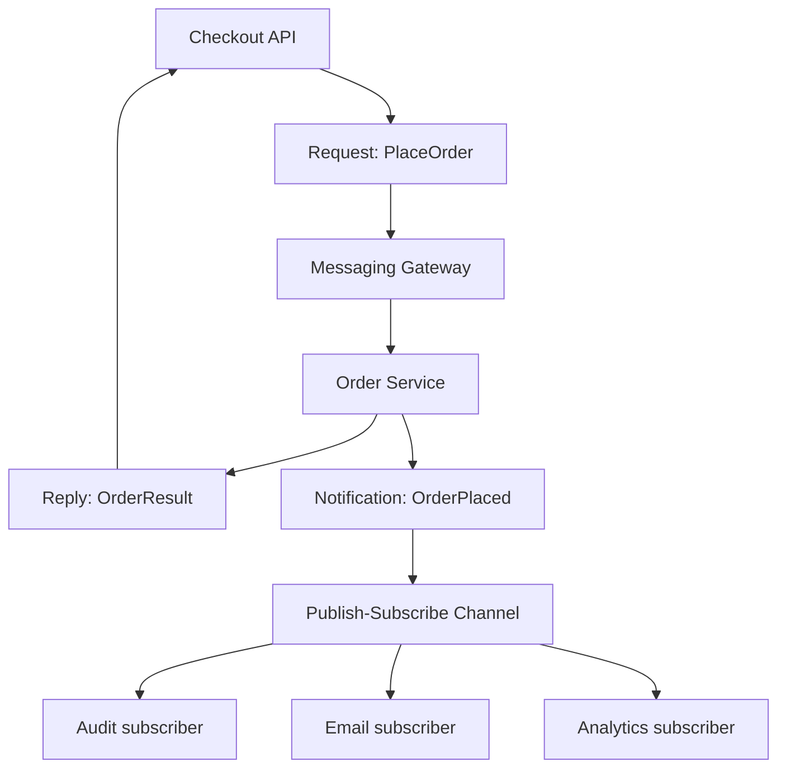

In the Request-Reply branch, the caller has a **request waiting for a result**. In the Event Notification branch, the producer announces **a business fact that already happened**; whether each subscriber succeeds or fails is a separate concern.

### The Core Question

> After sending a message, is the sender **entitled to expect a result dedicated to that invocation**, or is it merely **announcing an event** for other parties to react to independently?

The answer drives APIs, channel topology, retries, timeouts, correlation, failure handling, and testing strategy.

## 2. Learning Objectives

After this lesson, you can:

1. Explain Request-Reply and Event Notification in terms of interaction contracts.
2. Distinguish **business intent** from synchronous/asynchronous execution.
3. Distinguish command, query, event, and acknowledgement.
4. Know when to choose a Messaging Gateway versus publishing a notification.
5. Understand `requestChannel`, `replyChannel`, `errorChannel`, and subscriber channels.
6. Implement request-reply using Java DSL and `@MessagingGateway`.
7. Implement event notification fan-out using `PublishSubscribeChannel`.
8. Test that a Gateway returns `OrderResult` and an event reaches two subscribers.
9. Never confuse a `void` Service Activator return with a business reply.
10. Distinguish request ID, business correlation, event ID, causation, and trace ID.
11. Design appropriate timeouts, late replies, error channels, retries, and idempotency.
12. Know how to use outbox and eventual consistency for reliable notifications.
13. Handle Router/Filter/Splitter/Aggregator consistently with the contract.
14. Measure outcomes separately for request, publish, delivery, and business effect.

## 3. What Is Request-Reply?

**Request-Reply** is a communication model where one party sends a request and expects a **reply correlated with that request**.

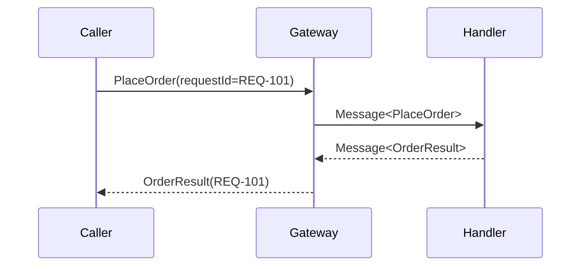

Defining elements:

- **Request:** command/query sent to a service responsible for handling it.
- **Reply:** outcome, decision, or error conforming to the request's contract.
- **Correlation:** knowing which request a reply belongs to.
- **Timeout/deadline:** callers cannot wait forever.
- **Failure policy:** knowing how to handle exceptions, missing replies, and unknown outcomes.
- **Cardinality:** for a standard request-reply API, one call awaits one logical final response; a service may exchange multiple internal messages yet must aggregate them into a contract-compliant response.

### Real-World Example

```java
OrderResult result = orderGateway.place(
    new PlaceOrder(
        "shop-01", "ORD-101", "REQ-101", 125_000L));
```

`result` belongs to **that exact invocation**. It may be `ACCEPTED`, `REJECTED`, or `COMPLETED` depending on the business contract.

**Never equate returning a reply with final commit:** an `ACCEPTED` result may only confirm the work was accepted. `COMPLETED` should only be used when the system truly has proof of the state promised by the contract.

## 4. What Is Event Notification?

**Event Notification** is a model that announces **an event that has already occurred** so subscribers can decide independently whether to react. The producer normally **does not expect each subscriber to return a business reply to the publish call**.

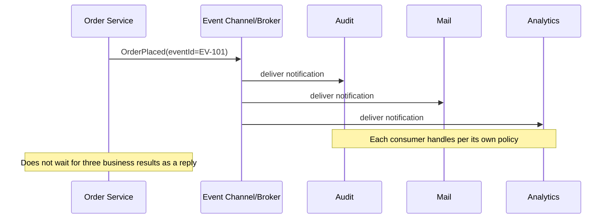

Characteristics:

- **Past-tense fact:** `OrderPlaced`, `PaymentCaptured`, `InventoryReserved`.
- **Publisher** does not need to know all subscribers.
- **Subscribers** can be added over time without changing the producer's contract.
- Producer does not automatically know when downstream effects finish.
- One subscriber failing does not make the original event "never happened."
- Reliability depends on transport, consumer ACKs, retries, idempotency, and dedicated persistence.

### Example

```java
eventChannel.send(MessageBuilder
    .withPayload(
        new OrderPlaced(
            "shop-01", "ORD-101", "EV-101",
            "REQ-101", Instant.now()))
    .build());
```

This snippet illustrates publishing; `send(...)` succeeding on a channel **does not mean** the email was sent, analytics updated, or audit committed. In production, timestamps need explicit semantics and event IDs must remain stable across retries.

## 5. Key Comparison Table

| Dimension | Request-Reply | Event Notification |
| --- | --- | --- |
| Intent | Ask a service to execute/answer | Announce a fact that already happened |
| Typical phrasing | "Please do...", "Tell me..." | "Something happened..." |
| Example | `PlaceOrder → OrderResult` | `OrderPlaced` |
| Receiver obligation | Produce result or failure per API | Process event per subscription contract |
| Sender expects business reply? | Yes | Usually no |
| Correlation | Request ↔ reply | Event ↔ workflow/causation/tracing |
| Producer timeout | Critical for reply | May only be publish/transport timeout |
| Subscriber count | One logical responder or aggregator | Typically one-to-many, though not mandatory |
| Strength | Caller gets an immediate decision | Loose coupling, extensible subscribers |
| Risk | Latency, timeouts, response coupling | Eventual consistency, replay/ordering |
| Consumer failure | Affects response if in request path | Can be handled independently per consumer |
| Retries | Requires operation idempotency | Requires per-event/consumer-action idempotency |
| Typical Spring flow | Gateway → request channel → handler → reply | Event channel/broker → subscribers |
| Primary tests | Reply matches request/type/deadline | Subscribers receive right event, dedup/recovery |

**Columns represent design defaults, not technology constraints.** Event notification may have only one subscriber. Request-reply may run asynchronously over a broker; the distinction lies in the **interaction contract**, not the channel name.

## 6. Do Not Confuse the Pattern with Synchronous/Asynchronous Execution

One of the biggest misconceptions: "Request-Reply is synchronous, Event Notification is asynchronous."

Not entirely true.

### Synchronous Request-Reply

Java caller waits for `gateway.place(...)` to return a result:

```text
Caller blocks -> request -> handler -> reply -> caller resumes
```

### Asynchronous Request-Reply

Caller submits a request and receives the response later via callback, future, reply topic, or polling; **it is still request-reply** because each response correlates to one request.

```text
Caller -> requestId=R1 -> Broker -> Worker
Caller continues other work
Worker -> reply(requestId=R1) -> Reply Channel
Caller correlates result R1
```

### Synchronous In-JVM Event Notification

A `PublishSubscribeChannel` configured without an executor can dispatch subscribers directly on the sending thread. The producer may block while subscribers run. **It is still event notification** because there is no business-reply contract for the event.

### Asynchronous Event Notification

Over an executor/broker, consumers process later with retries, DLQs, and eventual consistency.

| Semantics | Synchronous Dispatch | Asynchronous Dispatch |
| --- | --- | --- |
| Request-Reply | Gateway + DirectChannel | Request/reply queue/topic, correlation ID |
| Event Notification | PublishSubscribeChannel without executor | ExecutorPubSub / broker consumers |

**Axis 1:** Is a business reply required?  
**Axis 2:** On which thread and when does execution run?  

These are two independent decisions and must be tested separately.

## 7. Command, Query, Event, Reply, and ACK

Related concepts that are not interchangeable:

| Type | Meaning | Example |
| --- | --- | --- |
| **Command** | Request to change state | `PlaceOrder` |
| **Query** | Request for data | `GetOrderStatus` |
| **Event** | A state fact that occurred | `OrderPlaced` |
| **Reply** | Result of a command/query | `OrderResult` |
| **Transport ACK** | Transport-layer delivery/receipt confirmation | Broker ACK |
| **Business commit** | State/side effect durably recorded per contract | DB commit |

### Can a Command Be One-Way?

Yes. `RebuildSearchIndex` can be a queued one-way command, yet **that does not turn it into an event notification**. It still requests an action that has not happened yet, rather than announcing a past fact.

### Can an Event Lead to a Reply?

A consumer can emit a new event or status message, but that is **a separate interaction**. Do not attach per-subscriber business replies to event publishing unless you are intentionally designing a request-reply/aggregation protocol.

### Is an ACK an OrderResult?

No. A broker accepting a message knows only that it received/delivered it per protocol—not that Order Service validated and committed it. `send(...) == true` or a publisher confirm is **not** `OrderResult(COMPLETED)`.

## 8. Bad Example: Using Event Notification to Fake RPC

Suppose the client needs immediate order confirmation, yet the producer only publishes `OrderCreatedRequested` to a topic and hopes the email processor returns a result.

```text
HTTP Caller
   -> publish "OrderRequested"
   -> wait until someone somewhere emits "OrderResult"
```

Without a request/reply protocol, the design becomes ambiguous:

- Who is the authoritative responder?
- Where is the reply topic/destination?
- Which correlation ID links the response to the caller?
- How many replies might arrive?
- If one subscriber fails and another succeeds, what is the final response?
- How are timeouts and late replies handled?
- Will retrying the operation create two orders?

**If an API needs a result**, use Request-Reply or an explicit asynchronous operation protocol (such as returning `202 Accepted + operationId` and querying status later), never event-bus luck.

## 9. Opposite Bad Example: Using RPC for Every Notification

Order Service finishes writing an order, then synchronously calls:

```text
Order Service
  -> Audit RPC
  -> Email RPC
  -> Analytics RPC
  -> Fraud Metrics RPC
  -> finally return Checkout response
```

Consequences:

- Checkout latency depends on every downstream subscriber.
- An unavailable analytics service makes customers think placing an order failed.
- Adding a new subscriber requires modifying the producer.
- Coupling increases; availability drops.
- Retrying Checkout because email failed can create duplicate orders.

**When side effects are independent secondary reactions**, Event Notification/Outbox is usually a better fit. Keep inside the Request-Reply path only steps that genuinely must finish before a result may be declared.

## 10. When Should You Choose Request-Reply?

Prefer Request-Reply when the caller needs **an immediately actionable decision or result**:

- Validate a request and return accepted/rejected.
- Query current order status at call time.
- Calculate fees before confirming checkout.
- Check quota/eligibility before granting access.
- Reserve synchronously when SLAs are tight and proper transactions/recovery exist.
- Call a specialized service for canonical data needed by the next workflow step.
- Expose a Gateway boundary for HTTP/RPC APIs with explicit response contracts.

### Decision Questions

1. Does the caller need to know the outcome **before proceeding**?
2. Is there a reasonable deadline?
3. Can it return `PENDING` instead of blocking?
4. Does the action have side effects; on timeout, can it be retried safely?
5. Are the responder and reply routing clearly defined?
6. With multiple responders, who aggregates them into one logical result?

If these questions are unclear, do not merely name an interface `...Gateway` and assume the rest takes care of itself.

## 11. When Should You Choose Event Notification?

Prefer Event Notification once a business fact is established and **multiple parties may care without the producer waiting for their results**:

- `OrderPlaced` → send email, update reports, audit.
- `PaymentCaptured` → trigger fulfillment and ledger/reporting.
- `ShipmentDelivered` → update loyalty, customer care.
- `CustomerProfileChanged` → invalidate caches, update search index.
- `StockAdjusted` → update projections via eventual consistency.
- `DocumentApproved` → trigger indexing and notifications.

### Critical Conditions

- Events have stable IDs and business meaning.
- Consumers expect duplicates and out-of-order delivery.
- Producers have a clear publish reliability contract.
- Event schemas/versions and retention/replay are managed.
- Publishing an event is never confused with every subscriber finishing processing.
- If a subscriber is critical to the primary transaction, reconsider placing it on an asynchronous event path.

## 12. Common Hybrid Pattern: Reply First, Emit Event After Commit

A standard architecture:

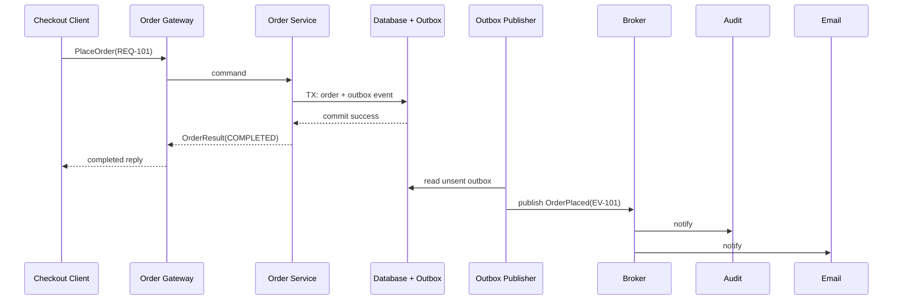

This design separates **business decision/completion** from **downstream reactions**:

- Caller gets a meaningful reply.
- Subscribers do not inflate Checkout latency.
- Outbox records share the order transaction, reducing the risk of committing without publishing.
- Publishers may retry, so consumers still need idempotency.
- Event Notification does not mean the email was sent.
- If the database/order transaction fails to commit, `OrderPlaced` must never be emitted as an occurred fact.

### Must You Always Return COMPLETED Before Publishing?

No. If a service only accepts a long workflow, it can return `ACCEPTED` with an operation ID and finish/fail later. In that case, emit the event only when the business fact truly happens; never emit `OrderPlaced` for a newly queued request whose order has not been created.

## 13. Starting the Java 17 Example: Immutable Command and Result

We build a demo in package `example.integration`. `PlaceOrder` is a **command**; `OrderResult` is a **reply**.

### `PlaceOrder.java`

```java
package example.integration;

public record PlaceOrder(
    String tenantId,
    String orderId,
    String requestId,
    long amountMinorUnits
) {
    public PlaceOrder {
        if (tenantId == null || tenantId.isBlank()
                || orderId == null || orderId.isBlank()
                || requestId == null || requestId.isBlank()) {
            throw new IllegalArgumentException(
                "PlaceOrder missing tenant/order/request ID");
        }
    }
}
```

### `OrderResult.java`

```java
package example.integration;

public record OrderResult(
    String requestId,
    String status,
    String reasonCode
) {
    public OrderResult {
        if (requestId == null || requestId.isBlank()
                || status == null || status.isBlank()) {
            throw new IllegalArgumentException(
                "OrderResult missing requestId/status");
        }
    }

    public static OrderResult accepted(String requestId) {
        return new OrderResult(requestId, "ACCEPTED", null);
    }

    public static OrderResult rejected(
            String requestId, String reasonCode) {
        return new OrderResult(
            requestId, "REJECTED", reasonCode);
    }
}
```

### Why Is the Reply ACCEPTED Instead of COMPLETED?

The demo only records an invocation and decides whether the input is acceptable. It is **not connected to a database yet**. Returning `COMPLETED` here could mislead readers into thinking the order was durably persisted, whereas tests do not prove that. In real projects:

- `ACCEPTED`: work accepted per contract.
- `REJECTED`: input/business rule rejected.
- `COMPLETED`: business state confirmed complete per predefined criteria.
- `PENDING/UNKNOWN_OUTCOME`: status lookup/reconciliation needed.

Some APIs throw exceptions for validation instead of returning a typed `REJECTED`; that is a contract choice and does not change the Request-Reply nature.

## 14. Domain Event for Event Notification

Once an order is genuinely created, the producer can emit:

### `OrderPlaced.java`

```java
package example.integration;

import java.time.Instant;

public record OrderPlaced(
    String tenantId,
    String orderId,
    String eventId,
    String causationRequestId,
    Instant occurredAt
) {
    public OrderPlaced {
        if (tenantId == null || tenantId.isBlank()
                || orderId == null || orderId.isBlank()
                || eventId == null || eventId.isBlank()
                || occurredAt == null) {
            throw new IllegalArgumentException(
                "OrderPlaced missing identity/time");
        }
    }
}
```

### Why Does an Event Have `eventId` Instead of Only `orderId`?

One order can produce multiple events:

```text
OrderPlaced(EV-1, orderId=ORD-101)
PaymentCaptured(EV-2, orderId=ORD-101)
OrderShipped(EV-3, orderId=ORD-101)
```

`orderId` identifies the entity; `eventId` identifies one logical event. Two events with the same order ID are not duplicates.

### What Is `causationRequestId`?

In the demo, this field links `OrderPlaced` to the command/request that triggered the event. Large systems often store `causationId` as the **parent event's event ID** instead of a request ID; document the contract clearly. It does not necessarily equal `businessCorrelationId` and does not replace an idempotency key.

### Must an Event Notification Carry Full Entity State?

No. Several styles exist:

- **Event Notification:** carries minimal IDs and metadata so subscribers learn a fact; consumers query more details if needed.
- **Event-Carried State Transfer:** carries data needed for consumers to build projections without querying the producer.
- **Event Sourcing event:** records domain changes as part of a strictly ordered history.

Here `OrderPlaced` carries a few IDs and a timestamp for illustration. Do not copy every sensitive order field onto the event bus unnecessarily.

## 15. Request Handler: Receiving Command and Returning Result

Create a mock service tracking invocation counts for testing:

### `DemoOrderService.java`

```java
package example.integration;

import java.util.concurrent.atomic.AtomicInteger;

public final class DemoOrderService {

    private final AtomicInteger calls = new AtomicInteger();

    public OrderResult place(PlaceOrder command) {
        calls.incrementAndGet();

        if (command.amountMinorUnits() < 0) {
            return OrderResult.rejected(
                command.requestId(), "INVALID_AMOUNT");
        }

        return OrderResult.accepted(
            command.requestId());
    }

    public int callCount() {
        return calls.get();
    }
}
```

### Why Not Publish the Event Inside This Method?

To teach both semantics cleanly, the demo separates the two operations:

1. Gateway call returns `OrderResult` for the request.
2. Event producer publishes `OrderPlaced` once the fact has occurred.

Automatically emitting `OrderPlaced` inside `place(...)` without a DB commit could mislead tests into assuming "ACCEPTED = OrderPlaced." In production, see the Outbox section for emitting facts accurately after transactions.

### Result Returned to a Specific Caller

Two calls with the same order ID but distinct request IDs:

```java
place(new PlaceOrder(
    "shop-01", "ORD-101", "REQ-A", 100L));

place(new PlaceOrder(
    "shop-01", "ORD-101", "REQ-B", 100L));
```

are expected to produce results correlated separately to `REQ-A` and `REQ-B`. Because the demo implements no idempotency, it cannot tell whether two calls represent the same logical operation.

## 16. Event Notification Subscribers: Two Independent Side Effects

One event can be received by two listeners:

- Projection subscriber records a read-model update.
- Audit subscriber records event info for reconciliation.

In the demo, a `ConcurrentLinkedQueue` makes asserting received message counts easy. It is not a durable database.

### `OrderProjectionSubscriber.java`

```java
package example.integration;

import java.util.List;
import java.util.concurrent.ConcurrentLinkedQueue;

public final class OrderProjectionSubscriber {

    private final ConcurrentLinkedQueue<OrderPlaced> observed =
        new ConcurrentLinkedQueue<>();

    public void onPlaced(OrderPlaced event) {
        observed.add(event);
    }

    public List<OrderPlaced> snapshot() {
        return List.copyOf(observed);
    }
}
```

### `OrderAuditSubscriber.java`

```java
package example.integration;

import java.util.List;
import java.util.concurrent.ConcurrentLinkedQueue;

public final class OrderAuditSubscriber {

    private final ConcurrentLinkedQueue<OrderPlaced> observed =
        new ConcurrentLinkedQueue<>();

    public void onPlaced(OrderPlaced event) {
        observed.add(event);
    }

    public List<OrderPlaced> snapshot() {
        return List.copyOf(observed);
    }
}
```

### Why Do Both Methods Return `void`?

Because these are handlers processing **one-way event notifications**. Their goal is not to build an `OrderResult` for the producer, but to perform their respective work.

That does not mean processing outcomes are ignored: in production, subscribers need dedicated logs, metrics, retries, ACKs, DLQs, and idempotency.

### What If a Subscriber Wants to Emit Another Event?

The Audit subscriber can emit `AuditRecorded` as **a brand-new event**, not as a default reply to the publisher of `OrderPlaced`. It needs its own event ID and causation/correlation metadata.

## 17. Messaging Gateway for Request-Reply

### `OrderCommandGateway.java`

```java
package example.integration;

import org.springframework.integration.annotation.MessagingGateway;

@MessagingGateway(
    name = "orderCommandGateway",
    defaultRequestChannel = "placeOrderRequests",
    defaultReplyTimeout = "2000")
public interface OrderCommandGateway {

    OrderResult place(PlaceOrder command);
}
```

### What the Gateway Does

- Caller invokes Java method `place`.
- Gateway creates a request message from the command.
- Gateway sends it to `placeOrderRequests`.
- Reply-producing handler returns `OrderResult`.
- Gateway maps the reply back to the Java return value for the exact caller.

### What the Gateway Does Not Do Automatically

- Does not create an order in a database.
- Does not emit an `OrderPlaced` event.
- Does not guarantee each request is processed only once.
- Cannot confirm a business commit via the reply channel alone.
- Does not return errors from a remote broker worker to the right caller without a reply/correlation protocol.

### What Does Timeout Mean?

`defaultReplyTimeout` limits reply waiting inside the contract/framework. When a handler emits no reply, the caller may observe a timeout, null/exception/no-result depending on method signature and configuration. Never infer from a timeout that the business effect did not happen.

## 18. Java DSL: One Request-Reply Flow and Two Event Notification Subscribers

### `InteractionStyleConfiguration.java`

```java
package example.integration;

import org.springframework.context.annotation.Bean;
import org.springframework.context.annotation.Configuration;
import org.springframework.integration.annotation.IntegrationComponentScan;
import org.springframework.integration.channel.DirectChannel;
import org.springframework.integration.channel.PublishSubscribeChannel;
import org.springframework.integration.config.EnableIntegration;
import org.springframework.integration.dsl.IntegrationFlow;
import org.springframework.messaging.MessageChannel;

@Configuration
@EnableIntegration
@IntegrationComponentScan(
    basePackageClasses = OrderCommandGateway.class)
public class InteractionStyleConfiguration {

    @Bean
    public MessageChannel placeOrderRequests() {
        return new DirectChannel();
    }

    @Bean
    public MessageChannel orderNotifications() {
        return new PublishSubscribeChannel();
    }

    @Bean
    public DemoOrderService demoOrderService() {
        return new DemoOrderService();
    }

    @Bean
    public OrderProjectionSubscriber orderProjection() {
        return new OrderProjectionSubscriber();
    }

    @Bean
    public OrderAuditSubscriber orderAudit() {
        return new OrderAuditSubscriber();
    }

    @Bean
    public IntegrationFlow placeOrderFlow(
            DemoOrderService service) {

        return IntegrationFlow.from("placeOrderRequests")
            .handle(service, "place")
            .get();
    }

    @Bean
    public IntegrationFlow projectionNotificationFlow(
            OrderProjectionSubscriber projection) {

        return IntegrationFlow.from("orderNotifications")
            .handle(projection, "onPlaced")
            .get();
    }

    @Bean
    public IntegrationFlow auditNotificationFlow(
            OrderAuditSubscriber audit) {

        return IntegrationFlow.from("orderNotifications")
            .handle(audit, "onPlaced")
            .get();
    }
}
```

### Reading the Configuration by Contract

`placeOrderRequests` is a `DirectChannel`. A Gateway calls the service, the service **returns `OrderResult`**, and the framework uses the request's `replyChannel` to return the result.

`orderNotifications` is a `PublishSubscribeChannel`. Two `IntegrationFlow`s subscribe to this channel and invoke two `void` handlers. The channel proactively fans out **one event to all subscribers**.

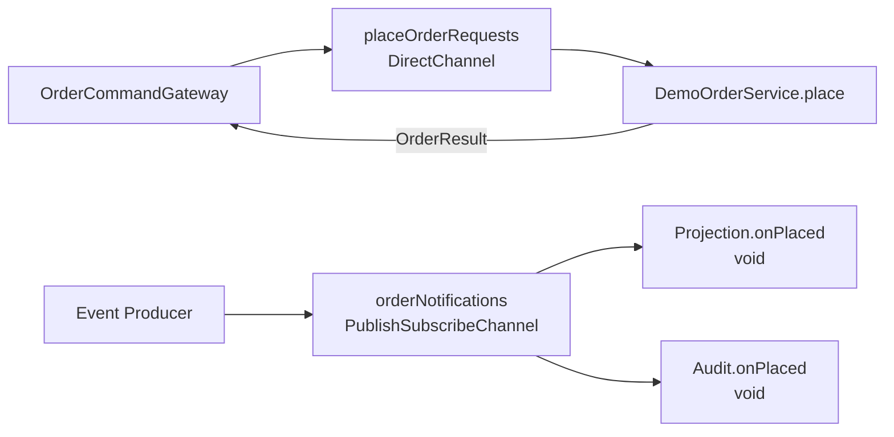

**There is no automatic edge from `DemoOrderService.place` to `orderNotifications` in this configuration.** That is intentional: tests publish a separate domain event to illustrate semantics; production should use transactions/outboxes rather than ad-hoc post-response event firing.

### Why Omit Output Channels on Event Handlers?

Because both return `void`. In this Event Notification model, they are terminal subscribers with no business reply back to the publisher.

### Note on Framework APIs

The example uses standard Spring Integration Java DSL and `@MessagingGateway`. Method resolution, annotation scanning, timeouts, and tests must be verified against actual library versions. The STEP 4 NEW lesson generated this content without running compile/integration QA.

## 19. Testing Request-Reply: Gateway Returns Result Matching the Request

### `InteractionStyleTest.java`

```java
package example.integration;

import static org.junit.jupiter.api.Assertions.*;

import java.time.Instant;

import org.junit.jupiter.api.Test;
import org.springframework.beans.factory.annotation.Autowired;
import org.springframework.beans.factory.annotation.Qualifier;
import org.springframework.messaging.MessageChannel;
import org.springframework.messaging.support.MessageBuilder;
import org.springframework.test.annotation.DirtiesContext;
import org.springframework.test.context.junit.jupiter.SpringJUnitConfig;

@SpringJUnitConfig(InteractionStyleConfiguration.class)
@DirtiesContext(
    classMode = DirtiesContext.ClassMode.AFTER_EACH_TEST_METHOD)
class InteractionStyleTest {

    @Autowired
    private OrderCommandGateway gateway;

    @Autowired
    private DemoOrderService service;

    @Autowired
    @Qualifier("orderNotifications")
    private MessageChannel notifications;

    @Autowired
    private OrderProjectionSubscriber projection;

    @Autowired
    private OrderAuditSubscriber audit;

    @Test
    void requestReplyReturnsResultToCaller() {
        PlaceOrder request = new PlaceOrder(
            "shop-01", "ORD-101", "REQ-101", 125_000L);

        OrderResult result = gateway.place(request);

        assertNotNull(result);
        assertEquals("REQ-101", result.requestId());
        assertEquals("ACCEPTED", result.status());
        assertNull(result.reasonCode());
        assertEquals(1, service.callCount());

        // Demo does NOT auto-publish events when receiving a command.
        assertTrue(projection.snapshot().isEmpty());
        assertTrue(audit.snapshot().isEmpty());
    }
}
```

### What Does the Test Verify?

- Request with `requestId=REQ-101` is processed by one handler.
- Handler creates an `OrderResult` reply with the same logical request ID.
- Gateway returns the value to the Java caller.
- No event notification is accidentally emitted merely because the API returned a reply.
- Callbacks/notifications do not need to participate for the Gateway to receive a result.

### What the Test Does Not Prove

- An order was actually written to a DB.
- Gateway reply equals transaction commit.
- The system retries properly when responses are lost.
- A Kafka/RabbitMQ event was published.
- Exactly-once side effects across multiple pods.

## 20. Testing That Domain Rejections Still Return a Reply

Add this method to `InteractionStyleTest`:

```java
@Test
void rejectedCommandStillHasTypedReply() {
    OrderResult result = gateway.place(
        new PlaceOrder(
            "shop-01", "ORD-102", "REQ-102", -10L));

    assertNotNull(result);
    assertEquals("REQ-102", result.requestId());
    assertEquals("REJECTED", result.status());
    assertEquals("INVALID_AMOUNT", result.reasonCode());
    assertEquals(1, service.callCount());

    // REJECTED is not an OrderPlaced fact.
    assertEquals(0, projection.snapshot().size());
    assertEquals(0, audit.snapshot().size());
}
```

### Distinguishing Rejection from Exception

In this example, `REJECTED` is a **normal reply** under the API contract, needing no error channel. If the service throws a technical exception, the caller may receive an error or a fallback result from an error flow per Gateway configuration.

Never publish `OrderPlaced` when input is rejected: that asserts a business fact that never happened.

## 21. Testing Event Notification: One Event Reaching Two Subscribers

Add to `InteractionStyleTest`:

```java
@Test
void oneNotificationIsDeliveredToTwoSubscribers() {
    OrderPlaced event = new OrderPlaced(
        "shop-01", "ORD-101", "EV-101",
        "REQ-101", Instant.parse("2026-11-21T08:30:00Z"));

    boolean dispatched = notifications.send(
        MessageBuilder.withPayload(event)
            .setHeader("sourceEventId", event.eventId())
            .setHeader(
                "businessCorrelationId",
                "order:shop-01:ORD-101")
            .build());

    assertTrue(dispatched);

    // PublishSubscribeChannel has no executor in this demo:
    // both handlers execute in the synchronous flow.
    assertEquals(
        java.util.List.of(event), projection.snapshot());
    assertEquals(
        java.util.List.of(event), audit.snapshot());

    // Gateway was never invoked in this test.
    assertEquals(0, service.callCount());
}
```

### What Do the Results Show?

- One `OrderPlaced` message is sent to the event channel.
- Two independent subscribers receive the exact same event value.
- No corresponding `OrderCommandGateway.place` call occurred.
- `send(...)` indicates channel dispatch per configured semantics; it is **not an `OrderResult`**.
- In this synchronous test, listener methods have already run when `send` returns. With executors/brokers, different synchronization is required and immediate assertions will not hold.

### Event Notification Does Not Require Multiple Subscribers to Be Valid

Even with only the Audit subscriber, `OrderPlaced` is still a notification. Subscriber count is a topology detail; it does not decide whether the producer expects a **business reply**.

## 22. Testing Multiple Events: Logical Identity and Subscriber State

```java
@Test
void independentEventsKeepDistinctEventIds() {
    OrderPlaced first = new OrderPlaced(
        "shop-01", "ORD-101", "EV-101", "REQ-101",
        Instant.parse("2026-11-21T08:30:00Z"));

    OrderPlaced second = new OrderPlaced(
        "shop-01", "ORD-101", "EV-102", "REQ-101",
        Instant.parse("2026-11-21T08:30:01Z"));

    assertTrue(notifications.send(
        MessageBuilder.withPayload(first).build()));

    assertTrue(notifications.send(
        MessageBuilder.withPayload(second).build()));

    assertEquals(
        java.util.List.of(first, second),
        projection.snapshot());

    assertEquals(
        java.util.List.of(first, second),
        audit.snapshot());
}
```

### Why Are Two Events with the Same Order ID Not Automatically Duplicates?

`orderId` represents the entity, whereas `eventId` represents one logical event. Two distinct event IDs can represent two distinct facts—in the example both use `OrderPlaced` to illustrate identity, though in real domains check whether **emitting two `OrderPlaced` facts for the same order is allowed**. If not, business invariants/unique constraints must prevent it.

### Is Ordering Guaranteed in Tests?

The demo sends sequentially over a synchronous `PublishSubscribeChannel`, so fixtures observe send order. Across executors or multiple Kafka partitions, global ordering is not guaranteed automatically. Never treat local test ordering as a cross-service promise.

## 23. `void` Service Activator and Event Notification

In the demo configuration:

```java
public void onPlaced(OrderPlaced event) {
    observed.add(event);
}
```

each subscriber is a `void` Service Activator. It can execute side effects without producing a normal reply:

```text
orderNotifications
  -> Projection.onPlaced(event): void
  -> Audit.onPlaced(event): void
```

A common design mistake is wiring:

```text
Event Channel -> void handler -> next reply stage
```

and expecting the original event to continue onward as the handler's result. A `void` method has no reply payload. When multiple consumers are needed, use a Publish-Subscribe Channel, Recipient List, or Wire Tap instead of relying on a nonexistent return value.

### When a Subscriber Emits a New Event

A handler can emit `ProjectionUpdated` after committing a projection; that is **another event** with its own `eventId`/`causationId`. Do not place it onto the `OrderPlaced` producer's `replyChannel` unless a true request/reply protocol exists.

## 24. When Request-Reply Has Multiple Downstream Workers

A request may need data from multiple sources before returning one result:

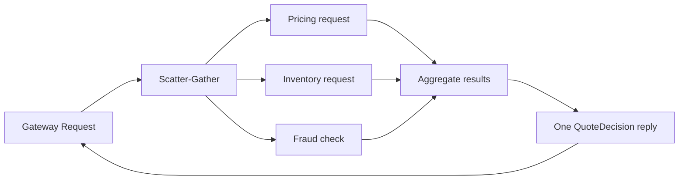

**This is still Request-Reply**: the Gateway waits for **one logical final result**. Internally, multiple branches and partial replies exist; correlation, release strategy, and timeouts determine when the final result is built.

### Distinguishing from Event Notification Fan-Out

```text
Request-Reply fan-out:
  Request -> N worker contributions
          -> Aggregator -> 1 business reply

Event Notification fan-out:
  Event -> N independent subscribers
        -> no Aggregator required to return a result
```

Topologies look similar, yet **completion contracts** differ. Having three subscribers does not mean you must build an Aggregator.

## 25. The Flip Side: Does Event Notification Need ACKs?

Transport-level acknowledgements may still be required. For example:

- Kafka producer receives broker acknowledgement.
- RabbitMQ publisher receives publisher confirm.
- Consumer ACKs/nacks the message after processing.
- HTTP webhook receives 2xx/4xx/5xx after a delivery attempt.

These ACKs confirm **a protocol-level transmit/receive/process step**, not a business reply to the Order Gateway.

```text
Publisher -> Broker
  broker ACK
  != Email sent
  != Audit committed
  != Analytics projection updated
```

### What If an HTTP Webhook Consumer Returns 200?

It usually signals the notification was received/processed per the webhook contract. The producer should not treat it as an `OrderResult(REQ-101)` equivalent for the `PlaceOrder` command.

### What If a Notification Requires Every Subscriber to Confirm?

When business rules genuinely require **N confirmations before continuing**, you are building a **completion/aggregation protocol** atop the event bus. Recognize it explicitly (correlation, quorum, deadlines, failures) rather than pretending it is pure fire-and-forget notification.

## 26. Correlation: Request ID, Event ID, Business ID, and Causation

Both patterns need identities, yet **not the same kind of identity**.

| Concept | Request-Reply | Event Notification |
| --- | --- | --- |
| `requestId` | Matches reply to request | May record cause, not event ID |
| `eventId` | May not apply to a query | Identifies logical event for dedup/replay |
| `businessCorrelationId` | Links requests across a workflow | Links events across a workflow |
| `causationId` | Command/parent triggering next step | Event/command that caused this event |
| `MessageHeaders.id` | Runtime Spring Message instance | Runtime Spring Message instance |
| `replyChannel` | Destination returning to caller | Usually no business reply |
| `errorChannel` | Error branch in request/reply flow | Publisher/subscriber error branch per boundary |
| `traceId`/`traceparent` | Observability | Observability |

### Example of an Order Moving from Request to Events

```text
PlaceOrder request:
  requestId = REQ-101
  businessCorrelationId = order:shop-01:ORD-101

Reply:
  requestId = REQ-101
  status = COMPLETED

OrderPlaced notification:
  eventId = EV-201
  causationRequestId = REQ-101
  businessCorrelationId = order:shop-01:ORD-101

EmailScheduled notification:
  eventId = EV-202
  causationId = EV-201
  businessCorrelationId = order:shop-01:ORD-101
```

Never use `EV-201` as the reply ID of `REQ-101` or `ORD-101` as the event ID for every notification. One entity has many lifecycle events, and one workflow can span multiple commands and requests.

### Aggregator Correlation ID Is a Special Case

A Splitter may generate `correlationId=group-G` and `sequenceNumber=1..N` for an Aggregator to group messages. That is an EIP endpoint's group identity; it does not automatically equal `businessCorrelationId`.

**Rule:** keep each ID's namespace, scope, and owner distinct; never overwrite a technical header simply because names look similar.

## 27. Reply Channels and Event Channels Have Different Lifecycles

A synchronous Gateway can attach a per-invocation temporary reply channel:

```text
Request A -> replyChannelA
Request B -> replyChannelB
```

The reply channel must exist and receive the reply **within the deadline**. Past timeout, temporary channel/request state may no longer be valid.

Event notification is different:

```text
OrderPlaced(EV-201) -> orderNotifications topic
  -> Audit consumer group
  -> Email consumer group
  -> Analytics consumer group
```

There is no per-subscriber temporary `replyChannel` by default. Subscriptions have **independent lifecycles**, can outlive producer restarts, and can replay per broker retention.

### When a Gateway Response Gets Sent to an Event Channel

If a handler accidentally sets `outputChannel="orderNotifications"`, an `OrderResult` may be published as an event. Consequences:

- Caller never receives its reply and times out.
- Subscribers receive an incompatible payload type.
- One caller's private response broadcasts to a wider audience.
- Potential leakage of business data/PII.

**Never share one channel named "results" for both replies and notifications without explicit message types and routing contracts.**

### When an Event Gets Sent to a Reply Channel

Conversely, sending `OrderPlaced` to a Gateway reply destination can trigger type-conversion failures when the Gateway method declares `OrderResult`. Response types and event types must be separated by design.

## 28. Error Semantics of Request-Reply

A Request-Reply caller expects a response or failure within a deadline. Possible outcomes include:

```text
PlaceOrder(REQ-101)
  -> ACCEPTED
  -> REJECTED(INVALID_AMOUNT)
  -> COMPLETED
  -> PENDING_RECONCILIATION
  -> timeout
  -> technical exception
```

### Failure Categories

| Scenario | Appropriate Response |
| --- | --- |
| Input invalid per business rule | Typed `REJECTED` or validation exception |
| Missing required reply | Reply-required error/timeout |
| Handler throws before side effect | Technical exception; retryable per policy |
| DB committed, reply lost | Unknown caller outcome; needs idempotency/status lookup |
| Reply wrong type | Conversion failure; fix contract |
| Reply for another request | Correlation bug; fail/fix routing |
| Gateway reply timeout | Deadline exceeded; does not roll back automatically |
| Request channel saturated | Send timeout/backpressure |
| Remote worker crash | Timeout/async reply protocol/reconciliation |

### Gateway Error Channel

`@MessagingGateway(errorChannel="...")` can orchestrate errors within Gateway scope. An error flow receives `ErrorMessage` and **returns a typed result** if callers expect a business response, or propagates/records a terminal failure per contract.

However:

- A Filter dropping without throwing does not automatically emit an `ErrorMessage`.
- A `void` method emits no reply.
- Errors inside a worker on another process do not automatically return to the Java caller.
- A logger-only error flow does not produce an `OrderResult`.
- Not all error channels share the same scope; distinguish Gateway, adapter, and async endpoints.

Event Notification manages errors differently, as shown next.

## 29. Error Semantics of Event Notification

Notification subscribers process events per their subscription contract:

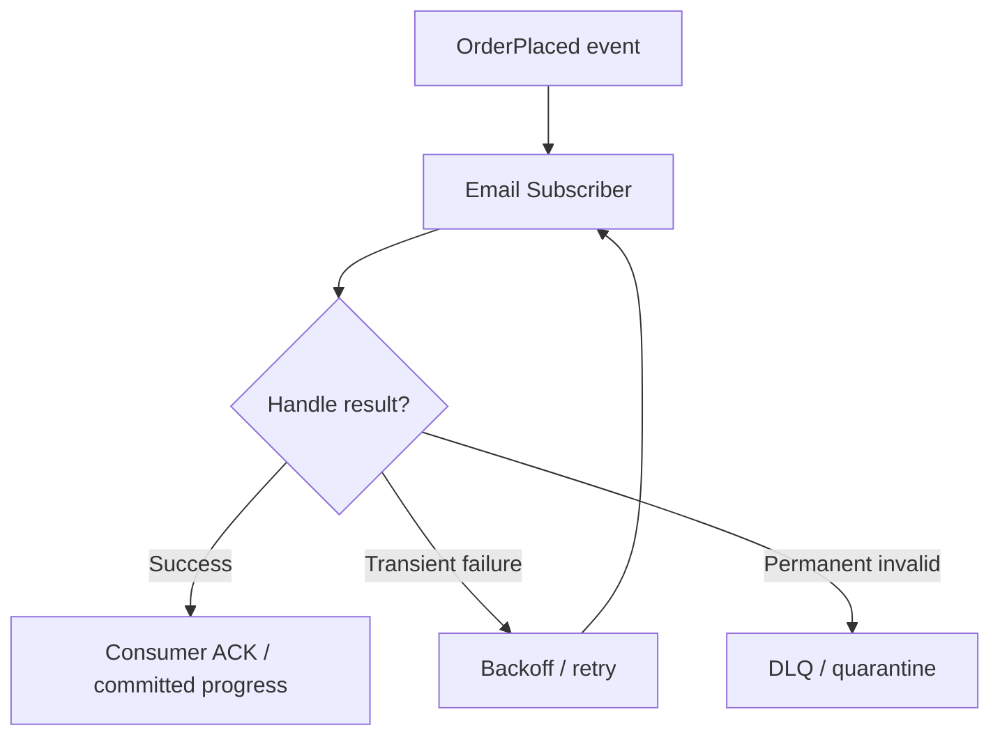

When the Email subscriber fails:

- `OrderPlaced` **is still a fact that occurred**.
- The Audit subscriber may already have finished processing.
- The producer should never "re-create the order" merely because email failed.
- Retries on the Email consumer focus on **sending the email**, not repeating Order Service's business transaction.
- DLQs/alerts must define ownership and replay policies.
- Email's idempotency key may be `eventId + notificationTemplate + recipient`, not just `orderId`.

### Note on Synchronous `PublishSubscribeChannel`

With an in-JVM `PublishSubscribeChannel` without an executor, a subscriber throwing an exception can propagate to the `send(...)` thread and affect dispatch to other subscribers depending on configuration/error handling. This **does not turn event notification into Request-Reply**; it shows dispatch mechanics can be synchronous and do not automatically isolate failures.

For stronger subscriber failure isolation, consider separate queues/consumer groups or isolated flows, controlled executors/error channels, and appropriate reliability guarantees.

## 30. Comparing Timeouts: Reply Deadline vs. Retry/Delivery Delay

| Concept | Request-Reply | Event Notification |
| --- | --- | --- |
| **Request send timeout** | May fail to enter request channel | May fail to publish to broker/channel |
| **Reply timeout** | Caller awaits one final reply | Typically absent |
| **Consumer processing timeout** | Affects responsiveness if on reply path | Consumer retries/fails independently |
| **Late reply** | Reply arrives past caller deadline | Not a default reply concept |
| **Retention/replay window** | Can support async results/idempotency | Crucial for broker/event replay |
| **SLA** | API/operation deadline | Event processing delay and subscription lag |

### Example: Gateway Times Out While Event Still Emits

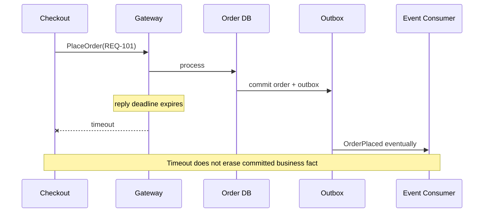

If the caller retries the same logical operation, the database/business layer needs idempotency. Never infer from a timeout that **the order was not created**.

### Event Notification Has No Implicit "Processed Everywhere" Guarantee

A producer publishes successfully while one subscriber has a 20-minute backlog. If business rules require every subscriber to finish before a deadline, add **completion tracking/job orchestration** or classify it as a different workflow instead of relying solely on publisher confirms.

## 31. Retry Policies Cannot Be Shared Blindly

### Request-Reply Retries

Callers may retry due to timeouts. Yet if an operation has side effects, the same request may already have committed. Require:

- An idempotency key stable across retries.
- Stored result/operation status.
- Unique constraint or transaction guard.
- Distinction between **known-not-committed** and **unknown outcome**.
- Bounded retries/backoff/circuit breakers.

### Event Notification Retries

A subscriber can retry **event handling**:

- The same event ID is redelivered.
- Subscriber's own operation needs its own idempotency.
- Retry counts do not return to the publisher as a business reply.
- One subscriber failing does not mean other subscribers must rerun.
- Maintain separate retry budgets and DLQs per consumer group.

### Key Comparison Table

| Side Effect | Illustrative Idempotency Key |
| --- | --- |
| Create order from command | `tenantId + stableCommandId + PLACE_ORDER` |
| Send `OrderPlaced` email | `eventId + recipient + emailTemplate` |
| Update projection | `projectionName + eventId` |
| Write audit from event | `consumerName + eventId + auditAction` |
| External payment | Provider idempotency token per payment operation |

**Never use `MessageHeaders.id` as a business idempotency key**, as a redelivered message instance can carry a new ID.

## 32. Event Notification and the Transactional Outbox

This is one of the most important operational distinctions. If Order Service commits an order and crashes before publishing `OrderPlaced`, subscribers never learn that fact.

### Failure Pattern with Direct Publishing

```text
BEGIN DB TX
  create order
COMMIT
process crashes
publish OrderPlaced never happens
```

### Outbox

```text
BEGIN DB TX
  create order
  insert outbox_event(eventId=EV-201)
COMMIT

Outbox publisher:
  read unprocessed event
  publish OrderPlaced(EV-201)
  mark published / retry as needed
```

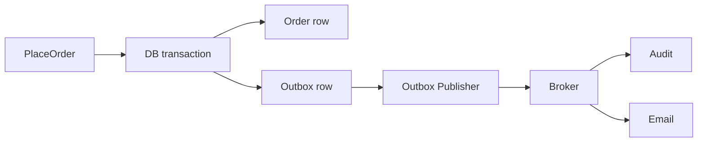

### Outbox Does Not Guarantee Exactly-Once Delivery

The publisher can:

1. Publish successfully.
2. Crash before marking the outbox row published.
3. Publish again after restarting.

Consumers must handle duplicate logical event IDs. Outbox ensures **publish intent is never lost after commit**, not that duplicates never occur.

### Why Not Emit `OrderPlaced` from the API Layer After Receiving `ACCEPTED`?

Because `ACCEPTED` does not necessarily mean the order was created. Only the producer owning the business transaction should assert the `OrderPlaced` fact; never let callers guess and emit events on the backend's behalf.

## 33. Event Schemas and Event Ownership

Event Notification still introduces coupling via the **event contract**, even though it reduces direct coupling between producer and subscribers.

### What an Event Schema Needs

- Stable `eventId`.
- Specific, meaningful `eventType`.
- `eventSchemaVersion` or registry ID.
- Trusted `tenantId`.
- `occurredAt` with explicit timezone/UTC.
- `producer/sourceSystem`.
- `businessCorrelationId` and `causationId` when needed.
- Minimal payload or versioned event-carried state.
- Retention/replay expectations.
- Compatibility with older consumers.

### Minimal Envelope Example

```json
{
  "eventId": "EV-201",
  "eventType": "order.placed",
  "eventSchemaVersion": 1,
  "tenantId": "shop-01",
  "businessCorrelationId": "order:shop-01:ORD-101",
  "causationId": "REQ-101",
  "occurredAt": "2026-11-21T08:30:00Z",
  "payload": {
    "orderId": "ORD-101"
  }
}
```

Such an event envelope can be constructed with an **Envelope Wrapper** before publishing; not all metadata must live in internal Spring headers. Across Kafka/HTTP, ensure proper schemas/serializers and allowlisted header mapping.

### When Changing Versions

- Producers must not alter event type semantics while keeping the same schema version.
- Consumers must never deserialize class names from untrusted payloads.
- Maintain contract tests across languages.
- Before retiring an old version, check DLQ/replay data still within the retention window.
- Adding a required field can be a breaking change.

## 34. Event Notification Is Not Event Sourcing

This is another common confusion:

**Event Notification:** emit a notification so others react. It may be stored in a broker and replayed, yet is not necessarily the source of truth for full state.

**Event Sourcing:** domain state is derived from a strictly ordered sequence of events with strict semantics; the event store is the authoritative data source.

```text
Notification model:
  Order DB is source of truth
  -> OrderPlaced event informs others

Event sourcing model:
  Event stream may be source of truth
  -> projections derive state
```

Never assume "using `PublishSubscribeChannel` means doing Event Sourcing." The two models have distinct storage, versioning, replay, ordering, and consistency requirements.

## 35. Event Notification and Eventual Consistency

When Order Service commits and publishes an event:

```text
Order DB:
  ORD-101 = CREATED

Analytics projection:
  ORD-101 = not yet visible

Event consumer catches up:
  ORD-101 = CREATED
```

This lag is an acceptable consequence of eventual consistency when business/API contracts permit it.

### When Callers Need "Read-Your-Writes"

An API that places an order and immediately queries status may want instant visibility. Options include:

- Returning authoritative data from Order Service inside the Request-Reply response.
- Querying the authoritative store directly.
- Tracking versions/offsets/watermarks so projection consumers report catch-up progress.
- Returning `PENDING` if projections have not caught up yet.
- Never assuming every event consumer updated instantaneously when the producer published.

### When a Downstream Effect Is Mandatory Before Returning Checkout Success

For instance, inventory reservation is required to confirm an order. Put it inside the **request-processing decision** or an orchestrated workflow with an explicit outcome. Never turn it into a "fire-and-forget notification" while reporting `COMPLETED` before the business invariant is protected.

## 36. Ordering: Reply Correlation Differs from Event Ordering

### Request-Reply

Two requests may complete out of send order:

```text
Send R1, R2
Reply R2 first, R1 later
```

Accurate correlation suffices: R2 must never return to R1's caller.

### Event Notification

A subscriber might expect:

```text
OrderPlaced EV-1
OrderPaid EV-2
OrderCancelled EV-3
```

Yet if events cross multiple partitions, retries, fan-out, and async workers, global order is not guaranteed.

### Designing Per Entity

To process an entity in order:

- Use a partition key on `tenantId:orderId` when supported by transport.
- Emit monotonic versions/sequences from the authoritative source.
- Enforce optimistic concurrency / expected versions in projections.
- Handle duplicates and out-of-order arrivals.
- When using a Resequencer, define group, release, timeout, and late-message policies.
- Never use low-resolution `occurredAt` timestamps as a total-order ID.

### Should You Wait for All Events to Return to the Gateway?

Only when the Gateway genuinely requires those results for **one logical decision**. Waiting on analytics/email just to report "all delivered" turns independent notification consumers into critical-path dependencies and requires declaring a new completion contract.

## 37. Router and Filter in Both Patterns

Both Request-Reply and Event Notification can use Routers/Filters, yet **the meaning of discard/failure differs**.

### Request-Reply

```text
Gateway -> Filter -> drop
                  -> no reply
                  -> caller timeout (if no reply branch)
```

If input is rejected, return `OrderResult(REJECTED)` or a structured error—never silently drop and leave callers timing out.

A Router finding no route may throw or discard depending on config; for request-reply, define a fallback/rejection result.

### Event Notification

```text
OrderPlaced -> Filter(only VND orders)
  -> non-VND events discarded from this subscriber's branch
```

A Filter dropping events because a subscriber **is not interested** can be completely normal. No business reply back to the producer is needed. However, invalid schemas/tenants or poison events should be classified/quarantined rather than confused with "subscriber not interested."

### Table

| Scenario | Request-Reply | Event Notification |
| --- | --- | --- |
| Filter excludes message | Needs response/failure policy | Can be a valid skip |
| Router has no route | May need to notify caller | Can ignore per subscription contract |
| Handler throws | Affects caller/error path | Consumer retry/DLQ |
| Handler returns `void` | Unsuitable if caller awaits reply | Suitable for terminal consumers |
| Backpressure | Caller latency/timeouts | Lag/retry backlog |

## 38. Splitter/Aggregator: One Request with Many Parts vs. Many Event Subscribers

### Request-Reply Batch

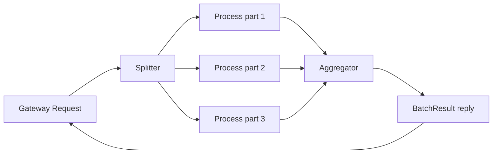

The Gateway needs one final `BatchResult`. Hence the Aggregator must have:

- Group key/correlation.
- Expected contributors or release strategy.
- Timeout/partial/fail-fast policy.
- Duplicate/missing-part handling.
- Reply context to route the result back to the caller.

If a part is dropped by a Filter or handled by a `void` handler emitting no output, the Aggregator can wait forever.

### Event Notification Fan-Out

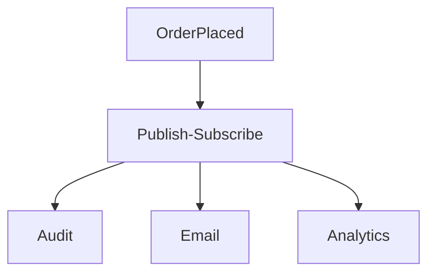

No Aggregator is needed if the producer has **no obligation to wait** for Audit+Email+Analytics to return results.

### When Notification Completion Becomes a Business Requirement

If you must know "both email and audit succeeded before continuing," build a workflow completion tracker or an Aggregator consuming **outcome events** with dedicated correlation and deadlines. That is a new design, not a default property of publish-subscribe.

## 39. Gateway and Errors Across Async Boundaries

A `@MessagingGateway` dispatching through an `ExecutorChannel` or broker may already have left the original thread when a worker fails.

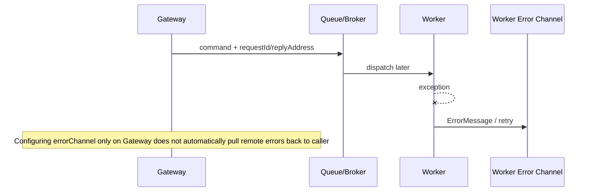

### What Does Request-Reply Over a Broker Require?

- Portable request ID, unique within proper scope.
- Allowlisted reply destination/topic/queue.
- Correlation preserved across serializers/header mappers.
- Deadlines/timeouts and late-reply policies.
- Error response envelope with an explicit result type.
- Retry/idempotency/unknown-outcome handling.
- Never serialize a Java `MessageHeaders.REPLY_CHANNEL` object into JSON.

### Notifications Carry No Reply Destination by Default

An `OrderPlaced` event is published to a topic for subscribers to consume. There is no reason to force replies back to the producer; failures are handled by each consumer group's own error stream.

## 40. When to Use `202 Accepted + operationId`?

If a command takes several minutes, holding a synchronous Gateway waiting for completion is fragile:

```text
POST /jobs
  -> 202 Accepted
  -> operationId=OP-101

GET /jobs/OP-101
  -> PENDING / COMPLETED / FAILED
```

Two interactions occur here:

1. **Short Request-Reply:** accept the job/command and return acceptance.
2. **Asynchronous processing:** background worker executes; may publish a `JobCompleted` event notification.

### Model

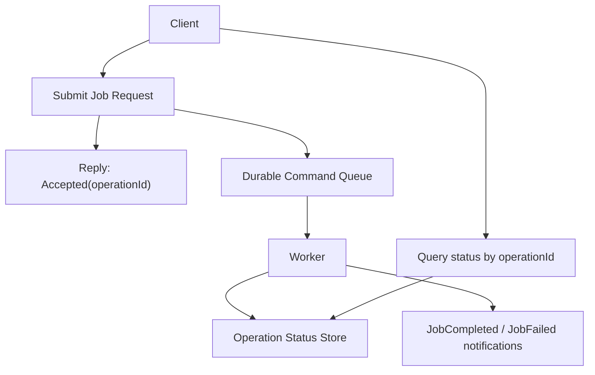

### Why Not Call a Command an Event?

`JobRequested` may look like an event name, yet if it means "please run this job," semantically it is a **command**. The subsequent fact is `JobCompleted`/`JobFailed`.

Names should tell consumers **what happened** and **what receivers must do**, rather than disguising a long request as a notification to dodge designing reply/status handling.

## 41. JUnit: Concurrent Request-Reply Calls Must Return to the Right Caller

A single Gateway proxy can be shared across threads. Never store `currentRequestId` in a mutable static field, or request A's reply could be handed to request B.

Add this test to `InteractionStyleTest`:

```java
@Test
void concurrentGatewayCallsKeepTheirOwnRequestIds()
        throws Exception {

    var requests = java.util.List.of(
        new PlaceOrder(
            "shop-01", "ORD-A", "REQ-A", 100L),
        new PlaceOrder(
            "shop-02", "ORD-B", "REQ-B", 200L),
        new PlaceOrder(
            "shop-03", "ORD-C", "REQ-C", 300L)
    );

    var pool = java.util.concurrent.Executors
        .newFixedThreadPool(requests.size());

    var ready = new java.util.concurrent.CountDownLatch(
        requests.size());

    var start = new java.util.concurrent.CountDownLatch(1);

    var futures = new java.util.ArrayList<
        java.util.concurrent.Future<OrderResult>>();

    try {
        for (PlaceOrder command : requests) {
            futures.add(pool.submit(() -> {
                ready.countDown();

                if (!start.await(
                        5,
                        java.util.concurrent.TimeUnit.SECONDS)) {
                    throw new IllegalStateException(
                        "Concurrent start timeout");
                }

                return gateway.place(command);
            }));
        }

        assertTrue(ready.await(
            5, java.util.concurrent.TimeUnit.SECONDS));

        start.countDown();

        var byRequest = new java.util.HashMap<
            String, OrderResult>();

        for (var future : futures) {
            OrderResult result = future.get(
                5,
                java.util.concurrent.TimeUnit.SECONDS);

            assertNotNull(result);

            // Each logical request appears exactly once.
            assertNull(byRequest.put(
                result.requestId(), result));
        }

        assertEquals(
            java.util.Set.of("REQ-A", "REQ-B", "REQ-C"),
            byRequest.keySet());

        for (OrderResult result : byRequest.values()) {
            assertEquals("ACCEPTED", result.status());
        }

        assertEquals(3, service.callCount());
        assertTrue(projection.snapshot().isEmpty());
        assertTrue(audit.snapshot().isEmpty());
    } finally {
        start.countDown();
        pool.shutdownNow();
    }
}
```

### Significance

- Three callers receive typed replies correlated to each `requestId`.
- The test does not assert reply completion order across requests.
- Event Notification subscribers are **not** triggered merely because the Gateway returned a reply.
- Because the demo lacks idempotency/durable storage, service call count proves only local invocations.

### Limitations

This is a single-JVM concurrency test over `DirectChannel`. It does not prove cross-process broker reply routing, DB transactions, retries, or multi-pod consistency. If switching the request channel to async, test correlation and deadlines against the real topology.

## 42. JUnit: Notifications Across Multiple Tenants Are Not Mixed

Add a test for fan-out. The test sends events in explicit order within the JVM, then verifies each subscriber observes all events with accurate identities:

```java
@Test
void notificationsPreserveTenantAndEventIdentity() {
    var events = java.util.List.of(
        new OrderPlaced(
            "shop-01", "ORD-A", "EV-A", "REQ-A",
            Instant.parse("2026-11-21T08:30:00Z")),
        new OrderPlaced(
            "shop-02", "ORD-B", "EV-B", "REQ-B",
            Instant.parse("2026-11-21T08:30:01Z")),
        new OrderPlaced(
            "shop-01", "ORD-C", "EV-C", "REQ-C",
            Instant.parse("2026-11-21T08:30:02Z"))
    );

    for (OrderPlaced event : events) {
        assertTrue(notifications.send(
            MessageBuilder.withPayload(event).build()));
    }

    assertEquals(events, projection.snapshot());
    assertEquals(events, audit.snapshot());

    var ids = projection.snapshot().stream()
        .map(OrderPlaced::eventId)
        .collect(java.util.stream.Collectors.toSet());

    assertEquals(
        java.util.Set.of("EV-A", "EV-B", "EV-C"), ids);
    assertEquals(0, service.callCount());
}
```

### Do Not Equate Multi-Tenancy with Security Isolation

The test proves event values are not scrambled by subscriber fixtures. It **does not authenticate senders** or prove tenant A cannot read tenant B's events. In production, test producer identity, topic ACLs, authorization, payload/header trust, and data access controls separately.

### When Using Multiple Partitions

If the event flow crosses Kafka partitions or executors, never assert `List.equals(events, ...)` on global arrival order. Instead, receive all events with a timeout, index by `eventId`, and verify each tenant/order. When business rules require per-`orderId` ordering, design explicit partitioning/sequence policies.

## 43. JUnit: Duplicate Notifications Are Not Automatically Deduplicated

This test intentionally simulates the risk of **at-least-once delivery**:

```java
@Test
void repeatedNotificationReachesSubscriberTwiceWithoutDedup() {
    OrderPlaced event = new OrderPlaced(
        "shop-01", "ORD-101", "EV-101", "REQ-101",
        Instant.parse("2026-11-21T08:30:00Z"));

    var message =
        MessageBuilder.withPayload(event).build();

    assertTrue(notifications.send(message));
    assertTrue(notifications.send(message));

    // Demo handlers have no Idempotent Receiver.
    assertEquals(2, projection.snapshot().size());
    assertEquals(2, audit.snapshot().size());

    assertEquals(
        java.util.List.of(event, event),
        projection.snapshot());
}
```

### What the Test Exposes

- A `void` subscriber is not automatically idempotent.
- `PublishSubscribeChannel` does not deduplicate by `eventId` automatically.
- The same event can be delivered multiple times.
- Consumers need business-key/side-effect guards.

### A Proper Deduplication Key

```text
consumer=OrderAudit
tenantId=shop-01
eventId=EV-101
operation=WRITE_AUDIT
```

Another consumer like Email needs a distinct key because it executes a different side effect. Store keys persistently across multiple pods/restarts; an in-JVM `HashSet` is insufficient for system-wide reliability.

### When a Duplicate Has a Conflicting Payload

If `EV-101` was already processed and a subsequent message with the same ID carries a different order ID or tenant, that is not a simple duplicate: it may indicate an event ID collision, corruption, or producer bug. Check payload fingerprints/contracts and quarantine conflicts.

## 44. Failure Isolation: What If One Event Subscriber Fails?

Suppose the Email subscriber throws an exception:

```java
public void onPlaced(OrderPlaced event) {
    throw new IllegalStateException(
        "SMTP temporarily unavailable");
}
```

With an **in-process synchronous `PublishSubscribeChannel`**, the error can propagate to the sending thread and affect dispatch to other subscribers. Never promise that one failing branch is automatically isolated just because publish-subscribe is used.

### Topologies to Evaluate

| Topology | Characteristic | What to Test |
| --- | --- | --- |
| Sync PubSub in JVM | Dispatches on same thread per config | How exceptions affect sender/other branches |
| PubSub with Executor | Subscribers dispatched async | Error channel, thread pool, backpressure |
| Broker with multiple consumer groups | Each group has independent progress and retries | Per-group ACK/redelivery/DLQ |
| Single consumer group, multiple instances | Work sharing/partitioning | Partition assignment, ordering, duplicates |
| One shared handler doing multiple things | Coupled inside one effect | Partial failure and transaction policy |

### Never Fabricate Replies from Arbitrary Subscriber Errors

If the Email handler fails, never push an `OrderResult(REJECTED)` onto the temporary reply channel of an already-completed Checkout request. The order may already be created; an email failure is a **subscriber outcome**, not an order transaction rollback.

### When Must a Subscriber Report Status Back?

You can emit `EmailDeliveryFailed`/`EmailSent` as new events for monitoring/workflows. If the Checkout workflow strictly requires email success before a deadline, define a separate completion protocol and state its effect on business results explicitly.

## 45. Request-Reply in a Remote System: Concrete Correlation Protocol

If Gateway requests/replies traverse Kafka or RabbitMQ, you need **portable fields**, not Java `MessageChannel` objects passed across JVMs.

An exchange can use:

```json
{
  "type": "order.command",
  "requestId": "REQ-101",
  "replyTo": "orders.replies.v1",
  "tenantId": "shop-01",
  "payload": {
    "orderId": "ORD-101",
    "amountMinorUnits": 125000
  }
}
```

Worker replies:

```json
{
  "type": "order.reply",
  "requestId": "REQ-101",
  "status": "COMPLETED",
  "reasonCode": null
}
```

### Mandatory Controls

- `replyTo` must belong to an allowlist or routing policy; never trust arbitrary client-supplied topics/URLs.
- `requestId` is unique within scope and preserved unchanged between request and reply.
- Reply consumer validates tenant/principal/producer identity as applicable.
- Pending-request deadlines/expirations are managed.
- Late replies are discarded/quarantined or stored for reconciliation.
- If the broker redelivers a reply, never complete the same request twice.
- Payload/reply schema versions are managed.
- Error replies must carry `requestId` and a meaningful status.
- Never assume messages are delivered exactly once.

**This is still Request-Reply**, even over an asynchronous transport. Conversely, `OrderPlaced` on a notification topic needs no `replyTo` to be a valid event notification.

## 46. Failure Matrix: Choosing the Right Handling

| Failure | Request-Reply Concern | Event Notification Concern |
| --- | --- | --- |
| Caller timeout | Outcome unknown; idempotent retry/status | Usually no caller business reply |
| Handler throws | Error result/exception/deadline | Consumer retry/error channel |
| Message publish fails | Request send failure; likely unprocessed | Outbox retry; never lose event |
| Subscriber receives duplicate | If worker reply, correlate/dedup | Consumer-specific idempotency |
| Reply arrives late | Never deliver to another caller; reconcile | No default reply |
| Event arrives late | May affect workflows awaiting events | Consumer lag/eventual consistency |
| Filter discards | May cause no-reply timeout | Can be a valid skip |
| Router has no route | Structured failure/fallback | Subscription policy/DLQ |
| DB commits, reply lost | Replay stored result | Event can still publish after commit |
| Outbox publishes twice | Consumer must not create business reply twice | Consumer deduplicates event |
| One consumer fails | If part of request decision, return failure result | Does not alter published fact |
| Incompatible schema | Request validation/error result | Consumer quarantine/compatibility |
| Tenant mismatch | Never return cross-tenant data | Never emit/trust cross-tenant events |
| Network partition | Timeouts/retries/circuit breakers | Backlog/retries/retention |
| Shutdown/restart | Pending requests may expire | Durable broker replay and consumer offsets |

### There Is No "Retry Everything" Rule

An `IllegalArgumentException` for a negative amount is a deterministic validation failure; retrying the exact request fails forever.

A timeout after external payment capture may be an **unknown outcome**. Retrying immediately with a new operation ID can charge twice. Use provider idempotency keys and reconciliation.

An SMTP failure in an email consumer can retry independently without re-invoking Order Gateway.

## 47. Observability: Measuring Milestones of Two Different Interactions

### Request-Reply Metrics

| Suggested Metric | Meaning |
| --- | --- |
| `request.reply.requests` | Gateway invocations |
| `request.reply.completed` | Calls receiving typed final results |
| `request.reply.rejected` | Domain rejections |
| `request.reply.failures` | Technical errors |
| `request.reply.latency` | End-to-end result latency |
| `request.reply.send_timeout` | Request dispatch timeouts |
| `request.reply.reply_timeout` | Missing replies at deadline |
| `request.reply.late_replies` | Replies arriving past deadline |
| `request.reply.correlation_errors` | Replies missing/mismatched request ID |
| `request.reply.idempotent_replays` | Stored results returned on retry |

### Event Notification Metrics

| Suggested Metric | Meaning |
| --- | --- |
| `event.publish.attempts` | Publish attempts |
| `event.publish.confirmed` | Broker/channel confirmations per protocol |
| `event.outbox.pending` | Outbox rows not yet published |
| `event.consumer.delivered` | Deliveries to consumers |
| `event.consumer.processed` | Events successfully processed by consumers |
| `event.consumer.duplicate` | Detected duplicates |
| `event.consumer.failed` | Consumer failures |
| `event.consumer.retry` | Actual retry attempts |
| `event.consumer.dlq_backlog` | Poison events awaiting attention |
| `event.consumer.lag` | Delay/backlog per subscription |
| `event.consumer.processing_latency` | Event processing duration |

These are **recommended application metrics**, not a claim that Spring Integration emits all of them under these exact names automatically.

### Illustrative Structured Logging

```text
stage=REQUEST_RECEIVED
requestId=REQ-101
operation=PLACE_ORDER
tenant=shop-01

stage=REPLY_RETURNED
requestId=REQ-101
status=COMPLETED
latencyMs=...

stage=EVENT_OUTBOX_COMMITTED
eventId=EV-201
businessCorrelationId=order:shop-01:ORD-101

stage=EVENT_PUBLISHED
eventId=EV-201
messageType=OrderPlaced

stage=EVENT_CONSUMED
eventId=EV-201
consumer=Audit
result=SUCCESS
```

Never put `eventId` or `requestId` into high-cardinality metric labels without an explicit policy. For logs, enforce tenant/PII security, retention, and trusted provenance.

### A Dashboard Should Separate Three States

```text
API result:
  Caller saw COMPLETED

Event transport:
  OrderPlaced published

Consumer side effects:
  Email sent? Audit committed? Analytics caught up?
```

Never collapse all three into a single green "Success" indicator.

## 48. Tracing: A Distributed Trace Does Not Replace Business Identity

A `traceparent` or trace ID can link spans across Request-Reply and eventual Event Notification:

```text
Trace T1:
  HTTP PlaceOrder
  Gateway invocation
  DB transaction
  Outbox insertion
  Event publisher
  Audit consumer (linked span)
```

However:

- Trace ID is not an idempotency key.
- Replaying a logical event can run under a new trace.
- One business operation can span multiple traces.
- Responses correlate by request ID/protocol, not arbitrary trace IDs.
- Event handlers must distinguish parent-child spans, span links, and causation.
- Never trust unvalidated external tracing baggage to authorize tenants.

### Do Not Copy All Transport Headers

Metadata on a Spring `Message` may contain `replyChannel`/`errorChannel`, transient trace context, credentials, or framework IDs. When publishing events to a broker, use allowlists and explicit envelopes/schemas; never serialize raw Java `MessageHeaders`.

## 49. Backpressure and Scalability: Two Kinds of Pressure

### Request-Reply

When the request queue fills or handlers slow down:

- Caller latency climbs.
- Reply timeouts / HTTP request timeouts spike.
- Pending reply contexts consume resources.
- Client retries amplify load.
- Requires rate limiting, bounded queues, bulkheads, and error budgets.

### Event Notification

When subscribers slow down:

- Consumer lag rises.
- Broker/queue backlog grows.
- Message retention may expire before consumers catch up.
- Failing consumers need dedicated retries/DLQs.
- Requires partitioning/scaling consumers, max in-flight caps, bounded executors, and backpressure.

### Decision Flow

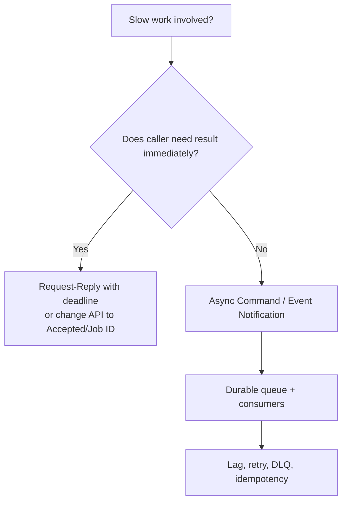

**Be careful:** an asynchronous command is a request to perform work, not necessarily a notification about a past fact. Never turn every command into a domain event merely because "the result isn't needed immediately."

## 50. Common Anti-Patterns

### 50.1. Calling Event Notification a "Request with a Reply"

Publishing `OrderPlaced` does not produce an `OrderResult` for the caller. If a result is needed, design a separate protocol.

### 50.2. Treating Sync/Async as the Pattern Definition

Request-Reply can be async and Event Notification can be sync in-JVM. Distinguish by contract.

### 50.3. Treating Broker ACK as Business Completion

A broker accepting an event does not prove consumer DBs updated or emails went out.

### 50.4. Returning `COMPLETED` Immediately Upon Enqueueing a Command

If the job has not finished, return `ACCEPTED`/`PENDING` with an operation ID.

### 50.5. Publishing `OrderPlaced` Before DB Commit

The fact may never have happened if the transaction rolls back. Use an Outbox or suitable transactional protocol.

### 50.6. Retrying the Entire `PlaceOrder` Flow When One Subscriber Fails

That risks duplicate orders. Retry per consumer-specific side effect.

### 50.7. Blocking Checkout on All Notification Subscribers

Increases coupling and latency; only do this if it is a business invariant backed by a completion contract.

### 50.8. Using `MessageHeaders.id` as a Logical Event ID

Redelivery can create a new `Message` instance. Use a stable event ID.

### 50.9. Using the Same `orderId` for Every Request/Reply Correlation

Two concurrent requests for the same entity can swap replies. Use distinct request IDs.

### 50.10. Using Business Correlation as an Unchecked Aggregator Group ID

May merge separate workflow runs. Scope group/correlation strategies properly.

### 50.11. Placing a `void` Handler Between Gateway and Reply Stage While Expecting a Result

A `void` method produces no normal reply. Return a typed outcome or design another continuation.

### 50.12. Letting a Filter Drop Invalid Commands Without Returning a Rejection

The Gateway may time out instead of receiving an explicit business decision.

### 50.13. Assuming PubSub Always Isolates Subscriber Failures

In-process synchronous PubSub can propagate exceptions. Design proper topologies and error policies.

### 50.14. Using In-Memory Queues Instead of Durable Brokers While Claiming Reliability

Demo `QueueChannel`/`PublishSubscribeChannel` beans do not provide persistence, cross-pod delivery, or crash recovery.

### 50.15. Retrying Non-Idempotent Side Effects After Timeout

May double charge or create duplicate orders. Enforce idempotency and reconciliation.

### 50.16. Sending a Java `replyChannel` Object Over HTTP/Kafka

Not portable; use reply destination and correlation protocols.

### 50.17. Confusing Event Notification with Event Sourcing

Publishing events does not build an authoritative event store or full state-rebuild mechanism.

### 50.18. Failing to Version Event Schemas

Old subscribers may fail deserialization; DLQ replays break after deployments.

### 50.19. Ignoring Late Replies

The caller may have timed out, yet late replies need discarding/reconciliation—never routing to a new caller.

### 50.20. Logging All Headers/Payloads for Tracing

Risks PII/token leakage. Use curated structured metadata and access controls.

## 51. Decision Tree: Should You Use Request-Reply or Event Notification?

Start from the **business contract**, not from whether the team already has Kafka or HTTP.

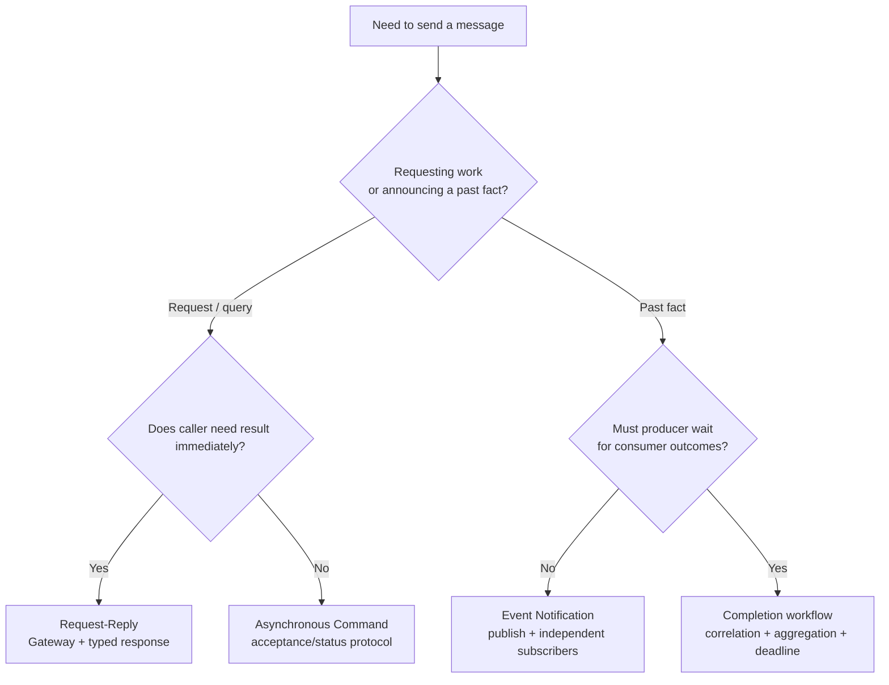

### How to Read the Diagram

- A **command** does not become an event simply by being placed on a queue.
- A **notification** does not gain a reply simply because subscribers run synchronously on the same thread.
- A **Gateway** does not have to block across every topology; replies can be asynchronous.
- An **event** can trigger critical operations, yet never claim "everything succeeded" without a confirmation mechanism.
- When multiple components contribute to one decision, use Scatter-Gather/Aggregator while defining the logical final response.

### Product Rule

If the UI claims "Order created successfully," you need proof from the authoritative order workflow. If the UI can only say "Request accepted," return `ACCEPTED` and give users a way to check status. Never let an event publish or HTTP timeout accidentally define the semantics of the "Order Confirmed" screen.

## 52. Case Study: Placing an Order with a Reply, Then Emitting a Notification

Consider order `ORD-101`, request `REQ-101`.

### Scenario A — Success

1. Checkout sends `PlaceOrder(REQ-101)`.
2. Order Service validates input.
3. Database transaction writes the order and outbox event `EV-201`.
4. Transaction commits.
5. Gateway returns `OrderResult(COMPLETED)` if the contract promises that terminal state.
6. Outbox publisher emits `OrderPlaced(EV-201)`.
7. Audit consumer writes event using an idempotency key.
8. Email consumer sends mail using its own idempotency key.
9. Analytics consumer updates its projection.

**Key point:** the email event arriving 30 seconds late does not reverse the committed order. If email completion is strictly required to declare "complete," express that in the business contract instead of relying on an independent notification.

### Scenario B — Input Rejected

1. Checkout sends a negative amount.
2. Order Service returns `REJECTED(INVALID_AMOUNT)`.
3. No order is created.
4. No `OrderPlaced` event is emitted.
5. API/UI shows a clear error to the caller.

**Never** emit `OrderPlaced` merely because a request reached the Gateway.

### Scenario C — DB Commits, Reply Lost

1. Order row + outbox `EV-201` committed.
2. `COMPLETED` reply is lost; Gateway times out.
3. Caller retries `REQ-101` with the same stable operation key.
4. Business layer finds the stored result and returns `COMPLETED` without creating a second order.
5. Outbox may publish `EV-201` more than once on restart.
6. Audit/Email consumers deduplicate by `eventId`.

**Never** treat a Gateway timeout as reason to cancel or re-emit the fact under a different event ID.

### Scenario D — Email Consumer Fails

1. Order is committed.
2. Notification `EV-201` is published.
3. Audit processes successfully.
4. Email receives the event, but SMTP times out.
5. Email retries within bounds; once budget is exhausted, move to DLQ and alert.
6. Checkout outcome still reflects order status—never flip `COMPLETED` to `REJECTED` over an email outage.

### Scenario E — Inventory Reservation Is Mandatory

If business rules state "never confirm an order without reserving inventory," then Inventory is not merely a secondary notification consumer:

```text
PlaceOrder command
  -> validate
  -> reserve inventory (reply/error)
  -> commit order
  -> return OrderResult
  -> publish OrderPlaced
```

Or use an orchestrated Saga/workflow with `PENDING` status, compensation, and deadlines. Never turn a mandatory requirement into a fire-and-forget Notification while reporting the order as complete.

## 53. Practice Exercise A: Implementing Both Patterns in One Module

**Goal:** using the same order domain, prove Request-Reply and Event Notification have distinct contracts.

### A1. Domain and Gateway

1. Create `PlaceOrder`, `OrderResult`, and `OrderPlaced`.
2. Define `OrderCommandGateway.place(PlaceOrder)` returning `OrderResult`.
3. Configure `placeOrderRequests` as a `DirectChannel`.
4. Write `DemoOrderService.place` returning `ACCEPTED` or `REJECTED`.
5. Wire with `IntegrationFlow.from(...).handle(service, "place")`.
6. Call the Gateway from JUnit.
7. Assert reply matches `requestId`, `status`, and `reasonCode`.
8. Assert no `OrderPlaced` event is auto-published by the demo handler.

### A2. Event Notification

9. Create `orderNotifications` as a `PublishSubscribeChannel`.
10. Create `OrderProjectionSubscriber` with `void onPlaced`.
11. Create `OrderAuditSubscriber` with `void onPlaced`.
12. Register two `IntegrationFlow`s subscribed to the same channel.
13. Publish an `OrderPlaced(EV-101)`.
14. Assert both subscribers observe the same event.
15. Assert `DemoOrderService.callCount()==0` when a test only publishes an event.
16. Explain why `send(...)` is not a business reply.
17. Publish two events with distinct IDs; distinguish event ID from order ID.

### A3. Wiring a Proper Production Pipeline

18. Replace the demo service with a transactional Order Service.
19. Write outbox events inside the same DB transaction creating the order.
20. Have the outbox publisher emit notifications after commit.
21. Keep `eventId` stable across retries.
22. Add consumer idempotency per business side effect.
23. Build a status/reply protocol if callers must track long-running completion.
24. Ensure source tenant and event schemas are validated.

### Expected Outcomes

| Action | Gateway Reply | Event Consumers |
| --- | --- | --- |
| Valid `place` call in demo | `ACCEPTED` | Not triggered automatically |
| Negative-amount `place` call | `REJECTED` | Not triggered |
| Publish `OrderPlaced` | No Gateway reply | Audit and Projection receive event |
| Publish same event twice | No automatic replies | Demo consumers observe two deliveries |
| One `void` subscriber finishes | No return result | Other subscriber receives via PubSub, not from `void` reply |
| Backend commit + outbox publish | Result per commit contract | Event may arrive after reply |

## 54. Practice Exercise B: Fault Injection and Reliability Testing

**Goal:** observe clearly how a failure affects either the caller or only a consumer side effect, avoiding false inferences from `send`/timeouts.

### B1. Request-Reply

1. Add a handler throwing an exception simulating a DB outage before commit.
2. Configure appropriate Gateway error handling.
3. Verify callers receive an exception or typed error result per contract.
4. Add a `void` handler and try using it behind a Gateway returning `OrderResult`.
5. Verify no-reply behavior with a bounded timeout.
6. Add a Filter discarding commands; distinguish from exceptions.
7. Add `requiresReply` on an endpoint expecting a response and verify the error path.
8. Send three concurrent requests; verify request IDs never swap.
9. Simulate a late reply arriving after timeout.
10. Retry with the same idempotency key; verify stored result.
11. Simulate DB commit followed by reply failure; confirm effects are not duplicated.
12. Test result type mismatches and missing reply channels.

### B2. Event Notification

13. Send one event to two subscribers.
14. Make the Email handler throw; observe real synchronous PubSub dispatch behavior.
15. Switch to a broker or async executor with its own error policy.
16. Measure retry attempts, consumer lag, and DLQ backlog.
17. Publish the same event ID twice; demonstrate the need for deduplication.
18. Publish the same event ID with a different payload; verify conflict handling.
19. Update consumer projections from out-of-order events.
20. Enforce source version and schema validation at ingress.
21. Simulate outbox publisher crash after broker publish, before marking published.
22. Verify the event can be republished with the same event ID.
23. Verify consumers do not send two emails from duplicate notifications.
24. Record consumer-processed metrics separately from broker-publish-confirmed metrics.

### B3. Cross-Boundary

25. Run Request-Reply over a broker with request ID and reply topic.
26. Send two requests with the same order ID but different request IDs.
27. Verify late replies are never assigned to new requests.
28. Never serialize Java `MessageChannel` objects.
29. Send `OrderPlaced` in a JSON envelope with event ID, version, and correlation.
30. Test a subscriber running an older schema version.
31. Verify authentication, tenant isolation, and no credential leaks.
32. Add separate alerts for Gateway timeouts and consumer lag.

### Choosing Topology-Appropriate Assertions

In the synchronous JVM demo, `snapshot().size()` can be asserted right after `send`. With executors/brokers, use latches, Awaitility, or bounded polling; avoid arbitrary `Thread.sleep` calls and never assert global order across partitions.

## 55. Pre-Production Acceptance Test Suite

| Category | Test Case | What Must Be Proven |
| --- | --- | --- |
| Request-Reply | Gateway happy path | Typed result returns to exact caller |
| Request-Reply | Rejected command | Explicit rejection, no fake business fact published |
| Request-Reply | Handler throws | Error path matches contract |
| Request-Reply | Void/null handler | Does not fabricate a reply |
| Request-Reply | Reply timeout | Timeout is not equated with rollback |
| Request-Reply | Two concurrent callers | Reply correlation never swaps |
| Request-Reply | Wrong reply type | Conversion/error is caught |
| Request-Reply | Send timeout | Dispatch/backpressure policy works |
| Request-Reply | Retry after commit | Business effect not repeated |
| Event Notification | One event, two subscribers | Each subscriber receives one delivery in sync demo |
| Event Notification | Duplicate `eventId` | Consumer idempotency prevents duplicate effects |
| Event Notification | Event schema V1/V2 | Compatibility verified |
| Event Notification | Subscriber throws | Retry/DLQ and isolation match topology |
| Event Notification | Consumer lag | Backpressure/retention policy holds |
| Event Notification | Outbox crash window | No lost events and duplicates handled |
| Event Notification | Out-of-order | Projection version/sequence policy holds |
| Event Notification | Tenant mismatch | Rejected without cross-tenant leaks |
| Event Notification | Replay after restart | Consumers resume/dedup cleanly |
| Boundary | Kafka/AMQP header mapping | ID/schema/correlation survive serialization |
| Boundary | Error reply protocol | Remote failures return to right request when contracted |
| Workflow | Splitter/Aggregator | Final reply releases only upon policy contributions |
| Workflow | Event-driven completion | Not assuming every notification needs an Aggregator |
| Operations | Metrics | Request/reply, publish, and consumer effects measured separately |

Merely writing tests in Markdown **does not prove successful execution**. When adopting in a project, run unit, integration, and broker/DB fault-injection tests, and verify actual APIs of your pinned Spring Integration version.

## 56. Self-Assessment Questions

**Q1.** What is the most important difference between Request-Reply and Event Notification?

*Request-Reply carries a reply contract for a specific request; Event Notification announces an occurred fact, typically without expecting business replies from subscribers.*

**Q2.** Must Request-Reply be synchronous?

*No. It can use asynchronous reply topics, callbacks, or futures as long as request IDs, reply correlation, and deadlines are explicit.*

**Q3.** Can Event Notification dispatch synchronously inside one JVM?

*Yes. A `PublishSubscribeChannel` without an executor can invoke subscribers on the same thread; the pattern remains notification.*

**Q4.** Does `MessageChannel.send(...)` returning `true` mean consumers committed to the DB?

*No. It reflects channel dispatch semantics; business commits and broker acknowledgements are separate milestones.*

**Q5.** How do `PlaceOrder` and `OrderPlaced` differ?

*`PlaceOrder` is a command requesting order creation; `OrderPlaced` asserts the fact that an order was created.*

**Q6.** If the Gateway returns `ACCEPTED`, may `OrderPlaced` be emitted immediately?

*Not automatically. Wait until the fact actually occurs per the business contract/transaction.*

**Q7.** Why do two concurrent requests for the same order need separate request IDs?

*So replies are never delivered to the wrong caller; order ID is a business entity ID, not a replacement for request correlation.*

**Q8.** If the Email subscriber fails, should the entire `PlaceOrder` request be retried?

*Usually no. Retry email sending using event/consumer idempotency; do not recreate an already-committed order.*

**Q9.** Does Event Notification need a stable event ID?

*Yes, when deduplication, replay, reconciliation, and tracing of logical events are required.*

**Q10.** What does the Transactional Outbox solve?

*It records event-publish intent in the same DB transaction as business state, reducing the risk of committing and failing to publish. It does not by itself eliminate duplicate deliveries.*

**Q11.** If a caller times out, is it certain the DB did not commit?

*No. It may have committed while the reply was lost; idempotency, stored results, and reconciliation are needed.*

**Q12.** Why is letting a Filter discard messages before a Gateway reply path dangerous?

*Because neither a reply nor an exception may be emitted, leaving the caller waiting until timeout. Define an explicit rejection result or failure contract.*

**Q13.** When should an Aggregator be used in Request-Reply?

*When multiple contributions must be combined into one final response with correlation, a release strategy, and deadlines.*

**Q14.** Is an Aggregator needed when `OrderPlaced` fans out to three subscribers?

*Not if the producer does not require all three to complete. Subscriber fan-out represents independent reactions.*

**Q15.** Does `PublishSubscribeChannel` automatically isolate one subscriber's failure from other subscribers?

*Not in every setup; synchronous dispatch can propagate exceptions. Test and design explicit isolation.*

**Q16.** Are Event Notification and Event Sourcing the same thing?

*No. Notification announces facts; Event Sourcing uses event history as the authoritative state source with strict constraints.*

**Q17.** Is a command sent to a queue without waiting for a reply an Event Notification?

*Not necessarily. If it asks a receiver to perform a future action, it remains a one-way/asynchronous command.*

**Q18.** If the UI needs to know when a multi-minute job completes, what should you do?

*Return an acceptance/operation ID, persist job status, and support polling/callbacks; optionally emit a completion event once truly done.*

## 57. Production Checklist

- **Semantic contract:** determine command/query vs. event fact—never rely on transport names.
- **Reply obligation:** does the caller need a per-invocation result?
- **Synchronous vs. async:** decide independently from the interaction pattern.
- **Gateway:** right request channel, reply route, timeout, and return type.
- **Status semantics:** `ACCEPTED` is never confused with `COMPLETED`.
- **No reply:** `void`, `null`, Filter discards, and unresolved Routers have explicit policies.
- **Error handling:** technical exceptions, domain rejections, async failures, and DLQs are separated.
- **Correlation:** request ID is distinct from event ID, entity ID, and Aggregator group ID.
- **Causation:** events record their triggering source when needed.
- **Retry:** bounded and idempotent per logical business operation.
- **Unknown outcome:** never retry blindly after timeouts that may have committed.
- **Outbox:** business transactions and event-publish intents are linked when required.
- **Producer:** emit only facts that occurred; never confuse accepted jobs with completed events.
- **Schema:** event type/version, contract tests, replay compatibility.
- **Subscribers:** idempotency, retry/error channels, DLQs, and consumer ownership.
- **Failure isolation:** understand sync PubSub vs. executor/broker consumer groups.
- **Ordering:** partitioning/grouping/sequencing and out-of-order handling are explicit.
- **Concurrency:** never mix replies and never use a mutable `currentRequestId`.
- **Transport:** headers/serializers/reply destinations are protocol-portable.
- **Security:** authenticated tenant/source, allowlisted metadata, PII payload protection.
- **Backpressure:** Gateway latency and consumer lag monitored separately.
- **Observability:** request completion, broker publish, and subscriber effects tracked distinctly.
- **Testing:** unit, `IntegrationFlow`, multi-caller, duplicates, fault injection, and replay.
- **Operations:** runbooks for timeouts, lost replies, duplicate events, poison messages, and lag.
- **Ownership:** clear team ownership for each command API, event schema, and subscription.
- **Documentation:** explicitly state what each reply/event/ACK guarantees—and what it does not.

## 58. Conclusion

**Request-Reply** and **Event Notification** can both be implemented with Spring Integration, yet serve two different needs. Request-Reply links **one request with its matching result**, requiring reply channels, correlation, deadlines, typed responses, and per-caller failure handling. Event Notification announces **an event that has occurred** to subscribers with independent lifecycles, requiring event identity, schemas, publish reliability, consumer retries, idempotency, and eventual consistency.

The difference **does not lie in synchronous vs. asynchronous execution**, nor simply in one consumer vs. many consumers. A Gateway can communicate over an asynchronous broker and still be Request-Reply; a `PublishSubscribeChannel` running synchronously inside a JVM is still Event Notification. Start from the question: *is the sender asking for an action/result, or announcing a fact?*

In the `SPRING_INTEGRATION_PATTERN` module, an effective architecture often combines **Gateway + Service Activator** returning business results on the command path with **Transactional Outbox + Event Notification subscribers** for secondary reactions after facts commit. When combining Router, Filter, Transformer, Splitter, Aggregator, retry, error channel, and correlation, ensure every branch honors its contract. That keeps systems testable, observable, loosely coupled, and free from pitfalls like "caller got no reply even though side effects ran" or "event published before all subscribers finished."
