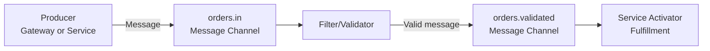
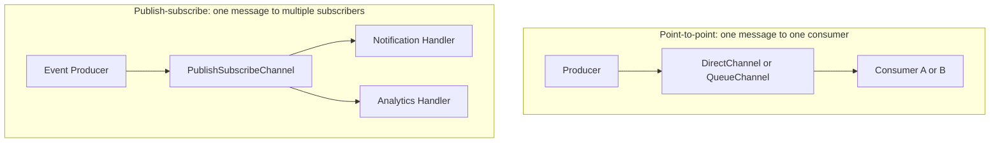
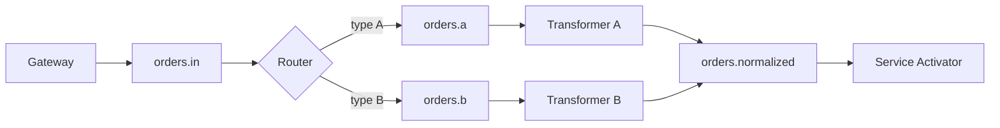

# Channel as a Pipe in Enterprise Integration Patterns

In Enterprise Integration Patterns (EIP), a **Message Channel** is a logical connection path that allows a message sender (**producer**) to transfer data to a receiver (**consumer**) without directly invoking each other's methods. You can think of a channel as a **pipe**: a processing component pushes a message into one end of the pipe; the next component receives the message at the other end.

That is a useful mental model, but it is important to understand it accurately: a channel is not necessarily a queue, a separate processing thread, or an external broker. A channel describes **the message exchange boundary and message delivery semantics**. The actual execution mechanism depends on the configured channel type.

In the **SPRING_INTEGRATION_PATTERN** module, understanding channels is foundational for assembling **Router, Filter, Transformer, Splitter, Aggregator, Gateway**, as well as designing retries, error channels, correlation, testing, and tracing message paths. This lesson focuses on the nature of a Message Channel, what it decouples, and how the "pipe" concept maps to Spring Integration.

## 1. From Direct Calls to Messages Flowing Through a Pipe

Consider an order processing workflow with two steps: validating the request and forwarding valid requests to fulfillment.

### Direct Call Approach

```java
void submit(OrderCommand order) {
    validator.validate(order);
    fulfillmentService.fulfill(order);
}
```

The code is easy to read: the orchestrator knows both `validator` and `fulfillmentService` directly, as well as their invocation order. For a short workflow, this can be a good choice. However, when you need to change how validation works, add a processing route, or change the execution mechanism, the orchestrator may have to change as well.

### Connecting Steps with Channels



Here, the **Filter/Validator** reads from `orders.in` and emits results to `orders.validated`; the **Service Activator** receives messages from `orders.validated` to fulfill the order. Processing components are connected through channels and message contracts.

This organization reflects the **Pipes and Filters** idea: a *filter* is a processing step with a dedicated responsibility; a *pipe* is the connection that moves data from one step to the next. Distinguish the **Filter pattern** (deciding whether a message may continue) from the **Message Channel pattern** (the transport path and delivery semantics). A channel by itself does not inspect order contents.

### Three Fundamental Components

| Component | Responsibility | Examples in Spring Integration |
| --- | --- | --- |
| **Message** | The exchanged data packet, consisting of payload and headers | `Message<OrderCommand>` |
| **Message Channel** | Acts as the send/receive intermediary and defines message delivery behavior | `DirectChannel`, `QueueChannel`, `PublishSubscribeChannel` |
| **Message Endpoint** | Connects business logic to messaging: consumes, transforms, routes, or emits messages | `Service Activator`, `Filter`, `Transformer`, `Router` |

An endpoint can both consume a message from an input channel and emit a new message to an output channel. A channel is the **connection between endpoints**, not the business processing logic itself.

## 2. What Is Inside a Message Traveling Through a Pipe?

In Spring Integration, messages use the `org.springframework.messaging.Message<T>` type, which has two parts:

- **Payload:** the primary data, such as `OrderCommand`, parsed JSON, or an event object.
- **Headers:** metadata supporting processing, such as `id`, `timestamp`, correlation ID, reply channel, or error channel when appropriately configured.

```text
Message<OrderCommand>
+--------------------------------------------------+
| Headers                                           |
|   id: UUID                                        |
|   timestamp: creation time                        |
|   correlationId: correlation ID (if set by app)   |
+--------------------------------------------------+
| Payload                                          |
|   OrderCommand(orderId="O-101", amount=250000)    |
+--------------------------------------------------+
            |
            v
      Message Channel
            |
            v
        Consumer
```

**A channel transports messages**; it does not automatically transform payloads, add idempotency keys, or confirm business completion. Filter, Transformer, Router, Aggregator, or handler steps take on those specialized responsibilities. For flows that split and aggregate messages, correlation IDs and sequence metadata must be designed so parts belonging to the same group are accurately identified.

A producer and consumer are decoupled from **direct invocation addresses**, yet they still need to agree on a contract: payload type, field semantics, required headers, and how to handle invalid messages. A Message Channel helps manage this dependency at a clear boundary; it does not make the contract disappear.

## 3. Four Questions a Channel Must Answer

Before choosing a channel, determine:

1. **Who will receive the message?** One consumer among many or all subscribers?
2. **When does the consumer process it?** Immediately on the sender thread, on another thread, or after the consumer pulls the message from a queue?
3. **When processing fails, what happens?** Does the exception propagate back to the producer? Who retries and records failed messages?
4. **If load increases, where are messages held?** Are there buffer limits, waiting mechanisms, data loss on restart, or backpressure?

You cannot deduce these answers merely by seeing `.channel("orders.in")` in the Java DSL.

## 4. Common Message Channel Types in Spring Integration

| Channel Type | Exchange Behavior | Suitable When | Notes |
| --- | --- | --- | --- |
| **DirectChannel** | Producer sends and handler is invoked synchronously on the sender thread | Simple pipelines needing immediate response/error propagation | Decouples structure, but does not decouple temporal dependency |
| **ExecutorChannel** | Dispatches to a subscriber via a `TaskExecutor` | Offloading processing to another thread | Must monitor executor capacity, task rejections, and async errors |
| **QueueChannel** | Messages enter a queue; consumer retrieves via polling | Buffering and decoupling send/receive rates within a single process | Requires a poller; in-memory queues do not automatically survive restarts |
| **PublishSubscribeChannel** | Broadcasts messages to multiple subscribers | One event requires multiple processing branches | Broadcasting to multiple branches differs from splitting a message into parts; synchronous by default |
| **RendezvousChannel** | Direct handoff between a sender and a waiting receiver | Synchronizing handoff timing | Sender may have to wait for receiver; not used as an accumulating queue |
| **PriorityChannel** | Queue with priority ordering | Work items have different priority levels | Must consider the risk of low-priority items waiting too long |

### 4.1. Point-to-point vs. Publish-subscribe



With a **point-to-point** channel, each message is delivered to **one** handler, even if multiple eligible subscribers exist. For example, `DirectChannel` uses single-target dispatch; `QueueChannel` provides a message to a single receive operation from the queue. You should not expect two handlers to both see every message from a point-to-point channel.

With **PublishSubscribeChannel**, one message is broadcast to multiple subscribers. This is a common choice for an "order created" scenario that triggers sending notifications and updating analytics. However, subscribers can still run synchronously if no executor is configured; a failing subscriber can affect the send operation depending on dispatch/error handling configuration.

### 4.2. Synchronous vs. Asynchronous

Do not equate "going through a channel" with "running in the background." In `DirectChannel`, the execution path often resembles a method call with an intermediate step:

```text
HTTP Thread
  -> gateway.send(message)
  -> DirectChannel
  -> validator
  -> DirectChannel
  -> handler.fulfill(order)
  -> return
```

With `ExecutorChannel`, processing can move to a thread belonging to the executor. With `QueueChannel`, the producer typically finishes after placing the message in the queue, while the consumer uses a poller to retrieve it later. This change affects when an API is allowed to return, transaction contexts, and error propagation paths.

### 4.3. In-Application Channels vs. External Brokers

`DirectChannel`, `ExecutorChannel`, and `QueueChannel` typically connect endpoints **within a single Spring application context**. They do not by themselves create a durable transport path between two microservices in two separate processes.

When connecting over Kafka, RabbitMQ, JMS, or external systems, you must use **appropriate message-driven adapters, gateways, binders, or integration endpoints** and configure the transport properties of that infrastructure. Even so, the internal architecture can still represent data flow through `MessageChannel`s so inner processing steps do not depend directly on the adapter.

## 5. Hands-On Example: Building a Pipe Through Two Channels

In the following example, a gateway accepts an order processing request. The first flow validates the data and pushes valid messages to the next channel. The second flow pulls messages from this channel to execute business logic.

### 5.1. Defining Contracts and the Gateway

```java
import java.math.BigDecimal;

import org.springframework.context.annotation.Bean;
import org.springframework.context.annotation.Configuration;
import org.springframework.integration.annotation.Gateway;
import org.springframework.integration.annotation.IntegrationComponentScan;
import org.springframework.integration.annotation.MessagingGateway;
import org.springframework.integration.channel.DirectChannel;
import org.springframework.integration.config.EnableIntegration;
import org.springframework.integration.dsl.IntegrationFlow;
import org.springframework.messaging.MessageChannel;

record OrderCommand(String orderId, BigDecimal amount) {}

interface FulfillmentService {
    void fulfill(OrderCommand order);
}

@MessagingGateway
interface OrderGateway {
    @Gateway(requestChannel = "orders.in")
    void submit(OrderCommand command);
}

@Configuration
@EnableIntegration
@IntegrationComponentScan
class OrderChannelConfiguration {

    @Bean("orders.in")
    MessageChannel ordersIn() {
        return new DirectChannel();
    }

    @Bean("orders.validated")
    MessageChannel validatedOrders() {
        return new DirectChannel();
    }

    @Bean
    IntegrationFlow validateOrders() {
        return IntegrationFlow.from("orders.in")
            .filter(OrderCommand.class,
                order -> order.orderId() != null
                    && !order.orderId().isBlank()
                    && order.amount() != null
                    && order.amount().signum() > 0,
                spec -> spec.throwExceptionOnRejection(true))
            .channel("orders.validated")
            .get();
    }

    @Bean
    IntegrationFlow fulfillOrders(FulfillmentService fulfillment) {
        return IntegrationFlow.from("orders.validated")
            .handle(OrderCommand.class, (order, headers) -> {
                fulfillment.fulfill(order);
                return null; // one-way handler, does not emit a reply
            })
            .get();
    }
}
```

This is an example for Spring Integration Java DSL in an application that already has the Spring Integration dependency. The gateway and configuration must be in a package scanned by `@IntegrationComponentScan` (or registered equivalently). `FulfillmentService` must have an actual implementation bean.

Example invocation from a business service:

```java
class CheckoutService {
    private final OrderGateway orders;

    CheckoutService(OrderGateway orders) {
        this.orders = orders;
    }

    void checkout(String id, BigDecimal amount) {
        orders.submit(new OrderCommand(id, amount));
    }
}
```

Key design points:

- `CheckoutService` only knows `OrderGateway`, without needing to know where `FulfillmentService` processes the order.
- Two channels have clear names: `orders.in` and `orders.validated`; the Filter acts as the endpoint between the two "pipes".
- `throwExceptionOnRejection(true)` causes messages failing the predicate to be rejected with an exception instead of being silently dropped by the filter. That is a choice for this example, not the only default for every flow.
- Both channels are `DirectChannel`, so `orders.submit(...)` still executes synchronously. On success, the call returns after `fulfill(...)` finishes; exceptions from the handler can propagate back to the caller.
- `return null` in the handler indicates no reply message is produced; to achieve request-reply, you must define the corresponding contract and flow.

### 5.2. What Changes When Switching the Pipe to a Queue?

Suppose order fulfillment processing is slow and does not have to finish before the API returns. We can change **only the second channel and how it is consumed**.

Replace the `orders.validated` channel bean with:

```java
import org.springframework.integration.channel.QueueChannel;

@Bean("orders.validated")
MessageChannel validatedOrders() {
    return new QueueChannel(100); // maximum 100 pending messages
}
```

And use a poller in the consuming flow:

```java
import org.springframework.integration.dsl.Pollers;

@Bean
IntegrationFlow fulfillOrders(FulfillmentService fulfillment) {
    return IntegrationFlow.from("orders.validated",
            endpoint -> endpoint.poller(Pollers.fixedDelay(250)))
        .handle(OrderCommand.class, (order, headers) -> {
            fulfillment.fulfill(order);
            return null;
        })
        .get();
}
```

**These two snippets replace the corresponding parts of the synchronous example**—do not add a second bean with the same name. When using a queue, the producer can send successfully while the handler has not yet finished processing the message. The poller retrieves messages from the queue on a schedule; completion time depends on configuration and actual load. With a bounded queue, the producer must be designed for the case where the queue is full and messages cannot be sent or must wait.

This is an **in-memory QueueChannel**: if the process stops, unprocessed messages can be lost. An in-memory queue also does not automatically guarantee exactly-once delivery, retries, dead-letter handling, or persistence across restarts. If the business requirement is "once accepted, it must be processed even if the system restarts," you need an appropriate persistence design, such as a persistent message store or broker, combined with error handling and idempotency mechanisms.

## 6. How Much Coupling Does a Channel Reduce?

Two types of dependency must be separated:

**Structural dependency.** When a producer sends to `orders.in`, it does not need to instantiate or directly invoke the order processing handler. You can swap or add downstream steps, such as a Router selecting a warehouse or a Transformer converting data contracts, while keeping the sending interface intact if the message contract remains stable.

**Operational dependency.** When the channel is a `DirectChannel`, the producer still depends on the consumer's speed and failures. Only by choosing appropriate dispatch, buffering, and infrastructure mechanisms can a system partially decouple timing and availability dependencies.

This decoupling has limits. Producer and consumer still need to agree on:

| Shared Contract | If Changed Arbitrarily |
| --- | --- |
| Channel name or endpoint lookup | Messages may fail to reach the consumer |
| Payload and schema version | Handler fails to read or misinterprets the message |
| Headers for routing/correlation | Router or Aggregator processes the wrong branch/group |
| Error and acknowledgment policies | Producer assumes success when the task actually failed |
| Ordering, duplication, and retry semantics | Data may be updated multiple times or out of order |

Therefore, the benefit of a "pipe" is **allowing steps to communicate across well-defined boundaries**. Do not assume a channel eliminates all forms of coupling.

## 7. Combining Channels with Other Patterns

In a real-world integration system, channels typically appear interspersed among many EIPs:



- **Gateway:** provides a convenient way to call from application code into a message flow.
- **Router:** receives a message from a channel and selects an output channel based on content or headers.
- **Filter:** decides whether a message should proceed or be discarded/rejected.
- **Transformer:** converts the payload or message structure so the next consumer can understand it.
- **Splitter:** splits one message into multiple messages, usually sending them through the next channel.
- **Aggregator:** collects related messages and combines them based on completion conditions. It requires clear correlation, group state, and timeout mechanisms.
- **Retry and error channel:** helps handle errors at appropriate execution points; merely adding a channel does not automatically implement retry policies or error observability.

Some components like Aggregator can hold state, whereas a typical channel only handles message distribution or buffering. Distinguishing where state is held helps avoid misdiagnosing causes of data loss and bottlenecks.

## 8. Observing and Testing a Pipe

When adding channels, a message's path can traverse many endpoints. You need to know **where the message originated, which endpoints it was routed to, and where it stopped**.

### 8.1. Recommended Test Cases

| Test Case | Expectation |
| --- | --- |
| Send a valid `OrderCommand` via the gateway | `FulfillmentService.fulfill` is called exactly once in the synchronous example |
| Send zero or negative amount | Filter rejects and caller receives an exception when using DirectChannel |
| Handler throws an exception | With DirectChannel, the error can propagate back to the caller and must be handled |
| Switch `orders.validated` to QueueChannel | Message is enqueued and the poller processes it later; do not equate "send succeeded" with "business task completed" |
| Queue reaches capacity | Wait/rejection behavior matches timeout and producer policy |
| Multiple subscribers on DirectChannel | One message is not broadcast to every subscriber by default like PublishSubscribeChannel |

For integration tests, you can replace `FulfillmentService` with a mock or spy, send a message into `OrderGateway`, and verify invocation counts. When switching to a queue, wait conditionally with a timeout instead of assuming the handler ran immediately after the send call.

### 8.2. Operational Data to Record

- **Message ID and correlation ID** to correlate logs across steps; business correlation IDs should be intentionally populated into messages.
- **Channel and endpoint names** to see which step a message just passed through.
- **Message sent/received counts, latency, errors, and retries** to detect bottlenecks.
- **Queue depth, consumption rate, and pending message count** if queues are used.
- **Final outcome** of the business task, especially for asynchronous flows.

Spring Integration provides interceptors, metrics, and observability mechanisms configurable at channels/endpoints. Enabling, configuring, and exporting telemetry depends on the application and monitoring system in use. Do not assume every message is automatically traced or audited if not explicitly configured.

## 9. Common Misconceptions

**"Having a channel makes everything asynchronous."** False for `DirectChannel`: producer and consumer still execute on the same sender thread. You must check the channel type and configured executor/poller.

**"A channel is a durable queue."** Not true for channels in general. `DirectChannel` is not a queue; `QueueChannel` uses memory by default; durability depends on infrastructure and message stores.

**"Putting two consumers on a channel means both receive a copy."** Only true when using a broadcast-to-all-subscribers mechanism like `PublishSubscribeChannel` with appropriate configuration. Point-to-point provides a single processing target per message.

**"Sending to a queue successfully means the task is finished."** False for delayed consumption flows. A successful send indicates the channel accepted the message under its semantics, not that the business handler has completed.

**"A pipe will automatically retry when a consumer fails."** Retry, redelivery, dead-letter, and error handling are policies that must be configured on endpoints, adapters, or supporting infrastructure.

**"The more channels, the better."** Every new channel requires a name, contract, handling policy, and observability instrumentation. Add a channel when it clarifies a boundary between two responsibilities, delivery policies, or distinct execution requirements.

## 10. Practice Exercise

An e-commerce system receives an `OrderPaid` event and needs to perform three tasks: grant digital download access, send an email, and update business metrics.

1. If granting access must finish before the API returns, consider a synchronous flow and clarify whether exceptions propagate back to the API.
2. If sending email can be delayed by a few minutes, choose a way to decouple processing time; compare `ExecutorChannel`, `QueueChannel`, and a broker based on restart fault-tolerance requirements.
3. If every payment event must reach both email and analytics services, consider `PublishSubscribeChannel` or event infrastructure instead of a point-to-point channel.
4. If analytics needs to batch data, distinguish the channel transporting messages from an Aggregator responsible for correlation and group state.
5. Draw the channels and endpoints; indicate for each "pipe" what the producer must know, where messages could be held, and who is responsible for retries.

Explain why the same **Message Channel** symbol on a diagram can correspond to very different runtime behaviors. If you can answer in terms of channel type, consumption style, error policy, and storage guarantees, you have grasped the most important part of the "channel as a pipe" model.

## Key Takeaways

**In EIP, a Message Channel is the "pipe" connecting processing steps via messages.** It decouples the sender from directly invoking the receiver and provides a clear connection point for an integration flow. In Spring Integration, a pipe can be a `DirectChannel`, `ExecutorChannel`, `QueueChannel`, or `PublishSubscribeChannel`, and each type has different execution semantics.

When designing loosely coupled and extensible systems, choose channels based on **delivery target, processing timing, error propagation, buffering capacity, and durability requirements**. Only then combine Filter, Router, Transformer, Splitter, Aggregator, Gateway, retry, error channel, and correlation. A good design is one where you can explain precisely where every message goes, when it is considered processed, and how failures are detected.
