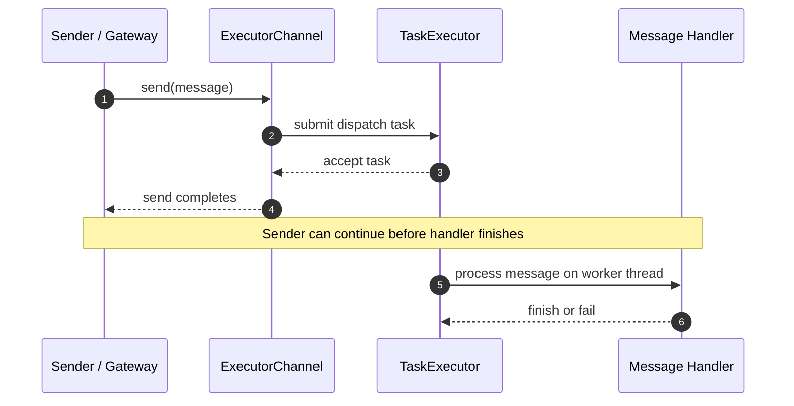
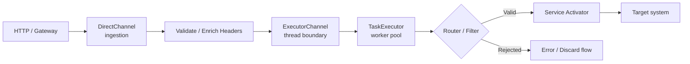
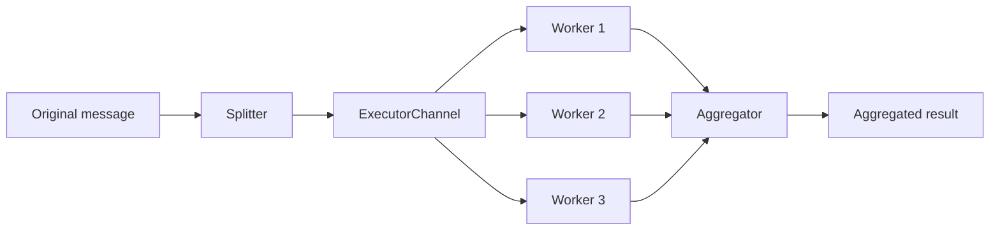
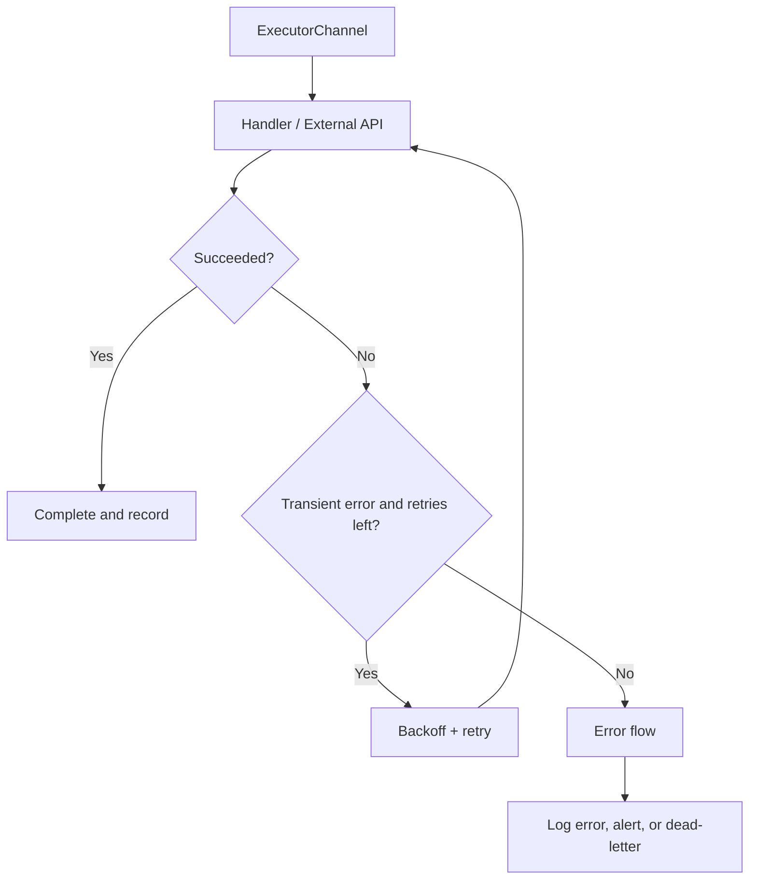

# ExecutorChannel and Asynchronous Communication in Spring Integration

> **Chapter:** Message channel  
> **Lesson:** ExecutorChannel and Asynchronous Communication  
> **Scope:** Building message flows with Spring Integration following Enterprise Integration Patterns (EIP), combining Router, Filter, Transformer, Splitter, Aggregator, Gateway, retry, error channel, correlation, and flow observability.

## 1. The Problem: Avoiding Blocking the Sender Thread for Entire Processing

An application receives an order message through a Gateway. After ingestion, it needs to validate the data, send a request to a payment service, and save history. If all handlers run sequentially on the request-receiving thread, the sender's response time depends on all downstream work.

```text
HTTP / Gateway Thread
    |
    v
Receive order --> Validate --> Payment --> Save history --> Return
                   (20 ms)      (500 ms)      (100 ms)
```

Under high concurrency, slow handlers can tie up inbound threads. We want to hand off the message to a dedicated group of processing threads so the sender thread is released early once the handoff is accepted.

**ExecutorChannel** is a `MessageChannel` in Spring Integration that performs this handoff. It uses a `TaskExecutor` to dispatch messages to a subscriber. Sender and handler can run on two different threads.



The diagram depicts the case where the executor has an available worker thread and accepts the task. If the executor is overloaded, rejects the task, or uses a caller-runs policy, the behavior differs. Therefore, "asynchronous send" does not mean "never blocks" or "already processed successfully."

### After This Lesson, You Will Be Able To

- Explain the role of `ExecutorChannel` in EIPs and distinguish it from `DirectChannel` and `QueueChannel`.
- Configure a resource-bounded thread pool and choose an overload rejection policy.
- Identify thread, transaction, ordering, and metadata context boundaries.
- Structure error channels, retries, and tests for asynchronous branches.
- Know when a durable queue/broker is required instead of in-process memory dispatch alone.

## 2. Where Does ExecutorChannel Fit in the Message Channel Model?

Spring Integration exchanges data using `Message<?>`. Each message contains a **payload** (business data) and **headers** (metadata). A handler does not need to directly know another handler's address or technology: it sends messages to a channel.

`ExecutorChannel` is a **SubscribableChannel**: handlers subscribe to receive messages and the framework actively pushes messages to a subscriber. It shares the goal of dispatching to a handler like `DirectChannel`, except dispatch is executed via a `TaskExecutor`.

| Channel | Consumption Style | Handler Execution Thread | Usage Characteristics |
| --- | --- | --- | --- |
| `DirectChannel` | Subscribe, dispatches to one subscriber | Typically same sender thread | Synchronous call flow, easy-to-follow ordering and error return |
| **`ExecutorChannel`** | Subscribe, dispatches to one subscriber | Via `TaskExecutor`, usually a worker thread | Creates an asynchronous boundary inside the application |
| `QueueChannel` | Poll, receiver pulls messages | Poller/receiver thread | Has internal buffer, consumes on a poll cadence |
| `PublishSubscribeChannel` | Subscribe, broadcasts to multiple subscribers | Can be synchronous or use an executor | Suitable for broadcast/fan-out to multiple handlers |

A few points often misunderstood:

- `ExecutorChannel` **is not a message broker**. It does not automatically write messages to Kafka, RabbitMQ, or a database.
- `ExecutorChannel` **is not a durable queue**. `ThreadPoolTaskExecutor` can hold pending tasks in memory; if the process stops abruptly, unfinished work can be lost.
- With multiple subscribers, `ExecutorChannel` dispatches to one handler per send (unicast); it does not automatically duplicate messages to all subscribers. To broadcast to multiple consumers, look at `PublishSubscribeChannel`.
- `send(message)` completing primarily indicates the dispatch was accepted in the normal case; it does not guarantee downstream business transactions have finished.

### Why Not Just Use `@Async`?

`@Async` can run a method call on an executor, whereas `ExecutorChannel` explicitly represents **an asynchronous boundary in the message flow graph**. Router, Filter, Transformer, Gateway, and other components can sit before or after the channel while still conforming to the `MessageChannel` interface, sharing payload/headers and Spring Integration's error-flow mechanisms.

Choose `ExecutorChannel` when thread handoff is part of the integration design. Choose `@Async` for asynchronous method calls that do not necessarily belong to a message flow. Both mechanisms require managing executor resources and errors.

## 3. How Do Synchronous and Asynchronous Flows Differ?

Consider a flow:



Steps before `ExecutorChannel` still typically execute on the inbound thread. Once the message crosses this channel, the framework delegates dispatch to the executor. Subsequent Router, Filter, and handler steps usually run on a worker thread from that executor until another thread boundary is reached.

Consequences to keep in mind:

1. **Sender-perceived latency** can drop because the sender does not wait for handlers past the boundary.
2. **Overall system throughput and latency** still depend on handler speed, pool size, and target system capacity.
3. **Completion order** can change when multiple workers process concurrently.
4. **Sender thread's ThreadLocal and transaction** do not automatically carry over to the worker thread.
5. **Exceptions occurring on the worker** need a separate error-reporting mechanism; the sender may have already returned.

## 4. Complete Example: Processing Orders Through ExecutorChannel

This example uses Spring Integration Java DSL. The input is a message carrying `OrderSubmitted`. The flow adds a header to track source origin, passes through `ExecutorChannel`, and invokes an order-processing service. The service is a one-way handler and returns `void`.

```java
package example.integration;

import java.math.BigDecimal;
import java.util.concurrent.ThreadPoolExecutor;

import org.slf4j.Logger;
import org.slf4j.LoggerFactory;
import org.springframework.beans.factory.annotation.Qualifier;
import org.springframework.context.annotation.Bean;
import org.springframework.context.annotation.Configuration;
import org.springframework.core.task.TaskExecutor;
import org.springframework.integration.channel.DirectChannel;
import org.springframework.integration.channel.ExecutorChannel;
import org.springframework.integration.config.EnableIntegration;
import org.springframework.integration.dsl.IntegrationFlow;
import org.springframework.messaging.Message;
import org.springframework.messaging.MessageChannel;
import org.springframework.scheduling.concurrent.ThreadPoolTaskExecutor;

@Configuration
@EnableIntegration
public class AsyncOrderConfiguration {

    public record OrderSubmitted(String orderId, BigDecimal total) {}

    @Bean("ordersInput")
    public MessageChannel ordersInput() {
        return new DirectChannel();
    }

    @Bean("ordersExecutor")
    public ThreadPoolTaskExecutor ordersExecutor() {
        ThreadPoolTaskExecutor executor = new ThreadPoolTaskExecutor();
        executor.setCorePoolSize(2);
        executor.setMaxPoolSize(4);
        executor.setQueueCapacity(100);
        executor.setThreadNamePrefix("orders-worker-");
        executor.setRejectedExecutionHandler(
            new ThreadPoolExecutor.AbortPolicy());
        // When registered as a Spring bean, the executor is initialized
        // and its lifecycle is managed by Spring.
        return executor;
    }

    @Bean("ordersAsync")
    public MessageChannel ordersAsync(
            @Qualifier("ordersExecutor") TaskExecutor executor) {
        return new ExecutorChannel(executor);
    }

    @Bean
    public OrderProcessor orderProcessor() {
        return new OrderProcessor();
    }

    @Bean
    public IntegrationFlow ordersFlow(OrderProcessor processor) {
        return IntegrationFlow.from("ordersInput")
            .enrichHeaders(headers ->
                headers.header("sourceSystem", "checkout-api"))
            .channel("ordersAsync")
            .handle(processor, "process")
            .get();
    }

    public static class OrderProcessor {

        private static final Logger log =
            LoggerFactory.getLogger(OrderProcessor.class);

        public void process(Message<OrderSubmitted> message) {
            OrderSubmitted order = message.getPayload();
            String source = message.getHeaders()
                .get("sourceSystem", String.class);

            log.info("orderId={}, source={}, thread={}",
                order.orderId(),
                source,
                Thread.currentThread().getName());

            // TODO: Call the actual business processing service.
            // Appropriate timeout, idempotency, and error handling are required.
        }
    }
}
```

You can send a message into the channel as follows (for instance from a controller or application gateway):

```java
OrderSubmitted order =
    new OrderSubmitted("ORD-2048", new BigDecimal("1250000"));

boolean accepted = ordersInput.send(
    MessageBuilder.withPayload(order)
        .setHeader("businessKey", order.orderId())
        .build()
);
```

This send snippet assumes `ordersInput` is injected as a `MessageChannel` and `MessageBuilder` is imported from `org.springframework.messaging.support.MessageBuilder`.

**Stage-by-stage walkthrough:**

- `ordersInput` is a `DirectChannel`, entering the flow on the sender thread.
- `enrichHeaders` adds source metadata without altering the payload.
- `ordersAsync` hands processing off to `ordersExecutor`.
- `OrderProcessor.process(...)` runs on a thread chosen by the executor and still has access to both the payload and the `businessKey` / `sourceSystem` headers.
- The `process` method returns `void` to indicate one-way processing; no reply message is created.

This example is for an in-process flow. When replacing the TODO with payment calls, database writes, or broker publishing, add consistency and recovery mechanisms; adding `ExecutorChannel` alone does not guarantee the order has been safely persisted.

### Why Use `TaskExecutor` Instead of Creating Threads Manually?

Spring manages lifecycle, worker counts, resources, and rejection policies. `ThreadPoolTaskExecutor` also exposes metrics for pool size and active tasks. Creating a new thread per message makes resource control difficult during traffic spikes.

## 5. Understanding ThreadPoolTaskExecutor Configuration

Key parameters in the example:

| Setting | Illustrative Value | Meaning |
| --- | ---: | --- |
| `corePoolSize` | 2 | Number of core workers maintained per executor config |
| `maxPoolSize` | 4 | Upper bound on workers in the pool |
| `queueCapacity` | 100 | Number of tasks allowed to wait in the internal queue |
| `threadNamePrefix` | `orders-worker-` | Helps locate worker threads in logs and thread dumps |
| Rejection policy | `AbortPolicy` | Signals failure when no more tasks can be accepted |

Under typical `ThreadPoolExecutor` behavior, when core workers are busy, tasks are queued; only once the queue is full does the pool grow threads up to `maxPoolSize`. Thus, setting a huge `maxPoolSize` alongside a huge `queueCapacity` **does not mean** thread count increases immediately under load.

Behavioral model:

```text
Incoming message
    |
    v
Any idle core worker?
    | Yes                         | No
    v                             v
Worker processes           Enqueue task if space remains
                                    |
                           Is queue full?
                             | No      | Yes
                             v         v
                             Wait   Create another worker
                                    (if below max)
                                            |
                                    Pool also full?
                                        | Yes
                                        v
                                  Reject task
```

With `queueCapacity=0`, the executor maintains no standard waiting queue and tends to hand off directly to workers, allowing the pool to scale up sooner while also making task rejection more likely when all workers are busy. With a large queue, bursts are buffered temporarily, but wait times and memory consumption increase.

**Rule of thumb:** bound the queue, bound concurrency according to target system capacity, monitor queue wait latency, and intentionally pick overload behavior.

### When a Task Is Rejected

Once both the pool and queue are exhausted, the executor can reject tasks. With `AbortPolicy`, the send operation can fail with an exception wrapped or thrown by the framework/executor mechanism.

Other policies like `CallerRunsPolicy` can make the calling thread execute the task itself. This provides backpressure but also **breaks the assumption that the handler always runs on a worker thread**. Therefore, you cannot assume every `send` through `ExecutorChannel` returns immediately.

Overload behavior must be reflected in the API contract: return an error, return an accepted status, ask the caller to perform controlled retries, or offload to durable storage.

## 6. Preserving Ordering, Correlation, and Correctness Under Concurrency

Suppose the input sequentially sends three messages for the same order:

```text
M1 = CREATE
M2 = APPROVE
M3 = SHIP
```

When multiple workers process concurrently, **start** or **completion** order can differ from send order. For example, `M2` finishes before `M1` if `M1` takes longer. This is dangerous if business rules require `CREATE` to always finish before `APPROVE`.

Common strategies:

- Use a single sequential processing stream for strictly ordered operations; do not increase concurrency just to reduce response latency.
- Use partitioning/keyed routing by `orderId` so messages for the same key follow the same ordered branch while different keys run in parallel. Implementing partitioning and order preservation is a separate design concern.
- Use state checks or data versioning in persistence to prevent applying an older event after a newer one.
- Design **idempotent** handlers: reprocessing the same message must not trigger unintended duplicate business transactions.

### With Splitter and Aggregator

A Splitter can produce multiple child messages. Spring Integration uses headers such as `correlationId`, `sequenceNumber`, and `sequenceSize` to support message grouping and aggregation. If child messages pass through an `ExecutorChannel`, they may arrive at the Aggregator out of order.



The Aggregator needs appropriate correlation/release strategies, a group store, and a timeout policy in case child messages fail or arrive late. **Do not arbitrarily modify framework-generated correlation/sequence headers**. A business key like `businessKey` can be kept in a separate header for observability and reconciliation.

## 7. Transaction and ThreadLocal Boundaries

This is the most critical difference between `DirectChannel` and `ExecutorChannel`.

### Transactions Do Not Follow the Message Automatically

Suppose an inbound thread is inside a `@Transactional` method and sends a message to an `ExecutorChannel`. The worker-side handler **does not automatically participate in the transaction bound to the sender thread**. It may run in its own transaction if configured, or with no transaction at all.

The risk:

```text
Thread A (DB transaction open):
  save Order
  send message to ExecutorChannel ----+
  commit transaction                  |
                                      v
Thread B:                         read Order from DB
                                   (may happen before commit)
```

When downstream actions must only execute after source data commits, consider publishing events after commit, a **transactional outbox**, or a durable broker/queue with appropriate transactional support. Using an in-RAM asynchronous channel alone does not solve distributed transactions or guaranteed delivery.

### ThreadLocals Are Not Automatically Copied

`SecurityContextHolder`, logger MDC, transaction context, and data stored in `ThreadLocal` may be absent on worker threads. When reusing workers, uncontrolled context propagation can also leak data from a prior task into the next task.

Solutions:

1. Put **non-sensitive business metadata** needed across the flow into `MessageHeaders` with a clear schema.
2. For tracing or security context with dedicated requirements, use framework-supported propagation mechanisms, such as an appropriate `TaskDecorator` or observation/tracing integration.
3. Do not trust security metadata merely because it is in a header; obtain authorization from a verified source and enforce checks at security boundaries.
4. Any context manually set on a worker thread must be cleaned up in a `finally` block.

For example, `traceId` and `businessKey` help correlate logs from HTTP threads to workers. Access tokens, passwords, or sensitive personal data should not be indiscriminately copied into headers or logs.

## 8. Error Channels and Retries in Asynchronous Processing

With `DirectChannel`, a handler throwing an exception can immediately fail the sender's `send` call on the same thread. Past an `ExecutorChannel` boundary, errors thrown during handler execution happen on a worker thread when the sender may have already received its send result.

Distinguish **two error timings**:

| Timing | Examples | How to Handle |
| --- | --- | --- |
| **Before or at handoff** | No eligible subscriber, executor rejects task, misconfigured channel | Handle send failure, return rejection, or perform bounded retry at ingress |
| **Inside the worker** | Payment timeout, invalid payload, DB write failure | Handle at endpoint, retry advice, error flow, or appropriate error channel |

Spring Integration provides the `errorChannel` header and a default `errorChannel` for error publishing. Which channel an error from a worker reaches depends on the dispatcher, error handler, and actual flow configuration. When designing, verify **the error path of your channel/endpoint in the Spring Integration version you use**, rather than treating a successful send as proof of no downstream errors.

### Principles When Adding Retries

- Only retry potentially recoverable errors, such as transient timeouts or brief network blips; never infinitely retry a schema-invalid payload.
- Set **retry limits, backoff, and timeouts**. Note that retries executing inside a worker hold a pool slot for an extended time.
- Payment systems and record-creation operations require an **idempotency key** to avoid double-charging or duplicate writes on retry.
- After retries are exhausted, include error logging and follow-up handling: an error flow, a durable dead-letter queue, or a business failure state.
- When processing groups, account for failed elements in the Aggregator's timeout and release/expire design.

Logical flow example:



If the requirement is **never lose messages even if the application shuts down**, use a message broker or suitable persistent queue/store paired with acknowledgments and transport-level retry/DLQ; `ExecutorChannel` alone does not meet this goal.

## 9. Gateways and Request-Reply Calls

`ExecutorChannel` pairs well with one-way tasks, such as "accept request and process later." Be careful, however, when using a Gateway with methods returning a result.

Example of two API contracts:

```java
// One-way style: intent is to submit a request for processing.
void submitOrder(OrderSubmitted order);

// Request-reply style: caller needs the processing result.
OrderResult submitAndWait(OrderSubmitted order);
```

A call to `submitAndWait` still must wait for a reply or hit a timeout if the contract returns synchronously, even with an `ExecutorChannel` in the middle of the flow. Switching threads **does not automatically turn request-reply into fire-and-forget**.

If the API must return immediately, you can return an order/request ID after controlled acceptance and provide a status lookup endpoint. However, "accepted" must be defined precisely: merely queued into an in-memory thread pool is different from durably persisted to a database/broker.

When true asynchronous request-reply is needed, design using appropriate abstractions and configure reply timeouts, correlation, and error paths rather than just dropping in an `ExecutorChannel` and assuming everything is async.

## 10. Monitoring, Tuning, and Avoiding Bottlenecks

In production systems, measure downstream completion time in addition to sender response time.

Useful metrics:

| Metric | What It Reflects | Sign Action Is Needed |
| --- | --- | --- |
| Active thread count | Worker utilization | Hitting limits for sustained periods |
| Pending task count | Unprocessed backlog pressure | Queue growing continuously |
| Queue wait time | Latency before a worker starts | Sender is fast while business completion is very slow |
| Handler processing time | Actual cost of downstream branch | Slow API/DB or timeouts |
| Rejected task count | Overload at the boundary | Need backpressure, ingress throttling, or more capacity |
| Retry/error rate | Quality and stability of the branch | Repeated errors, stalls, poison messages |

You can use Micrometer and Spring observation mechanisms to attach metrics/traces, depending on configuration and running version. In logs, attach `businessKey` or a correlation ID safely to link events across threads and across Router, Filter, and Gateway branches.

**Do not just increase thread counts.** If a handler calls a payment service capped at 10 concurrent requests, a 100-thread pool can overwhelm that service and trigger cascading timeouts. Concurrency limits should reflect downstream capacity and flow SLAs.

### Design Selection Guide by Need

| Need | Suitable Design Direction |
| --- | --- |
| Fast processing, must be synchronous and share transaction/thread | `DirectChannel` |
| Hand off handler to another pool inside the same JVM | **`ExecutorChannel`** |
| Internal buffer so a poller pulls work on a cadence | `QueueChannel` + poller |
| Broadcast one event to multiple subscribers | `PublishSubscribeChannel` |
| Must retain messages across app crashes and cross-process retries | Broker or durable store with appropriate adapters |

## 11. Testing to Verify Execution Runs on a Worker Thread

Do not use `Thread.sleep()` and guess that the handler has finished. `CountDownLatch` enables bounded waiting and verifies the executing thread.

The JUnit 5 example below isolates `ExecutorChannel` behavior without depending on a payment service or database:

```java
import static org.junit.jupiter.api.Assertions.*;

import java.util.concurrent.CountDownLatch;
import java.util.concurrent.TimeUnit;
import java.util.concurrent.atomic.AtomicReference;

import org.junit.jupiter.api.Test;
import org.springframework.integration.channel.ExecutorChannel;
import org.springframework.messaging.support.GenericMessage;
import org.springframework.scheduling.concurrent.ThreadPoolTaskExecutor;

class ExecutorChannelTest {

    @Test
    void dispatchesMessageOnWorkerThread() throws InterruptedException {
        ThreadPoolTaskExecutor pool = new ThreadPoolTaskExecutor();
        pool.setCorePoolSize(1);
        pool.setMaxPoolSize(1);
        pool.setQueueCapacity(10);
        pool.setThreadNamePrefix("test-worker-");
        pool.initialize();

        try {
            ExecutorChannel channel = new ExecutorChannel(pool);
            CountDownLatch processed = new CountDownLatch(1);
            AtomicReference<String> handlerThread =
                new AtomicReference<>();

            channel.subscribe(message -> {
                handlerThread.set(Thread.currentThread().getName());
                processed.countDown();
            });

            String senderThread = Thread.currentThread().getName();
            assertTrue(channel.send(new GenericMessage<>("ORD-2048")));

            assertTrue(processed.await(5, TimeUnit.SECONDS),
                "Handler must complete within timeout");
            assertNotNull(handlerThread.get());
            assertNotEquals(senderThread, handlerThread.get());
            assertTrue(handlerThread.get().startsWith("test-worker-"));
        } finally {
            pool.shutdown();
        }
    }
}
```

This test proves under this specific configuration that the handler was invoked on a worker thread and the message was delivered successfully. It **does not** prove durability, exactly-once delivery, or ordering with multiple workers.

### Integration Tests to Add

1. **Multiple concurrent messages:** verify handlers do not rely on completion order when parallelism is allowed.
2. **Full pool/queue:** confirm the system reports overload per contract without silently dropping work.
3. **Handler throws an error:** verify errors reach the configured error flow and retries are bounded.
4. **Payload and headers:** verify `businessKey`, `traceId`, `errorChannel`, and essential metadata survive the boundary.
5. **Transactions:** verify handlers do not read uncommitted data, or implement an outbox where needed.
6. **Shutdown/restart:** if zero work loss is required, test durable broker/store mechanisms rather than `ExecutorChannel` alone.

## 12. Practice Exercise: Asynchronous Payment Processing

An ordering portal receives `OrderSubmitted` containing `orderId`, `amount`, and `customerId`. The system must allow concurrent processing of multiple orders, yet never charge twice if an operation is retried.

**Design requirements:**

1. Place a `DirectChannel` at ingress, using a Header Enricher to add `businessKey=orderId` and `receivedAt`.
2. Add an `ExecutorChannel` configured with a bounded pool and queue.
3. Add a Filter to reject invalid data and a Router to branch by payment method.
4. Apply timeouts and backoff retries for transient errors.
5. Create an error flow to record uncompletable orders; distinguish rejected sends from worker execution failures.
6. Ensure payment processing is idempotent by `orderId` or a reliably issued transaction key.
7. Write tests for threads, overload, retries, and errors; observe queue depth and order completion time.
8. Explain how orders are preserved if the application process restarts mid-flight.

**A reasonable solution** uses `ExecutorChannel` to decouple in-JVM processing, combined with load shedding and handler retries. If the strict requirement is zero order loss on process crash, use a transactional outbox or durable broker to persist the request before acknowledging receipt; then consume and process idempotently.

### Self-Check Questions

**Question 1:** Why does `ExecutorChannel` typically make the sender return faster without making the handler run faster?

*Because dispatch is handed off to an executor; the sender can continue once the task is accepted, while the handler and target system execution time remains the same.*

**Question 2:** With `maxPoolSize=20` and a very large `queueCapacity`, does the pool always scale up to 20 threads under high load?

*No. Under `ThreadPoolExecutor` behavior, tasks can be queued after core workers are busy; the pool only expands once the queue can no longer accept more tasks.*

**Question 3:** Should you rely on `ExecutorChannel` to guarantee a payment is never lost?

*No. ExecutorChannel only provides in-process executor dispatch. You need durable storage, processing acknowledgments, and appropriate idempotency.*

**Question 4:** Can you infer completion order from the order messages were sent?

*Not when multiple workers process concurrently. Ordering or key partitioning must be designed according to business requirements.*

## 13. Checklist for Deploying ExecutorChannel in Production

- **Ingress:** define the `send`/Gateway contract and the meaning of the "accepted" state.
- **Executor:** choose appropriate `corePoolSize`, `maxPoolSize`, `queueCapacity`, rejection policy, and shutdown behavior.
- **Data:** keep required metadata in headers; avoid relying on sender `ThreadLocal`s.
- **Correctness:** design ordering, idempotency, correlation, and transactions at thread boundaries.
- **Recovery:** specify timeouts, retries, error flows, and terminal error logging.
- **Reliability:** add a durable broker/store if messages cannot be lost on process termination.
- **Operations:** monitor pool, queue, latency, rejections, errors, and cross-branch traces.

`ExecutorChannel` is the tool for establishing a clear asynchronous boundary between steps of a Spring Integration flow. When combined properly with Router, Filter, Transformer, Splitter, Aggregator, and Gateway, it lets you allocate processing resources according to demand. System correctness still depends on well-designed and tested message contracts, overload policies, error management, transactions, and recovery strategies.
