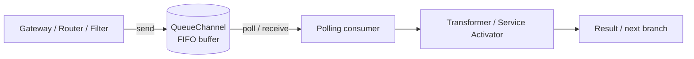
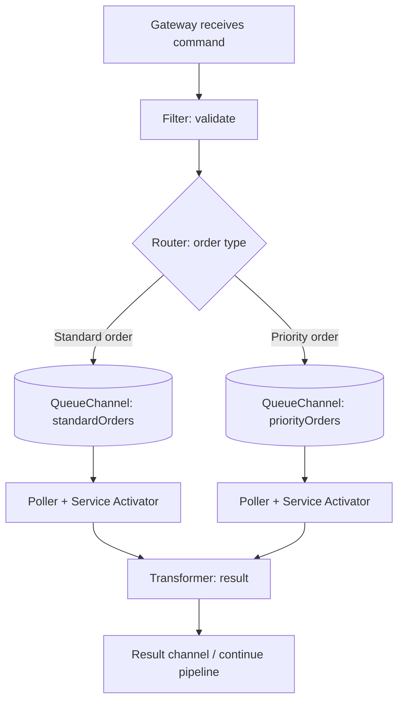

# QueueChannel and Message Buffering in Spring Integration

In integration systems, message senders often produce data at a different pace than processors. An API may receive bursts of concurrent requests while database writes, external service calls, or result aggregation take substantial time. **QueueChannel** is a Spring Integration *Message Channel* type that allows **messages to be enqueued so the receiving side can proactively pull and process them**.

This is an important choice when learning **Enterprise Integration Patterns** with Spring Integration: combining Gateway, Router, Filter, Transformer, Splitter, Aggregator, retry, error channel, and correlation to build message flows that are more loosely coupled, extensible, and observable. This lesson focuses on how QueueChannel acts as a buffer, how it behaves under rising load, the limits of in-memory queues, and how to test a poller-driven flow.

## 1. Where Does QueueChannel Sit in the Messaging System?

Spring Integration uses `Message<T>` to represent data and `MessageChannel` to pass messages between endpoints. Each Message contains:

- **Payload**: the business content, such as `OrderCommand`, `PaymentEvent`, or a list of item codes.
- **Headers**: metadata such as Message ID, timestamp, correlation ID, and routing info.

`QueueChannel` implements the **`PollableChannel`** interface. The sender calls `send(...)` to place a Message into the channel; the receiver calls `receive(...)` to pull a Message out. Messages stay in the queue until retrieved by a receiver, within memory and configured capacity limits.



**Two concepts must be kept distinct:**

1. **QueueChannel is where Messages wait to be processed**; by itself it does not start a background processing thread.
2. **A Poller or code calling `receive()` is what retrieves Messages**. Without a consumer, data stays in the queue until it fills up or the application shuts down.

This differs from `DirectChannel`, where `send()` normally invokes a registered handler directly on the calling thread. `QueueChannel` separates the moment the sender puts a Message into the channel from the moment the receiver processes it; this is **temporal decoupling**, though it does not mean the application now has a durable message broker.

## 2. Queue Mechanics and Fundamental Characteristics

By default, a `QueueChannel` uses an in-memory **FIFO** (*first in, first out*) queue. Under normal configuration, earlier-arriving Messages are retrieved first. However, **processing completion order** can differ from retrieval order when multiple consumers run concurrently.

| Property | Typical Behavior | Design Implication |
| --- | --- | --- |
| Channel type | `PollableChannel` | Consumer must call `receive()` directly or be triggered by a poller |
| Transfer style | Producer `send`, consumer `receive` | Both sides can run at different times |
| Buffer | In-memory queue in standard configuration | Helps absorb short load spikes; risk of data loss if process stops |
| Ordering | FIFO when enqueueing/dequeuing Messages | Does not guarantee completion order under concurrent processing |
| Distribution | Each successful retrieve removes one Message from the queue | Not a mechanism to broadcast one Message to all subscribers |
| Capacity | Can be bounded via `capacity` | If space is available, `send` accepts data; when full, must handle timeout/rejection |
| Error handling | Errors happen **after the Message has already been removed** | Must design retries, error flows, and failed-message storage |

### PollableChannel vs. SubscribableChannel

To select the right channel type, distinguish:

| Channel | Consumption Style | Best Suited When |
| --- | --- | --- |
| `DirectChannel` | Pushes directly to subscriber; typically same execution thread | Synchronous, simple, fast-response processing is needed |
| `ExecutorChannel` | Offloads subscriber invocation to a `TaskExecutor` | You want to shift the execution boundary to another thread |
| `QueueChannel` | Receiver **actively polls** | Buffering, rate regulation, and batch/cadenced processing are needed |
| `PublishSubscribeChannel` | Broadcasts to multiple subscribers | Multiple branches need the same event |
| `PriorityChannel` | Polls by priority | Messages must be prioritized instead of FIFO |

Do not pick QueueChannel merely because you want "asynchronous." Every queue-based flow must clearly specify **who polls, how fast it polls, and how errors are handled**.

## 3. Creating a QueueChannel and Testing send/receive

Small example using Java and Spring Integration:

```java
import org.springframework.integration.channel.QueueChannel;
import org.springframework.messaging.Message;
import org.springframework.messaging.support.MessageBuilder;

public class QueueChannelDemo {
    public static void main(String[] args) {
        QueueChannel queue = new QueueChannel(2); // holds at most 2 Messages

        Message<String> first = MessageBuilder
                .withPayload("ORDER-001")
                .setHeader("source", "web")
                .build();
        Message<String> second = MessageBuilder
                .withPayload("ORDER-002")
                .build();
        Message<String> third = MessageBuilder
                .withPayload("ORDER-003")
                .build();

        boolean accepted1 = queue.send(first, 0);
        boolean accepted2 = queue.send(second, 0);
        boolean accepted3 = queue.send(third, 100);

        System.out.println(accepted1); // true
        System.out.println(accepted2); // true
        System.out.println(accepted3); // false: queue is currently full

        Message<?> received1 = queue.receive(0);
        Message<?> received2 = queue.receive(0);
        Message<?> received3 = queue.receive(0);

        System.out.println(received1.getPayload()); // ORDER-001
        System.out.println(received2.getPayload()); // ORDER-002
        System.out.println(received3 == null);      // true
    }
}
```

The constructor `new QueueChannel(2)` sets a **maximum capacity of two Messages in the queue**. The first two `send` calls succeed; the third waits up to 100 ms and returns `false` if no space opens up.

### Meaning of Timeouts

`QueueChannel` provides `MessageChannel.send(message, timeout)` and `PollableChannel.receive(timeout)`. Common values:

| Timeout | `send()` When Queue Is Full | `receive()` When Queue Is Empty |
| --- | --- | --- |
| `0` | Try immediately; return `false` if unable to enqueue | Try immediately; return `null` if no Message is available |
| Positive number, e.g. `500` | Wait up to 500 ms for space | Wait up to 500 ms for a Message |
| `-1` | Can wait indefinitely to enqueue the Message | Can wait indefinitely to receive a Message |

In real applications, use finite timeouts where response time matters. A `false` result must be handled explicitly, such as rejecting the request, signaling overload, or routing to another reliable intake mechanism. Never treat `send()` returning `false` as message acceptance.

When `receive(timeout)` returns `null`, it simply means **no Message arrived within the wait window**; it is not necessarily an error. Check for `null` before calling `getPayload()`.

## 4. Buffer Capacity and Backpressure

If the producer generates `λ` Messages/second while the consumer completes `μ` Messages/second, when `λ > μ` over a sustained period the number of queued Messages grows. With queue capacity `C`, assuming an initially empty queue and constant rates, the approximate time to fill is:

\[
t_{\text{fill}}\approx\frac{C}{\lambda-\mu}\quad(\lambda>\mu)
\]

For example: the producer sends 120 Messages/second; the consumer processes 100 Messages/second; the queue holds up to 1,000 Messages. Backlog grows at roughly 20 Messages/second and the queue can fill in about 50 seconds if rates stay constant. This is only an approximation: real production/processing fluctuates and involves bursts, retries, and overhead.

### Bounded Queue vs. Unbounded Queue

```java
QueueChannel bounded = new QueueChannel(500);
QueueChannel defaultQueue = new QueueChannel();
```

- **Bounded** (`new QueueChannel(500)`): caps the number of waiting Messages. Consider this for flows susceptible to overload to prevent unbounded memory growth.
- **Default** (`new QueueChannel()`): uses an in-memory buffer with no application-imposed capacity limit; in practice still constrained by process/JVM resources.

Capacity is measured in **Message count**, not bytes. A queue of 1,000 tiny payloads is vastly different from a queue of 1,000 payloads containing huge data arrays. Do not look solely at Message count while ignoring payload size and lifecycle.

**Backpressure** here does not automatically propagate across every tier. When the queue fills, `send` blocking or failing applies pressure back on the calling producer; the Gateway, HTTP endpoint, or upstream receiver must decide how to handle that signal. If the producer retries without limit, overload can worsen.

### Rule of Thumb for Initial Capacity

You can estimate based on the maximum backlog wait time the system tolerates:

\[
C \approx \text{steady consumption rate} \times \text{target wait time}
\]

This is only a starting point for load testing. Also examine burst rates, memory resources, `send` response times, worker counts, and alert thresholds. A large capacity does not fix a consumer that is persistently slower than the producer; it only delays hitting the limit.

## 5. Wiring QueueChannel with a Poller and Service Activator

In a Spring application, we commonly declare `QueueChannel` as a bean and use a **poller** to fetch Messages on a schedule. The following example uses Spring Integration Java annotation configuration:

```java
import org.springframework.context.annotation.Bean;
import org.springframework.context.annotation.Configuration;
import org.springframework.integration.annotation.Poller;
import org.springframework.integration.annotation.ServiceActivator;
import org.springframework.integration.channel.QueueChannel;
import org.springframework.integration.config.EnableIntegration;
import org.springframework.messaging.Message;

@Configuration
@EnableIntegration
public class OrderQueueConfiguration {

    @Bean
    public QueueChannel orderQueue() {
        return new QueueChannel(100);
    }

    @ServiceActivator(
            inputChannel = "orderQueue",
            poller = @Poller(fixedDelay = "250", maxMessagesPerPoll = "10"))
    public void processOrder(Message<String> message) {
        String orderId = message.getPayload();
        System.out.println("Processing: " + orderId);
        // Execute actual business logic and handle exceptions per policy
    }
}
```

`orderQueue()` creates a queue holding at most 100 Messages. `@ServiceActivator` declares an endpoint receiving data from the channel named `orderQueue`; `@Poller` lets that endpoint fetch up to 10 Messages per poll cycle, with a fixed delay of 250 ms between scheduled polls. **This configuration does not automatically spawn 10 parallel threads**: `maxMessagesPerPoll` caps how many Messages are fetched per poll, while concurrency depends on scheduler, executor, and handler configuration.

A producer can send Messages like this:

```java
import org.springframework.integration.channel.QueueChannel;
import org.springframework.messaging.support.MessageBuilder;

public class OrderProducer {
    private final QueueChannel orderQueue;

    public OrderProducer(QueueChannel orderQueue) {
        this.orderQueue = orderQueue;
    }

    public boolean submit(String orderId) {
        return orderQueue.send(
                MessageBuilder.withPayload(orderId)
                        .setHeader("businessOrderId", orderId)
                        .build(),
                300);
    }
}
```

In Spring Boot, `OrderProducer` must be registered as a bean (e.g., via `@Component` or `@Bean`) so Spring injects `orderQueue`. The return value of `submit` indicates whether the Message **entered the queue**, **not** that business processing has finished.

### What Does a Poller Solve and What Doesn't It Solve?

A poller supplies a consumption cadence and invokes the handler on schedule. It does not turn an in-memory queue into durable storage, does not replace a retry policy, and does not ensure failed Messages are placed back into the queue. To tune throughput, adjust poll intervals, `maxMessagesPerPoll`, executor settings, and replica counts, then measure actual processing capacity.

If multiple consumers pull from one queue, a Message is normally taken by **one** consumer. However, once retrieved, consumers may process concurrently, so completion order is no longer strictly FIFO.

## 6. Fitting QueueChannel into an Integration Flow

A sample order-processing flow:



Here the Router classifies orders. QueueChannel serves as a **buffer between the ingestion layer and the processing layer**; Pollers regulate each branch's pace. A `Filter` can block invalid messages before enqueueing, avoiding wasted capacity.

Enterprise Integration Patterns interact with QueueChannel as follows:

| Pattern | How It Coordinates with QueueChannel | What to Control |
| --- | --- | --- |
| Gateway | Sends application requests into the queue | Distinguish "queued" from "processed"; synchronous call timeouts |
| Router | Routes Messages to different queues | Capacity, poll rate, and priority of each branch |
| Filter | Drops ineligible Messages before/after the queue | Prevent Aggregator groups from waiting on dropped items |
| Transformer | Converts payload before enqueueing or after polling | Preserve necessary business/correlation metadata |
| Splitter | Emits multiple child Messages, optionally enqueueing each | `correlationId`, `sequenceNumber`, `sequenceSize`, item count |
| Aggregator | Groups items processed after polling | Late Messages, timeouts, release strategy, and message store |
| Retry | Retries a failed consumer operation | Attempt limits, backoff, idempotency, exhaustion handling |
| Error channel | Routes errors to an error-handling path | Logging original Message info and storing failed Messages |

**Correlation example:** an order has three line items; Splitter creates three child Messages sharing the same `correlationId` and `sequenceNumber` values `1, 2, 3`. Passing all three through QueueChannel can cause them to finish in different orders. The Aggregator must rely on correlation metadata and release strategies to gather the full set, not on when Messages finish processing.

When a Filter discards an item after a Splitter, the Aggregator might still wait for the original `sequenceSize`. Handle this in the flow design: filter before splitting, adjust completion conditions, or handle expired groups.

## 7. What Happens When the Application Stops or a Consumer Fails?

This is the most important limitation of a standard QueueChannel.

### 7.1. An In-Memory Queue Is Not a Durable Queue

If the JVM process stops or is killed, Messages residing only in memory are lost. When deploying multiple instances, each instance typically has its **own internal queue**, not a cluster-wide shared queue.

If you must retain Messages across restarts, exchange across services, or rely on broker acknowledgments, design suitable storage/transport such as JMS, AMQP, Kafka, or Spring Integration's message store mechanisms with corresponding configuration. Using durable storage requires verifying transactions, recovery, serialization, and consumption strategies; you cannot flip one setting and assume exactly-once semantics.

### 7.2. Dequeuing Does Not Mean Processing Succeeded

With an in-memory QueueChannel, `receive()` removes the Message **from the queue**. If the handler calls an external service and fails, the Message does not automatically reappear in the queue just because the handler threw an exception.

```text
QueueChannel (holds Message A)
         |
     receive(A)
         |        QueueChannel no longer has A
      handler
         |
       error!
         |
   retry / error flow / error persistence configured by application
```

That is why every consumer needs explicit error-handling rules: bounded retries, routing error events to an error flow, persisting messages for manual intervention, or moving to a dead-letter channel when infrastructure supports it.

### 7.3. Retries and Idempotency

Retries can repeat business operations. For instance, a handler writes an order to the database and then fails calling the next service; retrying the entire handler could insert the order a second time.

Typical solutions include:

1. Establish a stable **idempotency key**, such as `eventId` or `orderId + operationType`.
2. Check and record processing state atomically.
3. Cap retry attempts, apply suitable backoff, and record the final failure reason.
4. Monitor failed Messages or incomplete Aggregator groups for follow-up handling.

A Message's `MessageHeaders.ID` only helps observe that specific Message instance; if the same event is recreated as a new Message, its ID can differ. Therefore, do not rely solely on Message ID as a deduplication key across retries or services.

## 8. Monitoring Queues in Production

A queue can function properly and still slow down the system as backlog accumulates. Monitor producer, queue, and consumer sides together:

| Metric | Meaning | Warning Sign to Investigate |
| --- | --- | --- |
| Queue depth | Number of waiting Messages | Rising continuously over a sustained period |
| Capacity utilization | Occupied share of capacity | Approaching limit or frequently full |
| Enqueue rate | Messages accepted per second | Sudden spike exceeding consumption capacity |
| Dequeue / success rate | Messages pulled and processed successfully | Lower than enqueue rate over extended time |
| Oldest message age | Wait time of the oldest Message in the queue | Exceeding wait-time SLA |
| Send timeout / rejection | Count of times producer failed to enqueue | Backpressure has reached upstream |
| Handler latency | Handler execution duration | Dependent service or database slowdown |
| Retry / error count | Retry attempts and failed Message count | Repeated errors or misaligned error handling |

You can use Micrometer, Spring Boot Actuator, and appropriate monitoring tools to collect metrics at the producer, poller, and handler. Do not assume every metric is exported out of the box across all versions/configs; some require custom metrics.

For logs, useful fields include `messageId`, `correlationId`, business key, channel name, enqueue/dequeue timestamps, attempt count, and outcome. Avoid logging full payloads if they contain sensitive info or large blobs.

## 9. Testing QueueChannel and Processing Branches

### 9.1. Verifying Basic Behavior

Use a small queue to verify exact behavior:

```java
import static org.junit.jupiter.api.Assertions.*;

import org.junit.jupiter.api.Test;
import org.springframework.integration.channel.QueueChannel;
import org.springframework.messaging.Message;
import org.springframework.messaging.support.MessageBuilder;

class QueueChannelTest {

    @Test
    void shouldBufferInFifoOrderAndRejectWhenFull() {
        QueueChannel queue = new QueueChannel(2);

        assertTrue(queue.send(MessageBuilder.withPayload("A").build(), 0));
        assertTrue(queue.send(MessageBuilder.withPayload("B").build(), 0));
        assertFalse(queue.send(MessageBuilder.withPayload("C").build(), 0));

        Message<?> first = queue.receive(0);
        Message<?> second = queue.receive(0);

        assertNotNull(first);
        assertNotNull(second);
        assertEquals("A", first.getPayload());
        assertEquals("B", second.getPayload());
        assertNull(queue.receive(0));
    }
}
```

This is a unit test targeting `QueueChannel` alone without starting a full Spring context. It proves the bounded queue accepts two Messages, rejects the third when full, and yields them in FIFO order to a consumer.

### 9.2. Testing a Poller-Driven Pipeline

For `OrderQueueConfiguration` in Section 5, integration tests should verify:

- Sending a Message to the channel succeeds; the handler is invoked via the poller within a bounded wait window.
- When the producer sends multiple Messages, handler invocations and business outcomes match the number of Messages **accepted by the queue**.
- When the queue is full, the producer receives `false` or the rejection policy triggers properly.
- When the handler fails, the message follows the configured retry/error flow; do not assume a dequeued Message necessarily succeeded.
- When two order types are split by a Router, Messages enter the right queue and corresponding consumer.
- With Splitter/Aggregator, verify correlation metadata and aggregated results once branches finish.

Avoid fixed `Thread.sleep()` calls in async tests. Wait on an explicit condition with a timeout and fail if not satisfied.

### 9.3. Load Testing and Failure Recovery

Drive producer rates higher than consumer rates in a controlled manner, measuring how long the queue takes to fill and how upstream responds. Then pause the consumer, restart the app, and inject handler errors to verify precisely what remains in the queue, what was processed, and what must be re-sent. These tests are especially important before adopting QueueChannel in high-reliability workflows.

## 10. Common Design Mistakes and How to Avoid Them

| Symptom | Possible Cause | Resolution |
| --- | --- | --- |
| Messages enter queue but are never processed | Missing consumer/poller, stopped poller, or wrong channel name | Check channel bean, poller, endpoint, and startup logs |
| API hangs or slows down | Producer blocking on `send()` when queue is full, or Gateway waiting for reply | Set timeouts and appropriate overload responses |
| Application RAM grows continuously | Unbounded queue or oversized payloads | Bound capacity, shrink payloads, monitor backlog |
| Data lost on restart | Messages exist only in memory | Use durable storage/messaging infrastructure if required |
| Messages vanish after handler error | Message was already removed by `receive()` | Configure retries, error flow, and failed-Message storage |
| Processing results are out of order | Multiple consumers pulling Messages or branches taking varying times | Enforce ordering at the business layer or partition processing |
| Incomplete or mixed aggregation groups | Wrong `correlationId`, items dropped by Splitter/Filter | Check headers and Aggregator release/expiry strategies |
| Same business action runs multiple times | Retries or upstream re-emitting the same event | Use an idempotency key and persist processing state |

## 11. When Should You Use QueueChannel?

**QueueChannel fits well** when a Spring Integration application needs an **internal** buffer between two stages, short wait times, an actively polling consumer, and can tolerate in-memory semantics or uses a dedicated message store solution.

**Consider alternatives** when you need to broadcast messages to multiple subscribers, priority ordering, durable cross-process delivery, or a shared broker across multiple replicas. In those cases, other channel types or adapters to JMS, AMQP, or Kafka reflect system requirements better.

When designing a Message Channel, four questions must always have clear answers: **Who sends? Who pulls the Message? What happens when the buffer is full? Where does the Message go if the consumer fails?** With concrete answers plus proper testing and monitoring, QueueChannel helps a Spring Integration flow absorb short bursts and decouple send/receive cadences in a controlled manner.
