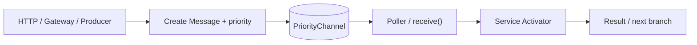
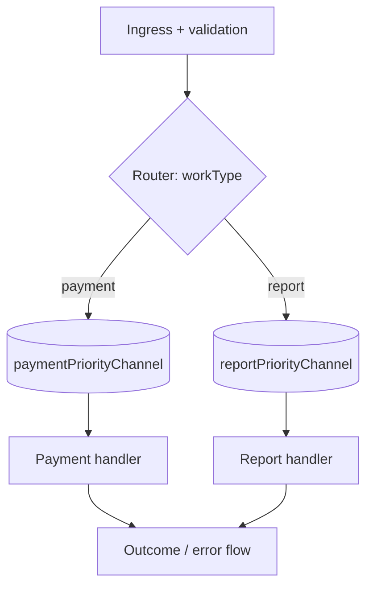

# PriorityChannel and Priority Ordering in Spring Integration

## Learning Objectives

In a messaging system, not every request should be processed strictly in arrival order. A payment incident may need to be processed before a report sync job, even if the report entered the queue earlier. Spring Integration's **PriorityChannel** lets consumers retrieve waiting messages by priority level.

This lesson belongs to the **Message channel** chapter, within the scope of **SPRING_INTEGRATION_PATTERN**: implementing Enterprise Integration Patterns (EIP) with Spring Integration to create loosely coupled, extensible message flows; coordinating Router, Filter, Transformer, Splitter, Aggregator, Gateway, retry, error channel, and correlation; and testing and tracing each branch.

After this lesson, you will be able to:

- Distinguish **enqueue order** from **dequeue order** for `QueueChannel` and `PriorityChannel`.
- Use the `priority` header, `PollableChannel`, and pollers in their proper roles.
- Configure `PriorityChannel` via Java DSL or XML with bounded capacity.
- Build a `Comparator<Message<?>>` to customize priority ordering and handle ties.
- Write tests verifying priority rules without depending on thread timing.
- Identify starvation, backpressure, multi-consumer risks, retries, correlation, and message stores.

## 1. Why Do We Need PriorityChannel?

A standard `QueueChannel` retrieves messages in first-in, first-out (FIFO) order. `PriorityChannel` is still a message queue, but selects the next element to dequeue based on **priority**, read by default from the `priority` header.

Suppose a system receives three tasks:

| Arrival Order | Task | `priority` Header |
| --- | --- | ---: |
| 1 | Generate daily report | 1 |
| 2 | Confirm order | 5 |
| 3 | Handle urgent fraud | 10 |

Assuming **all three messages are already in the queue before the consumer calls `receive()`**, the dequeue order under default priority configuration is:

```text
Sent in:   report (1)  --->  order (5)  --->  fraud (10)
                                              |
Queue holds: [report (1), order (5), fraud (10)]
                                              |
Dequeued:  fraud (10) --->  order (5)  --->  report (1)
```

**A higher priority value means higher priority**. This selection order applies among messages **currently waiting in the channel**. It does not mean a late-arriving message preempts a task a consumer has already dequeued and begun processing.

### Three Easily Confused Concepts

| Concept | Meaning | Implication |
| --- | --- | --- |
| **Arrival order** | Order in which producers successfully call `send()` | Does not dictate `PriorityChannel` dequeue order. |
| **Dequeue order** | Order in which `receive()` calls retrieve waiting messages | Determined by the channel's comparator. |
| **Completion order** | Order in which handlers finish tasks | Also depends on processing duration, retries, thread pools, and I/O; may differ from dequeue order. |

`PriorityChannel` provides a **dequeue** policy—not a scheduler capable of interrupting running tasks (*preemption*), nor a mechanism guaranteeing work completes in priority order.

## 2. How PriorityChannel Works

`PriorityChannel`, in package `org.springframework.integration.channel`, is an implementation based on `QueueChannel` that implements `PollableChannel`. A producer sends a `Message<?>` to the channel; a consumer actively pulls via `receive()`, or Spring Integration uses a **polling endpoint** to invoke receive on a schedule.



Inside a message you typically find:

```text
Message
  payload = WorkItem(id="W-42", type="FRAUD_CHECK")
  headers:
    priority      = 10
    correlationId = "batch-8"
    traceId       = "trace-91"
```

- `payload` describes the business work to perform.
- `priority` serves **selecting the order in which messages are pulled from the channel**.
- `traceId` supports end-to-end tracing across endpoints.
- `correlationId` supports linking a group of messages, such as in Splitter/Aggregator. It is **not automatically synonymous** with priority.

### The priority Header Must Have the Right Type

The default header is named `priority` and should be set as an `Integer`, for example via `MessageBuilder.setHeader("priority", 10)`. Do not pass the string `"10"` and expect the framework to convert it automatically. If priority comes from HTTP, Kafka, or user input, normalize, validate, and clamp the value range before sending into the channel.

If a message **lacks** the header or has an invalid value, do not build business contracts around assumed ordering. Assign a default priority deliberately at ingress and test against the exact Spring Integration version you use.

## 3. Small Java Example: Observing Dequeue Order

The following example intentionally sends all three messages **before receiving**, so results are unaffected by pollers or asynchronous execution.

```java
import org.springframework.integration.channel.PriorityChannel;
import org.springframework.messaging.Message;
import org.springframework.messaging.support.MessageBuilder;

public class PriorityChannelDemo {

    private static Message<String> task(String name, int priority) {
        return MessageBuilder.withPayload(name)
            .setHeader("priority", priority)
            .build();
    }

    public static void main(String[] args) {
        PriorityChannel channel = new PriorityChannel(10);

        channel.send(task("report", 1));
        channel.send(task("order", 5));
        channel.send(task("fraud", 10));

        System.out.println(channel.receive(0).getPayload()); // fraud
        System.out.println(channel.receive(0).getPayload()); // order
        System.out.println(channel.receive(0).getPayload()); // report
    }
}
```

Here:

1. `new PriorityChannel(10)` creates a channel with **capacity = 10**.
2. `send()` accepts messages and places them into the queue.
3. `receive(0)` attempts to retrieve a message **immediately**, without waiting if the queue is empty.
4. The default comparator selects higher priority first.

The `10` in the constructor is **capacity**, not a default priority level or consumer count. When the channel has no remaining messages, `receive(0)` returns `null`; the example above does not hit that case because all three messages were sent beforehand.

### Quick Comparison with Other Channel Types

| Channel | Who Receives the Message? | Prominent Ordering Rule | Use Case |
| --- | --- | --- | --- |
| `DirectChannel` | Handler invoked via subscribe/dispatch | Invokes handler synchronously; no priority queue | Direct forwarding, needing same-thread transactions. |
| `QueueChannel` | Consumer/poller calls `receive()` | FIFO for waiting messages | General work buffering. |
| `PriorityChannel` | Consumer/poller calls `receive()` | By priority/comparator for waiting messages | Prioritizing urgent work. |
| `PublishSubscribeChannel` | Subscribers | Broadcasts to multiple subscribers; no priority queueing | Event fan-out. |

Note: `PriorityChannel` only changes the queueing strategy; it does not automatically perform Router, Filter, or error handling in place of endpoints.

## 4. Configuring a Real Flow in Spring Integration

Suppose an application needs to place tasks into a priority queue, and then a handler processes them. We use:

- An **IntegrationFlow** that accepts input and translates a business label into the `priority` header.
- A **PriorityChannel** bean with bounded capacity.
- A **polling service activator** that pulls messages from the channel.

```java
import org.springframework.context.annotation.Bean;
import org.springframework.context.annotation.Configuration;
import org.springframework.integration.channel.PriorityChannel;
import org.springframework.integration.config.EnableIntegration;
import org.springframework.integration.annotation.Poller;
import org.springframework.integration.annotation.ServiceActivator;
import org.springframework.integration.dsl.IntegrationFlow;
import org.springframework.messaging.Message;

@Configuration
@EnableIntegration
public class PriorityWorkFlowConfig {

    @Bean("taskPriorityQueue")
    public PriorityChannel taskPriorityQueue() {
        return new PriorityChannel(100);
    }

    @Bean
    public IntegrationFlow taskIngressFlow() {
        return IntegrationFlow.from("taskIngress")
            .enrichHeaders(h -> h.headerFunction("priority", message -> {
                Object severity = message.getHeaders().get("severity");

                if ("CRITICAL".equals(severity)) {
                    return 100;
                }
                if ("HIGH".equals(severity)) {
                    return 50;
                }
                return 10;
            }))
            .channel("taskPriorityQueue")
            .get();
    }

    @ServiceActivator(
        inputChannel = "taskPriorityQueue",
        poller = @Poller(fixedDelay = "200", maxMessagesPerPoll = "1")
    )
    public void handleTask(Message<String> message) {
        String task = message.getPayload();
        int priority = (Integer) message.getHeaders().get("priority");

        // Call business service; can trace via traceId.
        System.out.printf("Handling %s (priority=%d)%n", task, priority);
    }
}
```

The code above illustrates **how components are wired**. Another flow can send messages to `taskIngress`, for instance:

```java
Message<String> incoming = MessageBuilder.withPayload("order-42")
    .setHeader("severity", "CRITICAL")
    .setHeader("traceId", "trace-42")
    .build();

taskIngress.send(incoming);
```

In this send snippet, `taskIngress` is a `MessageChannel` injected from the Spring context; the example requires importing `org.springframework.messaging.MessageChannel`, `org.springframework.messaging.support.MessageBuilder`, and related message types. The header enricher maps `CRITICAL` → `100`, `HIGH` → `50`, and everything else → `10` before placing the message into the queue.

**Why is a poller required?** `PriorityChannel` belongs to `PollableChannel`, so it does not push to subscribers the way `DirectChannel` does. A handler using `@ServiceActivator` that wants to consume from this channel needs a poller configuration (or an equivalent active receiving mechanism). `fixedDelay` sets the polling cadence and `maxMessagesPerPoll` limits messages per poll; they do not replace the priority policy.

### XML Configuration

If a project uses XML instead of Java configuration, the equivalent queue definition is:

```xml
<int:channel id="taskPriorityQueue">
    <int:priority-queue capacity="100"/>
</int:channel>
```

The XML snippet assumes the Spring Integration `int` namespace is declared. Official documentation also supports configuring a comparator, accepted payload types (`datatype`), and compatible message store options.

## 5. Equal Priorities: Not FIFO by Default

Two tasks with the same priority create another edge case:

```text
A(priority=5) -> sent first
B(priority=5) -> sent later
```

With a comparator that compares only priority, A and B compare as equal. **Do not assume the channel guarantees FIFO for messages with equal priority.** If business logic requires "higher priority first; same priority first-in, first-out," define an explicit secondary tie-breaker rule.

One approach is attaching a sequence number at **ingress** and using a custom comparator:

```java
import java.util.Comparator;
import java.util.concurrent.atomic.AtomicLong;

import org.springframework.integration.channel.PriorityChannel;
import org.springframework.messaging.Message;
import org.springframework.messaging.support.MessageBuilder;

public class StablePriorityQueueFactory {

    private final AtomicLong sequence = new AtomicLong();

    public Message<String> newTask(String body, int priority) {
        return MessageBuilder.withPayload(body)
            .setHeader("priority", priority)
            .setHeader("enqueueSequence", sequence.incrementAndGet())
            .build();
    }

    public PriorityChannel createChannel() {
        Comparator<Message<?>> byPriorityThenSequence =
            Comparator.<Message<?>>comparingInt(m ->
                    ((Number) m.getHeaders().get("priority")).intValue())
                .reversed()
                .thenComparingLong(m ->
                    ((Number) m.getHeaders().get("enqueueSequence"))
                        .longValue());

        return new PriorityChannel(100, byPriorityThenSequence);
    }
}
```

The rules here:

1. Priority **descending**: `100` before `50` before `10`.
2. When priorities are equal, `enqueueSequence` **ascending**: smaller numbers are dequeued first.
3. Every message must carry `priority` and `enqueueSequence` headers with the expected types when entering the comparator.

`AtomicLong` provides monotonic ordering only **within a single application instance**. If multiple producers run across multiple nodes, you need a unified sequencing mechanism or a different ordering requirement. Do not rely on low-resolution timestamps as the sole tie-breaker when strict ordering is truly required.

**A comparator must be consistent, transitive, and based on data that does not mutate while the message is in the queue.** Avoid comparing against "current time," mutable data, or external state; queue heap ordering can become unpredictable.

## 6. Capacity, Backpressure, and Timeouts

A priority queue still requires **resource bounds**. If producers send faster than consumers process, the queue can grow continuously and create memory pressure. Configuring finite capacity provides a **backpressure** signal.

```java
PriorityChannel queue = new PriorityChannel(2);

boolean first  = queue.send(task("A", 1), 0);
boolean second = queue.send(task("B", 5), 0);
boolean third  = queue.send(task("C", 9), 0);
```

Assuming no consumer is running and the queue starts empty:

- `first` and `second` succeed.
- `third` fails because the queue is full when using a `0` timeout for non-blocking send.
- With a positive timeout, the producer may wait until space frees up or the timeout expires.
- Using the overload without a timeout risks blocking indefinitely if the queue stays full; check the API contract and how your project's sending endpoints behave.

In production systems, send failures must be handled actively (returning an upstream error, retrying with backoff, routing to a fallback channel, or reporting overload); never ignore `send()`'s return value.

**Do not interpret "high priority" as bypassing capacity limits.** A full queue can reject a newly arriving urgent message before it is ever ranked. If you need reserved capacity for urgent work, consider separate queues or dedicated admission control rules.

## 7. Impact on Other Enterprise Integration Patterns

Priority lives on the **Message Channel**; EIP endpoints decide **which messages enter the channel** and **what happens after receiving**. Design priority alongside the entire flow.

| Pattern / Endpoint | How It Combines | Risks to Avoid |
| --- | --- | --- |
| **Router** | Splits tasks by type, region, or SLA into dedicated priority channels. | One shared queue can let one task type dominate all tenants. |
| **Filter** | Rejects invalid messages before entering the queue. | Unauthenticated external priority headers could "boost" untrusted tasks. |
| **Transformer** | Converts payloads; preserves the `priority` header if later steps still need it. | Handler builds a new `Message<?>` and accidentally drops headers. |
| **Splitter** | Child messages can carry priorities matching their subtasks. | One large request spawning many high-priority parts can monopolize the queue. |
| **Aggregator** | Groups messages by `correlationId` and release strategy, not by priority alone. | A low-priority child arriving late can hold back the entire group. |
| **Gateway** | Callers can supply attributes used to compute priority at ingress. | Synchronous Gateways still have timeouts; high priority does not guarantee immediate response. |
| **Retry / error channel** | Retries failures under control; preserves `traceId` and correlation keys for analysis. | Continuously retrying a high-priority message can starve throughput for other messages. |

### Example with Router and Processing Branches



If payments have strict SLAs while reports run in batches, two queues and two consumer groups can be easier to throttle and isolate than a single priority queue. Adding `priority` alone does not solve every resource-isolation or fairness problem.

### Ordering in Splitter/Aggregator

When a request is split into parts and later recombined, **processing order** can change due to priority and concurrency. If the final output requires the original order, use group metadata such as `correlationId`, `sequenceNumber`, and deliberate aggregation/resequencing rules. Do not treat the order in which an `Aggregator` receives messages as representing the original element order in the source payload.

## 8. Important Ordering Limitations

### 8.1. In-Flight Messages Are Not Preempted

Suppose a consumer has already dequeued a priority `1` task that takes 5 seconds to run. A priority `100` message then arrives in the queue. The new message may be picked **on the next receive**, but `PriorityChannel` does not interrupt the running handler to process it first.

If ultra-low latency is required for urgent tasks, design adequate **processing capacity**, potentially separating queues and consumers rather than simply raising priority numbers.

### 8.2. Multiple Consumers Do Not Guarantee Completion Order

With multiple pollers/workers or async processing, a high-priority message may be dequeued first yet finish after another message due to differing task durations. If strict completion order or per-`orderId` ordering is required, add keyed serialization, concurrency limits, or a dedicated coordinator.

### 8.3. Starvation

If high-priority messages arrive continuously, low-priority messages may wait for a very long time—or never be dequeued during sustained high traffic. This is **starvation**.

Mitigation strategies:

- Cap ingress rate/quotas per priority tier or per tenant.
- Separate queues for workloads with different SLAs.
- Use proportional *weighted scheduling* outside a single `PriorityChannel`.
- Design an "aging" policy that gradually boosts priority after long waits. To apply this to items already in a queue, you need explicit re-queueing/scheduling mechanics; **merely using a comparator that reads current time does not cause a heap-backed queue to automatically reorder itself**.
- Monitor wait latency **per priority tier**, not just overall averages.

### 8.4. Internal Priority vs. Cross-Service Priority

An in-process Java `PriorityChannel` does not automatically propagate ordering rules to Kafka, AMQP, JMS, or HTTP. Adapters can map headers to protocol metadata, yet the broker or receiving consumer maintains its own queueing policy. Test across real boundaries when systems span multiple services.

### 8.5. In-Memory Queues vs. Durable Persistence

The default queue configuration fits in-process work, but does not preserve remaining messages if the application terminates abruptly. Spring Integration supports priority-capable message stores via `PriorityCapableChannelMessageStore` (depending on version, implementations include JDBC/Redis/MongoDB). With a message store, configuring `comparator` and `capacity` carries different constraints than in-memory queues; consult documentation for your exact runtime version.

A durable queue also does not automatically provide **exactly-once processing**. You still need idempotency, retries, and business state checks.

## 9. Testing: Priority Must Be Proven at Dequeue Time

To test priority, create an isolated queue, **send all test messages first**, and then receive sequentially. Avoid starting background pollers in basic ordering tests because a consumer might pick up a low-priority message before the high-priority one is even sent.

```java
import static org.assertj.core.api.Assertions.assertThat;

import org.junit.jupiter.api.Test;
import org.springframework.integration.channel.PriorityChannel;
import org.springframework.messaging.Message;
import org.springframework.messaging.support.MessageBuilder;

class PriorityChannelTest {

    private Message<String> msg(String payload, int priority) {
        return MessageBuilder.withPayload(payload)
            .setHeader("priority", priority)
            .build();
    }

    @Test
    void dequeuesHighestPriorityFirst() {
        PriorityChannel queue = new PriorityChannel(8);

        assertThat(queue.send(msg("low", 1))).isTrue();
        assertThat(queue.send(msg("high", 10))).isTrue();
        assertThat(queue.send(msg("medium", 5))).isTrue();

        assertThat(queue.receive(0).getPayload()).isEqualTo("high");
        assertThat(queue.receive(0).getPayload()).isEqualTo("medium");
        assertThat(queue.receive(0).getPayload()).isEqualTo("low");
        assertThat(queue.receive(0)).isNull();
    }

    @Test
    void refusesNewMessageWhenBoundedQueueIsFull() {
        PriorityChannel queue = new PriorityChannel(1);

        assertThat(queue.send(msg("first", 1), 0)).isTrue();
        assertThat(queue.send(msg("second", 100), 0)).isFalse();

        assertThat(queue.receive(0).getPayload()).isEqualTo("first");
    }
}
```

These assertions verify the two core contracts:

1. **Among messages currently waiting in the queue**, higher priority is chosen first.
2. **A full queue** does not automatically evict or make room for a new higher-priority message.

With a secondary `enqueueSequence` comparator, add a dedicated test with two equal-priority messages confirming the lower sequence number is dequeued first. In full integration flows, add tests covering priority header computation, timeout handling, retries, and `traceId` preservation across Transformer/Router steps.

## 10. Operational Monitoring and Troubleshooting

Metrics worth tracking:

| Metric | Practical Meaning |
| --- | --- |
| Queue depth / capacity utilization | Detects memory pressure and producer backlogs. |
| Queue wait time per priority | Reveals low-priority starvation or high-priority SLA breaches. |
| Enqueue rate, dequeue rate, processing time | Distinguishes bottlenecks at producer, queue, or handler. |
| Failed sends / timeouts | Signals backpressure and need to tune capacity. |
| Retries, errors, dead-letters by priority | Identifies poison tasks consuming processing resources. |
| `traceId`, `correlationId`, task ID | Traces a message's journey through Router/Splitter/Aggregator. |

Example diagnostic questions:

**"Why was a priority 100 message still processed late?"** Check whether it was sent **before or after** the consumer dequeued remaining messages; whether another task was already running or multiple consumers exist; and whether the `priority` header was computed correctly before entering the queue.

**"Why did two priority 10 messages swap order?"** The default comparator is not a FIFO contract for tied priorities. If stability is needed, add an enqueue sequence number and a tie-breaker comparator.

**"Why can't an urgent message enter the queue?"** Check capacity, `send()` timeout, and consumption rate; priority does not bypass capacity bounds.

**"Why is an Aggregator group completing late?"** Check correlation and release strategy; a low-priority part may still be waiting for a consumer even after all other parts arrived.

When logging, log only necessary and permitted headers. Never dump raw tokens, secrets, or entire message headers into logs just to debug ordering.

## 11. Practice Exercises

1. **Verify ordering:** Create `PriorityChannel(5)`, send five messages with priorities `2, 8, 1, 10, 5`, then write assertions verifying `10, 8, 5, 2, 1`. Explain why all messages must be sent before calling `receive()`.
2. **Tie-breaking rule:** Add a secondary `enqueueSequence` comparator and verify three equal-priority messages are dequeued in ascending sequence order.
3. **Header enrichment:** Accept tasks with a `severity` header and map `CRITICAL/HIGH/NORMAL` to `100/50/10`. Test a Filter rejecting invalid severities before enqueueing.
4. **Load bounds:** Set capacity to `2`, verify `send(..., 0)` returns failure when full, and design an upstream response strategy.
5. **Starvation scenario:** Simulate continuous high-priority arrivals, measure low-priority wait times, and propose a testable throttling/fairness policy.
6. **EIP coordination:** Use a Router to send payments and reports to separate priority queues. Use `traceId` for tracing and `correlationId` when a request goes through Splitter/Aggregator.

## 12. Summary of Key Takeaways

- `PriorityChannel` is a **PollableChannel** that selects waiting messages using the `priority` header or a custom `Comparator<Message<?>>`.
- **Higher** priority is dequeued first under default comparison; processing completion order is not guaranteed.
- A poller or active consumer is required; a queue does not process messages just because `send()` was called.
- **Equal priority is not FIFO by default.** When required, add a stable tie-breaker.
- Capacity, backpressure, starvation, concurrency, and message durability are essential parts of production design.
- Priority is a **queueing** policy; Router, Filter, Transformer, Splitter/Aggregator, Gateway, retries, and error flows still require separate configuration and testing.

### References

- [Spring Integration Reference — Message Channel Implementations](https://docs.spring.io/spring-integration/reference/channel/implementations.html)
- [Spring Integration Reference — Configuring Message Channels](https://docs.spring.io/spring-integration/reference/channel/configuration.html)
- [Spring Integration API — PriorityChannel](https://docs.spring.io/spring-integration/docs/6.4.2/api/org/springframework/integration/channel/PriorityChannel.html)
