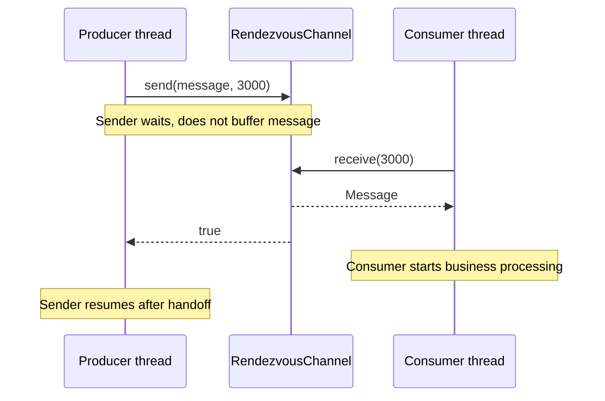
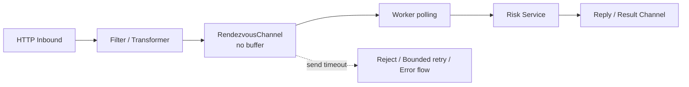

# RendezvousChannel and Synchronous Handoff

## 1. Why Do We Need a Rendezvous Point Between Threads?

In an integration system, a producer should not always push a message into a queue and move on immediately. Certain processing stages require **delivering a message only when a consumer is already ready to receive it**. For example: a thread receiving computation commands wants to hand off a command to a waiting processing thread; if no receiver thread is waiting yet, the sender thread must wait for a bounded duration and report expiration if handoff fails.

In **SPRING_INTEGRATION_PATTERN**, we implement Enterprise Integration Patterns with Spring Integration to connect Router, Filter, Transformer, Splitter, Aggregator, Gateway, retry, error channel, and correlation steps. In the **Message channel** chapter, `RendezvousChannel` is an intentional choice when **the timing of message handoff** matters more than buffering messages in a queue.

Expected outcomes after this lesson:

- Explain the *rendezvous* mechanism between sender and receiver, and why the channel does not pre-buffer messages.
- Distinguish `RendezvousChannel` from `DirectChannel`, `QueueChannel`, and `ExecutorChannel`.
- Use `send(message, timeout)` and `receive(timeout)` to bound wait times and prevent thread hangs.
- Configure an appropriate polling consumer, design timeout handling, and test handoff across two separate threads.
- Understand the boundary between "consumer received the message," "processing completed," and "reply returned."

## 2. How Does RendezvousChannel Work?

`RendezvousChannel` is a Spring Integration `PollableChannel` built on a **direct handoff** mechanism backed by `java.util.concurrent.SynchronousQueue`. The underlying queue has **zero storage capacity**: there is no slot to hold a message while waiting for a future consumer.

A `send` succeeds only when a matching `receive` call can actually take that message. If no receiver is present at send time, the sender waits until one arrives or the timeout expires. Conversely, a receiver calling `receive` when no sender is present waits for a producer to appear.



Key characteristics:

1. **Both calls must meet.** `send` and `receive` are two halves of the same handoff action; sending cannot "stash" a message inside the channel.
2. **Sender and receiver typically live on different threads.** If a single thread calls an unbounded `send` intending to call `receive` afterward, it will never reach the `receive` line.
3. **The channel does not spawn worker threads.** Threads come from the application, thread pools, or configured polling endpoints; using `RendezvousChannel` does not by itself make processing asynchronous.
4. **Successful handoff does not guarantee business processing succeeded.** After receiving the message, the consumer can still fail, retry, or take a long time to finish.
5. **Not durable storage.** If the application stops or no consumer exists, there is no backlog stored in the channel to recover. When durability is needed, use a broker or a channel with an appropriate persistent store.

### What Does "Synchronous" Mean Here?

Rendezvous establishes **synchronization at the moment of message exchange** between two sides, whereas `DirectChannel` typically executes subscribers directly **on the sender thread**. Thus two threads can run independently yet synchronize for an instant to hand off a message. Do not equate this kind of synchronization with a database transaction, a complete HTTP request/reply, or waiting for a business outcome.

For instance, `receive()` may return a message that takes the consumer 10 seconds to process, while `send()` already returned `true` as soon as the handoff completed. If the sender wants to wait for that 10-second result, it needs a dedicated response mechanism: `replyChannel`, a reply-producing Gateway, `CompletableFuture`, or a corresponding reply message with correlation when multiple requests run concurrently.

## 3. Comparing Common Message Channels

| Channel | Message Delivery | Handler Thread | When Does `send` Complete? | Best Fit |
| --- | --- | --- | --- | --- |
| `DirectChannel` | Calls subscriber directly, no polling | Usually the sender's own thread | When the synchronous handler returns or throws | Simple pipelines, few steps, synchronous error propagation needed. |
| `QueueChannel` | Places message into buffer for another thread later | Polling/consumer thread | Once enqueued; consumer may receive later | Decoupling producer/consumer rates, absorbing bursts up to queue capacity. |
| `RendezvousChannel` | Transfers only when sender and receiver meet; no buffer | Thread that called `receive` | When handed off to receiver, before guaranteeing work is done | Direct handoff, readiness coordination, limiting pre-buffering. |
| `ExecutorChannel` | Dispatches to subscriber via `TaskExecutor` | Executor worker thread | Depends on executor accepting the task; does not wait for handler completion | Decoupling sender and handler threads, concurrent task execution. |

**Two very common points of confusion:**

- `RendezvousChannel` is **pollable**: the receiving side must actively call `receive` or be driven by a polling endpoint. `DirectChannel` is **subscribable**: you register handlers and the channel dispatches automatically on `send`.
- `QueueChannel` can have a bounded capacity and reject or wait when full; `RendezvousChannel` has no concept of "one open slot left." Even the very first message requires a waiting consumer. You cannot substitute them by assuming a `QueueChannel` of capacity 0 behaves the same.

Do not treat "synchronous" as the sole criterion for picking a channel. Answer: who owns the receiving thread, how long is the wait, must backlog be buffered, and under overload should producers block or place messages in temporary storage?

## 4. Send, Receive, and Timeout APIs

Two related interfaces:

- `MessageChannel`: `send(Message<?>)` or `send(Message<?>, long timeout)`, returning `boolean`.
- `PollableChannel`: adds `receive()` or `receive(long timeout)`, returning `Message<?>` or `null`.

`RendezvousChannel` provides both send and receive behavior because it is a `PollableChannel`. Timeouts in these calls are measured in **milliseconds**.

| Call | When Peer Is Ready | When Peer Is Not Ready |
| --- | --- | --- |
| `send(message, 3000)` | Hands off message, returns `true` | Waits up to ~3 seconds; returns `false` on expiration. |
| `receive(3000)` | Returns `Message<?>` | Waits up to ~3 seconds; returns `null` on expiration. |
| `send(message, 0)` | May deliver immediately if a receiver is waiting | Returns `false` immediately. |
| `receive(0)` | May receive immediately if a sender is waiting | Returns `null` immediately. |
| `send(message)` / `receive()` | Hands off when both sides meet | Can wait indefinitely if no peer appears or unless interrupted. |

Use finite timeouts at boundaries where blocking a thread indefinitely causes harm, such as an HTTP request thread. Timeout **does not measure business processing duration after receipt**; to bound end-to-end duration, set an additional deadline across the full request/reply.

Distinctions to remember:

- `send(...) == true`: the channel paired a sender with a receiver. **Does not mean** the consumer finished processing, committed a transaction, or persisted data successfully.
- `send(...) == false`: handoff did not occur before the deadline. The application must choose to reject, perform bounded retries, or route to a fallback mechanism. Never mark the order as processed.
- `receive(...) == null`: no message arrived within the wait window; there is no payload to pass to a Transformer or handler.
- If a thread is interrupted or the system is shutting down, handle it per actual lifecycle/exception contracts; do not treat every failure as a normal timeout.
- With multiple concurrent senders and receivers, pairing follows the channel's concurrency mechanics; do not assume business FIFO ordering solely from thread creation order.

## 5. Java Example: Two Threads Exchanging a Message

This is a standalone Spring Integration API example. Producer and consumer run on two workers of an `ExecutorService`, sharing **a single `RendezvousChannel` instance**. We deliberately use timeouts so the program finishes cleanly if one side does not run.

```java
import java.util.concurrent.ExecutorService;
import java.util.concurrent.Executors;
import java.util.concurrent.Future;
import java.util.concurrent.TimeUnit;

import org.springframework.integration.channel.RendezvousChannel;
import org.springframework.messaging.Message;
import org.springframework.messaging.support.MessageBuilder;

public final class RendezvousHandoffDemo {

    public static void main(String[] args) throws Exception {
        RendezvousChannel handoff = new RendezvousChannel();
        ExecutorService workers = Executors.newFixedThreadPool(2);

        Message<String> order = MessageBuilder.withPayload("order-42")
                .setHeader("appCorrelationId", "corr-42")
                .build();

        try {
            Future<Boolean> producer = workers.submit(
                    () -> handoff.send(order, 3_000));

            Future<Message<?>> consumer = workers.submit(
                    () -> handoff.receive(3_000));

            boolean sent = producer.get(4, TimeUnit.SECONDS);
            Message<?> received = consumer.get(4, TimeUnit.SECONDS);

            if (!sent || received == null) {
                throw new IllegalStateException("Failed to hand off message");
            }

            System.out.println(received.getPayload()); // order-42
            System.out.println(
                    received.getHeaders().get("appCorrelationId")); // corr-42
        } finally {
            workers.shutdownNow();
        }
    }
}
```

**Runtime walkthrough:**

1. The producer calls `send`. If no consumer is receiving yet, the producer pauses inside this call.
2. The consumer calls `receive` on **the same channel**. Both threads pair up and the message is transferred directly.
3. `receive` returns the message; `send` returns `true`.
4. Printing the payload happens outside the channel and is just for observation. In real deployments, the consumer invokes a processing service on the receiving thread and must manage errors, transactions, and replies separately.

The same message retains its payload and attached application headers, such as `appCorrelationId`. However, **message handoff does not automatically perform reply correlation**; business correlation remains the flow's design responsibility.

### Counter-Example: Sequential Calls on One Thread

```java
RendezvousChannel handoff = new RendezvousChannel();
Message<String> message = MessageBuilder.withPayload("task").build();

boolean sent = handoff.send(message, 1000);
Message<?> received = handoff.receive(1000);
```

Above, `send` waits for a consumer, yet `receive` is only called **after `send` finishes** on that exact same thread. With no second receiving thread, `send` expires and returns `false`; then `receive` also expires and returns `null`. Without timeouts, the thread would block forever at `send`.

## 6. Combining with Spring Integration Java DSL

When the producer comes from one endpoint and the consumer is another flow, declare the channel as a bean and let a **polling consumer** receive messages. Merely declaring a `RendezvousChannel` does not start a consumer.

Illustrative example:

```java
import org.springframework.context.annotation.Bean;
import org.springframework.context.annotation.Configuration;
import org.springframework.integration.channel.RendezvousChannel;
import org.springframework.integration.dsl.IntegrationFlow;
import org.springframework.integration.dsl.Pollers;
import org.springframework.messaging.MessageHandler;

@Configuration
public class HandoffFlowConfiguration {

    @Bean
    public RendezvousChannel ordersRendezvous() {
        return new RendezvousChannel();
    }

    @Bean
    public IntegrationFlow consumeOrders(RendezvousChannel ordersRendezvous) {
        return IntegrationFlow
                .from(ordersRendezvous, endpoint -> endpoint.poller(
                        Pollers.fixedDelay(100)
                                .receiveTimeout(500)
                                .maxMessagesPerPoll(1)))
                .handle((MessageHandler) message -> {
                    // Example: in production, call a service and handle errors.
                    System.out.println("Received: " + message.getPayload());
                })
                .get();
    }
}
```

Meaning of the three poller parameters:

- `fixedDelay(100)`: delay interval between polls (default unit is milliseconds for numeric overloads).
- `receiveTimeout(500)`: each poll waits up to ~500 ms for a message; if no producer arrives, it yields `null` and that poll cycle ends.
- `maxMessagesPerPoll(1)`: each poll attempts to pull at most one message, preventing one poll cycle from stretching across many consecutive `receive` calls.

Handler processing runs on **the polling endpoint's thread**. If the handler performs slow I/O, the poller thread stays occupied and the next producer may have to wait; measure load before raising concurrency or adding thread pools. The poller attempts to receive messages on a schedule, so when sender meets receiver also depends on the scheduler and `receiveTimeout`.

Sending into the channel from an external service:

```java
import org.springframework.beans.factory.annotation.Qualifier;
import org.springframework.messaging.MessageChannel;
import org.springframework.messaging.support.MessageBuilder;
import org.springframework.stereotype.Service;

@Service
public class OrderHandoffService {

    private final MessageChannel handoff;

    public OrderHandoffService(
            @Qualifier("ordersRendezvous") MessageChannel handoff) {
        this.handoff = handoff;
    }

    public void submit(String orderId) {
        boolean delivered = handoff.send(
                MessageBuilder.withPayload(orderId).build(),
                2_000);

        if (!delivered) {
            throw new IllegalStateException(
                    "No consumer available within 2 seconds");
        }
    }
}
```

This means **the order was handed to a consumer** when `submit()` returns, not that the order is finished. If the API needs to report "fully processed," you must design an additional result-receiving step. In production, avoid handling `false` by retrying endlessly on a web thread: that can exhaust threads and amplify load right when downstream is struggling.

### Choosing the Right Consumer Style

In other Spring Integration flows, a `Service Activator` wired directly to a `DirectChannel` usually responds synchronously within the sender's call. With `RendezvousChannel`, the consumer needs polling, and Spring Integration provides polling endpoints to manage it. Balance:

- How many threads can wait on `receive`.
- How many producers can block concurrently at `send`.
- Handler processing duration after receiving a message.
- Limits from the source (e.g., HTTP request timeout) and target (e.g., database connection pool).

If you do not need direct pairing and instead want a work queue, a `QueueChannel` with an explicit capacity is easier to operate. If you need a durable queue that survives application restarts, choose AMQP/JMS/Kafka or a corresponding persistent store design.

## 7. Scenario: Normalizing a Command Before Worker Handoff

Suppose a system receives an order risk-check request:

1. An HTTP inbound gateway receives the request and attaches `appCorrelationId` from a verified source.
2. A `Filter` drops invalid requests; a `Transformer` converts the payload into a standardized check command.
3. The flow sends the command through `RendezvousChannel` so it **hands off only when a worker is waiting**.
4. The worker receives the command, checks risk, and emits the result to another channel.
5. If a response must return to the original HTTP request, the Gateway awaits a reply message via a pre-designed reply path.



**Do not confuse three milestones:**

| Milestone | Condition | What Can You Respond? |
| --- | --- | --- |
| Producer calls `send` | A command wants handoff | No guarantee a receiver exists; producer may be waiting. |
| `send` returns `true` | Consumer received the message | Can report "accepted for processing" if the API contract permits; cannot yet report "processing complete." |
| Worker finishes and emits reply | Result or business error is ready | Can return the outcome matching request correlation and deadline. |

A Spring Integration Gateway defines `requestChannel`, `replyChannel`, `requestTimeout`, and `replyTimeout`. **Request timeout** governs sending the request into the channel, whereas **reply timeout** governs waiting for the response. These values must align with upstream HTTP timeouts and downstream SLAs. `RendezvousChannel` neither creates replies automatically nor correlates results across multiple requests.

### Relationship to Retry, Error Channel, and Correlation

- **Retry:** when `send` expires and returns `false`, distinguish handoff failures from post-handoff business failures. Use bounded retries with backoff and idempotency keys; avoid creating duplicate business commands when upstream is unsure of final status.
- **Error channel:** errors from a polling handler can be routed to an error flow per endpoint configuration; failed `send` calls must be handled by the producer. Do not assume all errors return to the original sender thread.
- **Correlation:** use headers like `appCorrelationId` or `businessMessageId` to trace across multiple channels. With Splitter/Aggregator, `correlationId`, `sequenceNumber`, and `sequenceSize` have specific group-aggregation semantics; do not reuse a channel message's UUID as business correlation.
- **Router:** you can route command types to different channels, but ensure **every Rendezvous branch has a matching consumer**; a branch without a consumer will cause producers on that branch to time out.

## 8. Backpressure, Resources, and Operational Risks

Even without a buffer, blocked sends still consume resources on **producer threads**. If 500 concurrent HTTP requests wait on a single consumer, the system may tie up 500 request threads or pending tasks. This is a form of backpressure, but it does not replace bounded load control.

Hypothetical example: consumer handles 20 commands/second while producers send 200 commands/second. Even if each handoff is fast, the handler can only pull another item when the poller is ready; the count of waiting senders can climb rapidly. Instead of merely extending timeouts:

- Cap ingress concurrency; fail fast when the system is overloaded.
- Set wait times shorter than the caller's deadline; handle `false` intentionally.
- Track separate metrics: waiting senders, handoff wait time, timeout counts, worker processing time, business errors, and deadline expirations.
- Distinguish having no consumer (config/lifecycle issue) from having busy consumers.
- Test shutdown: stop accepting new requests, interrupt remaining waiters per policy, and explicitly report unhanded commands.

**Rendezvous has no internal queue to absorb pressure.** It enforces conditional handoff, so you must still cap waiting senders at ingress/thread pools. If traffic bursts must be retained, buffers and brokers are generally better suited.

### Transactions and Redelivery

`send() == true` does not have transactional commit semantics: if a worker crashes after receiving a message but before writing to the database, the channel will not automatically redeliver the message. If reliable processing across process crashes is required, add transactions/outbox, a durable broker, idempotent retries, or recovery workflows.

For *at-least-once* requirements, applications must handle duplicates. For business-level *exactly-once*, define explicit transaction and idempotency boundaries rather than relying on the channel's zero-buffer property.

## 9. Testing RendezvousChannel Behavior

The following JUnit 5 + AssertJ examples verify two fundamentals: **cannot send when there is no receiver**, and **two threads can hand off a single message**.

```java
import static org.assertj.core.api.Assertions.assertThat;

import java.util.concurrent.ExecutorService;
import java.util.concurrent.Executors;
import java.util.concurrent.Future;
import java.util.concurrent.TimeUnit;

import org.junit.jupiter.api.Test;
import org.springframework.integration.channel.RendezvousChannel;
import org.springframework.messaging.Message;
import org.springframework.messaging.support.MessageBuilder;

class RendezvousChannelTest {

    @Test
    void cannotSendWhenThereIsNoReceiver() {
        RendezvousChannel channel = new RendezvousChannel();
        Message<String> message =
                MessageBuilder.withPayload("order-1").build();

        assertThat(channel.send(message, 50)).isFalse();
        assertThat(channel.receive(0)).isNull();
    }

    @Test
    void transfersMessageBetweenTwoThreads() throws Exception {
        RendezvousChannel channel = new RendezvousChannel();
        ExecutorService workers = Executors.newFixedThreadPool(2);
        Message<String> message = MessageBuilder
                .withPayload("order-2")
                .setHeader("appCorrelationId", "corr-2")
                .build();

        try {
            Future<Boolean> sending =
                    workers.submit(() -> channel.send(message, 2_000));
            Future<Message<?>> receiving =
                    workers.submit(() -> channel.receive(2_000));

            assertThat(sending.get(3, TimeUnit.SECONDS)).isTrue();
            Message<?> result = receiving.get(3, TimeUnit.SECONDS);

            assertThat(result).isNotNull();
            assertThat(result.getPayload()).isEqualTo("order-2");
            assertThat(result.getHeaders().get("appCorrelationId"))
                    .isEqualTo("corr-2");
        } finally {
            workers.shutdownNow();
        }
    }
}
```

These are channel-API tests without services, HTTP, or brokers. For a real flow, expand testing to cover:

| Scenario | Outcome to Observe |
| --- | --- |
| Producer calls first, consumer arrives within deadline | `send` returns `true`; receiver gets exact payload and headers. |
| No consumer exists | `send` returns `false` in bounded time; API returns an error or takes the defined fallback path. |
| Consumer calls first, producer arrives within deadline | `receive` gets the message; no duplicates. |
| Receiver with no sender | `receive(timeout)` returns `null`; poller continues its schedule cleanly. |
| Worker receives message but processing fails | Handoff still succeeded; business error is observed and handled separately. |
| Many producers, few consumers | No thread leaks, timeouts are measured; no reliance on implicit processing order. |
| Flow with Gateway awaiting results | Verify request timeout, reply timeout, correlation, and late-reply handling together. |

To avoid flaky race-condition tests, use `CountDownLatch` or other synchronization primitives when you must confirm a thread has entered its wait state. Avoid `Thread.sleep(...)` to simulate readiness; sleeping does not prove the other thread has started `receive`.

## 10. Common Errors and How to Isolate Them

| Symptom | Possible Cause | Resolution |
| --- | --- | --- |
| `send` is always `false` | No poller/receiver, poller not started, or timeout too short | Check channel bean, consumer endpoint, lifecycle, and poll schedule. |
| Flow hangs after sending | Unbounded `send` waiting with no receiver ever appearing | Use finite timeouts; inspect thread dumps for threads stuck on send/receive. |
| One producer and one consumer exist yet exchange fails | Both sides use **two different channel instances** or wrong bean name | Verify wiring, channel names, and dependency injection context. |
| Send succeeds yet API still times out | Handoff succeeded, but processing/reply was slow or never returned | Measure handoff, processing, and reply durations separately; check `replyChannel` and correlation. |
| System overloads despite zero-buffer channel | Many producer threads blocked, consumer pulling too slowly | Cap ingress, concurrency, and timeouts; consider an appropriate queue/broker. |
| Results arrive out of request order | Scheduler pairs threads by readiness without a business ordering contract | Use explicit IDs/correlation; if ordering is required, design per-key/sequence ordering. |
| Downstream errors never reach caller | Handler runs on polling thread after sender returned from handoff | Use an error flow, stateful replies, or job tracking instead of expecting cross-thread exceptions. |

When debugging, start at four points: which thread the producer calls `send` on, where the receiver calls `receive`, which step each timeout applies to, and whether the request expects a reply. Logs should carry `appCorrelationId` on both sides; never log sensitive data just to verify handoff.

## 11. Practice Exercises

**Exercise 1 — Bounded-Timeout Handoff.** Create one producer and one consumer on two threads. Configure `send(..., 500)` and `receive(..., 1000)`. Test three cases: consumer runs first, producer runs first, and no consumer ever runs. Record the outcomes and explain the difference between `false` and `null`.

**Exercise 2 — Channel Comparison.** Using the same payload `order-42`, implement three setups: `DirectChannel`, `QueueChannel`, and `RendezvousChannel`. Use thread-name logs and wait durations to explain when the sender returns, which thread runs the handler, and what happens when no consumer exists.

**Exercise 3 — Correlated Request/Reply.** Combine Router, Transformer, RendezvousChannel, business handler, and reply flow. Attach `appCorrelationId` at ingress; intentionally trigger one handler error and one delayed reply. Explain why a successful `send` is insufficient to return HTTP 200 for the business result, and choose timeouts for request/reply.

**Exercise 4 — Load Limits.** Simulate 50 producers and two consumers where each consumer takes 100 ms per command. Measure handoff success rate, timeouts, and waiting threads. Propose an appropriate ingress cap; if every command must be preserved, evaluate moving to a broker or bounded-capacity queue.

A complete solution must include a **thread diagram**, working channel/consumer configuration, a timeout policy, and tests covering both success and missing-receiver cases.

## 12. Summary of Key Takeaways

`RendezvousChannel` implements **zero-capacity direct handoff** messaging: sender and receiver must meet to transfer a message. It establishes a synchronization point between threads without spawning consumers, holding backlog, or confirming business completion. In Spring Integration, use this channel when controlling handoff timing matters; always design matching timeouts, thread pools, reply/error mechanisms, and correlation. For durable command persistence or burst absorption, consider a queue or broker with explicit policies.

## References

- [Spring Integration Reference — Message Channels](https://docs.spring.io/spring-integration/reference/channel.html)
- [Spring Integration Reference — Channel Implementations](https://docs.spring.io/spring-integration/reference/channel/implementations.html)
- [Spring Integration Reference — Polling Consumer](https://docs.spring.io/spring-integration/reference/endpoint/polling-consumer.html)
- [Spring Integration API — RendezvousChannel](https://docs.spring.io/spring-integration/api/org/springframework/integration/channel/RendezvousChannel.html)
- [Java SE — SynchronousQueue](https://docs.oracle.com/en/java/javase/17/docs/api/java.base/java/util/concurrent/SynchronousQueue.html)

Examples use standard Spring Integration concepts and APIs. When integrating into a specific application, verify APIs and polling configuration against your Spring Integration/Spring Framework version.
