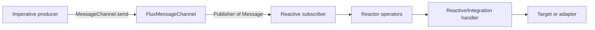
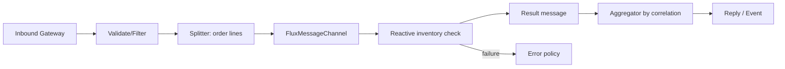

# FluxMessageChannel and Reactive Bridge

In **Spring Integration**, a *Message Channel* is the boundary that carries `Message<?>` instances between endpoints of an integration flow. Traditional channels such as `DirectChannel`, `ExecutorChannel`, or `QueueChannel` fit many command and event processing scenarios. When a flow needs to connect with **Project Reactor** and **Reactive Streams**—such as receiving continuous streams, bounding consumption rates, or integrating with asynchronous reactive components—you can use **`FluxMessageChannel`**.

This topic belongs to the **Message channel** chapter of the `SPRING_INTEGRATION_PATTERN` module: learning how to implement Enterprise Integration Patterns with Spring Integration so message flows are loosely coupled, extensible, routable, filterable, transformable, splittable/aggregatable, error-handled, and observable across branches. The focus of this lesson is **the boundary between imperative message sending (`send`) and demand-driven stream consumption (`Publisher`/`Subscriber`)**, not merely swapping a channel's name.

After this lesson, you will be able to:

- Explain where `FluxMessageChannel` sits in the Spring Integration and Reactor architecture.
- Connect a producer sending `Message<?>` imperatively with a consumer using `Flux<Message<?>>`.
- Distinguish asynchronous execution, *non-blocking* I/O, backpressure, and whether a message has actually finished processing.
- Recognize how to combine `FluxMessageChannel` with Filter, Router, Transformer, Splitter, Aggregator, Gateway, and error flows.
- Select channels and design tests so messages are not dropped, event-loops are not blocked, and subscriptions are not accidentally duplicated.

## 1. From MessageChannel to Reactive Streams

### Traditional Approach: Sending a Single Message

A `MessageChannel` in Spring Messaging supports sending a message:

```java
import org.springframework.messaging.MessageChannel;
import org.springframework.messaging.support.MessageBuilder;

void publish(MessageChannel channel) {
    boolean accepted = channel.send(
            MessageBuilder.withPayload("order-created").build()
    );
}
```

The `send(...)` method represents **a single send** into the channel. A `true` return value must not be broadly interpreted as "all downstream business processing has finished": its exact meaning depends on how the channel dispatches messages, the receiving endpoint, and whether processing runs synchronously.

### Reactive Approach: Subscribing to a Stream of Messages

**Reactive Streams** standardizes four concepts:

| Concept | Role |
| --- | --- |
| `Publisher<T>` | Source emitting elements to a subscriber. |
| `Subscriber<T>` | Consumer receiving elements, capable of signaling how many items it wants. |
| `Subscription` | Link between publisher and subscriber allowing `request(n)` or `cancel()`. |
| Backpressure | Mechanism allowing the consumer to express *demand* instead of being pushed unbounded data. |

Project Reactor provides `Flux<T>` for streams of **0 to N elements** and `Mono<T>` for **0 or 1 element**, along with operators such as `map`, `filter`, `flatMap`, `concatMap`, `onErrorResume`, and `timeout`.

**`FluxMessageChannel`** is an integration channel supporting **`ReactiveStreamsSubscribableChannel`**: it participates in Spring Integration's messaging model while also being consumable as a `Publisher<Message<?>>`. As a result, it serves as a **reactive bridge** between channel-API producers and Reactive Streams consumers.



In this diagram, **bridge** means bridging two **message-consumption models**, not automatically bridging two message brokers. The channel itself does not make downstream functions non-blocking; blocking logic remains blocking until properly isolated and scheduled.

## 2. Characteristics of FluxMessageChannel

| Aspect | What to Understand |
| --- | --- |
| Data type | Stream elements are `Message<?>` instances, carrying payload and headers like any Spring message. |
| Producer side | Producers can use the `MessageChannel.send(message)` API. |
| Consumer side | Reactive components can subscribe to the channel's publisher. |
| Execution timing | A subscriber must be subscribed and the flow active; merely declaring a `Flux` does not consume anything yet. |
| Demand | Subscribers can signal element demand according to Reactive Streams. |
| Completion and errors | Distinguish reactive stream errors/completion from business error handling for an individual message. |
| Storage capability | Do not treat the channel as durable message storage, an acknowledged queue, or a broker buffering when consumers are slow. |

### Four Things Not to Confuse

1. **Reactive ≠ automatically running in the background.** A reactive stream generally does not execute before subscription. Even after subscribing, parts of execution may still occur on the current thread unless another scheduling boundary is introduced.
2. **Reactive ≠ non-blocking end to end.** `Thread.sleep()`, blocking JDBC, synchronous HTTP calls, or synchronous file reads still block threads if executed inside a reactive callback.
3. **Backpressure ≠ infinite memory or zero message loss.** Verify how the channel, adapters, and operators handle latency, queued items, and overflow.
4. **Sent ≠ processed/committed.** A successful `send()` does not replace acknowledgments, transactions, or idempotency at the target system.

## 3. Minimal Example: From `send()` to `Flux`

The following example shows a producer sending a message via the Spring API while a consumer processes it through Project Reactor. Imports are listed to clarify the participating libraries:

```java
import org.springframework.integration.channel.FluxMessageChannel;
import org.springframework.messaging.Message;
import org.springframework.messaging.support.MessageBuilder;

import reactor.core.Disposable;
import reactor.core.publisher.Flux;

public class ReactiveBridgeExample {

    public static void main(String[] args) {
        FluxMessageChannel channel = new FluxMessageChannel();

        // Consumer side: subscribe before emitting messages.
        Flux<Message<?>> messages = Flux.from(channel);
        Disposable subscriber = messages
                .map(Message::getPayload)
                .doOnNext(payload -> System.out.println("Received: " + payload))
                .subscribe();

        // Producer side: does not need to know the consumer uses Reactor.
        boolean accepted = channel.send(
                MessageBuilder.withPayload("ORD-1001")
                        .setHeader("traceId", "trace-101")
                        .build()
        );

        System.out.println("send accepted = " + accepted);

        // In a short example, dispose the subscription when done.
        subscriber.dispose();
    }
}
```

The goal of this example is to show **both sides of the bridge**: `send()` and `Flux.from(channel)`. This is not a production pattern for long-lived event sources. In a Spring application, let the framework or a lifecycle component manage subscription/disposal, startup timing, error handling, and shutdown. In particular, an async flow might not complete before sample code calls `dispose()`; to test deterministically, use a reactive test harness like `StepVerifier` rather than inferring from `main` execution timing.

### Preserving Payload and Header Semantics

In the example, the payload is an order ID and `traceId` is tracing metadata. To read both:

```java
Flux.from(channel)
        .doOnNext(message -> {
            Object orderId = message.getPayload();
            Object traceId = message.getHeaders().get("traceId");
            System.out.println(orderId + " / " + traceId);
        });
```

This `Flux` snippet **only describes a pipeline** and has not executed yet because there is no subscription. This distinction is critical when debugging: a missing subscriber is not the same as a Filter dropping messages, nor does it mean the message had a null payload.

## 4. Placing FluxMessageChannel in an IntegrationFlow

In a Spring application, the channel can be a bean referenced by an integration flow. The example below uses Spring Integration Java DSL and Java 17+ records:

```java
import java.math.BigDecimal;

import org.springframework.context.annotation.Bean;
import org.springframework.context.annotation.Configuration;
import org.springframework.integration.channel.FluxMessageChannel;
import org.springframework.integration.dsl.IntegrationFlow;

record OrderSubmitted(String orderId, BigDecimal amount) {}
record OrderAccepted(String orderId) {}

@Configuration
class OrderIntegrationConfig {

    @Bean
    FluxMessageChannel ordersFluxChannel() {
        return new FluxMessageChannel();
    }

    @Bean
    IntegrationFlow orderFlow(FluxMessageChannel ordersFluxChannel) {
        return IntegrationFlow.from(ordersFluxChannel)
                .<OrderSubmitted>filter(order ->
                        order.amount() != null
                                && order.amount().signum() > 0)
                .<OrderSubmitted, OrderAccepted>transform(order ->
                        new OrderAccepted(order.orderId()))
                .handle(OrderAccepted.class, (accepted, headers) -> {
                    System.out.println("Accepted: " + accepted.orderId());
                    return null; // one-way handler: produces no reply
                })
                .get();
    }
}
```

The producer can send `Message<OrderSubmitted>` into the `ordersFluxChannel` bean from a Gateway, adapter, or service. Inside the flow, the **Filter** rejects invalid data; the **Transformer** converts accepted payloads into a new type; the **Service Activator** performs the final step and emits no reply. Returning `null` from the terminal handler indicates **no reply message**, not creating a new message with a null payload.

This illustration focuses on placing the channel at **the start of a flow**. A flow can also place reactive channels between steps. However, the actual degree of reactive execution depends on endpoint types, handlers, adapters, configuration, and Spring Integration version. **Do not assume every endpoint in a flow automatically becomes a non-blocking Reactor chain just because the input is `FluxMessageChannel`.**

## 5. Two Directions of the Reactive Bridge

### Direction A — Imperative Producer → Reactive Consumer

This is the natural use case for `FluxMessageChannel`:

```text
Service / Gateway / Inbound adapter
             │
       send(Message)
             │
             ▼
    FluxMessageChannel
             │
   Publisher<Message<?>>
             │
             ▼
   Subscriber + operators
             │
             ▼
    Reactive handler
```

For example, an adapter receives messages from a legacy system and sends them to a Spring Integration channel; downstream needs `filter`, `concatMap`, or `flatMap` to call another service with a reactive API. Subscribe the consumer first, define concurrency limits, and decide how errors are reported when downstream is unavailable.

### Direction B — Reactive Producer → Imperative Message Flow

A reactive source like `Flux<OrderSubmitted>` can convert each item into a `Message<OrderSubmitted>` to feed into a traditional channel. However, calling `channel.send(...)` directly on an event-loop thread can become a **blocking boundary** if the channel or downstream processes synchronously.

The code below only illustrates **type conversion**, and does not subscribe to send messages:

```java
import org.springframework.messaging.Message;
import org.springframework.messaging.support.MessageBuilder;
import reactor.core.publisher.Flux;

Flux<OrderSubmitted> orders = obtainOrders(); // reactive source from application

Flux<Message<OrderSubmitted>> messages = orders.map(order ->
        MessageBuilder.withPayload(order)
                .setHeader("source", "reactive-order-feed")
                .build()
);
```

Here `obtainOrders()` represents an application-defined business source, not a built-in Spring API. To forward `messages` into an imperative flow in practice, prefer Spring Integration adapters or endpoints that natively support publisher/reactive inputs and manage lifecycle. If you must wrap a blocking call, isolate it onto an appropriate scheduler (such as `Schedulers.boundedElastic()`), limit concurrency, and define timeouts, retries, and error policies; **do not scatter `subscribe()` calls without a clear lifecycle owner**.

### A Bridge Does Not Replace Delivery Contracts

In both directions, explicitly determine:

- When is a message considered **received**?
- When is business processing considered **successful**?
- If the consumer cancels its subscription, fails, or slows down, who is responsible for storing/retrying messages?
- Which ID is used for **deduplication** if the producer replays messages?

If durability, at-least-once delivery, or transactional acknowledgments are required, use the appropriate capabilities of a broker, persistent store, transactions, and idempotent consumers; do not assume `FluxMessageChannel` replaces them.

## 6. Backpressure, Rates, and Concurrency

### Demand Flows from Consumer to Publisher

In Reactive Streams, a subscriber uses `Subscription.request(n)` to request up to `n` elements before asking for more. When using `FluxMessageChannel`, separate two questions:

1. **How many elements does downstream want to receive?** That is Reactive Streams demand semantics.
2. **What can upstream do when data is pushed via `send()` faster than processing capacity?** That involves imperative boundaries, queues/buffers, overflow behavior, and how the application handles downstream overload.

A synchronous `send()` API does not magically turn an imperative producer into a `Publisher` obeying `request(n)`. Therefore, even when downstream uses `Flux`, the overall chain does **not necessarily** have end-to-end backpressure.

### Regulating Pace on the Processing Side

Example of processing async tasks with bounded concurrency:

```java
import org.springframework.messaging.Message;
import reactor.core.publisher.Flux;
import reactor.core.publisher.Mono;

Flux<Message<?>> inbound = Flux.from(channel);

Flux<OrderResult> processed = inbound
        .map(message -> (OrderSubmitted) message.getPayload())
        .flatMap(order -> processAsync(order), 8);

// processAsync(OrderSubmitted) is an application method returning Mono<OrderResult>.
// Subscribe and manage the subscription at the proper application endpoint.
```

`flatMap(..., 8)` limits the maximum number of `processAsync` operations subscribed concurrently within **this operator**; it does not enforce a system-wide quota or stop the producer from calling `send()`. If ordering must be preserved, consider `concatMap` (sequential processing) or keyed ordering by business key; actual ordering also depends on the source, schedulers, and async operations.

### Handling Speed Mismatches

| Scenario | Design Direction |
| --- | --- |
| Producer faster than consumer | Define explicit rate/buffer limits; measure backlog and choose an overflow policy. |
| Consumer calls remote services | Use non-blocking APIs if available; bound concurrency, timeouts, and retries. |
| Consumer must call blocking APIs | Isolate blocking work onto a bounded scheduler/thread pool. |
| Zero message loss allowed | Use a broker/persistent queue and proper acknowledgments with idempotency. |
| Must preserve per-order ordering | Identify correlation/partition keys and process sequentially per key. |
| Data must reach multiple consumers | Explicitly verify multi-subscriber behavior for your channel/version; use PubSub or an explicit fan-out topology when needed. |

**Do not place blind trust in default buffers.** A production design needs real measurements of throughput, wait time, active tasks, error rates, retry counts, and buffer utilization. Under heavy load, merely adding `publishOn` or `subscribeOn` can shift a bottleneck to another thread pool instead of resolving it.

## 7. Interaction with Enterprise Integration Patterns

`FluxMessageChannel` is a mechanism for **transporting messages between endpoints**, not a replacement for EIPs. Combine them as follows:

| Pattern | Meaning Across a Reactive Boundary | What to Check |
| --- | --- | --- |
| **Gateway** | Pushes requests into a flow or receives replies from a flow. | Do not assume request–reply always responds immediately; define timeouts and correlation. |
| **Filter** | Drops messages failing conditions. | "No output message" differs from a message with an empty or null payload. |
| **Router** | Routes messages to appropriate processing branches. | Each branch may have different speeds, schedules, and error policies. |
| **Transformer** | Converts payloads/headers across the boundary. | Preserve necessary correlation/trace metadata; test type conversions. |
| **Splitter** | Splits one message into multiple child messages. | Emission rate of parts, sequence/correlation, and ordering under concurrency. |
| **Aggregator** | Combines related messages into a result. | Group completion conditions, timeouts, group store, and risk of stalled groups. |
| **Retry** | Retries transient failures. | Distinguish Reactor retries from endpoint/inbound-adapter retries; avoid duplicate side effects. |
| **Error channel** | Routes errors through Spring Integration messaging. | Do not assume every Reactor `onError` automatically turns into an `ErrorMessage`. |

### Business Example: Processing Individual Order Lines



Suppose an order has 15 lines. The Splitter generates child messages, each carrying metadata so the Aggregator recognizes the same group. Inventory checks use a non-blocking service with bounded concurrency to avoid overloading the warehouse system. The Aggregator must know **when all 15 results arrive, when a timeout hits, or when an error policy forces early completion**. `FluxMessageChannel` does not define those business rules on its own.

When retrying inventory calls after failure, use an appropriate **idempotency key** if the call has side effects (such as reserving stock). `correlationId` for grouping children and `traceId` for observability are not necessarily idempotency keys. For unrecoverable errors, explicitly decide whether to return `NotAvailable`, send to an error flow, compensate, or mark the group failed; never let errors vanish in an unmonitored subscription.

## 8. Error Handling and Reactive Stream Lifecycle

A reactive subscriber sees three core signals: `onNext` (element), `onError` (stream-terminating error), and `onComplete` (normal stream completion). These signals do not map one-to-one to business messages:

- **`onError`** is a stream-level error signal; it usually terminates the current subscription unless handled by an operator.
- **`ErrorMessage`/`errorChannel`** is Spring Integration's message/error handling mechanism; mapping endpoint exceptions to an error channel depends on the endpoint/configuration.
- **Business error messages** (e.g., `OutOfStock`) can be normal payloads and should not automatically turn into `onError` if business logic expects to route that branch.

To keep a single item's failure from tearing down the entire subscriber, handle errors **inside** the per-item transformation:

```java
Flux<OrderResult> outcomes = Flux.from(channel)
        .map(message -> (OrderSubmitted) message.getPayload())
        .flatMap(order -> processAsync(order)
                .onErrorResume(ex ->
                        Mono.just(OrderResult.failed(order.orderId(), ex.getMessage()))),
                8);
```

`OrderResult.failed(...)` is an application-designed *result type* pattern, not a built-in Spring class. This strategy is suitable when individual order failures are **converted into actionable results**; do not swallow critical errors or carelessly persist error messages containing sensitive data. If errors should go to an error channel, integrate with Spring Integration's error mechanism rather than just printing logs inside `.subscribe(...)`.

### Subscriptions Are Lifecycle-Managed Resources

In Reactor, `.subscribe()` typically returns a `Disposable`. When application code manages a reactive stream directly, specify where subscriptions are created and disposed, ensure a pipeline is not subscribed twice, and define shutdown behavior. In a Spring Integration application, leverage Spring-managed endpoint/flow lifecycles. **Subscribing multiple times to the same source** can cause duplicated emissions or duplicate processing depending on publisher type and fan-out policies; test explicitly if exactly-once per message is required.

### Threading and Tracing

Message headers can carry `correlationId`/`traceId`, yet `ThreadLocal`-based state such as certain MDC logging contexts **does not automatically follow along** when Reactor switches threads. When distributed tracing is needed, use Reactor-compatible context propagation and Spring Observability alongside header propagation across adapters. Never assume `publishOn` or `subscribeOn` preserves all `ThreadLocal`s automatically.

## 9. Comparing FluxMessageChannel with Other Channels

| Channel Type | Core Model | When to Consider |
| --- | --- | --- |
| `DirectChannel` | Invokes handler on the current call stack in normal cases. | Simple flows, low overhead, clear synchronous behavior. |
| `ExecutorChannel` | Dispatches processing via `TaskExecutor`. | Separating sender and receiver threads without Reactive Streams demand semantics. |
| `QueueChannel` | In-memory queue, typically polled by consumers. | Controlled internal buffering/polling, not durable storage by default. |
| `PublishSubscribeChannel` | Broadcasts to subscribers per channel configuration. | Fan-out of messages to multiple Spring Integration handlers. |
| **`FluxMessageChannel`** | Bridges `MessageChannel` ↔ Reactive Streams `Publisher<Message<?>>`. | Combining Reactor-based sources/handlers with subscription-based consumption. |

Do not rank these choices simplistically as "reactive is always faster." Choose based on **consumption model**, **delivery guarantees**, **latency**, **I/O profile**, and **error handling**, then validate with load and integration tests. A purely blocking workflow does not become more resource-efficient simply by replacing `DirectChannel` with `FluxMessageChannel`.

## 10. Testing the Reactive Bridge with StepVerifier

For reactive streams, calling `Thread.sleep()` and checking a variable produces flaky tests. **`reactor-test`** provides `StepVerifier` to subscribe, trigger actions, and assert signals sequentially.

```java
import static org.junit.jupiter.api.Assertions.assertTrue;

import org.junit.jupiter.api.Test;
import org.springframework.integration.channel.FluxMessageChannel;
import org.springframework.messaging.support.MessageBuilder;

import reactor.core.publisher.Flux;
import reactor.test.StepVerifier;

class FluxMessageChannelTest {

    @Test
    void bridgesSentMessageToReactiveSubscriber() {
        FluxMessageChannel channel = new FluxMessageChannel();

        Flux<String> received = Flux.from(channel)
                .map(message -> (String) message.getPayload())
                .take(1);

        StepVerifier.create(received)
                .then(() -> assertTrue(channel.send(
                        MessageBuilder.withPayload("ORD-1001").build())))
                .expectNext("ORD-1001")
                .verifyComplete();
    }
}
```

In this test, `StepVerifier` subscribes **before** the `.then(...)` callback sends the message. `.take(1)` bounds the expected elements and completes the test stream after the first item. This example illustrates API bridging; to verify overload resilience and subscription cancellation, add tests controlling demand, concurrency, timeouts, and errors.

### Recommended Test Suite for Production Applications

| Test Scenario | What to Verify |
| --- | --- |
| Message sent after consumer is ready | Exact payload and required headers arrive without unintended mutation. |
| No subscriber yet or subscriber cancels | Observe exact channel behavior in your version; do not assume messages are buffered. |
| Producer faster than consumer | Bounds, backlog, overflow, and recovery behave as designed. |
| Handler returns an error | `onError` flow, error channel, retries, and business state remain unambiguous. |
| Splitter/parallel processing | Correlation, sequence, Aggregator completeness, and keyed ordering meet requirements. |
| Flow shutdown/restart | Subscriptions are released; in-flight messages follow delivery policy. |
| Across broker adapters | Header mapping, serialization, acknowledgments, and idempotency hold per contract. |

## 11. Common Implementation Mistakes and How to Avoid Them

**Mistake 1 — Creating a `Flux` and forgetting to subscribe.** Declaring `Flux.from(channel).map(...)` alone does not run the pipeline. A framework- or application-managed subscriber is required.

**Mistake 2 — Calling `.subscribe()` ad hoc inside handlers.** Leads to unmanaged duplicate subscriptions, swallowed errors, leaked resources on shutdown, and broken retry coordination. Place subscriptions at clear lifecycle boundaries.

**Mistake 3 — Calling blocking APIs on the event-loop.** Use non-blocking APIs whenever possible; if blocking calls are unavoidable, isolate and bound them on an appropriate scheduler. Swapping the channel without fixing blocking logic does not remove the bottleneck.

**Mistake 4 — Treating backpressure as a delivery guarantee.** `request(n)` regulates subscriber demand; it does not replace broker acknowledgments, transactions, or crash-safe storage.

**Mistake 5 — Using unbounded `flatMap` for every message.** Can flood downstream services with concurrent requests; tune concurrency, timeouts, retries, and connection pools.

**Mistake 6 — Equating stream errors with business outcomes.** `OutOfStock` is an expected business outcome; network or parse failures generally require different policies. Model result types and error flows explicitly.

**Mistake 7 — Assuming every consumer receives a copy.** Do not guess fan-out vs. competing-subscriber behavior; verify your version and configuration and build explicit PubSub/Router topologies for independent branches.

**Mistake 8 — Ignoring correlation during parallel processing.** Results may arrive out of order; Aggregators and business logic must rely on stable IDs and completion rules rather than arrival order alone.

## 12. Practice Scenario

An ordering system receives up to thousands of events per second. Each event needs an inventory check from a reactive `WebClient` service that may return quickly or time out. If an order has multiple items, it must go through a Splitter, check each line, and then pass through an Aggregator before sending a response.

Design the flow step by step:

1. Define the `OrderSubmitted` payload and required `traceId`, `correlationId` headers. Identify a durable ID for idempotency in case of replays.
2. Use a Filter to validate input data; use a Router to separate valid/invalid branches. Never use `null` to mean "order does not exist."
3. Choose where to place `FluxMessageChannel` to bridge imperative sending to Reactor processing, and ensure the endpoint has a managed subscriber.
4. Use `flatMap` with bounded concurrency for async I/O; if per-order ordering is required, add keyed ordering.
5. For Splitter/Aggregator, define the per-run correlation ID, completion condition, timeout, and handling when one line fails.
6. Distinguish `OUT_OF_STOCK` outcomes from `TIMEOUT` or `NETWORK_ERROR`; choose conditional retries and matching error flows.
7. Test message delivery, load pressure, cancellation, retries, Aggregator output counts, and observe via metrics/tracing. If message loss is unacceptable, add durable delivery and persistence at the appropriate boundary.

**Check question:** The producer's `send()` succeeds, yet the subscriber later throws an error calling the inventory API. Can you tell the user the order finished processing? **No.** A successful send into a channel does not prove the business transaction succeeded. The final outcome must come from a business reply or confirmed state in the target system.

## Summary

- **`FluxMessageChannel`** is the reactive bridge between a **Spring Integration `MessageChannel`** and a **Reactive Streams `Publisher<Message<?>>`**; it preserves the message model with payloads and headers.
- **Subscription** activates consumption; configuring a `Flux` pipeline does not mean it is running.
- **Backpressure** coordinates demand on the Reactive Streams side; it does not automatically make `send()` wait, persist messages durably, or guarantee downstream commits.
- **Reactive does not mean non-blocking** if downstream still calls blocking APIs, nor does it automatically handle errors on the application's behalf.
- When combining EIPs (**Filter, Router, Transformer, Splitter, Aggregator, Gateway, retry, and error channel**), maintain clear correlation, delivery semantics, error policies, observability, and subscription lifecycles.
- Choose `FluxMessageChannel` when genuinely bridging the imperative world with Reactor; for simple synchronous processing, `DirectChannel` or another channel may be clearer.
