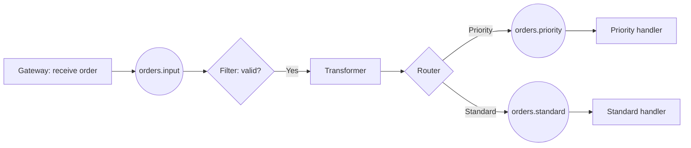
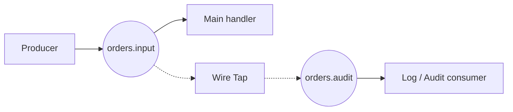
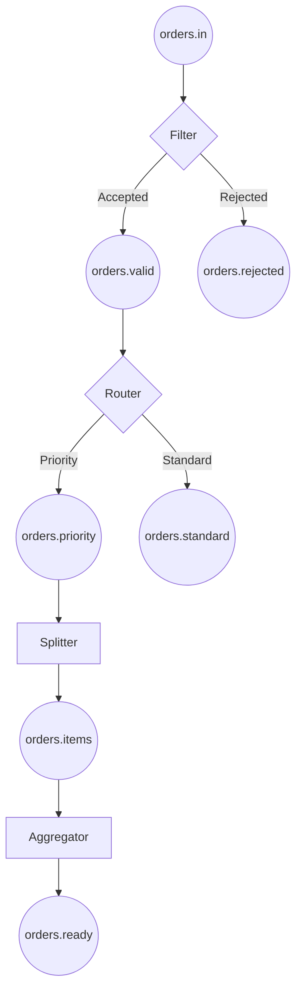
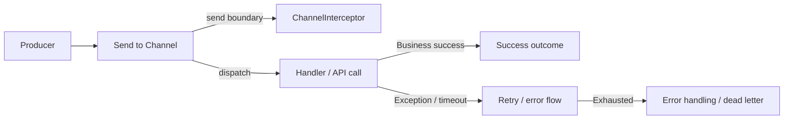

# Channel Interceptors and Message Observability

> **Chapter:** Message channel  
> **Module:** `SPRING_INTEGRATION_PATTERN` — learning Enterprise Integration Patterns with Spring Integration to build loosely coupled, extensible message flows; practicing Gateway, Filter, Transformer, Router, Splitter, Aggregator, retry, error channel, correlation, testing, and branch tracing. This lesson focuses on **observation points at a Message Channel** and using `ChannelInterceptor` without distorting business behavior.

## 1. Learning Objectives

After this lesson, you will be able to:

1. Explain what a **Channel Interceptor** is, where it sits in a message's path, and what observability problem it solves.
2. Distinguish the callbacks `preSend`, `postSend`, `afterSendCompletion`, `preReceive`, `postReceive`, and `afterReceiveCompletion`.
3. Attach an interceptor to a `DirectChannel`, log metadata safely, and recognize the limits of concluding "send succeeded."
4. Distinguish **interceptor**, **Wire Tap**, **logging/metrics/tracing**, and **error channel**; pick the right measurement points for Router, Filter, Gateway, Splitter, and Aggregator.
5. Test observability, evaluate operational overhead, and avoid blocking or leaking data in integration flows.

## 2. Why Observe Messages at the Channel?

An ordering flow might traverse the following steps:



When an order `ORD-501` fails to reach the target processor, logging only at the Gateway entry and the final handler is insufficient to know:

- Did the Gateway actually send the message into the input channel?
- Was the message genuinely dispatched to an endpoint?
- Did the message travel through the priority branch or the standard branch?
- When a consumer fails, did the error occur during **sending** or **processing**? Is there an asynchronous boundary?
- How many messages pass through each channel, what is the error rate, and how long is spent at the send/receive boundary?

A **Channel Interceptor** lets you add logic **around send/receive operations on a channel**. This is a useful cross-cutting point for logging, metrics, tagging, metadata checks, monitoring, or forwarding a copy to an observation branch. Instead of scattering logging code inside every business handler, you attach one cross-cutting component to the channel.

> **Important limitation:** Interceptors observe **operations on the channel**; they do not automatically trace a message's entire business lifecycle across every service, broker, database, and branch. A successful `send()` return does not mean the downstream target task has completed.

## 3. What Is ChannelInterceptor?

In Spring Integration, messages are exchanged over a `MessageChannel`; common internal channels like `DirectChannel`, `ExecutorChannel`, and `QueueChannel` support Spring Messaging `ChannelInterceptor` callbacks.

`org.springframework.messaging.support.ChannelInterceptor` is an **interface** providing default methods to intercept or observe before and after send and receive operations on interceptor-enabled channels.

```text
Producer
   |
   | send(message)
   v
[ ChannelInterceptor: preSend ]
   |
   v
[ Message Channel ] ----> Subscriber / Consumer
   |
   +-- [ ChannelInterceptor: postSend ]
   +-- [ ChannelInterceptor: afterSendCompletion ]
```

The diagram illustrates **wrapping around the `send` operation**; callback order and when the handler completes depend on the dispatch model. In particular, an `ExecutorChannel` may merely **schedule** work on an executor before the consumer finishes running. Do not read the diagram as a promise that every handler always finishes before `afterSendCompletion`.

### 3.1. Role of Interceptors in EIP Design

| Component | Primary Responsibility | Examples |
| --- | --- | --- |
| **Filter** | Decides which messages are allowed to continue per business rules | Drops orders with `amount <= 0` |
| **Transformer** | Converts payload/headers per contract | Converts `OrderRequest` to `NormalizedOrder` |
| **Router** | Selects target channel or branch | `orders.priority` vs. `orders.standard` |
| **Service Activator** | Invokes business logic upon receiving a message | Reserves inventory or charges payment |
| **ChannelInterceptor** | Observes/adjusts operations passing through a channel | Logs IDs, counts messages, times dispatch |
| **Wire Tap** | Sends a copy of the message to an observation channel | Sends info to an audit flow |
| **Error Channel** | Receives `ErrorMessage` per error-handling mechanism | Handles errors of an asynchronous flow |

An interceptor **is capable** of altering or blocking messages, yet Filter/Transformer/Router should be used for **business rules** because they express intent more clearly, are easier to test, and remain visible in flow diagrams. Interceptors fit cross-cutting concerns such as metrics and tracing.

## 4. Callback Lifecycle: Send and Receive

`ChannelInterceptor` defines callbacks for **send** and **receive**. Not every channel exercises both sides: a `DirectChannel` normally dispatches to a subscriber on send; a `QueueChannel` involves consumers actively calling `receive()`.

### 4.1. Send Callbacks

| Callback | When Does It Run? | Value / Meaning | Suitable Usage |
| --- | --- | --- | --- |
| `preSend(message, channel)` | Before the channel executes the send | Returns a message to continue; may return `null` to cancel the send | Start timer, read metadata, verify protocol |
| `postSend(message, channel, sent)` | After the send operation returns normally | `sent` indicates the result of the channel's send operation | Count successful/failed dispatches at the channel boundary |
| `afterSendCompletion(message, channel, sent, ex)` | When the send finishes and the callback chain is eligible for completion | Receives send status and exception if any | Clean up temporary context, record send-time exceptions |

**Note on `preSend`:** Returning `null` means **do not proceed with sending** the message. This is powerful and dangerous if misused to "silently" enforce business rules. Do not return `null` just to hide errors or filter orders without an explicit rejection path.

**Note on `postSend`:** If sending throws an exception, `postSend` may not be invoked; completion/error paths must be designed and tested separately. Furthermore, `sent == true` reflects the operation at the **current channel**, not confirmation of successful processing in the target system.

**Note on `afterSendCompletion`:** Whether an interceptor receives its completion callback depends on how far it participated in the chain. Do not assume an interceptor ordered after another interceptor that aborted in `preSend` will still receive completion callbacks to clean up state.

### 4.2. Receive Callbacks

| Callback | When Does It Run? | Meaning |
| --- | --- | --- |
| `preReceive(channel)` | Before receiving from a `PollableChannel` | Can allow/cancel the receive attempt (returns boolean) |
| `postReceive(message, channel)` | After a normal receive operation | Can observe/transform the message returned to the consumer |
| `afterReceiveCompletion(message, channel, ex)` | When the receive operation finishes | Clean up context, measure receive errors |

**Receive callbacks are not "subscriber finished processing" callbacks.** If a poller pulls a message from a queue and the handler later throws an exception, the `receive()` phase and the handler's business phase are **two separate milestones**.

### 4.3. Interpreting Correctly by Channel Type

| Channel | How Should Callbacks Be Interpreted? |
| --- | --- |
| `DirectChannel` | `send()` typically dispatches synchronously to the subscriber; handler exceptions can propagate back through send. Send duration may include handler duration. |
| `ExecutorChannel` | Send may only hand off work to an executor; send completion callbacks **do not guarantee** the handler has finished. Measure at the consumer if you want end-to-end latency. |
| `QueueChannel` | Send puts the message in the queue; consumer uses receive/poller at another time. Measure enqueue, dequeue, and queue wait time separately. |
| `PublishSubscribeChannel` | One send can trigger multiple subscribers; outcomes and exceptions depend on dispatch mode and config (sync/executor/error handling). Do not infer per-subscriber independent results from a single callback. |
| Outbound broker adapter | Introduces protocol boundaries, publish confirms, and out-of-process consumers. A source channel interceptor does not replace acks, broker metrics, or target traces. |

## 5. Example: Attaching an Interceptor to a DirectChannel

The example below demonstrates **attaching an interceptor at a channel**, logging several safe metadata fields, and delivering the message to a handler. Assume the application has Spring configured with the Spring Integration dependency; the example matches Java configuration using `@EnableIntegration` and Java DSL.

```java
import org.slf4j.Logger;
import org.slf4j.LoggerFactory;
import org.springframework.context.annotation.Bean;
import org.springframework.context.annotation.Configuration;
import org.springframework.integration.channel.DirectChannel;
import org.springframework.integration.config.EnableIntegration;
import org.springframework.integration.dsl.IntegrationFlow;
import org.springframework.messaging.Message;
import org.springframework.messaging.MessageChannel;
import org.springframework.messaging.support.ChannelInterceptor;

@Configuration
@EnableIntegration
class OrderChannelConfiguration {

    private static final Logger log =
        LoggerFactory.getLogger(OrderChannelConfiguration.class);

    @Bean("orders.input")
    DirectChannel ordersInput(ChannelInterceptor orderChannelObserver) {
        DirectChannel channel = new DirectChannel();
        channel.addInterceptor(orderChannelObserver);
        return channel;
    }

    @Bean
    ChannelInterceptor orderChannelObserver() {
        return new ChannelInterceptor() {
            @Override
            public Message<?> preSend(Message<?> message, MessageChannel channel) {
                log.info("channel.preSend messageId={} orderId={} payloadType={}",
                    message.getHeaders().getId(),
                    message.getHeaders().get("orderId"),
                    message.getPayload().getClass().getSimpleName());
                return message; // Do not modify payload or headers.
            }

            @Override
            public void postSend(Message<?> message, MessageChannel channel,
                                 boolean sent) {
                log.info("channel.postSend messageId={} sent={}",
                    message.getHeaders().getId(), sent);
            }

            @Override
            public void afterSendCompletion(Message<?> message,
                                            MessageChannel channel,
                                            boolean sent, Exception ex) {
                if (ex != null) {
                    log.warn("channel.send.failed messageId={} sent={}",
                        message.getHeaders().getId(), sent, ex);
                }
            }
        };
    }

    @Bean
    IntegrationFlow orderFlow() {
        return IntegrationFlow.from("orders.input")
            .handle(message -> log.info("handler.received orderId={}",
                message.getHeaders().get("orderId")))
            .get();
    }
}
```

On the message-producing side:

```java
import org.springframework.messaging.Message;
import org.springframework.messaging.MessageChannel;
import org.springframework.messaging.support.MessageBuilder;

MessageChannel input = context.getBean("orders.input", MessageChannel.class);

Message<String> message = MessageBuilder.withPayload("Reserve stock for ORD-501")
    .setHeader("orderId", "ORD-501")
    .setHeader("sourceSystem", "web-store")
    .build();

boolean sent = input.send(message);
System.out.println("Channel send returned: " + sent);
```

With a `DirectChannel` and a simple handler as above, logs typically show `preSend` → `handler.received` → `postSend`. However, **this is not the universal order for all channel types**; on an executor-backed channel, the handler may run later or on another thread.

### 5.1. What This Example Has and Does Not Have

- **Has:** an interceptor logging metadata for channel `orders.input`; a handler receiving messages via the flow; logs correlatable via `messageId` and `orderId`.
- **Does not yet have:** proper latency measurement, metric emission, distributed tracing, durability guarantees, comprehensive sensitive-data redaction, retry/error channels, or external target systems.
- **Does not do:** alter payloads, filter messages conditionally, or conclude "stock reserved" from `sent=true`.

Logging `channel` or `channel.toString()` may not yield a stable name across all configurations. In production systems, **assign a stable channel label** from configuration or a registry rather than relying on an arbitrary object string representation.

## 6. Global Interceptors and Application Scope

With many channels, calling `addInterceptor(...)` manually on every bean risks omissions. Spring Integration supports **global channel interceptors** using patterns to apply one interceptor to multiple matching channels (for example, channels whose names start with `orders.`).

Two common setups:

1. **Local:** create the channel and call `addInterceptor(...)` as shown above; it is immediately obvious which channel is affected.
2. **Global:** declare an interceptor with `@GlobalChannelInterceptor` or equivalent config, paired with **patterns** to select target channels. This helps unify metrics/tracing, though you must double-check the matched channel list.

When using global interceptors, watch out for framework-created internal channels, reply channels, error channels, and dynamically configured channel names. An overly broad pattern can spike log/metric volume, including internal messages or messages carrying sensitive data. **Global does not mean observing the message broker or other applications.**

## 7. Wire Tap: Observing a Side Flow Without Intruding on the Main Handler

**Wire Tap** is an Enterprise Integration Pattern that creates a branch receiving a copy of messages flowing along the main path for auditing, metrics, logging, or analytics. In Spring Integration, Wire Tap can be implemented as a **channel interceptor** forwarding messages to an observation channel.



The main path does not need to know about the audit channel's consumer. However, a "side branch" **is not guaranteed to have zero impact on the main branch**: if the audit branch is slow, uses a synchronous channel, or writes unbounded data, it can add latency or exert backpressure. Thread isolation and durability depend on the destination channel configuration and error handling.

### 7.1. How a Regular Interceptor Differs from Wire Tap

| Criterion | Direct-Logging Interceptor | Wire Tap |
| --- | --- | --- |
| Observation style | Executes measurement/logging right inside callbacks | Sends the message to another observation channel |
| Complexity | Fewer components, suitable for lightweight metadata | Involves a secondary flow and dedicated consumer |
| Performance risk | Heavy logging or metrics directly slow down the channel | Audit branch can generate its own load, buffering, or errors |
| Typical goal | Counters, send status, safe metadata | Independent audit, analytics, persistent record keeping |
| Security concern | Never log raw sensitive payloads | Must control what data is forwarded to the side branch |

**Copying a message does not necessarily deep-copy its payload.** If the payload is a mutable object, branches may reference the same content, risking race conditions or data corruption. Prefer immutable payloads or intentionally copy when one side needs to modify data.

### 7.2. Avoiding Observation Loops

If a global interceptor or Wire Tap also matches `orders.audit`, it may intercept the very message just sent for auditing. If the side flow sends back into a channel within the tap's pattern, there is a risk of **infinite loops or message storms**.

The safeguard is narrowing patterns, excluding audit/error/metrics channels from tap scope, and testing topologies with side branches. Never treat "match all channels" as a safe default.

## 8. Designing Logs, Metrics, and Tracing for Their Intended Purposes

These three observability signals complement each other rather than replacing one another:

| Signal | Question Answered | Example |
| --- | --- | --- |
| **Log** | What steps did a specific message pass through? | `orderId=ORD-501`, `channel=orders.priority`, `sendResult=true` |
| **Metric** | How is the overall system performing? | Throughput, error rate, dispatch latency, queue depth |
| **Trace** | Which services/branches did a request traverse and where did time go? | Span across Gateway → Router → Inventory API |

### 8.1. Choosing Meaningful Log Fields

Keep at minimum permitted fields:

- Stable `channelName` and `component`/`handler` where available.
- `messageId` to identify a message within the app and `orderId`/business key for business tracking.
- `correlationId` to link parts of a flow, especially for Splitter/Aggregator.
- `traceId`/`spanId` when distributed tracing is configured.
- `payloadType`, `schemaVersion`, and `messageKind` to spot contract mismatches without logging full payloads.
- `outcome`, `exceptionType`, duration, and retry count when relevant.

**Never log by default** full payloads, auth tokens, addresses, payment details, or personal data. Classify data, mask/redact per policy, and bound length, retention, and log access permissions.

### 8.2. Metrics and Latency Need Clear Boundaries

A timer started in `preSend` and stopped in `afterSendCompletion` measures **send-boundary duration**. With `DirectChannel`, that measurement may include synchronous handler time; with `ExecutorChannel`, it may measure only scheduling overhead. It is **not a consistent end-to-end latency definition** across all flows.

To measure accurately, define separately:

1. **Channel send duration:** how long sending into the channel takes.
2. **Queue wait duration:** time from enqueue to dequeue (requires reliably propagated timestamps).
3. **Handler processing duration:** how long the handler takes to process.
4. **End-to-end business duration:** from receiving the request to confirming the business outcome, including external service boundaries.

Metrics must control **cardinality**. Channel names or error types usually have bounded values; `orderId`, `messageId`, and `traceId` can be unique per message, so **never use them as tags on aggregated metrics** without strict controls.

### 8.3. Tracing Is More Than Logging the Same ID

In synchronous flows, context may reside on the current thread; when crossing into an executor, poller, broker, or remote API, context can break unless explicitly **propagated**. Depending on your stack, tracing may be supported by observation/instrumentation mechanisms, but never assume trace headers propagate automatically across every adapter.

A typical design includes: creating or extracting trace context at ingress, propagating context across messaging boundaries, creating dedicated spans for handlers/outbound calls, linking with the business `correlationId`, and **never substituting** business correlation with trace IDs. A business request may span multiple retries or multiple separate traces.

## 9. Observing Router, Filter, Splitter, and Aggregator

An interceptor only sees **channels it is attached to**. Thus, observing a multi-branch flow requires intentionally placed measurement points:



| Node to Observe | Useful Measurement Point | Pitfalls to Avoid |
| --- | --- | --- |
| **Ingress** | Messages received, payload type, source origin | Counting ingress does not prove downstream success |
| **Filter** | Accepted and rejected counts; rejection reason | Not seeing a message on the post-Filter channel **is not enough** to conclude the Filter dropped it |
| **Router** | Counts per target channel, fallback/unknown branch | A router may forward a message to multiple channels depending on type and config |
| **Splitter** | Child message count, business key, sequence/correlation | Individual child `messageId` is not the group ID |
| **Aggregator** | Group size, missing parts, release/timeout, wait time | Sending to Aggregator input does not mean the group has been released |
| **Gateway** | Ingress and reply/timeout, business outcome | `send=true` does not mean a reply was received |

For example, `ORD-501` has three line items. The Splitter emits three messages. To know all three were combined, measure or inspect **the Aggregator's output**, `correlationId` key, `releaseStrategy` condition, and timeout. Counting three messages entering the input channel is **insufficient** to confirm group completion. If messages are retried, channel counters can exceed unique business operations; distinguish *attempt count* from *unique processed count*.

## 10. Interceptors, Errors, and Retries: Observing at the Right Layer

In a synchronous flow using `DirectChannel`, if a handler throws an exception, the error can propagate to the caller and fail the send operation. With executor- or poller-backed channels, handler errors may be handled after the channel-level send/receive has already finished; in that case, observe at the handler or via configured `ErrorMessage` and `errorChannel` mechanisms.



**Three status levels to keep distinct:**

- **Message accepted/sent at channel:** handoff at the current channel met its condition.
- **Handler processed:** the handler processed the message (which may have failed or been retried).
- **Business outcome completed:** the target system actually created the order, reserved stock, or persisted data per contract.

### 10.1. Should You Retry Inside a `ChannelInterceptor`?

Generally **do not** place business retry policies inside an interceptor. Retries belong where full operation context and recoverability exist, such as advice around a handler or outbound gateway. If an interceptor calls `channel.send(...)` itself, it can cause recursion, duplicate sends, or broken callback ordering. Interceptors are well suited for **recording send attempts**; handler/retry advice is suited for deciding **which operation to retry**.

### 10.2. `errorChannel` Does Not Automatically Catch Every Error

For async errors, Spring Integration converts failures into `ErrorMessage`s and sends them to the configured error channel. For sync errors, exceptions may be thrown straight to the caller. **Do not attach an interceptor only to `errorChannel` and claim full error visibility across the module.** Combine measurements at handlers, gateways, and outbound adapters, and verify the path of each error type.

### 10.3. Safety When an Interceptor Fails

An interceptor performing logging or metrics can fail when emitting logs, sending telemetry over the network, or accessing storage. Throwing an exception inside `preSend` can directly disrupt the business flow. Keep instrumentation **lightweight, bounded, with sensible fallbacks**, and agree on a policy when telemetry fails. Avoid blocking network calls directly on the `DirectChannel` hot path.

## 11. Testing ChannelInterceptor with JUnit

The following test does not boot a full application: it creates a `DirectChannel`, registers a subscriber, and attaches a callback-counting interceptor. It proves the interceptor observes channel operations and **does not alter the payload**.

```java
import static org.junit.jupiter.api.Assertions.assertEquals;
import static org.junit.jupiter.api.Assertions.assertTrue;

import java.util.concurrent.atomic.AtomicInteger;

import org.junit.jupiter.api.Test;
import org.springframework.integration.channel.DirectChannel;
import org.springframework.messaging.Message;
import org.springframework.messaging.MessageChannel;
import org.springframework.messaging.support.ChannelInterceptor;
import org.springframework.messaging.support.GenericMessage;

class ChannelInterceptorTest {

    @Test
    void shouldObserveSendWithoutChangingMessage() {
        DirectChannel channel = new DirectChannel();
        AtomicInteger before = new AtomicInteger();
        AtomicInteger after = new AtomicInteger();
        AtomicInteger delivered = new AtomicInteger();

        channel.addInterceptor(new ChannelInterceptor() {
            @Override
            public Message<?> preSend(Message<?> message, MessageChannel source) {
                before.incrementAndGet();
                return message;
            }

            @Override
            public void postSend(Message<?> message, MessageChannel source,
                                 boolean sent) {
                if (sent) {
                    after.incrementAndGet();
                }
            }
        });

        channel.subscribe(message -> {
            assertEquals("ORD-501", message.getPayload());
            delivered.incrementAndGet();
        });

        boolean sent = channel.send(new GenericMessage<>("ORD-501"));

        assertTrue(sent);
        assertEquals(1, before.get());
        assertEquals(1, after.get());
        assertEquals(1, delivered.get());
    }
}
```

This is only a **unit test for synchronous `DirectChannel`**. For production test suites, add the following scenarios:

| Scenario | What to Verify |
| --- | --- |
| Message passes through an intercepted channel | Accurate metadata recorded; payload and business headers are not unintentionally modified |
| Message dropped by Filter | Rejection data exists at the designed point; do not misdiagnose missing downstream logs |
| Router branches | Target channels are measured separately; one event is not miscounted as multiple business operations |
| `QueueChannel` with poller | Send and receive are measured as distinct operations, including timeouts and backlog |
| `ExecutorChannel` with slow handler | Send logs may appear before handler completion |
| Handler throws an exception | Distinguish synchronous failures from async error messages |
| Telemetry fails | Does not accidentally break the main flow if policy allows continuing |
| Global interceptor matching audit channel | Does not create tap loops or duplicate logs |
| Message contains sensitive data | Logs/traces never emit raw payloads, secret keys, or personal data |

## 12. Production Implementation Checklist

- [ ] Define the goal: audit, metrics, tracing, or flow tracking for debugging.
- [ ] Attach interceptors to the right channels and review every global pattern intentionally.
- [ ] Select metadata to record; never log sensitive payloads or use `messageId` as a high-cardinality metric tag.
- [ ] Distinguish send boundary, handler duration, queue wait, and business completion.
- [ ] Clarify semantics of `DirectChannel`, `ExecutorChannel`, `QueueChannel`, or broker adapters.
- [ ] Ensure reliable correlation IDs and trace context across Router, Splitter, Aggregator, and external systems.
- [ ] Separate business rejections, exceptions, and timeouts; configure matching error flows and retries.
- [ ] Ensure Wire Tap creates no loops and observation branches have bounded load, storage, and access controls.
- [ ] Test that original messages are not unexpectedly mutated and telemetry does not block hot paths.
- [ ] Benchmark instrumentation overhead under realistic load, with appropriate sampling, retention, and alerts.

## 13. Practice Exercise

An order-processing system receives `OrderPlaced` via `orders.input`, filters invalid orders, and routes to `orders.priority` or `orders.standard`; multi-item orders go through a Splitter to check inventory and an Aggregator to combine results. When the inventory API times out, the flow performs bounded retries; the final result returns via a Gateway or is published as an event.

**Requirements:**

1. Pick at least **four channels** to attach interceptors to; explain why and what metrics/fields to capture at each channel.
2. Use `DirectChannel` at the start and `ExecutorChannel` before the Inventory API. Does logging `postSend(sent=true)` at the executor boundary prove the API succeeded? Why or why not?
3. Design a `Wire Tap` sending audit details to a side branch while avoiding sensitive payloads and avoiding loops.
4. Choose roles for `correlationId`, `orderId`, `messageId`, and `traceId` in the Splitter/Aggregator problem; distinguish their responsibilities.
5. Write a test proving `orders.priority` receives messages when `priority=true` while `orders.standard` does not; add tests for API failure and when one part of a group fails to return a result.

**Design hint:** place counters at ingress and branch channels; measure the inventory handler separately from channel sends; set correlation on child messages and track Aggregator release/expiry; use retry advice on the outbound handler rather than resending inside an interceptor; put auditing on a dedicated bounded channel with security policies; clearly define when the Gateway is allowed to return a result.

## 14. Summary

**A Channel Interceptor is an extension point for observing and intercepting send/receive operations on interceptor-enabled Message Channels.** It is valuable for collecting metadata, metrics, and error signals at channel boundaries, though it is not the right place to hide business Filter/Router/Transformer logic or prove end-to-end success. **Wire Tap** forks a message copy to an observation flow and likewise requires resource bounds and data controls.

In Spring Integration, always distinguish **when a channel accepts a message**, **when a handler actually processes it**, and **when business work at the target system completes**. Combining interceptors with logs, metrics, tracing, correlation, Router/Filter branch tests, timeouts, retries, and error channels produces EIP flows that are both extensible and reliably diagnosable.

**Further Reading:** Official Spring Integration documentation on Message Channels, Channel Interceptors, Wire Tap, Global Channel Interceptors, Java DSL, Error Handling, and Observability; Spring Framework Messaging documentation on `ChannelInterceptor`.
