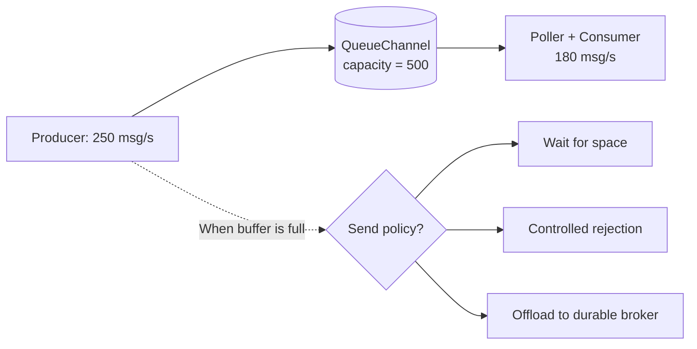
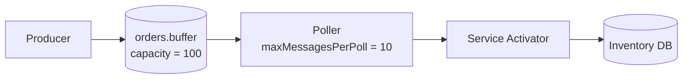
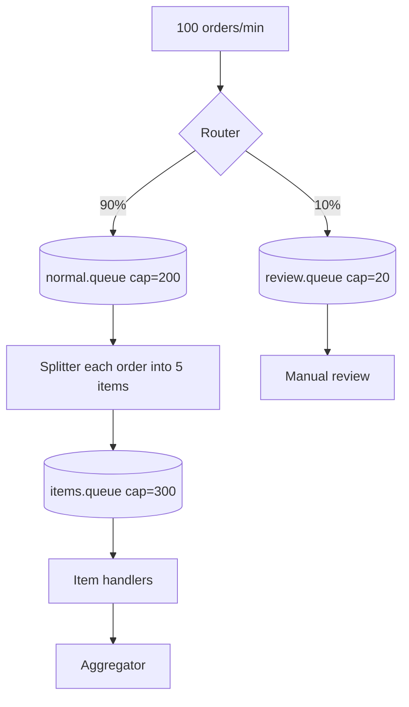

# Channel Capacity and Behavior When Full

## 1. The Problem: Producer Faster Than Consumer

In an **integration flow**, a producer can emit messages faster than a downstream endpoint can process them. For example, an API receives 250 order requests per second while inventory reservation only processes 180 orders per second. If all messages enter an unbounded in-memory buffer, the queue grows indefinitely; if producers block indefinitely, response times spike; if messages are dropped arbitrarily, the system can lose critical business work.

In the **SPRING_INTEGRATION_PATTERN** module, we use Spring Integration to implement Enterprise Integration Patterns (EIP) such as **Router, Filter, Transformer, Splitter, Aggregator, and Gateway**, combined with retries, error channels, correlation, and branch testing. Before diving deeper into those patterns, we must understand **channel capacity**: the ability to hold pending messages, send behavior when space runs out, and the impact of that choice on the entire flow.



Three questions to answer before choosing a channel:

1. **Is there a buffer?** `DirectChannel` delivers directly to a subscriber; `QueueChannel` stores messages waiting for a consumer to pull; `RendezvousChannel` has no intermediate queue storage.
2. **Is the buffer bounded?** If so, what happens to the producer when waiting messages reach capacity?
3. **Under overload, do business requirements allow waiting, rejecting, retrying, or offloading to durable storage?** There is no universal strategy valid for every message type.

**Learning objectives:** distinguish capacity from throughput, predict `send` behavior on a full channel, configure a bounded `QueueChannel`, wire pollers/consumers, recognize `ExecutorChannel` saturation, test backpressure, and monitor overload branches.

## 2. Capacity, Throughput, Backlog, and Backpressure

### 2.1. Key Terminology

| Term | Meaning | Example |
|---|---|---|
| **Capacity** | Maximum number of messages a channel buffer can hold at once. | `QueueChannel(100)` limits queued messages to 100. |
| **Queue depth / backlog** | Number of messages currently waiting to be consumed. | Queue has 80/100 slots occupied. |
| **Throughput** | Messages successfully processed or sent per unit of time. | Consumer completes 180 messages/sec. |
| **Arrival rate** (`λ`) | Rate of messages arriving at the producer/channel. | 250 messages/sec. |
| **Service rate** (`μ`) | Rate at which downstream pulls and processes messages. | 180 messages/sec. |
| **Backpressure** | Signal or mechanism slowing/blocking the producer when downstream cannot keep up. | Blocking `send`, failed send, HTTP 429/503 per policy. |
| **Overload / saturation** | State where resources like queues, thread pools, or connection pools exhaust capacity. | Queue full or executor rejecting new tasks. |

In a single-queue model, if on average `λ > μ`, backlog **tends to grow**. A rough estimate over a steady load interval is:

\[
\Delta Q \approx (\lambda - \mu)\,\Delta t
\]

If `λ = 250` and `μ = 180` messages/sec, backlog grows by roughly **70 messages/sec**. An empty queue of capacity 700 can fill in about **10 seconds** at constant rates. This is only an illustrative model, **not an SLA forecast**: in reality arrivals burst, latencies vary, consumers run concurrently, filters drop messages, and processing costs differ across payloads.

**Capacity does not make consumers faster.** Raising capacity from 100 to 1,000 slots only lets backlog accumulate longer; if downstream throughput stays low over time, the queue still fills. Capacity helps absorb **temporary bursts**, not replace service optimization, consumer scaling, or ingress rate control.

### 2.2. Full Buffer vs. Broken Buffer

A full queue does not necessarily indicate an exception or infrastructure failure. It may simply be enforcing memory-protection bounds as designed. In that state, the producer should receive a clear outcome: **wait**, **stop accepting**, or **route to a pre-designed alternate intake path**. Conversely, setting an unrealistically huge limit can turn predictable overload into an unrecoverable out-of-memory crash.

In particular, **capacity is normally counted in messages, not bytes**. Two queues of 100 messages can consume vastly different RAM if one holds 100 short IDs and the other holds 100 large payloads. When sizing capacity, estimate payload sizes and attached objects/headers.

## 3. Capacity Means Different Things for Different Channels

| Channel | Internal Queue? | Saturation Point to Consider | Core Behavior |
|---|---|---|---|
| `DirectChannel` | No `QueueChannel`-style message queue. | Subscriber processing time, calling thread, and handler availability. | Synchronous dispatch; sender can be held while handler runs. |
| `QueueChannel` | Yes. | Waiting items reaching capacity. | Producer sends into queue, consumer actively `receive`/polls; sending when full depends on timeout. |
| `PriorityChannel` | Has a priority queue. | Capacity and priority-based dequeue policy. | Ranks by priority, but does not make the queue infinite or guarantee strict fairness. |
| `RendezvousChannel` | No multi-message waiting buffer. | No receiver ready to accept. | Direct handoff: producer may have to wait for consumer to receive. |
| `ExecutorChannel` | No dedicated `QueueChannel`; may use executor's queue. | `TaskExecutor` thread count, queue, and rejection policy. | Offloads execution to executor; saturation follows executor policy. |
| `PublishSubscribeChannel` | No per-subscriber queue by default. | Execution time/capacity of subscribers or executor if configured. | Fan-out to subscribers, synchronous or executor-backed depending on config. |

Do not treat `capacity` identically across all channels. For example, `new QueueChannel(50)` bounds **waiting messages**; `ThreadPoolTaskExecutor.setQueueCapacity(50)` bounds **waiting tasks in the executor**. One task may process one message, multiple messages, or spawn further tasks; two numbers of 50 do not imply equivalent load or durability.

## 4. QueueChannel: The Canonical Full-Queue Case

### 4.1. Creating a QueueChannel with Explicit Capacity

Spring Integration provides `QueueChannel`, a `PollableChannel` implementation that can bound the number of messages held in the queue:

```java
import org.springframework.integration.channel.QueueChannel;

QueueChannel queue = new QueueChannel(2);
```

In this example, the queue stores at most **2 unretrieved messages**. Once a consumer calls `receive`, that message no longer occupies a slot in the queue, even if the consumer's business processing is not yet finished.

If you use the default `QueueChannel` constructor, understand it as a queue **without an explicitly designed small bound** (effectively an implementation-large capacity); do not rely on the default as an overload protection policy. In production, set capacity based on workload, memory budget, and acceptable wait time.

### 4.2. Behavior When Calling `send(message, timeout)`

`MessageChannel` supports `send(Message<?> message, long timeout)`; for a bounded queue, timeout governs how waiting for a free slot behaves:

| `timeout` | When Space Is Available | When Queue Is Full |
|---|---|---|
| `0` | Sends immediately and succeeds. | Tries immediately and returns `false` if unable to enqueue; does not wait. |
| Positive number (milliseconds) | Sends and succeeds. | Waits **at most** that duration; if still full, returns `false`. |
| `-1` (infinite timeout) | Sends and succeeds. | Can wait until a consumer frees space or the thread is interrupted; risks hanging callers if no consumer exists. |

These outcomes describe **basic send behavior of a healthy QueueChannel**. Callers must still distinguish `false` from exceptions caused by thread interruption, interceptors, or surrounding handlers; templates/gateways may translate send failure into a higher-level exception. Never treat `send(...)` returning `false` as the message entering the queue.

#### Timeline Illustration

```text
T0  capacity=2, queue=[]
T1  send(A, 0)  -> true     queue=[A]
T2  send(B, 0)  -> true     queue=[A, B]       FULL
T3  send(C, 0)  -> false    queue=[A, B]       no wait
T4  receive(0)  -> A        queue=[B]          frees 1 slot
T5  send(C, 0)  -> true     queue=[B, C]       FULL
```

At T3, `C` **is not automatically retried** and cannot be found in the queue. If the application treats `false` as success, requests risk being lost. With a positive timeout, the producer at T3 can wait until T4, claim the freed slot, and proceed; there is no guarantee of success if multiple producers contend for the slot.

### 4.3. Standalone Java Snippet with QueueChannel

```java
import org.springframework.integration.channel.QueueChannel;
import org.springframework.messaging.Message;
import org.springframework.messaging.support.MessageBuilder;

QueueChannel queue = new QueueChannel(2);

Message<String> a = MessageBuilder.withPayload("A").build();
Message<String> b = MessageBuilder.withPayload("B").build();
Message<String> c = MessageBuilder.withPayload("C").build();

boolean okA = queue.send(a, 0);      // true
boolean okB = queue.send(b, 0);      // true
boolean okC = queue.send(c, 0);      // false because queue is full

Message<?> taken = queue.receive(0); // take A out of the queue
boolean retryC = queue.send(c, 0);  // true: a slot just opened

System.out.println(okA && okB && !okC && retryC); // true
System.out.println(taken.getPayload());            // A
```

`receive(0)` does not wait when the queue is empty; it returns `null` if no message is available. In production code, always check for `null` before accessing the payload. This snippet uses a fixed single-threaded send/receive order; in multi-producer/multi-consumer apps, never infer outcomes from inspecting queue size beforehand because of race conditions.

### 4.4. When Negative or Infinite Timeouts Become a Risk

If a sender uses a send call that can **wait indefinitely** while consumers are stopped or broken, requests can hang. If locks, connections, or transactions are held while waiting, queue congestion can cascade into deadlocks or exhaustion in other components.

Design principles:

1. Use **finite** send timeouts wherever response-time limits exist.
2. Return clear outcomes on overload; retry only with delay policies, attempt limits, and duplicate protection.
3. Monitor backlog and consumer liveness; **never** just increase timeouts to hide congestion.
4. Never perform unbounded waits inside a transaction or critical section if downstream needs those held resources.

## 5. Combining QueueChannel with Pollers and Consumers

`QueueChannel` is a `PollableChannel`: consumers must actively pull messages. In Spring Integration, a **polling endpoint** can use a `Poller` to check the queue periodically and pass messages to a handler.



Java DSL configuration example targeting Java 17+, Spring Boot 3.x, and Spring Integration 6.x:

```java
import java.math.BigDecimal;

import org.springframework.context.annotation.Bean;
import org.springframework.context.annotation.Configuration;
import org.springframework.integration.channel.QueueChannel;
import org.springframework.integration.config.EnableIntegration;
import org.springframework.integration.dsl.IntegrationFlow;
import org.springframework.integration.dsl.Pollers;

record OrderCommand(String orderId, BigDecimal total) {}

interface OrderProcessingService {
    void process(OrderCommand order);
}

@Configuration
@EnableIntegration
class OrderQueueConfiguration {

    @Bean(name = "orders.buffer")
    QueueChannel ordersBuffer() {
        return new QueueChannel(100);
    }

    @Bean
    IntegrationFlow orderConsumerFlow(OrderProcessingService processingService) {
        return IntegrationFlow.from("orders.buffer",
                        endpoint -> endpoint.poller(
                                Pollers.fixedDelay(200)
                                        .maxMessagesPerPoll(10)))
                .handle(OrderCommand.class, (order, headers) -> {
                    processingService.process(order);
                    return null; // one-way endpoint, no reply needed
                })
                .get();
    }
}
```

`OrderProcessingService` is an application business interface; provide an actual implementation bean when running in a Spring context. The example assumes no framework-supplied constructor or implementation.

Here, `fixedDelay(200)` configures the interval between poll triggers—it is **not** a promise of exactly 10 messages every 200 ms. `maxMessagesPerPoll(10)` caps the **maximum** messages pulled per poll cycle (depending on scheduler, available messages, and handler duration); it does not automatically scale threads or guarantee throughput. If the consumer takes 500 ms per message on one thread, the queue can still fill up despite having capacity 100.

### 5.1. Producer with Timeout and Explicit Outcome When Full

A producer can send directly to the `orders.buffer` bean to control wait time. The following example **does not use a request–reply gateway**: enqueueing confirms acceptance into the buffer, **not successful business processing**.

```java
import org.springframework.integration.channel.QueueChannel;
import org.springframework.messaging.support.MessageBuilder;

final class OrderIntake {
    private final QueueChannel queue;

    OrderIntake(QueueChannel queue) {
        this.queue = queue;
    }

    boolean tryAccept(OrderCommand order) {
        return queue.send(MessageBuilder.withPayload(order)
                .setHeader("orderId", order.orderId())
                .build(), 100); // wait up to 100 ms to enqueue
    }
}
```

In a real Spring app, inject the exact `orders.buffer` bean (e.g., via `@Qualifier`) if multiple `QueueChannel`s exist. The caller of `tryAccept()` must map `true/false` into a **business contract**: true means "entered buffer," false means "not accepted." If zero data loss across restarts is required, an in-memory queue is not a strong enough confirmation boundary; consider a durable broker/message store and matching acknowledgments.

### 5.2. Buffer Size and Consumer Throughput Are Independent Concerns

When a queue hits capacity, the **right** ways to increase capability are:

- Optimize the downstream endpoint if it is the bottleneck (database queries, downstream HTTP, synchronization locks).
- Increase consumer concurrency under control if business rules allow parallel processing; verify threads, transactions, and message ordering.
- Tune poll intervals/batch sizes based on measurement rather than assuming "polling faster" is always better.
- Throttle producers, or batch/drop unneeded messages with a Filter per contract.
- Dedicate separate queues for critical flows so one slow branch does not consume all capacity.

Increasing capacity alone is sensible mainly when the goal is **absorbing brief bursts** and downstream can drain the backlog once the spike passes.

## 6. Choosing a Policy When Full: Wait, Reject, Persist, or Shed Load

| Policy | Mechanism | Fits When | Risks to Control |
|---|---|---|---|
| **Block / wait** | `send` with positive or infinite timeout. | Producer tolerates latency and downstream recovers quickly. | Threads tied up; cascading timeouts, held transactions, system-wide stalls. |
| **Fail fast** | `send(message, 0)` and check `false`. | API prioritizes fast responses and clients implement appropriate retries. | Must express errors clearly and never claim acceptance before enqueueing. |
| **Bounded wait** | Short finite timeout. | Want to absorb small jitter while capping SLA. | Outcomes depend on races/concurrency; must track timeout metrics. |
| **Durable queue/broker** | Offload to JMS/Kafka/RabbitMQ or a properly configured persistent store. | Need crash recovery, paused consumers, long-lived producer/consumer decoupling. | Still subject to quotas, broker overload, retry/ack/DLQ, ordering, and duplicates. |
| **Load shedding** | Reject lower-priority requests under overload. | Data is droppable under explicit policy (e.g., certain telemetry). | Never apply blindly to payments or critical orders. |
| **Scale downstream** | Add workers or raise throughput. | Workload parallelizes and downstream resources support it. | Can overload databases/external services and reorder messages. |

For HTTP requests at the system edge, a full channel may map to **429 Too Many Requests** or **503 Service Unavailable** depending on root cause and API contract, with retry guidance when appropriate. That is an API-layer decision, **not** default `QueueChannel` behavior. Never return HTTP 200/202 "accepted" if the message did not actually reach the promised durable/processing boundary.

### 6.1. Backpressure Does Not Equal Automatic Retry

Suppose a `QueueChannel` has capacity 2, a producer sends a third message, and receives `false`. The channel has **signaled overload**, yet it does not:

- Automatically place the third message into another queue.
- Automatically retry with backoff.
- Automatically emit an `ErrorMessage` on an error channel the same way a throwing handler does.
- Automatically prevent duplicate processing if the sender retries.

To retry, define **retryable errors**, attempt limits, backoff/jitter, total wait budget, and idempotency. Waiting to retry on the same thread needed downstream to drain the queue can cause deadlocks or amplify congestion.

### 6.2. Error Flows Must Distinguish Intake Failures from Processing Failures

```text
Producer -- send false/timeout --> INTAKE_REJECTED (not accepted)

Queue -- consumer receives --> Handler -- exception --> PROCESSING_FAILED
                                                   | retry / recovery / DLQ
```

Failing to **enqueue** differs from **enqueued yet handler failed**. With an in-memory channel, a message removed via `receive` whose handler fails will not automatically return to the queue; design explicit transactions/recovery rather than assuming at-least-once delivery. Error channels, retry advice, transactions, and broker acknowledgments address distinct slices of responsibility.

## 7. ExecutorChannel: Being Full Means the Executor's Task Queue Is Full

`ExecutorChannel` delegates dispatch to a `TaskExecutor`. It does not take the same `capacity` parameter as `QueueChannel`; bounds typically come from the executor's **thread pool** and **task queue**. Example:

```java
import java.util.concurrent.ThreadPoolExecutor;

import org.springframework.context.annotation.Bean;
import org.springframework.integration.channel.ExecutorChannel;
import org.springframework.messaging.MessageChannel;
import org.springframework.scheduling.concurrent.ThreadPoolTaskExecutor;

@Bean
ThreadPoolTaskExecutor integrationExecutor() {
    ThreadPoolTaskExecutor executor = new ThreadPoolTaskExecutor();
    executor.setCorePoolSize(4);
    executor.setMaxPoolSize(8);
    executor.setQueueCapacity(50);
    executor.setThreadNamePrefix("integration-worker-");
    executor.setRejectedExecutionHandler(
            new ThreadPoolExecutor.AbortPolicy());
    executor.initialize();
    return executor;
}

@Bean(name = "orders.async")
MessageChannel asyncOrders(ThreadPoolTaskExecutor integrationExecutor) {
    return new ExecutorChannel(integrationExecutor);
}
```

Once the executor has occupied all available threads **and** its task queue has no room, submitting a new task can be **rejected** per `RejectedExecutionHandler`. With `AbortPolicy`, this typically manifests as a rejected-execution exception, which Spring layers may wrap or translate differently. This is **not** identical to `QueueChannel.send(message, 0)` returning `false`; always observe actual exceptions and executor configuration.

Key detail for `ThreadPoolTaskExecutor`: with a positive queue capacity, the executor generally uses core threads and **enqueues tasks** before expanding threads up to `maxPoolSize`. Hence `corePoolSize=4`, `maxPoolSize=8`, `queueCapacity=50` **does not** mean it immediately scales to 8 threads first and only then queues. Load-test to verify pool behavior and scaling strategies.

Other rejection policies like `CallerRunsPolicy` can force the **sending thread to execute the task** when the executor saturates (unless shut down), providing backpressure while altering latency and sync/async boundaries. Never pick a policy just because its name sounds good; test its impact on gateway contracts, transactions, logging/MDC, and ordering.

### 7.1. Common Misconception: "ExecutorChannel Never Blocks Producers"

Under normal conditions, the executor accepts tasks quickly and handlers run on worker threads. Under overload, policies reject tasks or force the caller to run them. Therefore, **there is no blanket guarantee that producers always return immediately**. Each `TaskExecutor` and rejection policy has its own semantics.

Moreover, `ExecutorChannel` is not durable message storage. App restarts can lose in-memory tasks/messages whether running or queued.

## 8. Capacity in Flows with Router, Splitter, and Aggregator

Real flows rarely have just one queue. A **Router** can split load across branches with different backlogs. A **Splitter** can multiply one order message into dozens of line-item messages; an **Aggregator** must wait for multiple parts before emitting a result. Size capacity in **per-stage message units**, not solely inbound request counts.



**Likely bottlenecks:**

1. `review.queue` can fill up even when overall arrival rate is low because manual review is slow.
2. After a Splitter, **one** order spawns **many** messages: 90 orders/min on the normal branch at 5 lines/order produces 450 item messages/min downstream.
3. The Aggregator holds state for waiting groups; group backlog does not live solely in `QueueChannel`. Monitor unreleased groups, timeouts, and message stores.
4. One branch hitting a full queue can block threads of another branch if they share an executor or hold transactional resources.

Do not force every branch to use the same capacity. Budget capacity by criticality, payload size, downstream speed, bursts, retries, and acceptable latency. If review items have long SLAs, use a dedicated durable queue/worker rather than crowding a request–reply gateway's in-memory buffer.

### 8.1. Correlation and Overload Must Be Observed Together

When a Splitter divides a message into parts, attach a stable correlation key and track sequence numbers. If one child fails to enqueue because a queue is full, the Aggregator may **never receive enough parts** to satisfy its release strategy. In that case:

- Record `correlationId`, `sequenceNumber`, `sequenceSize` if present, along with `traceId` and business IDs.
- Define group timeout/expiry and handle incomplete results per business requirements.
- Check whether retries can produce duplicate items and how the Aggregator handles duplicates.
- Monitor each branch queue individually; do not look only at total inbound gateway requests.

Overload in one branch does not automatically surface as an obvious error in another. Observability must tell you **what was accepted**, **processed**, **forwarded**, or **rejected and where**.

## 9. Testing Full Queues and Timeouts

### 9.1. Unit Test Without a Spring Context

JUnit 5 can verify exact capacity and `send(..., 0)` without waiting on wall-clock time:

```java
import org.junit.jupiter.api.Test;
import org.springframework.integration.channel.QueueChannel;
import org.springframework.messaging.Message;
import org.springframework.messaging.support.MessageBuilder;

import static org.junit.jupiter.api.Assertions.assertEquals;
import static org.junit.jupiter.api.Assertions.assertFalse;
import static org.junit.jupiter.api.Assertions.assertNotNull;
import static org.junit.jupiter.api.Assertions.assertTrue;

class QueueChannelCapacityTest {

    @Test
    void rejectsImmediatelyWhenQueueIsFullAndAcceptsAfterReceive() {
        QueueChannel queue = new QueueChannel(2);
        Message<String> a = MessageBuilder.withPayload("A").build();
        Message<String> b = MessageBuilder.withPayload("B").build();
        Message<String> c = MessageBuilder.withPayload("C").build();

        assertTrue(queue.send(a, 0));
        assertTrue(queue.send(b, 0));
        assertEquals(2, queue.getQueueSize());

        assertFalse(queue.send(c, 0));
        assertEquals(2, queue.getQueueSize());

        Message<?> consumed = queue.receive(0);
        assertNotNull(consumed);
        assertEquals("A", consumed.getPayload());
        assertTrue(queue.send(c, 0));
        assertEquals(2, queue.getQueueSize());
    }
}
```

`getQueueSize()` is useful for **diagnostics or tests when no other thread is active**, not as an atomic pre-check to decide "there is room so send will definitely succeed" in multi-threaded code. **The authoritative source of send outcome is `send(...)` itself or the send API exception**, not a prior `queueSize` read.

### 9.2. Integration Test for a Waiting Producer

To test `send(message, timeout)` when a queue is full:

1. Create a queue of capacity 1 and send message `A` successfully.
2. From another thread, call `send(B, 500)` and ensure that thread has actually begun sending (using a barrier/latch, not just `Thread.sleep`).
3. Pull `A` from the queue before the timeout expires; verify sending `B` succeeds and the consumer receives `B`.
4. Repeat **without** pulling `A`; verify sending `B` returns `false` after the bounded interval with tolerance for CI jitter.
5. Shut down executors/test threads in `finally`; set finite test-wide timeouts so CI cannot hang.

Timing tests can flake on overloaded CI runners; avoid asserting exact milliseconds. What matters is **outcome state** and **no lost or duplicated messages**, not proving the scheduler wakes to the exact millisecond.

### 9.3. End-to-End Flow Test Matrix

| Scenario | Expected Signal | Required Assertion |
|---|---|---|
| Queue below capacity | `send` returns `true`. | Consumer receives all messages per contract. |
| Queue just filled | `send(..., 0)` returns `false`. | Rejected message is not recorded as accepted. |
| Queue full, receiver frees slot | `send` with positive timeout can succeed. | Single copy of the message enqueued; no duplication. |
| Queue continuously full | `send` waits up to limit then fails. | Overload metrics/logs emitted and producer responds properly. |
| Slow/broken consumer | Queue depth rises and triggers alerts. | Incident visible without restarting the app. |
| Executor saturation | Policy throws exception or runs on caller per config. | Not conflated with `QueueChannel` full; error carries trace/correlation. |
| Splitter fan-out exceeds branch capacity | One or more queues build backlog. | Group expiry/recovery tested; never waits forever. |
| App restart with in-memory queue | Pending messages have no persistence guarantee. | Never claim delivery guarantees the design does not support. |

## 10. Monitoring Capacity and Setting Alert Thresholds

A production system must monitor **queue depth**, **ingress/egress rates**, **latency**, **enqueue failure rates**, and **downstream health** together.

| Metric / Signal | Role | Interpretation |
|---|---|---|
| Queue depth | Waiting messages. | Continuous rise means downstream cannot keep up or is failing. |
| Remaining capacity | Open slots left. | Approaching 0 warns of imminent saturation; snapshot value. |
| Enqueue accepted/rejected | Producer intake outcomes. | Rising rejections indicate load policy tuning or consumer inspection is needed. |
| Oldest-message age | Age of oldest unprocessed message. | Can trigger early warning even before queue depth looks high. |
| Consumer throughput | Messages successfully processed per second. | Distinguishes burst-induced fullness from downstream slowdown. |
| Processing failures/retries | Errors and retry counts. | Excessive retries can amplify queue ingress pressure. |
| Executor active threads / task queue | Executor saturation. | Pertains to `ExecutorChannel`; does not replace `QueueChannel` metrics. |
| Aggregator incomplete groups | Groups waiting to complete. | Can stall even when `QueueChannel` looks empty. |

Example snapshot observation in application code:

```java
import org.springframework.integration.channel.QueueChannel;

void reportQueueSnapshot(QueueChannel queue) {
    int queued = queue.getQueueSize();
    int free = queue.getRemainingCapacity();
    System.out.printf("queued=%d remaining=%d%n", queued, free);
}
```

This is an **instantaneous snapshot**, not a slot reservation. For long-term dashboards, export metrics/observations via Spring Integration/Micrometer for your runtime version and set thresholds relative to each queue's **actual capacity**; never hardcode one global alert number across all flows.

### 10.1. Example Three-Tier Alert Evaluation

For a queue of capacity 100, you might **start tuning** with illustrative tiers:

- **70/100:** inspect upward trend over several minutes alongside consumer throughput.
- **90/100:** warn of imminent fullness if arrival rates stay elevated.
- **100/100:** measure failed `send` rates and ensure producers respond per overload policy.

These are **not universal default rules**. A queue at depth 95 that is draining steadily may be less dangerous than a queue at depth 50 climbing rapidly, while oldest-message age may already violate SLAs before capacity fills. Combine multiple metrics and run game-day drills for bursts and consumer outages.

## 11. Common Design Mistakes

| Misconception | Consequence | Right Fix |
|---|---|---|
| "Larger capacity increases throughput." | Only hides backlog; latency still climbs. | Measure and fix downstream bottlenecks; scale appropriately. |
| "Every `MessageChannel` has a queue capacity." | Wrong expectations for `DirectChannel` or `ExecutorChannel`. | Pick channel types by semantics; account for executors and transport. |
| "Default QueueChannel is safe against overload." | Uncontrolled RAM growth during sustained backlogs. | Set finite capacity per memory budget and payload sizes. |
| "`send(..., 0)` returning `false` means it will retry." | Producer silently drops messages or reports false acceptance. | Inspect return values and apply explicit retry/rejection policies. |
| "Infinite blocking guarantees zero message loss." | Threads/transactions stall, causing cascading timeouts. | Set finite timeouts and explicit error contracts. |
| "In-memory queue equals a durable broker." | Restarts lose waiting messages. | Use a durable broker/store with acks and recovery when required. |
| "Adding a QueueChannel makes consumers process automatically." | Messages sit idle in the queue. | Wire an actual poller/consumer or `receive()`. |
| "Raising maxPoolSize makes ExecutorChannel use all threads immediately." | Pool still enqueues tasks before scaling past core threads per config. | Understand `ThreadPoolTaskExecutor`, queueCapacity, and rejection policies. |
| "If send succeeds, business processing succeeded." | Confuses accepted-to-buffer with processed/committed. | Separate ACCEPTED, PROCESSING, COMPLETED, and FAILED states. |
| "Aggregator waiting means the queue hasn't finished." | Overlooks group state and missing parts. | Track correlation, release/expiry, and message stores separately. |

## 12. Practice Exercises

1. **Basic capacity:** Create `QueueChannel(3)`, send four messages with timeout `0`, then receive each one. Explain why the fourth message is not in the queue and when it could be re-sent.
2. **Timeouts:** Compare `send(B, 0)`, `send(B, 200)`, and `send(B, -1)` when a capacity-1 queue already holds `A`. Design a test with a consumer on another thread ensuring no test hangs.
3. **Poller:** Use `IntegrationFlow.from("orders.buffer", endpoint -> endpoint.poller(...))` to process orders. Make `processingService.process` slower than the producer; observe queue depth and failed `send` rate.
4. **Executor:** Create an `ExecutorChannel` with a small thread pool, finite queueCapacity, and `AbortPolicy`. Generate workload beyond pool capacity; contrast executor exceptions with `QueueChannel`'s `false`.
5. **Routing:** Split standard vs. review orders into two queues with different capacities. Slow down the review branch and check whether it affects the standard branch (watch for shared thread pools/resources).
6. **Splitter/Aggregator:** Split one order into five parts and intentionally make one branch reject enqueueing due to a full queue. Define how to detect missing parts, timeouts, recovery, and idempotency.
7. **Observability:** Add `traceId`, `orderId`, `correlationId` (where applicable) and structured logs for `ENQUEUE_ACCEPTED`, `ENQUEUE_REJECTED`, `PROCESSING_STARTED`, `PROCESSING_COMPLETED`, or `PROCESSING_FAILED`. Identify which step fails during incidents.

### Self-Check Questions

**Question 1:** A queue with capacity 100 currently holds 100 messages. What does `send(message, 0)` return for a normal producer? **Answer:** `false` if no slot is open at the moment of the enqueue attempt; the new message was not accepted into the queue.

**Question 2:** Does increasing capacity from 100 to 10,000 fix a consumer handling only 50 messages/sec when producers send 100 messages/sec? **Answer:** No; it only delays when the backlog fills up and can increase memory usage and latency.

**Question 3:** Is an `ExecutorChannel` whose `TaskExecutor` task queue is full identical to `QueueChannel.send(..., 0)` returning `false`? **Answer:** Not by default; it follows the executor's rejection policy, which may throw an exception or execute the task on the caller thread.

**Question 4:** Is a successful `QueueChannel.send(...)` enough to answer "the order has finished processing"? **Answer:** No; it only confirms the message was enqueued, not that the handler and downstream side effects completed.

**Conclusion:** **Capacity is the limit of a backlog holding area, not a measure of processing throughput.** When designing Spring Integration flows, choose the right channel semantics, set finite limits where needed, explicitly define `send` behavior when full, design consumers/pollers and overload policies, and test both happy paths and rejection paths. Combine Router/Filter/Transformer, Splitter/Aggregator, retries, error flows, and correlation with per-branch metrics to keep systems loosely coupled while preventing message loss or cascading stalls under load.
