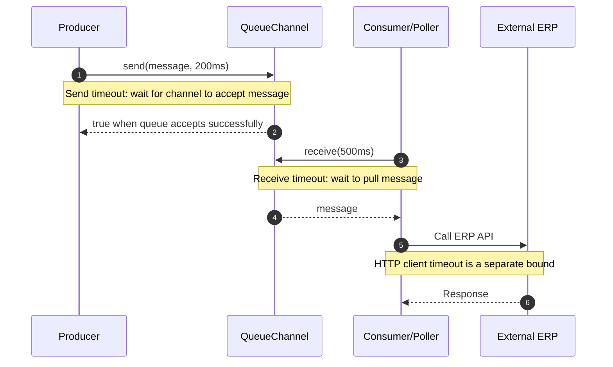
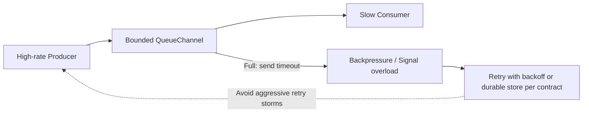
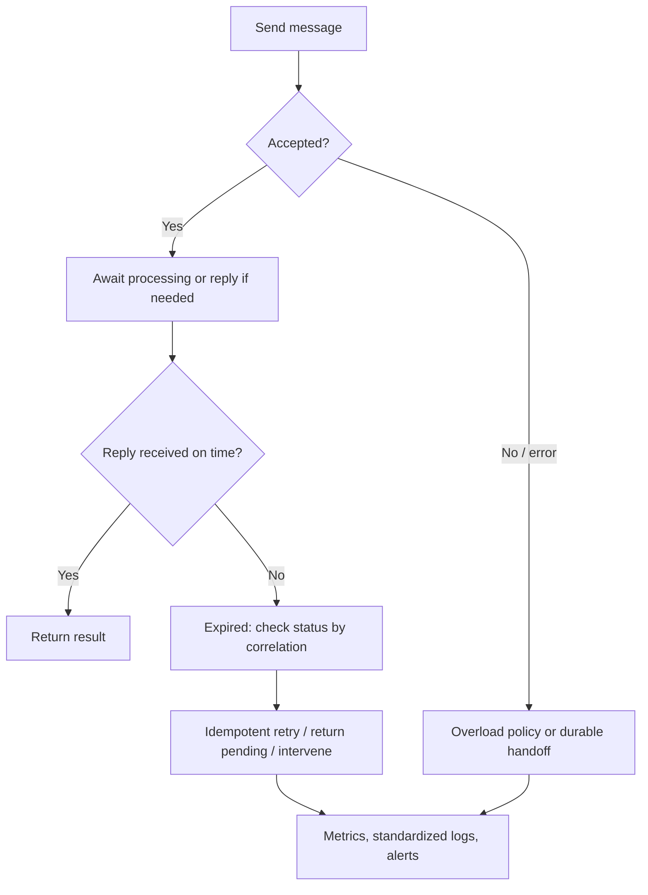

# Send Timeout and Receive Timeout

In an integration system, **successfully sending a message** and **successfully receiving a message** are two distinct events. A producer may block because a channel is full, while a consumer may wait because no data has arrived yet. If an application uses **Spring Integration** without sensible wait bounds, a small downstream failure can hang requests, exhaust threads, or bloat queues.

The topic **Send timeout and receive timeout** belongs to the **Message channel** chapter of the `SPRING_INTEGRATION_PATTERN` module. It forms the foundation for implementing **Enterprise Integration Patterns (EIP)**—Router, Filter, Transformer, Splitter, Aggregator, Gateway—in loosely coupled, extensible message flows while handling retries, error channels, correlation, testing, and monitoring of failing branches.

> **Key takeaway:** `send timeout` limits how long an operation waits **to hand off/deliver a message** on a wait-capable send; `receive timeout` limits how long an operation waits **for a message to appear** on a wait-capable receive. **Neither is "the maximum time for the entire business workflow to complete."**

## 1. Understanding the Two Wait Timeouts Correctly

### 1.1. Send Timeout: Waiting Until the Channel Can Accept a Message

A producer calls `MessageChannel.send(message, timeout)` to hand a message to a channel. On channels that **hold/wait for free space** (such as a bounded `QueueChannel`), the call may wait until space becomes available.

- If the channel has room, `send` usually finishes early **without consuming the full timeout budget**.
- If the channel is full, `send` may wait up to the specified duration depending on the implementation.
- If unable to send within that window, the call can return `false`; depending on the channel/endpoint and failure mode, an exception may also be thrown.
- The timeout does not prove a consumer processed the message. It only reflects the outcome of **handoff at the send boundary**.

With the Spring Messaging Java API:

```java
import org.springframework.messaging.Message;
import org.springframework.messaging.MessageChannel;

// 200 is the send wait budget (milliseconds), not business processing time.
MessageChannel channel = /* configured channel */ null;
Message<?> message = /* message to send */ null;

// Example invocation when real channel/message exist; do not run this null snippet as-is.
// boolean accepted = channel.send(message, 200);
```

**Note:** Not every channel waits. `DirectChannel` routes calls synchronously to a subscriber on the caller thread; `ExecutorChannel` depends on its executor; `QueueChannel`/`RendezvousChannel` are where resource waiting or producer–consumer coordination clearly show up. The practical meaning of the `timeout` parameter **depends on the channel type**.

### 1.2. Receive Timeout: Waiting Until a Message Is Available to Pull

A consumer can call `PollableChannel.receive(timeout)` to pull a message. On a `QueueChannel`, if the queue is empty the receiver can wait until data arrives or the deadline expires:

```java
import org.springframework.integration.channel.QueueChannel;
import org.springframework.messaging.Message;

QueueChannel queue = new QueueChannel(10);

Message<?> availableNow = queue.receive(0);   // Check immediately, do not wait.
Message<?> within250ms = queue.receive(250);   // Wait up to ~250 ms.

if (within250ms == null) {
    // No message received before the wait window expired.
    // Insufficient basis to conclude the system failed.
}
```

`receive(...)` returns a `Message<?>` when data is present, and can return `null` when no message arrives before timeout. **Receiving `null` once does not mean the producer failed or a message was lost**; the producer may simply not have sent anything yet.

`receive(timeout)` is part of **`PollableChannel`**, not every `MessageChannel`. `SubscribableChannel` implementations like `DirectChannel` operate by dispatching to subscribers, **not by calling `receive(...)` to pull data**.

### 1.3. Distinguishing Send Success from Processing Success

Suppose an internal queue has room. The producer calls `send(...)` and receives `true`. That normally only states that the channel accepted the message; it **does not guarantee** the Service Activator processed it, the ERP responded, the transaction committed, or the data survives an application shutdown.

Conversely, on a synchronous channel like `DirectChannel`, `send(...)` passing to a handler can trigger immediate execution on the same thread. Thus, accurate conclusions require inspecting **channel, endpoint, and processing boundaries**, not just the boolean `true`.

## 2. Four Easily Confused Points in Time Within a Flow



This diagram includes at least **three kinds of waiting**: waiting to send into the channel, waiting to pull from the channel, and waiting for the ERP over the network. If the caller needs a result from the whole flow, there is also the **reply timeout** of a request–reply gateway. Raising `send timeout` alone cannot fix a slow ERP; raising `receive timeout` alone does not guarantee the business operation finished.

| Milestone | Who Waits? | When Expired | Evidence Obtained |
| --- | --- | --- | --- |
| **Send timeout** | Producer handing a message to a channel. | Channel may reject the send or throw an error depending on type. | Whether the channel accepted the message on time. |
| **Receive timeout** | Consumer pulling a message from a `PollableChannel`. | May receive `null`. | Whether a message became available during the wait window. |
| **Reply timeout** | Gateway/caller awaiting a response in a request–reply flow. | May time out or have no reply per gateway and processing contract. | Whether a reply arrived within the deadline. |
| **Network/client timeout** | HTTP/broker/database client awaiting connection or response. | Client or adapter raises its own timeout/error. | Whether communication with the external resource met its deadline. |
| **Processing deadline** | Business workflow with a completion deadline. | Requires cancellation, compensation, expiry marking, or deferred handling policy. | Whether the overall use case met its SLA. |

## 3. Timeouts Depend on `MessageChannel` Type

Spring Integration provides multiple channel types with distinct semantics. Do not apply one timeout explanation to all of them.

| Channel | Execution Model | Send Timeout | Receive Timeout |
| --- | --- | --- | --- |
| **`DirectChannel`** | Synchronous dispatch to subscriber (usually on sender thread). | Not a handler execution abort timer; `send` duration may include handler execution time. | No direct poll API; uses subscribers. |
| **`QueueChannel`** | Buffers messages in a queue for consumer/poller later. | Clearly meaningful when **the queue is bounded and full**. | Meaningful when **the queue is empty**. |
| **`RendezvousChannel`** | Direct handoff between sender and receiver with no standard backlog buffer. | Sender may wait for receiver readiness. | Receiver may wait for sender readiness. |
| **`ExecutorChannel`** | Offloads processing to a `TaskExecutor`. | Mainly governed by executor policy/task acceptance; not a runtime bound on the handler. | Does not use `receive` like a `PollableChannel`. |
| **`PublishSubscribeChannel`** | Broadcasts to multiple subscribers; synchronous or executor-backed. | Depends on dispatch style; does not impose a combined time cap across all subscribers. | Does not use `receive` to poll in this channel model. |

### 3.1. Why Does `DirectChannel` Cause Misunderstandings?

Consider a handler calling an ERP API that takes 8 seconds. The producer sends over a `DirectChannel` with a 100 ms timeout:

```text
Producer ──send(message, 100ms)──> DirectChannel ──> Handler calls ERP (8 seconds)
```

Do not assume the handler is automatically canceled after 100 ms. For synchronous dispatch, `send timeout` is not a deadline mechanism for Java methods, SQL queries, or HTTP clients. To bound ERP call duration, configure **connect/read/response timeouts** on the appropriate client, and define retry/circuit-breaker policies or request-wide budgets at the application layer.

If you switch to `ExecutorChannel` to decouple threads, the sender returning early **still does not prove** the handler finished or survives restarts. The executor can saturate; its rejection policy and task queue also require design and observability.

### 3.2. Different `QueueChannel` Capacities Change Timeout Behavior

With a bounded `QueueChannel`, such as `new QueueChannel(1)`, once one message occupies the slot, the second send may have to wait. Conversely, a queue without an intentionally tight capacity bound keeps accepting messages, making send timeouts rare while **memory absorbs the pressure**.

The answer is not "longer waits are better," but coordinating **capacity + send timeout + consumer throughput + backpressure**. An oversized queue merely hides that the consumer is falling behind the producer.

## 4. QueueChannel Timeout Mechanics via Testable Examples

The next two examples use Spring Integration and Spring Messaging APIs directly. You do not need an ERP, Kafka, or HTTP server running to verify the core semantics.

### 4.1. Send Timeout When Queue Is Full

```java
import static org.junit.jupiter.api.Assertions.assertFalse;
import static org.junit.jupiter.api.Assertions.assertTrue;

import org.junit.jupiter.api.Test;
import org.springframework.integration.channel.QueueChannel;
import org.springframework.messaging.support.MessageBuilder;

class QueueSendTimeoutTest {

    @Test
    void secondMessageCannotEnterFullBoundedQueue() {
        QueueChannel queue = new QueueChannel(1);

        // Empty queue: accepts the first message immediately.
        assertTrue(queue.send(
            MessageBuilder.withPayload("first").build(), 0));

        // No consumer has pulled the first message yet; queue is still full.
        // Second send waits at most 50 ms then returns false.
        assertFalse(queue.send(
            MessageBuilder.withPayload("second").build(), 50));
    }
}
```

This test verifies **delivery outcome when the queue is full**. It does not assert exact wall-clock timing; on busy CI machines, avoid tight assertions down to a few milliseconds. If you need to test long vs. short timeouts, allow reasonable tolerance in a stable environment.

**Production scenario:** If the producer receives `false`, never quietly report "order created successfully." The system needs an explicit contract: return an overload status to the caller, route to durable storage, signal retry, or fall back to synchronous handling. The choice depends on delivery guarantees and business rules.

### 4.2. Receive Timeout When Queue Is Empty

```java
import static org.junit.jupiter.api.Assertions.assertEquals;
import static org.junit.jupiter.api.Assertions.assertNull;
import static org.junit.jupiter.api.Assertions.assertTrue;

import org.junit.jupiter.api.Test;
import org.springframework.integration.channel.QueueChannel;
import org.springframework.messaging.Message;
import org.springframework.messaging.support.MessageBuilder;

class QueueReceiveTimeoutTest {

    @Test
    void receiveReturnsNullWhenNothingArrives() {
        QueueChannel queue = new QueueChannel(2);

        // Empty queue, waits at most 40 ms with no producer.
        assertNull(queue.receive(40));

        assertTrue(queue.send(
            MessageBuilder.withPayload("order-101").build(), 0));

        // Data already present: receive immediately; no need to wait out timeout.
        Message<?> received = queue.receive(0);
        assertEquals("order-101", received.getPayload());

        // Message was pulled out; queue is empty again.
        assertNull(queue.receive(0));
    }
}
```

To keep tests deterministic, avoid racing threads here: empty queue → receives `null`; queue has one message → pull it → empty again. This is a **semantics unit test**, not a test of real throughput or thread scheduling.

### 4.3. What Do `0`, Positive Numbers, and Negative Values Mean?

Across common Spring Integration pollable/queue implementations, usage typically follows:

| Timeout Value | Common Practical Meaning | Recommendation |
| --- | --- | --- |
| `0` | Try immediately, **do not wait** if unready. | Use for fast checks and avoiding blocking callers. |
| Positive number, e.g. `200` | Wait at most roughly **200 milliseconds**. | Use a finite wait budget aligned with SLAs. |
| Negative value supporting "wait forever" (typically `-1`) | May wait until channel is ready or thread is interrupted. | Avoid on online requests unless monitoring, cancellation, and error handling exist. |

**Do not apply this table blindly to every channel or adapter.** Check the actual API and Spring Integration version; defaults on gateways, templates, adapters, or pollers can differ, and some components do not share identical semantics.

## 5. Distinguishing `receive(timeout)` from the Polling Scheduler

A consumer can explicitly call `queue.receive(200)`. Yet many Spring Integration flows use a **poller** to inspect sources on a schedule:

```text
Poller runs on configured interval
         |
         v
      QueueChannel
         |
   message present?
      /       \
    yes        no
     |          |
  process    end poll cycle
```

Parameters like **`fixedDelay`/`fixedRate`**, **`maxMessagesPerPoll`**, and **receive timeout** are not interchangeable:

- `fixedDelay`: governs when **the next poll starts** after the previous one completes per scheduler config.
- `maxMessagesPerPoll`: caps how many messages a single poll cycle can retrieve/process per config.
- `receive timeout`: limits **an individual wait to pull a message** from an applicable pollable source.

For example, a poller running frequently while handlers are very slow can still let the queue fill; raising receive timeout will not speed up handlers. Conversely, if the poller sleeps too long, messages sit waiting even when consumers have spare capacity.

In real integrations, measure **message queue wait time**, **queue depth**, and **consumer processing rate**, rather than only counting how often `receive` returns `null`.

## 6. Request/Reply Gateways Have Two Distinct Timeouts

A **Messaging Gateway** translates familiar Java method calls into a message flow. When a method returns a result, two wait budgets are commonly configured:

1. **Request timeout:** how long to wait **sending the request message** to the request channel, if sending can block.
2. **Reply timeout:** how long to wait **receiving the reply message** for that request in a request–reply flow.

Annotation configuration example (for Spring Integration versions supporting these attributes):

```java
import org.springframework.integration.annotation.MessagingGateway;

@MessagingGateway(
    defaultRequestChannel = "pricingRequests",
    defaultRequestTimeout = "200",
    defaultReplyTimeout = "1500"
)
public interface PricingGateway {
    PriceQuote requestQuote(PriceRequest request);
}

// PriceRequest and PriceQuote are application-defined business types.
```

Here, `200` and `1500` are **milliseconds** per the gateway's timeout contract. A real flow must still define `pricingRequests` and a request–reply endpoint, such as a Service Activator returning `PriceQuote` or an outbound gateway calling an external service.

### 6.1. Reply Timeout Is Not an Automatic Work Cancellation Mechanism

If the gateway waits 1500 ms for a reply while downstream takes 5 seconds, the caller may time out per configuration/execution path; however, **that does not mean background work stopped**, transactions rolled back, or external APIs stopped processing. Along some **direct synchronous** paths, handler runtime can dictate when the call returns; do not view reply timeout as a "master clock" guaranteed to interrupt a running method.

Therefore, clarify explicitly:

- What does the caller receive when no reply arrives on time: `null`, an exception, an expired status, or an async handle? This depends on method signature, gateway mechanics, and application error handling.
- Are late replies discarded, routed to an error/undelivered handler, persisted, or reconciled against the expired state?
- Will caller retries repeat an **already-completed task** and create duplicate data?
- Are correlation keys and reply channels preserved across async/adapter boundaries?

### 6.2. When to Use Request–Reply vs. Fire-and-Forget?

| Need | Better-Suited Design |
| --- | --- |
| API needs an immediate quote within a short wait budget. | Request–reply Gateway with clear deadlines and matching client timeouts. |
| Sending emails/reports that may take minutes. | Accept the job, return a job ID, and process asynchronously; never hold HTTP requests open. |
| Task contacting multiple partners where parts may be missing. | Track state by correlation ID, Aggregator timeouts, and group completion rules. |
| Irregularly paced data source. | Poller/consumer with finite receive timeouts; avoid busy-spinning on empty queues. |

## 7. Timeouts Under Heavy Load: Backpressure Before Retry

Suppose producers emit 500 messages/sec while consumers handle only 100 messages/sec. With an unbounded queue, waiting messages grow continuously. With capacity = 1000, the queue eventually fills and producers begin encountering send timeouts.



**Backpressure** is the signal telling upstream systems **to slow down or stop pushing into a saturated resource**. A send timeout is an important diagnostic signal: if callers retry immediately without limits, they can make the overload far worse.

### 7.1. Choosing a Policy After Send Failure

| Business Contract | Policy Direction to Consider |
| --- | --- |
| Online request where client can retry. | Return an overload error or appropriate temporary status with retry guidance and stable idempotency keys. |
| Event that must never be lost. | Use durable intake/storage matching guarantees, with acknowledgments and replay support. |
| Low-criticality telemetry where sampling drops are acceptable. | Controlled drop with metrics emitted; never falsely report processing success. |
| Batch workload tolerant of delay. | Throttle producers, batch appropriately, scale bounded consumers, and monitor queue age. |

**Never equate an in-memory `QueueChannel` with a durable broker.** A `send` returning `true` before a crash does not mean the message will be recovered; durability requires appropriate storage, transactions, and ack/recovery mechanisms.

### 7.2. Both Too-Short and Too-Long Timeouts Have a Cost

- **Too short:** triggers false errors during legitimate traffic spikes or normal consumer processing windows.
- **Too long:** ties up threads, increases latency, reduces capacity for new requests, and masks saturation.
- **Unbounded:** risks hanging callers indefinitely if no consumer/handler exists or external resources stall.

A sensible starting point is not one universal number, but **SLOs/SLAs, producer/consumer rates, queue capacity, high-percentile processing times, and the end-to-end latency budget**.

## 8. Designing an End-to-End Time Budget

Suppose an API aims to respond within **2 seconds**. An illustrative budget might allocate:

| Stage | Example Budget |
| --- | ---: |
| Request validation/normalization | 150 ms |
| Waiting to send into bounded channel | 150 ms |
| Waiting for downstream/reply, including processing and network | 1400 ms |
| Reserve for serialization/network/caller overhead | 300 ms |
| **Total** | **2000 ms** |

These numbers only illustrate how to divide a budget, **not default values to copy verbatim**. An end-to-end deadline must be tracked across boundaries rather than giving every layer its own 2-second timeout. If each adapter can wait 2 seconds across three sequential adapters, total API latency far exceeds the original target.

A system should:

1. **Start measuring the deadline at the ingress boundary** (HTTP/Gateway), rather than resetting the clock at every branch.
2. **Allocate budgets to each wait point**: queues, gateway replies, client connect/read, locks, aggregators.
3. **Subtract elapsed time** before forwarding; if no budget remains, fail cleanly or shift to an async workflow.
4. **Ensure timeouts are never mistaken for "not processed"**: maintain business state and idempotency.
5. **Monitor latency percentiles and expiration counts**, not just averages.

If a request was accepted for async processing and may continue past the caller's deadline, the contract must clearly state *accepted* vs. *completed*. Returning HTTP success must not mislead clients into assuming side effects completed if the system only enqueued the work.

## 9. Retries, Errors, Correlation, and Late Results

### 9.1. Can Retrying After a Send Timeout Cause Duplicates?

On a **simple bounded `QueueChannel`**, `send(..., timeout)` returns `false` when the message could not enter the queue. However, **across gateways, adapters, or external transports**, callers may be uncertain whether the target system already processed the message or operation. A timeout at one hop does not prove "zero side effects occurred."

When retrying, ensure:

- Bounded attempts, backoff, jitter where appropriate, and deadline budget enforcement.
- Classification between transient errors (full queue, brief network issue) and permanent errors (bad schema, unauthorized).
- **Stable idempotency keys** and state checks at boundaries with side effects.
- No blind retries after a gateway reply timeout if the operation may already have succeeded.

### 9.2. Does an Error Channel Catch Every Timeout?

There is no such blanket guarantee. For code calling `queue.receive(100)`, a `null` return means **no data arrived in time**, and does not by default become an `ErrorMessage`. `send(...)` may return `false` or throw depending on channel/infrastructure; gateway reply timeouts also have their own semantics. In synchronous flows, exceptions may go straight back to callers; in async flows, endpoints/adapters may send `ErrorMessage`s to an error channel when configured to do so.

Therefore, design **branch-specific error policies**:



**This is a policy diagram**, not automatic default behavior generated by Spring Integration merely because you declare a bean named `errorChannel`.

### 9.3. Correlation for Request–Reply and Aggregator

In a Splitter/Aggregator flow, one order may split into five child messages. If three replies arrive before timeout while two return late, the team must define **release strategy**, **group timeout/expiry**, and handling for late/duplicate results. **Aggregator group timeout differs from `PollableChannel.receive(timeout)`**: one governs **message-group lifecycle**, while the other bounds **a single pull wait** on a channel.

Keys to distinguish:

| Key | Purpose |
| --- | --- |
| `messageId` | Technical identifier of a single message instance; can change when rebuilt. |
| `correlationId` | Links messages belonging to the same request or processing group. |
| `eventId` or idempotency key | Identifies an already-processed event/action to guard against replays. |
| `traceId` | Connects observability logs/spans across services; does not replace business keys. |

Avoid using sensitive data like tokens or email addresses as correlation IDs. When a reply arrives after the caller timed out, the flow needs an explicit policy to persist state, intentionally discard, or reconcile asynchronously per contract—never treat late replies as "random noise."

## 10. Testing Timeouts: Test Only What You Actually Control

Split tests across layers, since a `QueueChannel` unit test cannot prove external network ERP response times.

| Test Layer | Scenario | What to Assert |
| --- | --- | --- |
| **Unit: bounded queue** | Capacity 1, send two messages with no consumer. | First returns `true`, second expires/returns `false`. |
| **Unit: empty queue** | No producer, call `receive(40)`. | Returns `null` and does not continue as if a message arrived. |
| **Flow test** | Router sends batch into queue, downstream blocked. | Proper overload signal raised; messages are not silently dropped. |
| **Gateway test** | Downstream reply exceeds budget. | Caller observes timeout/missing reply per contract; do not assert downstream was canceled. |
| **Adapter integration test** | HTTP client or broker slow/unavailable. | Client timeouts, retry/error flows, and status updates behave properly. |
| **Idempotency test** | Resend same event after request timeout. | No duplicate side effects beyond contract. |
| **Recovery test** | Restart while messages sit in queue. | Clearly demonstrates which channel/store type does or does not persist. |
| **Load test** | Producer outpaces consumer over time. | Queue age, capacity, thread usage, and send timeout rate stay within limits. |

### 10.1. Avoiding Flaky Tests Caused by Clocks and Schedulers

Doing `Thread.sleep(50)` and expecting a message at exactly 50 ms produces flaky tests. For async tests, use **latches/synchronization and conditional waits with timeouts**. Give tests enough headroom for scheduler variance while staying bounded to catch deadlocks.

The two JUnit examples above deliberately test **deterministic queue states** (full/empty) rather than millisecond precision. That is the starting point; real flow tests should add concurrent producer–consumer cases, interruption, retries, and adapter configuration.

### 10.2. Test Cancellation and Interruption Conditions Too

A thread waiting indefinitely may never exit cleanly if no data arrives and no stop signal fires. On application shutdown, verify whether endpoints/pollers/executors respond to interruption, stop accepting new messages, drain queues, or hand off to a durable store. **Finite timeouts reduce unbounded resource-holding risks**, but do not replace graceful shutdown and recovery strategies.

## 11. Observability: Distinguishing Full Channels, Empty Channels, and Slow Processing

Useful operational signals:

- **Send timeout rate:** rate of send failures due to missing capacity or dispatch failures; tag channel and cause.
- **Receive empty/timeout rate:** frequency of empty receives; high values may simply mean **low traffic**, not an error.
- **Queue depth/capacity:** current depth, fill percentage, and backlog growth/drain rate.
- **Queue age:** how long messages wait before a consumer pulls them.
- **Handler latency:** endpoint execution time, especially around external calls.
- **Gateway reply latency:** wait time from sending a request until receiving a reply.
- **Error/retry counts:** timeout counts by type, retries, final outcomes, and duplicate rates.

A minimal structured log entry might look like:

```text
event=channel_send_timeout
channel=orders.queue
timeout_ms=200
queue_capacity=100
queue_depth=100
correlation_id=7ac87f45-2e10-4a89-91f6-96dbe3bc35fa
outcome=retry_scheduled
```

This is an **example log format**, not a claim that Spring Integration emits these exact fields automatically. Configure instrumentation and metrics/traces accordingly; avoid logging payloads, API keys, tokens, customer info, or putting per-request `correlationId` values into **metric labels** that cause high cardinality. Keep opaque correlation IDs in access-controlled logs/traces while aggregating metrics by channel name and error type.

### 11.1. Quick Diagnosis by Symptom

| Symptom | Likely Causes to Check First |
| --- | --- |
| Rising send timeouts, queue always full. | Consumer too slow, infrequent poller, downstream errors, or producer burst. |
| Frequent receive timeouts, queue nearly always empty. | Low workload or producer not sending; cross-check ingress traffic. |
| Fast `send` yet very slow overall API. | Handler, network client, gateway reply, or Aggregator—not send timeout alone. |
| Reply timeout yet partner persisted data. | Delayed/lost response, under-budgeted timeout; requires idempotency and status lookup. |
| `ExecutorChannel` saturated and rejecting tasks. | Executor pool/queue/rejection policy, backpressure, and capacity. |
| Shutdown hangs. | Infinite waits, blocked threads, poller/executor lifecycle, or unfinished external tasks. |

## 12. Common Mistakes and Fixes

### Mistake 1: "Setting `sendTimeout=200` Prevents Handlers from Running Longer Than 200 ms"

**Wrong:** Send timeout is not a business-logic execution deadline. With `DirectChannel`, a synchronous handler can run longer; with async channels, work continues after the sender returns. **Fix:** set timeouts on clients/handlers appropriately and enforce end-to-end deadlines.

### Mistake 2: "`receive(100)` Returning `null` Means the System Is Broken"

**Wrong:** `null` may simply mean the queue had no messages yet. **Fix:** check ingress traffic, producer health, and polling goals; do not spam error logs on every empty poll.

### Mistake 3: "Make Queue Capacity Infinite to Avoid Send Timeouts"

**Wrong:** That converts the problem into memory exhaustion and extreme queue delays. **Fix:** bound capacity to consumer capability, monitor backlog, and apply backpressure.

### Mistake 4: "Gateway Reply Timeout Means the Partner Did Nothing"

**Wrong:** The partner may have committed while the response was lost or delayed. **Fix:** track business state, idempotency, and safe reconciliation/retry workflows.

### Mistake 5: "Every Timeout Goes to the Error Channel"

**Wrong:** `receive` returning `null` does not raise an error; `send` can return `false`; gateways/adapters have distinct exception paths. **Fix:** handle each outcome explicitly and test configured sync/async error paths.

### Mistake 6: "Replacing `DirectChannel` with `ExecutorChannel` Adds Durability"

**Wrong:** Asynchronous does not mean durable, and executors can saturate. **Fix:** pick persistence/brokers matching delivery requirements, paired with acknowledgments, retries, and recovery.

## 13. Check Your Understanding

**Scenario A.** `QueueChannel(1)` holds one message. There is no consumer. The producer calls `send(second, 100)`. What happens?

*Answer:* Because the queue is full, the call waits roughly 100 ms and returns `false`. This signals **the message was not enqueued**, not proof that downstream ran or failed.

**Scenario B.** A consumer calls `receive(300)` on an empty queue and gets `null`. Should it go straight to a DLQ?

*Answer:* No. There is no message to move to a DLQ; this is normally **an empty poll**. Treat it as idle unless the app contract defines a specific business timeout condition.

**Scenario C.** An API sends through `DirectChannel`, a handler makes a 10-second HTTP call, and `send timeout` is set to 50 ms. Will the API definitely return after 50 ms?

*Answer:* No. `DirectChannel` runs handlers synchronously; send timeout does not cancel the HTTP call. Configure client timeouts and proper end-to-end limits.

**Scenario D.** A Gateway hit a reply timeout, yet the customer reports the order just appeared in the ERP. Is immediately re-sending the create-order request safe?

*Answer:* Not necessarily. Reconcile state first or retry using a **stable idempotency key** to avoid creating duplicate orders.

**Scenario E.** A Splitter sends five parts to multiple systems; the Aggregator receives only four within 3 seconds. Should you increase `QueueChannel.receiveTimeout` so the Aggregator is guaranteed all parts?

*Answer:* No. That is an Aggregator **group correlation, release strategy, and group timeout/expiry** problem, distinct from pulling a message from a `PollableChannel`. Define handling for late arrivals and incomplete groups.

## 14. Timeout Design Checklist for a Flow

| Question | What to Define |
| --- | --- |
| Which channel does the producer send to? | Channel type, capacity, and whether `send` can block. |
| How does the consumer pull messages? | Subscriber or poller; does `receive timeout` apply? |
| Does the caller wait for a reply? | Request timeout, reply timeout, and result type upon expiration. |
| Are network/database calls involved? | Connect/read/response timeouts, transactions, and circuit breakers if used. |
| What is the business deadline? | Divide budgets per stage with reserves and late-reply handling. |
| What happens when the queue is full? | Backpressure, bounded retries, fail fast, or durable persistence per contract. |
| Can messages be reprocessed? | Idempotency keys, deduplication, and state reconciliation. |
| Are Splitter/Aggregator used? | Correlation, group release/expiry, and incomplete-branch handling. |
| Is status measurable? | Send/receive timeouts, queue depth/age, handler latency, errors, and retries. |
| Are real failure modes tested? | Full queue, empty queue, slow consumer, late request–reply, shutdown/restart. |

## Conclusion

**Send timeout** and **receive timeout** are two wait bounds at the send/receive message boundary; they keep Spring Integration from hanging on immediate producer/consumer readiness. On `QueueChannel`, send timeout matters especially when full, and receive timeout matters when empty. On other channels—especially `DirectChannel` and `ExecutorChannel`—understand **the actual dispatch model** before reasoning about timeouts.

When building **Enterprise Integration Patterns**, design timeouts alongside **capacity, backpressure, Gateway request/reply, client timeouts, retries, error flows, correlation, idempotency, and observability**. A timeout is valuable not merely because it stops waiting, but because the system knows **what happened, what remains uncertain, and what safe next step to take**.
