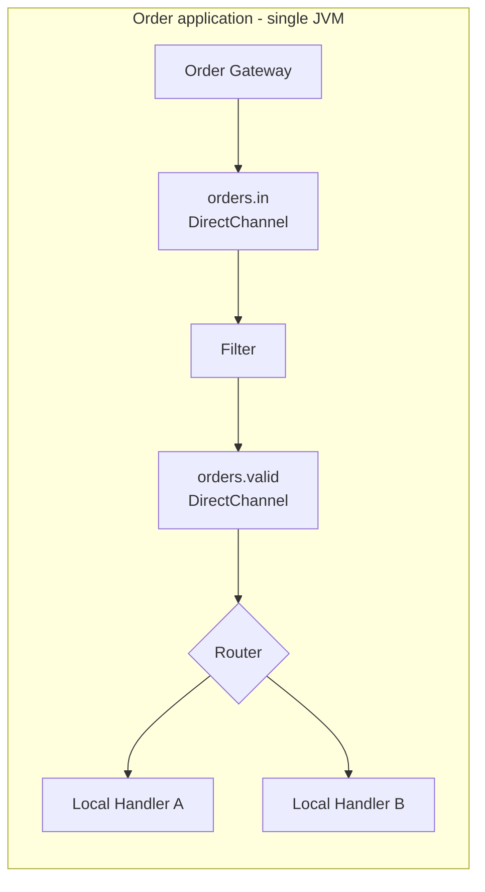
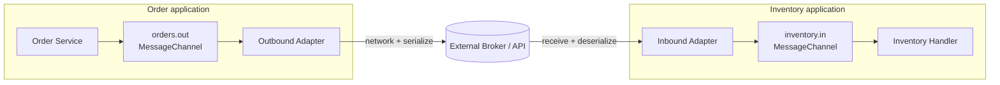
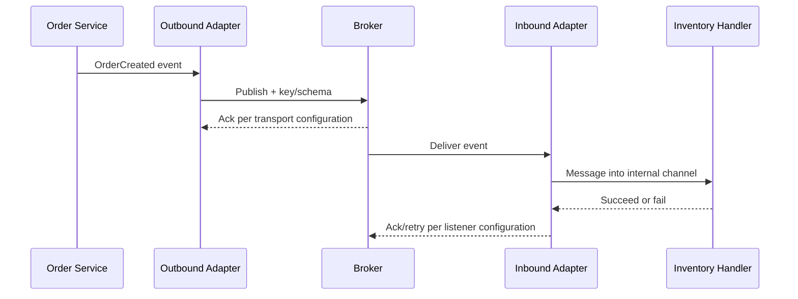
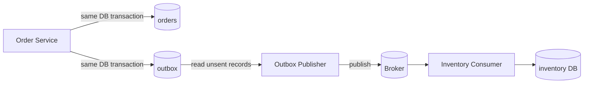

# Internal Channels vs. External System Channels

In Enterprise Integration Patterns (EIP), a **Message Channel** represents the logical path of a message from sender to receiver. When implemented with **Spring Integration**, the same diagram may connect processing steps inside **a single Java application** or cross **networks, brokers, and other applications**. Both setups share the message-exchange concept, yet they differ substantially in processing timing, data contracts, error mechanisms, durability, and operations.

For example: an ordering system must validate an order, route by region, reserve inventory, and send notifications. The **validate → route** steps can live inside the same application and communicate over `DirectChannel`. Conversely, if inventory is an independently deployed service, the reservation request may travel over Kafka, RabbitMQ, JMS, or HTTP. In that case, the system must also handle network transport, retries, connection failures, and potential redelivery of the same message.

This lesson belongs to the **Message channel** chapter of the **SPRING_INTEGRATION_PATTERN** module. Its goal is to help you design loosely coupled, extensible message flows with Router, Filter, Transformer, Splitter, Aggregator, and Gateway, while knowing when retry, error channel, correlation, testing, and observability are needed at external boundaries.

After this lesson, you will be able to distinguish **internal channels** from **cross-system channels**, choose how to bridge both sides via adapters/gateways, and describe precisely what is guaranteed when sending a message.

## 1. Two Connectivity Scopes Under the Same Model

### 1.1. Internal Channels: Endpoints Within One Application

Internal channels connect endpoints belonging to the same Spring application context. A producer sends a `Message<?>` or payload into a `MessageChannel`; the channel delivers the message to a registered endpoint.



Those endpoints may be Filters, Transformers, Routers, Service Activators, or other Spring Integration components. With `DirectChannel`, execution typically runs synchronously on the sender thread. With `ExecutorChannel` or `QueueChannel`, execution timing can be decoupled, yet because everything stays in one process, in-memory resources vanish when the process stops.

Internal channels reduce source-code coupling between producer and consumer implementations. Even so, both sides remain coupled to the **message contract** and the channel's execution semantics.

### 1.2. Channels Across External Systems: Crossing a Transport Boundary

When a message must travel to another system, the flow must pass through an **adapter or gateway** capable of speaking the actual transport. The transport could be HTTP, AMQP/RabbitMQ, Kafka, JMS, TCP, or a SaaS API.



**Terminology note:** In Spring Integration, a `MessageChannel` is normally an **in-application abstraction**. A Kafka topic, RabbitMQ queue, or HTTP endpoint is an **external transport destination**; they do not automatically become `MessageChannel` beans just because people casually call them "channels." Outbound adapters bridge internal channels to transports; inbound adapters receive data from transports and emit into internal channels.

Thanks to this boundary, inner business handlers can process messages against a stable contract without knowing whether they arrived via HTTP or Kafka. However, the adapter layer must manage data conversion, connections, timeouts, send/receive acknowledgments, and errors.

## 2. Key Similarities and Differences

| Criterion | Internal `MessageChannel` | Cross-System Exchange |
| --- | --- | --- |
| Boundary | Between endpoints within one application/context | Across processes, hosts, or services |
| Data | Usually in-memory Java objects with message headers | Requires protocol representation, serialization, and compatible schemas |
| Latency | Typically low, no network hop | Includes network latency, serialization, and external system latency |
| Errors | May be in-process handler exceptions | Includes timeouts, disconnects, ambiguous responses, redeliveries |
| Transactions | Can share thread and transaction when configured | Usually separate transaction boundaries requiring consistency design |
| Durability | Depends on channel/message store; `DirectChannel` stores nothing | Depends on broker, persistence, publisher confirms, acks, and config |
| Scaling | Usually within one process; executors increase internal concurrency | Producer and consumer can deploy and scale independently when transport supports it |
| Observability | Channel/endpoint metrics and in-app logs | Requires cross-process tracing, message keys, broker metrics, retry/DLQ |
| Security | In-process trust boundary | Requires authentication, authorization, transport encryption, and data controls |
| Complexity | Fewer operational moving parts | Must operate adapters, broker/API, schema contracts, and failure workflows |

You cannot declare "external channels are more reliable" or "internal channels are always synchronous." An in-memory `QueueChannel` is asynchronous yet loses data on restart; an HTTP outbound gateway crosses the network yet can still block a thread waiting for a response. **The transport type and execution configuration** determine actual behavior.

### Common Misconception: Channel vs. Queue

- **Channel** is the concept of delivering messages between parties.
- **Queue** is one way of storing and supplying messages to consumers.
- **Topic/pub-sub** is a mechanism delivering the same event to subscribers under specific rules.
- **Adapter/gateway** moves messages across a boundary, e.g., from a `MessageChannel` to HTTP or a broker.

Calling all of these "queues" obscures critical architectural decisions.

## 3. Internal Channel Types and Execution Properties

Spring Integration offers several `MessageChannel` implementations. Common choices:

| Channel | Core Behavior | Use Case | What to Verify |
| --- | --- | --- | --- |
| `DirectChannel` | Dispatches to subscriber on sender thread | Synchronous steps, chaining Filter/Transformer/Router in-process | Handler errors and latency can affect caller |
| `ExecutorChannel` | Dispatches via `TaskExecutor` | Concurrent processing or offloading off sender thread | Executor overload, rejected tasks, async error handling |
| `QueueChannel` | Messages sit in queue for consumer/poller | Buffer between internal producer and consumer | Capacity, poller, send timeouts, message persistence |
| `PublishSubscribeChannel` | Distributes messages to multiple subscribers | In-app event fan-out | With/without executor, single-subscriber failures, invoked branches |
| `PriorityChannel` | Supplies messages by priority | Scheduling tasks of differing urgency | Starvation and priority assignment |
| `RendezvousChannel` | Sender and receiver hand off directly | Synchronizing both sides at exchange time | Blocking or timeouts when no receiver is ready |

A `DirectChannel` works very well between two steps on the same thread. Pushing those steps onto Kafka purely for "decoupling" adds serialization, networking, and operational overhead without necessarily serving any real requirement.

Conversely, an email task that can run later, may belong to another service, and must survive application restarts fits an external transport's durability, redelivery, and error-handling mechanisms better when properly configured.

## 4. Java DSL Example: Purely Internal Pipeline

Suppose an application receives `OrderCommand`, validates data, and forwards to `InventoryService`. This is an internal flow with no broker involved.

```java
import java.math.BigDecimal;

import org.springframework.context.annotation.Bean;
import org.springframework.context.annotation.Configuration;
import org.springframework.integration.annotation.Gateway;
import org.springframework.integration.annotation.IntegrationComponentScan;
import org.springframework.integration.annotation.MessagingGateway;
import org.springframework.integration.channel.DirectChannel;
import org.springframework.integration.config.EnableIntegration;
import org.springframework.integration.dsl.IntegrationFlow;
import org.springframework.messaging.MessageChannel;

record OrderCommand(String orderId, BigDecimal amount) {}

interface InventoryService {
    void reserve(OrderCommand order);
}

@MessagingGateway
interface OrderGateway {
    @Gateway(requestChannel = "orders.in")
    void submit(OrderCommand order);
}

@Configuration
@EnableIntegration
@IntegrationComponentScan
class InternalOrderFlow {

    @Bean("orders.in")
    MessageChannel ordersIn() {
        return new DirectChannel();
    }

    @Bean("orders.valid")
    MessageChannel ordersValid() {
        return new DirectChannel();
    }

    @Bean
    IntegrationFlow validateOrders() {
        return IntegrationFlow.from("orders.in")
            .filter(OrderCommand.class,
                order -> order.orderId() != null
                    && !order.orderId().isBlank()
                    && order.amount() != null
                    && order.amount().signum() > 0,
                spec -> spec.throwExceptionOnRejection(true))
            .channel("orders.valid")
            .get();
    }

    @Bean
    IntegrationFlow reserveStock(InventoryService inventory) {
        return IntegrationFlow.from("orders.valid")
            .handle(OrderCommand.class, (order, headers) -> {
                inventory.reserve(order);
                return null; // one-way handler
            })
            .get();
    }
}
```

An application service simply calls `orderGateway.submit(command)`. Corresponding Spring Integration dependencies and an `InventoryService` implementation bean must be registered in the application.

### What Is Guaranteed in This Example?

1. `orders.in` and `orders.valid` are two `DirectChannel`s connecting endpoints within the same Spring context.
2. The Filter rejects invalid orders with an exception because `throwExceptionOnRejection(true)` is configured. That is the filter's behavior, not a default channel feature.
3. Because handlers run synchronously along this path, the caller normally returns only after `inventory.reserve(order)` completes. Exceptions from the handler can propagate to the caller.
4. There is no broker, network serialization, durable queue, or load distribution across multiple processes.
5. If `orders.valid` is replaced with a `QueueChannel`, a poller must be added to read messages; completion timing and error paths change accordingly.

**Takeaway:** Internal channels are useful even when execution remains synchronous: they establish explicit connection points to insert Filters, Routers, Transformers, or interceptors at step boundaries.

## 5. Connecting Externally: Outbound Adapters and Inbound Adapters

A flow from Spring Integration to another system typically consists of two halves:

- **Outbound adapter/gateway:** receives messages from an internal channel and translates them into the external system's protocol.
- **Inbound adapter/gateway:** receives data from the external system, converts it into Spring messages, and emits into an internal channel.

The distinction between **adapter** and **gateway** also relates to interaction style: an outbound adapter usually performs one-way sending; an outbound gateway usually participates in request-reply interactions. Never treat either name as a guarantee that the external system completed business processing.

### 5.1. One-Way Pattern Over a Broker



In this diagram, **broker publish acknowledgment** and **Inventory Handler business outcome** are two distinct milestones. A producer receiving a publish-success ack does not mean inventory has been reserved.

Depending on the technology, broker acks may only confirm the message was accepted under the current ack/persistence settings. Never infer that a message is safe across every failure without checking your exact broker documentation and configuration.

### 5.2. Example Bridging into Spring Integration from Kafka

The following example shows the **inventory application side**, where a Spring Kafka consumer receives an event from a topic and forwards it into an internal `MessageChannel`. This manual bridge is easy to read; in real deployments you can use Spring Integration's **Kafka inbound channel adapter** instead of writing a manual bridge.

```java
import org.springframework.beans.factory.annotation.Qualifier;
import org.springframework.context.annotation.Bean;
import org.springframework.context.annotation.Configuration;
import org.springframework.integration.channel.DirectChannel;
import org.springframework.integration.config.EnableIntegration;
import org.springframework.integration.dsl.IntegrationFlow;
import org.springframework.kafka.annotation.EnableKafka;
import org.springframework.kafka.annotation.KafkaListener;
import org.springframework.messaging.MessageChannel;
import org.springframework.messaging.support.MessageBuilder;
import org.springframework.stereotype.Component;

record OrderCreated(String orderId, String region) {}

interface InventoryReservationService {
    void reserveFor(OrderCreated event);
}

@Configuration
@EnableIntegration
@EnableKafka
class InventoryInboundFlow {

    @Bean("inventory.events.in")
    MessageChannel inventoryEventsIn() {
        return new DirectChannel();
    }

    @Bean
    IntegrationFlow handleEvents(InventoryReservationService service) {
        return IntegrationFlow.from("inventory.events.in")
            .handle(OrderCreated.class, (event, headers) -> {
                service.reserveFor(event);
                return null;
            })
            .get();
    }
}

@Component
class KafkaToIntegrationBridge {
    private final MessageChannel inbound;

    KafkaToIntegrationBridge(
        @Qualifier("inventory.events.in") MessageChannel inbound) {
        this.inbound = inbound;
    }

    @KafkaListener(
        topics = "orders.events",
        groupId = "inventory-reservation")
    public void onOrderCreated(OrderCreated event) {
        boolean accepted = inbound.send(
            MessageBuilder.withPayload(event).build());

        if (!accepted) {
            throw new IllegalStateException("Internal channel rejected event");
        }
    }
}
```

To run this example, the app also needs the Spring Kafka dependency, bootstrap servers configuration, consumer factory, deserializer/JSON conversion, and listener container setup. Topic `orders.events` must exist on the broker; `InventoryReservationService` must have an implementation; and producers must publish matching the `OrderCreated` contract.

**Execution path:** Kafka listener pulls the external record → deserializes to a Java object → internal `MessageChannel` → Service Activator. Because the internal channel is `DirectChannel`, errors from `reserveFor` can propagate back to the listener. The **listener container** decides exception handling, offset commits, retries, or dead-lettering per its configuration. This code does not by itself create durability, idempotency, or retry policies.

With Spring Integration Kafka, you can use a **message-driven inbound channel adapter** directly to receive records and emit Spring messages onto a channel. On the producer side, an **outbound channel adapter** turns internal channel messages into Kafka records. Whether using an official adapter or a manual bridge depends on integration needs, while the boundary principles stay the same.

### 5.3. How Does Crossing HTTP Differ from Crossing a Broker?

With an outbound HTTP gateway, the producer normally sends a request and waits for a response or timeout. Calling an external API still introduces **temporal coupling**: a slow or unavailable receiver impacts the call.

With a broker, the producer can publish a message and proceed once publish acknowledgment arrives per configured rules. The consumer processes later, yet the system must handle **eventual consistency**, intermediate states, and potential duplicates under retries/redelivery.

There is no rule that "HTTP is always worse than Kafka." HTTP fits well when immediate answers and clear request-reply contracts are needed; brokers fit well when decoupling processing time, fan-out, or durable message storage/distribution is needed.

## 6. What Changes When Messages Cross External Boundaries?

### 6.1. Payloads Need a Cross-System Contract

Within a single JVM, a `Message<OrderCommand>` can carry a Java object directly. Crossing Kafka, RabbitMQ, JMS, or HTTP usually requires serializing data into JSON, Avro, Protobuf, or another mutually agreed format.

Example event contract:

```json
{
  "eventId": "evt-10025",
  "eventType": "OrderCreated",
  "schemaVersion": 1,
  "occurredAt": "2026-11-21T03:00:00Z",
  "orderId": "ORD-902",
  "region": "VN-S"
}
```

Every field must have clear semantics. `eventId` supports tracing and deduplication; `schemaVersion` tracks data versions; `orderId` is a business key usable as a Kafka message key when ordering per order is required. This is an example contract design, not fields automatically generated by Spring Integration.

Agree on backward-compatible schema evolution: how old consumers handle new fields, how required fields evolve, and where parse failures go. Avoid sending Java native-serialized objects across untrusted boundaries by default.

### 6.2. Spring Message Headers Are Not Automatically Preserved Verbatim

Internal `MessageHeaders` hold values like message ID and timestamp; different adapters have distinct policies for mapping headers to Kafka record headers, HTTP headers, or JMS properties. Not every Java object in headers is serializable, and not every header name is supported by every transport.

For cross-service correlation, explicitly design fields/headers like `traceId`, `correlationId`, or business keys; configure header mappers and verify the receiver sees the exact values. Never rely on all internal headers being transmitted untouched.

### 6.3. "Sent" Differs from "Processed"

Commonly confused milestones:

| Milestone | Typical Meaning | What Is Not Yet Guaranteed? |
| --- | --- | --- |
| Send to `DirectChannel` succeeds | Channel dispatched along synchronous path | Provides no durability if the process dies |
| Send to `QueueChannel` succeeds | Queue accepted message per capacity rules | Consumer may not have processed it yet |
| Broker accepts publish | Broker acknowledged per transport policy | Consumer may not have received or succeeded yet |
| Consumer ack/commit | Per consumer config, message/offset acknowledged | Does not automatically guarantee all business side effects are atomic |
| Handler updates data successfully | Consumer business step finished | Producer may not know the outcome without a reply path |

If an API returns `202 Accepted` after publishing an event, treat it as request accepted for later processing. Never show status as "completed" while consumers have not processed it yet.

### 6.4. Distributed Transactions Do Not Appear Automatically

Consider creating an order and publishing `OrderCreated`:

1. Updating the `orders` table succeeds.
2. The process crashes before publishing the event.

Now the order exists while the inventory system may never receive notification. Reversing the order carries risk too: publishing first, then rolling back the order save.

A common approach is **Transactional Outbox**: write the business change and an outbox record **in the same database transaction**; a separate task reads the outbox, publishes to the broker, and marks sent status. This resolves dual-write risks under proper deployment conditions, yet retries can still publish duplicates, so consumers must remain idempotent.



The diagram only illustrates data flow; the actual transaction is updating `orders` and `outbox` inside the same database before the publisher runs.

## 7. Retries, Error Channels, and Duplicate Message Handling

### 7.1. On Internal Channels

With `DirectChannel`, handler exceptions can typically propagate to the caller. To retry, configure retry advice on the appropriate endpoint. With `ExecutorChannel` or queue pollers, errors happen on another thread, so use endpoint/handler error mechanisms and matching error channels.

An **Error channel** routes error messages to a dedicated handling flow when infrastructure generates an `ErrorMessage` in that execution context. It does not guarantee redelivery on its own, is not a broker dead-letter queue, and does not replace external adapter error policies.

### 7.2. At External Boundaries

A classic failure happens when a consumer finishes processing yet loses its connection before the broker records its ack. The broker may redeliver the same message; if the handler updates state or deducts stock again, data corrupts.

Define three independent policies:

- **Retry:** which error types are retryable (timeouts, transient errors), attempt counts, delays, and load bounds.
- **Dead-letter/parking:** messages failing after bounded attempts must be persisted for investigation or controlled replay.
- **Idempotency:** delivering the same `eventId`/business key multiple times produces the intended business effect only once.

For instance, a consumer handling `ReserveInventory(orderId, sku, quantity)` can record `processed_event_id` in a table or enforce a unique business-key constraint inside the same transaction as the stock update. Checking only in memory fails across multiple parallel instances or restarts.

In particular, **exactly-once** claims must be scoped precisely: some brokers support transactional/processing guarantees within their own ecosystem, yet that does not automatically make every external database call, HTTP request, or side effect execute once. Idempotent design remains essential.

### 7.3. Out-of-Order or Late Messages

With Kafka, ordering is preserved within **a single partition** under its operational conditions, not across all partitions. With queues and multiple consumers, parallel processing can also finish in a different order than emitted.

When business rules require per-order ordering, choose an appropriate partition key or coordinator, use version/sequence numbers, and define how late events are resolved. With **Splitter/Aggregator**, define correlation keys, group completion conditions, timeouts, and missing-part handling; channels do not supply these rules automatically.

## 8. When to Stay Internal vs. Go External?

Start from **business requirements and deployment boundaries**, not from technology names.

| Need | Sensible Starting Point | Trade-offs to Weigh |
| --- | --- | --- |
| Validate/transform data across steps inside one service | `DirectChannel` with Filter/Transformer | Readability, exceptions, transactions |
| Short processing requiring immediate result | Internal sync flow or HTTP gateway if receiver is external | Timeouts, reply contracts, fallbacks |
| In-app background work where crash loss is acceptable per requirements | `ExecutorChannel` or internal queue | Concurrency, full queues, shutdown |
| Background task that must survive restarts | Transport or message store with durability | Persistence, acks, outbox, retries, idempotency |
| Two microservices needing independent deployment and scaling | Adapters/gateways and cross-system transport | Schemas, networking, security, observability |
| One event needed independently by multiple systems | Suitable event/pub-sub infrastructure | Topic semantics, consumer groups, fan-out |
| Sensitive data needing immediate accurate response | Authenticated request-reply with timeouts and business confirmation | Ambiguous state on timeout, duplicate control |
| Gathering multiple results across multiple consumers | Splitter/Aggregator with correlation | Timeouts, partial results, state storage |

**Comparative examples:**

- **Monolithic app:** validate order → price calculation → model conversion → handler all in one process. Internal channels usually suffice; adding a broker can add operational complexity without real benefit.
- **Multi-service system:** orders, payments, inventory, and notifications deploy independently. Broker adapters or HTTP gateways bridge deployment boundaries; in exchange you must design data contracts, distributed state, connection errors, and tracing.
- **Hybrid system:** inside each service, use internal channels to connect Filter/Router/Transformer; cross external transports only at boundaries needing independence or remote execution. This structure is very common.

## 9. Observing Message Flows Across Boundaries

In an internal pipeline, logs can use message IDs, channel names, and endpoints to pinpoint the active step. Over the network, the same business message may be reconstructed as distinct Spring messages across processes, so **an internal message object ID does not necessarily survive intact on the receiving side**.

Design at minimum:

| Information | Purpose |
| --- | --- |
| `eventId`/request ID | Look up a specific event and deduplicate |
| `correlationId`/trace context | Link steps belonging to the same business request across services |
| Message key, topic/queue, and partition/offset if available | Identify origin and consumption point |
| Publish, receive, process, and ack timestamps | Measure end-to-end latency and find bottlenecks |
| Retry count, error type, and dead-letter destination | Investigate failing messages |
| Handler name, chosen route, and business outcome | Know which branch ran and whether it completed |

Never put passwords, access tokens, or sensitive payloads in logs merely for observability convenience. When a message is delayed, separate time **waiting in the queue/broker** from time **spent in handler processing**; adding consumer threads only helps when processing capacity is the true bottleneck.

A helpful operational view:

```text
Producer
  ├─ publishAttempt
  ├─ publishAcknowledged / publishFailed
  v
Broker / External API
  ├─ enqueue / deliver
  ├─ lag / depth
  v
Consumer Adapter
  ├─ deserialize / validate
  ├─ route to local channel
  v
Business Handler
  ├─ processed / retry / dead-letter
  └─ business outcome
```

Each milestone needs matching instrumentation. Internal channel metrics do not replace broker metrics, and vice versa.

## 10. How to Test Both Channel Scopes

### 10.1. Testing Internally

With `DirectChannel`, you can test routing with one valid message and one invalid message:

1. Send a valid command to the gateway or input channel.
2. Using a mock/spy `InventoryService`, verify the handler receives the exact payload and expected invocation count.
3. Send an invalid command and verify the filter rejects according to policy.
4. For Routers, verify output channel selection conditions; for Transformers, check transformed payload and preserved headers.

Because the flow runs synchronously, tests can assert immediately after the call. When switching to `ExecutorChannel` or queues/pollers, assert asynchronously using bounded conditional waits; never use fixed sleeps to fake success.

### 10.2. Testing Across External Systems

Test against real brokers/APIs in isolated environments, such as integration containers, to validate behaviors mock channels cannot prove:

- Producer publishes with expected schema and key; consumer reads and deserializes properly.
- Broker unavailable or slow: app returns proper status and enforces timeout/retry policies.
- Consumer fails once then succeeds: verify retries, ack/offset commits, and zero duplicate side effects.
- Malformed schema message: log root cause, route to proper error handling, avoid infinite retry loops.
- Consumer restarts with pending messages: verify whether messages redeliver per persistence settings.
- Two instances consuming together: verify consumer group/queue semantics and ordering where business logic requires it.

**Schema compatibility** contract tests matter too: adding a field to a DTO in one service must not silently break independent consumers reading the message.

## 11. Common Design Pitfalls

**1. Thinking `DirectChannel` can send to another process.** It dispatches to handlers inside the application context. Cross-process communication requires appropriate adapters/gateways.

**2. Treating HTTP responses as fully completed events.** HTTP `200` or `202` only means what the API contract defines. For async APIs, the response may merely confirm request intake.

**3. Equating "broker acked" with "business transaction committed."** Those two milestones belong to different systems; measure and handle them separately.

**4. Neglecting serialization and versioning.** Adding a field to a Java record may work fine in-process while breaking older consumers across a transport.

**5. Retrying infinitely without idempotency.** Messages can trigger duplicate reservations, double emails, or repeated charges. Bound retries and make handlers safe against redelivery.

**6. Using an internal queue as a durable broker.** In-memory queues do not survive restarts. Specify a persistent message store or durable infrastructure explicitly.

**7. Logging correlation IDs without propagating them across boundaries.** When an adapter builds a new message, traces break. Verify header mapping and metadata contracts.

**8. Turning every interaction into async messaging.** When business rules need immediate confirmation of stock reservation, a request-reply contract or explicit state design often beats a "fire-and-forget" event.

## 12. Design Exercise

You are responsible for a ticketing system. The booking service has three duties:

- Validate input and calculate pricing within the same process.
- Send a payment request to an independently deployed payment service; the app must know the result before deciding to issue the ticket.
- Once the ticket is issued, send an email and update analytics. These tasks can run asynchronously yet must not be lost across restarts.

Design a diagram combining internal channels and external boundaries.

**One reference solution:**

1. Use `DirectChannel` inside the booking service for Filter/Transformer steps and short steps with immediate outcomes.
2. Use an outbound gateway over a supported request-reply protocol, or design async request/reply with correlation, timeouts, and clear business state for payments.
3. Only after the ticket-issuance decision is consistently persisted, emit `TicketIssued` via an outbox and durable broker as required.
4. Use appropriate consumers/consumer groups so both email and analytics are notified per transport semantics, then feed into internal channels inside each service.
5. Configure retries, invalid-message handling, dead-lettering, idempotency, and metrics; clarify which milestone means "sent" and which means "completed."

Further discussion: if calling the payment service times out, can we be sure no charge occurred? If the broker redelivers `TicketIssued`, will two emails go out? If analytics goes down for 30 minutes, should ticket issuance block? Answers depend on contracts, state, and delivery policies, not merely channel selection.

## Key Takeaways

An **internal Message Channel** connects endpoints inside Spring Integration and determines how messages are dispatched within the application. **Cross-system exchange** carries messages across process boundaries via adapters/gateways and a transport with its own semantics. A Kafka topic, RabbitMQ queue, or HTTP endpoint is not automatically a `MessageChannel` bean.

Design across three layers: **internal EIP flow** (Gateway, Filter, Router, Transformer, Splitter, Aggregator), **connectivity boundaries** (adapters, gateways, schemas, headers), and **operational guarantees** (acks, retries, error channels, correlation, idempotency, observability). Keeping these three layers distinct lets you build flows that are loosely coupled, scalable, and verifiable as the system grows.
