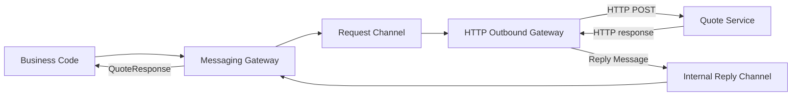
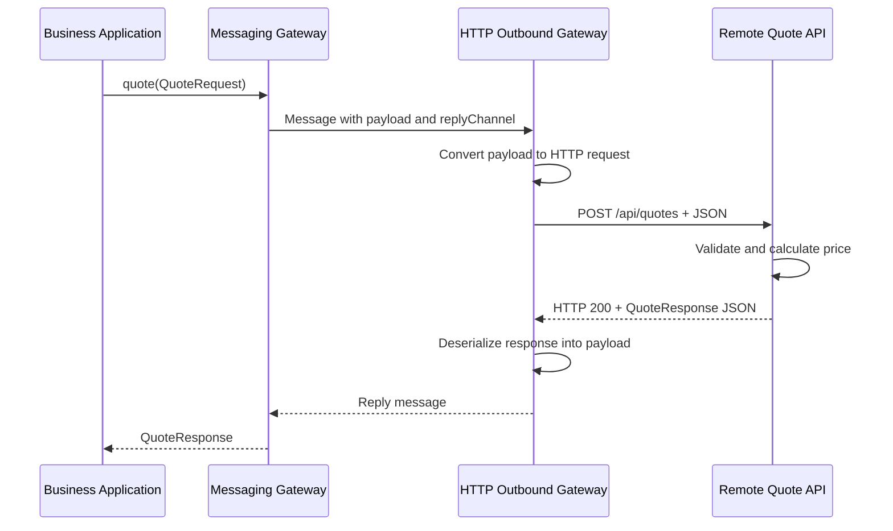
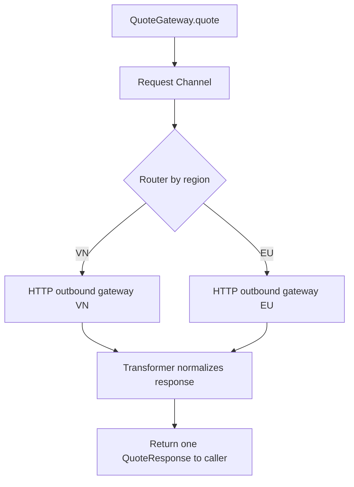

# Remote Procedure Invocation in an Integration Flow with Spring Integration

## 1. Problem Statement: Calling Functionality in Another System

Suppose a sales application needs to calculate a quote. The pricing logic resides in a separate service, so the application cannot directly call a Java object in the same process. Instead, the caller sends data over the network, the remote service executes the operation, and sends the result back.

That is the problem addressed by **Remote Procedure Invocation (RPI)**: representing the execution of an operation on another system as a call with a request and a result. In **Enterprise Integration Patterns**, this approach allows an application to invoke a remote service through an interface close to a regular method call.

With **Spring Integration**, we can combine:

- **Messaging Gateway**: provides a Java method-style API for business code.
- **Request channel**: forwards the request into the integration flow.
- **Outbound gateway**: sends the request over a protocol such as HTTP and receives the response.
- **Message handler / Transformer / Router**: transforms, routes, and processes the result if needed.
- **Reply channel**: returns the flow's result back to the calling Gateway.

This lesson belongs to the **Remote procedure invocation** chapter of the **SPRING_INTEGRATION_PATTERN** module. The module focuses on applying Router, Filter, Transformer, Splitter, Aggregator, Gateway, retry, error channel, and correlation to build loosely coupled message flows that are scalable, observable, and testable.

After this lesson, you will understand how RPI fits into an integration flow, build a Spring Integration example that calls an HTTP service, know where to configure timeouts and error handling, and recognize the limitations of synchronous calls over the network.

## 2. What Is Remote Procedure Invocation Really?

In a local method call, for example:

```java
QuoteResponse result = quoteService.calculate(request);
```

the caller and the handling object typically live in the same JVM. An error can propagate through a stack trace, parameters can be in-memory Java objects, and the call duration is usually significantly shorter than network communication.

In remote invocation, the line of code on the caller side may look similar:

```java
QuoteResponse result = quoteGateway.quote(request);
```

but underneath there are many additional steps:

1. Convert the request into a message and serialize it into transmittable data.
2. Send the data over a transport, such as HTTP.
3. Wait for the other system to receive and execute the operation.
4. Receive a response or error from the network/service.
5. Deserialize the result and return it to the Java caller.

Therefore, RPI **hides communication complexity from business code**, but it cannot eliminate network latency, connection failures, data contract changes, or the possibility of an ambiguous outcome after a timeout.

### Key Characteristics

| Aspect | Local Method Call | Remote Procedure Invocation |
|---|---|---|
| Execution location | Same process/JVM | Another service or process |
| Parameter passing | In-memory objects/values | Serialized payload |
| Result | Direct value or exception | Response over transport, then converted |
| Latency | Usually low | Depends on network, target system, queues, I/O |
| Errors | Program errors, local resources | Adds timeouts, DNS, connection, HTTP status, incompatible data |
| Atomicity | Can participate in the same transaction | Does not have distributed transactions by default |
| Retry | Usually less complex | Can repeat side effects of the remote operation |

RPI usually has **request–reply** semantics, but not every request–reply is a remote invocation: a Gateway calling a Service Activator within the same application can also be request–reply without crossing a network boundary.

## 3. Where Does RPI Sit in Spring Integration?

Spring Integration uses EIP components to organize sending, processing, transforming, and returning messages. RPI typically takes shape when an internal flow encounters an **outbound gateway** that sends a request to an external system and waits for a response.



The components are not completely equivalent:

- **Messaging Gateway** is the facade on the calling application side, mapping a Java method to a message flow.
- **HTTP outbound gateway** is the integration endpoint that performs the HTTP exchange and creates a reply message from the response.
- **REST endpoint** resides in the remote service, receives the HTTP request, executes the processing, and emits an HTTP response.
- **Temporary reply channel** (when the Gateway uses this mechanism) resides on the Spring Integration side of the calling application. It is an internal channel object and **is not sent intact over HTTP**.

The last point is crucial: the remote service does not need to know about the `MessageChannel` object in the client JVM. The outbound gateway bridges the two contexts: the HTTP response from the network is turned into a reply in the internal flow; then the Gateway returns the result to the caller.

### Sequence Diagram



If the remote endpoint fails or does not respond, the steps after the HTTP request do not proceed like the success branch. The caller receives an exception, a timeout, or follows a designed error-handling path, depending on the configuration.

## 4. Hands-On Example: Calling a Quote Service over HTTP

We will build two independent applications:

- **Quote Server** running at `http://localhost:8081`, providing `POST /api/quotes`.
- **Quote Client** using a Spring Integration Gateway and an HTTP outbound gateway to call Quote Server.

The code snippets match the Spring Boot 3.x / Spring Integration 6.x model with Java 17 or later; when using a different version, verify API compatibility and the corresponding dependencies.

### 4.1. Shared Data Contract

Both sides need to agree on the JSON structure of the request/response. In a real project, DTOs can be shared in a versioned contract library or generated from OpenAPI.

```java
// QuoteRequest.java
package com.example.contract;

public record QuoteRequest(String productCode, int quantity) {
}
```

```java
// QuoteResponse.java
package com.example.contract;

import java.math.BigDecimal;

public record QuoteResponse(
        String productCode,
        int quantity,
        BigDecimal total
) {
}
```

Expected JSON request:

```json
{
  "productCode": "BOOK-01",
  "quantity": 3
}
```

Successful JSON response:

```json
{
  "productCode": "BOOK-01",
  "quantity": 3,
  "total": 75.00
}
```

When using Java records on both sides with compatible Jackson configuration, JSON data can be mapped into records by field name. In multi-language or multi-version environments, the HTTP/JSON contract is a more important source of truth than sharing Java classes.

### 4.2. Remote Server: REST Endpoint Executing Business Logic

In the Quote Server application, a Spring Web/Jackson dependency is required, such as `spring-boot-starter-web`.

```java
// QuoteController.java - runs in the Quote Server application
package com.example.quoteserver;

import com.example.contract.QuoteRequest;
import com.example.contract.QuoteResponse;

import java.math.BigDecimal;

import org.springframework.http.HttpStatus;
import org.springframework.web.bind.annotation.PostMapping;
import org.springframework.web.bind.annotation.RequestBody;
import org.springframework.web.bind.annotation.RestController;
import org.springframework.web.server.ResponseStatusException;

@RestController
public class QuoteController {

    private static final BigDecimal UNIT_PRICE =
            new BigDecimal("25.00");

    @PostMapping("/api/quotes")
    public QuoteResponse calculate(@RequestBody QuoteRequest request) {
        if (request == null
                || request.productCode() == null
                || request.productCode().isBlank()
                || request.quantity() <= 0) {
            throw new ResponseStatusException(
                    HttpStatus.BAD_REQUEST,
                    "Invalid quote request");
        }

        BigDecimal total = UNIT_PRICE.multiply(
                BigDecimal.valueOf(request.quantity()));

        return new QuoteResponse(
                request.productCode(),
                request.quantity(),
                total);
    }
}
```

The Server application needs to run on port 8081:

```properties
# application.properties of Quote Server
server.port=8081
```

When receiving a valid request, the server calculates the price and returns HTTP 200 with JSON. When the request is invalid, the server returns HTTP 400; this is a **contract/validation error at the HTTP boundary**, not a business reply of type `QuoteResponse`.

### 4.3. Client: Defining the Messaging Gateway

The Client application declares an interface so business code does not have to interact directly with `HttpURLConnection` or construct HTTP requests.

```java
// QuoteGateway.java - runs in the Quote Client application
package com.example.quoteclient;

import com.example.contract.QuoteRequest;
import com.example.contract.QuoteResponse;
import org.springframework.integration.annotation.MessagingGateway;

@MessagingGateway(
        defaultRequestChannel = "remoteQuoteRequests",
        defaultReplyTimeout = "3000"
)
public interface QuoteGateway {

    QuoteResponse quote(QuoteRequest request);
}
```

When `quote()` is called, Spring Integration builds a message from the request and sends it to `remoteQuoteRequests`. For a method requiring a return value, the Gateway waits for a reply according to its contract and configuration.

`defaultReplyTimeout = "3000"` configures **waiting for the reply** in milliseconds. It does not automatically replace the connection timeout or HTTP response read timeout; this will be analyzed in section 6.

### 4.4. Client: Declaring the IntegrationFlow Calling the Remote Service

The Client application needs Spring Integration dependencies, including `spring-boot-starter-integration` and `spring-integration-http`. Ensure Jackson supports JSON conversion.

```java
// RemoteQuoteFlow.java - runs in the Quote Client application
package com.example.quoteclient;

import com.example.contract.QuoteResponse;

import org.springframework.context.annotation.Bean;
import org.springframework.context.annotation.Configuration;
import org.springframework.http.HttpMethod;
import org.springframework.integration.channel.DirectChannel;
import org.springframework.integration.dsl.IntegrationFlow;
import org.springframework.integration.http.dsl.Http;
import org.springframework.messaging.MessageChannel;

@Configuration
public class RemoteQuoteFlow {

    @Bean
    public MessageChannel remoteQuoteRequests() {
        return new DirectChannel();
    }

    @Bean
    public IntegrationFlow invokeQuoteService() {
        return IntegrationFlow.from("remoteQuoteRequests")
                .handle(
                    Http.outboundGateway(
                            "http://localhost:8081/api/quotes")
                        .httpMethod(HttpMethod.POST)
                        .expectedResponseType(QuoteResponse.class)
                )
                .get();
    }
}
```

Meaning of each step:

1. `remoteQuoteRequests` is the internal request channel.
2. `IntegrationFlow.from(...)` creates the flow's entry point from that channel.
3. `Http.outboundGateway(...)` turns the request into an HTTP call.
4. `httpMethod(HttpMethod.POST)` selects the HTTP method.
5. `expectedResponseType(QuoteResponse.class)` instructs converting the response content into the appropriate result type.
6. The return value of the outbound gateway becomes the reply in the flow and is routed back to where the Gateway is waiting when no other output endpoint overrides it.

The presence of a JSON conversion library is necessary to serialize `QuoteRequest` and deserialize `QuoteResponse`. If the server returns JSON that does not match the contract or message converter configuration is missing, the call can fail at the conversion step.

**Distinguishing the names:** `QuoteGateway` is the Messaging Gateway representing the Java call; `Http.outboundGateway(...)` is the outbound gateway accessing the service over the network. Both Gateways have different responsibilities even though they sit in the same request–reply flow.

### 4.5. Starting the Client Side

```java
// QuoteClientApplication.java
package com.example.quoteclient;

import org.springframework.boot.SpringApplication;
import org.springframework.boot.autoconfigure.SpringBootApplication;
import org.springframework.integration.annotation.IntegrationComponentScan;
import org.springframework.integration.config.EnableIntegration;

@SpringBootApplication
@EnableIntegration
@IntegrationComponentScan
public class QuoteClientApplication {

    public static void main(String[] args) {
        SpringApplication.run(QuoteClientApplication.class, args);
    }
}
```

The `QuoteGateway` class and flow configuration must fall within the component scan scope. Server and Client are two independently started applications; do not put both `@SpringBootApplication` classes into the same running application.

### 4.6. Usage from Business Code

```java
// Example inside a @Service belonging to the Client application.
QuoteResponse response = quoteGateway.quote(
        new QuoteRequest("BOOK-01", 3)
);

System.out.println(response.total()); // 75.00
```

To run the example flow: start Quote Server on port 8081, then start Quote Client and call the Gateway method. The caller receives `QuoteResponse` like a Java call, while HTTP communication happens inside the integration flow.

An independent test on the server side can send the following request:

```bash
curl -i -X POST "http://localhost:8081/api/quotes" \
  -H "Content-Type: application/json" \
  -d '{"productCode":"BOOK-01","quantity":3}'
```

When the server runs properly, the response has HTTP status 200 and the corresponding quote data. On Windows PowerShell, you can use `curl.exe` instead of the `curl` alias if you need to run the example command.

## 5. What Happens on the Return Path?

In the example above, **two different response dimensions** exist:

| Scope | Request | Reply |
|---|---|---|
| Java → Spring Integration | Call `quote(request)` | `QuoteResponse` returned to caller |
| Internal integration flow | Message sent into `remoteQuoteRequests` | Message created from the outbound gateway's response |
| HTTP client ↔ remote server | HTTP POST + JSON | HTTP status + JSON |
 
The HTTP response **does not contain a Spring Integration temporary reply channel object**. The outbound gateway receives the HTTP response, creates a reply message, and then the framework uses internal routing mechanisms to complete the Gateway call.

If there is a Transformer after the HTTP outbound gateway, the Transformer can change the `QuoteResponse` payload into another DTO before returning to the caller. If there is a Router, ensure each branch returns a result matching the contract or handles errors explicitly.

### When to Use a Fixed Reply Channel?

Most method-call-style Gateways that need one reply per call can rely on the temporary reply channel mechanism. A fixed reply channel is suitable for topologies needing a dedicated response flow, but you must understand how to preserve correlation when there are multiple concurrent callers.

Regardless of the mechanism used, **do not send a Java `MessageChannel` reference over the network**; if results need to be matched across a distributed system, use a serializable correlation ID value transmitted according to the common protocol.

## 6. RPI Timeouts: Distinguishing Wait Time Layers

A remote invocation has multiple points where it can block:

1. Waiting for the request to be sent into the channel.
2. TCP/TLS connection to the remote service.
3. Sending the HTTP request and waiting for the server to process it.
4. Reading the HTTP response over the network.
5. Waiting for the reply to be delivered back to the internal Gateway, if part of the processing is executed asynchronously.

| Timeout / deadline | Used to control |
|---|---|
| **Connect timeout** | Maximum time allowed to establish a connection per the HTTP client |
| **Read/response timeout** | Time waiting for response data per the HTTP client mechanism |
| **Gateway request timeout** | Waiting for sending the message into the channel if send can block |
| **Gateway reply timeout** | Waiting for the reply message after sending the request per Gateway semantics |
| **Business deadline** | Total time the application accepts for an end-to-end operation |

Because `DirectChannel` executes handlers synchronously, calling through an HTTP outbound gateway can **occupy the caller thread right during the request-sending phase**. Therefore, setting `defaultReplyTimeout = "3000"` alone does not guarantee that a hung HTTP request will stop after three seconds.

### Example Configuring Timeouts for the HTTP Client

You can create an HTTP request factory with timeouts and attach it to the HTTP outbound gateway:

```java
import java.time.Duration;

import org.springframework.http.HttpMethod;
import org.springframework.http.client.SimpleClientHttpRequestFactory;
import org.springframework.integration.dsl.IntegrationFlow;
import org.springframework.integration.http.dsl.Http;

// Inside @Configuration class:
@Bean
public IntegrationFlow invokeQuoteService() {
    SimpleClientHttpRequestFactory requestFactory =
            new SimpleClientHttpRequestFactory();

    requestFactory.setConnectTimeout(Duration.ofSeconds(1));
    requestFactory.setReadTimeout(Duration.ofSeconds(2));

    return IntegrationFlow.from("remoteQuoteRequests")
            .handle(
                Http.outboundGateway(
                        "http://localhost:8081/api/quotes")
                    .httpMethod(HttpMethod.POST)
                    .expectedResponseType(QuoteResponse.class)
                    .requestFactory(requestFactory)
            )
            .get();
}
```

This is an **alternative variant** of the `invokeQuoteService()` bean in section 4.4; do not register both flows consuming the same request channel. Timeout overloads depend on the Spring Framework version; if the version you use only accepts milliseconds as `int`, use the compatible overload. In real projects, put these parameters into environment configuration rather than hardcoding them in multiple places.

Even with connect/read timeouts configured, check the **overall deadline**, because retries can make the final duration longer than expected. If server-side processing has already completed but the response was lost on the network, the client cannot conclude with certainty that the operation did not occur.

## 7. Handling HTTP Errors and Exceptions in an Integration Flow

Remote Procedure Invocation must treat network failures as a normal state to design for, not a rare event that can be ignored.

### Common Scenarios

| Scenario | Example | Handling Approach |
|---|---|---|
| Invalid request | HTTP 400 | Fix data, return validation error; usually do not retry as-is |
| Unauthorized | HTTP 401/403 | Check authentication and authorization mechanisms |
| Resource not found | HTTP 404 | Map according to business contract |
| Temporary server error | HTTP 502/503 | Bounded retry if the operation is safe |
| Rate limit | HTTP 429 | Follow backoff/Retry-After guidance if provided |
| Cannot connect | DNS/TCP/TLS error | Monitor network, circuit breaker, and timeouts |
| Slow server processing | Read timeout | Uncertain whether the request already caused side effects |
| Invalid response schema | JSON fails to map to DTO | Fix contract compatibility; increasing timeout will not help |

The HTTP outbound gateway typically reports unsuccessful HTTP responses via exceptions according to the HTTP client/handler configuration, which may be wrapped by Spring Integration when passing through the endpoint. Do not assume every error will turn into a `QuoteResponse` with `total = 0`.

### Errors on Synchronous vs. Asynchronous Flows

In the example using `DirectChannel`, exceptions from the HTTP request can propagate back to the caller of `quote()`. When routing the flow through an `ExecutorChannel`, `QueueChannel`, or another asynchronous boundary, errors can be directed to an error channel while the caller waits separately for a reply.

An `errorChannel` is not automatically equivalent to a `replyChannel`. If you want the caller to receive a business error response, design how errors are converted into a contract-compliant response or propagate the exception down the proper path.

### Error Strategy Should Be Explicit

Result contracts can be grouped into:

- **Success:** server returns valid data, Gateway returns `QuoteResponse`.
- **Business rejection:** server returns status code and body representing a validation/business error; client maps it to a structured error.
- **Infrastructure failure:** transport timeout, connection error, overloaded service, or corrupted response; route into retry/fallback policies.
- **Uncertain state:** request may have been processed on the server but the reply was lost; do not automatically assume "not executed."

Depending on requirements, exception mapping logic can be placed in a handler, advice, or an application layer wrapping the Gateway. What matters is that the caller can distinguish a business outcome from a communication failure.

## 8. Retry, Idempotency, and the Risk of Duplicate Calls

Suppose an RPI calls an endpoint to **create a payment order**:

1. Client sends `POST /payments`.
2. Server records the transaction successfully.
3. The response is lost due to network issues.
4. Client sees a timeout and retries.
5. Server may record a second transaction if there is no deduplication mechanism.

Retry decisions cannot rely solely on timeout errors. You must consider **idempotency**: multiple equivalent requests produce the same business effect as a single execution.

### Idempotency Key

An appropriate protocol can specify:

- Each business operation is assigned a fixed `Idempotency-Key`, such as a UUID generated once before calling.
- Client keeps the same key across retries of the same operation.
- Server stores the key along with the result, rejecting or returning the previous result if the key has already been processed.
- Different keys represent independent business requests.

```text
First try: POST /payments, Idempotency-Key: pay-42
           → server processes and saves result; response is lost

Retry:     POST /payments, Idempotency-Key: pay-42
           → server looks up key, returns previous result; does not create a new payment
```

Typically, the HTTP outbound gateway can be configured to map necessary headers to HTTP. Do not assume all Spring Integration headers automatically appear as HTTP headers; explicitly check and declare header mappings for `Idempotency-Key`, `X-Request-Id`, or `traceparent` according to your system's communication standard.

### When Can You Retry?

| Classification | Recommendation |
|---|---|
| Read-only query | Can retry with limits, backoff, jitter, and deadline |
| POST creating side effects | Only auto-retry when the server supports idempotency or there is a mechanism to determine the outcome |
| HTTP 400 due to invalid data | Do not retry as-is |
| HTTP 401/403 | Do not retry blindly; fix authentication/permissions |
| HTTP 429/503 | Consider backoff per the server contract |
| Response parse error due to schema | Investigate API compatibility instead of retrying continuously |

Spring Integration has retry advice mechanisms for endpoints and handlers, but applying them must be weighed against **the safety of the remote business operation**, not just technical feasibility.

## 9. Correlation and Distributed Flow Observability

In an internal system, a Gateway can use a temporary reply channel to match a reply with a caller. When a request travels over HTTP, you need **network-transmittable identifiers** to support tracing and event correlation.

Example metadata set:

| Metadata | Purpose |
|---|---|
| `X-Request-Id` | Track a request across client, gateway, and server |
| `traceparent` | Carry W3C distributed trace information when tracing is enabled |
| `Idempotency-Key` | Identify the same business operation across multiple retries |
| `correlationId` | Correlate intermediate messages in a flow, especially with Splitter/Aggregator |
| Deadline/cutoff | Inform the receiver of remaining valid time for the task if the contract supports it |

Do not conflate all of these into a single ID. `traceId` serves observability, `Idempotency-Key` prevents duplicate execution, and a message group's correlation ID joins branches of an integration flow.

Log at minimum:

1. Request ID and start timestamp.
2. Remote destination and operation name, avoiding logging credentials/tokens.
3. HTTP call duration, received status, or exception type.
4. Retry count and delay if any.
5. Result mapped back to the caller and total completion time.

When data contains sensitive information, log controlled identifiers/metadata instead of the full request/response body.

### Key Metrics

- Requests/second to each remote operation.
- Rates of 2xx, 4xx, 5xx, and transport errors.
- Latency p50/p95/p99 per endpoint.
- Counts of timeouts, retries, and open circuit breakers.
- Number of schema-mismatch responses.
- Wait time and queue size if the flow has async steps.

These metrics help distinguish a slow remote service, unstable network, congested request channel, and contract errors.

## 10. Combining with Enterprise Integration Patterns

Remote invocation rarely stands alone. A real-world integration flow may require additional patterns you have learned.

| Pattern | Role in Remote Invocation |
|---|---|
| **Gateway** | Provides Java API for callers and implements request–reply transport |
| **Transformer** | Converts business DTOs to partner API requests, or converts responses to internal models |
| **Router** | Selects endpoint by region, product type, tenant, or API version |
| **Filter** | Blocks unsuitable requests before calling remote, with a clear rejection branch outcome |
| **Splitter** | Splits a batch into multiple independent remote calls |
| **Aggregator** | Combines responses into a single final result, per correlation and timeout policy |
| **Retry** | Retries transient errors with bounds and idempotency |
| **Error channel** | Receives errors in async branches for alerting or failure handling |
| **Correlation** | Matches requests/replies and branch results accurately |

### Example: Router + Remote Gateways

A system might have two quote providers:



Regardless of the branch taken, the Java method contract remains `QuoteResponse quote(QuoteRequest)`. That is the value of the integration layer: business code calls a unified API, while the integration topology handles routing, mapping, and errors.

### Example: Splitter + Aggregator

A request containing five products can be split into five remote calls. If **one** total quote needs to be returned, the Aggregator must wait for the necessary results, handle partial errors according to policy, and only then emit a single final result message back to the Gateway. Without proper release/timeout conditions, the aggregate call may hang or receive incomplete results.

Here `correlationId` and sequence information serve to group messages. Do not let five child calls directly send five replies to a Gateway waiting for a single result.

## 11. When to Use RPC vs. When to Use Asynchronous Messaging?

RPI is convenient but increases **temporal coupling**: at the moment the caller makes the call, it must be able to reach and receive a response from the remote service.

| Criterion | Synchronous Remote Procedure Invocation | Asynchronous Messaging |
|---|---|---|
| Caller needs immediate result | Suitable | Requires additional mechanism to return results later |
| Result may take hours | Unsuitable for blocking requests | Usually more suitable |
| Long, multi-step processing | Easily causes caller timeouts | Can be processed with queues/workflows |
| Target system health | Directly affects caller latency | Queues can buffer when target system is slow |
| Result management | Via direct response | Via events, callbacks, correlation ID, or status polling |
| API-level simplicity | Easy to call like a method | Requires managing task state |

Examples:

- **Consider RPI for:** exchange rate lookup, tax calculation, fast authentication, fetching customer info.
- **Consider asynchronous for:** video processing, importing millions of records, multi-step payments, approval workflows.

A synchronous API can immediately return `202 Accepted` with a task ID, after which the client tracks results via events or polling. That is a different contract from a Gateway method waiting until all processing finishes.

## 12. Principles for Safe and Scalable Design

### 12.1. Clear, Versioned Contracts

Define request/response schemas, status codes, error bodies, versions, payload size limits, and backward-compatibility rules. If a JSON field is renamed without agreement, the client may fail to parse even on HTTP 200.

### 12.2. Resource Limits

A synchronous Gateway holds a thread while waiting for HTTP. With many concurrent callers, the system risks exhausting threads or connection pools. Limit concurrency, use connection pooling, apply backpressure/rate limits, and set clear deadlines.

### 12.3. Decouple Business Layer from Transport

Business code should only know `QuoteGateway.quote(request)` or a similar abstraction. URLs, HTTP methods, mapping, and retries belong in the integration layer. This reduces direct coupling to a specific API provider or communication mechanism.

### 12.4. Protect Data and Endpoints

Use HTTPS/TLS, appropriate authentication, input validation, and minimize outbound data. Do not put bearer tokens, cookies, or sensitive data into logs or traces. Do not allow remote URLs to be constructed arbitrarily from untrusted data without destination controls.

### 12.5. Do Not Turn Every Error into a Retry

Continuous retries can cause cascading overload. Limit attempt counts, add exponential backoff/jitter, use a circuit breaker, and perform fallbacks only when the fallback preserves business semantics.

## 13. Testing Remote Procedure Invocation

An integration flow should not only be tested by unit testing the Gateway class; HTTP communication and error mapping must be verified.

### Testing Layers

1. **Remote handler unit tests:** directly call the pricing logic, testing valid and validation branches.
2. **Contract tests:** verify HTTP request/response JSON against the schemas published by both sides.
3. **Client flow integration tests:** run a controllable HTTP stub/server, call `QuoteGateway.quote()`, and verify method, path, JSON body, and deserialized result.
4. **Failure tests:** server returns 400, 500, timeout, malformed JSON, or disconnects.
5. **Concurrency/retry tests:** send multiple parallel requests, verify replies go to the right callers and retries do not create duplicate side effects.

### Example Unit Test for the Remote Controller

```java
// QuoteControllerTest.java - in the Quote Server project
package com.example.quoteserver;

import static org.junit.jupiter.api.Assertions.assertEquals;

import com.example.contract.QuoteRequest;
import com.example.contract.QuoteResponse;
import java.math.BigDecimal;
import org.junit.jupiter.api.Test;

class QuoteControllerTest {

    private final QuoteController controller = new QuoteController();

    @Test
    void returnsExpectedQuote() {
        QuoteResponse actual = controller.calculate(
                new QuoteRequest("BOOK-01", 3));

        assertEquals("BOOK-01", actual.productCode());
        assertEquals(3, actual.quantity());
        assertEquals(new BigDecimal("75.00"), actual.total());
    }
}
```

This test only checks **controller logic**, not HTTP serialization or the Client flow. In a full integration test, the HTTP stub must verify that the real request to `POST /api/quotes` carries the correct JSON and the reply maps to `QuoteResponse`.

### Suggested Test Matrix

| Scenario | Expectation |
|---|---|
| HTTP 200 + valid JSON | Gateway returns exact `QuoteResponse` |
| HTTP 400 | Caller receives intentional validation/error handling |
| Temporary HTTP 503 | Retries per policy if operation permits |
| Connect timeout | Infrastructure error raised, wait time measurable |
| Read timeout | Do not assume server did not execute |
| Response with invalid JSON schema | Mapping error detected |
| Multiple concurrent callers | No mismatched replies |
| Retry with same idempotency key | No duplicate side effects created |
| Router selects multiple remote endpoints | All branches preserve response contract |
| Splitter/Aggregator | Proper correlation and only one final reply |

## 14. Common Pitfalls

**Pitfall 1: configuring only the reply timeout on the Messaging Gateway.** This does not necessarily bound a synchronous HTTP call waiting on the network. Configure HTTP client timeouts and an overall deadline.

**Pitfall 2: assuming HTTP 200 means business success.** An API may return a valid response whose body contains a business failure status code. The contract must clearly define the meaning of each field and status.

**Pitfall 3: sending all message headers over HTTP.** Internal headers may contain sensitive data or non-serializable objects, such as a reply channel reference. Only map agreed-upon metadata.

**Pitfall 4: retrying POST regardless of side effects.** When a response is lost after the server already processed it, retrying can create duplicates. Use idempotency or query state first.

**Pitfall 5: confusing HTTP outbound adapter and outbound gateway.** An outbound adapter typically serves one-way sending; an outbound gateway serves request–reply exchanges. If the caller needs response data, choose a component with reply semantics.

**Pitfall 6: forgetting an error-handling branch.** A Router, Filter, or error flow may terminate without producing a reply, causing the caller to wait or receive an incomplete result. Every path must have a clear outcome.

**Pitfall 7: sending multiple replies to a Gateway waiting for one result.** With fan-out, use an Aggregator or a contract that supports multiple results rather than assuming request–reply can spontaneously return a list of responses.

## 15. Review Questions

1. Beyond Java syntax, in what ways does Remote Procedure Invocation differ from a local method call?
2. What roles do the Messaging Gateway and HTTP outbound gateway play within the same integration flow?
3. Why is a Spring Integration temporary reply channel not transmitted intact over HTTP?
4. When calling outbound HTTP on a `DirectChannel`, why does `defaultReplyTimeout` not guarantee a bound on the call's total duration?
5. When an HTTP request times out, can you be sure the remote server has not executed the operation? Why or why not?
6. When is an idempotency key needed, and how must it be preserved across retries?
7. Why should `X-Request-Id`, `traceparent`, and `Idempotency-Key` be kept distinct?
8. If a Router selects between two different providers, what must be guaranteed about the response contract?
9. If a Splitter emits multiple remote requests, what correlation and release strategy does the Aggregator need?
10. Which scenarios should move from synchronous request–reply to asynchronous messaging?

## 16. Project Adoption Checklist

- [ ] Gateway has a clear request, response, and error contract.
- [ ] Integration flow uses the proper outbound gateway when a response is required.
- [ ] JSON schema, HTTP method, endpoint, and API version are agreed upon.
- [ ] HTTP client has connect/read timeouts; the system has an appropriate overall deadline.
- [ ] HTTP status, validation errors, mapping errors, and transport errors are handled separately.
- [ ] Retries are bounded, use backoff, and evaluate idempotency before being applied.
- [ ] Headers sent over the network are explicitly mapped; no internal objects/channels leak.
- [ ] Request ID/tracing, logs, and metrics are sufficient to track each operation.
- [ ] Threads, connections, and concurrency are bounded to fit real load.
- [ ] Integration tests exist with a mock HTTP server or test environment.
- [ ] All Router/Filter/Splitter/Aggregator branches preserve the reply contract.
- [ ] Long-running tasks are evaluated for moving to an asynchronous flow.

**Remember:** Remote Procedure Invocation in Spring Integration lets business code call a familiar Java API while the integration flow turns the message into a network request and converts the response back. The convenience of a Gateway must be paired with clear design around contracts, timeouts, errors, retries, idempotency, and correlation. A remote call always exhibits distributed system characteristics, even when it looks like an ordinary Java method on the surface.
