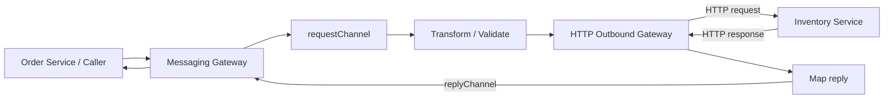
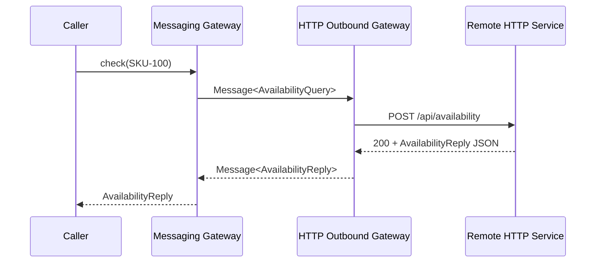
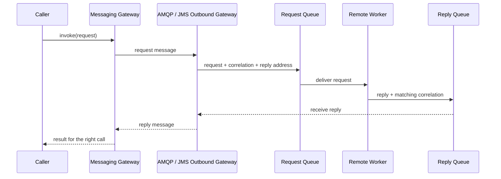

# Gateway and Remote Adapter

In the **Remote procedure invocation** chapter of the **SPRING_INTEGRATION_PATTERN** module, we build calls to a remote system as familiar business operations while still using Spring Integration messages internally. This is how Enterprise Integration Patterns are applied to create loosely coupled, extensible flows: the caller works through a **Gateway**, while HTTP, TCP, or message broker connectivity is handled by the appropriate **remote adapter**.

When a system needs to call an inventory, payment, or customer lookup service, two very different responsibilities are often mixed: **representing the business request** and **communicating over the network**. Spring Integration lets you establish a clear boundary between those two responsibilities. The Gateway accepts the call and converts it into a message; the remote adapter sends the message over a specific protocol, receives external data (in request-reply), and returns the result to the internal flow.

After this lesson, you will be able to:

- Distinguish Messaging Gateway, outbound gateway, inbound gateway, and one-way channel adapters.
- Build a Java DSL flow calling a REST API from a Java-typed Gateway interface.
- Explain how request/reply travels through channels, adapters, and the network; and when correlation is needed.
- Define payload contracts, timeouts, remote errors, retries, idempotency, and flow observability.
- Choose the right remote adapter type based on synchronous/asynchronous requirements and protocol characteristics.

## 1. Two Abstraction Layers: Gateway and Remote Adapter

Suppose an ordering system needs to check stock. At the business layer, the desired call is:

```java
AvailabilityReply reply = availabilityGateway.check(
    new AvailabilityQuery("SKU-100")
);
```

The caller does not need to build an HTTP request manually, open a TCP connection, or know the inventory service's queue name. This organization splits responsibilities as follows:

| Component | Role | What Not to Confuse It With |
| --- | --- | --- |
| **Messaging Gateway** (e.g., `@MessagingGateway`) | Creates a Java interface for sending messages and, if the method returns a value, waiting for the appropriate reply. | Does not necessarily call HTTP, TCP, or a broker by itself. |
| **Message channel** | Connects Spring Integration components and coordinates messages within the application. | Not inherently a network connection. |
| **Transformer / Router / Filter** | Normalizes data, selects processing routes, applies business rules before/after sending. | Does not replace external protocol contracts. |
| **Outbound gateway** | Two-way interaction with an external system: sends requests and receives responses/replies. | Differs from an outbound *channel adapter*, which is only for one-way sending. |
| **Inbound gateway** | Receives external requests, feeds them into the flow, and returns replies to the calling system. | Not the same as an inbound *channel adapter*, which only brings data one-way into the flow. |
| **Channel adapter** | Moves messages across the system boundary in a send or receive direction, usually without tying a direct reply to each request. | Should not treat every channel adapter as RPC. |

A common architecture:



The path has two layers that should be observed separately:

1. **In-process:** method call → message → channel → handler → reply channel.
2. **Across the network boundary:** adapter encodes/sends request → external service processes → adapter receives/decodes response.

The Gateway lets callers depend on a *business contract*. The adapter keeps the rest of the flow less tightly coupled to a specific transport protocol. Even so, switching from HTTP to AMQP may still require adjusting timeouts, correlation mechanisms, and delivery guarantees; it is not a completely transparent substitution.

## 2. How Does Remote Procedure Invocation Differ from One-Way Messaging?

**Remote Procedure Invocation (RPI)** expresses an operation on a remote system like a function call. The core difference lies in expecting a result for a request.

| Characteristic | Request-Reply via Remote Gateway | Sending via Outbound Channel Adapter |
| --- | --- | --- |
| Goal | Send a request and receive a related result | Emit an event/command externally |
| Caller | Typically waits for a reply or a clearly designed future/reply flow | Does not need a direct business reply |
| Error handling | Can receive remote errors, timeouts, conversion errors | Typically knows send/write status, not necessarily whether business processing completed |
| Examples | Checking stock, looking up rates, fetching a quote | Publishing an "order created" event, sending telemetry |
| Good fit when | The next step needs the external service's response | The task can run independently without blocking the sender |

Simply receiving an ACK from a broker does not mean business processing on the receiving side is finished. To know the final outcome, design a dedicated reply and pairing mechanism, or switch to a stateful asynchronous flow.

## 3. Example: Java Gateway Calling an HTTP Remote Service

The example uses **Spring Integration Java DSL**, Spring Integration HTTP, Java 17+, and a hypothetical inventory service:

- Remote endpoint: `POST http://localhost:8081/api/availability`.
- Request JSON: `{"sku":"SKU-100"}`.
- Response JSON: `{"sku":"SKU-100","available":true,"quantity":12}`.
- Caller only sees a Java method returning `AvailabilityReply`.

### 3.1. Defining DTOs and the Gateway Interface

```java
package example.inventory;

record AvailabilityQuery(String sku) {}

record AvailabilityReply(
    String sku,
    boolean available,
    int quantity
) {}
```

```java
package example.inventory;

import org.springframework.integration.annotation.MessagingGateway;

@MessagingGateway(
    defaultRequestChannel = "inventory.check.requests",
    defaultReplyTimeout = "5000"
)
interface AvailabilityGateway {
    AvailabilityReply check(AvailabilityQuery query);
}
```

The method signature is the **caller's contract**. Whether the flow underneath uses HTTP, TCP, or another adapter, business code still receives `AvailabilityReply` as long as every success branch satisfies that contract.

### 3.2. Connecting the Gateway to an HTTP Outbound Gateway

```java
package example.inventory;

import org.springframework.context.annotation.Bean;
import org.springframework.context.annotation.Configuration;
import org.springframework.http.HttpMethod;
import org.springframework.http.MediaType;
import org.springframework.integration.annotation.IntegrationComponentScan;
import org.springframework.integration.config.EnableIntegration;
import org.springframework.integration.dsl.IntegrationFlow;
import org.springframework.integration.http.dsl.Http;
import org.springframework.messaging.MessageHeaders;

@Configuration
@EnableIntegration
@IntegrationComponentScan
class InventoryClientIntegrationConfig {

    @Bean
    IntegrationFlow inventoryRemoteCallFlow() {
        return IntegrationFlow.from("inventory.check.requests")
            .enrichHeaders(h -> h.header(
                MessageHeaders.CONTENT_TYPE,
                MediaType.APPLICATION_JSON_VALUE
            ))
            .handle(
                Http.outboundGateway(
                        "http://localhost:8081/api/availability"
                    )
                    .httpMethod(HttpMethod.POST)
                    .expectedResponseType(AvailabilityReply.class)
            )
            .get();
    }
}
```

How this flow works conceptually:

1. `AvailabilityGateway.check(query)` creates a message with `AvailabilityQuery` as payload and sends it to `inventory.check.requests`.
2. The `contentType` header indicates a JSON request. The HTTP outbound gateway uses the configured HTTP message conversion mechanism to serialize the request.
3. The adapter sends an HTTP POST to the inventory service, receives the HTTP response, and converts the response body into `AvailabilityReply` via the appropriate converter.
4. The reply follows the internal request-reply mechanism so the `check(...)` call returns the result to the caller.

The example assumes you have the **Spring Integration HTTP dependency** and an HTTP message converter supporting JSON (typically Jackson in Spring Boot applications). If a converter is missing or the response body does not match the schema, merely setting `expectedResponseType` does not guarantee decoding. The endpoint and URL in the code are localhost examples; real applications should read service addresses and connection settings from deployment configuration.

### 3.3. Receiving Service Interface: HTTP Inbound Gateway

If the inventory side also uses Spring Integration, it can accept HTTP requests into a flow and return responses via an inbound gateway:

```java
package example.inventory;

import org.springframework.context.annotation.Bean;
import org.springframework.context.annotation.Configuration;
import org.springframework.http.HttpMethod;
import org.springframework.integration.config.EnableIntegration;
import org.springframework.integration.dsl.IntegrationFlow;
import org.springframework.integration.http.dsl.Http;

@Configuration
@EnableIntegration
class InventoryServerIntegrationConfig {

    @Bean
    IntegrationFlow availabilityEndpointFlow() {
        return IntegrationFlow.from(
                Http.inboundGateway("/api/availability")
                    .requestMapping(m -> m.methods(HttpMethod.POST))
                    .requestPayloadType(AvailabilityQuery.class)
            )
            .handle(AvailabilityQuery.class, (query, headers) -> {
                int quantity = "SKU-100".equals(query.sku()) ? 12 : 0;
                return new AvailabilityReply(
                    query.sku(),
                    quantity > 0,
                    quantity
                );
            })
            .get();
    }
}
```

This is a separate illustrative **server** part running on the HTTP-receiving service; it does not have to share the same application as the outbound part. In a real service, the inventory logic would call the appropriate data component and validate requests. The response is serialized to HTTP by the server-side converters.

### 3.4. When Does the Gateway Receive the Right Reply?

With standard HTTP request-reply, the response belongs to the exact request on that HTTP connection, so the protocol itself ties both ends together. Inside Spring Integration, the Gateway creates/maintains a reply context for the internal call. The flow must preserve the return path through handlers, Transformers, and Routers.



If the final handler returns `String`, `Map`, or an error object while the Gateway declares `AvailabilityReply`, the payload must be converted/normalized. Routing the request-reply along the right path **does not automatically guarantee the right data type**.

## 4. Other Remote Adapters You Can Use

Spring Integration provides components to connect with external protocols; exact API names and capabilities depend on the declared version/module. Choose by the desired interaction style, not merely by the word "adapter."

| Protocol | Common Endpoint Type | Characteristics to Consider |
| --- | --- | --- |
| **HTTP/REST** | HTTP outbound gateway / inbound gateway | Clear request-reply via HTTP response; must specify HTTP status, JSON schema, connect/read timeouts. |
| **JMS** | JMS outbound gateway / inbound gateway | Uses a message broker; requires reply destination, correlation, wait timeout, and redelivery policy. |
| **AMQP/RabbitMQ** | AMQP outbound gateway / inbound gateway | Supports RPC model via request/reply queues; requires reply, routing, correlation, and timeout config. |
| **TCP** | TCP outbound gateway / inbound gateway | Must specify message framing, payload serialization, and connection management. |
| **Kafka** | Kafka endpoints supporting request-reply under specific configurations | Check gateway capabilities in your version; request-reply is not default behavior for every producer/consumer. |
| **Custom protocol** | Service Activator or application-implemented adapter | Must manage contract, conversion, timeouts, retries, and potentially correlation manually. |

When a protocol offers both a *channel adapter* and a *gateway*, prefer an **outbound gateway** when a direct reply is needed. If the flow is inherently emitting an event and the caller does not wait for a result, an **outbound channel adapter** is usually more appropriate.

Another option is using a Service Activator that calls a third-party HTTP client/SDK. That can be convenient when the SDK carries domain-specific logic. However, a dedicated outbound gateway makes the message-to-protocol boundary explicit in the integration flow configuration and pairs easily with Spring Integration's channels, advice, and headers.

## 5. Payload, Headers, and the Contract Between Two Systems

In an application with multiple endpoints, a remote invocation contract needs more than the method name `check`:

| Aspect | Questions to Answer |
| --- | --- |
| Request schema | Which fields are required, what types, is it versioned? |
| Reply schema | What is a valid success payload? Are nulls/empty lists allowed? |
| Remote status | How are HTTP 2xx/4xx/5xx or broker error codes mapped? |
| Headers | Are `contentType`, `accept`, `requestId`, trace headers, authorization required? |
| Timeout | What are the wait thresholds at Gateway, adapter, connection, and remote handler? |
| Retry | Is repeating the command safe? What idempotency key applies? |
| Correlation | Which side matches reply to request, and using which field? |
| Security | How are authentication, authorization, encryption, and sensitive data handled? |

### Internal Headers Do Not Cross the Network Automatically

In Spring Integration, `replyChannel` and `errorChannel` may hold references to internal channels in the JVM. You cannot assume these Java objects will be sent over JSON or a broker as a reply address usable by another system. At the remote boundary, the adapter must translate headers supported by the protocol. JMS/AMQP reply addresses or HTTP headers must be mapped properly per transport.

Similarly, a Java message's `MessageHeaders.ID` should not be used as a long-lived business request identifier. When cross-service observability and pairing are needed, define a stable `requestId` and pass it across protocols/systems per contract.

## 6. Correlation: Differences Between HTTP and Brokers

**HTTP request-response:** The adapter performs a call and receives the corresponding response for that call; you generally do not need to build a queue-RPC pending correlation table yourself. Even with concurrent requests, the HTTP client distinguishes each response. Including a `requestId` in headers remains useful for logs, tracing, and idempotency.

**JMS/AMQP request-reply:** Request and reply are two separate messages that may travel through different queues; replies can arrive late or out of order. A proper remote gateway/adapter needs a mechanism to match replies and manage timeouts. Depending on the protocol, this may use `JMSCorrelationID`, `replyTo`, or adapter correlation headers/metadata. Do not assume the same internal header will share the same name across all brokers.



Distinguish **RPC correlation** from **Aggregator correlation**. A message group after a Splitter typically uses `correlationId` and `sequenceNumber` to reassemble parts; remote invocation uses correlation to determine which request a reply belongs to. When an RPC is split into multiple tasks, the system may need both identifiers with distinct semantics.

## 7. Timeout: Multiple Clocks Running Simultaneously

Setting `defaultReplyTimeout = "5000"` on `@MessagingGateway` only governs **waiting for a reply via the Gateway mechanism**. Do not assume it automatically enforces a timeout on a synchronous HTTP socket call. For an HTTP outbound gateway, configure timeouts on the appropriate HTTP request factory/client; for brokers, configure reply wait timeouts and late-reply handling.

| Timeout Level | What Is Bounded? | Consequence When Expired |
| --- | --- | --- |
| **Connect timeout** | Time to establish a connection to the server | Cannot connect; typically raises a transport error. |
| **Read/response timeout** | Time waiting for data from the remote side | Remote call may throw a timeout error. |
| **Reply timeout** | Time Gateway/adapter waits for a reply via messaging | Caller stops waiting; remote task may still continue. |
| **Business deadline** | Maximum acceptable time for a request end-to-end | Must be designed/propagated across steps if all systems are to honor it. |

Example: The Gateway has `defaultReplyTimeout=5000`, yet a direct HTTP call hangs for 30 seconds due to remote client settings. Setting a timeout on the Gateway **is not enough** to prove the caller will always return after 5 seconds. Inspect the real execution path: `DirectChannel`, async queues, and HTTP client configuration.

When remote calls time out, explicitly define whether the application will **return an error**, **return a fallback**, or **hand the request off to deferred processing**. Never automatically assume a timeout means the remote side canceled the transaction.

## 8. Retry, Idempotency, and Remote Errors

A remote invocation can fail at multiple points:

1. **Before sending:** DNS, TLS, connect timeout; the remote side may never have received the request.
2. **During processing:** remote returns 4xx/5xx, payload fails schema checks, or task errors out.
3. **After remote processing:** response is lost on the way back; caller reports timeout even though the business change may already have occurred.

The third case makes retries dangerous. If the remote call is a payment or order creation operation, resending a request can cause duplicate transactions.

- For **read** operations without side effects (e.g., checking stock count), bounded retries may fit transient network errors.
- For **write** operations, you need an idempotency key, server-side deduplication, or a design that queries state before retrying.
- When retrying, set backoff, max attempts, total duration limits, and classify retryable vs. non-retryable errors.
- Authentication, schema validation, or business rule errors usually will not vanish by resending the same payload.
- For queue-based RPC, if a reply arrives after timeout, define how to clean up pending state and record late replies.

Example of a request carrying a stable business identifier:

```json
{
  "requestId": "c18b18b5-0049-40d5-b7e2-073d88c40f1b",
  "operation": "reserve-stock",
  "sku": "SKU-100",
  "quantity": 2
}
```

`requestId` is preserved across retries of the **same business operation** when both sides agree it is the deduplication key. Individual attempts can carry a different `attemptId` for logging. Merely adding a header to the request does not create idempotency: the remote service must enforce duplicate detection and handling rules.

In Spring Integration, you can apply retry advice around appropriate endpoints and route failures through `errorChannel` or exceptions to the caller. When the flow runs synchronously, exceptions typically return to the caller; when asynchronous channels exist, ensure the error path has a subscriber and a way to correlate with the original request. Do not send an arbitrary `ErrorMessage` as if it were the Gateway's success DTO.

## 9. Observing and Securing the Remote Boundary

A remote "function" call always exhibits network characteristics: variable latency, possible disconnections, and uncertain outcomes on timeout. To investigate incidents, collect data on both the Gateway and remote adapter sides:

| Field | Why Is It Needed? |
| --- | --- |
| `requestId` / correlation ID | Links request, reply, and retries |
| `traceId` / span ID (if any) | Tracks execution path across services |
| Flow/channel/endpoint name | Identifies which step the request reached |
| Remote service name, operation | Isolates external dependencies |
| Payload type and schema version | Diagnoses conversion or compatibility errors |
| Call duration and timeout | Distinguishes slow processing, connection loss, internal errors |
| Remote result code and retry count | Observes error rates and load pressure on external systems |

Do not put entire payloads, credentials, or tokens in logs. Across multiple services, define propagation of trace context and correlation fields through adapters; internal headers do not automatically become HTTP headers without explicit mapping configuration.

For security, remote URLs should use TLS where data protection is required, appropriate authentication, authorization at the receiving service, input validation, and request/response size limits. Only allow calls to trusted configured endpoints; avoid taking arbitrary URLs directly from payloads to reduce SSRF risks.

## 10. Testing the Gateway and Remote Adapter

Test at two layers: **the Gateway's internal contract** and **the adapter's communication with the remote service**. A test that only invokes an internal Java handler does not prove JSON/HTTP mapping is correct.

| Case | How to Simulate | What to Verify |
| --- | --- | --- |
| Success | HTTP stub returns `200` with valid JSON | Gateway returns `AvailabilityReply` with exact values. |
| Invalid schema | Stub returns JSON missing fields or wrong types | Clear conversion/validation error; no fabricated result. |
| Remote 4xx | Stub returns access or invalid data error | Error handled per contract; no infinite retry. |
| Transient remote 5xx | Stub fails a few times then succeeds | Bounded retry and backoff if policy permits. |
| Slow response | Stub intentionally delays beyond remote client timeout | Caller sees error/timeout per policy; does not hang indefinitely. |
| Late/reordered replies via queue | Send multiple requests, invert reply order | Each caller receives the right reply or expires per deadline. |
| Duplicate reply | Same correlation key appears twice | Does not complete or trigger business side effects twice. |
| Wrong reply type | Remote returns `String` when DTO expected | Detected at boundary with diagnostic info. |
| Missing reply | Remote returns nothing or wrong reply destination | Times out, cleans up pending state, logs/monitors error. |

### Example Contract-Level Test Scenario

```text
Given: caller invokes gateway.check(AvailabilityQuery("SKU-100"))
And: HTTP stub expects POST /api/availability
And: request body has sku = "SKU-100"
And: stub returns application/json:
     {"sku":"SKU-100","available":true,"quantity":12}
When: gateway.check(...) completes
Then: result is AvailabilityReply
And: sku = "SKU-100", available = true, quantity = 12
And: remote endpoint is called only the number of times allowed by retry policy
```

For HTTP, mock servers such as MockWebServer or WireMock can simulate networking and responses; for AMQP/JMS, write integration tests verifying reply queues, correlation, and timeouts. When swapping adapters, keep Gateway contract tests and add tests for the new transport mechanism.

## 11. Common Design Mistakes

**Confusing the Gateway with an HTTP client.** `@MessagingGateway` gives callers an interface into a message flow; to call HTTP, you need an HTTP outbound gateway or protocol-specific component inside the flow.

**Using a one-way channel adapter and expecting an RPC response.** Outbound channel adapters suit one-way sending; if direct request-reply is required, design an outbound gateway or a correlated asynchronous reply flow.

**Assuming a reply on the right channel means the right type.** A reply may arrive as a JSON string, `byte[]`, an older DTO version, or an error object. Normalize and verify the Gateway return type.

**Configuring timeouts only on the Gateway.** Sockets, brokers, and worker threads have their own wait thresholds. Review the entire call path before making latency guarantees.

**Retrying all errors.** Repeating side-effecting operations without idempotency can create duplicate data; retrying a schema-invalid request forever will not recover.

**Believing correlation headers pass through external systems automatically.** Java headers and transport headers do not always map one-to-one. You need a contract and message converter/header mapper configuration.

**Hiding remote errors as a successful result.** Returning an "empty success" DTO after a network error can mislead callers into making wrong decisions. Clearly distinguish valid empty data, business errors, and connection failures.

## 12. Implementation Checklist

1. Identify the business method the caller needs and the **success result type**.
2. Decide whether the operation is request-reply or one-way.
3. Declare `@MessagingGateway` and an explicit `requestChannel`.
4. Select the remote adapter/gateway for the protocol, configuring URLs/destinations from environment settings.
5. Normalize request/response schemas using a Transformer or appropriate converter.
6. Set timeouts at **both the Gateway and remote transport**, understanding sync/async channel impacts.
7. Define errors, retries, idempotency, and correlation when replies travel through a broker.
8. Log/trace by request ID, channel, and remote target while avoiding sensitive data.
9. Test the happy path, invalid schemas, timeouts, remote errors, and out-of-order replies if queues are used.

## Conclusion

A **Gateway** gives a remote integration call a clean business interface for callers; a **remote adapter** handles communication with the external system. With Spring Integration, combining `@MessagingGateway`, channels, Transformers, and outbound/inbound gateways separates responsibilities and makes each layer easy to test. To make Remote Procedure Invocation reliable, go beyond "a successful call": define reply contracts, configure timeouts at the right layers, handle remote errors, use proper correlation, and control retries for operations with side effects.
