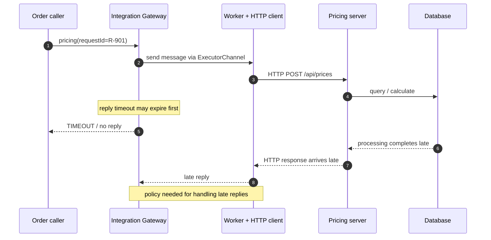
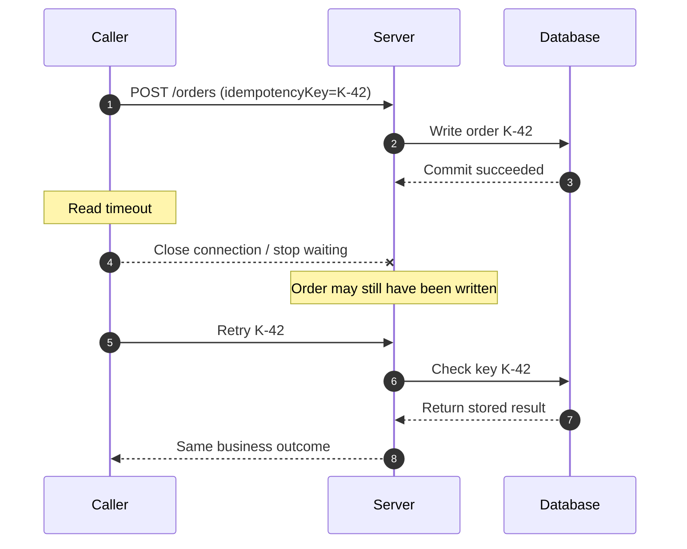

# Network Timeouts and Processing Timeouts in Remote Procedure Invocation

## Lesson Objectives

After this lesson, you will be able to:

- Distinguish **network connect timeout**, **response read timeout**, **Messaging Gateway reply wait timeout**, and **server-side business processing timeout**.
- Explain why an RPC that timed out on the client can still continue processing or produce side effects on the server.
- Design a time budget (*timeout budget*), an end-to-end deadline for the entire call chain, and deadline propagation across multiple services.
- Configure timeouts on the HTTP client and Spring Integration Gateway, recognizing the exact boundary each timeout controls.
- Handle retries, idempotency, circuit breakers, error channels, request–reply correlation, and late replies.
- Design test cases for slow connections, slow processing, multiple concurrent calls, and network errors with unknown outcomes.

In the **SPRING_INTEGRATION_PATTERN** module, we learn to implement *Enterprise Integration Patterns* with Spring Integration to build loosely coupled and scalable message flows. This lesson belongs to the **Remote procedure invocation** chapter and focuses on a critical problem when connecting Gateway, Router, Transformer, retry, error channel, and correlation flows: **how a slow or unresponsive remote call must terminate so the system does not hang, misprocess, or cause duplicate side effects**.

## 1. RPC Can Be Slow in Many Places

Suppose an ordering service calls a pricing service to calculate the total amount:

```text
Order Service                             Pricing Service
     |                                           |
     | -- POST /api/prices, requestId=R-901 --> |
     |         (network / HTTP client)           |  <-- waiting for worker / DB / price calculation
     |                                           |
     | <-- HTTP response: total = 240000 ------ |
     |                                           |
```

Not every slow call shares the same cause. A request may spend time in DNS, TCP/TLS handshake, waiting for a pooled connection, sending data, waiting for a server worker, waiting on database queries, and only then begin receiving the HTTP response. Configuring only a single timeout may bound **one segment** of the journey while leaving the remaining segments blocked.

Therefore, three questions must be answered first:

1. **Who is waiting?** The thread calling the Gateway, the HTTP client thread, or the server request-handling thread?
2. **What is being bounded?** Send time, connection time, waiting for response bytes, executing one task, or the entire journey?
3. **What happens when time expires?** Abort I/O, return an error, stop waiting for a reply, ask the remote side to cancel, or merely mark the task overdue?

A `timeout` notice only indicates that a **wait limit** was exceeded. It does not prove the server did not process the request.

## 2. Distinguishing Types of Timeouts

| Timeout Type | Where Measured? | Typical Limit Applied | What Is **Not** Guaranteed |
| --- | --- | --- | --- |
| **Connect timeout** | HTTP/TCP client | Time spent attempting to establish a connection to the endpoint | Does not bound DNS, pool acquisition, full TLS, or business runtime in every implementation |
| **Connection-pool acquisition timeout** | Pooled HTTP client | Time spent waiting to borrow an available connection | Does not solve slow server processing after a connection is acquired |
| **Read/socket timeout** | HTTP client | Wait interval for reading data from the socket | Usually not an absolute deadline for the entire HTTP call; multiple reads can extend total duration |
| **HTTP/request deadline** | Client, proxy, or RPC transport | Total time from start to final cutoff per specific mechanism | Does not automatically cancel server-side computation |
| **Spring Integration request timeout** | Messaging Gateway / channel send operation | Wait time to send a message when send can block | Not the remote request processing duration |
| **Spring Integration reply timeout** | Messaging Gateway receiving a reply | Wait time for a reply after the send phase | Does not interrupt a running synchronous handler; does not guarantee the remote operation stopped |
| **Server processing timeout** | Server, worker, database client | Time allowed to process a request or business step | Does not automatically replace timeouts at connections, message brokers, databases, and downstreams |
| **Queue / message-expiry timeout** | Queue, broker, or consumer | Time a message is retained awaiting processing, depending on broker | Does not guarantee a reply exists; TTL expiry does not necessarily roll back an active transaction |

**Key takeaway:** `connectTimeout`, `readTimeout`, `requestTimeout`, and `replyTimeout` have similar names but different scopes. Timeouts must be placed at the exact layers where blocking can occur.

### 2.1. Network Timeouts

Network timeouts describe situations where **communication** does not progress fast enough: failing to open a connection within the allowed window, failing to read data in time, or a dropped network hop. Timeouts can happen even when the server is healthy, such as blocked connections, busy proxies, or dropped packets.

For example, an HTTP client sets `connectTimeout = 400 ms` and `readTimeout = 1,500 ms`. If TCP cannot be established in time, the connection fails in the connect phase. If connected but the server sends no data within the read wait interval, the read phase can expire. These values **do not mean** the whole call is guaranteed to finish in 1,900 ms, due to DNS, thread scheduling, pool waiting, and how the library implements socket I/O.

### 2.2. Processing Timeouts

Processing timeouts bound **business work**: looking up data, calculating prices, calling additional services, evaluating rules, or executing transactions. They may be enforced via server request deadlines, database timeouts, transaction timeouts, or task coordinators.

If a server receives a request and starts writing an order, the client timing out while waiting for the response **does not mean** the database will roll back. The server may finish committing while the response is lost in transit. This is why every RPC with side effects must account for an **unknown outcome** after a timeout.

### 2.3. Reply Wait Timeout in Spring Integration

`@MessagingGateway` turns a Java method into a call to a message flow. For a method returning an object, the Gateway typically sends a message to the request channel and waits for a reply as configured.

- If the flow runs over a `DirectChannel`, the handler executes **synchronously** during the send. A slow HTTP call inside the handler holds the calling thread before the reply-wait mechanism takes effect; `replyTimeout` does not replace HTTP timeouts.
- If the request goes through an `ExecutorChannel`, the handler runs on a worker thread. The Gateway can wait for a reply with its own limit, and the caller may time out before the handler finishes.
- If the application uses a broker or multi-hop gateway, you must also distinguish time spent publishing to the broker, queue wait time, handler time, and reply transit time.

When the Gateway expires, a method returning an object may receive `null` in common synchronous configurations when no reply arrives; other return types and error-handling configurations behave differently. **Verify and standardize the timeout contract at the Gateway calling layer**; do not assume every timeout automatically turns into a single exception type.

## 3. Timing Diagram and End-to-End Deadline



From the diagram, **the caller's clock and the underlying processing clock are not the same**. By the time the Gateway expires, the worker and server may still be working; if the system allows an immediate retry, the same transaction may be executed again.

### 3.1. Relative Timeout and Absolute Deadline

Suppose the API advertises a target response time of **3 seconds**. A reference budget design:

| Component | Illustrative Budget |
| --- | ---: |
| Local dispatch wait + connection + network exchange | 500 ms |
| Server processing, including dependency queries | 1,700 ms |
| Reply, result conversion, and jitter reserve | 500 ms |
| Safety margin | 300 ms |
| **Total caller budget** | **3,000 ms** |

These numbers are a **design budget**, not a claim that summing socket timeout configurations creates an overall deadline. To keep the deadline, track elapsed time, allocate remaining budget to subsequent hops, and enforce an overall deadline that layers actually respect.

A **relative timeout** says "allowed to wait another 2 seconds from now." If each service repeats 2 seconds at every hop, total latency can grow with the number of hops. A **deadline** says "all work must complete before one unified point/budget"; at each hop, propagate the remaining budget.

```text
Caller has a 3,000 ms budget
  After dispatch + connect takes 450 ms
    -> 2,550 ms remaining
      Server uses 1,600 ms
        -> 950 ms remaining for response and subsequent steps
```

When sending a deadline as an absolute timestamp, clock skew across machines must be considered. For systems needing careful accounting, absolute deadlines serve cross-process communication; the receiver converts them to relative budgets and uses a monotonic clock for local measurement. Never use clock synchronization concerns as an excuse to omit real I/O timeouts.

## 4. Spring Integration Example: HTTP RPC with Two-Layer Limits

Let's build a flow calling a pricing service:

```text
Java caller
   |
   v
PricingGateway
   |  reply timeout: 2,500 ms
   v
ExecutorChannel (pricingRequests)
   |
   v
Service Activator (HTTP client)
   |  connect timeout: 400 ms
   |  read timeout: 1,800 ms
   v
Pricing HTTP service
   |  server-side processing + separate DB timeout
   v
HTTP response -> Service Activator -> Gateway -> caller
```

The example fits **Java 17+**, **Spring Integration 6.x**, Spring Boot with Integration and Web starters, using `RestTemplate` for HTTP. `public` types go in separate Java files within the same package per application. The pricing service runs independently, e.g., on port 8081; the URL only illustrates a development environment.

### 4.1. Request, Response, and RPC Result Contract

```java
// PricingRequest.java
public record PricingRequest(
        String requestId,
        String sku,
        int quantity
) {}

// PricingResponse.java
import java.math.BigDecimal;

public record PricingResponse(
        String requestId,
        String sku,
        BigDecimal total
) {}

// PricingResult.java
public record PricingResult(
        String requestId,
        PricingResponse response,
        String errorCode
) {
    public boolean successful() {
        return response != null && errorCode == null;
    }

    public static PricingResult ok(PricingResponse response) {
        return new PricingResult(response.requestId(), response, null);
    }

    public static PricingResult error(String requestId, String code) {
        return new PricingResult(requestId, null, code);
    }
}
```

`requestId` is a **business** correlation key for logging and reconciliation. It does not replace `MessageHeaders.CORRELATION_ID` when a flow uses Splitter/Aggregator; nor is it the Spring Messaging message ID. When a request crosses the network, the business key must be transmitted as a contract field or an agreed header.

### 4.2. Configuring HTTP Connect/Read Timeouts and the Processing Channel

```java
import org.springframework.context.annotation.Bean;
import org.springframework.context.annotation.Configuration;
import org.springframework.integration.annotation.IntegrationComponentScan;
import org.springframework.integration.channel.ExecutorChannel;
import org.springframework.integration.config.EnableIntegration;
import org.springframework.messaging.MessageChannel;
import org.springframework.scheduling.concurrent.ThreadPoolTaskExecutor;
import org.springframework.http.client.SimpleClientHttpRequestFactory;
import org.springframework.web.client.RestTemplate;

@Configuration
@EnableIntegration
@IntegrationComponentScan
public class PricingIntegrationConfig {

    @Bean
    public ThreadPoolTaskExecutor pricingExecutor() {
        ThreadPoolTaskExecutor executor = new ThreadPoolTaskExecutor();
        executor.setCorePoolSize(4);
        executor.setMaxPoolSize(8);
        executor.setQueueCapacity(50);
        executor.setThreadNamePrefix("pricing-rpc-");
        return executor;
    }

    @Bean
    public MessageChannel pricingRequests(
            ThreadPoolTaskExecutor pricingExecutor) {
        return new ExecutorChannel(pricingExecutor);
    }

    @Bean
    public RestTemplate pricingRestTemplate() {
        SimpleClientHttpRequestFactory requestFactory =
                new SimpleClientHttpRequestFactory();
        requestFactory.setConnectTimeout(400);
        requestFactory.setReadTimeout(1800);
        return new RestTemplate(requestFactory);
    }
}
```

With `SimpleClientHttpRequestFactory`, the unit of `setConnectTimeout(int)` and `setReadTimeout(int)` is **milliseconds**. These are two limits at HTTP transport; they do not represent final server execution time and do not cover all network phases.

We use `ExecutorChannel` so HTTP calls run on worker threads. The pool has bounded threads and queue capacity; under overload, a policy is needed for rejected executions. Do not grow pool sizes unboundedly to mask downstream latency.

### 4.3. Gateway: Bounding Reply Wait Time

```java
import org.springframework.integration.annotation.MessagingGateway;

@MessagingGateway(
    defaultRequestChannel = "pricingRequests",
    defaultReplyTimeout = "2500"
)
public interface PricingGateway {
    PricingResult quote(PricingRequest request);
}
```

Once the request enters the async channel, the Gateway waits for a response up to the configured limit. `2,500 ms` here is the Gateway reply wait time; it does not promise the HTTP worker stops at that mark. Another configuration may need `requestTimeout` when sending a message can block; that handles the **send phase**, not `replyTimeout`.

### 4.4. Service Activator: Calling HTTP and Normalizing Errors

```java
import org.springframework.integration.annotation.ServiceActivator;
import org.springframework.stereotype.Component;
import org.springframework.web.client.HttpStatusCodeException;
import org.springframework.web.client.ResourceAccessException;
import org.springframework.web.client.RestTemplate;

@Component
public class PricingRpcHandler {
    private final RestTemplate pricingRestTemplate;

    public PricingRpcHandler(RestTemplate pricingRestTemplate) {
        this.pricingRestTemplate = pricingRestTemplate;
    }

    @ServiceActivator(inputChannel = "pricingRequests")
    public PricingResult invoke(PricingRequest request) {
        try {
            PricingResponse response = pricingRestTemplate.postForObject(
                "http://localhost:8081/api/prices",
                request,
                PricingResponse.class
            );
            if (response == null) {
                return PricingResult.error(
                    request.requestId(), "EMPTY_RESPONSE");
            }
            if (!request.requestId().equals(response.requestId())) {
                return PricingResult.error(
                    request.requestId(), "CORRELATION_MISMATCH");
            }
            return PricingResult.ok(response);
        } catch (ResourceAccessException ex) {
            // Could be connect/read timeout or another I/O error.
            return PricingResult.error(
                request.requestId(), "REMOTE_IO_FAILURE");
        } catch (HttpStatusCodeException ex) {
            // HTTP 4xx/5xx does not equal timeout.
            return PricingResult.error(
                request.requestId(),
                "REMOTE_HTTP_" + ex.getStatusCode().value());
        }
    }
}
```

`ResourceAccessException` covers many I/O failures, so not every catch here should be labeled `TIMEOUT`. If you need to distinguish `CONNECT_TIMEOUT` or `READ_TIMEOUT` accurately for retries/metrics, inspect the cause chain according to the HTTP client used and normalize it in the adapter.

In this example, HTTP errors are converted into **structured replies** so the Gateway receives a result even when I/O fails. Uncaught programming errors here can still follow Spring Integration's error mechanism: in async flows, `errorChannel` and endpoint configuration determine where `ErrorMessage` goes. Without a clear error-reply path, callers may only see a reply timeout even though the worker threw an exception.

### 4.5. Caller Handling Gateway Timeout

```java
import org.springframework.stereotype.Service;

@Service
public class PricingApplicationService {
    private final PricingGateway gateway;

    public PricingApplicationService(PricingGateway gateway) {
        this.gateway = gateway;
    }

    public PricingResponse priceForOrder() {
        String requestId = "R-901";
        PricingResult result = gateway.quote(
            new PricingRequest(requestId, "BOOK-01", 2));

        if (result == null) {
            // Did not receive a reply within the Gateway budget.
            throw new IllegalStateException(
                "RPC_REPLY_TIMEOUT requestId=" + requestId);
        }
        if (!requestId.equals(result.requestId())) {
            throw new IllegalStateException(
                "RPC_CORRELATION_ERROR");
        }
        if (!result.successful()) {
            throw new IllegalStateException(
                "RPC_FAILED code=" + result.errorCode());
        }
        return result.response();
    }
}
```

This example illustrates the calling contract. Production applications should use domain-specific exception/result types instead of `IllegalStateException` and avoid putting sensitive data in error messages. What must be preserved is separating **no reply**, **downstream HTTP/I/O errors**, and **reply mismatched with request ID**.

### 4.6. The Server Side Must Also Have Timeouts

Suppose the pricing server performs:

```text
POST /api/prices
  1. validate requestId, sku, quantity
  2. check if deadline is still valid
  3. query price table (dedicated query timeout)
  4. calculate total amount
  5. create response with the same requestId
```

The server needs a maximum duration for the request and for each downstream call. If the client has already timed out, do not continue an expensive operation merely because no deadline check exists. However, **checking the deadline before running** does not automatically stop a query that has already started. You must use the cancellation/interruption/timeout mechanisms of the executor, database, or I/O library itself.

One intentional way to propagate budget is sending a header such as `X-Request-Deadline-Epoch-Millis` or a `remainingTimeoutMs` field in an envelope. This is an **application-defined convention**, not a header Spring Integration automatically standardizes for all HTTP RPCs.

Example calculating remaining time before starting work:

```java
import java.time.Clock;
import java.time.Duration;
import java.time.Instant;

public final class DeadlineBudget {
    private final Clock clock;
    private final Instant deadline;

    public DeadlineBudget(Clock clock, Instant deadline) {
        this.clock = clock;
        this.deadline = deadline;
    }

    public long remainingMillis() {
        return Math.max(0L,
            Duration.between(clock.instant(), deadline).toMillis());
    }

    public void requireTimeLeft() {
        if (remainingMillis() <= 0L) {
            throw new IllegalStateException("DEADLINE_EXCEEDED");
        }
    }
}
```

The example above only **measures and checks** the deadline. It does not automatically enforce timeouts on HTTP/databases or interrupt a running worker. When initiating a new I/O operation, pass the remaining budget into the appropriate client/driver; never mutate timeout setters on a thread-shared HTTP client per request in an unsafe multi-threaded way.

## 5. Why Client Timeouts Cannot Replace Processing Timeouts

A sequence of events requiring special caution:



When the client times out, there are at least three possibilities:

| Actual State | Does Client Know for Sure? | Consequence |
| --- | --- | --- |
| Request never reached server | Usually no | Can retry if rules allow |
| Server still processing | No | Retry may create duplicate processing |
| Server committed but reply lost | No | Uncontrolled retry may duplicate side effects |

For a **read-only** RPC without side effects, retrying can be simpler. For creating orders, payments, sending emails, or dispatching inventory, you must use an **idempotency key**, store processed outcome state, and define behavior when the same key is resent. Never apply unconditional retries to all timeout errors.

**Note on task cancellation:** client disconnect, `Future.cancel(true)`, or `CompletableFuture.orTimeout(...)` does not guarantee an HTTP call or server transaction stops immediately. Cancellation only takes effect when the library and task genuinely support it. A complete solution enforces deadlines wherever blocking operations occur and verifies actual rollback/cancel behavior.

## 6. Choosing Timeouts and Retries Based on Remaining Budget

Suppose the caller has a **3,000 ms** deadline, and the first request takes **2,400 ms** before hitting a read timeout. Only about **600 ms** remain, excluding overhead. Retrying with a fresh 3,000 ms timeout breaks the caller's budget and adds load while downstream is slow.

A sound strategy:

1. Attach `requestId` or `idempotencyKey` to every operation needing reconciliation.
2. At the RPC entry point, determine the **overall deadline**.
3. Before each attempt, compute **remaining budget**; if insufficient for a meaningful call, stop.
4. Set connect/read timeouts and effective attempt deadlines so they do not exceed overall policy; use bounded jittered backoff for eligible retries.
5. Only retry failures with transient recovery basis and operations safe to repeat.
6. Upon expiration, return a clear status; keep tracking submitted tasks if business rules require reconciliation.

### 6.1. Example Computing One Attempt's Budget

```java
import java.time.Duration;
import java.time.Instant;

public long computeAttemptBudgetMillis(
        Instant deadline,
        Instant now,
        long maxAttemptMillis,
        long reserveForReplyMillis) {
    long left = Duration.between(now, deadline).toMillis();
    return Math.max(0L,
        Math.min(maxAttemptMillis, left - reserveForReplyMillis));
}
```

If the function returns `0`, do not start a new attempt. This is a budget calculation example; **enforcing** this limit must be wired into the corresponding HTTP/RPC client's timeout. With a `RestTemplate` and request factory shared across threads, do not mutate the factory's timeout setters before each call; design the HTTP client/adapter for per-request timeouts or pools with fixed policies.

### 6.2. Failures That Should Not Be Retried the Same Way

| Signal | Retry? | Condition |
| --- | --- | --- |
| Connection refused before transmitting request | Possibly | Downstream can recover; avoid retry storms |
| Socket read timeout after sending request | Weigh carefully | Server-side outcome unknown; protect idempotency |
| HTTP 429 / 503 | Possibly | Honor `Retry-After` if present and remaining budget |
| HTTP 400 due to invalid data | Usually no | Request must be fixed |
| Deterministic business error | No | Retrying does not change the cause |
| Gateway reply timeout due to congested thread pool | Not automatically | Find bottleneck and limit concurrency |

A **circuit breaker** temporarily blocks new calls to a downstream with high error/timeout rates; a **bulkhead** bounds concurrent tasks; **retries** add attempts. They complement one another, but do not replace deadlines and deduplication. Aggressive retrying while downstream is overloaded can worsen an outage.

## 7. Error Channel, Router, and Correlation When Replies Arrive Late

Spring Integration can create multiple branches: request enters Gateway, passes through Router, Transformer, HTTP outbound endpoint, and returns. When applying timeouts, keep these rules:

- **Reply channel:** the path a reply takes back to the Gateway. A reply sent after the caller timed out does not automatically become the result of a different request.
- **Correlation ID:** if splitting a request into multiple messages via a Splitter or broker, preserve the correlation key so the Aggregator or pending request table matches the right reply. Do not equate message ID with business request ID.
- **Error channel:** in async flows, worker errors may be sent to `errorChannel` as an `ErrorMessage` depending on endpoint/configuration. Decide whether that error becomes an error response to the caller, is persisted for reconciliation, or is only logged/alerted. Never assume every error automatically returns to the caller.
- **Router/Filter:** a branch that produces no reply can cause the Gateway to time out waiting. If a Filter rejects a request, emit an error or complete per contract; avoid "silent filtering" in an RPC expecting a response.
- **Aggregator:** group timeout and reply timeout are two independent limits. Long-lived groups can grow memory/message stores even after the Gateway already returned a timeout.

A late-reply policy should be explicitly defined:

| Case | Illustrative Policy |
| --- | --- |
| Reply arrives on time, matching `requestId` | Deliver to caller, record success |
| Reply arrives after deadline | Record metrics and trace; discard or store outcome for business reconciliation |
| Reply arrives for nonexistent request ID | Never assign to another call; log/send to appropriate dead-letter/audit |
| Duplicate reply | Deduplicate by request ID + attempt/operation key |
| `ErrorMessage` emitted after caller timeout | Record independently, avoid losing root cause |

If the system runs multiple instances, pending request/correlation storage and routing replies to the right consumer instance must be designed explicitly. In-memory structures only fit when response lifetimes stay within one process and restart recovery is not required.

## 8. Observing Timeouts at the Right Layer

Do not merely log `"RPC timed out"` and conclude the server is slow. Record enough evidence to isolate the failing layer:

| Metric / Log Field | Meaning |
| --- | --- |
| `requestId`, `traceId`, downstream name | Correlate events across hops |
| `attemptNumber`, `deadlineRemainingMs` | Show retry count and remaining budget |
| `dns/connect/poolWait` when client supports it | Pinpoint connection setup latency |
| `remoteLatencyMs`, `responseStatus` | Observe HTTP call duration and outcome |
| `gatewayReplyWaitMs` | How long the caller waited for the message flow reply |
| `serverQueueMs`, `serverProcessingMs` | Distinguish server worker queueing from genuinely slow processing |
| `dbQueryMs`, `dbTimeoutCount` | Spot internal downstream delays |
| `lateReplyCount`, `timeoutCount` | Reconcile late arrivals and incomplete failures |

Track p50/p95/p99 latency, timeout rate, retry rate, and in-flight tasks still running after timeout. Label metrics with **connect/read/reply/server processing** causes when evidence supports them; otherwise use an unclassified I/O error label. Avoid logging tokens, payment details, or sensitive payloads.

## 9. Testing Timeout Boundaries

A timeout test is valuable when it simulates *the exact slow layer*. For instance, do not mock a socket exception and claim server processing time was tested.

| Scenario | How to Simulate | Expectation |
| --- | --- | --- |
| Cannot connect | Endpoint refuses connections or network test harness controls TCP | Connect error/timeout classified, does not hang forever |
| Server accepts but responds slowly | Local test HTTP server intentionally holds response after receiving request | Read timeout or overall deadline per client under test |
| Handler runs slower than reply timeout | Executor worker sleeps longer than Gateway wait time | Caller expires; handler may still run; late reply not misassigned |
| Server commits then reply is lost | Test server persists state before cutting connection | Retry with same idempotency key does not create another record |
| Multiple concurrent requests | Dispatch distinct request IDs, invert completion order | No mixed replies; no leaked pending requests |
| Expires at DB step | DB query slower than query timeout | Server terminates cleanly, returns appropriate error |
| Downstream returns HTTP 400/503 | Return specific status and body | 400 not retried; 503 follows bounded retry policy |

Example testing HTTP error mapping **without network connectivity** using `MockRestServiceServer` (Spring Test). It verifies the adapter returns a structured error when downstream reports 503, but **does not test real socket timeouts**:

```java
import static org.assertj.core.api.Assertions.assertThat;
import static org.springframework.test.web.client.match.MockRestRequestMatchers.method;
import static org.springframework.test.web.client.match.MockRestRequestMatchers.requestTo;
import static org.springframework.test.web.client.response.MockRestResponseCreators.withStatus;

import org.junit.jupiter.api.Test;
import org.springframework.http.HttpMethod;
import org.springframework.http.HttpStatus;
import org.springframework.test.web.client.MockRestServiceServer;
import org.springframework.web.client.RestTemplate;

class PricingRpcHandlerTest {
    @Test
    void mapsHttp503ToStructuredReply() {
        RestTemplate restTemplate = new RestTemplate();
        MockRestServiceServer server =
            MockRestServiceServer.createServer(restTemplate);
        server.expect(requestTo("http://localhost:8081/api/prices"))
            .andExpect(method(HttpMethod.POST))
            .andRespond(withStatus(HttpStatus.SERVICE_UNAVAILABLE));

        PricingRpcHandler handler = new PricingRpcHandler(restTemplate);
        PricingResult reply = handler.invoke(
            new PricingRequest("R-901", "BOOK-01", 2));

        assertThat(reply.successful()).isFalse();
        assertThat(reply.requestId()).isEqualTo("R-901");
        assertThat(reply.errorCode()).isEqualTo("REMOTE_HTTP_503");
        server.verify();
    }
}
```

To verify real wait times, use a latency-controlled HTTP test server or fault-injecting proxy, measure elapsed time with a monotonic clock, and inspect server-side tasks too. Do not test deadlines with a `Thread.sleep` and assume it proves a remote transaction was interrupted.

## 10. Practical Scenario: Order Times Out After 2.5 Seconds

Suppose `PricingGateway` has a `2,500 ms` reply timeout, the HTTP client has a `1,800 ms` read timeout, and the pricing service occasionally slows down due to DB queries. When the system receives 200 concurrent requests:

1. Some messages must wait in the executor queue before starting HTTP calls.
2. Active workers face connect/read limits; many calls may fail due to slow I/O.
3. The Gateway may expire before a task starts running or before receiving a result, because reply timeout is measured from Gateway invocation, not when the HTTP request actually begins.
4. If callers retry all timed-out requests without limits, the queue fills further and latency climbs.
5. If a call is a write operation, timed-out outcomes still require reconciliation by request ID/idempotency key.

Practical remediation is measuring **executor queue wait** and **remote latency** separately, capping concurrent requests, sizing I/O and server timeouts within budget, applying conditional retries, and defining a late-reply policy. When a request can hit multiple backends, a Router can pick branches based on downstream health; correlation must be preserved so replies return to the right caller, and every branch must respect the same overall deadline.

## 11. Pre-Production RPC Checklist

1. Are **connect, pool wait, read, Gateway reply**, and **server processing** separated in design and metrics?
2. Does the caller have an overall deadline? Do hops consume **remaining budget** instead of starting fresh timeouts?
3. Can Gateway expiration leave running handlers, message groups, transactions, or remote tasks behind? Is there a cleanup policy?
4. When outcomes are unknown, could retries duplicate side effects? Is there an `idempotencyKey` and stored results for processed keys?
5. Are HTTP 4xx/5xx, connect/read timeouts, business errors, and reply timeouts distinguished?
6. Do executor errors flow to an error channel or get converted into structured error replies?
7. Have late replies, server commits with lost responses, concurrent requests, and thread-pool pressure been tested?

## Conclusion

**Network timeouts** bound individual communication activities; **processing timeouts** bound work on the server; **reply timeouts** in Spring Integration bound how long the Gateway waits for a response from the message flow. These three groups of limits serve different purposes and must coordinate within an **overall deadline**. When an RPC times out, the client stopping its wait does not prove the server stopped processing. Therefore, beyond configuring timeouts, you must design correlation, idempotency, budget-aware retries, late-reply handling, and clear observability for every stage of the call.
