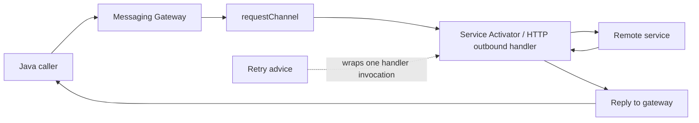
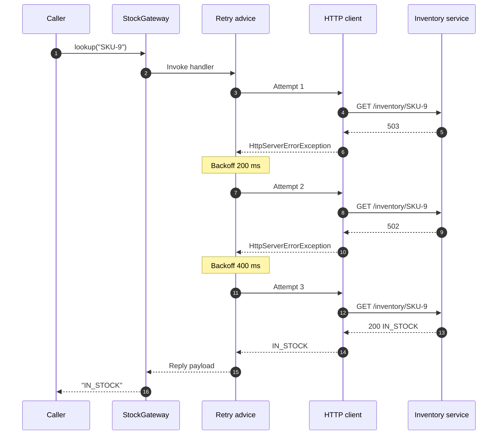
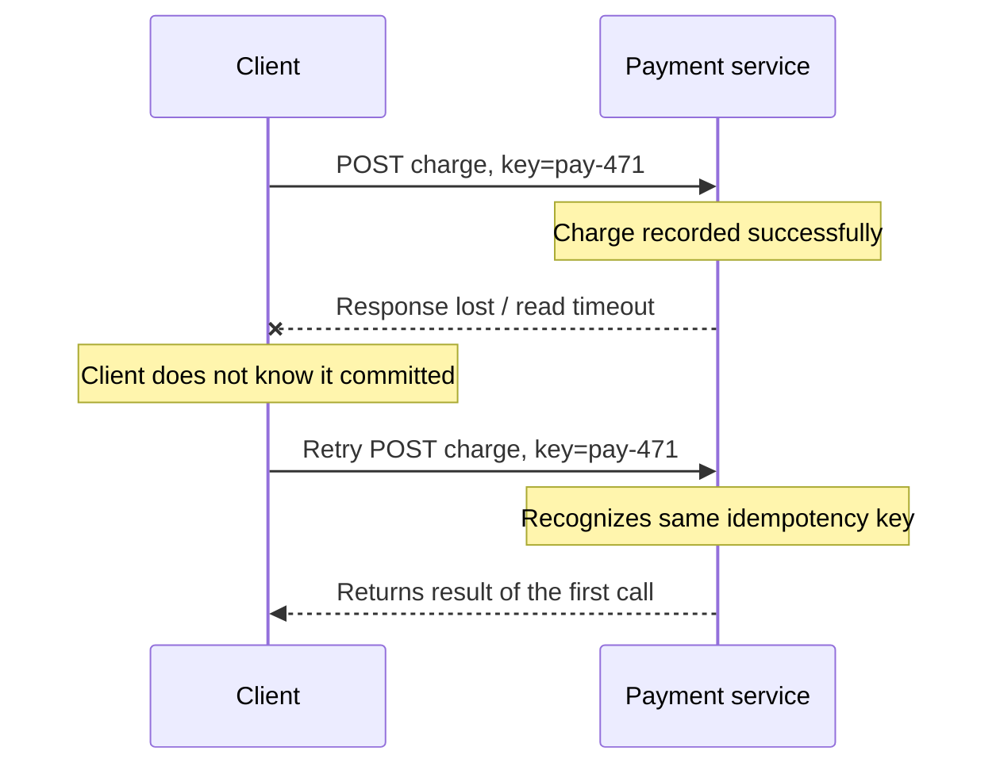

# Remote Procedure Invocation — Retrying Remote Calls with Spring Integration

## Learning Objectives

After this lesson, you will be able to:

- Explain why **Remote Procedure Invocation (RPI)** can fail transiently and when retries help recover.
- Distinguish retryable failures from business errors, invalid data errors, and **uncertain** execution states when network responses are lost.
- Configure `RequestHandlerRetryAdvice`, `RetryTemplate`, attempt limits, and **exponential backoff** for a handler making HTTP calls from Spring Integration.
- Analyze the relationship between retries, HTTP client timeouts, `@MessagingGateway`, `replyChannel`, multi-layer retries, and error channels.
- Test retry counts, success outcomes, non-retry cases, and exhausted retries; apply **idempotency**, correlation, and observability to prevent duplicate side effects.

This lesson belongs to the **Remote procedure invocation** chapter of the **SPRING_INTEGRATION_PATTERN** module. The module's goal is learning Enterprise Integration Patterns in Spring Integration to build loosely coupled, extensible message flows with Router, Filter, Transformer, Splitter, Aggregator, Gateway, retry, error channel, correlation, and branch-level testability and observability. Here, the key area to master is the policy for **retrying an operation on a remote system** and its impact on the request–reply path.

## 1. Why Do Remote Calls Need Retries?

An internal Java call can fail when execution logic is invalid. With remote calls, many additional failures occur between the caller and the remote service:

- TCP fails to connect because the service is restarting or the connection is refused.
- A connection pool or network gateway experiences a brief glitch.
- The server returns `502 Bad Gateway`, `503 Service Unavailable`, or `504 Gateway Timeout` during overload.
- The request reached the server, but the client could not read the response before timing out.
- The server enforces rate limiting and returns `429 Too Many Requests` with a `Retry-After` hint.
- A data or business error causes the server to return `400`, `401`, `403`, `404`, or `409`; resending the identical request usually will not fix the root cause.

Retry is **conditionally re-sending an execution** when a failure is likely transient and the operation is permitted to run again. It is an availability mechanism, not a cure for every error. Picking the wrong error types or retrying without bounds can keep hammering an already overloaded service with more traffic.

Inventory check example:

```text
Order ──request──> stockRequests ──> HTTP inventory service
         │                              │
         │                              ├─ Attempt 1: 503
         │                              ├─ Wait 200 ms
         │                              └─ Attempt 2: 200 "IN_STOCK"
         │
         └─reply<──── "IN_STOCK" <───────┘
```

For a **side-effect-free** stock lookup, two attempts may be acceptable. Conversely, if the RPC is "create payment," a prior attempt that succeeded with a lost response could double-charge upon retry. That is the crucial distinction between **technically retryable** and **business-safe to retry**.

## 2. Where Retry Sits in a Spring Integration Flow

In a flow, a remote call is typically a handler or outbound gateway:



`RequestHandlerRetryAdvice` is an advice integrated with Spring Integration handlers. It uses **Spring Retry** to re-invoke the handler when execution throws an exception allowed by the retry policy.

Points requiring exact scoping:

1. Retry attached to the **remote-calling handler** re-executes that handler itself. Steps before the handler do not automatically re-run.
2. Retry in the **caller outside the gateway** can re-run the **entire request flow**, including steps prior to the remote call.
3. Retries in the HTTP client, message broker, load balancer, or external service SDK can stack on top of Spring Integration retries.
4. If the handler both writes to a DB and calls HTTP, retrying the whole handler may write to the DB again. Separate the operations or ensure they are safe to repeat.

Choose **one primary layer responsible** for retrying each error type; when multiple layers must retry, calculate the total attempt budget and wait duration.

## 3. Classifying Errors Before Retrying

Do not retry on every `Exception`. A starting policy for HTTP/RPC might be:

| Signal | Retry? | Conditions and Notes |
| --- | --- | --- |
| Connection failure, transient I/O error | Usually yes | Verify operation is safe to repeat; some timeouts happen after the server received the request |
| `502`, `503`, `504` | Usually considered | Wait with backoff; guard against overload; only retry idempotent commands |
| `500` | Depends on cause | Could be a persistent bug; pointless to repeat if not transient |
| `429` | Conditional | Honor `Retry-After` and quotas; do not hammer with rapid retries |
| `400`, `401`, `403`, `404` | Usually no | Fix request/permissions or verify business rules first |
| `409 Conflict` | Depends on contract | May indicate a duplicate command handled by server; check state before retrying |
| Validation/domain exception | No | Same invalid data usually yields the same result |
| Overall deadline expired | Do not continue | Do not issue new attempts beyond the time budget |
| Error from active caller cancellation | No | Respect cancellation/interruption as supported |

Two timeout forms must be distinguished:

- **Connect timeout**: the client failed to establish a connection in time. This usually suggests a connectivity error, though proxies and infrastructure can still make outcomes ambiguous.
- **Read timeout**: the client already sent the request or connected, but did not receive data in time. **You cannot conclude the remote side did not execute the operation.** For commands with side effects, query state or use an idempotency key.

Even when receiving `503` or `500`, the request may have executed part of the business logic before the error was emitted. Never infer "HTTP error code means not committed."

### What Components Make Up a Retry Policy?

| Component | Effect | Example |
| --- | --- | --- |
| `maxAttempts` | Total executions, **including the initial attempt** | 3 = initial attempt + up to 2 retries |
| Retryable exception classifier | Specifies which exceptions are retried | `ResourceAccessException`, `HttpServerErrorException` |
| Backoff | Inserts a pause before the next attempt | 200 ms → 400 ms → ... |
| Jitter | Randomizes wait intervals to prevent synchronized client retry storms | 200 ms ± an appropriate range |
| Deadline/budget | Prevents total duration from exceeding caller tolerance | Do not start a new attempt near SLA expiration |
| Recovery/fallback | Behavior once attempts are exhausted | Throw error, record error result, route to compensation flow |

**Note:** exponential backoff only controls **the delay between attempts**. It does not automatically enforce a total duration limit and is not equivalent to a circuit breaker.

## 4. Complete Example: Retrying When the Inventory Service Returns 5xx

We will build a Spring Integration program making an HTTP GET call to an inventory service. The handler takes a `sku` and fetches a string response. Hypothetical remote API example:

```http
GET http://localhost:8099/inventory/SKU-9

HTTP/1.1 200 OK
Content-Type: text/plain

IN_STOCK
```

When the remote temporarily returns 5xx or the client encounters a network access failure, the handler will be retried up to a limit. When the remote returns 4xx, this policy will not retry.

Required project dependencies: `spring-integration-core`, `spring-retry`, Spring Web (for `RestTemplate`), and Spring Context. The code uses Java 17 and Spring Integration Java DSL following common Spring Integration 6.x APIs. The testing section below also uses Spring Test and JUnit 5.

### 4.1. Caller Gateway

`StockGateway.java`:

```java
import org.springframework.integration.annotation.MessagingGateway;

@MessagingGateway(defaultRequestChannel = "stockRequests")
public interface StockGateway {
    String lookup(String sku);
}
```

The caller only sees the `lookup` method. Spring Integration converts the `sku` payload into a message and sends it to the `stockRequests` channel. The handler returns the reply along the request–reply path managed by the gateway. This style decouples business calling code from channel details, just like the Gateway pattern works throughout the module.

### 4.2. Configuring HTTP Client, RetryTemplate, and IntegrationFlow

`StockIntegrationConfig.java`:

```java
import java.util.Map;

import org.springframework.context.annotation.Bean;
import org.springframework.context.annotation.Configuration;
import org.springframework.http.client.SimpleClientHttpRequestFactory;
import org.springframework.integration.annotation.EnableIntegration;
import org.springframework.integration.annotation.IntegrationComponentScan;
import org.springframework.integration.dsl.IntegrationFlow;
import org.springframework.integration.handler.advice.RequestHandlerRetryAdvice;
import org.springframework.retry.backoff.ExponentialBackOffPolicy;
import org.springframework.retry.policy.SimpleRetryPolicy;
import org.springframework.retry.support.RetryTemplate;
import org.springframework.web.client.HttpServerErrorException;
import org.springframework.web.client.ResourceAccessException;
import org.springframework.web.client.RestTemplate;

@Configuration
@EnableIntegration
@IntegrationComponentScan(basePackageClasses = StockGateway.class)
public class StockIntegrationConfig {

    @Bean
    public RestTemplate stockRestTemplate() {
        SimpleClientHttpRequestFactory factory =
            new SimpleClientHttpRequestFactory();

        factory.setConnectTimeout(500);
        factory.setReadTimeout(1_000);
        return new RestTemplate(factory);
    }

    @Bean
    public RetryTemplate stockRetryTemplate() {
        // maxAttempts = 3 includes the initial try + up to 2 retries.
        // true: traverse deeper causes if the exception is wrapped by the handler.
        SimpleRetryPolicy policy = new SimpleRetryPolicy(
            3,
            Map.of(
                ResourceAccessException.class, true,
                HttpServerErrorException.class, true
            ),
            true
        );

        ExponentialBackOffPolicy backoff =
            new ExponentialBackOffPolicy();
        backoff.setInitialInterval(200);
        backoff.setMultiplier(2.0);
        backoff.setMaxInterval(1_000);

        RetryTemplate template = new RetryTemplate();
        template.setRetryPolicy(policy);
        template.setBackOffPolicy(backoff);
        return template;
    }

    @Bean
    public RequestHandlerRetryAdvice stockRetryAdvice(
            RetryTemplate stockRetryTemplate) {
        RequestHandlerRetryAdvice advice =
            new RequestHandlerRetryAdvice();
        advice.setRetryTemplate(stockRetryTemplate);
        return advice;
    }

    @Bean
    public IntegrationFlow stockFlow(
            RestTemplate stockRestTemplate,
            RequestHandlerRetryAdvice stockRetryAdvice) {
        return IntegrationFlow.from("stockRequests")
            .handle(
                String.class,
                (sku, headers) -> stockRestTemplate.getForObject(
                    "http://localhost:8099/inventory/{sku}",
                    String.class,
                    sku
                ),
                endpoint -> endpoint.advice(stockRetryAdvice)
            )
            .get();
    }
}
```

**Flow explanation:**

1. `StockGateway.lookup("SKU-9")` sends a message into `stockRequests`.
2. The `.handle(...)` endpoint calls `RestTemplate.getForObject(...)` to the external service.
3. The advice wraps the handler and relies on `RetryTemplate` to decide on retries.
4. If the remote returns 5xx, `RestTemplate` throws `HttpServerErrorException` (or a subclass) by default; the policy allows retrying.
5. If connection/reading encounters an access error, `ResourceAccessException` can be retried per the policy.
6. If a subsequent attempt succeeds, the handler returns the payload and Spring Integration routes the reply back to the gateway.
7. If attempts are exhausted or the error is not listed, the exception propagates to the flow/caller error-handling mechanism.

**Why `traverseCauses = true`?** Spring Integration may wrap exceptions from a handler inside `MessageHandlingException` or another wrapper. Traversing the cause chain lets the policy still recognize the underlying HTTP error. This avoids retrying every framework exception while keeping retries scoped to intended error types.

`Map.of(...)` in the example defines the retryable exceptions; unconfigured exceptions will not be retried. The timeouts on `SimpleClientHttpRequestFactory` are connect/read timeouts **per HTTP attempt**, not the total timeout for the whole request–reply. Depending on Java and Spring Framework versions, timeout configuration APIs may differ; verify the actual dependencies when bringing this into a project.

### 4.3. Timeline of Three Attempts

With hypothetical responses 503 → 502 → 200:



If the third attempt still fails with 503, the policy stops and throws the final error; **there is no fourth attempt**. Choosing 200 ms and 400 ms is illustrative only—do not assume they suit all workloads.

### 4.4. Handling 429 and Retry-After

The example above only retries 5xx and `ResourceAccessException`; 429 usually falls under `HttpClientErrorException`, so it is **not** retried by that policy. This is intentional to avoid accidentally retrying all 4xx errors.

If the system must support 429:

- Only allow retries when the remote contract explicitly permits retrying.
- Read `Retry-After` when present, as seconds or an HTTP-date timestamp; respect overall deadlines and budgets.
- Consider handling 429 with a custom retry policy/backoff or a dedicated HTTP client layer; a fixed `ExponentialBackOffPolicy` does not read this header automatically.
- Limit concurrent calls so retries do not turn into a traffic surge.

## 5. Testing Remote Attempt Counts with MockRestServiceServer

The goal of testing is verifying **actual attempt counts** and reply behavior. You do not need to run a real HTTP service; `MockRestServiceServer` from `spring-test` can stub responses for `RestTemplate`.

`StockRetryIntegrationTest.java`:

```java
import static org.junit.jupiter.api.Assertions.assertEquals;
import static org.junit.jupiter.api.Assertions.assertThrows;
import static org.springframework.test.web.client.match.MockRestRequestMatchers.requestTo;
import static org.springframework.test.web.client.response.MockRestResponseCreators.withBadRequest;
import static org.springframework.test.web.client.response.MockRestResponseCreators.withServerError;
import static org.springframework.test.web.client.response.MockRestResponseCreators.withSuccess;

import org.junit.jupiter.api.Test;
import org.springframework.beans.factory.annotation.Autowired;
import org.springframework.http.MediaType;
import org.springframework.test.context.junit.jupiter.SpringJUnitConfig;
import org.springframework.test.web.client.MockRestServiceServer;
import org.springframework.web.client.RestTemplate;

@SpringJUnitConfig(StockIntegrationConfig.class)
class StockRetryIntegrationTest {

    @Autowired
    StockGateway gateway;

    @Autowired
    RestTemplate stockRestTemplate;

    @Test
    void retriesServerErrorThenReceivesReply() {
        MockRestServiceServer server =
            MockRestServiceServer.createServer(stockRestTemplate);

        String url = "http://localhost:8099/inventory/SKU-9";
        server.expect(requestTo(url))
            .andRespond(withServerError());
        server.expect(requestTo(url))
            .andRespond(withSuccess(
                "IN_STOCK", MediaType.TEXT_PLAIN
            ));

        assertEquals("IN_STOCK", gateway.lookup("SKU-9"));
        server.verify(); // Called twice as expected.
    }

    @Test
    void doesNotRetryBadRequest() {
        MockRestServiceServer server =
            MockRestServiceServer.createServer(stockRestTemplate);

        String url = "http://localhost:8099/inventory/BAD-SKU";
        server.expect(requestTo(url))
            .andRespond(withBadRequest());

        assertThrows(
            RuntimeException.class,
            () -> gateway.lookup("BAD-SKU")
        );

        server.verify(); // Policy does not retry 400 errors.
    }
}
```

For exhausted retries, add a test with three consecutive 503 responses, then assert the gateway throws an exception and the server recorded **exactly three** HTTP calls. Do not assert that a call succeeds after a 400 error: that would contradict the configured policy.

**Testing note:** `MockRestServiceServer` swaps out `RestTemplate`'s request factory during the test session, making it suitable for testing exception classification, attempt counts, and reply routing. It does not prove real socket timeouts, network partition impacts, or stability under load; those scenarios require dedicated integration tests in an appropriate environment. For retries with backoff, test runtime includes real wait delays; do not write millisecond-exact timing assertions.

## 6. Retries Must Be Paired with Idempotency

Retries increase the likelihood that the same **business intent** is executed multiple times. A broken connection after the server already wrote the result is a dangerous scenario:



If the server does not support idempotency, retrying a POST can create a second transaction. Not every REST API with POST is unretryable, but **safety must be guaranteed by contract and implementation**, not merely by the HTTP method.

A sample contract:

```http
POST /payments
Idempotency-Key: pay-471
Content-Type: application/json

{"orderId":"ORD-471","amount":125000,"currency":"VND"}
```

The receiver must ensure:

1. One `idempotencyKey` within an explicit scope produces **only one** side effect.
2. Key and result are recorded atomically in the same transaction or consistent workflow.
3. On retry with the same key and same content, return the known result or in-progress status.
4. On the same key with a different payload, reject or report a conflict per contract.
5. Retain the key long enough relative to the retry window and potential delayed request arrivals.

**Do not generate a new key for each attempt.** The key represents **one business command**, while `attempt` is just one transport delivery of that command. `requestId` or `correlationId` helps logging and request–reply pairing; they do not provide idempotency on their own unless the backend checks and persists state.

### Which Operations Are Easier to Retry?

- Inventory lookup, reading configuration: usually retryable if the remote guarantees reads do not mutate state.
- Conditional PUT state updates: retryable if the API enforces idempotency and version checks.
- Creating orders, charging money, emitting events: require deduplication or state checks before retrying.
- Sending email/SMS: require command identity and deduplication strategy; resending can create duplicate notifications.

You must also account for **a call that failed at the HTTP layer yet succeeded at the business layer**.

## 7. Timeouts, Gateway, and Time Budgets

A policy with three attempts can take longer than the caller expects. We must distinguish:

| Clock | Scope |
| --- | --- |
| HTTP connect timeout | Time limit to connect to the remote **per attempt** |
| HTTP read timeout | Time limit waiting for response data per HTTP client behavior |
| Retry backoff | Pause **between** attempts |
| Messaging Gateway `requestTimeout` | Wait time to send request to the message channel when send supports timeouts |
| Messaging Gateway `replyTimeout` | Wait time for reply while the gateway awaits the result |
| Business deadline | Overall time limit during which the task remains meaningful to the caller |

Budget estimation formula:

\[
T_{\text{remote}} \approx \sum_{i=1}^{N} T_{\text{attempt},i}
+ \sum_{i=1}^{N-1} T_{\text{backoff},i}
\]

With three attempts and two backoffs of 200 ms and 400 ms, the retry pauses alone total **600 ms**. Once each HTTP call adds connection, processing, and read time, total duration grows larger. The formula is a budget model, **not a hard guarantee**: DNS, TLS, thread scheduling, connection pools, or client settings can affect real elapsed time.

**Common pitfall with DirectChannel:** a synchronous handler on a `DirectChannel` can hold the gateway thread right inside `send()`, encompassing all retries and backoffs. Therefore, setting `replyTimeout` alone does not guarantee the Java call finishes before the deadline if `send()`/the handler is still blocking. To bound total duration, enforce controls at the remote client layer, application deadlines, and appropriate async boundaries.

When using `ExecutorChannel` or an async adapter, the gateway may stop waiting while the handler continues retrying in the background. That can produce a **late reply**: the retry succeeds, yet the caller already timed out. You need a policy to store or handle late results rather than assuming a successful retry always means the caller received the reply.

### The Danger of Layered Retries

Suppose each layer retries three times:

```text
Caller:                up to 3 Gateway calls
Spring Integration:    up to 3 handler / gateway invocations
HTTP SDK:              up to 3 sends / handler calls
                      ───────────────────────────
Total can reach up to 3 × 3 × 3 = 27 HTTP requests
```

This is a **theoretical bound** when all three layers retry to the max; reality depends on the error and failure point. Yet this model alone shows why you must unify retry ownership and monitor final call counts.

## 8. Retry, Error Channel, and Recovery

What matters after exhausting retries is **bringing the system to a clear state**, instead of swallowing errors.

- **Synchronous flow:** once retries are exhausted, handler exceptions are typically wrapped/propagated back to the Messaging Gateway caller. The caller can catch the exception, return an appropriate API error, or apply a controlled fallback.
- **Asynchronous flow:** errors can pass through the endpoint/adapter's `ErrorMessage` and `errorChannel` mechanism as configured. The error consumer must distinguish real remote call failures from reply-emission errors and retry-mechanism errors.
- **Recovery callback:** Spring Retry and `RequestHandlerRetryAdvice` allow configuring behavior after retries are exhausted. For example, you can emit a failure event to a monitoring channel, but you must explicitly define whether the caller receives a business error reply, an exception, or a timeout.
- **Dead-letter/parking lot:** applies when a message must be saved for investigation or controlled replay; store correlation, failure reason, and attempt count. Manual replay must still respect idempotency.

For request–reply, **swallowing an exception and producing no reply** typically leaves the gateway waiting until timeout, losing the real error signal. If a business error reply is needed, design an explicit result type:

```java
public record StockLookupResult(
    String sku,
    boolean success,
    String availability,
    String errorCode
) {}
```

Distinguish `success=false, errorCode="REMOTE_UNAVAILABLE"` from a timeout with no message. Proper recovery helps callers decide at which layer and when to retry.

### How Do Circuit Breakers and Bulkheads Differ from Retry?

| Mechanism | What Does It Solve? |
| --- | --- |
| Retry + backoff | Recovers from short-lived faults with a few bounded attempts |
| Circuit breaker | Temporarily rejects calls when remote fails continuously to avoid adding load |
| Bulkhead / concurrency limit | Bounds the number of requests consuming system resources |
| Rate limiter | Throttles the sending rate toward the remote service |
| Timeout/deadline | Bounds how long it still makes sense to wait/continue |
| Idempotency | Keeps business side effects to once-only even when requests are resent |

A service may need multiple mechanisms together. However, application order affects behavior: retries must not bypass rate limits or deadlines enforced by the system.

## 9. Correlation and Tracking Each Attempt

Distinguish business IDs from per-attempt IDs:

| Field | Example | How to Use |
| --- | --- | --- |
| `operationId` | `op-471` | Identifies the business command, stable across attempts |
| `idempotencyKey` | `pay-471` | Prevents duplicate side effects at the remote service |
| `correlationId` | `trace-471` | Matches request–reply, logs, and traces across steps |
| `attempt` | `1`, `2`, `3` | Explains why multiple network calls occurred |
| `deadline` | UTC timestamp | Decides whether another retry is still allowed |
| `lastErrorType` | `REMOTE_503` | Classifies errors, measures retryable failure rate |

An illustrative log:

```json
{"event":"rpc_attempt","operationId":"op-471","attempt":1,"target":"inventory"}
{"event":"rpc_retry","operationId":"op-471","attempt":1,"reason":"HTTP_503","backoffMs":200}
{"event":"rpc_attempt","operationId":"op-471","attempt":2,"target":"inventory"}
{"event":"rpc_success","operationId":"op-471","attempt":2,"status":"IN_STOCK"}
```

Log only necessary metadata—do not log tokens or sensitive payloads. In Spring Retry, you can use `RetryListener` / info from `RetryContext` to measure attempts and last error, but watch the semantics: `retryCount` typically counts recorded failures, whereas `maxAttempts` counts the initial attempt too.

Useful metrics include: total RPC calls, first-attempt success rate, post-retry success rate, average attempts, 4xx/5xx/timeout errors, retry-exhausted requests, p95/p99 latency, and late replies. Split them by endpoint type and dependency to locate bottlenecks accurately.

## 10. Common Implementation Mistakes

| Symptom | Possible Cause | Fix |
| --- | --- | --- |
| 5xx only called once | Advice not attached to the right handler or classifier misses wrapped error | Check `endpoint.advice(...)` and cause chain |
| 400 errors also retried | Policy too broad, e.g., retrying every `Exception` | Specify retryable exceptions by error type |
| Caller waits very long | Retry + backoff stacked with HTTP timeouts in a synchronous flow | Compute total budget, tune request deadlines |
| POST request processed twice | Retried after read timeout when server had already committed | Idempotency key and state lookup |
| More overloaded remote gets even more traffic | Missing backoff, jitter, or concurrency caps | Backoff, retry budget, rate limit, and circuit breaker |
| Gateway times out even though handler later succeeds | Retry runs across async boundary, reply arrives late | Correlation and late-reply handling mechanism |
| Error turns into confusing timeout | Recovery swallows exception and emits no result | Return explicit business error reply or throw at proper layer |
| Unknown how many times retried | Not logging attempt, correlation, or metrics | Add `RetryListener`/structured tracing |
| Correlation header lost across adapter | Header filtered or not mapped across transport | Explicitly define mapped/serialized headers |
| Test only asserts returned payload | Does not prove right retry count ran | Assert HTTP request counts and non-retry branches |

## 11. Practice Exercises

**Exercise 1 — Successful retry.** Use `MockRestServiceServer` to produce two 503 responses followed by one 200 response. Verify the gateway returns the expected payload, total HTTP requests equal three, and there is no fourth call.

**Exercise 2 — Block inappropriate retries.** Test 400 and 404. Verify the handler calls remote only once per request; analyze why input errors differ from transient network errors.

**Exercise 3 — Exhausted retries.** Simulate three consecutive 503 responses. Record the final exception, total attempts, and backoff duration. Propose how to report the error from the gateway to a waiting REST controller.

**Exercise 4 — Side effects.** Replace the stock GET with an order-creation POST. Simulate the server saving the order while the response is lost on the first attempt. Design an `idempotencyKey` and test that both attempts produce only one order.

**Exercise 5 — Layered retries.** Give the HTTP SDK and Spring Integration each up to three attempts. Calculate max possible calls, propose which layer owns retries, and set an overall deadline to prevent load amplification.

**Exercise 6 — Async request–reply.** Place an `ExecutorChannel` before the handler and configure the gateway to wait less than total retry time. Track `requestId`, when the gateway times out, and the late handler result; decide whether to persist late results.

**Completion criteria:** explain which errors are retried, the business justification allowing retries, actual attempt count, backoff, error path after exhaustion, and how to prevent duplicate side effects when remote responses are lost.

## 12. Key Takeaways

- Retrying remote calls only helps when errors are transient and the operation is **safe to re-execute**.
- `RequestHandlerRetryAdvice` combined with `RetryTemplate` attaches bounded retries to Spring Integration handlers. `maxAttempts = 3` means **three total attempts**, not three retries after the first try.
- Classify exceptions specifically, use backoff and deadlines; avoid retrying all 4xx errors or hammering an overloaded remote service.
- A gateway's `replyTimeout` and HTTP timeouts are separate clocks; retries inside a synchronous handler can hold the caller longer than the configured reply wait.
- When side effects exist, **an idempotency key and remote business state** determine whether a retry is safe.
- Thorough observability of `operationId`/`correlationId`, attempt counts, post-retry outcomes, error channels, and late replies keeps integration flows reliable in production.
