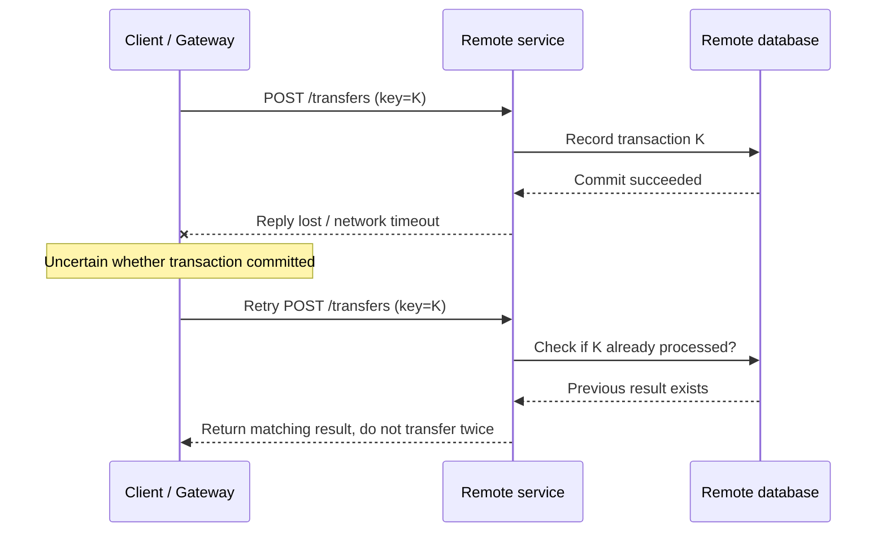
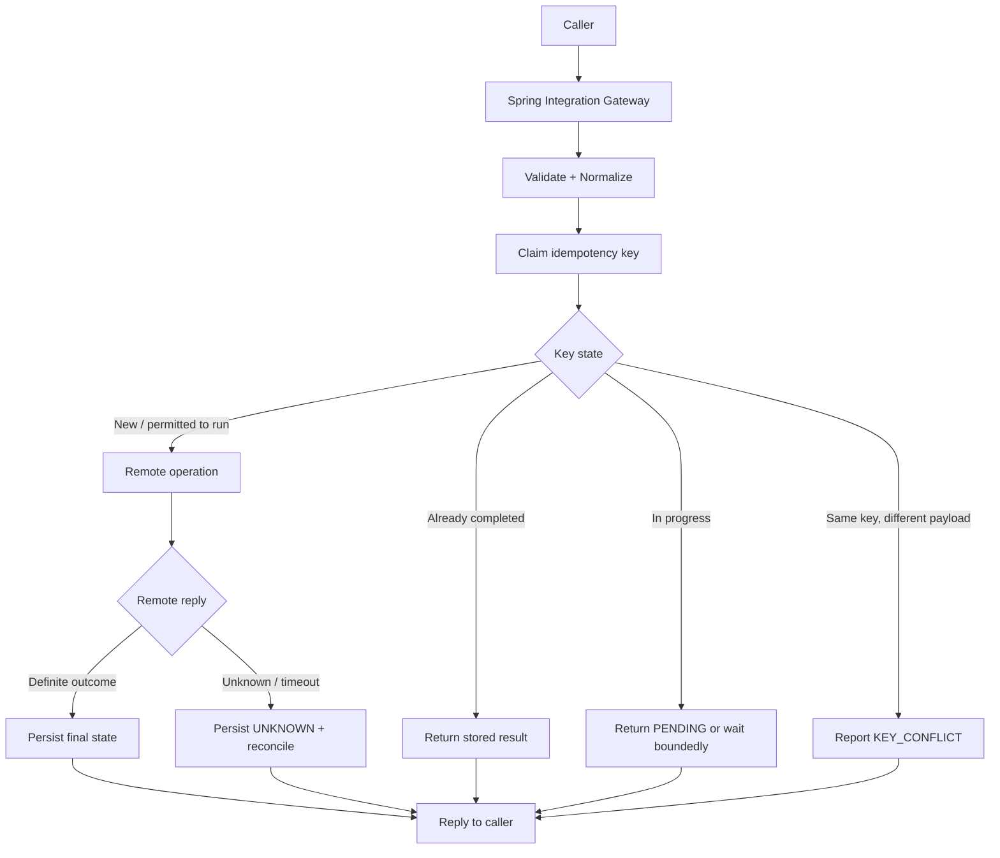
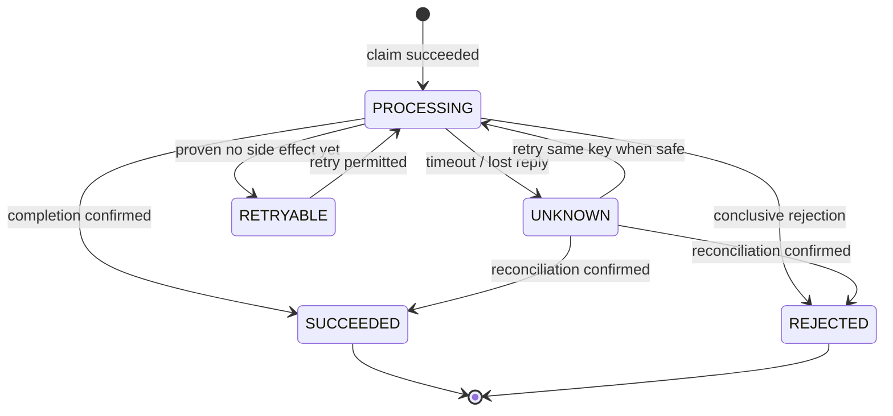

# Idempotency of Remote Operations in Spring Integration

## 1. Why Do Remote Calls Need Idempotency?

In the **Remote procedure invocation** chapter of the **SPRING_INTEGRATION_PATTERN** module, applications use Spring Integration to build message flows based on **Enterprise Integration Patterns** (EIP). A component may call an HTTP API, payment system, inventory service, or RPC endpoint through a Gateway and integration endpoints; Router, Filter, Transformer, retry, error channel, and correlation coordinate the branches.

The biggest problem when invoking a remote operation is not just sending a request successfully, but **knowing what happened when no reply is received**.

For example:

1. The application sends `transfer(500_000 VND)` to a money transfer service.
2. The service receives the request, records the transaction, and executes the transfer.
3. The connection drops right before the response is sent back.
4. The application sees a timeout and resends the request.
5. If the service does not prevent duplicate processing, the same transfer intent can create **two real transactions**.

Idempotency solves this problem with one principle: **repeating the same operation with the same business identity does not produce additional unintended effects**.

The concept of idempotency can be expressed as:

```text
f(f(x)) = f(x)       (in terms of observable business state/effects)
```

For example, setting an order's status to `CANCELLED` multiple times can be idempotent if every call leaves the order in the same state with no extra side effects. Conversely, `debit(account, 500_000)` executed twice would deduct money twice, so an idempotency key or deduplication mechanism is needed where the debit executes.

> **Guarantee scope:** Idempotency is a property of **business effects**; it does not mean every call must return the exact same HTTP status, timestamp, or response bytes. Some APIs provide response caching by idempotency key, which is a specific contract choice.

After this lesson, you will know how to:

- Identify a **logical operation** and pick an idempotency key that stays stable across retries.
- Distinguish idempotency, retry, deduplication, correlation, and exactly-once effect.
- Design an RPC/request–reply flow that tracks state, prevents concurrent races, and reconciles outcomes.
- Apply Spring Integration's Gateway, Service Activator, retry, and error channel while preserving correctness.
- Test timeouts, lost replies, duplicates, crashes, and key conflicts.

## 2. Remote Calls, Retries, and Outcome Blind Spots

A remote call can terminate in multiple ways. The caller only sees what is observable from its side; that is not always enough to infer state on the remote side.



To visualize the differences, consider possible observations:

| Caller Observes | Known for Sure | **Uncertain** |
| --- | --- | --- |
| Verified success reply | Remote confirmed operation per contract | Side effects outside contract |
| Explicit business rejection reply | Remote rejected per contract | Should not guess if contract is vague |
| Connection refused before connection established | Connection at that address failed | Whether an intermediary accepted the command |
| Read timeout after sending request | No timely reply received | Remote may still be running or already committed |
| HTTP 5xx | Remote/gateway reported an error | Whether any side effect happened before the error |
| Caller crashes after sending | Caller process stopped | Whether remote received, processed, or replied |

**No reply does not mean the command was not executed.** In particular, RPCs performing writes over HTTP/gRPC/queues need a reconciliation strategy when the outcome is unknown.

### Idempotency Is Not Retry

- **Retry**: mechanism to resend/re-execute an operation after an error.
- **Idempotency**: property guaranteeing that repeating the same intent causes no additional effects.
- **Deduplication**: detecting duplicate submissions (usually via a persisted key).
- **Correlation**: linking requests, replies, logs, and events via a correlation identifier.
- **Exactly-once business effect**: the business goal of creating an effect only once. Distributed systems typically achieve this through repeatable processing combined with persisted state, unique constraints, and idempotency at the side-effect boundary, rather than relying solely on message delivery protocols.

Retries can increase call counts; idempotency ensures multiple calls still represent one business intent. Without idempotency, retries can make things worse.

## 3. Identifying a Business Operation Properly

### 3.1. Choosing an Idempotency Key

A good key must satisfy these requirements:

1. **Unique for one business intent** within the defined scope.
2. **Preserved** when retrying the same intent, even across caller restarts.
3. **Changed** when the user genuinely initiates a new intent.
4. **Independent** of connection, thread, regenerated message IDs, or retry attempt numbers.
5. **Retained long enough** to catch any duplicates that may still arrive.

For example, the client generates a key like `trf-01JABC...` when the user confirms a transfer. On network failure, subsequent retries keep using the same key. If the user deliberately creates a second transfer for the same amount, a different key must be used.

Never use amount + account as the unique key: a user can legitimately transfer the same amount twice. Similarly, generating a **new** UUID on each retry defeats deduplication.

### 3.2. Key Scope and Payload Fingerprint

The same key string may be used by multiple tenants or clients. Therefore, storage should enforce a unique constraint on **`(tenant_id, idempotency_key)`** or an equivalent contract scope.

Alongside the key, store a **fingerprint of the normalized payload**. If the same key is reused with different data, return a conflict error instead of processing a new request or returning an unrelated cached result.

Example:

| Tenant | Key | Normalized Payload | Decision |
| --- | --- | --- | --- |
| `team-A` | `K-101` | Transfer 500,000 VND from A to B | First time: accept |
| `team-A` | `K-101` | Same payload as above | Duplicate: return stored status/result |
| `team-A` | `K-101` | Transfer 700,000 VND from A to B | **Conflict**: same key, different intent |
| `team-B` | `K-101` | Tenant B's own request | Independent if scope includes tenant |

The fingerprint can be a SHA-256 over a canonical representation of meaningful business fields. You must standardize decimal normalization, field ordering, currency units, timezones, and formatting; otherwise two semantically identical payloads can yield different fingerprints. Do not include tokens, trace IDs, or request timestamps in the fingerprint if they change on each retry.

### 3.3. Distinguishing Three Common Identifiers

| Field | Purpose | Changes on Retry? |
| --- | --- | --- |
| `idempotencyKey` | Identifies the business intent to deduplicate | **No** |
| `correlationId` | Links request/reply flows and processing steps | Depends on contract; should keep business key linked |
| `traceId` / `spanId` | Observes an execution path and its branches | May differ per call |

In Spring Integration, the `replyChannel` header can be a temporary internal channel, especially at a messaging gateway; do not use that channel object as a business identity over the network. Transmit business keys in serializable headers/fields compatible with the remote protocol.

## 4. An Idempotent RPC Flow

A common design places an orchestration layer on the caller side and an **idempotency ledger** on the remote side or the system owning the side effect.



**The most critical place is where the side effect occurs.** Caller-side deduplication prevents two threads in the same application instance from calling remote simultaneously, but cannot by itself guarantee safety across multiple instances, restarts, lost responses, or other clients calling the remote directly. To guarantee a remote effect happens once, the remote service needs an idempotency contract—or another mechanism to query/recover outcomes and prevent duplicates **at the data-writing system**.

Multiple layers can be applied:

- **Caller**: preserve the key, persist intent, control retries and deadlines, and avoid creating a new command when the outcome is uncertain.
- **Integration flow**: carry the key through Router/Transformer/Handler, log with correlation, apply timeouts/error channels, and orchestrate state.
- **Remote service**: perform atomic deduplication before writing side effects, store final results, and return valid responses for duplicates.
- **Storage/outbox**: persist progress durably for crash recovery; use transactional outbox if events must be published after committing data.

Never treat a message header or an in-memory cache as a substitute for durable idempotency when requests must survive restarts and multiple instances.

## 5. State Machine for an Operation

A useful ledger record can use the following states:

| State | Meaning | Action on Receiving Same Key Again |
| --- | --- | --- |
| `PROCESSING` | A worker claimed it; outcome not yet finalized | Do not start concurrently; return `PENDING` or wait boundedly |
| `SUCCEEDED` | Side effect completed and result stored | Return stored result |
| `REJECTED` | Remote rejected conclusively per contract | Return the same rejection decision |
| `UNKNOWN` | Request may have reached remote, outcome undetermined | Query/reconcile; avoid unsafe blind replay |
| `RETRYABLE` | Evidence shows it is safe to retry | Perform bounded retry with same key |

`PROCESSING` must not automatically become `FAILED` merely because processing took too long. `UNKNOWN` reflects **the caller's knowledge**, not necessarily the remote business state.

An illustrative state transition diagram:



If retrying from `UNKNOWN`, prefer a remote endpoint supporting **idempotency keys** or status lookup by request ID; a fresh POST with a new key can cause duplicates. The state table should also record confirmation source, timestamps, remote reference, and attempt count.

## 6. Example with Spring Integration Gateway and Service Activator

Let's build a money transfer call through Spring Integration. The example uses Java 17+, Spring Framework 6.1+ (for `RestClient`), and Spring Integration. The flow: Gateway receives the request, Service Activator coordinates the ledger, then calls a remote API supporting the `Idempotency-Key` header.

The snippets show responsibility boundaries. `OperationLedger` is the **state store contract** that must be backed by transactions/unique constraints; never use a `HashMap` as a production ledger.

### 6.1. Defining Request/Reply

```java
import java.math.BigDecimal;

public record TransferCommand(
    String tenantId,
    String requestId,
    String sourceAccount,
    String targetAccount,
    BigDecimal amount,
    String currency
) {}

public record TransferReply(
    String requestId,
    String state,
    String remoteOperationId,
    String code
) {}

public record RemoteTransferResponse(
    String operationId,
    String state
) {}
```

In this example, `requestId` serves as the idempotency key for **one intentional money transfer**. `tenantId` scopes the key. `state` in the reply can be `SUCCEEDED`, `REJECTED`, `PENDING`, or `UNKNOWN`.

### 6.2. Gateway and Request Channel

```java
import org.springframework.context.annotation.Bean;
import org.springframework.context.annotation.Configuration;
import org.springframework.integration.annotation.IntegrationComponentScan;
import org.springframework.integration.channel.DirectChannel;
import org.springframework.integration.config.EnableIntegration;
import org.springframework.messaging.MessageChannel;

@Configuration
@EnableIntegration
@IntegrationComponentScan
public class TransferIntegrationConfiguration {

    @Bean("transferRequests")
    public MessageChannel transferRequests() {
        return new DirectChannel();
    }
}
```

```java
import org.springframework.integration.annotation.MessagingGateway;

@MessagingGateway(defaultRequestChannel = "transferRequests")
public interface TransferGateway {
    TransferReply transfer(TransferCommand command);
}
```

This is a Java API for callers, not an RPC network protocol. Calling the remote API happens inside a flow handler. `DirectChannel` simplifies the illustration, though a synchronous HTTP handler can block the caller's thread. You must configure **connect timeout, read/response timeout, and business deadline** on the HTTP client/downstream; setting only `replyTimeout` on the messaging gateway does not guarantee aborting a synchronous call running inside `DirectChannel`.

### 6.3. Ledger Contract with Atomic Claim

```java
public enum ClaimKind {
    ACQUIRED,       // This worker won the right to process a new key.
    COMPLETED,      // A final result is already stored.
    IN_PROGRESS,    // Another worker is currently processing.
    UNKNOWN,        // Remote outcome could not be determined yet.
    KEY_CONFLICT    // Same key but different fingerprint.
}

public record Claim(
    ClaimKind kind,
    TransferReply previousReply
) {}

public interface OperationLedger {
    Claim claim(
        String tenantId,
        String idempotencyKey,
        String payloadFingerprint
    );

    void complete(
        String tenantId,
        String idempotencyKey,
        TransferReply reply
    );

    void markUnknown(
        String tenantId,
        String idempotencyKey,
        String reasonCode
    );
}
```

The `claim` contract must be **atomic**: two threads or two instances cannot both receive `ACQUIRED` for the same in-flight key. When `COMPLETED`, `previousReply` holds the saved response. `IN_PROGRESS` and `UNKNOWN` do not grant permission to run a fresh remote call.

Inside the ledger, use transactions, unique constraints/locks, and an appropriate lease/recovery policy. Only compare keys after verifying the tenant; avoid reading or returning another user's results.

### 6.4. Remote Client Passing the Idempotency Key

```java
import org.springframework.stereotype.Component;
import org.springframework.web.client.RestClient;

@Component
public class TransferRemoteClient {
    private final RestClient restClient;

    public TransferRemoteClient(RestClient.Builder builder) {
        this.restClient = builder
            .baseUrl("https://payments.example.invalid")
            .build();
    }

    public RemoteTransferResponse send(
            TransferCommand command,
            String idempotencyKey) {

        return restClient.post()
            .uri("/transfers")
            .header("Idempotency-Key", idempotencyKey)
            // Auth and tenant headers configured per real contract.
            .body(command)
            .retrieve()
            .body(RemoteTransferResponse.class);
    }
}
```

`https://payments.example.invalid` is only a placeholder address, **not a real API**. The remote API must publish a contract regarding `Idempotency-Key`, handling same-key/different-payload, key retention window, and status lookup.

The sample deliberately does not assume every HTTP 2xx definitely means `SUCCEEDED`: the remote side might return `ACCEPTED`/`PENDING` and process later. The handler must interpret `response.state()` per contract and confirm success only with clear evidence.

### 6.5. Service Activator Orchestrating Claim, Dispatch, and Recording Result

```java
import org.springframework.integration.annotation.ServiceActivator;
import org.springframework.stereotype.Component;
import org.springframework.web.client.ResourceAccessException;
import org.springframework.web.client.HttpServerErrorException;

@Component
public class TransferHandler {
    private final OperationLedger ledger;
    private final TransferRemoteClient remoteClient;
    private final PayloadFingerprint fingerprint;

    public TransferHandler(
            OperationLedger ledger,
            TransferRemoteClient remoteClient,
            PayloadFingerprint fingerprint) {
        this.ledger = ledger;
        this.remoteClient = remoteClient;
        this.fingerprint = fingerprint;
    }

    @ServiceActivator(inputChannel = "transferRequests")
    public TransferReply handle(TransferCommand command) {
        validate(command);

        String key = command.requestId();
        String hash = fingerprint.of(command);
        Claim claim = ledger.claim(command.tenantId(), key, hash);

        switch (claim.kind()) {
            case KEY_CONFLICT:
                return new TransferReply(
                    key, "REJECTED", null, "IDEMPOTENCY_KEY_CONFLICT");
            case COMPLETED:
                return claim.previousReply();
            case IN_PROGRESS:
                return new TransferReply(
                    key, "PENDING", null, "ALREADY_PROCESSING");
            case UNKNOWN:
                return new TransferReply(
                    key, "UNKNOWN", null, "RECONCILIATION_REQUIRED");
            case ACQUIRED:
                break; // Only the claimed branch may invoke remote.
        }

        try {
            RemoteTransferResponse remote = remoteClient.send(command, key);
            if (remote == null) {
                ledger.markUnknown(command.tenantId(), key, "EMPTY_RESPONSE");
                return new TransferReply(
                    key, "UNKNOWN", null, "EMPTY_REMOTE_RESPONSE");
            }

            // Illustrative contract: only SUCCEEDED/REJECTED are terminal.
            if ("SUCCEEDED".equals(remote.state())
                    || "REJECTED".equals(remote.state())) {
                TransferReply finalReply = new TransferReply(
                    key, remote.state(), remote.operationId(), "REMOTE_FINAL");
                ledger.complete(command.tenantId(), key, finalReply);
                return finalReply;
            }

            ledger.markUnknown(command.tenantId(), key, "NOT_FINAL_YET");
            return new TransferReply(
                key, "PENDING", remote.operationId(), "REMOTE_PENDING");

        } catch (ResourceAccessException
                 | HttpServerErrorException uncertain) {
            // Network/read timeout/5xx: remote may have already processed.
            ledger.markUnknown(command.tenantId(), key, "REMOTE_UNCERTAIN");
            return new TransferReply(
                key, "UNKNOWN", null, "RECONCILIATION_REQUIRED");
        }
    }

    private static void validate(TransferCommand command) {
        if (command.requestId() == null || command.requestId().isBlank()
                || command.tenantId() == null || command.tenantId().isBlank()
                || command.amount() == null
                || command.amount().signum() <= 0) {
            throw new IllegalArgumentException("Invalid transfer command");
        }
    }
}
```

`PayloadFingerprint` is a dependency performing canonicalization and hashing; to illustrate the functional boundary, we can declare the interface:

```java
public interface PayloadFingerprint {
    String of(TransferCommand command);
}
```

**Notes when applying:**

- This sample is an **integration skeleton**, not a standalone runnable program: you must implement `OperationLedger`, `PayloadFingerprint`, the remote API, tenant verification, HTTP client timeouts, and error-handling policies for your real system.
- `ResourceAccessException`/`HttpServerErrorException` are treated as uncertain outcomes. HTTP 4xx does not automatically mean a business rejection; only map to `REJECTED` if the remote contract guarantees the request was refused without side effects.
- A crash can occur after the remote returns `SUCCEEDED` but **before** the ledger saves `complete`. The next run will see an uncertain state and must query the remote with the same key or `remoteOperationId`. Never mark success merely because a prior call "probably" ran.
- If the remote truly supports idempotency keys, retrying with the same key can be safe within the provider's guaranteed scope and retention window. If not supported, reconcile before calling again.
- Do not place a long-running HTTP call **inside a ledger transaction holding locks**; claim and commit state before the network call, then update the result in a separate short transaction.
- If the remote response is asynchronous, return `PENDING` and build a callback/event/status query mechanism correlated by the same key; do not leave the gateway blocking indefinitely.

## 7. Implementing the Ledger in a Database

An example PostgreSQL schema storing records per tenant and key:

```sql
CREATE TABLE remote_operations (
    id BIGSERIAL PRIMARY KEY,
    tenant_id VARCHAR(80) NOT NULL,
    idempotency_key VARCHAR(160) NOT NULL,
    payload_fingerprint CHAR(64) NOT NULL,
    state VARCHAR(20) NOT NULL
        CHECK (state IN (
            'PROCESSING', 'SUCCEEDED', 'REJECTED',
            'UNKNOWN', 'RETRYABLE'
        )),
    remote_operation_id VARCHAR(160),
    response_json JSONB,
    lease_until TIMESTAMPTZ,
    created_at TIMESTAMPTZ NOT NULL DEFAULT now(),
    updated_at TIMESTAMPTZ NOT NULL DEFAULT now(),
    CONSTRAINT uq_remote_operation_tenant_key
        UNIQUE (tenant_id, idempotency_key)
);
```

**Atomic claim** is the first line of defense before calling remote:

```sql
INSERT INTO remote_operations (
    tenant_id,
    idempotency_key,
    payload_fingerprint,
    state,
    lease_until
)
VALUES (
    :tenant_id,
    :key,
    :fingerprint,
    'PROCESSING',
    now() + interval '30 seconds'
)
ON CONFLICT (tenant_id, idempotency_key)
DO NOTHING
RETURNING id;
```

If `INSERT ... RETURNING` creates a row, the caller claimed the new key. If no row is returned, the application must **read the existing record** and inspect its fingerprint and state:

- **Different fingerprint**: return `KEY_CONFLICT`, do not call remote.
- **`SUCCEEDED`/`REJECTED`**: return the stored final result.
- **`PROCESSING`**: return `PENDING` or wait briefly per policy; do not trigger another remote call.
- **`UNKNOWN`**: route to the reconciliation flow.

Every state transition must be protected by a transaction, appropriate update predicates, and owner/lease checks where needed, so two workers cannot overwrite each other's outcomes. For example, the following update can be part of a real implementation, assuming the worker has proven claim ownership:

```sql
UPDATE remote_operations
SET state = 'SUCCEEDED',
    remote_operation_id = :remote_operation_id,
    response_json = CAST(:response_json AS jsonb),
    updated_at = now()
WHERE tenant_id = :tenant_id
  AND idempotency_key = :key
  AND state IN ('PROCESSING', 'UNKNOWN');
```

Always check the **updated row count**. The query only illustrates a state transition; in multi-worker designs, also store a claim owner/fencing token or version constraint to prevent a stale worker from updating after the lease was reassigned.

### 7.1. Why Not Hold a DB Lock During the HTTP Call?

If you open a transaction, run `SELECT ... FOR UPDATE`, and hold the lock for seconds waiting on remote, other requests with the same key block; the database bears extra pressure, and transactions can time out or deadlock.

In practice, split into short phases:

1. Transaction A: normalize + atomic claim + commit.
2. Outside transaction: call remote with the claimed idempotency key.
3. Transaction B: persist conclusive outcome or unknown status.
4. Reconciliation flow: update late outcomes after obtaining proof from remote.

At step 2, a crash can leave a record stuck in `PROCESSING` with no result. That is why leases, deadlines, and recovery mechanisms are required.

### 7.2. Can You Retry Immediately When a Lease Expires?

**Not by default.** An expired lease only indicates the previous owning worker is no longer trusted to be running; it does not prove the remote side did not execute.

When a lease expires:

- Check remote status via `idempotencyKey`/`remoteOperationId` if the API exposes a lookup endpoint.
- If the provider guarantees deduplication by key and is still within key retention, you can perform a controlled retry using **that same key**.
- If the provider lacks idempotency or lookup APIs, mark `UNKNOWN` and hand off to manual reconciliation or a domain-specific workflow.
- If an old worker might "come back to life," use fencing tokens, versions, or compare-and-set so it cannot overwrite a reassigned record.

A 30-second lease is not a "30-second business validity threshold"; do not delete keys after 30 seconds if callers might still retry over several hours.

### 7.3. TTL and Key Lifecycle

TTL must exceed the window during which duplicates can appear: timeouts, retry backoffs, queues, offline devices, recovery jobs, and broker redelivery windows. The remote provider may also retain keys for only a short window. Once the provider's window expires, resending the same key **is no longer guaranteed safe**; switch to lookup or investigation workflows.

If storing results forever is too costly, separate audit data from idempotency keys and retain final states for a duration matching business requirements. Never delete keys while requests could still be redelivered.

## 8. Crash Scenarios: Why Is "Exactly Once" Hard?

Consider four failure points:

| Crash Point | Possible Local State Observed | Recovery Solution |
| --- | --- | --- |
| Before claim | No record yet | Safe to claim and execute |
| After claim, before remote send | Stuck `PROCESSING` | Check state and lease; retry if proven safe |
| After remote commit, before local result save | `PROCESSING`/`UNKNOWN` | Query by key, or retry same key if provider guarantees idempotency |
| After local `SUCCEEDED` save, before sending reply | Final result stored | Caller retries same key and gets cached result |

The goal is **not creating duplicate business effects during recovery**. Locking on the caller side alone cannot guarantee that when remote and local DBs commit independently.

### 8.1. Does a Transactional Outbox Help?

An outbox guarantees events/commands are recorded in the same transaction as local data, and a publisher dispatches them externally. It closes the message-loss gap between local commit and publish, yet the publisher can still resend duplicates if an ACK is lost.

Hence, **outbox + idempotent consumer/inbox** is the classic pairing: the receiver records the message/operation ID via a unique constraint before or within the same transaction as the side effect. If the remote is a third-party HTTP API lacking idempotency keys or status queries, an outbox alone cannot guarantee an exactly-once side effect.

### 8.2. Can We Use "Inherently Idempotent Operations"?

Yes. Some operations are designed to be naturally idempotent:

```text
PUT /accounts/123/preferences
{"emailNotifications": true}
```

Resending the same value does not alter the desired state after the first call. Still, secondary side effects such as sending an email on every update must be controlled. Protocol-level idempotent HTTP method semantics do not prove an implementation makes all side effects idempotent.

Conversely, commands like `POST /transfers` or `incrementBalance(500000)` require an explicit idempotency contract to retry safely.

## 9. Retry, Timeout, Error Channel, and Correlation in Spring Integration

### 9.1. Retries Must Respect Idempotency

With `RequestHandlerRetryAdvice` or HTTP client retries, a handler invocation may re-execute. Before enabling:

- Specify which error kinds **are permitted to retry**.
- Preserve the exact idempotency key and payload on every attempt.
- Bound `maxAttempts`, backoff, jitter, and total duration.
- Detect uncertain outcomes; avoid retrying "all exceptions."
- Verify the remote applies keys across **the same endpoint and operation type**.

An illustrative policy:

| Result | Retry Immediately? | Reason |
| --- | --- | --- |
| Definite validation error | No | Payload must be fixed |
| `KEY_CONFLICT` | No | Same key already used for another intent |
| Connect failure before sending request, with clear evidence | Possibly | No side effect if truly not sent |
| Read timeout after sending | **Only if remote dedupes by key** or after reconciliation | State unknown |
| HTTP 5xx | Do not retry blindly | May have committed before returning error |
| `IN_PROGRESS` | Wait/poll per policy | Another worker already holds claim |
| `SUCCEEDED` in ledger | Do not call remote | Return stored result |

### 9.2. Two Types of Timeouts

Spring Integration Gateway's `requestTimeout` and `replyTimeout` govern sending the request to the channel and waiting for a reply within the gateway context, respectively. HTTP client timeouts, transactions, databases, RPC deadlines, and business deadlines must be configured separately.

If a handler in a `DirectChannel` makes an HTTP call and blocks for 10 seconds, `replyTimeout` does not necessarily cut the call after one second. With an `ExecutorChannel`, the gateway may time out while the worker keeps processing. In both cases, **caller timeout does not automatically cancel remote effects**.

### 9.3. Error Channels Classify Errors, Not Create Idempotency

Spring Integration can send an `ErrorMessage` to an error channel when errors arise at supported boundaries. Error flows are useful for logging, grouping failures, alerting, or building fallback replies.

However:

- An error channel does not prove a side effect did not occur.
- Worker-thread errors do not automatically return to the caller.
- Error replies must carry `requestId` and classify status as `UNKNOWN` when inconclusive.
- Retrying an exception multiple times does not create a once-only execution guarantee.

If an error flow turns every network exception into `FAILED` and the caller submits a new request, duplicates can still happen. Design error mapping around evidence of operation state.

### 9.4. Router, Filter, Transformer, Aggregator, and Correlation Identifiers

In a long EIP flow, keys pass through several stages:

```text
Gateway
  -> Filter (validate key, payload)
  -> Transformer (canonicalize command + fingerprint)
  -> Router (select remote provider)
  -> Service Activator / HTTP outbound call
  -> Reply Transformer
  -> Gateway reply
```

Recommendations:

- **Filter**: require valid keys; a request dropped by a filter without producing a reply can leave the gateway waiting until timeout. Design explicit rejection replies where needed.
- **Transformer**: preserve keys when transforming payloads/headers. If canonicalization is required, apply the exact same rules on every retry.
- **Router**: keys may need scoping by `providerId`/operation type; sending one key to two different providers may not prevent two effects.
- **Splitter/Aggregator**: each branch may need a stable child key like `operationKey + stepName`; the aggregator uses correlation to assemble results, but group correlation does not replace idempotency at the remote side effect.
- **Gateway**: uphold the `SUCCEEDED`/`REJECTED`/`PENDING`/`UNKNOWN` reply contract; do not interpret `null` or timeout as `FAILED`.

Keys can travel in message metadata and payloads. Crossing a broker or RPC boundary, choose protocol-serializable representations (e.g., HTTP headers, JSON fields, gRPC metadata), never Java channel objects directly.

## 10. Observability and Security

A well-designed idempotent system can explain why multiple calls created only one effect. Log/measure:

- `tenantId`, `idempotencyKey`, `requestId`, `correlationId`, endpoint, operation type.
- `attemptNumber` and retry reason.
- Atomic claim outcome: `ACQUIRED`, `COMPLETED`, `IN_PROGRESS`, `KEY_CONFLICT`.
- Ledger state before/after, claim timestamp, deadline, lease, and time spent in `UNKNOWN`.
- Remote operation ID, status code, call latency, and reconciliation outcome.
- Blocked duplicates, unknown-outcome requests, timeouts, p95/p99 latency, and key conflicts.

Example timeline:

```text
10:00:00.000 key=K-77 tenant=A attempt=1 CLAIMED
10:00:00.120 key=K-77 tenant=A attempt=1 REMOTE_SENT
10:00:01.120 key=K-77 tenant=A attempt=1 READ_TIMEOUT
10:00:01.130 key=K-77 tenant=A state=UNKNOWN
10:00:02.000 key=K-77 tenant=A attempt=2 DUPLICATE_UNKNOWN
10:00:03.200 key=K-77 tenant=A REMOTE_STATUS=SUCCEEDED
10:00:03.220 key=K-77 tenant=A state=SUCCEEDED remoteId=R-901
```

This is an illustrative timeline. The second request **does not send a new transfer command** without a safety basis; it queries/waits for reconciliation. Never log passwords, tokens, sensitive account numbers, or unfiltered raw payloads. Enforce authorization when returning cached results by key; never let another tenant guess a key and read transaction data.

## 11. Testing Difficult Scenarios

Idempotency needs more than testing "calling a second time returns the same value." Verify **actual side-effect counts**.

| Scenario | Setup | Expectation |
| --- | --- | --- |
| First call with new key | Key absent in ledger | One `ACQUIRED` claim, one remote call |
| Duplicate after completion | Ledger holds `SUCCEEDED` | Returns cached reply, **0 extra remote calls** |
| Two concurrent requests, same key | Two threads/instances claim | Only one request gets `ACQUIRED` |
| Same key, different payload | Different fingerprint | `KEY_CONFLICT`, remote not called |
| Read timeout after remote commit | Simulate dropped reply | `UNKNOWN` state then reconcile; no new side effect |
| Crash after remote commit, before local save | Restart worker | Lookup/retry same key when safe; only one effect |
| Crash after saving result, before reply | Caller retries | Returns stored result |
| Lease expires while old worker still alive | New worker starts recovery | Never allow two workers to duplicate side effects |
| Provider TTL expired | Very late retry | Do not rely on old key to claim safety |
| Explicit remote business rejection | `REJECTED` reply per contract | Save terminal state, no pointless retries |
| Error channel handling failure | Handler/adapter throws exception | Response does not convert uncertain errors to `FAILED` |
| Splitter creates multiple branches | Branch A succeeds, B times out | Stable per-branch keys, do not repeat A when retrying B |

### Illustrative Test for Duplicate After Completion

With JUnit 5 and Mockito, we can test the behavior of `TransferHandler` declared above. The test stubs the ledger and fingerprint, then proves a duplicate does not touch remote.

```java
import static org.junit.jupiter.api.Assertions.assertEquals;
import static org.mockito.Mockito.*;

import java.math.BigDecimal;
import org.junit.jupiter.api.Test;

class TransferHandlerTest {

    @Test
    void completedKeyReturnsCachedResultWithoutRemoteCall() {
        OperationLedger ledger = mock(OperationLedger.class);
        TransferRemoteClient client = mock(TransferRemoteClient.class);
        PayloadFingerprint fingerprint = mock(PayloadFingerprint.class);

        TransferCommand command = new TransferCommand(
            "tenant-A", "K-123",
            "A", "B", new BigDecimal("500000"), "VND"
        );
        TransferReply cached = new TransferReply(
            "K-123", "SUCCEEDED", "R-900", "REMOTE_FINAL"
        );

        when(fingerprint.of(command)).thenReturn("stable-fingerprint");
        when(ledger.claim("tenant-A", "K-123", "stable-fingerprint"))
            .thenReturn(new Claim(ClaimKind.COMPLETED, cached));

        TransferHandler handler =
            new TransferHandler(ledger, client, fingerprint);

        TransferReply actual = handler.handle(command);

        assertEquals(cached, actual);
        verifyNoInteractions(client);
    }
}
```

This test checks orchestration once the ledger already has a result. To confirm **multi-instance idempotency**, also write integration tests against a real database (unique constraints, concurrent transactions) and simulate crashes/restarts with a remote API supporting idempotency or reconciliation. Mockito does not prove storage atomicity.

### Extended Practice Scenarios

1. Create the `remote_operations` table and implement `claim` with `INSERT ... ON CONFLICT DO NOTHING`.
2. Run 20 concurrent threads sending key `K-123` and count remote calls; expected outcome is one call for the in-flight operation.
3. Change the payload of a request reusing the same key; verify the system returns `KEY_CONFLICT`.
4. Simulate remote success with client losing the reply; move ledger to `UNKNOWN` and add a lookup API.
5. Induce a crash between remote commit and local `complete`. After restart, verify no duplicate transfer occurs.
6. Test retrying after the provider's key TTL expires; design a flow rejecting automatic retries or routing to out-of-band reconciliation.

## 12. Common Pitfalls

**Generating a new UUID on every retry.** The system cannot recognize the same business intent. Keys must survive retries and restarts.

**Deduplicating with an in-instance `ConcurrentHashMap`.** Local memory does not protect across instances, vanishes on restart, and does not solve crashes after remote commit.

**Checking the key without comparing fingerprints.** Two requests with different contents sharing a key may be erroneously accepted or return a result belonging to a different request.

**Deleting keys after a short timeout.** An old request can still arrive after key deletion, creating a second side effect.

**Believing remote HTTP 5xx always means no side effect.** The server can commit before throwing an error. Respect the contract or query status.

**Retrying on lease expiration without reconciliation.** The old worker may have already sent the command; lease expiry is a recovery signal, not proof remote never ran.

**Assuming Spring Integration retry/errorChannel gives exactly-once.** They aid transport and error handling, whereas idempotency must be enforced at the side-effect boundary and durable state store.

**Ignoring tenant scope.** Unscoped global keys can cause cross-customer conflicts or leak another tenant's results.

**Returning `FAILED` when the real outcome is undetermined.** This encourages callers to issue fresh commands and create duplicates. Keep an `UNKNOWN`/`PENDING` state that can be reconciled.

## 13. Self-Assessment Questions

1. Why is retrying a money transfer after a read timeout riskier than retrying a read-only query?
2. If the same key arrives with a different payload, why can returning the old cached result also be a bug?
3. If the local database recorded `PROCESSING` and the application died before calling remote, how should recovery decide?
4. If remote committed but the local ledger has not written `SUCCEEDED`, what mechanism allows recovery without executing the transaction twice?
5. When using Splitter/Aggregator, how do you choose idempotency keys for the overall request and for each branch?
6. How do `replyTimeout`, HTTP timeout, lease expiration, and provider TTL differ?
7. Why is a unique constraint on a local table **insufficient** if the remote side lacks idempotency and status lookup?
8. When can you return `REJECTED`, when must you return `UNKNOWN`, and what evidence authorizes a state transition?

## Key Takeaways

- Idempotency protects **business effects** when the same remote operation is submitted multiple times; retry is only the re-execution mechanism.
- Keys must bind to one intent, have clear scope, remain unchanged across retries, and be checked against a payload fingerprint.
- Durable deduplication requires atomic claims, recoverable states, and concurrency control.
- Remote side effects are only guaranteed non-repeating when the system executing the side effect has proper idempotency/reconciliation; a caller-side ledger alone cannot create guarantees across two independent systems.
- Timeouts, 5xx responses, lost replies, and crashes can produce `UNKNOWN`; reconcile by key before unsafe retries.
- Spring Integration Gateway, Transformer, Router, retry, error channel, and correlation provide orchestration mechanics; idempotency correctness lives in **the business contract and state-persistence boundaries**.
