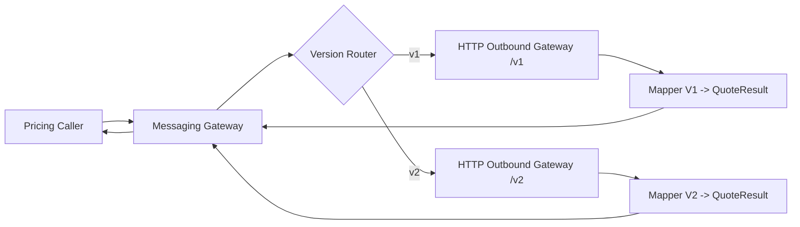
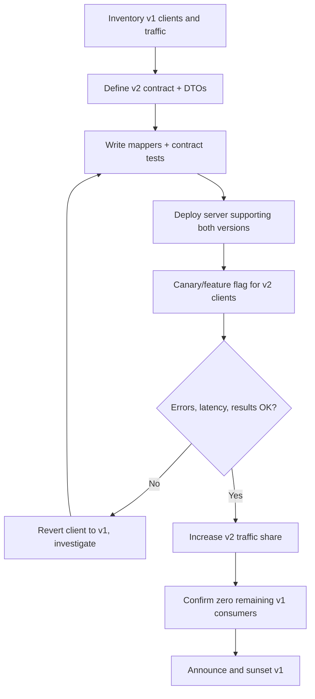

# Remote Endpoint Versioning

In the **Remote procedure invocation** chapter of the **SPRING_INTEGRATION_PATTERN** module, applications often invoke another service over HTTP, TCP, JMS, AMQP, or similar integration protocols. Spring Integration decouples business calling code from remote systems using **Messaging Gateway**, **Message Channel**, **Transformer**, **Router**, and **remote gateways/adapters**. However, this boundary must still handle a reality: **a remote endpoint's contract changes over time**.

**Remote endpoint versioning** is how you define, publish, select, and maintain communication contract versions so clients and servers can upgrade at different times. The goal is to keep routing valid requests, receiving valid replies, and handling errors predictably while v1 and v2 coexist or while an older version is being sunsetted.

After this lesson, you will be able to:

- Distinguish endpoint/API versions, message schema versions, and application library versions.
- Identify backward-compatible vs. breaking contract changes in request-reply.
- Use Gateway, Router, Transformer, and remote adapters to integrate multiple versions.
- Plan a v1-to-v2 migration with testing, observability, rollback, and deprecation timelines.
- Design appropriate timeouts, retries, correlation, error handling, and idempotency while multiple versions run concurrently.

## 1. Why Does Endpoint Versioning Matter for Remote Procedure Invocation?

Suppose a pricing service initially exposes:

```http
POST /v1/quotes
Content-Type: application/json

{"sku":"SKU-10","quantity":2}
```

Reply v1:

```json
{
  "sku": "SKU-10",
  "total": "250000"
}
```

Later, the owning team adds multi-currency support, a quote identifier, and changes `total` to a decimal number:

```http
POST /v2/quotes
Content-Type: application/json

{"sku":"SKU-10","quantity":2}
```

Reply v2:

```json
{
  "quoteId": "Q-2026-001",
  "sku": "SKU-10",
  "totalAmount": 250000.00,
  "currency": "VND"
}
```

If the internal flow currently deserializes v1 into `QuoteV1Response(String sku, String total)`, simply pointing the URL to `/v2/quotes` can cause data loss, conversion failures, or miscalculations. The endpoint still returns HTTP 200, yet **the meaning and structure of the reply changed**.

Versioning lets both systems upgrade independently over a transition window: older apps continue using v1, ready apps switch to v2, and teams know explicitly when v1 may be retired.

## 2. Three Kinds of Versions Not to Confuse

| Version Type | Example | Impact Scope |
| --- | --- | --- |
| **API/endpoint version** | `/v1/quotes`, `/v2/quotes` | Public contract between client and remote service: paths, payloads, error codes, and semantics |
| **Schema/envelope version** | Header `schemaVersion=2`, event `QuoteCreatedV2` | Data representation sent over HTTP/broker; may differ from path version |
| **Library/framework version** | Spring Integration, Jackson, HTTP client versions | Internal Java APIs and conversion mechanics; does not automatically determine the remote API version |

A client on a newer Spring Integration version can still call `/v1/quotes`. Conversely, a client on an older stack can call a v2 API if adapters and data contracts are compatible.

Do not attach `schemaVersion` arbitrarily to every internal message. Explicit versioning is only needed at boundaries where two sides upgrade independently or persisted data must be re-read later.

## 3. Which Changes Break Contracts?

There is no universal rule that "adding a field is always safe": compatibility depends on how clients parse, validate, serialize, and interpret that field.

| Change | Compatibility Likelihood | What to Verify |
| --- | --- | --- |
| Add optional field in reply | Usually compatible if client ignores unknown fields | Does the deserializer reject unknown properties? |
| Add **required** field to request | Usually breaks old clients | Does the server supply defaults or a transition period? |
| Rename `total` to `totalAmount` | Usually breaks v1 clients | Is there an alias or boundary mapper? |
| Change type from `String` to `number` | Risk of breaking | Parse behavior, numeric precision, formatting, nulls |
| Change unit from VND to USD | **Semantically** breaking despite identical JSON | Units, rounding, exchange rates, business conditions |
| Remove field or enum value | Potentially breaking | Do processing branches cover all values? |
| Change error codes, retry behavior | Can break caller decision logic | Which fields do clients inspect to classify errors/retries? |
| Change permissions or authentication | Can break all connectivity | Headers, credentials, policies, certificates |
| Add parallel v2 endpoint | Compatible with v1 if v1 stays unchanged | Coexistence operations, load limits, support window |

A "compatible" change is only confirmed against **real clients and real data**, not merely valid JSON syntax.

## 4. Common Ways to Represent Versions

### 4.1. Version in the URL Path

```text
POST https://pricing.example.test/v1/quotes
POST https://pricing.example.test/v2/quotes
```

Easy to see, easy to configure on HTTP outbound gateways, and straightforward to run concurrently. Downside: URLs change on upgrades; docs, routes, and support windows must stay aligned.

### 4.2. Version via Media Type or Header

```http
POST /quotes
Accept: application/vnd.example.quote.v2+json
Content-Type: application/json
```

The path stays stable, and clients request the v2 representation via HTTP content negotiation. The server must actually understand that media type; the HTTP adapter needs matching header mapper/message converter settings. Custom headers like `X-API-Version: 2` can also work if both sides agree.

**Note:** `Accept` indicates the response format the client accepts; `Content-Type` indicates the format of the request sent. Never swap these headers. Provider-defined version headers are not a universal default feature of all REST APIs.

### 4.3. Version in a Message Broker Envelope

```json
{
  "messageType": "QuoteRequest",
  "schemaVersion": 2,
  "requestId": "c31b623e-0177-4650-a8a1-05ece9acbdce",
  "payload": {
    "sku": "SKU-10",
    "quantity": 2
  }
}
```

JMS/AMQP/Kafka can carry version metadata in headers or serialized envelopes. Consumers inspect the version and pick the matching deserializer and mapper. Versioned topics/queues are also an option when traffic, retention, or access isolation is needed.

Do not assume Spring Integration understands a `schemaVersion` name automatically. It is a **system-defined contract** that must be encoded, mapped, and tested over the real transport.

## 5. Decoupling the Gateway's Business Contract from External DTOs

When calling v1 or v2 APIs, the rest of the application need not depend on two remote DTOs.



Define **stable business DTOs**:

```java
package example.pricing;

import java.math.BigDecimal;

record QuoteQuery(String sku, int quantity) {}

record QuoteResult(
    String sku,
    BigDecimal amount,
    String currency,
    String quoteReference
) {}
```

Define dedicated DTOs per remote contract:

```java
package example.pricing;

import java.math.BigDecimal;

record QuoteV1Response(String sku, String total) {}

record QuoteV2Response(
    String quoteId,
    String sku,
    BigDecimal totalAmount,
    String currency
) {}
```

The two remote DTOs differ, yet both convert into `QuoteResult`. For example:

```java
package example.pricing;

import java.math.BigDecimal;

final class QuoteMapping {

    private QuoteMapping() {}

    static QuoteResult fromV1(QuoteV1Response response) {
        if (response == null || response.sku() == null ||
            response.total() == null) {
            throw new IllegalArgumentException("v1 reply missing required fields");
        }
        return new QuoteResult(
            response.sku(),
            new BigDecimal(response.total()),
            "VND",     // Valid only if the v1 contract specifies VND.
            null       // V1 has no quote reference.
        );
    }

    static QuoteResult fromV2(QuoteV2Response response) {
        if (response == null || response.sku() == null ||
            response.totalAmount() == null || response.currency() == null) {
            throw new IllegalArgumentException("v2 reply missing required fields");
        }
        return new QuoteResult(
            response.sku(),
            response.totalAmount(),
            response.currency(),
            response.quoteId()
        );
    }
}
```

Using `null` for `quoteReference` is only an **illustrative choice when a v2 field did not exist in v1**. A real contract might use `Optional`, a status field, or require migrating all clients to v2 if quote references are mandatory. Never invent default currencies, units, or statuses unless the source service defines them clearly.

Advantage of the mapping layer: business code works with **one consistent type**; knowledge of v1/v2 differences stays confined to the adapter boundary.

## 6. Implementation with Messaging Gateway and HTTP Outbound Gateway

The example below illustrates two Java methods for two coexisting remote versions. During migration, we can intentionally invoke v1 or v2 and return the same `QuoteResult` to callers.

### 6.1. Gateway Declaring Explicit Request Channels

```java
package example.pricing;

import org.springframework.integration.annotation.Gateway;
import org.springframework.integration.annotation.MessagingGateway;

@MessagingGateway(defaultReplyTimeout = "5000")
interface QuoteGateway {

    @Gateway(requestChannel = "quote.v1.requests")
    QuoteResult quoteViaV1(QuoteQuery query);

    @Gateway(requestChannel = "quote.v2.requests")
    QuoteResult quoteViaV2(QuoteQuery query);
}
```

In the final deployment, the application can keep a single `quote(...)` method and use a Router or deployment configuration to pick the version. Having two methods here clarifies which version is called and facilitates side-by-side testing.

### 6.2. Two Flows Calling Two HTTP Endpoints

```java
package example.pricing;

import org.springframework.beans.factory.annotation.Value;
import org.springframework.context.annotation.Bean;
import org.springframework.context.annotation.Configuration;
import org.springframework.http.HttpMethod;
import org.springframework.http.MediaType;
import org.springframework.integration.annotation.IntegrationComponentScan;
import org.springframework.integration.config.EnableIntegration;
import org.springframework.integration.dsl.IntegrationFlow;
import org.springframework.integration.http.dsl.Http;
import org.springframework.messaging.MessageHeaders;

@Configuration
@EnableIntegration
@IntegrationComponentScan
class QuoteRemoteFlows {

    @Bean
    IntegrationFlow quoteV1Flow(
        @Value("${pricing.remote.base-url}") String baseUrl
    ) {
        return IntegrationFlow.from("quote.v1.requests")
            .enrichHeaders(headers -> headers.header(
                MessageHeaders.CONTENT_TYPE,
                MediaType.APPLICATION_JSON_VALUE
            ))
            .handle(Http.outboundGateway(baseUrl + "/v1/quotes")
                .httpMethod(HttpMethod.POST)
                .expectedResponseType(QuoteV1Response.class))
            .transform(QuoteV1Response.class, QuoteMapping::fromV1)
            .get();
    }

    @Bean
    IntegrationFlow quoteV2Flow(
        @Value("${pricing.remote.base-url}") String baseUrl
    ) {
        return IntegrationFlow.from("quote.v2.requests")
            .enrichHeaders(headers -> headers.header(
                MessageHeaders.CONTENT_TYPE,
                MediaType.APPLICATION_JSON_VALUE
            ))
            .handle(Http.outboundGateway(baseUrl + "/v2/quotes")
                .httpMethod(HttpMethod.POST)
                .expectedResponseType(QuoteV2Response.class))
            .transform(QuoteV2Response.class, QuoteMapping::fromV2)
            .get();
    }
}
```

Prerequisites to run the example: Spring Integration HTTP dependencies, an HTTP JSON message converter (such as Jackson), Spring context, and the `record`s above; `pricing.remote.base-url` must point to the appropriate service. Actual converter syntax/capabilities must be checked against your Spring Integration and HTTP client versions.

Path for each method:

1. Gateway builds the request message and sends it to the v1 or v2 channel.
2. The HTTP outbound gateway sends the request to the corresponding URL.
3. The JSON response is deserialized into `QuoteV1Response` or `QuoteV2Response`.
4. The Transformer normalizes it into `QuoteResult`.
5. The Gateway receives the reply matching the invocation and returns the uniform `QuoteResult` type.

If the v2 server does not support `POST /v2/quotes`, that is a contract/deployment error; do not automatically try another URL without an explicit fallback policy.

### 6.3. Selecting Version with a Router When Appropriate

When a **single Gateway method** is desired, the application can attach a `targetApiVersion` header via deployment config or an orchestration component, then use a Router to split into `quote.v1.requests` and `quote.v2.requests`. Diagram example:

```text
quote.requests
    |
    v
route by targetApiVersion
    | "1"                 | "2"
    v                     v
quote.v1.requests      quote.v2.requests
    |                     |
 HTTP /v1               HTTP /v2
    |                     |
QuoteV1Response        QuoteV2Response
    |                     |
Mapper V1              Mapper V2
    +------> QuoteResult <-+
                  |
                  v
             Reply Gateway
```

Principle: the version selecting an endpoint must come from a **trusted client/deployment policy**, such as a feature flag, tenant mapping, or rollout configuration. Never let an untrusted client header point arbitrarily to any URL. The Router must handle unsupported versions explicitly; avoid silently falling back to v1 on invalid versions.

If v1 and v2 also differ in request schemas, add a Transformer **before** each outbound gateway to construct that version's exact request DTO. Do not normalize only the reply while ignoring request differences.

## 7. Bidirectional Compatibility

While two versions coexist, evaluate at least two directions:

- **Old Client → New Server:** can the new server still process old requests and return replies old clients understand?
- **New Client → Old Server:** during rollback or against an un-upgraded instance, are the new client's requests compatible with the old server?

Example:

| | v1-only Server | v1 and v2 Server | v2-only Server |
| --- | --- | --- | --- |
| v1-only Client | Valid | Valid if v1 stays intact | Fails without compatibility layer |
| v1 and v2 Client | Selects v1 | Can try v2 per rollout policy | Selects v2 |
| v2-only Client | Fails without compatibility layer | Valid | Valid |

The versioning policy should be documented as a **concrete support matrix**, covering endpoints, request schemas, response schemas, error codes, auth mechanisms, and end-of-support dates. Simply having "a v2 route on the server" does not prove v2 clients work: converters, permissions, or business data may still be missing.

### Schema Changes Do Not Equal Semantic Changes

A mapper can rename `total` to `totalAmount`, yet if v2 also changed discount, tax, or currency calculations, renaming is not enough. Define tests with concrete business assertions to verify `QuoteResult` from v1 and v2 carry identical meaning in the fields the application uses.

## 8. Migrating and Deprecating a Version

Upgrading an endpoint should follow a verifiable sequence of steps:



1. **Inventory:** identify clients, consumers, request volume, error codes, and endpoints calling v1.
2. **Define v2 contract:** specify changed fields, validation, status codes, content types, deadlines, and deprecation policy.
3. **Create mappings and contract tests:** normalize both request and reply, verifying data accuracy.
4. **Deploy server first:** run v1/v2 side-by-side when possible, avoiding simultaneous client lockstep upgrades.
5. **Canary clients:** shift a small slice of traffic by tenant, instance, or feature flag; measure error rates, latency, and business result discrepancies.
6. **Gradual expansion:** raise v2 traffic share once metrics meet agreed thresholds; retain rollback capability during transition.
7. **Retire v1:** remove v1 flows/endpoints only after confirming no clients still require v1 and the deprecation notice window has passed.

During canary, **shadow response comparison** can help for read operations. For write operations like order creation or payment capture, never blindly call v1 and v2 in parallel, as that can produce **two business effects**. If shadow traffic is needed for commands, use a sandbox environment, dry-run mode, or verified idempotency.

Rollback is only safe if v1 still accommodates newly generated data. When v2 introduces states or semantics unrepresentable in v1, prepare a data rollback plan or restrict features during the transition window.

## 9. Timeouts, Retries, and Correlation When Running Multiple Versions

Versioning often appears alongside retries, yet the two responsibilities must stay separate:

**Retry:** re-sending the *same request* on transient failures (timeouts, certain 5xx errors) within limits and backoff.

**Version fallback:** switching to a *different contract* per a defined compatibility policy. This alters integration flow behavior and can affect schemas and semantics. Never treat any 404, 406, or conversion error as an automatic signal to fall back from v2 to v1.

| Scenario | Recommended Handling |
| --- | --- |
| v2 returns 200 matching schema | Map to `QuoteResult`, complete call |
| v2 returns 404 because endpoint not deployed yet | Check rollout/config; only fall back to v1 if policy permits |
| v2 returns 406 / 415 | Check `Accept`/`Content-Type`, media type, and converters |
| v2 returns 400 due to missing required field | Fix request mapping; retrying verbatim usually will not help |
| v2 returns 429 / 503 | Bounded retry if server and business allow; honor `Retry-After` if present |
| Timeout after sending command | Uncertain whether remote processed; requires idempotency or status lookup |
| Replies from v1/v2 differ in type | Map to unified DTO or raise clear version/schema error |
| Reply reaches wrong caller | Check correlation/reply channel; version does not replace correlation keys |

For HTTP request-response, the HTTP call pairs response with request on the client. For JMS/AMQP request-reply, replies may arrive on another queue and require a correlation key per transport contract. In both cases, a stable `requestId` aids logging and attempt reconciliation. If the system is upgrading from v1 to v2 between attempts, never resend a command to a different version unless you are sure the same `requestId` and idempotency semantics are honored by both versions.

A Gateway's `defaultReplyTimeout` does not automatically set timeouts on all underlying HTTP/broker connections. Configure connect/response timeouts, retry deadlines, and reply wait times per layer; monitor tail latency for both v1 and v2 so rollouts do not worsen overload.

## 10. Error Management and Version-Aware Observability

To diagnose issues while multiple versions run, log/measure at least:

| Data | Purpose |
| --- | --- |
| `targetApiVersion` / endpoint version | Distinguish v1 and v2 requests |
| Remote operation name | Pinpoint the affected capability |
| `requestId` and `traceId` (if present) | Link steps across the flow and external systems |
| Request/reply types, schema version | Spot incompatible converters/DTOs |
| HTTP status / transport error | Classify endpoint, auth, and timeout errors |
| Latency, timeouts, retry count | Check responsiveness and retry amplification |
| Fallback rate, active v1 client count | Track migration progress and deprecation readiness |

Example event log with sensitive data redacted:

```text
requestId=REQ-789
operation=quote
targetApiVersion=2
endpoint=POST /v2/quotes
replyType=QuoteV2Response
result=MAPPING_FAILED
durationMs=186
```

Do not log access tokens, customer data, card numbers, or full bodies just to identify versions. When using tracing, configure propagation across HTTP/brokers; Spring Message headers do not automatically travel intact over the network.

When using `errorChannel`, ensure converter errors, remote call errors, and Router errors are never turned into valid business replies. In synchronous flows, exceptions can return to the caller; in async flows, the error path needs a subscriber, correlation, and cleanup for pending state.

## 11. Contract Testing and Multi-Version Deployment

To verify a version change, test **at the real remote boundary**, not only with mapper unit tests.

| Test | Test Data | Expectation |
| --- | --- | --- |
| Gateway v1 | Mock remote returns v1 JSON | `QuoteResult` has exact amount and currency per v1 contract |
| Gateway v2 | Mock remote returns v2 JSON | `QuoteResult` captures amount, currency, `quoteReference` |
| Unknown field | v2 adds an optional field | Converter handles per published policy |
| Required field missing | Missing `currency` or `totalAmount` | Error detected, no fake success returned |
| Invalid number | v1 returns `total: "abc"` | Converter/mapper reports controlled error |
| Endpoint not found | `/v2/quotes` returns 404 | Proper error/fallback policy, no infinite retries |
| Status/error change | v2 returns 400/429/503 | Proper retry classification and error mapping |
| Timeout + retry | Slow response, bounded retries | No hang; deadline and idempotency honored |
| Mixed traffic | Call v1 and v2 concurrently | Same caller contract; no mixed replies |
| Rollback | v2 fails, route back to v1 | Works within limits of data v1 still supports |

Example application-level contract test pseudocode:

```text
Given:
  stub POST /v1/quotes -> 200 {"sku":"SKU-10","total":"250000"}
  stub POST /v2/quotes -> 200
    {"quoteId":"Q-2026-001","sku":"SKU-10",
     "totalAmount":250000.00,"currency":"VND"}
When:
  QuoteResult oldReply = gateway.quoteViaV1(query)
  QuoteResult newReply = gateway.quoteViaV2(query)
Then:
  oldReply.amount == newReply.amount == 250000
  oldReply.currency == newReply.currency == "VND"
  oldReply.quoteReference == null
  newReply.quoteReference == "Q-2026-001"
  each HTTP endpoint receives exactly its expected request
```

The test above assumes v1 business currency is VND and quote reference was added in v2. In real systems, which fields must match depends on confirmed business rules. Use HTTP stubs (WireMock/MockWebServer) or test containers/brokers per protocol to verify real requests, headers, and converters.

On the server side, maintain **consumer-driven contract tests** or shared schema fixtures in release pipelines. For JSON Schema/Avro/Protobuf, compatibility can be checked via registries or tooling if adopted; never assume a serializer automatically protects against semantic changes.

## 12. Common Implementation Mistakes

- **Changing URL to v2 while keeping v1 DTOs:** responses may fail to parse or, worse, parse with missing values silently.
- **Adding version to URL without versioning the contract:** fields, error codes, or business definitions still shift unexpectedly.
- **Exposing all v1/v2 DTOs to callers:** every caller must handle different schemas, increasing coupling and migration risk.
- **Unbounded fallback:** can mask v2 deployment bugs, send unexpected traffic to v1, or re-execute commands.
- **Switching versions between retries of a command:** can create two effects if idempotency is not shared across versions.
- **Failing to test old clients:** v2 works, but remaining v1 clients break when old routes/serializers are deleted.
- **Deleting v1 on a calendar schedule without measuring consumers:** infrequent batch jobs or partners may only send requests days later.
- **Equating HTTP status with business errors:** HTTP status and JSON bodies can evolve independently; document error mappings.
- **Ignoring monetary and unit semantics:** JSON parses cleanly, yet values are wrong in business meaning.

## 13. Checklist Before Shifting Traffic to a New Endpoint

1. Document exact `v1 -> v2` changes in **URL, method, headers, request schema, response schema, error codes, and semantics**.
2. Identify version owner, coexistence window, deprecation notice milestones, and consumer inventory.
3. Separate external DTOs from the Messaging Gateway's business return type.
4. Configure outbound gateways per version with validated request/reply mappings.
5. Define version selection policy and behavior for unsupported versions.
6. Design timeouts, retries, correlation, and idempotency for each operation kind.
7. Run contract tests for both v1 and v2, including error schemas, concurrency, and rollback.
8. Deploy server and clients in safe order; canary before expanding.
9. Monitor v1/v2 traffic volume, error rates, latency, and fallback counts.
10. Retire v1 only after confirming consumers migrated and rollback data remains valid.

## Conclusion

Remote endpoint versioning is part of **integration contract design**, not merely adding `/v2` to a URL. In Spring Integration, **Messaging Gateway** keeps the business interface stable; **remote gateways/adapters** manage connectivity, and **Router/Transformer** handle version selection and data differences. When upgrading, preserve request/reply compatibility, test failure scenarios, monitor live traffic, bound timeouts and retries, and maintain an explicit rollout, rollback, and retirement plan for legacy versions.
