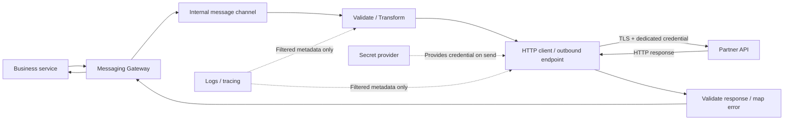
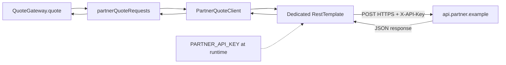
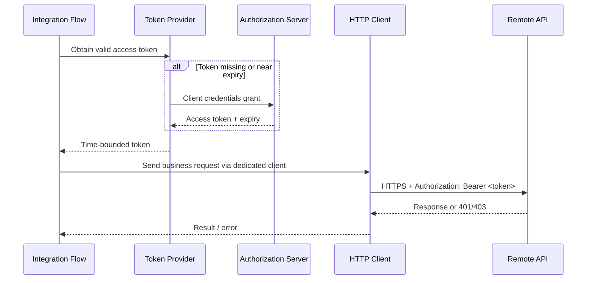
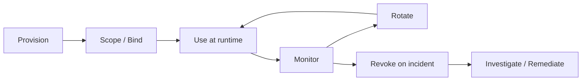

# Protecting Data and Credentials in Remote Procedure Invocation with Spring Integration

## 1. Context: Why Does Remote Procedure Invocation Need Security Controls?

An integration flow typically receives a request from business code, transforms the payload, and calls another service's API. That call may look like a Java method invocation, yet it actually crosses networks and multiple trust boundaries.

For example: a sales system calls a partner's quote service. The request carries product codes, quantities, and possibly customer IDs; the connection uses an API key, access token, or client certificate for authentication. Logging full messages, forwarding the wrong headers, or sending requests to unvalidated addresses can leak both data and credentials.

In the **Remote procedure invocation** chapter, the **Protecting Data and Credentials** topic focuses on safeguarding:

- **Business data:** customer details, orders, amounts, identifiers, and sensitive fields.
- **Credentials:** API keys, OAuth2 access tokens, passwords, private keys, and authentication certificates.
- **Metadata:** headers, correlation IDs, trace contexts, and error info that could expose internal systems.
- **RPC results:** responses must come from a trusted target, match the schema, and return to the right caller.

This lesson belongs to the **SPRING_INTEGRATION_PATTERN** module, using Enterprise Integration Patterns in Spring Integration to design loosely coupled, extensible message flows. Mechanisms such as Gateway, Router, Filter, Transformer, Splitter, Aggregator, retry, error channel, and correlation will be viewed through a security lens.

After this lesson, you will be able to design an authenticated API-calling flow, minimize data exposure across messages and logs, manage credentials at runtime, define header transmission boundaries, and write security tests for integration flows.

## 2. Identifying Trust Boundaries Before Writing the Flow

An application may trust internal beans, but should never assume every message, endpoint, or network response is trustworthy.



In the diagram:

1. Business code calls **Messaging Gateway** to avoid coupling to the partner's protocol.
2. The flow performs validation and mapping before sending externally.
3. The HTTP client attaches credentials **at the outbound boundary**.
4. The partner service receives only permitted data fields and headers.
5. The response is validated and converted into an appropriate value or error.
6. Logs and tracing are filtered everywhere messages might be recorded.

**Principle:** credentials belong to the communication channel and the calling application's identity. Unless an integration contract explicitly states otherwise, never put credentials into business payloads or broadcast them as shared Spring Integration message headers.

### Asset and Threat Classification

| Asset | Risk | Primary Countermeasure |
|---|---|---|
| Payload containing customer data | Leakage in transit, logs, or intermediaries | TLS, data minimization, redaction, storage controls |
| API key / access token | Theft, misuse on wrong service, excessive lifetime | Secret store, least scope, short lifetime, rotation |
| Private key / certificate | Copying or misconfiguration | Protected keystore, file permissions, mTLS, rotation |
| RPC target URL | SSRF, calling wrong host, sending credentials to unknown host | Endpoint allowlist, redirect control, egress policy |
| Internal headers | Leaking reply channel, topology info, trace internals | Map only explicitly allowed headers |
| External system response | Malicious data, wrong schema, abnormal size | Controlled parsing, validation, size limits |
| Logs / error channel | Storing tokens, sensitive data, or stack traces | Redaction, role-based access, short retention |
| Retry | Repeating side-effecting operations | Idempotency keys, conditional retries, and deadlines |

## 3. Protecting Data in Transit Over the Network

### 3.1. Call Only Over Verified HTTPS/TLS

For RPC over HTTP, prefer **HTTPS**. The HTTP client must verify the server certificate chain and hostname; never disable TLS verification to work around certificate errors.

A secure connection requires:

- Using an approved hostname, e.g., `api.partner.example`.
- Trusting the appropriate CA and verifying hostnames.
- Configuring TLS versions, ciphers, and trust stores per platform policy.
- Restricting redirects, especially cross-host redirects when requests carry credentials.
- Having a process to rotate trust stores and certificates before expiration.

**Critical mistake:** creating a `TrustManager` that accepts all certificates or disabling hostname verification in production. This nullifies TLS and opens the door to endpoint spoofing attacks.

### 3.2. Controlling Target URLs and SSRF Risk

Never take an outbound URL directly from user-supplied payloads and attach the system's access token to it. If an attacker tricks the flow into calling `http://127.0.0.1/...` or an internal metadata endpoint, the application can be abused to access resources never meant for the Internet.

Requirements:

1. Configure target URLs from trusted configuration, or restrict to an allowlisted set of hosts.
2. Verify the scheme is `https`, with valid hostname and port.
3. Enforce network/container egress policies allowing connections only to required destinations.
4. Control DNS and redirects, since naive hostname string checks do not prevent all SSRF forms.
5. Attach credentials only after the destination passes validation.

A Router may choose among multiple partners, yet each branch should use a **dedicated client and credential**. Never share a single `RestTemplate` that attaches Partner A's token and send requests to Partner B.

### 3.3. Transmit Only Necessary Data

If the quote endpoint only needs `sku` and `quantity`, do not send shipping addresses, emails, or payment details simply because internal application DTOs hold those fields.

Prefer dedicated boundary DTOs:

```java
// DTO sent to the remote API.
public record PartnerQuoteRequest(
        String sku,
        int quantity
) {
}
```

```java
// DTO from the remote API.
import java.math.BigDecimal;

public record PartnerQuoteResponse(
        String sku,
        BigDecimal total
) {
}
```

A Transformer in the flow can map rich business objects into the minimal `PartnerQuoteRequest`. This reduces data leaving the system, limits the exposure of issued credentials, and lets contracts evolve independently of the domain model.

### 3.4. Protecting Data at Rest and in Memory

TLS only protects data in transit. Data can still appear in:

- Application or reverse-proxy logs.
- Message stores, queues, dead-letter queues, audit events.
- Caches and response persistence.
- Process memory, heap dumps, crash dumps.
- CI/CD artifacts or debugging tools.

Apply least-privilege access, encryption at rest where required, appropriate retention, and restricted access to logs/heap dumps. For highly sensitive fields, consider tokenization, masking, or application-layer encryption per the integration contract.

## 4. Choosing an Authentication Mechanism for RPC

| Mechanism | Description | When Appropriate | Points to Watch |
|---|---|---|---|
| **API key** | Secret string identifying a client or app | Simple partner APIs supporting per-tenant/app keys | Keep in secret store, rotate, send only to target host |
| **OAuth2 client credentials** | Client obtains access token using app identity | Service-to-service with an authorization server | Scopes, audience, token lifetime, refresh/reacquire |
| **mTLS** | Mutual certificate authentication in TLS | Service links requiring strong authentication | Protect private key, manage CA and cert lifecycle |
| **HTTP Basic** | Base64-encoded username/password in header | Legacy systems explicitly requiring it | Use only over TLS; Base64 is not secure encryption |
| **Signed request / HMAC** | Signs content per API algorithm/contract | APIs requiring per-request integrity and auth | Timestamps, canonicalization, replay protection, key rotation |

Mechanisms can be combined, such as mTLS plus OAuth2. Do not attach extra credentials when unnecessary; each credential increases attack surface and management burden.

### Principle of Least Privilege

A **quote-lookup-only** flow should not use a service account with permission to delete orders or administer accounts. When calling multiple systems, prefer distinct identities per system and per environment.

Credentials should be constrained by:

- **Subject:** authorized application, workload, or tenant.
- **Action scope:** minimal scopes/roles/API permissions.
- **Permitted target:** contract audience and host.
- **Lifetime:** reasonable TTL and scheduled rotation.
- **Environment:** separate credentials for development, staging, and production.

## 5. Managing Credentials in Spring Integration

### 5.1. Never Put Secrets in Source Code

Avoid configuration like:

```java
// NEVER use in a real project.
String apiKey = "a-real-secret-value";
```

Never commit secrets to `application.yml`, test fixtures, internal docs, or CI scripts. If a credential leaks in Git or logs, deleting the line of code is **not enough**: revoke/rotate the secret and scrub history or copies per security incident procedures.

For runtime secrets, suitable sources include secret managers, key-protected Kubernetes Secrets, workload identity, or controlled environment variables. Environment variables are easy to use yet can still leak via dumps/diagnostics or process inspection; do not treat them as an absolute vault.

### 5.2. Read Credentials at Startup or on Request?

Two strategies exist:

- **Static credentials injected at startup:** simple for API keys; rotation usually requires reloading beans/restarting apps.
- **Dynamic credentials fetched from a token provider:** suited for short-lived access tokens, zero-downtime rotation, and systems with an authorization server.

Never cache a short-lived access token in a global variable forever. The token provider must account for expiration, clock skew, re-issuance, and authorization server errors.

### 5.3. Do Not Put Credentials in Internal Message Headers Unless Necessary

Spring Integration uses `replyChannel`, `errorChannel`, `correlationId`, and application metadata headers. Adding `Authorization` or `X-API-Key` to every message exposes credentials to components like Wire Tap, logging handlers, Splitters, or message stores.

Prefer this pattern:

1. Flow builds messages containing only business data and necessary metadata.
2. An HTTP client or security component is configured specifically for the remote endpoint.
3. The client attaches the credential right before the request leaves the process.
4. Outbound mapping forwards only allowlisted headers.

Attaching credentials at the HTTP client layer does not eliminate memory or HTTP-debug-log risks, but minimizes how many internal components touch them.

## 6. Hands-On Example: A Flow Calling a Partner API with an API Key

This example demonstrates **Spring Boot 3.x, Spring Integration 6.x, Java 17+** and Spring Web. Because the focus is protecting data and credentials, we use a **partner-dedicated `RestTemplate`**, attach the API key at the HTTP boundary, and invoke this client through a Service Activator inside an integration flow.

This approach is still **Remote Procedure Invocation via Spring Integration**: the Messaging Gateway turns a Java call into a message, the flow performs the remote HTTP request, and the result returns via Request–Reply. Spring Integration's HTTP outbound gateway is another option; the security principles for HTTP clients and header mapping remain similar.

### 6.1. Layer and Component Diagram



The credential never appears in the `PartnerQuoteRequest` payload, never travels through `partnerQuoteRequests`, and never becomes a default header on all messages.

### 6.2. Secret-Free Configuration

Example `application.properties` for the client application:

```properties
partner.api.url=https://api.partner.example/v1/quotes
```

The credential is supplied at runtime via environment variable `PARTNER_API_KEY`, mapping to property `partner.api.key`. Never write the value of `PARTNER_API_KEY` into this config file.

`api.partner.example` is an **illustrative hostname**, not a live API. In real deployments, replace it with an approved hostname and adjust the allowlist accordingly.

### 6.3. DTOs Containing Only Data the Partner Needs

```java
// PartnerQuoteRequest.java
package com.example.integration;

public record PartnerQuoteRequest(String sku, int quantity) {
}
```

```java
// PartnerQuoteResponse.java
package com.example.integration;

import java.math.BigDecimal;

public record PartnerQuoteResponse(String sku, BigDecimal total) {
}
```

### 6.4. Creating a Dedicated RestTemplate and Attaching the API Key at the Outbound Boundary

```java
// PartnerHttpConfiguration.java
package com.example.integration;

import java.net.URI;
import java.time.Duration;

import org.springframework.beans.factory.annotation.Value;
import org.springframework.boot.web.client.RestTemplateBuilder;
import org.springframework.context.annotation.Bean;
import org.springframework.context.annotation.Configuration;
import org.springframework.web.client.RestTemplate;

@Configuration
public class PartnerHttpConfiguration {

    @Bean("partnerRestTemplate")
    public RestTemplate partnerRestTemplate(
            RestTemplateBuilder builder,
            @Value("${partner.api.key}") String apiKey) {

        if (apiKey == null || apiKey.isBlank()) {
            throw new IllegalStateException("Partner credential is missing");
        }

        return builder
                .setConnectTimeout(Duration.ofSeconds(2))
                .setReadTimeout(Duration.ofSeconds(3))
                .additionalInterceptors((request, body, execution) -> {
                    URI uri = request.getURI();

                    if (!"https".equalsIgnoreCase(uri.getScheme())
                            || !"api.partner.example".equalsIgnoreCase(
                                    uri.getHost())
                            || (uri.getPort() != -1 && uri.getPort() != 443)) {
                        throw new IllegalStateException(
                                "Outbound target is not allowed");
                    }

                    request.getHeaders().set("X-API-Key", apiKey);
                    return execution.execute(request, body);
                })
                .build();
    }
}
```

Explanation:

- `@Value("${partner.api.key}")` reads the credential from runtime config. If missing, the app fails bean creation rather than running unprotected.
- This `RestTemplate` is dedicated exclusively to the quote partner. Never reuse it for other services.
- The HTTP interceptor verifies HTTPS, hostname, and port **before** adding the `X-API-Key` header.
- Connect/read timeouts are configured on the HTTP client. Gateway reply timeout is a separate setting.
- Never log `apiKey`, include it in exceptions, or copy it into Spring Integration `MessageHeaders`.

**Limitations of the example:** the allowlist in the interceptor is a basic control layer; if the HTTP client follows redirects automatically, redirects must be disabled or validated separately. Egress policies, DNS, and proxies still need secure configuration. The API key captured in the interceptor persists until the bean/client is replaced, so dynamic rotation requires a different credential provider mechanism.

### 6.5. Writing the HTTP Client to Send Requests and Return Responses

```java
// PartnerQuoteClient.java
package com.example.integration;

import java.net.URI;

import org.springframework.beans.factory.annotation.Qualifier;
import org.springframework.beans.factory.annotation.Value;
import org.springframework.http.HttpEntity;
import org.springframework.http.HttpMethod;
import org.springframework.http.ResponseEntity;
import org.springframework.stereotype.Component;
import org.springframework.web.client.RestTemplate;

@Component
public class PartnerQuoteClient {

    private final RestTemplate http;
    private final URI endpoint;

    public PartnerQuoteClient(
            @Qualifier("partnerRestTemplate") RestTemplate http,
            @Value("${partner.api.url}") String endpointUrl) {
        this.http = http;
        this.endpoint = URI.create(endpointUrl);
    }

    public PartnerQuoteResponse quote(PartnerQuoteRequest request) {
        if (request == null
                || request.sku() == null
                || request.sku().isBlank()
                || request.quantity() <= 0) {
            throw new IllegalArgumentException(
                    "Invalid partner quote request");
        }

        ResponseEntity<PartnerQuoteResponse> response = http.exchange(
                endpoint,
                HttpMethod.POST,
                new HttpEntity<>(request),
                PartnerQuoteResponse.class);

        if (response.getBody() == null) {
            throw new IllegalStateException(
                    "Partner returned an empty response");
        }

        return response.getBody();
    }
}
```

Notes on this class:

- `PartnerQuoteRequest` has two fields; the client does not send the entire domain object.
- The URL comes from deployment configuration and does not depend on caller input.
- The response deserializes into a specific type; returned payloads still require business validation if the contract mandates it.
- Exceptions do not include URLs with sensitive queries, API keys, or full response bodies.
- HTTP 4xx/5xx errors are typically represented as exceptions by the HTTP client; map them per contract at the appropriate layer.

### 6.6. Wrapping the Remote Call in an IntegrationFlow

```java
// PartnerQuoteFlow.java
package com.example.integration;

import org.springframework.context.annotation.Bean;
import org.springframework.context.annotation.Configuration;
import org.springframework.integration.channel.DirectChannel;
import org.springframework.integration.config.EnableIntegration;
import org.springframework.integration.dsl.IntegrationFlow;
import org.springframework.messaging.MessageChannel;

@Configuration
@EnableIntegration
public class PartnerQuoteFlow {

    @Bean
    public MessageChannel partnerQuoteRequests() {
        return new DirectChannel();
    }

    @Bean
    public IntegrationFlow partnerQuoteIntegration(
            PartnerQuoteClient partnerClient) {
        return IntegrationFlow.from("partnerQuoteRequests")
                .handle(
                    PartnerQuoteRequest.class,
                    (request, headers) -> partnerClient.quote(request)
                )
                .get();
    }
}
```

This is a handler with request–reply semantics. It returns `PartnerQuoteResponse` so the framework delivers the result back to the waiting Messaging Gateway. Because the request channel is a `DirectChannel`, the HTTP operation runs synchronously on the caller's execution path; this affects overall timeout calculation.

### 6.7. Declaring the Gateway for Business Code

```java
// QuoteGateway.java
package com.example.integration;

import org.springframework.integration.annotation.MessagingGateway;

@MessagingGateway(
        defaultRequestChannel = "partnerQuoteRequests",
        defaultReplyTimeout = "5000"
)
public interface QuoteGateway {

    PartnerQuoteResponse quote(PartnerQuoteRequest request);
}
```

To discover the Gateway interface at startup, enable Integration Component scanning:

```java
// DemoApplication.java
package com.example.integration;

import org.springframework.boot.SpringApplication;
import org.springframework.boot.autoconfigure.SpringBootApplication;
import org.springframework.integration.annotation.IntegrationComponentScan;

@SpringBootApplication
@IntegrationComponentScan
public class DemoApplication {

    public static void main(String[] args) {
        SpringApplication.run(DemoApplication.class, args);
    }
}
```

The application needs compatible dependencies including Spring Boot Starter Integration, Spring Boot Starter Web, Spring Integration core, and test tools when running tests. `@EnableIntegration` in the flow config enables Integration infrastructure; Spring Boot also provides auto-configuration for Spring Integration when appropriate dependencies are present.

### 6.8. Calling the Gateway

```java
PartnerQuoteResponse reply = quoteGateway.quote(
        new PartnerQuoteRequest("SKU-101", 2)
);

System.out.println(reply.total());
```

From the caller's perspective, this is a Java method. Underneath, the flow turns the request into an authenticated HTTP call, receives the JSON response, converts it into a DTO, and returns the result.

**Never use `System.out.println` to print full requests, tokens, or sensitive data** in real applications. The example prints only `total` to show how the response is accessed.

## 7. What If Using Spring Integration's HTTP Outbound Gateway?

Another option is using the built-in outbound gateway component in Spring Integration:

```java
import org.springframework.context.annotation.Bean;
import org.springframework.http.HttpMethod;
import org.springframework.integration.dsl.IntegrationFlow;
import org.springframework.integration.http.dsl.Http;

@Bean
IntegrationFlow partnerHttpGatewayFlow() {
    return IntegrationFlow.from("partnerQuoteRequests")
            .handle(
                Http.outboundGateway(
                        "https://api.partner.example/v1/quotes")
                    .httpMethod(HttpMethod.POST)
                    .expectedResponseType(PartnerQuoteResponse.class)
            )
            .get();
}
```

This is an **alternative** to the flow in section 6.6; do not register two different consumers on the same `DirectChannel` in the example.

In real deployments, the outbound gateway must be configured with an HTTP client/`RestTemplate` having proper authentication, timeouts, and TLS. Exact configuration depends on the Spring Integration and HTTP client versions used by the project.

**Header warning:** if you choose to insert `Authorization` directly into a Spring Integration message before the outbound gateway, you must audit wire taps, logs, message stores, and mapped request headers because that secret now lives inside the internal flow. Prefer attaching credentials inside the HTTP client at the sending boundary.

For REST clients, `Http.outboundGateway` fits when a reply is needed; HTTP outbound adapters lean toward one-way sending. If a Java method must return a response, design the flow to emit a terminal reply.

## 8. Using OAuth2 Client Credentials and Short-Lived Tokens

API keys are easy to understand, yet many service-to-service systems use **OAuth2 client credentials**. A client receives an application identity, authenticates with an authorization server, and obtains an access token with limited scope and lifetime.



To implement with Spring Security OAuth2 Client, you can use `OAuth2AuthorizedClientManager` for a dedicated client registration.

Example of the **token acquisition** part, assuming the manager and client registration are properly configured per Spring Security:

```java
import org.springframework.security.oauth2.client.OAuth2AuthorizeRequest;
import org.springframework.security.oauth2.client.OAuth2AuthorizedClient;
import org.springframework.security.oauth2.client.OAuth2AuthorizedClientManager;

public final class PartnerTokenProvider {

    private final OAuth2AuthorizedClientManager manager;

    public PartnerTokenProvider(OAuth2AuthorizedClientManager manager) {
        this.manager = manager;
    }

    public String accessToken() {
        OAuth2AuthorizeRequest request = OAuth2AuthorizeRequest
                .withClientRegistrationId("partner")
                .principal("integration-service")
                .build();

        OAuth2AuthorizedClient client = manager.authorize(request);

        if (client == null || client.getAccessToken() == null) {
            throw new IllegalStateException(
                    "Cannot obtain partner access token");
        }

        return client.getAccessToken().getTokenValue();
    }
}
```

This is an **illustrative snippet**, not a complete OAuth2 configuration class. You must define the client registration, token endpoint, client authentication method, scopes, and appropriate authorized-client provider. Caching and renewal behavior also depend on the configured manager and storage.

Then the dedicated client's HTTP interceptor can use the token provider:

```java
.additionalInterceptors((request, body, execution) -> {
    // Execute only after verifying valid scheme/host/port.
    request.getHeaders().setBearerAuth(tokenProvider.accessToken());
    return execution.execute(request, body);
})
```

Never log tokens, place them in URI query strings, or echo them into responses. If a request receives HTTP 401, do not retry infinitely: inspect the cause, token/scope/audience configuration, and refresh policy. On 403, permissions or scopes usually need fixing rather than requesting another token.

### Token Delegation and User Identity

Client credentials carry the **application's identity**, unlike a token representing an end user. Never automatically forward a user's raw bearer token from an inbound request to every remote API.

If business logic requires acting on behalf of a user, design a flow using token exchange / on-behalf-of or an appropriate delegation mechanism. A token scoped for Service A's audience should not be forwarded straight to Service B if B is not an authorized recipient for that token.

## 9. Header Mapping: Keep Essential Metadata, Strip Sensitive Data

Spring Integration message headers can contain internal values such as:

- `replyChannel`: internal reply destination.
- `errorChannel`: internal error handling channel.
- `correlationId` and sequence metadata: used for message correlation.
- Application metadata such as tenant, trace ID, and custom attributes.

Not every header suits HTTP. Some objects are non-serializable; some fields contain sensitive data; some only make sense inside the current JVM.

An outbound allowlist might contain:

| Allowed HTTP Header | Condition |
|---|---|
| `Content-Type: application/json` | Used when payload is JSON |
| `Accept: application/json` | When response contract uses JSON |
| `X-Request-Id` | Contains only validated/normalized non-sensitive ID |
| `traceparent` | When distributed tracing standard is enabled |
| `Idempotency-Key` | When server supports duplicate execution prevention |
| `Authorization` or `X-API-Key` | Added at the HTTP boundary by an authorized security component |

**Never forward raw** `replyChannel`, `errorChannel`, exception stack traces, session cookies, internal auth headers, or unnecessary host/program names. For tracing, consider that baggage or correlation metadata may also carry identifying data.

### Inbound Headers Also Need Filtering

Response headers from remote servers are not automatically trustworthy. Never copy all response headers straight into messages for downstream handlers to make security decisions. Only accept headers defined in the contract, such as partner-generated request IDs or rate-limit headers.

## 10. Logging, Wire Tap, and Tracing Without Leaking Secrets

An integration flow often needs multi-step observability to debug Routers, Filters, Transformers, or HTTP gateways. However, logging the entire `Message<?>` can simultaneously record payloads and credential headers.

### Logging Pattern to Avoid

```java
// Do not use if messages may carry sensitive data.
log.info("Outbound message: {}", message);
```

Common places where secrets leak accidentally:

1. `LoggingHandler` or Wire Tap printing full messages.
2. HTTP client debug logs printing request/response headers.
3. Exception handlers logging error bodies containing sensitive info.
4. APM/tracing automatically capturing HTTP headers or query strings.
5. Queues/DLQs persisting unredacted messages.
6. Unit test snapshots storing test credentials or real user data.

### Controlled Metadata Logging Example

```java
log.info(
    "Partner quote requestId={} operation={} durationMs={} outcome={}",
    requestId,
    "quote",
    durationMs,
    outcomeCode
);
```

Only log controlled values. Never assume `requestId` or customer codes are always non-sensitive; check how they are generated, their input sources, and retention rules.

**Maintain an explicit redaction list**, covering at minimum `Authorization`, `Proxy-Authorization`, `Cookie`, `Set-Cookie`, `X-API-Key`, `client_secret`, passwords, and tokens inside payloads. Also inspect URL query strings and exception messages.

### Useful Tracing Without Exposing Credentials

Distributed tracing can track spans: Gateway → Transformer → HTTP client → remote API. Use IDs to link spans, metrics per route/operation, and latency rather than storing entire payloads. Never put customer info or tokens into `traceparent`, and only use baggage under approved policies.

## 11. Retries, Error Channels, and Security Implications

Retries can accidentally turn a brief glitch into multiple requests carrying the same credentials and sensitive data. A sound flow specifies which failures may retry and whether credentials remain valid across retries.

| Status | Handling |
|---|---|
| HTTP 400 | Fix request; do not retry same payload indefinitely |
| HTTP 401 | Check expired or wrong credential; re-issue under control if appropriate |
| HTTP 403 | Check scope/role/audience; do not retry blindly |
| HTTP 429 | Slow down, follow retry policy/backoff |
| HTTP 502/503 | Bounded retry possible if operation is safe |
| Connect timeout | Follow retry policy and endpoint checks |
| Read timeout | Uncertain whether remote server processed it |
| Invalid response schema | Record contract error; do not treat retry as the default cure |

### Side Effects and Idempotency

If the RPC creates orders, charges payments, or mutates data, the server may have processed the request before the client lost connection. Retrying with valid credentials can create duplicate side effects.

When supported by the partner, send a unique `Idempotency-Key` for **one business operation**, keeping it constant across retries of that operation. The server must enforce a matching deduplication policy. Auth tokens and idempotency keys solve **two distinct problems**: who is allowed to call vs. which requests represent the same operation.

### Error Channels Must Also Be Secured

In asynchronous flows, `ErrorMessage` can carry exceptions and failed messages. Sending raw error messages to logs/DLQs can store sensitive payloads or headers longer than intended.

Controls needed:

- Who is permitted to read the error channel and DLQ.
- Which payloads are retained and for how long.
- Which headers/exceptions are redacted before persistence.
- How errors return to callers without leaking internal stack traces.
- When to quarantine error events for investigation with restricted access.

## 12. Protecting Credentials Across Their Lifecycle

A secret that was safe at issuance can still leak or expire later. A complete management lifecycle is required.



### 12.1. Provision

Issue distinct credentials per workload and environment; never reuse production API keys in development or test environments.

### 12.2. Storage and Access Control

Use a secret manager or proper secret distribution mechanism. Grant read access only to the runtime/service account that needs it. Avoid storing values in build artifacts, Git, emails, or tickets.

### 12.3. Usage

Fetch secrets only when needed. Avoid printing tokens to logs and responses. Guard against dumps if the application can capture heap or request diagnostics.

### 12.4. Rotation

For API keys, if supported by the provider, use an overlap window between old and new keys to update safely. For OAuth2, refresh/re-issue tokens based on expiry and client configuration. For mTLS, replace certificates/private keys before expiry while verifying the new trust chain.

### 12.5. Revocation and Incident Response

If a token or key leaks, revoke/rotate it at the issuing authority, assess anomalous usage, and audit everywhere the secret may have been written. Merely editing source code or clearing visible logs is insufficient while the token remains valid.

## 13. Security Testing for Integration Flows

Beyond business tests, verify credentials appear only at the intended HTTP boundary and the flow leaks no data.

### 13.1. Checking HTTP Requests with a Mock Server

For section 6's example, you can test without real network calls. Use `MockRestServiceServer` from Spring Test, supplying **dummy test-only credential values**.

```java
// PartnerQuoteSecurityTest.java
package com.example.integration;

import static org.junit.jupiter.api.Assertions.assertEquals;
import static org.springframework.test.web.client.match.MockRestRequestMatchers.*;
import static org.springframework.test.web.client.response.MockRestResponseCreators.*;

import java.math.BigDecimal;

import org.junit.jupiter.api.Test;
import org.springframework.beans.factory.annotation.Autowired;
import org.springframework.beans.factory.annotation.Qualifier;
import org.springframework.boot.test.context.SpringBootTest;
import org.springframework.http.HttpMethod;
import org.springframework.http.MediaType;
import org.springframework.test.web.client.MockRestServiceServer;
import org.springframework.web.client.RestTemplate;

@SpringBootTest(properties = {
        "partner.api.key=TEST_ONLY_KEY",
        "partner.api.url=https://api.partner.example/v1/quotes"
})
class PartnerQuoteSecurityTest {

    @Autowired
    private QuoteGateway gateway;

    @Autowired
    @Qualifier("partnerRestTemplate")
    private RestTemplate restTemplate;

    @Test
    void attachesApiKeyOnlyAtApprovedOutboundRequest() {
        MockRestServiceServer server =
                MockRestServiceServer.bindTo(restTemplate).build();

        server.expect(
                    requestTo("https://api.partner.example/v1/quotes"))
                .andExpect(method(HttpMethod.POST))
                .andExpect(header("X-API-Key", "TEST_ONLY_KEY"))
                .andExpect(content().json(
                        "{\"sku\":\"SKU-101\",\"quantity\":2}"))
                .andRespond(withSuccess(
                        "{\"sku\":\"SKU-101\",\"total\":50.00}",
                        MediaType.APPLICATION_JSON));

        PartnerQuoteResponse reply = gateway.quote(
                new PartnerQuoteRequest("SKU-101", 2));

        assertEquals("SKU-101", reply.sku());
        assertEquals(new BigDecimal("50.00"), reply.total());

        server.verify();
    }
}
```

This test verifies:

- The endpoint is called with the expected URL and HTTP method.
- The payload contains only fields of `PartnerQuoteRequest`.
- The test API key appears on the HTTP request to the permitted host.
- The JSON response is converted and returned to the Gateway.

This test **does not fully prove** log redaction, redirect handling, or egress policies. Those require separate tests and configurations.

### 13.2. Additional Scenarios to Test

| Test | Expectation |
|---|---|
| Missing API key | Application fails fast or refuses outbound calls per design |
| URL uses HTTP | Client refuses to send credential |
| URL points to another hostname | No HTTP request carrying key is sent |
| Server redirects to another host | Auth headers are not leaked |
| HTTP 401/403 | Error flow returns proper outcome without printing token |
| Expired token | Provider re-issues per policy; no infinite retries |
| Service returns huge payload | Blocked per configured limits |
| Invalid response schema | Mapping error handled without logging sensitive body |
| Wire tap/debug log enabled | Headers/passwords/tokens are redacted |
| Retry POST after read timeout | No duplicate side effects thanks to idempotency |
| Multi-tenant | No cross-tenant credential mix-up |
| Credential rotation | Client switches to new credential per process without unexpected outage |

### 13.3. Avoiding Secrets in Test Assertion Failures

An assertion printing the entire request on failure can expose headers. Prefer HTTP mock tools and test fixtures containing only fake credentials; never pull real production secrets to run CI.

CI configuration should also prevent saving request dumps, screenshots, artifacts, and test reports containing `Authorization` headers or real data.

## 14. Common Security Mistakes in Spring Integration Projects

**Mistake 1: adding the API key to every message right after Messaging Gateway.** A Wire Tap or error flow can observe that header. Add credentials in a dedicated client at the outbound boundary.

**Mistake 2: using one token-attaching RestTemplate across multiple domains.** Tokens can be sent to the wrong partner. Separate clients per target, validate hosts, and enforce egress policies.

**Mistake 3: disabling TLS validation on certificate errors.** This opens the door to endpoint spoofing. Fix trust chains, hostnames, or certificates properly.

**Mistake 4: logging raw payloads and `MessageHeaders` for debugging.** Headers or bodies may contain credentials/PII. Redact before logging and restrict log access.

**Mistake 5: putting tokens in URL query parameters.** URLs routinely appear in access logs, proxy logs, browser history, and monitoring. Use contract-defined headers/auth mechanisms.

**Mistake 6: using an end-user access token to call every downstream service.** Audience, scopes, and authorization context may not match. Perform delegation only via designed mechanisms.

**Mistake 7: assuming timeout means the remote side did nothing.** The request may have executed with a lost response. Combine retries with idempotency.

**Mistake 8: trusting a response just because the server returned HTTP 200.** The response may fail schemas, lack fields, exceed sizes, or violate business rules. Always validate.

**Mistake 9: holding stale credentials after rotation.** Static bean API keys may not reload automatically. Design bean reload/recreation or dynamic token providers per operational needs.

**Mistake 10: storing error messages without retention limits.** A DLQ holding requests/exceptions can become a sensitive data store. Enforce encryption, retention, and access controls.

## 15. Review Questions

1. What trust boundaries appear when a Messaging Gateway calls a remote API?
2. Why should `Authorization` not be placed as a default header on every message in a flow?
3. Which phase does TLS protect data in, and why do logs and message stores still need protection?
4. How do API keys, OAuth2 client credentials, and mTLS differ?
5. How do scopes, audience, and token expiration reduce risk?
6. Why should user tokens not be automatically forwarded to every remote API?
7. How can SSRF arise when remote URLs are taken from payloads?
8. Why must a host allowlist in an interceptor be paired with redirect controls and egress policies?
9. In the Java example, at which layer is the credential attached to the request?
10. Why can a read timeout cause duplicate side effects upon retry?
11. What different purposes do correlation IDs, trace IDs, and idempotency keys serve?
12. When an error channel holds a failed message, what protections are needed?
13. How can a test verify a credential is excluded from payloads and sent only to approved hosts?
14. When a credential leaks in Git, what steps are needed beyond deleting the line of code?

## 16. Checklist for a Secure Remote Procedure Invocation

- [ ] Classify which data is allowed to leave the system and strip extraneous fields.
- [ ] Endpoint uses HTTPS with verified certificates and hostnames.
- [ ] Target URL is allowlisted; redirects, DNS, and egress are controlled.
- [ ] Each partner/environment uses its own dedicated identity and credential.
- [ ] Credentials come from secure runtime sources, never hardcoded or committed.
- [ ] API keys/tokens are attached at the outbound boundary; header mapping is allowlisted.
- [ ] OAuth2 tokens have proper scopes/audience/TTL and lifecycle management.
- [ ] Service accounts hold least privilege; on-behalf-of user delegation is explicitly designed.
- [ ] Requests/responses are validated with sensible size limits.
- [ ] Logs, tracing, exceptions, and error channels enforce redaction, access control, and retention.
- [ ] Connect/read timeouts, Gateway timeouts, and overall deadlines are properly configured.
- [ ] Retries are bounded and paired with idempotency for side-effecting operations.
- [ ] Operational procedures exist for credential rotation and revocation.
- [ ] Tests cover unauthorized URLs, missing credentials, auth failures, log redaction, and concurrency.
- [ ] Router, Filter, Transformer, Splitter, and Aggregator branches neither leak secrets nor emit contract-violating replies.

**Remember:** Protecting data and credentials in Remote Procedure Invocation is a cross-cutting responsibility throughout the integration flow. Minimize payloads, verify targets via TLS, grant least privilege, attach credentials at the HTTP boundary, control headers/logs, and design appropriate timeout–retry–error handling. Spring Integration provides the message-flow mechanics; your application's data contracts, security configuration, and tests determine how safe the remote call truly is.
