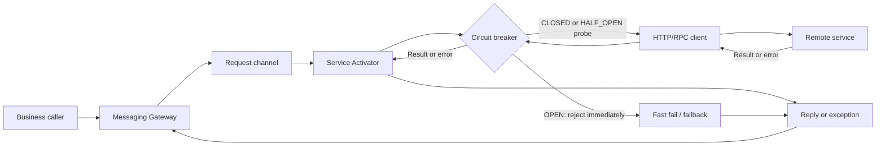
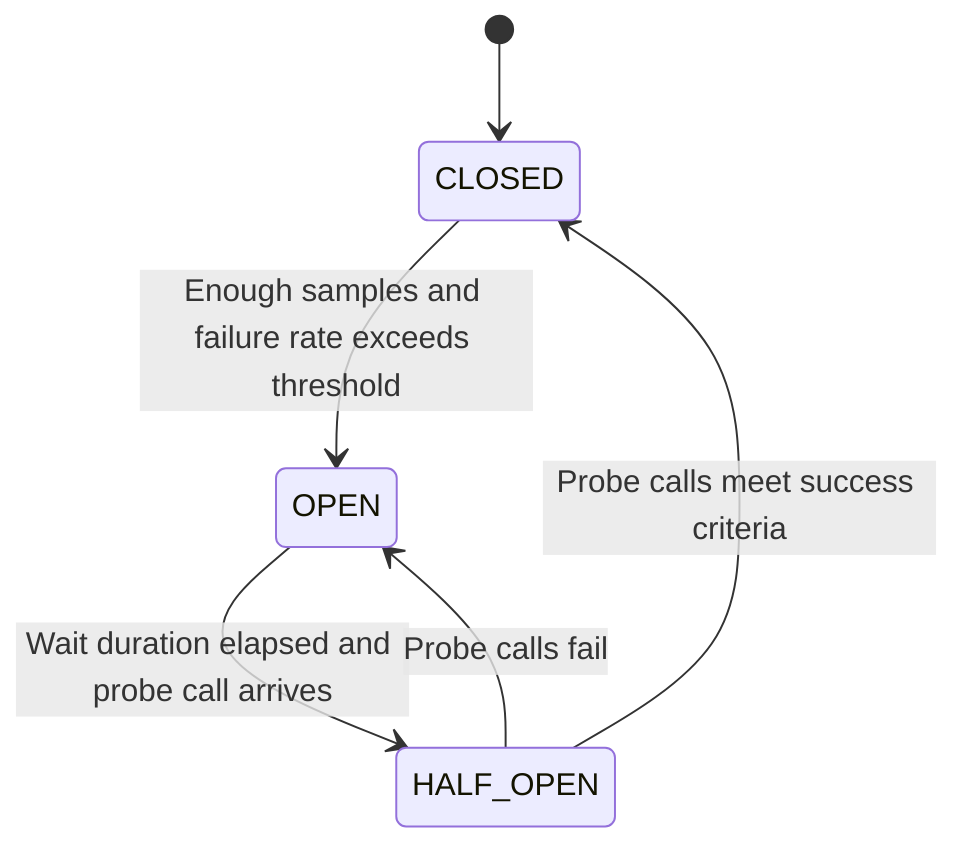

# Circuit Breaker at the Remote Call Boundary

## 1. Context and Objectives

In **Remote Procedure Invocation (RPI/RPC)**, a component sends a request to a service in another process or machine and awaits a result like a function call. With **Spring Integration**, this call is typically placed behind a `Messaging Gateway` and handled by a `Service Activator` or an outbound gateway. Message-based organization decouples business logic from transport protocols; however, a remote call itself can still hit timeouts, connection failures, HTTP 5xx responses, or overload.

A **circuit breaker** is a protective mechanism at a remote dependency boundary. It observes recent call outcomes and **temporarily rejects new calls** when the failure rate crosses a threshold. After a wait duration, the circuit breaker allows a few probe requests to decide whether to reopen normal traffic flow.

This lesson belongs to the `SPRING_INTEGRATION_PATTERN` module: implementing Enterprise Integration Patterns with Spring Integration for loosely coupled, scalable, testable, and observable message flows. After this lesson, you will be able to:

- Identify where to place a circuit breaker around a dependency in a request–reply branch.
- Understand the `CLOSED`, `OPEN`, and `HALF_OPEN` states, error classification, and key thresholds.
- Combine a circuit breaker with timeouts, retries, fallbacks, error channels, and correlation without masking business errors.
- Build a Spring Integration + Resilience4j example, then test state transitions and recovery.

## 2. Why Does a Synchronous Call Need a Circuit Breaker?

Suppose a system receives customer lookup requests. `CustomerGateway` sends messages across a channel to a handler; the handler calls `customer-service` over HTTP and returns data to the caller. When the target service suffers an outage, each request may keep occupying a worker thread while waiting for timeouts. Queued requests pile up, resources stay pinned, and failures cascade into otherwise healthy components.



A circuit breaker creates **fast fail** when a dependency is judged unavailable. It does not heal the target service on its own, bound concurrent calls, or replace timeouts. Its primary value is preventing wasted load from piling onto a failing dependency.

For example: out of the last 10 eligible calls, 6 fail due to timeouts or HTTP 5xx. If the failure threshold is 50% and minimum sample count is 10, the breaker can transition to `OPEN`; new calls are rejected without sending HTTP requests. Exact timing and calculation depend on the statistical window configuration.

## 3. Three States and Lifecycle

| State | Sends Remote Calls? | Behavior |
| --- | --- | --- |
| `CLOSED` | Yes | Allows requests; records successes/failures and checks threshold once enough samples exist. |
| `OPEN` | No | Rejects immediately with an error such as `CallNotPermittedException` in Resilience4j. |
| `HALF_OPEN` | Yes, but limited | Grants a limited number of trial calls; outcomes decide whether to return to `CLOSED` or `OPEN`. |



In Resilience4j, `OPEN` typically transitions to `HALF_OPEN` only when a new call arrives after the wait duration; automatic transition can be configured if needed. Special states like `DISABLED`, `FORCED_OPEN`, and `METRICS_ONLY` serve operations or observation; normal protection flows focus on the three states above.

Parameters to understand together:

| Parameter | Meaning | Illustrative Value |
| --- | --- | --- |
| `slidingWindowSize` | Window size in call count when using `COUNT_BASED`. | `20` |
| `minimumNumberOfCalls` | Minimum calls before evaluating the open threshold. | `10` |
| `failureRateThreshold` | Failure percentage (%) that opens the breaker given enough samples. | `50` |
| `waitDurationInOpenState` | Wait interval before probing again. | `30s` |
| `permittedNumberOfCallsInHalfOpenState` | Number of trial calls permitted in `HALF_OPEN`. | `3` |
| `slowCallDurationThreshold`, `slowCallRateThreshold` | Optional evaluation of slow-call rates even before outright failures. | Depends on SLO |

These numbers are **learning examples**, not configurations suitable for every system. Calibrate them using your dependency's timeouts, traffic volume, error budgets, and SLOs. For low-traffic services, an overly large statistical window can make the breaker slow to react.

## 4. Placing the Breaker at the Right Boundary

In a Spring Integration flow, place the breaker **tightly around the operation that actually leaves the process**: the HTTP client, RPC stub, or external service adapter. That way, the breaker measures the dependency's health rather than internal mapping, validation, or business steps.

Examples of different boundaries:

| Placement | Consequence | Recommendation |
| --- | --- | --- |
| Wrapping the HTTP/RPC call inside `Service Activator` | Accurately captures dependency outcomes; easy to configure per service. | Fits the example below. |
| Wrapping the entire flow including validation, transform, and RPC | Mapping/validation errors can open the breaker even when the dependency is healthy. | Use only if deliberately designed as policy. |
| One shared breaker for multiple distinct services | Failures in service A accidentally block calls to service B. | Separate breakers per dependency or operation group sharing fault/SLO profiles. |

Never instantiate a new `CircuitBreaker` per message: counters and state must be shared across calls. In Spring, declare it as a **singleton bean**. If endpoints on the same service have starkly different availability, consider per-operation breakers.

## 5. Spring Integration + Resilience4j Example

The example uses **Spring Boot 3.x, Spring Integration 6.x, Java 17+**, and synchronous HTTP via `RestClient`. It requires Spring Integration, Spring Web, and `io.github.resilience4j:resilience4j-circuitbreaker` with compatible versions managed in the project's build config. This is one implementation choice; Spring Integration does not lock you into Resilience4j or HTTP.

Request flow:

```text
CustomerGateway.getById(id)
    -> channel "customer.rpc.requests" (DirectChannel)
    -> CustomerRpcHandler.load(id)
    -> CircuitBreaker.executeSupplier(...)
    -> RestClient GET /customers/{id}
    -> CustomerSnapshot or exception returned to caller
```

### 5.1. Configuring Channel, HTTP Timeouts, and Circuit Breaker

```java
import java.time.Duration;

import io.github.resilience4j.circuitbreaker.CircuitBreaker;
import io.github.resilience4j.circuitbreaker.CircuitBreakerConfig;
import org.springframework.context.annotation.Bean;
import org.springframework.context.annotation.Configuration;
import org.springframework.http.client.SimpleClientHttpRequestFactory;
import org.springframework.integration.annotation.IntegrationComponentScan;
import org.springframework.integration.config.EnableIntegration;
import org.springframework.integration.channel.DirectChannel;
import org.springframework.messaging.MessageChannel;
import org.springframework.web.client.HttpClientErrorException;
import org.springframework.web.client.RestClient;

@Configuration
@EnableIntegration
@IntegrationComponentScan
public class CustomerRpcConfiguration {

    @Bean("customer.rpc.requests")
    MessageChannel customerRpcRequests() {
        return new DirectChannel();
    }

    @Bean
    RestClient customerRestClient(RestClient.Builder builder) {
        SimpleClientHttpRequestFactory factory =
                new SimpleClientHttpRequestFactory();
        factory.setConnectTimeout(300);  // milliseconds
        factory.setReadTimeout(1500);    // milliseconds

        return builder
                .baseUrl("https://customer-service.internal")
                .requestFactory(factory)
                .build();
    }

    @Bean
    CircuitBreaker customerCircuitBreaker() {
        CircuitBreakerConfig config = CircuitBreakerConfig.custom()
                .slidingWindowType(
                        CircuitBreakerConfig.SlidingWindowType.COUNT_BASED)
                .slidingWindowSize(20)
                .minimumNumberOfCalls(10)
                .failureRateThreshold(50.0f)
                .waitDurationInOpenState(Duration.ofSeconds(30))
                .permittedNumberOfCallsInHalfOpenState(3)
                .ignoreExceptions(HttpClientErrorException.class)
                .build();

        return CircuitBreaker.of("customer-service", config);
    }
}
```

`ignoreExceptions(HttpClientErrorException.class)` illustrates the policy of **excluding HTTP 4xx errors from the breaker's success/failure statistics**: for example, `404 Not Found` is usually a valid business outcome, not a sign of dependency outage. The 4xx exception still propagates to the caller for semantic handling. For APIs with different conventions (e.g., `429 Too Many Requests` signaling overload), classify separately. Without explicit rules, non-ignored runtime exceptions may also be counted as technical failures.

In this example, `SimpleClientHttpRequestFactory` supplies timeouts for **HTTP connect and read**. Adjusting the `Messaging Gateway` wait time in the next step does not replace those two timeouts.

### 5.2. Gateway Representing the Request–Reply Call

```java
import org.springframework.integration.annotation.Gateway;
import org.springframework.integration.annotation.MessagingGateway;

@MessagingGateway(defaultRequestChannel = "customer.rpc.requests")
public interface CustomerGateway {

    @Gateway(requestTimeout = "1000", replyTimeout = "2500")
    CustomerSnapshot getById(String customerId);
}
```

`@MessagingGateway` hides message/channel details from business code. The Gateway receives the handler's return value or propagates errors back to the caller per configured synchronous semantics.

**Important timeout note:** `DirectChannel` invokes its subscriber on the sender's thread. Therefore, the gateway's `replyTimeout` **does not guarantee interrupting** an HTTP call blocking inside the handler. Network timeouts must be configured on the client (and consider `TimeLimiter` for async calls) to enforce real time bounds. Likewise, `requestTimeout` does not turn `DirectChannel` into a deadline-enforced queue.

### 5.3. Service Activator Calling Remote Inside the Breaker

```java
import java.util.Objects;

import io.github.resilience4j.circuitbreaker.CircuitBreaker;
import io.github.resilience4j.circuitbreaker.CallNotPermittedException;
import org.springframework.integration.annotation.ServiceActivator;
import org.springframework.stereotype.Component;
import org.springframework.web.client.RestClient;

@Component
public class CustomerRpcHandler {
    private final RestClient client;
    private final CircuitBreaker breaker;

    public CustomerRpcHandler(RestClient customerRestClient,
                              CircuitBreaker customerCircuitBreaker) {
        this.client = customerRestClient;
        this.breaker = customerCircuitBreaker;
    }

    @ServiceActivator(inputChannel = "customer.rpc.requests")
    public CustomerSnapshot load(String customerId) {
        try {
            return breaker.executeSupplier(() ->
                    Objects.requireNonNull(
                            client.get()
                                    .uri("/customers/{id}", customerId)
                                    .retrieve()
                                    .body(CustomerSnapshot.class),
                            "customer-service returned an empty body"));
        } catch (CallNotPermittedException rejected) {
            throw new RemoteDependencyUnavailableException(
                    "customer-service is temporarily unavailable", rejected);
        }
    }
}

record CustomerSnapshot(String id, String displayName) {}

class RemoteDependencyUnavailableException extends RuntimeException {
    RemoteDependencyUnavailableException(String message, Throwable cause) {
        super(message, cause);
    }
}
```

These classes are grouped together for clarity; in a real project, split them into appropriate Java files and adjust packages/bean qualifiers when multiple `RestClient` or `CircuitBreaker` beans exist. `customer-service.internal` is an illustrative address and must be replaced with the real endpoint in environment configuration.

The execution path has two cases:

1. **Breaker permits the call:** `executeSupplier` runs the HTTP call. A successful outcome returns as the reply payload; HTTP exceptions propagate along the request–reply flow while being recorded or ignored by the breaker per policy.
2. **Breaker is `OPEN`:** the call is rejected before HTTP. `CallNotPermittedException` is translated into application exception `RemoteDependencyUnavailableException` so the caller can return `503`, apply a fallback, or take an equivalent path. This exception translation happens **outside the operation measured by the breaker**.

In a real application, preserve the `cause`, timestamps, and dependency identifier in logs/traces; avoid logging sensitive payload fields.

## 6. Designing Fallbacks and Error Responses

A fallback is a **business decision**, not a mandatory feature of a circuit breaker. When `OPEN`, the system must respond clearly or return bounded substitute data:

| Case | Sensible Response | What to Control |
| --- | --- | --- |
| Reading slowly changing data | Return cached data marked as `stale`. | TTL, last-updated time, access permissions. |
| Temporarily skippable lookup | Return `temporarily unavailable` status. | Caller knows this is not `not found`. |
| Write or payment operation | Fast fail or queue with idempotency if architecture permits. | Never fake "success"; prevent duplicate writes. |
| Non-critical auxiliary step | Skip step with explicit degraded indicator. | Must not corrupt core business results. |

Never turn every exception into a success payload: that misleads callers and masks failure rates. If a fallback calls another dependency, it needs its own protection policy and timeouts. A fallback that calls back into the exact service currently `OPEN` defeats fast fail.

In Spring Integration, explicitly decide the error path:

- In a **synchronous flow with `DirectChannel`**, handler exceptions usually propagate back to the gateway/caller. Callers can distinguish connection errors, business HTTP errors, and breaker-rejected calls.
- When using `errorChannel`, `ErrorMessage`, or async flows, configure the corresponding error-handling branch and response; **never assume all exceptions automatically reach a global `errorChannel`**.
- Preserve `correlationId`, request ID, or trace context across reply/error branches when splitting/aggregating or crossing async boundaries. This ties errors and replies to the exact request and supports tracing.

## 7. Combining Circuit Breaker with Timeout, Retry, and Bulkhead

Each mechanism solves a different problem:

| Mechanism | Which Question Does It Answer? | Key Caveat |
| --- | --- | --- |
| **Timeout** | How long to wait for one call at most? | Must be enforced in the I/O client or proper async layer. |
| **Retry** | Should a transient error be retried? | Retry only eligible errors; cap attempts, add backoff and jitter. |
| **Circuit breaker** | Should calls to this dependency be allowed right now? | Tracks failures in a window; rejects when `OPEN`. |
| **Bulkhead** | How many concurrent calls are permitted? | Isolates resources; breakers do **not** replace concurrency limits. |
| **Fallback** | What does the caller receive when the dependency is down? | Must preserve business correctness. |

The wrapping order affects how many samples the breaker observes:

```text
Gateway -> CircuitBreaker -> Retry (max 2 attempts) -> HTTP client
```

In this order, the breaker sees **one logical call** after up to two attempts; if both fail, the breaker records one failure. Conversely:

```text
Gateway -> Retry -> CircuitBreaker -> HTTP client
```

Each retry passes through the breaker, generating an extra sample or getting rejected when `OPEN`. That can trip the breaker faster and consume `HALF_OPEN` probe permits. Choose the order deliberately, especially for non-idempotent write operations.

**Never retry indefinitely** after timeouts. Every retry consumes resources and can worsen an overloaded service's collapse. For side-effecting operations, use idempotency keys and outcome-determination rules when the client times out after the server may have committed.

## 8. Testing Behavior with Controlled Scenarios

Replace the remote endpoint with a mock HTTP server or fake client capable of deterministic outcomes. For breaker unit tests, use small window configs without relying on long production wait durations. When testing deadlines, use proper time-control mechanisms or short, strictly bounded durations.

| Scenario | How to Test | Expectation |
| --- | --- | --- |
| Healthy dependency | Return consecutive HTTP 200s. | Caller gets `CustomerSnapshot`; breaker stays `CLOSED`. |
| 5xx/timeouts reach threshold | Send enough samples exceeding failure threshold. | Trips `OPEN`; subsequent requests emit zero HTTP calls. |
| `OPEN` fast fail | Keep calling before wait duration expires. | Receives unavailable error fast; remote hit count unchanged. |
| Recovery via `HALF_OPEN` | Wait duration passes; mock returns success for probes. | Allows configured probe count and closes back to `CLOSED` once met. |
| Failed probes | Mock keeps returning errors during `HALF_OPEN`. | Breaker returns to `OPEN` per threshold policy. |
| Valid HTTP 404 | Mock returns 404. | Caller still sees business error; 404 does not increment breaker failures in sample config. |
| Concurrent load | Many concurrent requests while dependency is slow. | Real limits enforced by timeout/bulkhead; breaker is not expected to cap concurrency alone. |
| Message branch error | Trigger corresponding error/reply branch. | Request correlation preserved; caller gets right result or exception type. |

Minimal JUnit 5 unit test checking Resilience4j's `OPEN` transition itself:

```java
import io.github.resilience4j.circuitbreaker.CallNotPermittedException;
import io.github.resilience4j.circuitbreaker.CircuitBreaker;
import io.github.resilience4j.circuitbreaker.CircuitBreakerConfig;
import org.junit.jupiter.api.Test;

import static org.junit.jupiter.api.Assertions.assertEquals;
import static org.junit.jupiter.api.Assertions.assertThrows;

class CustomerCircuitBreakerTest {
    @Test
    void opensAfterFailures() {
        CircuitBreakerConfig testConfig = CircuitBreakerConfig.custom()
                .slidingWindowSize(2)
                .minimumNumberOfCalls(2)
                .failureRateThreshold(50.0f)
                .build();
        CircuitBreaker testBreaker = CircuitBreaker.of("remote-test", testConfig);

        for (int i = 0; i < 2; i++) {
            try {
                testBreaker.executeRunnable(() -> {
                    throw new IllegalStateException("remote down");
                });
            } catch (IllegalStateException expected) {
                // Both calls fail to meet the minimum sample count.
            }
        }

        assertEquals(CircuitBreaker.State.OPEN, testBreaker.getState());
        assertThrows(CallNotPermittedException.class,
                () -> testBreaker.executeRunnable(() -> {}));
    }
}
```

This test only verifies the **breaker's state machine**. To verify integration, you still need a test sending requests through `CustomerGateway`, mocking HTTP, and asserting that while `OPEN`, zero requests reach the remote endpoint.

## 9. Operational Observability and Common Implementation Mistakes

Monitor metrics keyed by breaker/dependency name: current state and transitions, successful/failed/slow call counts, rejected call counts, latency, and fallback rates. You can use Resilience4j's event publisher, Micrometer, and existing logging/tracing; exact metric export depends on project dependencies and observability config.

On dashboards, separate **actual remote failures** from **calls rejected due to an `OPEN` breaker**. Rising rejection counts do not mean the target service is receiving more traffic. Keep metric label cardinality low (e.g., dependency name, operation type); never use customer ID or request ID as metric labels, as that causes high cardinality. Detailed IDs belong in logs or traces.

Implementation mistakes to avoid:

1. **Configuring only `replyTimeout` on the gateway** and assuming HTTP calls now have a deadline.
2. **Sharing one breaker across endpoints** with different fault profiles; one broken dependency blocks all integration.
3. **Counting validation/404 errors as infrastructure failures**, tripping the breaker during normal business traffic.
4. **Retrying before classifying errors**, especially 4xx responses or non-idempotent writes.
5. **Returning fallbacks as real successes** without indicating data staleness or degraded status.
6. **Omitting bulkheads**, letting thousands of slow calls exhaust threads before the breaker gathers enough samples to open.
7. **Skipping tests for `HALF_OPEN` and recovery**, leaving the system rejecting traffic even after the dependency recovers.

## 10. Completion Criteria for a Circuit-Breaker-Protected RPC Boundary

A solution is ready for integration testing once it clearly answers:

- Which dependency is protected, and right around which outbound call is the circuit breaker placed?
- Which exceptions/statuses count as infrastructure failures, business errors, or are ignored?
- Are connect/read timeouts, retry counts, and concurrency limits derived from SLOs?
- When `OPEN`, what error or fallback does the caller see, and can it corrupt data or cause side effects?
- Do request–reply/error outcomes preserve correlation and remain traceable?
- Do tests prove `OPEN` blocks HTTP, `HALF_OPEN` permits probes, and `CLOSED` recovers?
- Are metrics and alerts sufficient to distinguish dependency failures from breaker rejections?

A circuit breaker works best when treated as **one part of a remote-call policy** alongside timeouts, bounded retries, explicit error handling, and operational observability. In Spring Integration, placing this policy at the Service Activator or outbound boundary keeps upstream message flows and business logic clear and decoupled from how individual target services fail.
