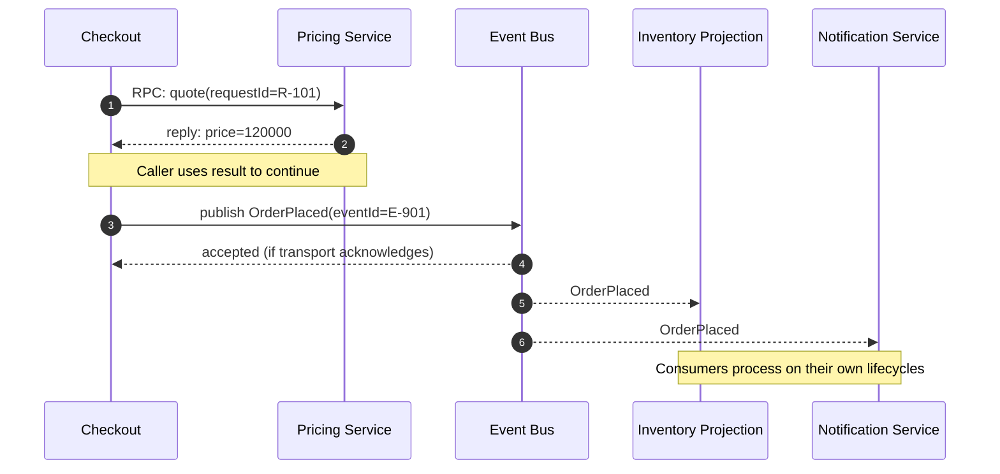
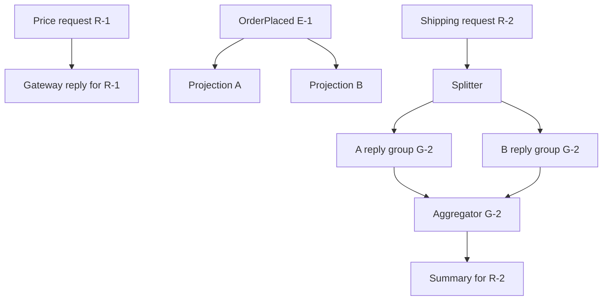

# Distinguishing RPC from Message-Driven Interaction in Spring Integration

## Lesson Objectives

After this lesson, you will be able to:

- Explain **Remote Procedure Invocation (RPC)** and **message-driven interaction** in terms of the exchange contract between components.
- Distinguish **request–reply**, **command**, **event**, and **fire-and-forget**, without equating messages with asynchronous processing.
- Identify temporal, availability, schema, timeout, error, and reliability dependencies of each design style.
- Implement a request–reply RPC via `@MessagingGateway` and an event-handling flow via `PublishSubscribeChannel` in Spring Integration.
- Choose combinations of Gateway, Service Activator, Router, Filter, Transformer, retry, error channel, and correlation tailored to business goals.
- Define test cases and monitoring metrics to prove the system returns accurate results without dropping or duplicating messages.

This lesson belongs to the **Remote procedure invocation** chapter of the **SPRING_INTEGRATION_PATTERN** module. The module targets implementing *Enterprise Integration Patterns* with Spring Integration to build loosely coupled, scalable message flows. Because both RPC and message-driven flows can be built using message channels, understanding **the interaction contract** before choosing APIs or transports is essential.

## 1. Two Interaction Styles Solving Two Different Needs

**RPC** is how one component asks another component to perform an operation and receives a corresponding result. Callers usually view the remote operation like a function call: send arguments, wait for a result or error, then decide the next step.

For example: when confirming payment, the sales service needs to know whether `authorizePayment(orderId, amount)` was approved or declined before displaying the result.

**Message-driven interaction** organizes work around sending and receiving messages. A consumer is triggered when a message arrives; the producer does not necessarily need to receive the consumer's business result right away. A message can represent:

- **Command:** instructing a component to perform an action, e.g., `ReserveInventory`.
- **Event:** announcing a fact that occurred, e.g., `OrderPlaced`.
- **Request:** asking for information, e.g., `GetShippingQuotes`.
- **Reply:** a response message that may carry a result or error status.

The difference lies in **the commitment between producer and consumer**: whether the caller needs the result immediately to continue, and who owns the completion lifecycle.

### Comparison Diagram



In the diagram, **accepted** is a message send/receive status under the transport contract—not proof that inventory and notifications finished processing. A broker with acknowledgments and durable persistence can increase reliability, whereas an in-memory channel does not automatically provide those properties.

## 2. Comparing by Contract Rather Than Technology

| Aspect | RPC / Request–Reply | Message-Driven, Especially Commands/Events Without Reply Waiting |
| --- | --- | --- |
| Purpose | Query the result of a specific operation | Trigger work or publish an event |
| What does sender need? | Result or error tied to the call | Usually only send/receive acknowledgment; processing results arrive via another mechanism if needed |
| Temporal coupling | Caller typically waits within a bound | Producer can finish before consumer if an async queue sits in between |
| Receiver relationship | Usually targets a known handler or RPC contract | Can be one consumer, multiple subscribers, or Router-selected consumer |
| Return path | Reply channel, HTTP response, or correlated callback | Not necessarily any reply; may emit downstream events |
| Errors | Caller must handle timeouts, remote errors, or unknown states | Errors can be handled independently via retries, dead-letter, or error flows |
| Consumer count | Usually one logical service; can fan out and aggregate replies | One message can broadcast to multiple subscribers per configuration |
| Scaling | Bounded by direct call path latency/deadlines | Decoupled scaling via brokers, partitions, and workers, with backpressure |
| Data consistency | Caller usually needs an immediate decision from the reply | Projections and side effects may become eventually consistent |
| Reliability | Timeout does not prove the server stopped or did not commit | Delivery may drop/duplicate per transport; needs ACK, persistence, idempotency |

**Avoid these misconceptions:**

1. "RPC always uses HTTP." RPC can use gRPC, HTTP, or **request–reply over a message broker**.
2. "Message-driven is always asynchronous." `DirectChannel` and `PublishSubscribeChannel` without an executor can invoke subscribers directly on the sender thread.
3. "Sending an event means zero feedback." The producer can still receive a transport acknowledgment, while business outcomes can be emitted as separate events.
4. "Asynchronous means a durable queue." `ExecutorChannel` only hands processing to an in-process executor; it does not guarantee messages survive restarts.
5. "No RPC means no coupling." Consumers and producers still couple to event schemas, versioning, and business rules.

## 3. Four Common Exchange Patterns

### 3.1. Request–Reply: Question and Answer

```text
Checkout -- QuoteRequest(requestId=R-101) --> Pricing
Checkout <-- QuoteReply(requestId=R-101) --- Pricing
```

The caller must pair the **exact** reply with the awaiting request, with agreed timeouts and error behavior. If request B finishes before A, reply B must never be handed to caller A. In Spring Integration, `@MessagingGateway` manages return paths per invocation; across a broker, pair reply destinations with correlation IDs/request IDs.

### 3.2. One-Way Command: Delegating an Execution Request

```text
Checkout -- ReserveInventory(commandId=C-101) --> Inventory Worker
Checkout <-- accepted by queue ------------------ Broker/Adapter
... Inventory Worker processes later ...
```

A command has a **clear target or handling responsibility**. Queue acceptance acknowledgment and business confirmation ("stock reserved") are **two separate milestones**. If Checkout must await the final result, add a matching reply, callback, polling, or status event.

### 3.3. Event Notification: Announcing What Happened

```text
Order Service -- OrderPlaced(eventId=E-901) --> Event Bus
                                                   |---> Analytics
                                                   |---> Email Service
                                                   |---> Search Projection
```

Events should be named in the **past tense** and express a business fact, such as `OrderPlaced`. The producer does not require every subscriber to return a response during the publish call. Subscribers can deploy independently, yet systems must still manage schema versions and duplicate or late events.

### 3.4. Scatter–Gather: Sending Multiple Requests and Awaiting One Summary

```text
Shipping Request
     |
  Splitter / Router
     |---- Provider A -> reply A --|
     |---- Provider B -> reply B --|--> Aggregator -> SummaryReply
     |---- Provider C -> reply C --|
```

This remains **request–reply at the caller boundary** even though multiple message-driven handlers run inside. The Aggregator uses correlation IDs, completion conditions, and deadlines to gather results. One application can mix patterns; you do not have to pick one "side" (RPC vs. messaging) for the entire system.

## 4. Spring Integration: Common Foundation for Both Approaches

Spring Integration provides `Message<?>` with payload and headers, `MessageChannel` to transport messages, and endpoints such as Service Activator, Router, Filter, Transformer, and Aggregator.

**The same building blocks can serve both interaction styles:**

| Component | When Doing RPC | When Doing Message-Driven |
| --- | --- | --- |
| `@MessagingGateway` | Turns a Java method into a request and awaits reply | Can use `void` methods to send one-way messages; contract is not RPC if caller does not await a result |
| `@ServiceActivator` | Executes and returns reply | Processes commands/events, optionally producing no output |
| `DirectChannel` | Synchronous on the sender's call stack | Delivers message to handler on the sender thread |
| `ExecutorChannel` | Runs request on worker; caller can await reply | Offloads task to executor, freeing the sending thread |
| `PublishSubscribeChannel` | Can dispatch to multiple processing branches | Broadcasts events to multiple subscribers |
| `Router` / `Filter` | Routes RPC branches; rejected branches must have explicit error/timeout contracts | Selects consumers or drops irrelevant events |
| `Transformer` | Converts DTOs, headers, responses | Reformats messages for consumers |
| `Aggregator` | Collects multiple replies before answering one request | Combines related events into a new result/command |
| `errorChannel` | Can turn async errors into error replies per configuration | Handles consumer errors, retries, and dead-letter paths per design |

Each case requires an explicit **contract for replies, errors, timeouts, and durability**; channel names do not dictate behavior on their own.

## 5. Example A — RPC via Messaging Gateway and HTTP

Suppose Checkout needs a price immediately before letting the user confirm. `PricingGateway.quote(...)` returns `PricingResult`. Underneath, Spring Integration uses a worker to call an HTTP Pricing Service.

The example uses **Java 17+, Spring Boot 3.x, Spring Integration 6.x**, and Spring Web. The `public` classes/records below live in corresponding Java files within the same package. The Pricing app runs at the illustrative address `http://localhost:8081`.

### 5.1. DTOs and Structured Result

```java
// PricingRequest.java
public record PricingRequest(
        String requestId,
        String sku,
        int quantity
) {}

// PricingQuote.java
import java.math.BigDecimal;

public record PricingQuote(
        String requestId,
        BigDecimal amount
) {}

// PricingResult.java
public record PricingResult(
        String requestId,
        PricingQuote quote,
        String errorCode
) {
    public boolean successful() {
        return quote != null && errorCode == null;
    }
}
```

`requestId` is a business identifier sent over the network for tracing and response verification. Spring Messaging's `Message<?>` ID does not automatically substitute for this identifier. When multiple requests run in parallel, returning the right monetary amount with the **wrong `requestId`** is still a severe bug.

### 5.2. Configuring the Request Channel and HTTP Client

```java
// PricingIntegrationConfig.java
import org.springframework.beans.factory.annotation.Qualifier;
import org.springframework.context.annotation.Bean;
import org.springframework.context.annotation.Configuration;
import org.springframework.http.client.SimpleClientHttpRequestFactory;
import org.springframework.integration.annotation.IntegrationComponentScan;
import org.springframework.integration.channel.ExecutorChannel;
import org.springframework.integration.config.EnableIntegration;
import org.springframework.messaging.MessageChannel;
import org.springframework.scheduling.concurrent.ThreadPoolTaskExecutor;
import org.springframework.web.client.RestTemplate;

@Configuration
@EnableIntegration
@IntegrationComponentScan
public class PricingIntegrationConfig {
    @Bean("pricingExecutor")
    public ThreadPoolTaskExecutor pricingExecutor() {
        ThreadPoolTaskExecutor executor = new ThreadPoolTaskExecutor();
        executor.setCorePoolSize(4);
        executor.setMaxPoolSize(8);
        executor.setQueueCapacity(50);
        executor.setThreadNamePrefix("pricing-");
        return executor;
    }

    @Bean("priceRequests")
    public MessageChannel priceRequests(
            @Qualifier("pricingExecutor") ThreadPoolTaskExecutor executor) {
        return new ExecutorChannel(executor);
    }

    @Bean("pricingHttpClient")
    public RestTemplate pricingHttpClient() {
        SimpleClientHttpRequestFactory factory =
                new SimpleClientHttpRequestFactory();
        factory.setConnectTimeout(350);
        factory.setReadTimeout(1600);
        return new RestTemplate(factory);
    }
}
```

`ExecutorChannel` runs the handler on an executor thread. This allows the Gateway's reply wait to expire while the worker is still processing. The two HTTP timeouts bound connect/read I/O individually; they do **not** automatically guarantee total server-side processing completes before the Gateway deadline.

### 5.3. Gateway Turning Java Calls into Request–Reply

```java
// PricingGateway.java
import org.springframework.integration.annotation.MessagingGateway;

@MessagingGateway(
    defaultRequestChannel = "priceRequests",
    defaultReplyTimeout = "2200"
)
public interface PricingGateway {
    PricingResult quote(PricingRequest request);
}
```

This is an **RPC contract**: the caller wants a price result or an error status before continuing. The Gateway binds a reply path to the call; the Service Activator does not need to know which caller is waiting. On reply timeout, a synchronous call returning a reference type may receive `null` when no reply arrives; handle this at the application boundary. Flow exceptions may follow different error paths depending on endpoints and configuration.

### 5.4. Service Activator Executing the Remote Call

```java
// PricingRpcAdapter.java
import org.springframework.beans.factory.annotation.Qualifier;
import org.springframework.integration.annotation.ServiceActivator;
import org.springframework.stereotype.Component;
import org.springframework.web.client.RestClientException;
import org.springframework.web.client.RestTemplate;

@Component
public class PricingRpcAdapter {
    private final RestTemplate http;

    public PricingRpcAdapter(
            @Qualifier("pricingHttpClient") RestTemplate http) {
        this.http = http;
    }

    @ServiceActivator(inputChannel = "priceRequests")
    public PricingResult invoke(PricingRequest request) {
        if (request.quantity() <= 0) {
            return new PricingResult(
                    request.requestId(), null, "INVALID_QUANTITY");
        }

        try {
            PricingQuote quote = http.postForObject(
                    "http://localhost:8081/api/prices",
                    request,
                    PricingQuote.class);

            if (quote == null ||
                    !request.requestId().equals(quote.requestId())) {
                return new PricingResult(
                        request.requestId(), null, "INVALID_REPLY");
            }
            return new PricingResult(request.requestId(), quote, null);
        } catch (RestClientException ex) {
            // Covers HTTP errors and I/O failures: classify further
            // by exception subtype if enforcing a retry policy.
            return new PricingResult(
                    request.requestId(), null, "REMOTE_FAILURE");
        }
    }
}
```

The adapter translates known HTTP failures into structured replies so callers do not wait until timeout merely because downstream returned an error status. This does not replace `errorChannel` for unexpected errors outside the `catch` scope. When crossing an asynchronous boundary, unhandled exceptions need a matching error flow; otherwise callers may simply observe a timeout.

### 5.5. Caller Making Decisions Based on the Result

```java
// CheckoutPricingService.java
import org.springframework.stereotype.Service;

@Service
public class CheckoutPricingService {
    private final PricingGateway gateway;

    public CheckoutPricingService(PricingGateway gateway) {
        this.gateway = gateway;
    }

    public PricingQuote getPrice(PricingRequest request) {
        PricingResult result = gateway.quote(request);

        if (result == null) {
            throw new IllegalStateException("PRICING_REPLY_TIMEOUT");
        }
        if (!request.requestId().equals(result.requestId())) {
            throw new IllegalStateException("PRICING_CORRELATION_ERROR");
        }
        if (!result.successful()) {
            throw new IllegalStateException(result.errorCode());
        }
        return result.quote();
    }
}
```

In this flow, Checkout **depends on Pricing responding on time**. If no reply arrives, Checkout must decide whether to return an error, defer, or apply a business-approved fallback policy. Never assume a timeout means the remote service definitely did not process the request.

## 6. Example B — Event-Driven via Publish–Subscribe Channel

After placing an order successfully, Checkout emits `OrderPlaced` so multiple components update their state. None of them needs to return "email sent" within the order-placement call.

This example uses an **in-memory channel with an executor** to clarify the event contract. This setup has **no durability, replay, or broker acknowledgments**; when durable delivery across restarts is needed, use appropriate adapters and brokers or a transactional outbox.

### 6.1. Immutable Event

```java
// OrderPlaced.java
import java.time.Instant;

public record OrderPlaced(
        String eventId,
        String orderId,
        Instant occurredAt
) {}
```

`eventId` identifies one event emission to aid deduplication. `orderId` is a business key that can appear across multiple event types. The event states **the order was placed**, rather than commanding "send an email."

### 6.2. Broadcast Channel for Multiple Subscribers

```java
// OrderEventsConfig.java
import org.springframework.beans.factory.annotation.Qualifier;
import org.springframework.context.annotation.Bean;
import org.springframework.context.annotation.Configuration;
import org.springframework.integration.channel.PublishSubscribeChannel;
import org.springframework.scheduling.concurrent.ThreadPoolTaskExecutor;

@Configuration
public class OrderEventsConfig {
    @Bean("orderEventExecutor")
    public ThreadPoolTaskExecutor orderEventExecutor() {
        ThreadPoolTaskExecutor executor = new ThreadPoolTaskExecutor();
        executor.setCorePoolSize(2);
        executor.setMaxPoolSize(6);
        executor.setQueueCapacity(100);
        executor.setThreadNamePrefix("order-events-");
        return executor;
    }

    @Bean("orderEvents")
    public PublishSubscribeChannel orderEvents(
            @Qualifier("orderEventExecutor")
            ThreadPoolTaskExecutor executor) {
        return new PublishSubscribeChannel(executor);
    }
}
```

Here `PublishSubscribeChannel` uses an executor, so subscriber execution runs on worker threads. Without an executor, the exact same channel type can invoke subscribers directly on the sending thread. Thus **Publish–Subscribe** describes the distribution pattern, whereas **asynchronicity** depends on channel configuration.

### 6.3. Producer Emits Event and Finishes Send Responsibility

```java
// OrderEventPublisher.java
import org.springframework.beans.factory.annotation.Qualifier;
import org.springframework.messaging.MessageChannel;
import org.springframework.messaging.support.MessageBuilder;
import org.springframework.stereotype.Component;

@Component
public class OrderEventPublisher {
    private final MessageChannel channel;

    public OrderEventPublisher(
            @Qualifier("orderEvents") MessageChannel channel) {
        this.channel = channel;
    }

    public void publish(OrderPlaced event) {
        boolean accepted = channel.send(
                MessageBuilder.withPayload(event).build());
        if (!accepted) {
            throw new IllegalStateException("ORDER_EVENT_SEND_FAILED");
        }
    }
}
```

`send()` returns `true` when the channel accepts the send per its contract. With an async executor, that **does not confirm** all subscribers finished processing and is **not** a guarantee the message survives a process crash. If publishing must be atomic with the order-writing transaction, consider a **transactional outbox** or an appropriate transport transaction solution.

### 6.4. Two Independent Consumers

```java
// OrderAuditProjection.java
import java.util.Map;
import java.util.concurrent.ConcurrentHashMap;
import org.springframework.integration.annotation.ServiceActivator;
import org.springframework.stereotype.Component;

@Component
public class OrderAuditProjection {
    // In-memory illustration only, not a durable event store.
    private final Map<String, OrderPlaced> seen =
            new ConcurrentHashMap<>();

    @ServiceActivator(inputChannel = "orderEvents")
    public void record(OrderPlaced event) {
        seen.putIfAbsent(event.eventId(), event);
    }

    public boolean hasSeen(String eventId) {
        return seen.containsKey(eventId);
    }
}

// OrderMetricsProjection.java
import java.util.Map;
import java.util.concurrent.ConcurrentHashMap;
import org.springframework.integration.annotation.ServiceActivator;
import org.springframework.stereotype.Component;

@Component
public class OrderMetricsProjection {
    private final Map<String, String> latestEventPerOrder =
            new ConcurrentHashMap<>();

    @ServiceActivator(inputChannel = "orderEvents")
    public void update(OrderPlaced event) {
        latestEventPerOrder.put(event.orderId(), event.eventId());
    }
}
```

Both consumers receive **the same event** and update separate projections. The example deliberately omits a database because its goal is explaining the interaction style. For production, replace this with durable storage, event-ID-based idempotency, proper versioning or ordering, and subscriber error monitoring. `ConcurrentHashMap` does not provide durability across restarts.

One pitfall to avoid: `latestEventPerOrder` only records the most recently **processed** event, which does not prove it is the latest event in business time. If ordering is required, carry a source sequence/version and compare before updating.

## 7. Biggest Difference: Degree of Temporal Coupling

When a direct RPC flow requires Pricing to respond within two seconds, Pricing's processing time and network health immediately affect the Checkout experience.

```text
RPC:
Checkout -- call Pricing --> Pricing
         <-- reply/error ---          (Checkout is waiting)

Async message with durable broker:
Order -- publish --> Broker --> Consumer A (processes later)
                          |--> Consumer B (processes later)
Order may proceed after the contract-defined ack point.
```

A broker can reduce **temporal coupling** when it persists messages durably and consumers pull them when ready. Still, the producer remains dependent on the broker's ability to accept messages; if the broker cannot accept, publishing can fail. The system must also handle consumer lag, backlogs, redeliveries, and schema versions.

Publishing an event before the order-write transaction commits can expose nonexistent state to consumers; publishing after commit risks losing the event if the process dies before sending. A **transactional outbox** is commonly used to write business data and event records in one local transaction, after which a relay publishes events and marks them sent. Because the relay may redeliver, consumers still need idempotency.

## 8. Timeouts, Errors, and Retries: Same Words, Different Meanings

| Scenario | In RPC | In Message-Driven Without Immediate Reply |
| --- | --- | --- |
| Slow consumer | Caller may time out | Backlog/consumer lag grows; producer may already have received ACK |
| Downstream returns error | Returns error to caller or error reply | Retry/backoff, dead-letter, or failure event per flow |
| Lost reply | True RPC outcome may be unknown | Not applicable without replies; ACK or subsequent event may be lost |
| Retry after timeout | Risks running the operation twice | Redelivery can also cause duplicate consumer processing |
| Cancel request | Caller stopping wait does not prove server canceled | Requires a cancel command or saga/compensation if business allows |
| Routing/failover | Router/Failover must return replies to the exact calling invocation | Router selects queues/consumers; must preserve correlation and ordering when required |

### 8.1. Gateway Timeouts Differ from HTTP Timeouts

The RPC example in section 5 uses `defaultReplyTimeout = "2200"` for the Messaging Gateway and `setReadTimeout(1600)` for the HTTP client. These are **two limits at different layers**:

- HTTP read timeout bounds reading over the transport per the request factory used.
- Gateway reply timeout bounds how long the caller waits for a reply message from the flow after sending.
- With `DirectChannel` and a synchronous handler, the Gateway may block right during the send phase; reply timeout does not interrupt I/O inside the handler.
- With `ExecutorChannel`, the caller may expire before the worker starts or finishes the HTTP call; the worker needs separate resource controls, deadlines, and late-reply handling.

Timeouts do not replace error handling and **do not prove the remote operation rolled back**.

### 8.2. Idempotency Is Needed in Both Models

In RPC, if the caller times out after the server created an order and retries, the server may receive the order-creation command twice. In message-driven flows, a broker may redeliver an event after a consumer wrote data but before it ACKed.

Safe designs use a stable key like `idempotencyKey` or `eventId`, combining lookup and state persistence **atomically/consistently with side effects**. Checking `containsKey` in memory or doing a non-transactional check-then-write is insufficient in distributed systems.

### 8.3. errorChannel Is Not replyChannel

`errorChannel` handles `ErrorMessage`s emitted in flows configured with error routing. `replyChannel` specifies where business replies should return. With a synchronous handler, exceptions can propagate straight to the caller; with an executor, error dispatch depends on endpoint/channel settings.

If an RPC promises a result, Router/Filter branches must guarantee a reply or an agreed error signal. If a Filter drops a message with no reply, the caller can wait until timeout. In event-driven flows, filtering out an irrelevant event is fine as long as consumer contracts allow it and monitoring does not treat it as a lost event.

## 9. Correlation in RPC and Message-Driven Flows

When observing multiple parallel interactions, distinguish these IDs:

| ID | Belongs To | When to Use |
| --- | --- | --- |
| Spring Message ID | A specific message | Distinguishing individual messages inside a flow |
| `requestId` | A business operation/query | Pairing request–reply, tracing across HTTP or brokers |
| `MessageHeaders.CORRELATION_ID` | A group of messages to join | Aggregator, Splitter, and flows requiring group correlation |
| `eventId` | A published event | Detecting duplicate event processing, tracking consumers |
| `traceId` / `spanId` | A distributed observability trace | Linking logs/latencies across services; never an idempotency key by default |



When gathering multiple replies, the Aggregator needs a shared correlation key and release strategy to know when a group is complete. When broadcasting events to multiple consumers, each consumer can process the same `eventId` independently; an Aggregator is not necessarily needed. Across brokers, internal headers must be mapped to actual transport formats; never assume an in-memory `replyChannel` object can travel to another process.

## 10. Choosing a Model by Business Question

| Need | Suitable Approach | Reason |
| --- | --- | --- |
| Show quote immediately before confirmation | RPC / request–reply | Checkout needs the result for the current step |
| Update dashboard on new order | Event message | Seller should not wait for dashboard updates |
| Send email after order is saved | Event, durable queue | Email can run later with retries |
| Reserve stock and require result before committing order | RPC or async command with pending state | Must agree on when "stock reserved" is confirmed |
| Fetch three shipping quotes and return cheapest | Fan-out + Aggregator + single RPC reply | Multiple internal branches, caller needs summary |
| Multi-minute video processing | Async command + job ID + progress events/polling | Holding an RPC connection open that long is unnecessary |
| Sync search index from data changes | Event stream, idempotent consumer | Projection can update eventually |
| Payment with side effects | Idempotent command/RPC contract, reconciliation | Timeouts can leave unknown outcomes; durable state needed |

No single pattern fits every case. Architectures commonly use **RPC where immediate responses are required** and **events/commands where work can be decoupled in time**, while standardizing schemas, correlation, tracing, and error handling across both.

## 11. Testing Differences Instead of Testing Payloads Alone

For RPC, critical tests include:

1. **Returning to the right request:** send multiple concurrent `requestId`s and deliberately invert completion order; every reply must reach the right caller.
2. **Timeouts:** remote responds slower than the Gateway limit; caller receives a clear timeout status, never another request's reply.
3. **Downstream failures:** HTTP 400, 503, disconnects, and unexpected exceptions are distinguished per contract.
4. **Retries with side effects:** server commits then reply is lost; retrying with the same idempotency key does not create a second record.

For message-driven flows, key tests include:

1. **Fan-out:** multiple subscribers receive events per config; an event does not force all subscribers to reply.
2. **Redelivery:** republish the same `eventId` and verify side-effect handling deduplicates.
3. **Slow or failing consumer:** producer does not treat message acceptance as business completion; verify transport-appropriate retries/error flows/dead-letter handling.
4. **Restart / broker outage:** if durability is required, acknowledged messages remain recoverable; in-memory channels do not satisfy this.
5. **Ordering:** process two events with different `version`s out of order; projection retains the latest business state.

Example test for an **RPC adapter** using Spring Test to verify a response with a mismatched `requestId` is rejected (this is a contract test, not testing network timeouts):

```java
import static org.assertj.core.api.Assertions.assertThat;
import static org.springframework.test.web.client.match.MockRestRequestMatchers.requestTo;
import static org.springframework.test.web.client.response.MockRestResponseCreators.withSuccess;

import org.junit.jupiter.api.Test;
import org.springframework.http.MediaType;
import org.springframework.test.web.client.MockRestServiceServer;
import org.springframework.web.client.RestTemplate;

class PricingRpcAdapterTest {
    @Test
    void rejectsReplyBelongingToAnotherRequest() {
        RestTemplate restTemplate = new RestTemplate();
        MockRestServiceServer mockServer =
                MockRestServiceServer.createServer(restTemplate);
        mockServer.expect(requestTo("http://localhost:8081/api/prices"))
                .andRespond(withSuccess(
                    "{\"requestId\":\"R-OTHER\",\"amount\":120000}",
                    MediaType.APPLICATION_JSON));

        PricingRpcAdapter adapter = new PricingRpcAdapter(restTemplate);
        PricingResult result = adapter.invoke(
                new PricingRequest("R-101", "BOOK-01", 1));

        assertThat(result.successful()).isFalse();
        assertThat(result.errorCode()).isEqualTo("INVALID_REPLY");
        assertThat(result.requestId()).isEqualTo("R-101");
        mockServer.verify();
    }
}
```

In real environments, add integration tests with brokers/test servers covering late replies, saturated executors, error channels, and durable message persistence. Mock tests alone cannot prove system reliability across power losses or network partitions.

## 12. Operational Monitoring and Dependency Control

**For RPC:** track request rate, p50/p95/p99 latency, 4xx/5xx errors, connect/read timeouts, Gateway reply timeouts, retry counts, pool saturation, and circuit breaker states. Log `requestId` with trace IDs to reconcile requests and replies. Respect timeout budgets across hops; once the caller's deadline passes, do not trigger unbounded retries.

**For message-driven:** track publish acceptance, consumer lag, queue depth, publish-to-process latency, retries/redeliveries, dead-letter counts, duplicate suppressions, and version/schema errors. An event bus may accept events successfully while consumers sit stopped for hours; a zero publish error rate does not mean business state is up to date.

For deep diagnostics, propagate the **same trace context** across related calls and events, without using trace IDs as deduplication keys. Avoid logging sensitive payloads or using framework message IDs as cross-system business identifiers.

## 13. Self-Check Questions

1. Can a `@MessagingGateway` send a message over a broker and wait for a reply? If so, what keeps that contract RPC?
2. Is a `PublishSubscribeChannel` without an executor guaranteed to be asynchronous?
3. Why is `send() == true` insufficient to conclude subscribers updated the database?
4. When a payment operation times out after the server may have committed, what solution prevents duplicate processing?
5. Why might an event need `eventId`, while request–reply needs `requestId` and an Aggregator needs its own correlation ID?
6. If a Filter drops an RPC request, what happens to the caller when no reply branch runs?
7. In the Checkout architecture, which tasks require immediate results, which can finish later, and what communication contracts fit each?

## Conclusion

**RPC** is a contract requesting execution of an operation and receiving a corresponding result; **message-driven interaction** organizes exchanges using messages where producers may dispatch commands or emit events without waiting for completion. The two concepts are **not strictly opposites**: RPC can travel over brokers, events can run synchronously, and Spring Integration shares Gateway, Channel, Service Activator, Router, Transformer, Aggregator, and correlation mechanics across both. Choosing properly depends on **when the caller needs the outcome**, **error/timeout contracts**, **reliability across retries or restarts**, and **how much temporal coupling the business accepts**.
