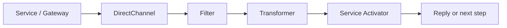
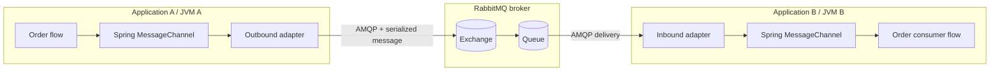
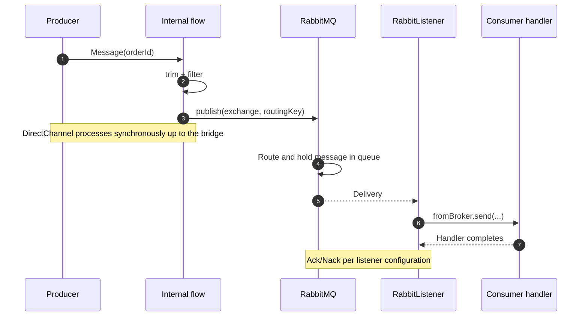
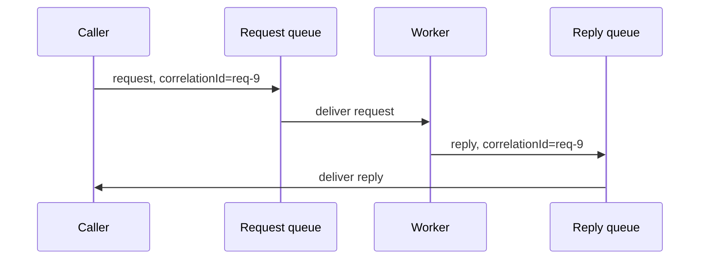
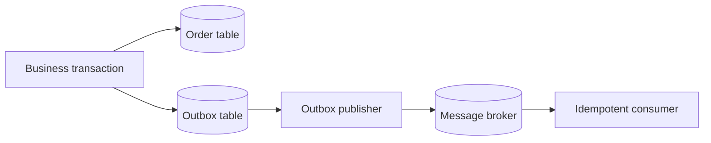

# Message broker — Internal Message Channels and Broker Channels

## Learning Objectives

After completing this lesson, you will be able to:

- Explain how Spring Integration's `MessageChannel` works within an application and distinguish it from a **queue/topic on a message broker**.
- Choose `DirectChannel`, `QueueChannel`, `ExecutorChannel`, or `PublishSubscribeChannel` based on synchronous, asynchronous, and message distribution requirements.
- Describe the message delivery boundary from **Spring Integration flow → outbound adapter/bridge → broker → inbound adapter/bridge → receiving flow**.
- Implement an example of sending and receiving events via RabbitMQ, identifying the roles of exchange, routing key, queue, consumer, and message converter.
- Analyze delivery acknowledgement, retry, duplicates, idempotency, correlation, error channels, and message observability when crossing process boundaries.

This lesson belongs to the **Message broker** chapter of the **SPRING_INTEGRATION_PATTERN** module. The module's goal is to implement Enterprise Integration Patterns with Spring Integration to build loosely coupled, extensible message flows; practicing Router, Filter, Transformer, Splitter, Aggregator, Gateway, retry, error channel, and correlation alongside testing and branch monitoring. Understanding **internal Message Channels and broker channels** properly is the foundation for deciding which steps should be processed locally and which must be handed off to another system.

## 1. Two concepts often both called “channel”

### 1.1. Internal Message Channel

In Spring Integration, `org.springframework.messaging.MessageChannel` is a contract for sending messages within a **running application context**. For example:

```java
public interface MessageChannel {
    boolean send(Message<?> message);
    boolean send(Message<?> message, long timeout);
}
```

A message has a **payload** and **headers**. Endpoints such as Service Activator, Filter, Router, Transformer, and Aggregator can be connected to each other through channels. Diagram of an application:



This **does not automatically mean** the message is sent over TCP, persisted by a broker, or that a service in another JVM can subscribe to a channel bean with the same name. By default configuration, these channels exchange information within a single process. Some channels can use an external `MessageStore` for persistent queuing, but that is still a specific configuration choice, not a default property of every `MessageChannel`.

For example, two microservices that both declare a bean named `orders` will have **two separate channel instances**, unless they are intentionally connected by a communication mechanism.

### 1.2. Broker channel / message destination on a broker

A **message broker** is intermediary infrastructure that receives messages from producers and delivers them to consumers: RabbitMQ, Apache Kafka, or a JMS broker are common examples. The term “broker channel” is often used to mean a **transport path or logical destination on a broker**, such as:

- RabbitMQ: exchange, routing key, and queue.
- JMS: queue or topic.
- Kafka: topic and partition.

These constructs are **not identical** to a Java `MessageChannel`. The connecting piece is a **message-driven adapter**, **outbound adapter/gateway**, or a bridge built by the application. The adapter converts the payload/headers into a transport format, sends them over the network, and converts the received data back into a Spring Integration message.



The boundary to keep in mind is the **adapter/bridge**, where characteristics such as synchronicity, serialization, errors, acknowledgement, and message lifecycle can change.

## 2. Comparing internal channel types

| Channel type | Delivery mechanism | Thread and execution timing | Use cases |
| --- | --- | --- | --- |
| `DirectChannel` | Sends to a matching subscriber | Subscriber handles directly on the sender thread by default | Short flows, synchronous processing, when exceptions need to propagate back to the caller |
| `QueueChannel` | Holds messages for the receiving side to `poll` | Sender enqueues; consumer calls `receive()` or a poller fetches them | Decoupling send/receive timing, small in-application queues |
| `ExecutorChannel` | Dispatches to a subscriber via an executor | Handled on another thread; sender usually returns before the handler finishes | Thread offloading, heavy work, or needing concurrency |
| `PublishSubscribeChannel` | Broadcasts to registered subscribers | Synchronous by default; can be configured with an executor | Broadcasting internal events to multiple handlers |
| Broker queue / topic | Over out-of-process transport | Producer and consumer run independently, following broker contracts | Connecting multiple services, buffering when consumers pause, independent scaling |

A few details that are easy to confuse:

- `DirectChannel` does not have a `receive()` API like a `PollableChannel`; it hands the message off to a subscriber. When a subscriber throws an exception in a synchronous flow, the exception typically propagates back to the sender.
- `QueueChannel` supports `receive(timeout)` and is an in-memory queue by default. It is **not automatically** a RabbitMQ/JMS queue and does not guarantee survival after process termination.
- `ExecutorChannel` introduces asynchronicity within the same application; it does not automatically persist across restarts. Failures in the handler occur after the sender has already received a successful send result.
- `PublishSubscribeChannel` sends to multiple subscribers **within the same application**. This differs from a broker fanning out to multiple services or multiple independent queues.
- `MessageChannel.send(message) == true` indicates that the send step was accepted by the channel according to its contract; it is **not** a final confirmation that all downstream business logic succeeded or that data was committed in another service.

Do not pick a channel just because its name sounds “async”. Determine whether you need messages to survive restarts, need process separation, need fan-out to multiple consumer groups, or simply need thread separation within a single flow.

## 3. When is a broker needed?

An internal Message Channel is usually sufficient if:

- The endpoints belong to the same application and can run in the same JVM.
- Sending/receiving does not need to survive independently when the application stops.
- The goal is only to decouple Router → Transformer → Service Activator steps and manage internal concurrency.
- There is no requirement for multiple microservices in different processes to subscribe to the same stream.

A broker is appropriate when:

- Producers and consumers are **independent in deployment, lifecycle, or scale**.
- Consumers may stop temporarily, while the system still needs to retain messages according to storage and acknowledgement configurations.
- An event must be delivered to multiple consumer groups; for example, a new order triggers shipping, sends notifications, and updates reports.
- You need retry policies, dead-lettering, throttling, backlog monitoring, or event log retention beyond a single process.

A broker also introduces costs: network latency, infrastructure operations, data formatting, schema/versioning, security, duplicate messages, ordering, redelivery, and debugging complexity. Do not add a broker if the scale and business requirements only call for internal channels.

### Delivery models are not the same

| Model | Example | Behavior to watch for |
| --- | --- | --- |
| Point-to-point | One RabbitMQ queue, multiple consumers on the same queue | Consumers compete for work; **not every consumer receives a copy** |
| Publish-subscribe | RabbitMQ exchange connected to multiple separate queues | Each matching queue can receive a copy of the event; consumers on the same queue still compete |
| Partitioned log | Kafka topic split into partitions | Consumer groups distribute partitions; ordering is primarily defined within each partition |
| Internal pub-sub | `PublishSubscribeChannel` with multiple subscribers | In-application delivery; does not automatically provide durability across processes |

For example, if three services all need the `OrderPlaced` event, in RabbitMQ you typically create **three separate queues** bound to the exchange. Creating three consumer instances on a single queue only increases the number of competing workers for **one work group**, not three groups receiving every event.

## 4. Example: Connecting Spring Integration to RabbitMQ

Problem: an application dispatches order ID processing commands via an internal channel `orderCommands`, a Filter drops blank IDs, a Transformer trims whitespace, and then a bridge forwards the order to RabbitMQ. A consumer receives from the broker and feeds it back into the internal `fromBroker` channel for processing.

To make the boundary clear, the example uses **Spring Integration** for the in-JVM steps and **Spring AMQP** (`RabbitTemplate`, `@RabbitListener`) as the bridge. In a real project, you can use **Spring Integration AMQP outbound/inbound channel adapters** so that the same responsibility is declared entirely as an `IntegrationFlow`. Both approaches rely on the same idea: a bridge/adapter connects an internal channel to an out-of-process transport.

Assume the Spring Boot project has the following dependencies:

```groovy
dependencies {
    implementation 'org.springframework.boot:spring-boot-starter-integration'
    implementation 'org.springframework.boot:spring-boot-starter-amqp'
    testImplementation 'org.springframework.boot:spring-boot-starter-test'
}
```

To use Spring Integration's dedicated AMQP adapters, add the `org.springframework.integration:spring-integration-amqp` dependency matching the running Spring Integration version. The example below only uses `RabbitTemplate` and `@RabbitListener`, so that adapter dependency is not needed.

### 4.1. Declaring internal channels and RabbitMQ topology

`OrderMessagingConfiguration.java`:

```java
import org.springframework.amqp.core.Binding;
import org.springframework.amqp.core.BindingBuilder;
import org.springframework.amqp.core.Queue;
import org.springframework.amqp.core.QueueBuilder;
import org.springframework.amqp.core.TopicExchange;
import org.springframework.amqp.rabbit.annotation.EnableRabbit;
import org.springframework.context.annotation.Bean;
import org.springframework.context.annotation.Configuration;
import org.springframework.integration.annotation.EnableIntegration;
import org.springframework.integration.channel.DirectChannel;
import org.springframework.integration.dsl.IntegrationFlow;
import org.springframework.messaging.MessageChannel;

@Configuration
@EnableIntegration
@EnableRabbit
public class OrderMessagingConfiguration {

    @Bean("orderCommands")
    public MessageChannel orderCommands() {
        return new DirectChannel();
    }

    @Bean("toBroker")
    public MessageChannel toBroker() {
        return new DirectChannel();
    }

    @Bean("fromBroker")
    public MessageChannel fromBroker() {
        return new DirectChannel();
    }

    @Bean
    public IntegrationFlow prepareOrderFlow() {
        return IntegrationFlow.from("orderCommands")
            .transform(String.class, String::trim)
            .filter(String.class, orderId -> !orderId.isBlank())
            .channel("toBroker")
            .get();
    }

    @Bean
    public TopicExchange orderExchange() {
        return new TopicExchange("orders.events", true, false);
    }

    @Bean
    public Queue orderCreatedQueue() {
        return QueueBuilder.durable("orders.created.q").build();
    }

    @Bean
    public Binding orderCreatedBinding(
            Queue orderCreatedQueue, TopicExchange orderExchange) {
        return BindingBuilder.bind(orderCreatedQueue)
            .to(orderExchange)
            .with("order.placed");
    }
}
```

The `orderCommands`, `toBroker`, and `fromBroker` beans are **Spring MessageChannels**. Conversely, `orders.events` is a **RabbitMQ topic exchange** and `orders.created.q` is a **RabbitMQ queue**. The binding allows messages with routing key `order.placed` to be routed from the exchange into the queue.

With Spring Boot's RabbitMQ auto-configuration and an appropriate `RabbitAdmin`, the exchange/queue/binding beans are declared on the broker. In plain Spring configuration, you need to register `RabbitAdmin` or explicitly create the topology using operational tools. A running RabbitMQ instance and environment-appropriate connection properties such as `spring.rabbitmq.host`, `port`, `username`, and `password` are required.

**Limitation of this example:** The Filter drops blank strings without emitting an error reply. For command flows requiring confirmation, return a validation error or use an explicit discard channel; if a synchronous caller is waiting for a reply, silent filtering can lead to timeouts.

### 4.2. Bridge publishing from Spring Integration to the broker

`OrderBrokerBridge.java`:

```java
import org.springframework.amqp.rabbit.annotation.RabbitListener;
import org.springframework.amqp.rabbit.core.RabbitTemplate;
import org.springframework.beans.factory.annotation.Qualifier;
import org.springframework.integration.annotation.ServiceActivator;
import org.springframework.messaging.MessageChannel;
import org.springframework.messaging.support.MessageBuilder;
import org.springframework.stereotype.Component;

@Component
public class OrderBrokerBridge {

    private final RabbitTemplate rabbitTemplate;
    private final MessageChannel fromBroker;

    public OrderBrokerBridge(
            RabbitTemplate rabbitTemplate,
            @Qualifier("fromBroker") MessageChannel fromBroker) {
        this.rabbitTemplate = rabbitTemplate;
        this.fromBroker = fromBroker;
    }

    @ServiceActivator(inputChannel = "toBroker")
    public void publish(String orderId) {
        rabbitTemplate.convertAndSend(
            "orders.events",
            "order.placed",
            orderId
        );
    }

    @RabbitListener(queues = "orders.created.q")
    public void receive(String orderId) {
        // From RabbitMQ back into an internal MessageChannel.
        boolean accepted = fromBroker.send(
            MessageBuilder.withPayload(orderId)
                .setHeader("transport", "rabbitmq")
                .build()
        );
        if (!accepted) {
            throw new IllegalStateException("Local channel rejected event");
        }
    }

    @ServiceActivator(inputChannel = "fromBroker")
    public void process(String orderId) {
        // Illustrates an internal handler; replace with actual business logic.
        System.out.println("Processing order event: " + orderId);
    }
}
```

Flow of execution:

1. A producer sends a `Message<String>` containing `" ORD-42 "` into `orderCommands`.
2. The Transformer turns the payload into `"ORD-42"`; the Filter keeps valid messages and forwards them to `toBroker`.
3. `@ServiceActivator` receives the message and calls `RabbitTemplate.convertAndSend(...)`. RabbitMQ routes the message via the exchange, routing key, and binding into the queue.
4. The consumer's `@RabbitListener` pulls the message from the queue, converts the decoded payload back to Java, builds a Spring `Message`, and sends it to `fromBroker`.
5. `@ServiceActivator` on `fromBroker` processes the payload in the receiving application.

How to send an internal request:

```java
import org.springframework.context.ApplicationContext;
import org.springframework.messaging.MessageChannel;
import org.springframework.messaging.support.MessageBuilder;

MessageChannel commands =
    context.getBean("orderCommands", MessageChannel.class);
commands.send(
    MessageBuilder.withPayload(" ORD-42 ").build()
);
```

`context` above is the `ApplicationContext` provided by the application. The example shares one process for both sides of the bridge for learning convenience; when split into two services, service A only keeps the publisher part, while service B keeps the consumer part and its own channel beans. They meet through the **broker**, without sharing `MessageChannel` instances.

### 4.3. Path diagram and changes in semantics



The sender should not treat a successful `commands.send(...)` call as proof that a consumer in another service has finished processing. With a standard `RabbitTemplate.convertAndSend(...)`, a normal return only indicates that the client-side publish operation did not throw an error at that moment; to verify that the broker received and routed it properly, you must configure **publisher confirms** and, where appropriate, **publisher returns/mandatory**. To verify that consumer-side business processing completed, a **business-level acknowledgement** or independent state check is required.

In the sending application, if `toBroker` is a `DirectChannel`, exceptions from the publish bridge can propagate back to the send call. If switched to an `ExecutorChannel`, exceptions can happen on a different thread and must be tracked with appropriate error handling.

## 5. Durability and confirmations are not the same

When using a broker, distinguish at least **three confirmation milestones**:

| Milestone | Who confirms? | What does it prove? |
| --- | --- | --- |
| Sent to internal channel | `MessageChannel` | The message was accepted/handed off to the endpoint per the channel's contract |
| Broker received publish | Publisher confirm, if configured | The broker confirmed handling the publish per its mechanism; does not mean the consumer has finished |
| Consumer finished processing | Consumer acknowledgement and/or business result | The broker can delete/mark the delivery per ack; business outcomes must be checked separately when side effects exist |

A **durable queue** means the queue is declared to survive a broker restart according to its supported mechanism, but persisting messages also involves **persistent delivery mode**, publisher confirms, infrastructure durability, and corresponding broker settings. Do not infer that just because a queue is durable, no message can ever be lost.

### Ack, requeue, and duplicate messages

In Spring AMQP, the listener container typically uses automatic acknowledgement at the **container level**: when the listener returns normally, the container acknowledges the delivery; when the listener throws an exception, the container applies its error policy, which may reject/requeue depending on configuration. “AUTO” here **does not mean ack immediately upon receipt**, nor does it guarantee that the business transaction is always atomic with the ack.

Consider this scenario:

1. The consumer receives `OrderPlaced(eventId=evt-17)`.
2. The consumer writes the order to the DB successfully.
3. The process crashes before RabbitMQ records the acknowledgement.
4. The broker may redeliver the **same message** after the consumer restarts.

If the handler does not check `eventId` or a business key, it may create duplicate data. Therefore, in *at-least-once* delivery models, consumers need **idempotency/deduplication**.

Be careful when replacing `fromBroker` with an `ExecutorChannel`: `fromBroker.send(...)` can return **before the handler actually finishes**. The listener might return successfully and the broker receive an ack even though work on another thread is still running. If an ack is required only after commit, clearly design the ack timing, transaction boundaries, or a mechanism to persist work before asynchronous handoff.

### Retry and dead-letter

If a consumer fails repeatedly and the broker always requeues, a “poison message” can create a failure loop. Production policies typically include:

- Classifying transient errors (e.g., downstream 503) versus permanent errors (invalid schema, malformed data).
- Retrying with **max attempts**, backoff, and rate/load limits; avoiding infinite retries directly inside the consumer.
- Once attempts are exhausted, routing the message to a **dead-letter queue (DLQ)** or configured quarantine storage, along with the failure reason, ID, and attempt count.
- Monitoring pending, unacked, redelivered, and dead-letter message counts; defining a safe replay procedure.

An `errorChannel` in Spring Integration helps capture `ErrorMessage`s from flow segments configured to route errors to a channel; **it does not automatically replace** RabbitMQ's nack/requeue/DLQ. Error channels handle errors inside the application, whereas delivery acknowledgement is a protocol between the consumer and the broker. When connecting the two, specify where errors should cause the listener to throw an exception and where errors are intentionally handled.

## 6. Serialization, headers, and correlation across a broker

Inside a JVM, a payload can be a Java object and the `replyChannel` header can even hold a `MessageChannel` instance. When crossing a broker, the message must be converted into a **transport format**. A broker consumer in another JVM cannot directly use a channel object reference from the producer.

Elements that should be standardized:

| Element | Example | Convention |
| --- | --- | --- |
| `eventId` | `evt-17` | Deduplication key for a specific event |
| `aggregateId` / `orderId` | `ORD-42` | Grouping key by business entity |
| `correlationId` | `trace-82` | Links logs/traces across processing steps, replies, and events |
| `causationId` | `cmd-12` | Indicates which command/event triggered this message |
| `schemaVersion` | `1` | Supports payload structure evolution |
| `occurredAt` | UTC ISO-8601 | Distinguishes occurrence time from broker delivery time |
| Content type | `application/json` | Declares how to decode the payload |
| Routing key/topic | `order.placed` | Broker distribution rule, not an in-JVM bean name |

Example of a **recommended production event payload** instead of the lesson's minimal `String`:

```json
{
  "eventId": "evt-17",
  "eventType": "OrderPlaced",
  "schemaVersion": 1,
  "orderId": "ORD-42",
  "occurredAt": "2026-11-21T05:00:00Z"
}
```

To actually send/receive JSON, you need to configure compatible message converters on the publisher/consumer, along with schemas and field mappings. The Spring AMQP snippet in section 4 uses `String` to avoid serializer dependencies; **you cannot replace it with a Java record and expect JSON automatically** without configuring a converter.

When messages traverse multiple transports, check which headers are mapped. The `replyChannel` header is internal routing information, not a reply address that can be unconditionally serialized. For request–reply over a broker, define the **reply destination**, correlation ID, timeout, and late-reply handling at the corresponding protocol/adapter level. Do not assume an internal synchronous `@MessagingGateway` will automatically create cross-service RPC just by using a queue.

## 7. Request–reply with a broker differs from one-way events

The order example above is **one-way publish/consume**: the producer emits an event, and the consumer processes it. In Remote Procedure Invocation or Request–Reply over a broker, the caller also needs a corresponding response:



This pattern additionally requires:

1. Defining a **reply queue/destination** that the worker can access.
2. Preserving the **correlation ID** across request and reply, especially when multiple calls run concurrently.
3. Setting a timeout on the caller; when the worker sends a reply after the timeout, there is a **late reply** that must be handled explicitly.
4. Safe retries; avoiding duplicate business execution if a message is redelivered.
5. Cleaning up pending state and deciding who receives the reply if the caller has restarted.

A broker does not automatically turn asynchronous communication into a synchronous call with “exactly once” semantics. If a business operation is long-running, it is often better to send a command with a `requestId` and let the caller query status or receive a completion event.

## 8. DB consistency and event publishing

Placed inside the same Service Activator:

```text
1. INSERT orders into the database
2. Publish OrderPlaced via RabbitMQ
```

These two steps do not automatically belong to the same distributed transaction. If the DB commits successfully but publishing fails, downstream services never receive the event. If publishing succeeds but the DB transaction rolls back, downstream services may receive an event for an order that does not exist.

**Transactional outbox** is a common approach:



The application writes the business change and an outbox record **in the same DB transaction**. An independent publisher reads the outbox, publishes to the broker, and marks the record as published after receiving an appropriate confirmation. If the publisher crashes midway, it may resend, so consumers still need deduplication by `eventId`.

On the receiving side, an **inbox/dedup table** can be used to record processed `eventId`s and execute side effects within the same transaction. This reduces the risk of duplication on redelivery; it does not turn the entire distributed system into a single atomic transaction.

## 9. Observing and testing the boundary

### 9.1. Testing internal channel behavior

A small JUnit 5 test demonstrates that `DirectChannel` dispatches messages to an internal subscriber and `QueueChannel` can be used to capture the result:

```java
import static org.junit.jupiter.api.Assertions.assertEquals;
import static org.junit.jupiter.api.Assertions.assertNotNull;
import static org.junit.jupiter.api.Assertions.assertTrue;

import org.junit.jupiter.api.Test;
import org.springframework.integration.channel.DirectChannel;
import org.springframework.integration.channel.QueueChannel;
import org.springframework.messaging.Message;
import org.springframework.messaging.support.MessageBuilder;

class InternalChannelTest {

    @Test
    void sendsToSubscribedHandlerWithinSameApplication() {
        DirectChannel input = new DirectChannel();
        QueueChannel captured = new QueueChannel(1);

        input.subscribe(message -> {
            captured.send(message);
        });

        assertTrue(input.send(
            MessageBuilder.withPayload("ORD-42").build()
        ));

        Message<?> received = captured.receive(1_000);
        assertNotNull(received);
        assertEquals("ORD-42", received.getPayload());
    }
}
```

This test proves in-memory dispatch capability. It **does not test** RabbitMQ, network failures, durability, or acknowledgements from a consumer in another process.

### 9.2. Broker integration testing

With a running RabbitMQ instance or Testcontainers RabbitMQ, verify independently:

1. The producer sends `" ORD-42 "` via `orderCommands`; the message arrives on the queue with the normalized payload `"ORD-42"`.
2. The consumer registered on `orders.created.q` receives the message and forwards the payload into `fromBroker`.
3. Two consumer groups with **two separate queues** both receive the published event; two consumers on the **same queue** share the workload.
4. Stop the consumer before publishing, then start it again: verify that the message is retained/delivered according to actual durability, TTL, ack, and retention settings.
5. Trigger an error in the consumer before ack: verify redelivery or dead-lettering per configuration; deduplication prevents a second side effect.
6. Publish with a routing key that matches no binding: verify publisher returns/mandatory or the configured unroutable message detection mechanism.

Use a unique event ID per test and purge queues between tests so results do not leak across runs. Check each milestone: producer send, broker confirm, consumer receipt, business commit, and ack. Do not use a single “send succeeded” assertion to represent the entire chain.

### 9.3. Metrics and logs to collect

| Location | Required observability |
| --- | --- |
| Internal channel | Message count sent, handler processing duration, errors/timeouts, queue depth if applicable |
| Outbound bridge | Publish attempts, exceptions, publisher confirms, unroutable returns |
| Broker | Ready/unacked counts, backlog, redelivered, DLQ, queue latency |
| Inbound bridge | Messages received, consumer concurrency, processing duration, nack/requeue |
| Business logic | `eventId`/`correlationId`, processing outcome, dedup hits, transaction status |

On every log entry, preserve the same `eventId` or `correlationId` from producer to consumer. Avoid logging tokens, passwords, and full sensitive payloads. If using Micrometer or distributed tracing, configure spans/baggage according to the adapter's capabilities and propagator configuration; do not assume tracing automatically propagates across every broker.

## 10. Common design mistakes

| Mistake | Consequence | Fix |
| --- | --- | --- |
| Assuming `QueueChannel` is a broker by default | Messages lost on application restart; other processes cannot subscribe | Use a broker/adapter when cross-process communication is actually needed, or design an appropriate persistent store |
| Sharing the same channel bean name across two services | The two channels remain completely separate | Define concrete broker endpoints, routing, and transport |
| Assuming `send()` succeeding means remote business logic is done | Marking completion prematurely | Track confirms, delivery, and business state at each layer |
| One queue with multiple consumers while expecting every consumer to receive every event | Only one competing consumer in the group receives each delivery | Create separate queues/bindings for each group that needs a copy |
| Acking before asynchronous work completes | Tasks may be lost if the worker crashes | Ack after processing/commit or persist work durably before acking |
| Infinite requeue on malformed payload | Poison message loop | Bounded retries, error classification, DLQ, and alerting |
| No deduplication after redelivery | Duplicate DB writes, emails, or charges | Idempotency by `eventId`/business key |
| Only creating a durable queue | Mistakenly assuming every publish is durable | Configure message persistence, confirms, HA, and recovery |
| Serializing a `MessageChannel` object in a header | A consumer in another JVM cannot use an internal reference | Use a transport reply destination and correlation |
| Changing event schema without versioning | Older consumers fail to parse or misinterpret payloads | Version schemas, test compatibility, apply explicit converters |

## 11. Practice exercises

**Exercise 1 — Internal channels only.** Build the flow `ordersInput → Filter → Transformer → Service Activator`. Replace `DirectChannel` with `ExecutorChannel`, and observe how the executing thread and error reporting change.

**Exercise 2 — Switch the endpoint to a broker.** Use `OrderMessagingConfiguration` and `OrderBrokerBridge` from section 4. Run RabbitMQ, send `" ORD-42 "`, and verify that the content on the queue is `"ORD-42"` and the consumer processed it.

**Exercise 3 — One queue or multiple queues?** Add another queue `orders.analytics.q` and bind it with the same routing key `order.placed`. Attach two consumers to `orders.created.q` and one consumer to `orders.analytics.q`. Observe how work sharing and pub-sub differ.

**Exercise 4 — Crash and redelivery.** Simulate a consumer that writes to the DB and then throws an exception before ack. Design `eventId` persistence so that upon redelivery, the consumer does not write a duplicate.

**Exercise 5 — No route.** Publish to the exchange with a routing key that matches no binding. Enable publisher confirms and mandatory returns according to appropriate configuration; compare “broker received publish” and “message routed to queue”.

**Exercise 6 — Request–reply over a broker.** Propose a reply destination, correlation ID, and timeout for a long-running worker. Write a policy for when a reply arrives after the caller has already timed out.

**Completion criteria:** for a given message, draw its complete path from producer to consumer, point out the JVM/broker boundary, identify which component is responsible for storage and ack, how retries/duplicates are detected, and how business completion is verified.

## 12. Key takeaways

- Spring Integration's `MessageChannel` is a contract for connecting endpoints **within a single application**; `DirectChannel`, `QueueChannel`, `ExecutorChannel`, and `PublishSubscribeChannel` have different semantics but do not automatically connect multiple services.
- A **broker channel** is a message path through out-of-process infrastructure (queue, topic, exchange/partition depending on the broker). An adapter/bridge is required to bridge the two worlds.
- `send()`, broker publisher confirm, consumer ack, and business commit are **different confirmation milestones**.
- When crossing a broker, you must design serialization, schemas, correlation, retries, dead-lettering, idempotency, and observability.
- Choose internal channels for local processing steps; use a broker when you need process decoupling, message retention while consumers are down, or distribution to multiple consumer groups under an explicit operational contract.
