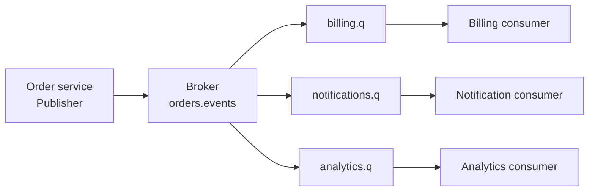
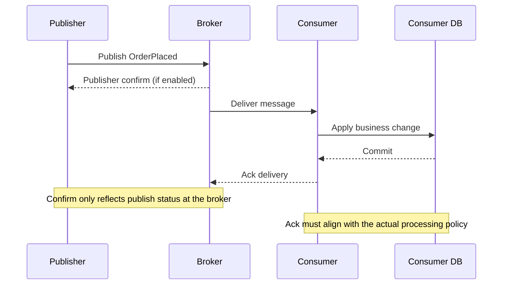
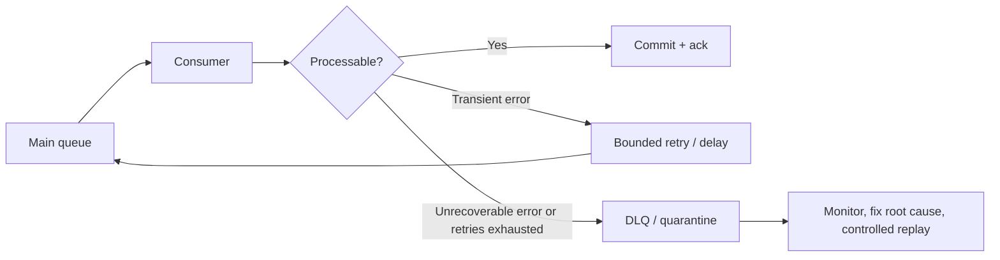
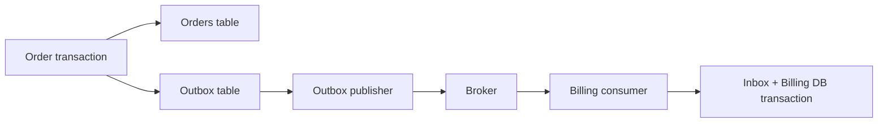

# Publish and Consume via a Broker with Spring Integration

## 1. The problem: decoupling event emission from event handling

In the **Message broker** chapter of the **SPRING_INTEGRATION_PATTERN** module, we apply **Enterprise Integration Patterns** with Spring Integration to organize loosely coupled, scalable, and observable message flows. This lesson focuses on two core actions:

- **Publish**: push a message onto a broker so interested systems can receive and process it.
- **Consume**: pull a message from a queue/topic/subscription, pass it into the application's processing flow, and acknowledge the outcome according to the delivery policy.

Suppose the **Order** service finishes saving an order and emits an `OrderPlaced` event. The **Billing** service needs to create a payment record; **Notification** needs to send a notification; **Analytics** needs to update statistics. If Order calls all three systems directly, one slow downstream system can prolong Order's processing time, and adding a new consumer forces Order to know about a new target destination.

Instead, Order publishes one event to a broker. Each service subscribes via its corresponding queue or consumer group.



The diagram illustrates **one event fanned out to multiple functional groups**. Within each group's queue, multiple consumers can run concurrently to share processing of that queue's messages. These are two distinct relationships: **broadcast between groups** and **competing consumers within a group**.

By the end of this lesson, you will be able to:

1. Explain exchange, routing key, queue, binding, topic, subscription, acknowledgment, and offset.
2. Build a publish/consume flow in Spring Integration, illustrated with RabbitMQ via Spring AMQP.
3. Distinguish confirmations of sent, received, processed, and business-committed states.
4. Design retry, dead-lettering, idempotency, and correlation when messages are sent or processed more than once.
5. Diagnose backlog, routing errors, poison messages, and failures during consumer restarts.
6. Compare differences among RabbitMQ, Kafka, and JMS to choose an appropriate mechanism.

## 2. Publish/subscribe does not mean every consumer receives every message

### 2.1. Core components

| Component | Role | Notes |
| --- | --- | --- |
| **Publisher / Producer** | Sends messages to the broker | Must handle network errors, retries, and publish confirmations |
| **Broker** | Intermediary that receives, stores/routes, and distributes messages | Durability depends on the product and configuration |
| **Exchange / Topic** | Ingress or classification point for messages | RabbitMQ uses exchanges; Kafka uses topics |
| **Routing key / Partition key** | Selects the destination or related data group | Semantics depend on the broker |
| **Queue / Subscription / Consumer group** | Where consumers pull messages from | Can represent a work group |
| **Consumer** | Reads and processes messages | Must manage errors, acknowledgments, and idempotency |
| **Ack / Offset commit** | Marks receive/processing progress with the broker | **Does not automatically mean** the business transaction has committed |
| **Dead-letter destination** | Holds messages that could not be processed per policy | Used for analysis, remediation, and controlled reprocessing |

In RabbitMQ, a publisher typically sends to an **exchange**, which then forwards to queues based on bindings/routing keys. In Kafka, a producer sends to a **topic partition**, and consumers in the same group divide partitions among themselves. Do not carry RabbitMQ's exchange/queue model directly onto Kafka because distribution, storage, and acknowledgment mechanics differ.

### 2.2. Two common distribution patterns

**Fan-out across services**

```text
           +--> billing.queue       --> Billing
Order ---> +--> notification.queue  --> Notification
           +--> analytics.queue     --> Analytics
```

Each processing group has its own queue/subscription. The same event can be processed independently by each group.

**Competing consumers within the same group**

```text
billing.queue --> Billing worker A
              --> Billing worker B
              --> Billing worker C
```

Workers read from the same queue to share the workload. A message is normally delivered to one consumer at a time within the same queue, but **may be redelivered** if not properly acknowledged or if the connection drops.

### 2.3. How do events and commands differ?

- An **Event** states what has happened: `OrderPlaced`, `PaymentCaptured`. Multiple subscribers may care.
- A **Command** requests specific work to be done: `ReserveStock`, `GenerateInvoice`. Usually targets a single owning recipient.
- **Request–reply over a broker** requires a reply destination, correlation ID, and timeout; it is a different communication style from fire-and-forget events.

For example, an event should be named in the past tense and carry enough data for consumers to understand what occurred. The broker is only responsible for transport; business events still require defined contracts, versions, and owners.

## 3. Message path and four levels of “success”

One of the most common design mistakes is logging “publish success” and assuming other services have already updated their data.



There are at least four milestones:

1. **Caller sends message to the adapter**: the application-side publish call has been invoked.
2. **Broker confirms publish**: the broker has received/handled the publish to the degree guaranteed by its contract.
3. **Broker delivers message to the consumer**: the consumer gets a chance to process it.
4. **Consumer commits business side effects and then acknowledges**: processing is considered complete per system policy.

These milestones are not interchangeable. A publisher confirm **does not** mean the consumer has created an invoice. Nor does a consumer ack prove a commit occurred if code acks before the data transaction completes.

### 3.1. Delivery guarantees

| Guarantee level | Meaning | Trade-off |
| --- | --- | --- |
| **At-most-once** | Messages may be lost; no retry on failure | Fewer duplicates, but data loss can occur |
| **At-least-once** | May redeliver when not yet acknowledged | Consumers must handle duplicates safely |
| **Exactly-once processing/effect** | Side effects are controlled not to duplicate within a defined guarantee scope | Requires coordination of transactions, deduplication, and explicit contracts |

In typical event-driven design, **prepare for duplicates by default** and make consumers idempotent. Some brokers support transactions or exactly-once semantics within their internal product boundary, but cannot automatically guarantee external actions such as HTTP calls, emails, or updates to another database happen exactly once.

## 4. Design the message contract before writing code

Example event when an order is accepted:

```json
{
  "eventId": "evt-9de71",
  "eventType": "OrderPlaced",
  "schemaVersion": 1,
  "orderId": "ord-2408",
  "amountCents": 259900,
  "currency": "VND",
  "occurredAt": "2026-11-21T03:10:30Z"
}
```

Role of each field:

| Field | Why is it needed? |
| --- | --- |
| `eventId` | Unique identifier of the event for deduplication in each consumer |
| `eventType` | Identifies the business event that occurred |
| `schemaVersion` | Supports contract evolution over time |
| `orderId` | Business key and potentially a key for preserving per-order ordering |
| `amountCents`, `currency` | Keeps units explicit and avoids floating-point precision issues |
| `occurredAt` | Timestamp when the event occurred, independent of broker delivery time |

An event can carry metadata such as `traceId`, `correlationId`, `tenantId`, or producer version in headers. **Event ID** is for duplicate detection; **correlation ID** is for tracing relationships across messages; the two concepts can be related but should not be assumed to be identical.

**Contract rule:** the consumer must validate event type, schema version, required fields, and tenant scope before executing side effects. If a schema is unsupported, have a clear policy to route the error to dead-letter/quarantine rather than misreading it and acking as a success.

## 5. Spring Integration example with RabbitMQ

This example implements an `Order` producer and a `Billing` consumer using **Spring Integration + Spring AMQP**. We use RabbitMQ as the illustrative broker; publish/consume principles can transfer to other brokers, though APIs and delivery guarantees must be redesigned accordingly.

### 5.1. Components and dependencies

For a Spring Boot application using Gradle, include dependencies matching the BOM of the Boot version in use:

```groovy
dependencies {
    implementation 'org.springframework.boot:spring-boot-starter-integration'
    implementation 'org.springframework.boot:spring-boot-starter-amqp'
    implementation 'org.springframework.integration:spring-integration-amqp'

    // Database integration when implementing inbox/outbox:
    implementation 'org.springframework.boot:spring-boot-starter-jdbc'
    runtimeOnly 'org.postgresql:postgresql'
}
```

A running RabbitMQ instance and environment-appropriate connection details are required. In a development environment, an example configuration is:

```yaml
spring:
  rabbitmq:
    host: localhost
    port: 5672
    username: guest
    password: guest
```

This is a **local configuration example**, not credentials for production. In production, fetch credentials from a secret manager, use TLS, apply least-privilege permissions per vhost/exchange/queue, and manage topology through controlled configuration.

### 5.2. Exchange, queue, and binding

We use the topic exchange `orders.events`. Billing has its own queue `billing.order-events.q` and receives only the `order.placed` routing key.

```java
import org.springframework.amqp.core.Binding;
import org.springframework.amqp.core.BindingBuilder;
import org.springframework.amqp.core.Queue;
import org.springframework.amqp.core.QueueBuilder;
import org.springframework.amqp.core.TopicExchange;
import org.springframework.amqp.core.ExchangeBuilder;
import org.springframework.context.annotation.Bean;
import org.springframework.context.annotation.Configuration;

@Configuration
public class BrokerTopology {

    public static final String EXCHANGE = "orders.events";
    public static final String BILLING_QUEUE = "billing.order-events.q";
    public static final String ORDER_PLACED_KEY = "order.placed";

    @Bean
    public TopicExchange ordersExchange() {
        return ExchangeBuilder.topicExchange(EXCHANGE)
            .durable(true)
            .build();
    }

    @Bean
    public Queue billingOrderEventsQueue() {
        return QueueBuilder.durable(BILLING_QUEUE).build();
    }

    @Bean
    public Binding billingOrderBinding(
            Queue billingOrderEventsQueue,
            TopicExchange ordersExchange) {
        return BindingBuilder.bind(billingOrderEventsQueue)
            .to(ordersExchange)
            .with(ORDER_PLACED_KEY);
    }
}
```

**Durable exchange/queue** declares topology that survives restarts per RabbitMQ's mechanism, but does not by itself guarantee every message is durably written. You must also consider message delivery mode, publisher confirms, queue type, replication, and broker policies.

When multiple services receive `OrderPlaced`, create a separate queue for each service and bind it appropriately to the exchange. Do not let Billing and Notification share a single queue if **both** are required to process every event.

### 5.3. Declaring a Gateway for the publisher

A fire-and-forget publish call can be represented by a gateway returning `void`. The gateway forwards the payload to a channel managed by Spring Integration.

```java
import org.springframework.integration.annotation.MessagingGateway;

@MessagingGateway(defaultRequestChannel = "outboundOrderEvents")
public interface OrderEventGateway {
    void publish(String eventJson);
}
```

Appropriate Spring Integration mechanisms must be enabled to register the gateway. The following example uses `@EnableIntegration` and `@IntegrationComponentScan`.

### 5.4. Outbound AMQP adapter for publishing

```java
import org.springframework.amqp.rabbit.core.RabbitTemplate;
import org.springframework.context.annotation.Bean;
import org.springframework.context.annotation.Configuration;
import org.springframework.integration.amqp.dsl.Amqp;
import org.springframework.integration.annotation.IntegrationComponentScan;
import org.springframework.integration.config.EnableIntegration;
import org.springframework.integration.dsl.IntegrationFlow;

@Configuration
@EnableIntegration
@IntegrationComponentScan
public class OrderPublishFlowConfig {

    @Bean
    public IntegrationFlow publishOrderFlow(RabbitTemplate rabbitTemplate) {
        return IntegrationFlow
            .from("outboundOrderEvents")
            .handle(Amqp.outboundAdapter(rabbitTemplate)
                .exchangeName(BrokerTopology.EXCHANGE)
                .routingKey(BrokerTopology.ORDER_PLACED_KEY))
            .get();
    }
}
```

Mechanism:

1. Caller invokes `OrderEventGateway.publish(json)`.
2. The gateway sends the message to the `outboundOrderEvents` channel.
3. `Amqp.outboundAdapter(...)` converts the payload into an AMQP message and publishes it to `orders.events`.
4. RabbitMQ routes the message to the queue bound with `order.placed`.

In this example, the publisher sends a JSON string. With Spring AMQP's default converter, `String` is typically sent as a text payload, so the consumer in the example receives a `String`. If using a custom JSON converter, byte array, or binary schema, ensure content type and converters on both sides are compatible.

**Note:** the gateway method returning without throwing an exception only proves that the call/adapter path completed under the current configuration. It is not proof that the message was persisted durably or processed by a consumer. If stronger guarantees are needed, implement publisher confirm/return and an outbox at the appropriate step.

### 5.5. Producer creating JSON from a domain event

```java
public record OrderPlacedEvent(
    String eventId,
    String eventType,
    int schemaVersion,
    String orderId,
    long amountCents,
    String currency,
    String occurredAt
) {}
```

```java
import com.fasterxml.jackson.core.JsonProcessingException;
import com.fasterxml.jackson.databind.ObjectMapper;
import org.springframework.stereotype.Component;

@Component
public class OrderEventPublisher {

    private final OrderEventGateway gateway;
    private final ObjectMapper objectMapper;

    public OrderEventPublisher(
            OrderEventGateway gateway,
            ObjectMapper objectMapper) {
        this.gateway = gateway;
        this.objectMapper = objectMapper;
    }

    public void publishOrderPlaced(OrderPlacedEvent event) {
        try {
            String json = objectMapper.writeValueAsString(event);
            gateway.publish(json);
        } catch (JsonProcessingException ex) {
            throw new IllegalArgumentException(
                "Cannot serialize OrderPlaced event", ex);
        }
    }
}
```

`eventId` must be generated **once per business event**, then stored for reuse if republishing is needed. If every retry generates a new event ID, consumers cannot easily detect redeliveries of the same event.

To avoid losing events when the order creation transaction commits but the process crashes before publishing, production systems should use a **transactional outbox**. Section 8 describes this.

### 5.6. Inbound adapter for consuming

In the Billing service, configure the flow that receives messages from the queue:

```java
import org.springframework.amqp.rabbit.connection.ConnectionFactory;
import org.springframework.context.annotation.Bean;
import org.springframework.context.annotation.Configuration;
import org.springframework.integration.amqp.dsl.Amqp;
import org.springframework.integration.config.EnableIntegration;
import org.springframework.integration.dsl.IntegrationFlow;

@Configuration
@EnableIntegration
public class BillingConsumeFlowConfig {

    @Bean
    public IntegrationFlow billingConsumeFlow(
            ConnectionFactory connectionFactory,
            BillingEventHandler handler) {

        return IntegrationFlow
            .from(Amqp.inboundAdapter(
                connectionFactory, BrokerTopology.BILLING_QUEUE))
            .handle(handler, "handleOrderPlaced")
            .get();
    }
}
```

The adapter receives the AMQP delivery and feeds the payload into the Spring Integration flow. `handle(handler, "handleOrderPlaced")` routes the message to a consumer Java method. By chaining additional `Filter`, `Transformer`, `Router`, or `Service Activator` steps, the consumer can build a more sophisticated processing flow.

To keep the example easy to observe, the flow here **processes synchronously on the receiving path** and returns control after business logic completes. If replaced with an `ExecutorChannel` or handed off to another thread and returned immediately, ack timing must be re-evaluated: the adapter may consider delivery complete before business processing finishes.

### 5.7. Consumer validating schema and invoking the use case

```java
import com.fasterxml.jackson.core.JsonProcessingException;
import com.fasterxml.jackson.databind.ObjectMapper;
import org.springframework.stereotype.Component;

@Component
public class BillingEventHandler {
    private final ObjectMapper objectMapper;
    private final BillingUseCase billing;

    public BillingEventHandler(
            ObjectMapper objectMapper,
            BillingUseCase billing) {
        this.objectMapper = objectMapper;
        this.billing = billing;
    }

    public void handleOrderPlaced(String json) {
        final OrderPlacedEvent event;
        try {
            event = objectMapper.readValue(json, OrderPlacedEvent.class);
        } catch (JsonProcessingException ex) {
            throw new IllegalArgumentException(
                "Malformed OrderPlaced event", ex);
        }

        if (!"OrderPlaced".equals(event.eventType())
                || event.schemaVersion() != 1
                || event.eventId() == null
                || event.eventId().isBlank()
                || event.orderId() == null
                || event.orderId().isBlank()
                || event.amountCents() <= 0) {
            throw new IllegalArgumentException(
                "Unsupported or invalid OrderPlaced event");
        }

        billing.applyOnce(event);
    }
}
```

Throw an exception to signal to the consumer's error-handling mechanism that the message **was not processed successfully**. However, what happens next (requeue, retry, move to DLQ, log and ack) depends on the listener container and error flow configuration. Do not assume every exception causes the broker to redeliver.

### 5.8. Safely handling duplicate deliveries

We must ensure that the same `eventId` does not create two invoices. One approach is an inbox table and a unique constraint in the **same transaction** as the business change.

Example PostgreSQL schema:

```sql
CREATE TABLE billing_inbox (
    subscriber_id VARCHAR(80) NOT NULL,
    event_id VARCHAR(160) NOT NULL,
    processed_at TIMESTAMPTZ NOT NULL DEFAULT now(),
    PRIMARY KEY (subscriber_id, event_id)
);

CREATE TABLE billing_invoice (
    event_id VARCHAR(160) PRIMARY KEY,
    order_id VARCHAR(160) NOT NULL,
    amount_cents BIGINT NOT NULL
);
```

Example use case using `JdbcTemplate`:

```java
import org.springframework.jdbc.core.JdbcTemplate;
import org.springframework.stereotype.Service;
import org.springframework.transaction.annotation.Transactional;

@Service
public class BillingUseCase {
    private static final String SUBSCRIBER = "billing";
    private final JdbcTemplate jdbc;

    public BillingUseCase(JdbcTemplate jdbc) {
        this.jdbc = jdbc;
    }

    @Transactional
    public void applyOnce(OrderPlacedEvent event) {
        int claimed = jdbc.update("""
            INSERT INTO billing_inbox (subscriber_id, event_id)
            VALUES (?, ?)
            ON CONFLICT (subscriber_id, event_id) DO NOTHING
            """, SUBSCRIBER, event.eventId());

        if (claimed == 0) {
            // Already processed this event previously.
            return;
        }

        jdbc.update("""
            INSERT INTO billing_invoice
                (event_id, order_id, amount_cents)
            VALUES (?, ?, ?)
            """,
            event.eventId(),
            event.orderId(),
            event.amountCents()
        );
    }
}
```

The guarantee lies in the transaction: if inserting the invoice fails, the inbox insert also rolls back, allowing a subsequent redelivery to retry. Two concurrent consumers encountering the same event ID are governed by the unique constraint; one wins the claim while the other receives a conflict/no-op outcome per DB rules.

**Limitation of this example:** This flow handles **a single side effect in the same database**. If Billing also makes HTTP calls, sends emails, or publishes a second event, the JDBC transaction does not automatically cover those external side effects. In that case, an outbox, downstream idempotency, or compensation mechanism is required. In practice, you should also scope `eventId` to the producer/tenant and, if key reuse is a risk, verify a payload fingerprint.

## 6. Acknowledgment: when does the broker consider a message processed?

With RabbitMQ, common acknowledgment modes are:

- **AUTO acknowledgment by the listener container**: the container handles ack/nack after the invocation finishes according to policy; **different from** the raw AMQP protocol auto-ack mode.
- **MANUAL**: the application explicitly manages ack/nack using the delivery tag/channel when fine-grained control is needed.
- **NONE**: messages may be considered delivered without waiting for consumer acknowledgment at this layer.

In the example flow, synchronous processing lets the listener container observe exceptions thrown by the handler. Requeue/republish/dead-letter policies must be intentionally configured.

### 6.1. Three failure modes to distinguish

| Failure mode | What the broker may observe | Risk |
| --- | --- | --- |
| Consumer crashes **before** DB commit, not yet acked | Delivery has not been acknowledged | Message can be redelivered; consumer must retry safely |
| DB commit succeeds, consumer crashes **before** ack | Delivery has not been acknowledged | Message can be redelivered even though the effect already completed |
| Consumer acks **before** DB commit, then DB fails | Delivery has already been acknowledged | Work may be lost with no further redelivery |

The standard approach is to **commit idempotent side effects first, then ack**. This still allows duplicates if a crash occurs right between commit and ack, but the consumer recognizes the duplicate and handles it safely.

### 6.2. Do not swallow exceptions unconditionally

Example of incorrect handling:

```java
public void handleOrderPlaced(String json) {
    try {
        process(json);
    } catch (Exception ex) {
        log.error("Processing failed", ex);
        // Swallowing the exception: the listener may treat processing as successful.
    }
}
```

If the flow neither throws an error nor emits an appropriately handled failure state, the broker may ack the message and never redeliver it even though the business logic failed. Spring Integration's error channel must be inspected similarly: **if an error flow consumes the exception and returns control as handled**, understand how that affects ack/retry at the adapter.

Instead, define a policy: which errors should be retried, which should go to dead-letter, and which are recognized as business rejections that are still treated as handled.

### 6.3. Prefetch and concurrency

A consumer can receive multiple unacked messages before completing them. **Prefetch** controls how many deliveries are dispatched ahead of time; **concurrency** controls how many consumers/workers process in parallel.

- Too high a prefetch can cause load imbalance or leave many unprocessed messages buffered on a single consumer.
- Higher concurrency improves throughput but can break observable ordering and increase DB contention.
- Long-blocking handlers increase queue backlog; optimize processing, set deadlines, and scale with control.
- When using a container created/managed by a Spring Integration inbound adapter, configure prefetch/concurrency directly on the **corresponding listener container**. Do not assume another Spring Boot listener property automatically applies to every custom container.

## 7. Retry, dead-letter, and poison messages

Messages from a broker can encounter transient errors (database unavailable) or unrecoverable errors (malformed JSON, unsupported schema version, inconsistent data). If immediately requeued every time, a poison message can loop indefinitely and consume resources.



### 7.1. Classifying errors by recoverability

| Error | Example | Typical action |
| --- | --- | --- |
| **Transient** | Brief DB disconnect, temporary timeout | Bounded retry with backoff/jitter |
| **Permanent/contract** | Invalid schema, unsupported event type | Dead-letter/quarantine and alert |
| **Business rejection** | Not eligible for invoicing per rules | Persist rejection outcome; decide whether to ack or emit an error event |
| **Unknown outcome** | External non-DB side effect may have occurred, reply lost | Reconcile before retrying if retry could cause duplicate effects |
| **Infrastructure failure** | Broker or consumer restart | Recover via at-least-once delivery and idempotency |

Set **max attempts** and distinguish handler-level retries (in-process) from broker-level redeliveries. Two overlapping retry layers can multiply the number of attempts dramatically without a shared cap.

### 7.2. Delayed retry and DLQ

One strategy is using a retry queue with a TTL that routes back to the main queue, or broker-appropriate delayed delivery features. RabbitMQ's dead-letter exchange (DLX) can route rejected/nacked or expired messages to another queue based on configuration.

Record the following information:

- `eventId`, error type, attempt count, start timestamp, and consumer version.
- Do not corrupt or discard the original payload when moving to the DLQ.
- Maintain a runbook to inspect, fix code/data, and replay selectively.
- Never bulk-replay a DLQ automatically without idempotency and impact assessment.

Note: **a DLQ is not created by default just because code throws an exception**. You must declare the destination, routing/dead-letter policy, retry configuration, and nack/reject behavior appropriate for the adapter/container in use.

### 7.3. Error channel in Spring Integration

Spring Integration can wrap exceptions inside a flow as an `ErrorMessage` and send them to `errorChannel` or a specific channel depending on the endpoint. An error flow can be used for logging, classification, emitting metrics, and deciding on recovery.

However, separate two responsibilities:

1. **Business recovery**: ensure state/side effects are handled safely, including duplicates.
2. **Broker settlement**: ack/nack/requeue/dead-letter accurately reflecting the processing outcome.

An error handler that only logs does not automatically accomplish both. Test the actual outcome on the broker, especially across asynchronous boundaries and when exceptions are caught by a handler.

## 8. Transactional outbox and inbox: preventing lost or duplicated events

### 8.1. The dual-write gap on the producer

Suppose the code is:

```java
orderRepository.save(order);
eventGateway.publish(orderEventJson);
```

If the database commits but publishing fails, the system has an order with no event. If publishing happens before DB commit, consumers may process the event while the Order transaction later rolls back.

**Transactional outbox** resolves this by writing the order and an event record to publish **within the same Order database transaction**.



Steps:

1. The Order transaction writes order data and an outbox record containing `eventId`, payload, destination, and unpublished status.
2. The outbox worker reads the record and publishes it to the broker.
3. Mark the outbox record as published only after required confirmations per policy; if uncertain, it can retry.
4. The broker may receive duplicates of the same `eventId` if an ack/confirm is lost.
5. The consumer uses an inbox with a unique constraint to prevent duplicate side effects.

An outbox does not inherently provide exactly-once delivery; the publisher can resend. Consumer-side inbox/idempotency is the essential other half.

### 8.2. Example outbox schema

```sql
CREATE TABLE order_outbox (
    event_id VARCHAR(160) PRIMARY KEY,
    event_type VARCHAR(120) NOT NULL,
    payload_json JSONB NOT NULL,
    destination VARCHAR(160) NOT NULL,
    status VARCHAR(20) NOT NULL DEFAULT 'NEW',
    created_at TIMESTAMPTZ NOT NULL DEFAULT now(),
    published_at TIMESTAMPTZ
);
```

A worker fetches `NEW` records, publishes the message, and updates the status. With multiple workers, you need claim/lease or row locking, handling crashes between publish and marking published, monitoring stuck records, and ensuring every retry uses the **same event ID and corresponding business content**.

### 8.3. Inbox on the consumer

In the `BillingUseCase` example, the unique key `(subscriber_id, event_id)` acts as an inbox. Advantages:

- A subscriber applies database side effects only once for the same event.
- Other consumers (Notification, Analytics) maintain their own processing state; they do not “steal” each other's messages.
- Duplicate prevention is enforced by a constraint rather than relying on an in-memory cache.

If the consumer affects external systems, design separate downstream idempotency; a database inbox cannot roll back an email already sent or an HTTP payment already executed.

## 9. Routing, Filter, Transformer, Splitter, and Aggregator

Spring Integration delivers value when composing multiple patterns around a broker.

### 9.1. Router and Filter

A mixed-event processing flow might look like:

```text
AMQP inbound adapter
  -> Transformer (JSON -> domain event)
  -> Filter (valid schema?)
  -> Router (eventType)
       +--> OrderPlacedHandler
       +--> OrderCancelledHandler
  -> business transaction
```

**Do not let a Filter silently drop an invalid message as if it were processed successfully** if business rules require quarantine/DLQ. For unsupported events, log the reason, route to an error flow, or reject according to an explicit policy.

### 9.2. Transformer and metadata

Transformers must preserve essential metadata: `eventId`, `correlationId`, `schemaVersion`, `tenantId`, emission timestamp, and source identifier. When changing payload or message shape, preserve deduplication and traceability capabilities. When using converters or constructing a new `Message`, check header mapping across the AMQP boundary. Do not send internal Java channel objects across a broker as unserializable headers.

### 9.3. Splitter and Aggregator

A consumer may split one event into multiple tasks; an aggregator combines the partial results. In such cases:

- Use a stable correlation ID to identify tasks in the same group.
- Each subtask may need its own idempotency key (`eventId + stepId`).
- Define group wait timeouts, handling for partial results, and what happens when one branch fails.
- Avoid acking the original message too early if the branches are required parts of a single business transaction. For long-running work, **persist state durably** and transition to recoverable orchestration.

Aggregator timeout, consumer timeout, and message broker timeout are distinct concepts that must be designed independently.

## 10. Message ordering and scaling consumer count

### 10.1. Ordering is not automatically guaranteed across every branch

If an order emits:

```text
OrderPlaced(order-1)
OrderPaid(order-1)
OrderCancelled(order-1)
```

The system may expect consumers to process them in order. However, when scaling multiple workers, retrying an older message, or distributing across multiple partitions/queues, observed ordering can change.

Broker-specific solutions:

- With Kafka, choose `orderId` as the partition key so events for the same order typically land in the same partition; within a partition, log offsets are ordered, though final effect ordering still depends on consumer/retry logic.
- With RabbitMQ, control consumer count, prefetch, and retry behavior, and use business versions/sequences when strict ordering matters.
- The consumer can store `aggregateVersion` and apply an event only if the version matches; early or late events require buffering/reconciliation.

### 10.2. Backpressure and latency

A broker decouples producer and consumer rates, but does not eliminate overload. If publishers outpace consumers over time, queues will grow.

Monitor:

- Queue depth or consumer lag.
- Counts of messages published, delivered, acknowledged, rejected, and dead-lettered.
- Active consumer count and actual throughput.
- Latency from `occurredAt` to successful processing.
- Redelivery, retry, and duplicate counts.
- Outbox backlog count, publisher confirm failures, and unroutable messages.

Scale consumers based on **queue depth, processing speed, and DB/downstream capacity**. Adding workers while the database is already overloaded can slow the system down further. Tune prefetch and concurrency using empirical measurements.

## 11. Publisher confirms, returns, and durable delivery

To avoid “sent without knowing whether the broker received it,” a RabbitMQ publisher typically needs:

1. **Publisher confirms** to know the broker handled the publish at its confirm guarantee level.
2. **Publisher returns** with mandatory publishing to detect messages that could not be routed to a matching queue, where topology allows.
3. **Durable topology and persistent delivery** per durability requirements.
4. **Controlled outbox/retry** when publish proof is not yet obtained.

Reference Boot configuration example (verify compatibility with the version in use):

```yaml
spring:
  rabbitmq:
    publisher-confirm-type: correlated
    publisher-returns: true
    template:
      mandatory: true
```

Enabling these properties **is not enough**: the application must also register callbacks or track `CorrelationData`/confirm results, handle NACKs/returned messages, apply timeouts, and update the outbox at the right moment. Confirms can arrive late or be lost if a connection drops; never mark an event “delivered to consumer” merely from a successful send call.

Specific policies for quorum queues, mirrored/deprecated queues, retention, and replication depend on the RabbitMQ version and environment. In production, choose durable configurations aligned with documentation and actual system SLOs.

## 12. RabbitMQ, Kafka, and JMS: choosing the right semantics

| Aspect | RabbitMQ (AMQP) | Kafka | JMS via a JMS-compliant broker |
| --- | --- | --- | --- |
| Publish target | Exchange | Topic/partition | Queue/topic |
| Distribution | Binding → queue → consumer | Log partition → consumer group | Per destination/provider semantics |
| Progress tracking | Delivery ack/nack | Offset commit | Session acknowledgment/transaction |
| Fan-out | Multiple queues bound to an exchange | Multiple consumer groups | Topic subscriptions |
| Ordering | Depends on queue, consumers, requeue, and config | Ordered within each partition | Depends on provider/destination/consumer |
| History replay | Not typically long-term log replay by default | Can re-read by retention/offset | Depends on provider |
| Spring integration | Spring Integration AMQP | Spring Integration Kafka / Spring Kafka | Spring Integration JMS / Spring JMS |

No single broker fits every requirement by default. Base your choice on throughput, latency, ordering, replay, operations, security, and workload patterns. RabbitMQ's retry/ack mechanics do not map directly to Kafka; for Kafka, you must understand offset commits, retry topics, consumer group rebalances, and transaction boundaries.

## 13. Testing publish and consume against real behavior

A unit test can verify a mapper or handler, but cannot prove the broker routed properly or the consumer acked at the right time. Write **integration tests against a real broker** (e.g., a dedicated test environment or Testcontainers), a test database, and controlled crash/duplicate scenarios.

| Scenario | How to trigger | What to verify |
| --- | --- | --- |
| Successful publish | Send a valid `OrderPlaced` | Message reaches the right billing queue; consumer processes it |
| Fan-out | Bind 2 queues to the same event | Both Billing and Notification receive the event |
| Competing consumers | Run 2 Billing workers on the same queue | One event produces only one business effect |
| No matching route | Use a routing key with no binding | Publisher detects it per return/mandatory policy instead of falsely reporting success |
| Malformed payload | Bad JSON / unknown schema version | Message goes to DLQ/quarantine per policy, with metrics |
| Temporary DB outage | Consumer fails before commit | Not falsely acked; bounded retry occurs |
| Crash after DB commit before ack | Simulate interruption | Redelivery may occur, but invoice is not duplicated |
| Duplicate with same `eventId` | Republish identical payload | Inbox blocks duplicate side effect |
| Same ID, different payload | Send duplicate ID with conflicting data | Report conflict/investigate instead of corrupting state |
| Outbox worker crash | Commit event locally, kill publisher | Event is still published after restart |
| Slow consumer | Intentionally build backlog | Observe queue depth/latency, tune prefetch |
| Reply/error flow | Handler throws exception | Know clearly whether it requeues, DLQs, or acks; do not rely on assumptions |
| Out-of-order messages | Swap the order of two state events | Consumer handles version/sequence correctly |

### 13.1. Example database duplicate check

Using a test database with Billing's actual schema, send the same event twice:

```java
import static org.junit.jupiter.api.Assertions.assertEquals;

import java.util.List;
import org.junit.jupiter.api.Test;
import org.springframework.beans.factory.annotation.Autowired;
import org.springframework.boot.test.context.SpringBootTest;
import org.springframework.jdbc.core.JdbcTemplate;

@SpringBootTest
class BillingIdempotencyTest {

    @Autowired BillingUseCase billing;

    @Autowired JdbcTemplate jdbc;

    @Test
    void sameEventDoesNotCreateTwoInvoices() {
        OrderPlacedEvent event = new OrderPlacedEvent(
            "evt-idempotency-01",
            "OrderPlaced",
            1,
            "ord-idempotency-01",
            159900,
            "VND",
            "2026-11-21T03:10:30Z"
        );

        billing.applyOnce(event);
        billing.applyOnce(event);

        Integer count = jdbc.queryForObject(
            "SELECT COUNT(*) FROM billing_invoice WHERE event_id = ?",
            Integer.class,
            event.eventId()
        );
        assertEquals(1, count);
    }
}
```

This is an **illustrative test template**; it requires a test database with appropriate schema, context, and transaction setup. In repeated CI runs, clean up data or use a unique event ID per test run. To prove crash resilience and concurrent delivery safety, add integration tests with multiple threads/instances and a real broker. Do not treat a single sequential repeated call as sufficient proof of distributed safety.

### 13.2. Interpreting test results

A flow meets the problem requirements when:

- The publisher distinguishes sending a message into the adapter from broker confirms and unroutable publishes.
- The consumer commits business state before acking per policy while tolerating redeliveries.
- Duplicates do not multiply side effects.
- Unrecoverable errors do not requeue forever; DLQ/quarantine and replay mechanisms exist.
- After restarts, outbox/inbox and the broker enable recovery per stated guarantees.
- Logs and metrics link `eventId` across publishing, delivery, and processing.

## 14. Common design mistakes

**Putting all consumers on one shared queue and expecting every service to receive every event.** Multiple consumers on the same queue typically share the workload; when multiple independent services must all receive events, design separate queues/subscriptions for each group.

**Treating a gateway return as consumer completion.** Publisher confirm and business completion are separate milestones.

**Acking before writing data.** If the consumer crashes or the DB rolls back after ack, work can be lost.

**Catching exceptions and only logging.** The handler may be treated as complete, failing to trigger expected retries/DLQ.

**Allowing infinite retries on invalid data.** Poison messages cause loops, inflate load, and hide bugs that need fixing.

**Omitting event IDs.** When the broker redelivers or the outbox republishes, the consumer cannot deduplicate reliably.

**Assuming the broker guarantees global ordering.** Concurrency, partitions, retries, and redeliveries can affect observed ordering; business logic needs its own version/sequence if ordering is mandatory.

**Writing to the DB and publishing to the broker as two independent calls in the same method and assuming atomicity.** Without a cross-system transaction, dual-writes must be solved with an outbox or equivalent architecture.

**Measuring only queue length.** You must also measure throughput, lag, retry failures, DLQ, outbox backlog, and end-to-end time from emission to side-effect completion.

**Putting all sensitive data into events/logs.** Messages can be stored and fanned out to many subscribers. Include only necessary data, secure transport, restrict permissions, and manage retention.

## 15. Practice exercises

1. Create exchange `orders.events`, queue `billing.order-events.q`, and binding `order.placed` in a test RabbitMQ environment.
2. Use `OrderEventPublisher` to send an `OrderPlaced` event. Observe the message being routed and writing an invoice.
3. Add queue `notifications.order-events.q` bound with the same routing key. Verify both groups receive the event.
4. Run two Billing instances reading from `billing.order-events.q`, send multiple events, and observe competing-consumer behavior.
5. Send a duplicate `eventId`; verify `billing_inbox` prevents creating a duplicate invoice.
6. Simulate database unavailability, configure bounded retries and a DLQ; observe what happens to acks.
7. Add a transactional outbox in Order. Kill the process after Order commits but before publishing; upon restart, verify the event still gets emitted.
8. Add tracing/correlation and dashboards for queue backlog, failed deliveries, and duplicate counts.

**Self-assessment question:** If an invoice has already been written to the database but the consumer crashes before the broker receives the ack, can the message be redelivered? What mechanism ensures the invoice is not created twice, and what must change if the consumer also calls an external payment API?

## Key takeaways

- **Publish** sends messages to a broker; **consume** receives and processes messages under specific topology, acknowledgment, and retry policies.
- RabbitMQ exchange/binding/queue and Kafka topic/partition/group play conceptually similar roles but have different semantics.
- Publisher confirm, broker delivery, consumer ack, and business transaction are **distinct success boundaries**.
- At-least-once design requires **idempotent** consumers; outbox and inbox patterns address crash windows between DB, broker, and acknowledgment.
- Retries must be bounded, unrecoverable errors require dead-letter/quarantine, and asynchronous flows require observability via event ID/correlation.
- Spring Integration composes Gateway, Router, Filter, Transformer, Service Activator, error channels, retries, and correlation into extensible flows; reliability resides in **contracts, transaction boundaries, and tested operational policies**.
