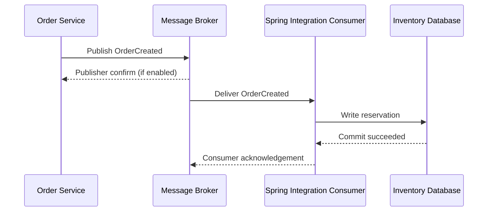
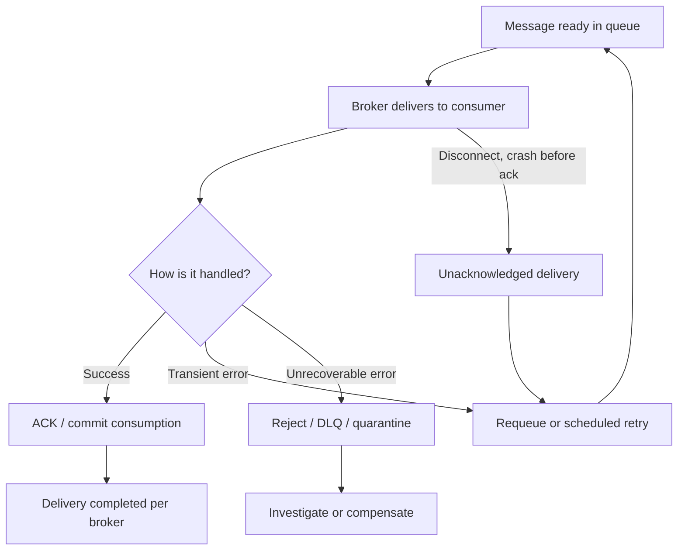
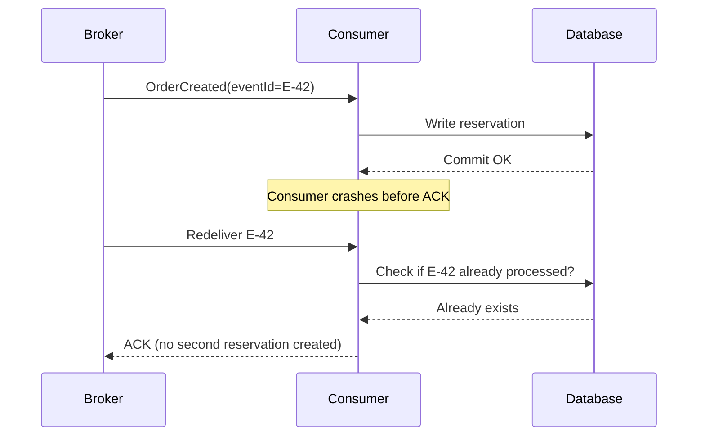
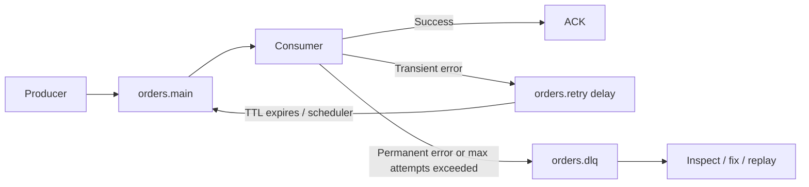
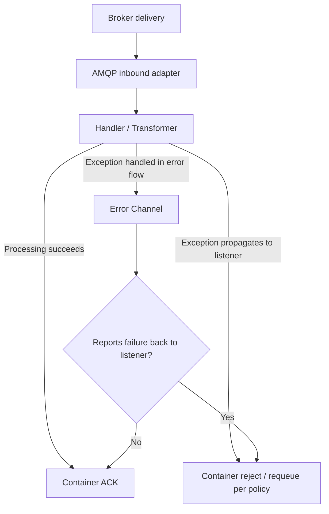

# Acknowledgement and Redelivery

In the **Message broker** chapter of the **SPRING_INTEGRATION_PATTERN** module, applications send and receive messages through a broker to build loosely coupled, extensible flows. Spring Integration helps compose **Channel**, **Router**, **Filter**, **Transformer**, **Service Activator**, **Gateway**, retry, error channel, and correlation into testable processing steps. However, when the system receives a message from a broker, a crucial question always arises: **when can the message be acknowledged as consumed, and if processing fails, what does the broker do with it?**

Two key concepts:

- **Acknowledgement (ack):** the consumer confirms to the broker that the delivery has been processed according to the consumer's contract. Confirmation is performed via the broker's specific protocol/mechanism.
- **Redelivery:** the broker delivers again a message that was previously delivered but not successfully acknowledged, or redelivers it under the system's retry/recovery mechanism. This can happen when a consumer crashes, loses connection, rolls back, or explicitly requests redelivery.

Understanding these two mechanisms helps avoid **lost messages**, **duplicate processing**, **infinite retry loops**, and confusing “received the message” with “business processing completed.”

After this lesson, you will be able to explain the message lifecycle, choose an ack policy, implement Spring Integration with AMQP/RabbitMQ using AUTO acknowledgement, recognize when MANUAL is needed, design retries and a dead-letter queue (DLQ), control idempotency, and build failure test scenarios.

## 1. Placing acknowledgement at the right point in the flow

Consider an inventory service receiving an `OrderCreated` event from a broker to deduct reserved stock:



**Publisher confirm** and **consumer acknowledgement** are two different signals:

| Signal | Who emits it? | What does it confirm? | What does it NOT guarantee? |
| --- | --- | --- | --- |
| Publisher confirm | Broker sends back to producer (when supported by protocol/config) | Broker handled the publish up to the confirm mechanism's guarantee | Does not say the consumer executed business logic |
| Consumer acknowledgement | Consumer sends to broker, or performed by container/transaction | Delivery can be marked complete per consumption policy | Does not prove database transactions or external service calls committed |
| Business acknowledgement | Business service emits a separate event/response, if designed | A specific business state has completed | Does not replace the broker ack |

For example, the producer receiving a publisher confirm does not mean inventory has been reserved. Conversely, the consumer sending an ack before the database commits can cause the broker to discard the delivery while the data write fails.

**Principle:** define “successful processing” by the business contract first, then choose when to ack. For DB-writing flows, typically treat a message as successful only after the DB operation commits or an appropriate transactional mechanism confirms.

## 2. Delivery lifecycle, ACK, NACK, and reject

Command names depend on the broker, but conceptual state transitions usually look like this:



### ACK

When the consumer acknowledges, the broker can remove the delivery from the unacknowledged set. In RabbitMQ, `basicAck` confirms a delivery tag on a channel. With JMS, acknowledgement or commit depends on session mode/transaction. With Kafka, the operational equivalent is usually committing the consumer group's offset, which has different semantics from per-message queue ACK.

### NACK/reject

RabbitMQ provides `basicNack` and `basicReject`. With `requeue=true`, the message can be put back on the queue, though **there is no promise it will be processed immediately or in the original order**. With `requeue=false` and a queue configured for dead-lettering, the broker can route the message to a dead-letter exchange/queue; if no suitable destination is configured, the message may be dropped.

JMS typically uses rollback or `Session.recover()` depending on session mode, rather than RabbitMQ's exact commands. Kafka uses offset commits and seek/retry/error-handler policies; do not interpret every Kafka error as a RabbitMQ NACK.

### Consumer crashes before ACK

In brokers supporting acknowledgement, an unacknowledged delivery can usually be redelivered when the channel/session/connection closes. Therefore, **receiving a message does not mean the message was processed exactly once**.

## 3. Comparing acknowledgement semantics by broker

| Technology | Related mechanism | Redelivery typically happens when | Points to remember |
| --- | --- | --- | --- |
| **RabbitMQ/AMQP 0-9-1** | `basicAck`, `basicNack`, `basicReject`; listener auto/manual mode | Consumer crashes before ack; NACK/requeue; errors causing delivery reject/requeue | Delivery tags are scoped to a channel; do not reuse an old tag on a new channel |
| **JMS** | `AUTO_ACKNOWLEDGE`, `CLIENT_ACKNOWLEDGE`, transacted session | Rollback/recover, session/connection failure before ack/commit | With `CLIENT_ACKNOWLEDGE`, acknowledgement can affect multiple messages received in the same session |
| **Kafka** | Consumer group offset commit; listener container ack mode | Consumer restarts or rebalances before offset commit; seek/retry | Offset commit marks partition progress; differs from per-message queue acknowledgement |
| **Other brokers** | Depends on protocol and adapter | Depends on lease, visibility timeout, or transaction mechanism | Check documentation for the specific broker used |

In the practical sections, we focus on **Spring Integration + RabbitMQ**, because this inbound adapter clearly illustrates the message entry point and how the listener container drives ack. When applying this to JMS/Kafka, translate the policy to the corresponding mechanism.

## 4. Three perspectives on reliability when consuming messages

| Delivery mode | Practical meaning | Main risk |
| --- | --- | --- |
| **At-most-once** | Message is not reprocessed once considered consumed | Messages may be lost if acked too early or without retries |
| **At-least-once** | System may redeliver until processed/acknowledged per policy | Consumer may receive and process duplicates |
| **Exactly-once** | An effect is applied strictly once within the system's guaranteed scope | Does not arise automatically from ACK; requires transactions, deduplication, or scoped guarantees |

For broker-based Spring Integration flows, **at-least-once + idempotent processing** is usually the practical starting point. Do not claim “exactly once” for the entire flow just because a broker offers transactions or Kafka supports transactions for part of a pipeline. For instance, external databases and payment APIs may lie outside the broker's transaction.

### Typical scenario: DB committed, ACK never reached the broker



Event `E-42` already produced an effect on the first attempt, and is later delivered again. If the consumer blindly calls `reserveStock()` again, stock could be deducted twice. Therefore, ACK must be paired with **idempotency**, especially when business logic has side effects.

## 5. Spring Integration: receiving messages from RabbitMQ and AUTO acknowledgement

Spring Integration provides an AMQP inbound adapter backed by Spring AMQP's listener container. With the container's `AcknowledgeMode.AUTO`, **the consumer does not call `basicAck` manually**; the container acknowledges when listener processing completes normally. This is **container-side AUTO**, not to be confused with RabbitMQ client `autoAck=true`, where the broker considers a delivery accepted immediately upon dispatch.

Example application using Java 17+, Spring Integration Java DSL, Spring Integration AMQP, and Spring AMQP:

```java
package example.orders;

import org.springframework.amqp.core.AcknowledgeMode;
import org.springframework.amqp.rabbit.connection.ConnectionFactory;
import org.springframework.amqp.rabbit.listener.SimpleMessageListenerContainer;
import org.springframework.context.annotation.Bean;
import org.springframework.context.annotation.Configuration;
import org.springframework.integration.amqp.dsl.Amqp;
import org.springframework.integration.config.EnableIntegration;
import org.springframework.integration.dsl.IntegrationFlow;

@Configuration
@EnableIntegration
class OrderConsumerIntegrationConfig {

    @Bean
    SimpleMessageListenerContainer ordersContainer(
            ConnectionFactory rabbitConnectionFactory) {
        var container =
            new SimpleMessageListenerContainer(rabbitConnectionFactory);
        container.setQueueNames("orders.created");
        container.setAcknowledgeMode(AcknowledgeMode.AUTO);
        container.setDefaultRequeueRejected(false);
        return container;
    }

    @Bean
    IntegrationFlow ordersInboundFlow(
            SimpleMessageListenerContainer ordersContainer,
            OrderProcessor orderProcessor) {
        return IntegrationFlow
            .from(Amqp.inboundAdapter(ordersContainer))
            .handle(String.class, (body, headers) -> {
                orderProcessor.process(body);
                return null; // One-way event flow, produces no reply.
            })
            .get();
    }
}

// Business bean implemented by the application.
interface OrderProcessor {
    void process(String body);
}
```

How it works:

1. Queue `orders.created` **must exist** or be declared via broker configuration in deployment; the snippet does not create queues or dead-letter exchanges on its own.
2. The AMQP inbound adapter receives the delivery and feeds the payload into the integration flow.
3. The Service Activator `orderProcessor.process(body)` executes the logic. The example assumes the body was already converted into a `String` by a converter; JSON/byte[] payloads need an appropriate converter/Transformer.
4. If the handler **completes normally**, the container handles ACK under `AcknowledgeMode.AUTO`.
5. If an error **is thrown out of listener processing**, the container handles failure per its configuration. With `setDefaultRequeueRejected(false)`, the delivery is typically rejected without requeuing, enabling dead-lettering **if configured on the broker**.

**Very important condition:** the example keeps the processing path synchronous (such as the default `DirectChannel` in that flow). If you insert an `ExecutorChannel` or intermediate queue so the adapter completes sending before business logic finishes, the listener may be considered successful and ACK before the actual side effect occurs. In that case, you must redesign the ack point, transaction, or recovery mechanism.

Furthermore, if an `errorChannel` is configured and errors are handled and “swallowed” by an error consumer instead of thrown back to the listener, ack/requeue behavior may differ from expectations. **You cannot infer redelivery policy merely from an exception thrown inside a flow**; check whether the exception actually reaches back to the listener container.

### When to use AUTO?

AUTO fits when a delivery can be processed within the listener's synchronous lifecycle and the container has accurate visibility into success/failure. Cases requiring ack after a long-running asynchronous operation, or requiring per-delivery ack/nack decisions across branches, may suit **MANUAL**, though switching to MANUAL demands stricter design.

## 6. MANUAL acknowledgement: confirming after business logic completes

With RabbitMQ, `AcknowledgeMode.MANUAL` lets the consumer decide when to call `basicAck`, `basicNack`, or `basicReject`. In Spring Integration, configure the listener container and verify how the adapter supplies the delivery tag/channel in message headers for the version in use; **never fabricate a delivery tag** and never ack on a different channel.

The pseudocode below clarifies the business decision (not runnable Java DSL code):

```text
onRabbitDelivery(message, channel, deliveryTag):
    try:
        validateSchema(message)
        processIdempotentlyAndCommit(message)
        channel.basicAck(deliveryTag, multiple=false)
    catch PermanentValidationError:
        channel.basicReject(deliveryTag, requeue=false)
    catch TransientDependencyError:
        # Only requeue directly if policy has appropriate backoff/limits.
        channel.basicNack(deliveryTag, multiple=false, requeue=true)
    catch UnexpectedError:
        # Per policy, may route to DLQ/investigation path.
        channel.basicNack(deliveryTag, multiple=false, requeue=false)
```

**Mandatory rules when applying MANUAL:**

- Ack on the **exact RabbitMQ channel** associated with the delivery; a delivery tag is not a global ID.
- `multiple=false` is usually safest for confirming individual deliveries. `multiple=true` acknowledges all unacked tags up to the specified tag on that channel and can be dangerous under concurrent processing.
- Never ACK in a `finally` block regardless of outcome; doing so can lose messages when business logic fails.
- Never call ACK multiple times for the same tag. Invalid acks or nacks can cause the broker to close the channel.
- If processing on another thread, account for channel lifecycle/thread-safety, delivery ownership, and when the listener yields control.
- When a consumer crashes after commit but before ACK, the broker can still redeliver: idempotency is mandatory even with manual acking.

If per-delivery manual ack control is not truly needed, choosing AUTO with a synchronous flow and well-configured retry/transactions is usually easier to operate.

## 7. Redelivery is a normal event, not only caused by code bugs

Common causes of redelivery:

- Consumer receives a message and **crashes/restarts** before ACK.
- TCP connection/channel closes while deliveries remain **unacknowledged**.
- Handler reports an error and the container/broker chooses **requeue** or rollback.
- Consumer uses **MANUAL** mode and sends `basicNack(..., true)`.
- A **delayed retry** mechanism moves a message from a retry queue back to the main queue.
- In Kafka-style consumer groups, offsets are uncommitted and the partition is reassigned to another consumer.

Two metadata fields to understand accurately:

- RabbitMQ has a delivery **redelivered** flag indicating the message was likely delivered before; this is not a counter of successful processing attempts and is not sufficient as a deduplication key.
- When dead-lettering in RabbitMQ, the broker may add headers regarding dead-letter history (e.g., `x-death`). That value does not completely replace an application-defined retry policy; how history is recorded can depend on queue type and the dead-letter path.

There is no guarantee that redelivery goes to the original consumer, occurs at a fixed time, or preserves the original order.

## 8. Retry, requeue, delayed retry, and dead-letter queues

These terms are easily confused:

| Mechanism | Meaning | Pros / cons |
| --- | --- | --- |
| **In-consumer retry** | Retries processing immediately within a single delivery, before ACK/NACK | Keeps delivery unacked; fits brief transient errors but can tie up resources |
| **Immediate requeue** | Returns an uncompleted message to the queue for broker redelivery | Simple, but easily causes hot loops and spikes CPU/network |
| **Delayed retry** | Moves the message onto a delayed retry path before returning to the main flow | Better backoff control; requires extra topology/policy |
| **Dead-letter queue (DLQ)** | Receives messages rejected, expired, or exceeding limits per broker config | Holds messages for inspection/recovery; does not resolve business errors automatically |
| **Quarantine/parking lot** | Channel storing problematic messages along with reason and history | Suited for schema errors or data needing manual intervention |

Example delayed retry topology:



This is a **logical diagram**. Actual implementation requires configuring exchanges, routing keys, TTL or an appropriate delayed-message mechanism, retry attempt caps, and dead-letter routing. Do not assume a queue named `orders.retry` automatically creates backoff or retry limits.

### Grouping errors

- **Transient errors:** overloaded database, remote HTTP 503, brief network drop. Safe for bounded retries with backoff.
- **Permanent errors:** schema-invalid JSON, invalid business code, missing required field. Retrying unchanged is usually futile; reject/DLQ and record the reason.
- **Unclassified errors:** start with a conservative retry cap, escalate for investigation when exceeded, and avoid stalling all consumers.

For retries with side effects, **never retry a command without evaluating idempotency**. A timeout does not prove the remote service did not execute the operation.

## 9. Setting retry limits and avoiding infinite loops

Suppose a consumer fails because a required value is missing. If it keeps NACKing with `requeue=true` immediately, the broker can immediately redeliver the same message, the consumer fails again, and NACKs again:

```text
delivery -> validation error -> nack(requeue=true)
         -> redelivery -> validation error -> nack(requeue=true)
         -> ... continuous loop
```

The consequences are wasted CPU, huge logs, inflated latency for valid messages, and broker instability.

An example policy:

1. **Attempt 1:** normal processing.
2. **Attempt 2:** retry after a short delay.
3. **Attempt 3:** retry after a longer delay.
4. If still failing: move to DLQ and log the cause; do not loop infinitely.

These numbers are illustrative; production systems must tune them based on target latency, message volume, remote service capacity, and error types. Notably, some RabbitMQ queue types/policies have their own delivery limits, but **not every queue has a built-in three-attempt limit**.

### Pitfall when “forwarding to a retry queue and ACKing the original message”

If the application publishes a copy to a retry queue and immediately ACKs the original message, there is a window where the copy has not been durably accepted by the broker. If publishing fails while the original ACK reaches the broker, the message can be lost.

Solutions must account for ordering/publisher confirms, transactions, or suitable architecture to ensure the original message is not dropped before the copy is safely stored. Broker-managed dead-lettering and application-managed republishing are two paths with different guarantee boundaries; do not assume both form a single atomic transaction.

## 10. Idempotency: the foundation for safe redelivery

With at-least-once delivery, **a message may arrive multiple times, yet the same business operation should apply its effect only once**. Therefore, choose a stable business key such as `eventId`, `commandId`, or a `source + id` pair. Do not rely on delivery tags since tags only have meaning within a channel/delivery session; nor should you generate a new UUID on each redelivery.

A common design is storing processed events in the same transaction as the business data.

```sql
-- PostgreSQL example
CREATE TABLE processed_events (
    consumer_name TEXT NOT NULL,
    event_id TEXT NOT NULL,
    processed_at TIMESTAMPTZ NOT NULL DEFAULT now(),
    PRIMARY KEY (consumer_name, event_id)
);
```

Transactional processing pseudocode:

```text
BEGIN DATABASE TRANSACTION
    INSERT (consumer_name, event_id) IF NOT EXISTS
    IF event_id already exists:
        COMMIT  # Duplicate; business effect already applied.
        ACK
        RETURN

    APPLY business update (reserve stock / save order)
COMMIT DATABASE TRANSACTION
ACK MESSAGE
```

More concretely with `JdbcTemplate`/PostgreSQL:

```java
package example.inventory;

import org.springframework.jdbc.core.JdbcTemplate;
import org.springframework.stereotype.Service;
import org.springframework.transaction.annotation.Transactional;

@Service
class InventoryEventService {

    private final JdbcTemplate jdbc;

    InventoryEventService(JdbcTemplate jdbc) {
        this.jdbc = jdbc;
    }

    @Transactional
    public void apply(StockReserved event) {
        int inserted = jdbc.update("""
            INSERT INTO processed_events (consumer_name, event_id)
            VALUES (?, ?)
            ON CONFLICT DO NOTHING
            """, "inventory-reservation", event.eventId());

        if (inserted == 0) {
            return; // Redelivered message, already applied previously.
        }

        jdbc.update("""
            UPDATE stock SET reserved = reserved + ?
            WHERE sku = ?
            """, event.quantity(), event.sku());
    }
}

record StockReserved(String eventId, String sku, int quantity) {}
```

**Example assumptions:** the `stock` table/product row exists, valid quantities were validated, and all DB operations run within the **same transaction** managed by `@Transactional`. Production code must check the updated row count and stock constraints; if the update fails, throw an exception to roll back the `processed_events` insert as well. The example only illustrates where to place the deduplication key, not complete reservation business code.

If side effects occur in **an external API**, a local database transaction cannot roll back that API. You need an idempotency key supported by the remote service, outbox/inbox, saga/compensation, or an appropriate status query mechanism. Deduplicating in an internal DB alone does not guarantee external operations are exactly-once.

## 11. Relationship between ACK, Spring Integration error channel, and Retry Advice

In Spring Integration, exceptions can arise in a Transformer, Filter, Service Activator, or HTTP Gateway downstream of the inbound adapter. When broker redelivery is required, inspect **how exceptions reach the listener container**.



The diagram is a mental model of the **processing completion boundary**, not a claim that every adapter and error flow produces identical ACK/NACK commands. Actual Spring Integration configuration, channel types, and listener container determine the path.

Checkpoints to verify:

- **Synchronous DirectChannel:** exceptions normally propagate back to the adapter; this conveniently lets the container decide ack/reject based on processing outcome.
- **ExecutorChannel/QueueChannel:** a message may be handed off to the next step successfully while actual business work is still running. ACK may occur before downstream steps complete.
- **ErrorChannel:** useful for logging, classifying, alerting, or routing to DLQ. But if the error flow catches the error and finishes “normally”, the listener may no longer know the business task failed.
- **Retry advice:** can retry the handler within the same delivery; must specify max attempts/backoff and exhaustion handling. Consumer-side retry differs from broker redelivery.
- **Filter:** a filter discarding a message may be treated as normal processing and trigger an ACK. If business rules require retaining the message for retry, do not use filtering to represent failure.

In production systems, explicitly document *which errors retry in the handler*, *which propagate back to the broker via the container*, *which go to the DLQ*, and *which ACK as valid events intentionally ignored per policy*.

## 12. Monitoring and investigating redelivered messages

The broker provides metrics for queues, consumers, and deliveries; the application should add business-level metrics. Monitor:

| Signal | Purpose |
| --- | --- |
| **Ready** and **unacknowledged** message counts | Distinguish messages awaiting delivery from those delivered but not yet ACKed |
| Consumer count, throughput | Detect missing consumers or processing bottlenecks |
| ACK/reject/redelivery rates | Spot excessive redeliveries or rejections |
| Retry attempt, retry delay | Observe retry loops and pressure on downstream dependencies |
| DLQ depth/oldest age | Know how many messages need investigation and backlog age |
| Processing latency, DB/remote latency | Identify slow processing keeping deliveries unacked |
| Idempotency duplicate count | Measure how many already-processed messages are being redelivered |
| Error count by type | Separate schema errors, infrastructure errors, and business errors |

Attach `eventId`, `requestId`, `correlationId`, and `traceId` per contract to link producer, consumer, and DB effects. Avoid logging full payloads if they contain sensitive data. Never use the `redelivered` flag alone to decide to skip processing: a flagged delivery might never have been processed by business logic yet.

### When the DLQ grows continuously

1. Inspect error types and schema versions of the latest messages.
2. Check consumer/dependency changes deployed around the same time.
3. Verify the retry topology does not create a loop from DLQ back to the main queue.
4. Throttle replay rate, fix the root cause, and ensure deduplication.
5. Replay under monitoring and measure outcomes; avoid dumping the entire DLQ into production at once.

## 13. Testing acknowledgement and redelivery

A proper test suite verifies **actual broker behavior**, not just unit tests where the handler returns successfully.

| Scenario | How to trigger | What to verify |
| --- | --- | --- |
| Successful processing | Consumer updates DB and returns normally | Broker receives ACK; message does not redeliver when error-free |
| Transient failure | Dependency fails a few times | Retry/backoff follows policy; eventually ACKs or goes to DLQ |
| Schema error | Message missing required fields | No infinite requeue; routed properly for investigation |
| Crash before commit | Stop consumer before persisting results | Message is redelivered per broker mechanism |
| Crash after commit before ACK | Intentionally fail at the ACK boundary | Redelivery produces no second DB side effect |
| Duplicate event | Publish same `eventId` multiple times | Deduplicated by business key |
| Consumer disconnect | Close channel while delivery is unacked | Delivery is redistributed by broker |
| Missing DLX | NACK/reject without requeue | Verify risk of message being dropped under actual config |
| Error flow swallows exception | Handler fails but error flow returns normally | Confirm whether container ACKs or rejects; fix policy if wrong |
| Asynchronous channel | Insert `ExecutorChannel` before business handler | Detect whether ack occurs too early |
| DLQ replay | Feed a fixed message back into main queue | Message processes cleanly, preserving idempotency and trace |

A useful integration test can use a RabbitMQ test instance/container, a test database, and controlled fault injection points. Tests should wait on **observable conditions** (ACK/redelivery, DB row count, queue state) rather than relying on `Thread.sleep` or strict consumer ordering. Verify both **business effect count** and **delivery count**: multiple redeliveries are acceptable if the business effect happens only once.

### Illustrative scenario with event `E-42`

```text
Given broker queue orders.created and consumer receives StockReserved(E-42)
When on the first attempt DB COMMIT succeeds but connection closes before ACK
Then the broker may redeliver E-42
When the consumer receives E-42 again
Then processed_events has only 1 row for (inventory-reservation, E-42)
And stock.reserved increases only once
And the subsequent delivery is ACKed per success policy
```

This scenario tests the critical boundary of at-least-once delivery. Never mark a test as passing merely because “the message disappeared from the queue” without checking data state.

## 14. Checklist for designing ACK and redelivery

1. Identify the broker, adapter, listener container, and acknowledgement mode in use.
2. Document **success criteria**, especially when DB transactions or external APIs are involved.
3. Choose **AUTO** when processing is synchronous and exceptions propagate to the listener; use **MANUAL** only when exact delivery lifecycle control is needed.
4. Never ACK before completing business effects; check asynchronous channel boundaries.
5. Maintain a stable **idempotency** key across redeliveries and retries.
6. Classify transient vs. permanent errors, cap attempts, and configure backoff.
7. Configure explicit DLX/DLQ/quarantine; define behavior when no dead-letter destination exists.
8. Avoid immediate requeue for permanent errors to prevent retry storms.
9. Verify how `errorChannel`, Retry Advice, Filter, and Router affect listener outcomes.
10. Track unacked, redelivery, retry, DLQ, and duplicate business effect counts.
11. Test crashes before/after commit, disconnects, converter errors, duplicates, and DLQ replay.
12. Do not claim end-to-end exactly-once semantics without guarantees across all involved boundaries.

## Conclusion

**Acknowledgement** answers whether the broker can consider a delivery handled; **redelivery** lets the system recover when an ACK is not recorded or processing fails. In Spring Integration, the **listener container**, **channel topology**, **exception propagation**, **retry policy**, and **error-handling path** together determine when the broker receives ACK/NACK. Reliable design combines timely acknowledgement with **idempotency**, bounded retries, dead-lettering, and testing the hardest failure windows: before commit, and after commit but before ACK. That allows message broker flows to scale while keeping failures and duplicate business effects under control.
