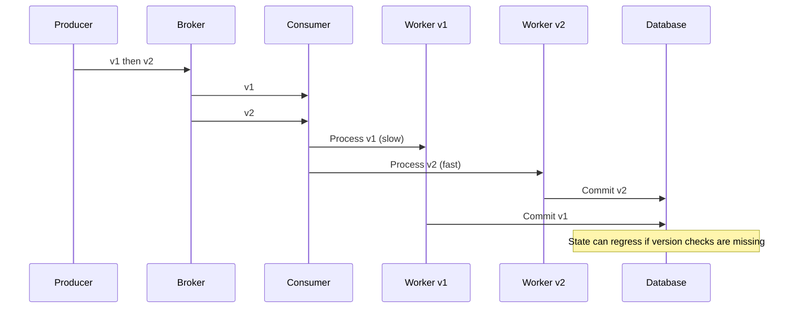
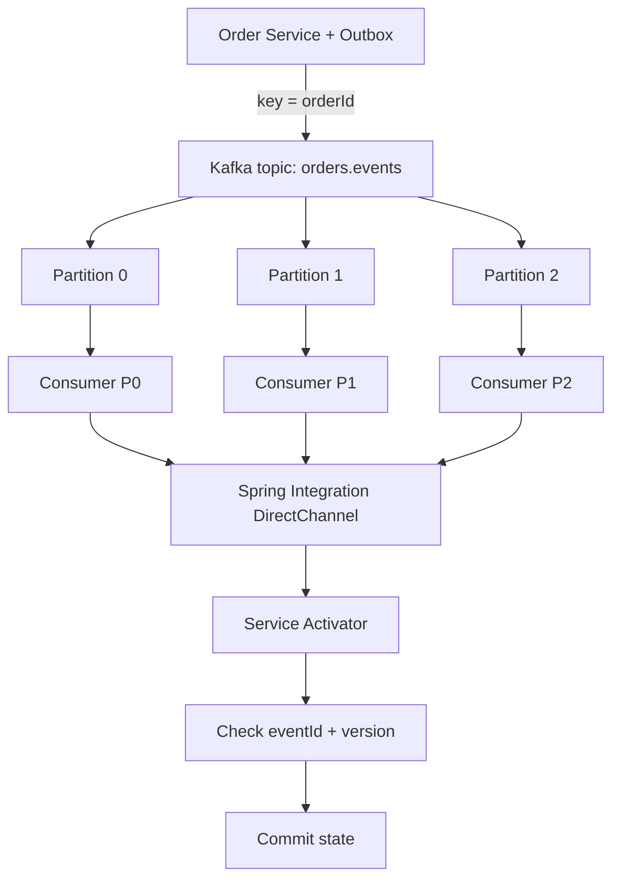
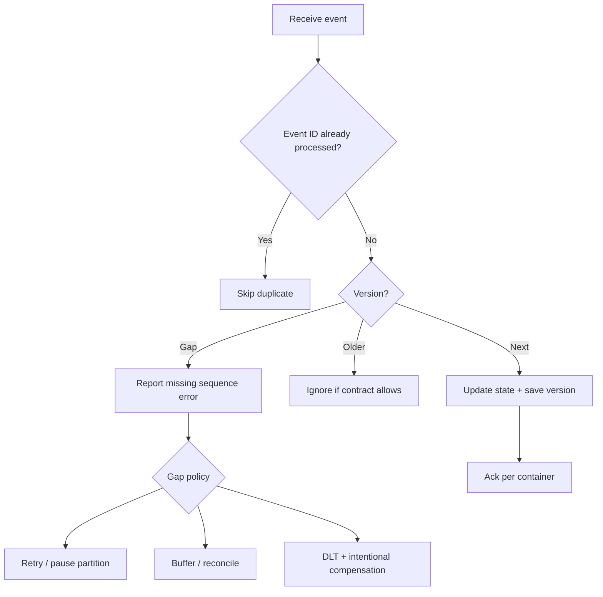

# Message Ordering in a Broker with Spring Integration

## 1. Why does message ordering matter?

In asynchronous integration systems, producers publish events to a **message broker**, and consumers receive them to update state, invoke services, or execute tasks. A broker reduces coupling between applications and supports load leveling and failure recovery, yet processing order does not always match the order in which events were created.

Consider an order `O-42` with a sequence of changes:

1. `OrderCreated(orderId=O-42, version=1)`.
2. `OrderPaid(orderId=O-42, version=2)`.
3. `OrderCancelled(orderId=O-42, version=3)`.

If a handler processes `OrderCancelled` before `OrderCreated`, the update may lack baseline data. If `PAID` state is written after `CANCELLED` without a version check, the system may accidentally revert the order to an older state.

**Message ordering** is defining and protecting a message sequence within the scope required by business rules: per queue, per partition, per entity key, or by causal relationships among events. During design, you must specifically answer **ordering of what, guaranteed where, and verified at which point**.

This lesson belongs to the **Message broker** chapter in the **SPRING_INTEGRATION_PATTERN** module. The module's goal is learning to apply Enterprise Integration Patterns with Spring Integration to build loosely coupled, extensible, testable, and observable flows. Components such as Router, Filter, Transformer, Splitter, Aggregator, Gateway, retry, error channel, and correlation can all influence ordering.

After this lesson, you will be able to:

- Distinguish emission order, broker append order, consumer delivery order, and business commit order.
- Understand ordering limits of Kafka, RabbitMQ, and queues/JMS.
- Choose partition keys or routing keys to protect per-entity ordering.
- Design a Spring Integration flow that processes events along a version sequence.
- Handle duplicates, retries, requeues, dead-letters, gaps, and rebalances without backward state updates.
- Test and measure ordering using event IDs, versions, partitions/offsets, and final state.

## 2. There are multiple kinds of ordering

| Order type | Meaning | Risk |
|---|---|---|
| **Business order** | Which change actually happened first in the business domain | Clock skew or multiple producers mutating the same entity |
| **Publish order** | Whether the producer sends earlier or later | Async sends, retries, or transactions altering order |
| **Broker order** | Sequence in which the broker records items in a log/queue | Ordering scope is typically limited to one partition or queue under specific conditions |
| **Delivery order** | Which message is delivered to which consumer first | Multiple partitions/consumers or redelivery |
| **Processing order** | Which event a handler starts processing first | Thread pools and asynchronous steps |
| **Commit order** | Which side effect updates the DB/external system first | Slow I/O, timeouts, retries, and race conditions |

For example, the broker delivers v1 then v2, yet the handler initiates two parallel HTTP calls. If the HTTP call for v2 finishes before v1, **delivery order was still right, but side-effect order inverted**.



Therefore, ordering must be designed from **where versions originate** through **where state commits**, not solely at the broker.

## 3. Ordering scope across brokers

### 3.1. Kafka: ordering guaranteed within a partition

Kafka stores a topic's records across multiple **partitions**. Each partition is a log with monotonically increasing offsets; records within the same partition are read in offset order. Kafka **has no global ordering across partitions**.

```text
orders.events
  partition 0: O-42 v1 -> O-42 v2 -> O-42 v3
  partition 1: O-87 v1 -> O-87 v2
  partition 2: O-91 v1 -> O-91 v2

Order within each partition: determined by offset.
Order across partitions: no global guarantee.
```

If a producer sends messages with `key = orderId` and the partitioning strategy stays unchanged, events for the same order are normally routed to the same partition. Thus you can preserve per-`orderId` ordering while still processing many orders concurrently across different partitions.

Keep in mind:

- Multiple producers sending the same key can race; broker append order does not replace business versions assigned at the source.
- Changing partition count can change key-to-partition mapping; a migration plan is needed if continuous ordering is mandatory.
- Producer retries and idempotence settings affect order preservation on send failures. Check producer settings and enable an idempotent producer when appropriate.
- In a consumer group, each partition is typically assigned to one active consumer at a time; rebalancing and redelivery can still cause events to be reprocessed.
- Reading by offset **does not automatically guarantee** an asynchronous side effect completes in offset order.

### 3.2. RabbitMQ: queues, consumers, and requeueing

RabbitMQ stores messages in queues and generally delivers in enqueue order under normal conditions. However, multiple consumers, prefetch, requeueing, redelivery, priorities, and async processing can make **completion order** diverge from enqueue order.

For example:

- Consumer A receives message 1 and processes slowly.
- Consumer B receives message 2 and processes quickly.
- B updates the DB before A.
- Message 1 gets `nack/requeue` and may be redelivered later or interleaved with other messages.

When strict sequential per-queue processing is needed, consider one active consumer, appropriate prefetch, synchronous processing, and an error strategy that avoids reinserting messages out of order. RabbitMQ offers *single active consumer* mode for certain queue types, though redelivery and idempotency still require handling.

### 3.3. JMS and traditional queues

JMS systems define message delivery rules per session, consumer, and provider. Nevertheless, multiple consumers, priorities, selectors, rollbacks, or redeliveries can affect the order observed and committed by the application.

Do not assume “a queue is FIFO” means “all business updates commit in a global order”. Read the contract of the **broker, session, consumer concurrency, and acknowledgment** in your actual deployment.

### Comparison

| Criterion | Kafka | RabbitMQ / Queue | Application-level decision |
|---|---|---|---|
| Baseline ordering scope | Partition | Queue under specific delivery conditions | Choose key/queue matching scope |
| Scaling | Partitions and consumer groups | Queue sharding and consumers | Parallelism across independent groups |
| Error retry | Reprocess, seek, retry topic, DLT | Nack/requeue, retry queue, DLQ | Is skipping a failing event allowed? |
| Duplicates | Possible via replay/redelivery | Possible via redelivery | Event ID and idempotency |
| DB commit order | Not guaranteed by broker alone | Not guaranteed by broker alone | Transactions and version checks |

## 4. Choosing an ordering key per aggregate

Usually you do not need global system-wide ordering. Ordering is only mandatory among events modifying the **same business entity**.

| Event type | Suggested key | Scope requiring sequentiality |
|---|---|---|
| OrderCreated / OrderPaid / OrderCancelled | `orderId` | One order |
| CustomerProfileChanged | `customerId` | One customer profile |
| InventoryReserved / InventoryReleased | `sku + warehouseId` | One item at one warehouse |
| AccountDebited / AccountCredited | `accountId` or suitable ledger design | One account |
| ProductPriceChanged | `productId + market` | One product in one market |

An overly broad key, such as using `tenantId` alone, can cause a **hot partition**. An overly narrow key, such as a fresh UUID per event, scatters related events across multiple partitions.

Steps to choose a key:

1. Identify which events must stay ordered relative to one another.
2. Pick an identifier stable throughout the entity's lifecycle.
3. Enforce that every producer of that event group uses the same key.
4. Evaluate key cardinality, traffic distribution, and hot-key likelihood.
5. Define a procedure for changing partition counts or topology.

If an operation affects **two aggregates**, such as transferring money between two accounts, ordering by one key does not automatically create an atomic transaction across both. You then need additional consistency mechanisms such as a database transaction, ledger, saga, or appropriate coordination.

## 5. Ordering in Spring Integration

Spring Integration passes messages through `MessageChannel`s and processing endpoints. Some channel types keep handler invocation synchronous, while others hand work off to different threads and introduce concurrency.

| Component | Impact on ordering |
|---|---|
| `DirectChannel` | Handler executes synchronously on the sender thread; convenient for sequential processing per consumer thread |
| `ExecutorChannel` | Work moves to an executor; threads can finish in a different order than received |
| `QueueChannel` | Buffers in an internal queue; multiple pollers/consumers can still commit out of order |
| `PublishSubscribeChannel` | Fans out to subscribers; no automatic shared commit order across branches |
| `Router` | Can send same-key events to different branches; must protect cross-branch ordering |
| `Filter` | Can drop an event, creating a gap if it belonged to a mandatory version sequence |
| `Transformer` | Synchronous ones normally preserve sequence; internal async work can reorder |
| `Splitter` | Emits multiple items; branch completion order can vary |
| `Aggregator` | Groups by correlation; arrival order differs from desired emission order |
| `Service Activator` | Executes side effects; must align commit and acknowledgment boundaries |

**Note:** a flow with `DirectChannel` is not inherently single-threaded system-wide. Multiple producers or consumer threads can still call that handler concurrently. Sequentiality must be evaluated **per key/partition and execution path**.

### Ordering, correlation, and idempotency

Three concepts to keep separate:

- **Ordering key:** groups messages that must stay ordered together, e.g., `orderId`.
- **Sequence / version:** indicates an event's position within a business chain.
- **Correlation ID:** links messages belonging to a group, especially in Splitter/Aggregator.
- **Event ID / idempotency key:** identifies an event or operation to prevent duplicate application.

A `correlationId` does not sort messages by itself. A partition key does not detect duplicates by itself. Nor does a version make side effects atomic if the handler has a race condition.

## 6. Designing the flow: keyed producer, sequential consumer

A reference topology:



Partitions are processed independently; ordering across different orders is not required. When multiple consumers invoke the same `DirectChannel`, the handler can run concurrently **for different partitions**. The key rule assigns each order to one partition, while version checks guard state across retries, replays, or operational faults.

The walkthrough below uses **Spring Boot 3.x, Spring Kafka 3.x, Spring Integration 6.x, and Java 17+**. The code is a learning example; real applications require a broker and durable state persistence.

### 6.1. Event with key and version

```java
// OrderEvent.java
package com.example.order;

public record OrderEvent(
        String eventId,
        String orderId,
        long version,
        String status
) {
}
```

A record:

```json
{
  "eventId": "e-002",
  "orderId": "O-42",
  "version": 2,
  "status": "PAID"
}
```

Versions must be issued by a consistent mechanism at the source: typically in the same transaction updating the aggregate or through a sequenced event-emission flow. Server timestamps are not a reliable way to assign versions when multiple producers contend.

### 6.2. Producer sending orderId as the key

```java
// OrderEventPublisher.java
package com.example.order;

import java.util.Objects;
import java.util.concurrent.CompletableFuture;

import org.springframework.kafka.core.KafkaTemplate;
import org.springframework.kafka.support.SendResult;
import org.springframework.stereotype.Component;

@Component
public class OrderEventPublisher {

    private final KafkaTemplate<String, OrderEvent> kafka;

    public OrderEventPublisher(KafkaTemplate<String, OrderEvent> kafka) {
        this.kafka = kafka;
    }

    public CompletableFuture<SendResult<String, OrderEvent>> publish(
            OrderEvent event) {
        Objects.requireNonNull(event, "event");

        if (event.orderId() == null || event.orderId().isBlank()) {
            throw new IllegalArgumentException("orderId is required");
        }

        return kafka.send(
                "orders.events",
                event.orderId(),
                event
        );
    }
}
```

`KafkaTemplate.send(...)` returns a `CompletableFuture` in Spring Kafka 3.x. The caller must handle send success/failure; `publish()` returning does not mean the broker has confirmed the message.

Illustrative producer configuration:

```yaml
spring:
  kafka:
    bootstrap-servers: localhost:9092
    producer:
      key-serializer: org.apache.kafka.common.serialization.StringSerializer
      value-serializer: org.springframework.kafka.support.serializer.JsonSerializer
      acks: all
      properties:
        enable.idempotence: true
```

Producer idempotence helps limit certain duplicate and reordering issues from retries within a single producer's scope. It does not resolve contention among multiple producers sending events for the same key, nor does it replace consumer-side deduplication.

To emit events alongside DB updates, use a **transactional outbox**: write the aggregate change and outbox record in one database transaction, then let a publisher emit outbox rows in order. If multiple publisher instances run, coordinate them so versions of the same key are not emitted out of order.

### 6.3. Spring Integration internal channel

```java
// OrderChannelConfiguration.java
package com.example.order;

import org.springframework.context.annotation.Bean;
import org.springframework.context.annotation.Configuration;
import org.springframework.integration.channel.DirectChannel;
import org.springframework.integration.config.EnableIntegration;
import org.springframework.messaging.MessageChannel;

@Configuration
@EnableIntegration
public class OrderChannelConfiguration {

    @Bean
    public MessageChannel orderedOrderEvents() {
        return new DirectChannel();
    }
}
```

`DirectChannel` executes the subscriber on the sending thread. In this example, the Kafka listener waits for the handler to finish before the listener method returns, provided the handler **does not spawn an asynchronous task of its own**.

### 6.4. Kafka listener forwarding records into the channel

```java
// KafkaOrderIngress.java
package com.example.order;

import java.util.Objects;

import org.apache.kafka.clients.consumer.ConsumerRecord;
import org.springframework.beans.factory.annotation.Qualifier;
import org.springframework.kafka.annotation.KafkaListener;
import org.springframework.messaging.Message;
import org.springframework.messaging.MessageChannel;
import org.springframework.messaging.support.MessageBuilder;
import org.springframework.stereotype.Component;

@Component
public class KafkaOrderIngress {

    private final MessageChannel orderedOrderEvents;

    public KafkaOrderIngress(
            @Qualifier("orderedOrderEvents") MessageChannel channel) {
        this.orderedOrderEvents = channel;
    }

    @KafkaListener(
            topics = "${app.orders.topic}",
            groupId = "${app.orders.group}",
            concurrency = "1"
    )
    public void onRecord(ConsumerRecord<String, OrderEvent> record) {
        OrderEvent event =
                Objects.requireNonNull(record.value(), "event");

        if (!Objects.equals(record.key(), event.orderId())) {
            throw new IllegalArgumentException(
                    "Kafka key and orderId must match");
        }

        Message<OrderEvent> message = MessageBuilder
                .withPayload(event)
                .setHeader("brokerPartition", record.partition())
                .setHeader("brokerOffset", record.offset())
                .build();

        if (!orderedOrderEvents.send(message)) {
            throw new IllegalStateException(
                    "Cannot deliver to integration flow");
        }
    }
}
```

The annotation uses Spring property placeholders, e.g., `topics = "${app.orders.topic}"` resolves to `orders.events` from configuration.

`concurrency = "1"` configures a single consumer thread **for this listener container instance**. If the application runs multiple replicas, each replica still has its own listener; the Kafka consumer group manages partition assignment. The goal is ensuring each partition is processed sequentially without dispatching per-partition work onto an uncontrolled parallel executor.

When `DirectChannel` invokes the handler and the handler throws an exception, the error propagates back to the Kafka listener so the listener container executes its configured retry/recovery policy.

### 6.5. Service Activator processing each event

```java
// OrderEventHandler.java
package com.example.order;

import org.springframework.integration.annotation.ServiceActivator;
import org.springframework.stereotype.Component;

@Component
public class OrderEventHandler {

    private final OrderProjection projection;

    public OrderEventHandler(OrderProjection projection) {
        this.projection = projection;
    }

    @ServiceActivator(inputChannel = "orderedOrderEvents")
    public void onEvent(OrderEvent event) {
        projection.apply(event);
    }
}
```

This is a **one-way** event-consuming flow; the method returns `void` and needs no reply channel. Unlike a request–reply Messaging Gateway, this broker consumer focuses on applying events and confirming completion.

### 6.6. Version checking and preventing backward updates

The code below illustrates in-memory behavior. Production requires persisting state and processed-event records in a durable DB with transactions and concurrency constraints.

```java
// OrderProjection.java
package com.example.order;

import java.util.Objects;
import java.util.concurrent.ConcurrentHashMap;
import java.util.concurrent.ConcurrentMap;

import org.springframework.stereotype.Component;

@Component
public class OrderProjection {

    private final ConcurrentMap<String, Snapshot> snapshots =
            new ConcurrentHashMap<>();

    public void apply(OrderEvent event) {
        Objects.requireNonNull(event, "event");

        if (event.orderId() == null || event.orderId().isBlank()
                || event.eventId() == null || event.eventId().isBlank()
                || event.version() <= 0) {
            throw new IllegalArgumentException("Invalid event");
        }

        snapshots.compute(event.orderId(), (id, previous) -> {
            long current = previous == null ? 0 : previous.version();

            if (event.version() < current) {
                // Older events must not overwrite newer state.
                return previous;
            }

            if (event.version() == current) {
                if (!Objects.equals(
                        previous.eventId(), event.eventId())) {
                    throw new IllegalStateException(
                            "Conflicting event at same version");
                }
                return previous; // Valid duplicate.
            }

            if (event.version() != current + 1) {
                throw new IllegalStateException(
                        "Version gap: expected " + (current + 1)
                        + ", received " + event.version());
            }

            return new Snapshot(
                    event.version(),
                    event.eventId(),
                    event.status()
            );
        });
    }

    public long currentVersion(String orderId) {
        Snapshot snapshot = snapshots.get(orderId);
        return snapshot == null ? 0 : snapshot.version();
    }

    private record Snapshot(
            long version,
            String eventId,
            String status) {
    }
}
```

Five outcomes exist:

1. Next consecutive version: applied.
2. Duplicate with same version and event ID: ignored, no second side effect.
3. Older version: ignored for a latest-state projection.
4. Same version with different event ID: raises a conflict.
5. Skipped version: reports a gap to trigger retry/reconciliation policy.

**Limitation:** ignoring older events fits a latest-state projection, not full audit logs or business logic requiring every intermediate side effect. Single-process memory does not survive restarts, is not shared across replicas, and does not join a database transaction. In production, persist `lastAppliedVersion` alongside state inside a transaction; use locks/optimistic locking or unique constraints to avoid race conditions.

### 6.7. Consumer configuration and offset commits

```yaml
app:
  orders:
    topic: orders.events
    group: order-projection-v1

spring:
  kafka:
    bootstrap-servers: localhost:9092
    consumer:
      enable-auto-commit: false
      key-deserializer: org.apache.kafka.common.serialization.StringDeserializer
      value-deserializer: org.springframework.kafka.support.serializer.JsonDeserializer
      properties:
        spring.json.value.default.type: com.example.order.OrderEvent
        spring.json.trusted.packages: com.example.order
    listener:
      ack-mode: record
      concurrency: 1
```

In `AckMode.RECORD`, the listener container manages committing offsets after the listener processes a record successfully, following container commit mechanics. Offset commits are **not automatically atomic** with DB commits. A consumer can update the DB successfully and crash before committing the offset, resulting in redelivery.

The configuration above does not explicitly define a `DefaultErrorHandler`, DLT, or partition-pause strategy. **Do not infer from this example that failing records are held forever until they succeed**; post-retry behavior depends on the listener container's error handler. If gaps must not be skipped, configure appropriate recovery and test it.

## 7. Retries, poison messages, and dead-letters can break ordering

Suppose a partition holds three ordered records:

```text
offset 100: order O-42, version 1
offset 101: order O-42, version 2  <-- fails processing
offset 102: order O-42, version 3
```

If v2 fails, several strategies exist:

| Strategy | Ordering | Trade-off |
|---|---|---|
| Retry v2 before advancing | Preserves opportunity for v1 → v2 → v3 | A poison message can block the entire partition |
| Route v2 to a retry topic, continue v3 | Can invert order | Needs buffering/gap detection/reconciliation |
| Route v2 to DLT and skip | Business sequence may miss a step | Valid only if contract permits partial handling |
| Pause/park partition for investigation | Preserves failure point | Increases lag for other keys on the same partition |
| Apply a newer snapshot | Can skip intermediate steps | Valid only for absolute-state events without replay-required side effects |



**No single retry configuration fits every business domain.** Payments, ledgers, and inventory usually cannot skip intermediate events. A projection storing only the latest absolute state may use a different policy if allowed by contract.

### Retries in Spring Integration vs. in the broker

Spring Integration endpoints can use retry advice; Kafka listener containers also offer retry/recovery. Enabling both simultaneously can multiply total attempts. Define retry budgets, backoff, timeouts, and retry eligibility at the **flow level**, while keeping side effects idempotent.

### Redelivery and acknowledgment

Common sequence:

```mermaid
sequenceDiagram
    participant B as Broker
    participant C as Consumer
    participant DB as Database
    B->>C: Event v2
    C->>DB: Commit v2 succeeded
    Note over C: Crash before ack/offset commit
    B->>C: Redeliver Event v2
    C->>DB: Check version/event ID
    DB-->>C: Already applied; skip write
    C-->>B: Ack/commit progress
```

Hence correct ordering does not mean “exactly once”. Kafka offers idempotence/transactions for specific cases, but cannot automatically combine **Kafka offsets + external DB/HTTP side effects** into one transaction.

## 8. Concurrency and performance: parallel across keys, sequential within a key

Sensible scaling does not necessarily mean adding threads to process **the same key**. Many independent keys can run in parallel:

```text
Consumer partition 0: O-42 v1 -> O-42 v2 -> O-42 v3
Consumer partition 1: O-87 v1 -> O-87 v2
Consumer partition 2: O-91 v1 -> O-91 v2
```

What must be guaranteed is that each change sequence for the same aggregate commits consistently, while independent aggregates do not block each other.

Situations that easily invert ordering:

- Sending messages to an `ExecutorChannel` with multiple workers.
- A handler creating a `CompletableFuture` and returning before the side effect finishes.
- A Router sending different versions of the same key to separate flows.
- A queue with multiple consumers and large prefetch.
- Retrying failed messages on a separate queue/topic while newer messages proceed first.
- A Splitter spawning multiple tasks and an Aggregator sorting by **arrival order** instead of sequence.

If per-key concurrency is required, you can design a **keyed executor/partitioned worker**: the same key always routes to one sequential worker, while different keys run concurrently. However, you must manage lifecycle, full queues, restarts, rebalances, and acknowledgment contracts; hashing to workers without durable state is insufficient.

### Hot keys

If one order/account generates most of the traffic, increasing partition count may not raise throughput for **that specific key**, since state-dependent operations must still be serialized. Revisit aggregate boundaries, batching, or the business model instead of merely adding threads.

## 9. Filter, Router, Splitter, and Aggregator in ordered flows

### Filter

If versions form a mandatory chain, a Filter dropping v2 while passing v1 and v3 creates a gap. Only filter out events when you can prove the dropped event **does not participate** in the protected sequence, or have an explicit replacement mechanism.

### Router

A Router picks branches based on event type. If v1 and v2 of the same key enter two different thread pools, commits can invert. Establish a shared serialization boundary or strong version checks where state is persisted.

### Splitter

A message holding multiple items can be split and processed in parallel. If output must preserve original item order, carry an index/sequence; returning message order does not necessarily match original item order.

### Aggregator

An Aggregator groups messages by correlation ID and release strategy. **Correlation** decides which group a message belongs to; **ordering** defines how items are ordered when building the result. If the contract requires a sequence-sorted list, the aggregator must sort explicitly.

### Gateway and synchronous flows

A request–reply Gateway can await a result after an Aggregator. Reply completion does not prove every side effect left the flow in order if independent asynchronous branches exist. Verify completion and commit conditions explicitly in such designs.

### Error channel

Errors in an asynchronous branch can be routed to `errorChannel`. If the error flow merely logs and drops the message, a later version may proceed before the earlier one was applied. Pair error policies with gap detection and proper broker acknowledgment.

## 10. Testing ordering

### 10.1. Unit testing version logic

```java
// OrderProjectionTest.java
package com.example.order;

import static org.junit.jupiter.api.Assertions.assertEquals;
import static org.junit.jupiter.api.Assertions.assertThrows;

import org.junit.jupiter.api.Test;

class OrderProjectionTest {

    @Test
    void consecutiveVersionsAndDuplicateAreSafe() {
        OrderProjection projection = new OrderProjection();

        OrderEvent v1 =
                new OrderEvent("e-001", "O-42", 1, "CREATED");
        OrderEvent v2 =
                new OrderEvent("e-002", "O-42", 2, "PAID");

        projection.apply(v1);
        projection.apply(v2);
        projection.apply(v2); // At-least-once redelivery.

        assertEquals(2L, projection.currentVersion("O-42"));
    }

    @Test
    void missingIntermediateVersionIsRejected() {
        OrderProjection projection = new OrderProjection();

        projection.apply(
                new OrderEvent("e-001", "O-42", 1, "CREATED"));

        assertThrows(IllegalStateException.class, () ->
                projection.apply(
                        new OrderEvent("e-003", "O-42", 3, "CANCELLED")));
    }

    @Test
    void conflictingSameVersionIsRejected() {
        OrderProjection projection = new OrderProjection();

        projection.apply(
                new OrderEvent("e-001", "O-42", 1, "CREATED"));

        assertThrows(IllegalStateException.class, () ->
                projection.apply(
                        new OrderEvent("other", "O-42", 1, "PAID")));
    }
}
```

These tests verify projection logic; they **do not prove** Kafka partitioning, listener concurrency, error recovery, or DB transactions.

### 10.2. Broker integration testing

A Kafka test environment (e.g., Testcontainers or version-compatible Embedded Kafka) can verify:

| Scenario | What to verify |
|---|---|
| Send v1, v2, v3 with same key | Consumer applies exact sequence |
| Multiple keys in parallel | No global ordering needed; each key stays consistent |
| Duplicate event | No second side effect produced |
| Version jumps from 1 to 3 | Gap reported; does not silently commit invalid state |
| Handler fails on v2 | Retry/DLT policy executes as designed |
| Crash after DB commit, before offset commit | Redelivery is handled idempotently |
| Rebalance/replica scaling | No backward state updates |
| Async downstream inserted | Verifies commit order, not merely receipt order |
| Partition count changed | Checks impact on key mapping |
| One high-load key | Monitors lag and throughput constraints |

For RabbitMQ, add tests for multiple consumers, prefetch, requeue, dead-lettering, failover, and verifying **side-effect completion order**.

### 10.3. Test completion order, not just receipt order

A test can intentionally delay v1 processing so v2 runs faster, then verify the projection did not downgrade its version. If a test only asserts the listener received v1 before v2, it misses DB-level inversions.

Also test when two events for the same key arrive from two distinct producers, especially when version generation and outbox have multiple instances.

## 11. Observability and incident troubleshooting

When an order reverts to an older state, reconstruct the event timeline by `orderId` and distinguish:

1. Timestamp when the version was assigned at the source.
2. Timestamp when the publisher sent and the broker confirmed.
3. Partition/offset of the record.
4. Consumer instance and thread receiving the record.
5. Handler start/end timestamps.
6. DB transaction commit/rollback.
7. Offset/ack recorded.
8. Retries, redeliveries, and DLT/reconciliation steps.

Log the following metadata under your data-protection policy:

| Field | Purpose |
|---|---|
| `orderId` or aggregate ID | Group related events |
| `eventId` | Identify duplicates |
| `version` | Verify business sequence |
| `partition` / `offset` | Verify order in Kafka |
| `consumerGroup` / instance | Locate processing component |
| `retryAttempt` | Track retry counts |
| `outcome` | Applied, stale, duplicate, gap, failed |
| Processing and commit duration | Separate broker, handler, and DB slowness |

Track metrics: per-partition consumer lag, version gap rate, duplicates, redeliveries, DLT count, paused partitions, p95/p99 processing latency, and load imbalance across partitions.

Never log full payloads if they contain customer data or credentials; debugging IDs and metadata must be governed by access control and retention policies.

## 12. Common mistakes

**Mistake 1 — “Kafka guarantees ordering across the entire topic.”** Kafka orders logs per partition. Multi-partition topics have no global order.

**Mistake 2 — Random key per event.** Events for the same entity can land on different partitions. Use a stable business key.

**Mistake 3 — Raising concurrency while forgetting downstream.** `ExecutorChannel`, `@Async`, or parallel HTTP calls can invert commit order. Control execution per key and version.

**Mistake 4 — Moving failed events to a retry topic and continuing normally.** Later events can overtake earlier ones. Define a gap-handling policy.

**Mistake 5 — Using offset instead of event ID.** Offsets are positions in the Kafka log; on redelivery, a record may be reprocessed. Side effects must be idempotent.

**Mistake 6 — Relying on timestamps for sequencing.** Clocks across producers are not guaranteed synchronized or reflective of causality. Use versions from an authoritative source.

**Mistake 7 — Increasing partitions without planning.** Keys can remap to different partitions afterward; old and new events can run concurrently.

**Mistake 8 — Skipping poison messages just to clear lag.** If an event is mandatory, later versions can produce invalid state. Have a reconciliation or replay plan.

**Mistake 9 — Aggregator emitting in arrival order.** When contracts require input sequence, sort explicitly by sequence.

**Mistake 10 — Assuming “exactly once” solves all side effects.** Kafka transactions do not atomically update external DBs or APIs; you still need versions, unique constraints, and idempotency.

## 13. Ordering design workflow for a project

1. **Define invariants:** e.g., order state can never move backward in version.
2. **Identify scope:** one order, account, warehouse, or entity group?
3. **Generate versions at the source:** guarantee monotonicity with producer coordination.
4. **Pick key/partition:** stable and reasonably balanced.
5. **Define concurrency:** inspect threads, pollers, executors, and async branches.
6. **Design transactions:** persist state and idempotency markers durably.
7. **Select retry/gap policy:** halt, retry, buffer, DLT, or reconcile per business rules.
8. **Add instrumentation:** lag, retries, gaps, duplicates, and hot partitions.
9. **Inject failures:** crashes, redeliveries, rebalances, multiple producers, and topology changes.
10. **Document guarantees:** state per-key/per-partition ordering and completion boundaries clearly.

## 14. Self-check questions

1. Why can DB commits still happen out of order even when the broker delivers in order?
2. At what scope does Kafka guarantee ordering, and why not across the whole topic?
3. When should `orderId` be chosen as the message key? When is this key too broad or too narrow?
4. How can changing the partition count affect the order of events sharing a key?
5. How do `DirectChannel` and `ExecutorChannel` differ regarding completion order?
6. What purposes do ordering key, correlation ID, sequence, and event ID serve?
7. If version 2 is retried on a different topic, what risk does version 3 face?
8. Why must consumers still be idempotent even when Kafka preserves partition order?
9. Are offset commits and database commits automatically inside the same transaction?
10. In RabbitMQ, how do multiple consumers, prefetch, and requeueing affect processing order?
11. Does an Aggregator need to sort output by sequence? In what situations?
12. How do hot keys limit throughput scaling?

## 15. Pre-deployment checklist

- [ ] Ordering scope is defined (key, partition, queue, aggregate).
- [ ] Producers use stable keys and versions from an authoritative source.
- [ ] Partition count/topology changes have a migration plan.
- [ ] Consumer concurrency and downstream async paths are controlled.
- [ ] Transactions or conditional versioned updates guard state writes.
- [ ] Event IDs/deduplication tolerate redelivery.
- [ ] Retry, DLT, and gap policies preserve business invariants.
- [ ] Ack/commit reflects only work completed per contract.
- [ ] Router, Filter, Splitter, and Aggregator enforce correlation and sequence rules.
- [ ] Logs/metrics capture partition, offset, version, lag, and retries.
- [ ] Tested duplicates, crashes, rebalances, missing versions, and hot keys.
- [ ] Replay, reconciliation, and state-recovery procedures exist.

**Key takeaway:** message ordering is a guarantee tied to **scope** and **completion point**, not merely a broker attribute. With Spring Integration, define business keys, keep processing sequential where needed, validate versions at commit time, and design retries/idempotency. Many independent entities can still run in parallel while each entity's changes apply consistently.
