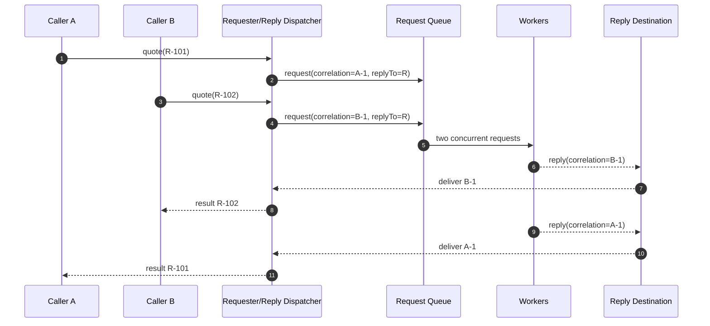
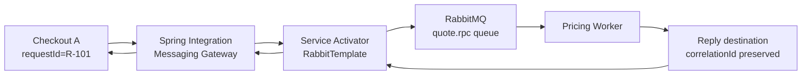
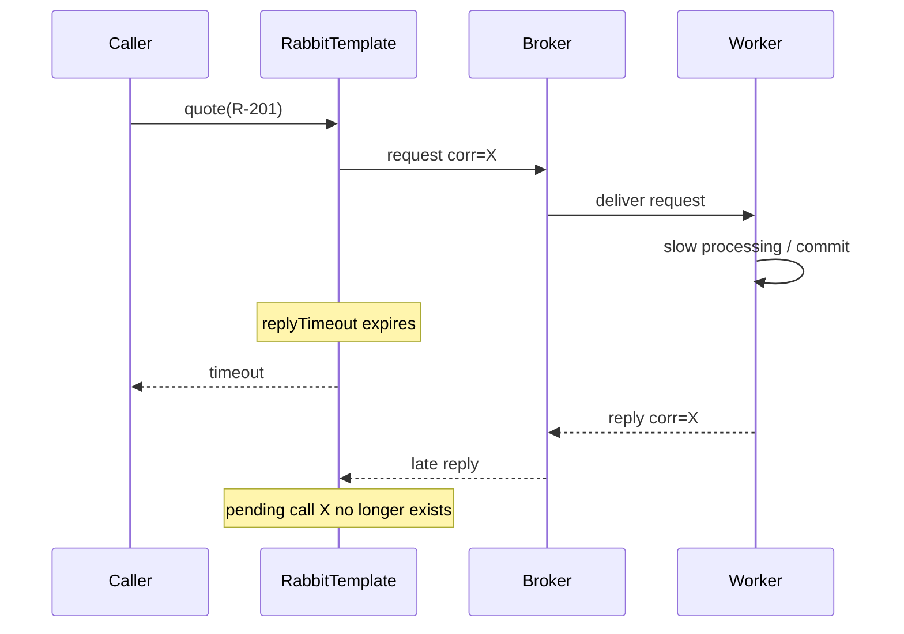

# Correlation Across a Broker in Spring Integration

## Learning Objectives

After this lesson, you will be able to:

- Explain why **message ID**, **business request ID**, **broker correlation ID**, and **Aggregator correlation ID** serve different purposes.
- Design request–reply over a broker so replies return to the **exact matching request**, even when multiple requests execute concurrently and return out of order.
- Distinguish `correlationId` from `replyTo`; understand how RabbitMQ, JMS, and Kafka represent them.
- Build a Spring Integration flow using `@MessagingGateway`, `@ServiceActivator`, and Spring AMQP `RabbitTemplate` to invoke a worker over RabbitMQ.
- Handle timeouts, late replies, retries, duplicate messages, multiple instances, error routing, and durability requirements.
- Write test cases verifying correlation integrity across processing branches.

This lesson belongs to the **Message broker** chapter of the **SPRING_INTEGRATION_PATTERN** module. When practicing Router, Filter, Transformer, Splitter, Aggregator, Gateway, retry, and error channels in Spring Integration, we must preserve relationships between messages. In particular, when a flow crosses a **broker/process boundary**, you cannot rely on an in-memory Java object or processing order to locate the original request.

## 1. The problem: replies arrive out of request send order

Suppose the Checkout service sends two shipping-fee calculation requests to a broker:

| Illustrative time | Message | Event |
| --- | --- | --- |
| 0 ms | `R-101` | Checkout A sends fee calculation request for order A |
| 5 ms | `R-102` | Checkout B sends fee calculation request for order B |
| 50 ms | `R-102` | Worker B finishes first, returning 35,000 VND |
| 180 ms | `R-101` | Worker A finishes later, returning 42,000 VND |

If the caller pairs the first reply with the earliest sent request, A would mistakenly receive B's 35,000 VND. **FIFO on a queue** does not prove completion order when there are multiple consumers, multiple instances, retries, or branches with different latencies.

**Correlation** is the mechanism of attaching a linking key to messages belonging to the same exchange session so the receiver can match each response to the right request regardless of order.



The key point is that the **reply sender/dispatcher** has a way to map `correlation=A-1` to A's waiting call and `correlation=B-1` to B's waiting call.

## 2. Separating identifier types

| Field / ID | Scope and purpose | Is it a cross-broker correlation key? |
| --- | --- | --- |
| `MessageHeaders.ID` | ID of a Spring Messaging `Message<?>`; a Transformer or adapter can create a new message | **Not by default**; a new message may get a different ID |
| Business `requestId` | Stable task identifier, e.g., `R-101`; used for tracing, reconciliation, and deduplication per app policy | Can be used by the app as a correlation key if explicitly defined |
| AMQP `correlationId` | AMQP message property linking request and reply | **Yes**, when the requester/reply dispatcher uses this field |
| AMQP `replyTo` | Destination address where the consumer sends the reply | **No**; specifies **where**, not **whom the reply belongs to** |
| JMS `JMSCorrelationID` | Header linking messages per JMS convention | **Yes**, if client and responder agree on how to set/read it |
| Kafka correlation header | Header used by the application or a request–reply helper | **Yes**, if producer/replier maintain the convention and reply routing |
| `MessageHeaders.CORRELATION_ID` | Spring Integration header for message groups, especially Splitter/Aggregator | **Flow-dependent**; do not assume automatic mapping to AMQP/JMS correlation IDs |
| `traceId` / `spanId` | Distributed observability in tracing | **Should not** replace request–reply or idempotency keys |

In a large application, **these IDs may differ yet must remain lookup-linked**. For example, a business request has `requestId=R-101`; `RabbitTemplate` creates an internal correlation key to await the reply; a Splitter creates a *message group* correlation if querying three vendors. Never force all of them into one ID and assume every adapter understands it.

### 2.1. How does `correlationId` differ from `replyTo`?

An AMQP request might carry:

```json
{
  "properties": {
    "correlationId": "rpc-7f91",
    "replyTo": "shipping.reply.instance-a",
    "contentType": "application/json"
  },
  "body": {
    "requestId": "R-101",
    "orderId": "ORDER-101"
  }
}
```

`replyTo` tells the worker **which destination** to send the response to. `correlationId` tells the requester **which waiting call** to complete when the reply returns. `requestId` in the body is the business ID, convenient for logging and reconciliation. The JSON above is an **illustrative representation** showing properties and body, not the literal wire format RabbitMQ packs.

The worker must preserve the request's correlation when replying, for instance:

```text
Request:
  correlationId = rpc-7f91
  replyTo       = shipping.reply.instance-a

Response:
  correlationId = rpc-7f91
  payload       = { requestId: R-101, amount: 42000 }
  sent to       = shipping.reply.instance-a
```

A message returning to the right reply queue but missing or carrying the wrong correlation ID risks being ignored, logged as an unknown reply, or failing to complete the request. Conversely, the right correlation ID sent to the wrong reply destination also prevents the caller from receiving the result.

## 3. Which boundaries must correlation cross?



There are three boundaries to verify:

1. **From Gateway to outbound adapter:** the message holds payload and Spring Integration internal headers; the reply channel inside the same JVM may be a framework-managed channel object.
2. **From outbound adapter to broker:** the adapter/HTTP/JMS/AMQP client must **serialize** data, select the request destination, and write correlation and reply destinations per protocol. A Java `MessageChannel` object cannot cross the network on its own.
3. **From broker back to Gateway:** the reply dispatcher reads the broker correlation ID, looks up the pending call, routes the result to the right caller, or detects late/unrecognized replies.

If you write a custom adapter and drop metadata at step 2, preserving `replyChannel` on an earlier Spring Integration message will not rescue the request. Conversely, if using a request–reply library that already manages correlation internally, avoid overwriting its headers without understanding its reply-waiting lifecycle.

## 4. Two common approaches for matching request–reply

### 4.1. Template/Gateway managing correlation automatically

Spring AMQP's `RabbitTemplate.convertSendAndReceive(...)` provides RPC over RabbitMQ: sending the request, arranging a reply destination, and using correlation to route the reply back to the waiting call. Under common RabbitMQ configurations, `RabbitTemplate` can use **direct reply-to**; exact behavior depends on RabbitMQ and client configuration.

The advantage is the application does not have to maintain its own `ConcurrentHashMap<correlationId, CompletableFuture<...>>`. Still, **automatic transport correlation does not replace a business request ID** used across logs, retries, reconciliation, or detecting mismatched reply payloads.

### 4.2. Manually managing pending requests and a reply consumer

When using asynchronous workflows, dedicated reply queues, fan-out, or a custom protocol, the application can manage state itself:

```text
pending[brokerCorrelationId] = { requestId, deadline, future }

1. Store pending entry before publishing the request.
2. Publish request with correlationId and replyTo.
3. When a reply arrives, read correlationId.
4. Look up pending[correlationId], verify requestId and payload type.
5. Complete the right future; remove pending state upon completion/expiry.
6. Late or mismatched replies: handle per dedicated policy.
```

In this case, you must ensure atomicity when a reply and a timeout happen nearly simultaneously: only one outcome may complete the call. Use conditional operations like `remove(key, expectedValue)` or atomic state transitions, and clean up resources when the caller cancels, times out, or restarts.

**Choose only one component to own correlation for a single RPC round-trip.** If `RabbitTemplate` is already acting as the request–reply dispatcher, do not simultaneously build another pending map and try to intercept replies on the same direct-reply-to destination.

## 5. Complete example: Spring Integration invoking a worker via RabbitMQ

This example uses **Java 17+, Spring Boot 3.x, Spring Integration 6.x, and Spring AMQP 3.x**. The requester application uses a Spring Integration Gateway; the responder application listens on RabbitMQ and returns a reply. `public` classes/records belong in their respective Java files. Both applications can share a DTO module or a common JSON/type-mapping convention.

Main dependencies are `spring-boot-starter-integration`, `spring-boot-starter-amqp`, and `spring-boot-starter-test` for testing; configure actual broker connectivity via `spring.rabbitmq.host`/credentials per environment. RabbitMQ must be running and the queue declared before sending requests.

### 5.1. Business contract

```java
// QuoteRequest.java
public record QuoteRequest(
        String requestId,
        String sku,
        int quantity
) {}

// QuoteReply.java
import java.math.BigDecimal;

public record QuoteReply(
        String requestId,
        String sku,
        BigDecimal total,
        String errorCode
) {
    public boolean successful() {
        return errorCode == null && total != null;
    }
}
```

`requestId` stays unchanged from request to reply. The requester layer re-checks this field **after** `RabbitTemplate` has already matched the reply at the transport level. The two checks serve two distinct purposes.

### 5.2. Requester: configuring channels and RabbitTemplate

```java
// QuoteRequesterConfig.java (requester application)
import org.springframework.amqp.rabbit.connection.ConnectionFactory;
import org.springframework.amqp.rabbit.core.RabbitTemplate;
import org.springframework.amqp.support.converter.Jackson2JsonMessageConverter;
import org.springframework.context.annotation.Bean;
import org.springframework.context.annotation.Configuration;
import org.springframework.integration.annotation.IntegrationComponentScan;
import org.springframework.integration.channel.DirectChannel;
import org.springframework.integration.config.EnableIntegration;
import org.springframework.messaging.MessageChannel;

@Configuration
@EnableIntegration
@IntegrationComponentScan
public class QuoteRequesterConfig {
    @Bean("quoteRpcRequests")
    public MessageChannel quoteRpcRequests() {
        return new DirectChannel();
    }

    @Bean("quoteRpcRabbitTemplate")
    public RabbitTemplate quoteRpcRabbitTemplate(ConnectionFactory connectionFactory) {
        RabbitTemplate rabbitTemplate = new RabbitTemplate(connectionFactory);
        rabbitTemplate.setMessageConverter(new Jackson2JsonMessageConverter());
        rabbitTemplate.setReplyTimeout(3000);
        return rabbitTemplate;
    }
}
```

`setReplyTimeout(3000)` configures how long `RabbitTemplate` waits for a broker reply (in milliseconds). This is not a RabbitMQ connection timeout, does not cap the worker's business execution time, and does not automatically cancel an already-sent request.

### 5.3. Messaging Gateway: caller API

```java
// QuoteGateway.java (requester application)
import org.springframework.integration.annotation.MessagingGateway;

@MessagingGateway(
    defaultRequestChannel = "quoteRpcRequests",
    defaultReplyTimeout = "4500"
)
public interface QuoteGateway {
    QuoteReply quote(QuoteRequest request);
}
```

The Gateway turns a `quote(request)` call into a message sent to `quoteRpcRequests`. Because the channel here is a `DirectChannel`, the Service Activator and `RabbitTemplate.convertSendAndReceive(...)` execute on the caller's thread. **Messaging Gateway's 4,500 ms reply timeout does not interrupt a Service Activator blocking inside `send()`**; waiting for the broker reply is controlled by `RabbitTemplate` at its 3,000 ms limit.

If the application requires a strict overall deadline, also configure timeouts on connection/pool acquisition and downstream processing, or design an asynchronous request channel with explicit cancellation and resource control.

### 5.4. Service Activator: calling the broker and checking the reply

```java
// QuoteBrokerClient.java (requester application)
import org.springframework.amqp.rabbit.core.RabbitTemplate;
import org.springframework.beans.factory.annotation.Qualifier;
import org.springframework.integration.annotation.ServiceActivator;
import org.springframework.stereotype.Component;

@Component
public class QuoteBrokerClient {
    private final RabbitTemplate rabbit;

    public QuoteBrokerClient(
            @Qualifier("quoteRpcRabbitTemplate") RabbitTemplate rabbit) {
        this.rabbit = rabbit;
    }

    @ServiceActivator(inputChannel = "quoteRpcRequests")
    public QuoteReply requestQuote(QuoteRequest request) {
        // Send to quote.rpc queue via default exchange.
        Object response = rabbit.convertSendAndReceive("quote.rpc", request);

        if (response == null) {
            // RabbitTemplate timed out waiting for reply at the broker layer.
            return new QuoteReply(
                request.requestId(), request.sku(), null, "BROKER_REPLY_TIMEOUT");
        }

        if (!(response instanceof QuoteReply reply)) {
            return new QuoteReply(
                request.requestId(), request.sku(), null, "INVALID_REPLY_TYPE");
        }

        if (!request.requestId().equals(reply.requestId())) {
            return new QuoteReply(
                request.requestId(), request.sku(), null, "REQUEST_ID_MISMATCH");
        }

        return reply;
    }
}
```

`convertSendAndReceive(...)` returns `null` if no reply arrives within the wait limit (normal timeout case); other failures such as connection loss or payload conversion errors can throw exceptions that must be handled per application error rules. The code intentionally distinguishes **reply timeout** from a **reply carrying a wrong `requestId`**.

**Do not manually set an AMQP correlation ID in this example.** `RabbitTemplate` manages its own request–reply correlation; the application keeps `requestId` as the business key. Modifying the broker correlation header used by `RabbitTemplate` can break reply matching.

### 5.5. Responder: declaring the queue and JSON converter

```java
// QuoteResponderConfig.java (responder application)
import org.springframework.amqp.core.Queue;
import org.springframework.amqp.core.QueueBuilder;
import org.springframework.amqp.rabbit.config.SimpleRabbitListenerContainerFactory;
import org.springframework.amqp.rabbit.connection.ConnectionFactory;
import org.springframework.amqp.rabbit.annotation.EnableRabbit;
import org.springframework.amqp.support.converter.Jackson2JsonMessageConverter;
import org.springframework.context.annotation.Bean;
import org.springframework.context.annotation.Configuration;

@Configuration
@EnableRabbit
public class QuoteResponderConfig {
    @Bean
    public Queue quoteRpcQueue() {
        return QueueBuilder.durable("quote.rpc").build();
    }

    @Bean
    public Jackson2JsonMessageConverter quoteJsonConverter() {
        return new Jackson2JsonMessageConverter();
    }

    @Bean
    public SimpleRabbitListenerContainerFactory rabbitListenerContainerFactory(
            ConnectionFactory connectionFactory,
            Jackson2JsonMessageConverter converter) {
        SimpleRabbitListenerContainerFactory factory =
            new SimpleRabbitListenerContainerFactory();
        factory.setConnectionFactory(connectionFactory);
        factory.setMessageConverter(converter);
        return factory;
    }
}
```

Both applications must agree on JSON conventions and DTO types. In production, consider explicit type ID mappings and trusted types when producer/consumer use different Java packages; never allow untrusted data to specify arbitrary classes for deserialization.

### 5.6. Responder: processing and returning the reply

```java
// QuoteWorker.java (responder application)
import java.math.BigDecimal;
import org.springframework.amqp.rabbit.annotation.RabbitListener;
import org.springframework.stereotype.Component;

@Component
public class QuoteWorker {
    @RabbitListener(queues = "quote.rpc")
    public QuoteReply handle(QuoteRequest request) {
        if (request.quantity() <= 0) {
            return new QuoteReply(
                request.requestId(), request.sku(), null, "INVALID_QUANTITY");
        }

        BigDecimal unitPrice = switch (request.sku()) {
            case "BOOK-01" -> new BigDecimal("120000");
            case "PEN-02"  -> new BigDecimal("15000");
            default -> null;
        };

        if (unitPrice == null) {
            return new QuoteReply(
                request.requestId(), request.sku(), null, "UNKNOWN_SKU");
        }

        return new QuoteReply(
            request.requestId(),
            request.sku(),
            unitPrice.multiply(BigDecimal.valueOf(request.quantity())),
            null
        );
    }
}
```

The Spring AMQP listener infrastructure sends the return value to the destination specified in the request's `replyTo` and preserves the correlation metadata needed for the requester to complete its call. Consequently, the worker does not need to know any Java callback, thread, instance, or waiting caller API.

In this flow, a request with `requestId=R-101`, `sku=BOOK-01`, `quantity=2` returns a total of **240,000 VND**. Even if R-102 finishes before R-101, the requester's dispatcher still pairs each reply via the transport correlation managed by `RabbitTemplate`.

### 5.7. Caller checking business results

```java
// CheckoutService.java (requester application)
import org.springframework.stereotype.Service;

@Service
public class CheckoutService {
    private final QuoteGateway quoteGateway;

    public CheckoutService(QuoteGateway quoteGateway) {
        this.quoteGateway = quoteGateway;
    }

    public QuoteReply getQuote() {
        QuoteRequest request = new QuoteRequest("R-101", "BOOK-01", 2);
        QuoteReply reply = quoteGateway.quote(request);

        if (reply == null) {
            throw new IllegalStateException("GATEWAY_REPLY_TIMEOUT");
        }
        if (!reply.successful()) {
            throw new IllegalStateException(reply.errorCode());
        }
        return reply;
    }
}
```

This is an **RPC contract over a message broker**: the caller expects a response tied to the current request, even though transport goes over RabbitMQ. Using a broker does not automatically turn the call into event-driven fire-and-forget.

## 6. When managing correlation manually at the AMQP level

Some architectures need asynchronous replies or durable reply queues—for example, a request might run for minutes and the caller receives the outcome via another channel. In that case, you can use raw AMQP properties:

```java
// Illustrates message construction for publishing;
// do not mix onto the same flow as RabbitTemplate RPC above.
import org.springframework.amqp.core.Message;
import org.springframework.amqp.core.MessageProperties;
import org.springframework.amqp.rabbit.core.RabbitTemplate;

public void publishAsync(
        RabbitTemplate rabbit,
        byte[] jsonPayload,
        String correlationId) {
    MessageProperties properties = new MessageProperties();
    properties.setContentType(MessageProperties.CONTENT_TYPE_JSON);
    properties.setCorrelationId(correlationId);
    properties.setReplyTo("quotes.reply.instance-a");

    Message message = new Message(jsonPayload, properties);
    rabbit.send("", "quote.rpc", message);
}
```

Here `correlationId` must be generated by the application and recorded in the pending table **before calling `send()`**. The worker must read `replyTo` and copy `correlationId` onto the reply message. The reply consumer must:

1. Read the exact broker message correlation ID.
2. Look up the previously registered pending request.
3. Verify the request ID and payload schema.
4. Complete the call at most once, then clean up the pending record.
5. Record replies that lack a pending entry, are expired, duplicated, or misrouted.

The snippet above is **an illustrative publish step**, omitting the reply listener, serialization, durable pending store, ack/retry, and full topology setup. Do not use it to replace a managed RPC mechanism without supplying the missing pieces.

### 6.1. Shared reply queues and multiple instances

A shared reply queue can work if every consumer can look up the pending request. However, if instance A holds `corr-A` in memory and the broker delivers that reply to instance B, B will not find the pending entry while A times out. Choose one deliberate design:

- **Requester/instance-bound reply destination:** the broker returns replies straight to the instance holding the local pending map; requires managing queue lifecycle and instance crashes.
- **Centralized reply dispatcher:** a dedicated component reads replies and completes the corresponding future/callback.
- **Distributed pending state store:** any instance can look up durable state or route replies by partition/owner; requires atomic operations and deadlines.
- **Async job contract:** do not hold an in-memory Java future across restarts; persist `requestId` and job status, emit a completion event, or let clients poll.

Each option carries different trade-offs. Adding a correlation ID alone does not guarantee reaching the right caller in a multi-replica deployment if replies land on a replica that does not own the waiting request.

## 7. Correlation over JMS and Kafka

| Transport | Common fields / techniques | Points to watch |
| --- | --- | --- |
| RabbitMQ (AMQP 0-9-1) | `correlationId`, `replyTo` properties | Response must reach the right destination and carry the key the requester expects |
| JMS | `JMSCorrelationID`, `JMSReplyTo`; sometimes correlated by request `JMSMessageID` | Agree on request ID / message ID rules; never assume response ID equals request message ID |
| Kafka | Correlation in record headers and reply topic/partition; helpers like `ReplyingKafkaTemplate` | Producer/consumer must preserve headers and configure reply listener/topic; Kafka does not provide RPC syntax out of the box for every topic |

For instance, with JMS, two common patterns are setting a dedicated correlation key on the request, or using the request's `JMSMessageID` as the response's correlation ID by mutual convention. The second approach works only if the responder extracts the **exact** request ID and the requester expects that rule. Never assume `JMSCorrelationID` always equals `JMSMessageID`.

With Kafka, a reply is published as a new record. When using `ReplyingKafkaTemplate` or a request–reply endpoint, the library manages correlation mapping; in a custom protocol, producer and consumer must agree on correlation header name, reply topic, reply partition, and pending-request storage. A Kafka header field does not automatically equal `MessageHeaders.CORRELATION_ID` inside a Spring Integration Aggregator.

## 8. Broker correlation vs. Aggregator correlation

Suppose Checkout sends a quote request to three partners:

```text
requestId = R-101 (business)
    |
    v
Splitter -> Vendor A, Vendor B, Vendor C
    |          |          |
    v          v          v
 broker RPC  broker RPC  broker RPC
  corr A      corr B      corr C     (separate transport hops)
    |          |          |
    v          v          v
 reply A     reply B     reply C
    \          |         /
     \         |        /
      Aggregator, groupId = G-101
                |
                v
        SummaryReply(requestId=R-101)
```

There are at least three correlation layers here:

- `R-101` is the **business request ID** tracking the overall operation.
- `corr A/B/C` are **broker request–reply keys** for each individual vendor call. They may be auto-generated by a template or managed by protocol.
- `G-101` is the **group key** aggregating branch replies. In Spring Integration's Splitter/Aggregator, group metadata typically travels via `CORRELATION_ID`, `SEQUENCE_NUMBER`, and `SEQUENCE_SIZE` headers.

Do not confuse a **single attempt's** broker correlation ID with a **message group's** correlation ID. Retrying a broker RPC may create a new transport correlation key while still belonging to the same business request. Overwriting the Splitter's headers during mapping can prevent the Aggregator from completing its group; overwriting `RabbitTemplate`'s key can prevent a reply from finding its waiting call.

When a flow passes through a Router, Transformer, or Filter:

1. Retain business IDs required for tracing, retries, and idempotency.
2. Check which headers each adapter serializes/deserializes and which headers get filtered out.
3. If a Filter drops a branch that an Aggregator is waiting on, configure an appropriate release/timeout strategy.
4. If a branch returns an error, decide whether the error counts as a structured reply or routes to `errorChannel` for separate handling.

## 9. Timeouts, late replies, and the nature of “unknown outcome”

Suppose `RabbitTemplate` waits up to 3 seconds. The worker commits data at second 4 and sends a reply. Once the requester has timed out:



**A timeout on the requester only means the requester stopped waiting.** It does not prove the worker never received, never committed, or was cancelled. Therefore:

- Never match a late reply to a new request just because it is the next message in the reply queue.
- With a business request ID, you can persist late results for reconciliation per business rules.
- Never retry indefinitely. Every attempt needs a deadline, retry policy, and idempotency key.
- For operations with side effects (orders, payments, notifications), retrying with the same operation ID must avoid duplicate results. Read-only queries can be more flexible.
- Configure TTL/group expiry/pending cleanup wherever state is held; a broker TTL does not automatically cancel an in-application future.

### 9.1. Duplicate messages and delivery semantics

The broker can redeliver a request if a consumer crashes after executing side effects but before acking. Without deduplication in the handler, the same `requestId` may execute twice:

```text
Consumer receives R-201 -> commits transaction
Consumer crashes before ACK
Broker redelivers R-201 -> new consumer receives again
```

If an operation requires exactly-once **business effect**, you need idempotency where the side effect happens—such as a unique constraint on the operation ID and persisting the outcome in the same transaction. Correlation solves **matching the right reply**; it does not create exactly-once delivery or exactly-once business effects on its own.

### 9.2. Asynchronous errors and the error channel

In Spring Integration, errors in a synchronous Service Activator can propagate back to the caller; in asynchronous flows, errors may be wrapped as `ErrorMessage`s and sent to an error channel if supported by endpoint/configuration. In a broker consumer, exceptions also interact with the broker adapter's ack/reject/requeue/dead-letter policy.

Therefore, decide **who is responsible for returning an error reply**:

- The worker returns a response carrying an `errorCode`, preserving request correlation.
- The worker routes errors to an error/dead-letter flow capable of reconciling the request, while the requester enforces an explicit timeout if no reply arrives.
- For non-retryable failures, emit a business rejection reply so the request completes decisively.

Never treat `errorChannel` as `replyChannel`. If you only log the exception without replying, the caller receives no business result until timeout.

## 10. Testing correlation across a broker

### 10.1. Testing two requests completing out of order

Send two requests `R-101` and `R-102`; deliberately make the worker return R-102 before R-101. Verify:

1. Reply R-102 completes only the call waiting for R-102.
2. Reply R-101 completes only the call waiting for R-101.
3. No request completes twice; no reply lacks a `requestId`.
4. All timed-out calls are detected and pending state is cleaned up.

A real integration test should run against RabbitMQ or an appropriate broker test container. The test harness below uses the declared `QuoteGateway` to invoke two requests concurrently:

```java
import static org.assertj.core.api.Assertions.assertThat;

import java.util.concurrent.ExecutorService;
import java.util.concurrent.Executors;
import java.util.concurrent.Future;
import java.util.concurrent.TimeUnit;
import org.junit.jupiter.api.Test;
import org.springframework.beans.factory.annotation.Autowired;
import org.springframework.boot.test.context.SpringBootTest;

@SpringBootTest
class QuoteBrokerCorrelationTest {
    @Autowired
    private QuoteGateway gateway;

    @Test
    void keepsRepliesWithTheirRequests() throws Exception {
        ExecutorService callers = Executors.newFixedThreadPool(2);
        try {
            Future<QuoteReply> a = callers.submit(() ->
                gateway.quote(new QuoteRequest("R-101", "BOOK-01", 2)));
            Future<QuoteReply> b = callers.submit(() ->
                gateway.quote(new QuoteRequest("R-102", "PEN-02", 5)));

            QuoteReply replyB = b.get(8, TimeUnit.SECONDS);
            QuoteReply replyA = a.get(8, TimeUnit.SECONDS);

            assertThat(replyA).isNotNull();
            assertThat(replyB).isNotNull();
            assertThat(replyA.requestId()).isEqualTo("R-101");
            assertThat(replyB.requestId()).isEqualTo("R-102");
            assertThat(replyA.total()).isEqualByComparingTo("240000");
            assertThat(replyB.total()).isEqualByComparingTo("75000");
        } finally {
            callers.shutdownNow();
        }
    }
}
```

This test checks **no response mismatch** under concurrent calls. To prove out-of-order completion specifically, the test responder must introduce **controlled delay**: intentionally delay R-101 longer than R-102 and observe reply timestamps. With the immediate sample worker, two concurrent futures alone do not prove reversed completion order.

### 10.2. Additional test cases needed

| Test case | How to trigger | Expected result |
| --- | --- | --- |
| Missing/wrong broker correlation ID | Replace reply with a message carrying an invalid key in a manual flow | Request times out properly; stray reply is logged, never assigned to another request |
| Right correlation, wrong `requestId` | Consumer returns payload with mismatched business ID | Adapter detects `REQUEST_ID_MISMATCH` |
| Late reply | Worker is slower than reply timeout | Requester already expired; late reply does not complete a new request |
| Duplicate request/reply | Intentional redelivery or republish | Idempotent handling; never completes multiple times |
| Two requester instances | Both instances publish and receive replies | Replies reach the right owner, not the other instance |
| Worker throws exception | Worker fails or broker requeues/dead-letters | Retry/error flow obeys policy; no infinite wait |
| Restart while waiting | Stop requester/consumer | If recovery is required, persistent job/reply routing enables reconciliation |
| Splitter/Aggregator over broker | Add multiple branches, invert order | Group correlation and sequence metadata remain intact |

## 11. Monitoring correlation in production

Fields worth logging at send/receive boundaries (without logging sensitive payloads):

| Field | Purpose |
| --- | --- |
| `requestId` / `operationId` | Trace business task across retries |
| `brokerCorrelationId` (when app-managed) | Identify which pending RPC a reply belongs to |
| `replyDestination` | Spot misrouted queues/topics/partitions |
| `requestPublishedAt` / `replyReceivedAt` | Measure end-to-end latency |
| `attempt` / `deadlineRemainingMs` | Distinguish retries from budget exhaustion |
| `messageGroupId` / `sequenceNumber` | Diagnose Aggregators missing members |
| `traceId` / `spanId` | Link logs/traces across Gateway, broker, and worker |

Useful metrics: pending RPC count, reply timeout rate, late replies, unmatched replies without pending entries, duplicate messages, consumer lag, dead-letter count, and p95/p99 latency. In particular, **continuously growing pending counts** may indicate a leak from missing cleanup or a consumer that stopped replying.

## 12. Design checklist

Before deploying request–reply over a broker, check:

1. **Who generates the correlation key?** Template/framework or application? Is there one clear owner?
2. **What is the reply address?** Direct reply-to, per-instance queue, shared queue, or topic/partition? Who consumes it?
3. **Are broker headers preserved across adapters?** Does the responder return the exact correlation key?
4. **Is the business request ID preserved?** Are duplicates, payload mismatches, and reply authorization checked?
5. **What happens on timeout/late reply?** Who cleans up pending state, and who records late outcomes?
6. **Are retries safe?** Are idempotency keys and consistent transactions in place for side effects?
7. **What if multiple replicas run?** Is the owner of a pending call guaranteed to receive its reply?
8. **What if Splitter/Aggregator are involved?** Are group correlation and broker correlation separated, and sequence headers preserved?
9. **Are monitoring and tests sufficient?** Do scenarios cover out-of-order completion, duplicates, mismatched keys, worker crashes, and restarts?

## Conclusion

**Correlation across a broker** ensures each reply is matched back to the **exact right request**, regardless of completion order or consumer count. `replyTo` routes **where** to reply, while `correlationId` identifies **which call** it belongs to; a business `requestId` supports tracing, retries, and idempotency across the system. Spring Integration can expose a Gateway-style API while `RabbitTemplate` or an adapter handles broker-level correlation. When managing correlation manually, also add pending-state lifecycle, deadlines, late-reply handling, deduplication, and instance-aware routing. Accurate correlation is essential for building testable, observable, and safely scalable Message Broker, Router, Splitter/Aggregator, and RPC flows.
