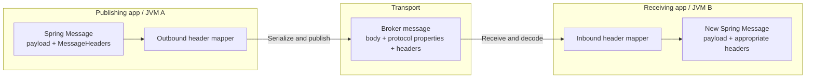
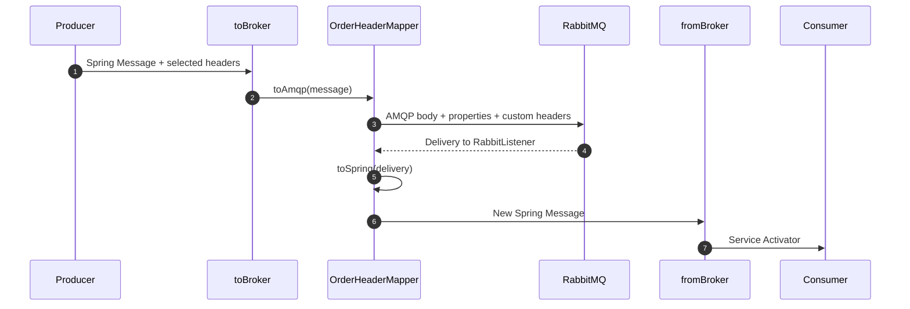
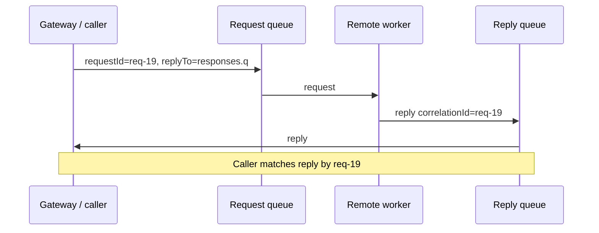

# Message broker — Header Mapping Across a Broker with Spring Integration

## Learning Objectives

After this lesson, you will be able to:

- Describe how **header mapping** transfers metadata between Spring Integration `MessageHeaders` and a message broker; distinguish payload, application headers, and transport protocol properties.
- Decide explicitly which headers must cross the JVM boundary, which must be restored from the broker, and which must remain local to the application.
- Distinguish `id`, `timestamp`, `replyChannel`, and `errorChannel` in Spring Messaging from `messageId`, `correlationId`, `replyTo`, and delivery metadata in AMQP.
- Build a Spring Integration ↔ RabbitMQ bridge with an **allowlist** for headers, test bidirectional mapping, and protect values that should not cross the network.
- Apply correlation, tracing, schema versioning, idempotency, retries, error channels, and late-reply handling when connecting Router/Transformer/Gateway to a broker.

This lesson belongs to the **Message broker** chapter of the **SPRING_INTEGRATION_PATTERN** module. The module aims to implement Enterprise Integration Patterns with Spring Integration so flows stay loosely coupled and extensible; practicing Router, Filter, Transformer, Splitter, Aggregator, Gateway, retry, error channel, correlation, and branch monitoring. Header mapping is a crucial boundary because a message handled safely in memory **cannot necessarily be transferred intact to another process's queue or topic**.

## 1. What is header mapping and what problem does it solve?

In Spring Integration, a message consists of two parts:

- **Payload**: business content such as `OrderCreated`, a JSON string, or a Java DTO.
- **Headers**: accompanying metadata for routing, observability, correlation, or processing control, such as `correlationId`, `replyChannel`, and application-defined keys.

Example inside one JVM:

```java
Message<String> event = MessageBuilder.withPayload(
        "{\"orderId\":\"ORD-42\"}")
    .setHeader("eventId", "evt-42")
    .setHeader("correlationId", "req-19")
    .setHeader("schemaVersion", 1)
    .build();
```

When a message passes through an internal channel like `DirectChannel`, header Java objects can remain in memory. However, across RabbitMQ, Kafka, or JMS, data must be converted into **protocol-supported properties/headers**, pass through encoding/serialization, and then be decoded in the receiving application. Selecting, renaming, converting types, and filtering headers is **header mapping**.



A mapper can perform all four actions: **field selection**, **renaming**, **type conversion**, and **dropping disallowed values**. Producer and consumer must share a metadata contract; matching header names alone does not guarantee compatibility.

## 2. Three metadata groups to distinguish

| Group | Examples | Meaning |
| --- | --- | --- |
| Application headers | `eventId`, `correlationId`, `schemaVersion`, `tenantCode` (if required) | Application-defined; must agree on name, type, scope, and trustworthiness |
| Spring Integration headers | `MessageHeaders.ID`, `MessageHeaders.TIMESTAMP`, `MessageHeaders.REPLY_CHANNEL`, `MessageHeaders.ERROR_CHANNEL` | Metadata for message lifecycle and routing **within the application** |
| Broker / transport properties | RabbitMQ `messageId`, `correlationId`, `replyTo`, routing key, delivery tag; Kafka topic, partition, offset | Send/receive protocol metadata; some set by producer, others generated by broker/consumer |

**Never copy all `MessageHeaders` blindly into the broker header table.** For example:

- `replyChannel` can be a Java `MessageChannel` object or a channel name meaningful only in the current application. A receiver in another JVM cannot invoke a channel object sent over the wire.
- `errorChannel` is typically an internal error-handling path; across a broker, the consumer must choose its own error flow.
- Spring message `id` and `timestamp` represent the lifecycle of **one message instance**. Deserializing into a new message can produce a new `id`/`timestamp`; if business logic needs a stable identifier, carry a dedicated `eventId`.
- `replyTo` (AMQP/JMS) is a **transport reply address**, not directly equivalent to an in-JVM `replyChannel` object.
- `deliveryTag`, `consumerTag`, Kafka `offset`, or redelivery headers only make sense for a specific message delivery/consumer; never copy them blindly into a new publish.

Some broker headers are also system-generated, such as `x-death` when a message passes through a dead-letter exchange in RabbitMQ. This is infrastructure metadata and should not be treated as a client-controlled business field.

### Two types of IDs that can coexist

```text
Application A                     Broker                    Application B
Spring Message id=uuid-A   -->   messageId=evt-42   -->   Spring Message id=uuid-B
             \____________________ eventId=evt-42 ___________________/
                                     correlationId=req-19
```

Here `uuid-A` and `uuid-B` can be completely different; `evt-42` is the stable event ID used to prevent duplicate processing. `req-19` represents the causal chain or request–reply flow the event belongs to. **Correlation ID does not automatically provide idempotency**: the receiver must store and check the event key or business key inside an appropriate transaction.

## 3. Design the header contract before configuring the mapper

For the `order.created` event, we explicitly publish a minimal contract:

| Metadata | Spring-side type | AMQP representation | Policy |
| --- | --- | --- | --- |
| Payload | UTF-8 JSON `String` | AMQP message body, `contentType=application/json` | Required; validate payload schema on consumer |
| `eventId` | `String` | AMQP `messageId` | Required; used as stable event ID |
| `correlationId` | `String` | AMQP `correlationId` | Required in this example; links logs/flows |
| `eventType` | `String` | Custom AMQP header `eventType` | Required; e.g., `order.created` |
| `schemaVersion` | `Integer` | Custom integer AMQP header | Required; supports compatibility checks |
| `traceparent` | `String` | Custom AMQP header `traceparent` | Optional; validate format and trustworthiness |
| `replyChannel`, `errorChannel` | May be Java objects | Not exported | Never serialize internal channel objects |
| `authorization`, secrets, session objects | Any | Not exported | Never leak internal tokens/secrets to the broker |

The names and rules above are an **application-defined contract in this example**. Spring Integration does not automatically assume every header named `eventId` must become AMQP `messageId`; that is a decision requiring explicit configuration or implementation.

When an expected header is absent on input, decide whether to **reject**, **populate a controlled value at ingress**, or **omit per contract**. Never let producer and consumer guess data types—for example, one side sending the number `1` while the other expects the string `"1"`.

### Allowlist principle

Prefer an **allowlist** by header name; forward only fields the consumer needs. This policy helps:

1. Avoid transferring unserializable framework headers.
2. Avoid leaking tokens, internal details, or large objects.
3. Keep the wire format stable when upstream adds new internal headers.
4. Limit reverse coupling between services.
5. Reduce the risk of the broker storing oversized headers or invalid types.

Avoid `headers.forEach((k, v) -> properties.setHeader(k, v))` across messages without an explicit data contract and type/length checks.

## 4. Spring Integration and adapter-based mapping

When using **Spring Integration AMQP inbound/outbound adapters**, the framework provides `HeaderMapper` implementations to convert between Spring Message headers and AMQP properties/headers. Standard headers may receive special handling; which headers pass through by default or are filtered out depends on the adapter, inbound/outbound direction, and version.

Questions to verify in a project:

- Which **mapper** the actual adapter/gateway uses and which default headers are supported in each direction.
- Whether mapping permits custom headers like `eventId` or `traceparent`, and whether explicit names/patterns must be declared.
- Which broker metadata is populated onto inbound Spring Messages and whether it survives a Transformer or Router.
- Whether reply destination/correlation mapping is supported for request–reply over the broker.
- Which framework headers are stripped on publish, and which objects must be converted to strings/primitives.

To make the boundary crystal clear, the walkthrough below **writes a small custom mapper** using Spring AMQP `MessageProperties` and Spring Messaging `MessageBuilder`. Spring Integration manages the channels/Service Activators, while `RabbitTemplate` and `@RabbitListener` connect to the broker. When switching to dedicated AMQP adapters, keep the same **header contract** and translate the equivalent allowlist configuration into the adapter's mapper.

## 5. Complete example: mapping headers over RabbitMQ

Problem: an application emits an order event; the message flows through `toBroker` and is published to RabbitMQ exchange `business.events` with routing key `order.created`; the consumer routes the received message into `fromBroker`. Both ends could be separate services, though the example places them in one application for illustration.

Using Java 17, Spring Boot with Spring Integration and Spring AMQP. Required dependencies:

```groovy
dependencies {
    implementation 'org.springframework.boot:spring-boot-starter-integration'
    implementation 'org.springframework.boot:spring-boot-starter-amqp'
    testImplementation 'org.springframework.boot:spring-boot-starter-test'
}
```

This code uses `RabbitTemplate` and raw AMQP `Message` directly, so `spring-integration-amqp` is not strictly required here. If using Spring Integration AMQP adapters, add the integration module matching your Spring Integration version. A running RabbitMQ server and Spring Boot connection configuration are required. The classes below sit in the same package for easy practice.

### 5.1. Internal channels and topology

`HeaderMappingConfiguration.java`:

```java
import org.springframework.amqp.core.Binding;
import org.springframework.amqp.core.BindingBuilder;
import org.springframework.amqp.core.Queue;
import org.springframework.amqp.core.QueueBuilder;
import org.springframework.amqp.core.TopicExchange;
import org.springframework.amqp.rabbit.annotation.EnableRabbit;
import org.springframework.context.annotation.Bean;
import org.springframework.context.annotation.Configuration;
import org.springframework.integration.annotation.EnableIntegration;
import org.springframework.integration.channel.DirectChannel;
import org.springframework.messaging.MessageChannel;

@Configuration
@EnableIntegration
@EnableRabbit
public class HeaderMappingConfiguration {

    @Bean("toBroker")
    public MessageChannel toBroker() {
        return new DirectChannel();
    }

    @Bean("fromBroker")
    public MessageChannel fromBroker() {
        return new DirectChannel();
    }

    @Bean
    public TopicExchange businessEvents() {
        return new TopicExchange("business.events", true, false);
    }

    @Bean
    public Queue orderCreatedQueue() {
        return QueueBuilder.durable("orders.created.q").build();
    }

    @Bean
    public Binding orderCreatedBinding(
            Queue orderCreatedQueue, TopicExchange businessEvents) {
        return BindingBuilder.bind(orderCreatedQueue)
            .to(businessEvents)
            .with("order.created");
    }

    @Bean
    public OrderHeaderMapper orderHeaderMapper() {
        return new OrderHeaderMapper();
    }
}
```

`toBroker` and `fromBroker` are internal `MessageChannel` beans. `business.events` is a RabbitMQ exchange; `orders.created.q` is a RabbitMQ queue. Queues/exchanges/bindings are declared on the broker when `RabbitAdmin`/auto-configuration is active; you cannot create a broker queue merely by declaring a `DirectChannel` bean.

### 5.2. Bidirectional mapper

`OrderHeaderMapper.java`:

```java
import java.nio.charset.StandardCharsets;

import org.springframework.amqp.core.MessageProperties;
import org.springframework.amqp.core.MessageDeliveryMode;
import org.springframework.messaging.Message;
import org.springframework.messaging.support.MessageBuilder;

public final class OrderHeaderMapper {

    // Allowlist for the order.created contract.
    public org.springframework.amqp.core.Message toAmqp(
            Message<String> source) {
        String eventId = required(
            source.getHeaders().get("eventId"), "eventId");
        String correlationId = required(
            source.getHeaders().get("correlationId"), "correlationId");
        String eventType = required(
            source.getHeaders().get("eventType"), "eventType");

        Object versionValue = source.getHeaders().get("schemaVersion");
        if (!(versionValue instanceof Integer version) || version < 1) {
            throw new IllegalArgumentException(
                "schemaVersion must be a positive Integer");
        }

        MessageProperties properties = new MessageProperties();
        properties.setContentType("application/json");
        properties.setContentEncoding("UTF-8");
        properties.setDeliveryMode(MessageDeliveryMode.PERSISTENT);
        properties.setMessageId(eventId);
        properties.setCorrelationId(correlationId);
        properties.setHeader("eventType", eventType);
        properties.setHeader("schemaVersion", version);

        Object trace = source.getHeaders().get("traceparent");
        if (trace instanceof String traceparent
                && !traceparent.isBlank()
                && traceparent.length() <= 128) {
            // Production code must also validate traceparent syntax.
            properties.setHeader("traceparent", traceparent);
        }

        return new org.springframework.amqp.core.Message(
            source.getPayload().getBytes(StandardCharsets.UTF_8),
            properties
        );
    }

    public Message<String> toSpring(
            org.springframework.amqp.core.Message source) {
        MessageProperties properties = source.getMessageProperties();

        if (!"application/json".equalsIgnoreCase(
                properties.getContentType())) {
            throw new IllegalArgumentException(
                "Unsupported content type");
        }
        if (properties.getContentEncoding() != null
                && !"UTF-8".equalsIgnoreCase(
                    properties.getContentEncoding())) {
            throw new IllegalArgumentException(
                "Unsupported content encoding");
        }

        String eventId = required(
            properties.getMessageId(), "messageId");
        String correlationId = required(
            properties.getCorrelationId(), "correlationId");
        String eventType = required(
            properties.getHeaders().get("eventType"), "eventType");

        if (!"order.created".equals(eventType)) {
            throw new IllegalArgumentException(
                "Unsupported event type");
        }

        Object rawVersion =
            properties.getHeaders().get("schemaVersion");
        if (!(rawVersion instanceof Number number)
                || number.intValue() < 1) {
            throw new IllegalArgumentException(
                "Invalid schemaVersion");
        }

        String payload = new String(
            source.getBody(), StandardCharsets.UTF_8);

        MessageBuilder<String> builder =
            MessageBuilder.withPayload(payload)
                .setHeader("eventId", eventId)
                .setHeader("correlationId", correlationId)
                .setHeader("eventType", eventType)
                .setHeader("schemaVersion", number.intValue());

        Object trace =
            properties.getHeaders().get("traceparent");
        if (trace instanceof String traceparent
                && !traceparent.isBlank()
                && traceparent.length() <= 128) {
            builder.setHeader("traceparent", traceparent);
        }

        // Creates a new Spring Message with fresh ID/timestamp;
        // does not recreate internal replyChannel/errorChannel.
        return builder.build();
    }

    private static String required(Object value, String name) {
        if (!(value instanceof String text) || text.isBlank()) {
            throw new IllegalArgumentException(
                "Missing or invalid " + name);
        }
        return text;
    }
}
```

Characteristics of the mapper:

- `eventId` maps to **AMQP `messageId`**; `correlationId` maps to **AMQP `correlationId`**.
- `eventType` and `schemaVersion` go into **custom AMQP headers**, while `contentType`/encoding describe the body.
- `traceparent` is optional and forwarded only as a short string; this example does not perform full W3C Trace Context validation.
- Headers such as `replyChannel`, `errorChannel`, `authorization`, `id`, and `timestamp` **are not copied wholesale**. The receiver builds a new Spring Message.
- The payload is treated as UTF-8 JSON, though the mapper does not yet validate JSON syntax/schema. In production, validate JSON and schema version before executing side effects.

`MessageDeliveryMode.PERSISTENT` only sets the AMQP message's delivery mode; actual durability also depends on durable queues, publisher confirms, broker topology, and storage configuration.

### 5.3. Publish/receive bridge

`OrderBrokerBridge.java`:

```java
import org.springframework.amqp.rabbit.annotation.RabbitListener;
import org.springframework.amqp.rabbit.core.RabbitTemplate;
import org.springframework.beans.factory.annotation.Qualifier;
import org.springframework.integration.annotation.ServiceActivator;
import org.springframework.messaging.Message;
import org.springframework.messaging.MessageChannel;
import org.springframework.stereotype.Component;

@Component
public class OrderBrokerBridge {

    private final RabbitTemplate rabbitTemplate;
    private final MessageChannel fromBroker;
    private final OrderHeaderMapper mapper;

    public OrderBrokerBridge(
            RabbitTemplate rabbitTemplate,
            @Qualifier("fromBroker") MessageChannel fromBroker,
            OrderHeaderMapper mapper) {
        this.rabbitTemplate = rabbitTemplate;
        this.fromBroker = fromBroker;
        this.mapper = mapper;
    }

    @ServiceActivator(inputChannel = "toBroker")
    public void publish(Message<String> event) {
        rabbitTemplate.send(
            "business.events",
            "order.created",
            mapper.toAmqp(event)
        );
    }

    @RabbitListener(queues = "orders.created.q")
    public void receive(
            org.springframework.amqp.core.Message delivery) {
        Message<String> mapped = mapper.toSpring(delivery);
        boolean accepted = fromBroker.send(mapped);
        if (!accepted) {
            throw new IllegalStateException(
                "Local inbound channel rejected message");
        }
    }

    @ServiceActivator(inputChannel = "fromBroker")
    public void process(Message<String> event) {
        // In a real system: process by eventId and perform deduplication.
        System.out.println(
            "Received eventId=" + event.getHeaders().get("eventId")
            + ", correlationId="
            + event.getHeaders().get("correlationId")
        );
    }
}
```

Path:



Because `fromBroker` is a `DirectChannel` and the handler runs synchronously, exceptions from the consumer propagate back to the listener so the container can apply its ack/nack policy. If replaced with an `ExecutorChannel`, `send()` may return before business logic completes; ack timing must be redesigned to avoid premature confirmation.

Also distinguish **publish dispatched successfully** from **broker confirmed receipt and routing**, and from **consumer committed business effects**. `RabbitTemplate.send(...)` does not prove all subsequent steps succeeded; for stronger guarantees, configure publisher confirms/returns, idempotent consumers, and appropriate business-outcome mechanisms.

### 5.4. Emitting a test message

An application component can inject the `toBroker` bean:

```java
import org.springframework.beans.factory.annotation.Qualifier;
import org.springframework.messaging.MessageChannel;
import org.springframework.messaging.support.MessageBuilder;
import org.springframework.stereotype.Component;
import java.util.UUID;

@Component
public class OrderEventPublisher {

    private final MessageChannel toBroker;

    public OrderEventPublisher(
            @Qualifier("toBroker") MessageChannel toBroker) {
        this.toBroker = toBroker;
    }

    public void publishOrderCreated(String orderId) {
        String eventId = UUID.randomUUID().toString();
        String json = "{\"orderId\":\"" + orderId + "\"}";

        boolean accepted = toBroker.send(
            MessageBuilder.withPayload(json)
                .setHeader("eventId", eventId)
                .setHeader("correlationId", "req-" + orderId)
                .setHeader("eventType", "order.created")
                .setHeader("schemaVersion", 1)
                .build()
        );
        if (!accepted) {
            throw new IllegalStateException("Cannot send event");
        }
    }
}
```

This is a minimal way to illustrate **header mapping**. Production code must serialize JSON using a safe serializer, assign a unique `eventId` per **event**, and keep that ID stable across publish retries. Never build JSON by string concatenation with untrusted data as in this academic snippet. When a shared message format exists, move both metadata definitions and JSON schemas into a shared contract library.

## 6. Testing mapping without a running broker

For the pure mapper in section 5.2, round-trip behavior can be tested with JUnit 5. Crucially, verify both **retained headers** and **stripped headers**, rather than comparing only the payload.

`OrderHeaderMapperTest.java`:

```java
import static org.junit.jupiter.api.Assertions.assertEquals;
import static org.junit.jupiter.api.Assertions.assertFalse;
import static org.junit.jupiter.api.Assertions.assertNull;
import static org.junit.jupiter.api.Assertions.assertThrows;

import org.junit.jupiter.api.Test;
import org.springframework.integration.channel.QueueChannel;
import org.springframework.messaging.Message;
import org.springframework.messaging.MessageHeaders;
import org.springframework.messaging.support.MessageBuilder;

class OrderHeaderMapperTest {

    private final OrderHeaderMapper mapper =
        new OrderHeaderMapper();

    @Test
    void mapsOnlyApprovedMetadataAcrossAmqp() {
        Message<String> original = MessageBuilder
            .withPayload("{\"orderId\":\"ORD-42\"}")
            .setHeader("eventId", "evt-42")
            .setHeader("correlationId", "req-19")
            .setHeader("eventType", "order.created")
            .setHeader("schemaVersion", 1)
            .setHeader(MessageHeaders.REPLY_CHANNEL, new QueueChannel(1))
            .setHeader("authorization", "placeholder-secret")
            .build();

        org.springframework.amqp.core.Message outbound =
            mapper.toAmqp(original);

        assertEquals(
            "evt-42", outbound.getMessageProperties().getMessageId());
        assertEquals(
            "req-19",
            outbound.getMessageProperties().getCorrelationId());
        assertEquals(
            1,
            outbound.getMessageProperties().getHeaders()
                .get("schemaVersion"));
        assertFalse(
            outbound.getMessageProperties().getHeaders()
                .containsKey("replyChannel"));
        assertFalse(
            outbound.getMessageProperties().getHeaders()
                .containsKey("authorization"));

        // Simulate an external party injecting an out-of-contract header.
        outbound.getMessageProperties()
            .setHeader("untrusted-extra", "not-for-app");

        Message<String> received = mapper.toSpring(outbound);

        assertEquals(original.getPayload(), received.getPayload());
        assertEquals("evt-42", received.getHeaders().get("eventId"));
        assertEquals(
            "req-19", received.getHeaders().get("correlationId"));
        assertEquals(1, received.getHeaders().get("schemaVersion"));
        assertNull(
            received.getHeaders().get(MessageHeaders.REPLY_CHANNEL));
        assertNull(received.getHeaders().get("authorization"));
        assertNull(received.getHeaders().get("untrusted-extra"));
    }

    @Test
    void rejectsRequiredHeaderWhenMissing() {
        Message<String> invalid = MessageBuilder
            .withPayload("{}")
            .setHeader("correlationId", "req-20")
            .setHeader("eventType", "order.created")
            .setHeader("schemaVersion", 1)
            .build();

        assertThrows(
            IllegalArgumentException.class,
            () -> mapper.toAmqp(invalid)
        );
    }
}
```

These two tests verify the mapper contract at the object level. They **do not prove** that RabbitMQ routes the message to the right queue, that the broker durably persists publishes, that the listener acks after commit, or that older consumer versions understand new schemas. Those require integration tests with RabbitMQ/Testcontainers and dedicated producer–consumer compatibility tests.

### What should integration tests add?

1. Emit `eventId=evt-42` via `toBroker`, read the delivery from RabbitMQ, and compare AMQP `messageId`, `correlationId`, custom headers, and `contentType`.
2. Inject an unexpected header at the broker and confirm the consumer does not promote it into business control data.
3. Send an unsupported `schemaVersion` or wrong content type; verify the listener applies reject/DLQ policy instead of looping in infinite requeues.
4. Provide a payload with Vietnamese characters; verify UTF-8 is decoded properly.
5. Simulate a consumer error before ack; verify redelivery produces no duplicate side effects thanks to `eventId` checks.
6. If implementing request–reply, send multiple concurrent requests; verify each reply matches its `correlationId` and late replies are never matched to subsequent calls.

## 7. Mapping with Kafka and JMS: same goal, different transport

You cannot copy an AMQP configuration verbatim across every broker because **header types and origins** differ.

| Topic | RabbitMQ / AMQP | Apache Kafka | JMS |
| --- | --- | --- | --- |
| Body/payload | AMQP message body and content type | Record value (bytes per serializer) | Text/Bytes/Object message per API and converter |
| Application headers | AMQP field table with supported types | Kafka record headers holding `byte[]`; multiple values with the same key are possible | Message properties per JMS-supported types |
| Correlation | AMQP `correlationId` property or contract header | No mandatory broker correlation property; app chooses header/record metadata | Standard JMS `JMSCorrelationID` |
| Reply destination | AMQP `replyTo` | Usually custom-designed reply topic/key/correlation | Standard JMS `JMSReplyTo` |
| Routing | Exchange + routing key + queue | Topic, partition, and record key | Destination queue/topic and selector |
| Received metadata | Delivery tag, redelivered, consumer info | Received topic, partition, offset | `JMSMessageID`, redelivered, delivery properties |

For **Spring Integration Kafka**, adapters and Spring Kafka map record headers to message headers. Because Kafka headers travel on the wire as bytes, define encoding/decoding rules (e.g., UTF-8 or JSON) for `correlationId`/`schemaVersion`; never assume an internal `Integer` arrives intact as an `Integer` over the wire. Received headers like topic, partition, and offset are **transport metadata** added by the consumer adapter and should not be reused as business metadata on outbound publishes.

For **JMS**, standard `JMSCorrelationID` and `JMSReplyTo` play a direct role in request–reply. Custom properties are constrained by JMS naming and supported value types; sending arbitrary objects from `MessageHeaders` may fail or convert unexpectedly.

A cross-broker rule: **define a transport-neutral contract at the business level**, then write separate adapter mappings for AMQP, Kafka, or JMS. For instance, `eventId` remains the event ID, while each transport may need a different wire representation.

## 8. Correlation, Reply Channel, and Error Channel across a broker

### 8.1. Correlation does not equal reply path

For internal Request–Reply calls, a gateway can set `replyChannel` so the handler knows where to send results. Across a broker, you usually need to explicitly design:



- **Reply destination**: which queue/topic receives replies; AMQP uses `replyTo`, JMS uses `JMSReplyTo`, Kafka usually needs an explicit agreement.
- **Correlation ID**: key matching replies to requests, especially when multiple requests share a reply destination.
- **Timeout**: when the caller stops waiting. A reply arriving past the deadline is a **late reply** and must be handled explicitly.
- **Idempotency key**: prevents duplicate side-effect execution across retries/redeliveries; this is separate from correlation.

In the one-way event publish example in section 5, we **did not map `replyChannel` to `replyTo`**. When building RPC over AMQP, define an explicit `replyTo` and correlation contract, or use an outbound gateway/adapter supporting request–reply with proper configuration. A Java `replyChannel` object cannot be used directly in another JVM.

### 8.2. Errors at the boundary

Errors can arise in several places:

| Location | Example | Handling approach |
| --- | --- | --- |
| Outbound mapper | Missing header, wrong type, unencodable value | Reject before publish; log error with correlation |
| Publish | Broker down, message returned as unroutable | Backoff, publisher confirm/return, outbox if needed |
| Inbound mapper | Unsupported schema version or content type | Classify as permanent error, reject/DLQ, no infinite retry |
| Consumer handler | Remote API 503, DB timeout | Bounded retry, idempotency, DLQ when exhausted |
| Reply path | Invalid reply destination or caller already timed out | Correlation, late-reply handling, outcome state persistence |

Spring Integration's `errorChannel` collects `ErrorMessage`s from endpoints/adapters that support or are configured for it. It does not replace the broker's **ack/nack/requeue/DLQ** policy. When an inbound listener throws an exception, the RabbitMQ listener container decides acknowledgement/redelivery based on configuration and error type; if the exception is caught and swallowed, the container may treat processing as successful despite business failure.

For messages invalid due to header mapping, avoid immediate infinite requeues. Record minimal diagnostic info (event ID if readable, source, error type, schema version), decide to reject or dead-letter, and provide a replay procedure after fixing data or the consumer.

## 9. Security and compatibility of headers

Headers coming from a broker are **untrusted boundary input**, even when the organization owns the broker. Key decisions:

- **Never trust headers for user authentication** without origin protection, broker authentication, and an explicit identity-propagation policy. Access tokens, cookies, sessions, or internal secrets should never be forwarded via copy-all mapping.
- Bound **header names, types, lengths, and counts**. Never accept arbitrary Java objects, deeply nested maps, or large payloads stuffed into header tables.
- For `traceparent`, validate canonical syntax and propagate traces only across appropriate trust boundaries; never treat a client-supplied trace ID as authorization.
- Version both payload schemas and header contracts. When changing a header from `String` to a number or renaming it, producer and consumer need a compatibility strategy.
- Clarify which headers are **set by the producer**, **added by the broker**, or **enriched by the receiving adapter**. Never allow external publishers to forge privileged system headers.
- Do not rely on custom header ordering; AMQP, Kafka, and JMS follow different transport rules. Kafka can store multiple headers with the same name.
- Avoid dumping all headers into logs if they may hold sensitive data. Log only approved fields such as `eventId`, `correlationId`, `eventType`, and `schemaVersion`.

### Mapping does not guarantee exactly-once

Even with accurate header mapping, the broker may redeliver the same event if a consumer crashes after committing data but before acking. The redelivered message may carry different system headers or construct a Spring message with a new ID; **`eventId` must stay unchanged so the consumer detects duplicates**.

The receiver should record processed `eventId`s with a unique constraint in the same transaction that performs the side effect. For operations like creating orders or processing payments, correlation ID or `MessageHeaders.ID` alone cannot ensure single execution.

## 10. Observability, diagnostics, and deployment checklist

### Tracing a sample message

```text
[producer] eventId=evt-42 corr=req-19 schema=1
    -> Spring Message id=uuid-A
[outbound mapper] messageId=evt-42 correlationId=req-19
    -> AMQP body + properties
[broker] exchange=business.events routingKey=order.created
    -> queue=orders.created.q
[inbound mapper] eventId=evt-42 corr=req-19 schema=1
    -> Spring Message id=uuid-B
[consumer] eventId=evt-42 handled=true
```

If an event is lost or fails, reconcile each step using the **stable business ID**. Never compare only `MessageHeaders.ID`, since messages can be reconstructed multiple times.

| Symptom | Possible cause | How to check |
| --- | --- | --- |
| Consumer misses `correlationId` | Outbound skipped mapping, renamed it, or inbound didn't restore it as a Spring header | Inspect raw AMQP properties and mapper contract |
| Java object in header causes serialization error | Copy-all mapping of `replyChannel`/DTO/exception | Enforce allowlist; encode into transport-supported types |
| Deduplicating by `id` still allows duplicates | Spring Message ID changes upon deserialization | Use a stable `eventId` across retries/redeliveries |
| Consumer misinterprets `schemaVersion` | One side sends `"1"`, other expects `Integer` | Lock down types and run compatibility tests |
| Unexpected header alters auth/routing | Trusting unverified broker data | Verify origin, auth, allowlist, and routing rules |
| Reply goes to wrong caller | Improper `replyTo`/correlation mapping | Check request–reply contract and pending registry |
| Failing message loops endlessly | Inbound mapper throws while broker requeues forever | Classify errors, nack/DLQ, track retry metrics |
| Tracing enabled but spans don't link | `traceparent` stripped or formatted wrongly | Check mapper/propagator on both sides |

In production, emit metrics for: outbound/inbound mapping errors, missing required headers, unsupported schema versions, publish failures, redeliveries, dedup hits, DLQ counts, late replies, and per-stage latency. Use `correlationId` to link logs; use `eventId` to distinguish **a specific event** from its redeliveries.

## 11. Practice exercises

**Exercise 1 — Allowing and stripping headers.** Extend `OrderHeaderMapperTest` with a valid `traceparent`, `authorization`, and a `replyChannel` object. Verify only allowlisted fields appear on the AMQP message, and the receiver does not restore internal headers.

**Exercise 2 — Type mismatch.** Have the producer send `schemaVersion="1"` as a string. Verify the mapper rejects it per contract. Then propose a migration policy if both string and integer must be supported temporarily.

**Exercise 3 — Kafka or JMS.** Design an equivalent mapping table for `eventId`, `correlationId`, and `schemaVersion`. Point out at least two differences in header types or protocol properties compared with AMQP.

**Exercise 4 — Redelivery.** Using RabbitMQ, simulate a consumer that writes to the DB and fails before ack. Verify `eventId` is preserved upon redelivery and prove repeated delivery causes no duplicate side effects.

**Exercise 5 — Request–reply.** Add `replyTo` and a correlation ID to a gateway request; issue two concurrent requests, match replies accurately, and define behavior when a reply arrives after timeout.

**Exercise 6 — Observing mapping errors.** Send a message with a wrong content type, missing correlation ID, or unsupported schema version. Ensure the listener routes the failure into the configured dead-letter flow without creating an infinite requeue loop.

**Completion criteria:** given a concrete event with `eventId` and `correlationId`, explain every bidirectional mapping step, which values are kept, which are stripped, why system IDs change, and how to verify everything in tests.

## 12. Key takeaways

- **Header mapping** is the contract translating metadata between a Spring Integration `Message` and a broker-protocol message; never assume every header transfers intact.
- Distinguish application headers, Spring internal headers, and broker properties. Internal `replyChannel`/`errorChannel` do not automatically become valid addresses in another process.
- Prefer an **allowlist** and validate types, encoding, lengths, and schemas. Stable `eventId` enables deduplication; `correlationId` links flows/request–reply.
- AMQP, Kafka, and JMS all support metadata, yet their data types and standard properties differ; design mappings per transport.
- Test both **forwarded** and **stripped** headers, and run broker integration tests to verify routing, acknowledgement, retries, error channels, and cross-service compatibility.
