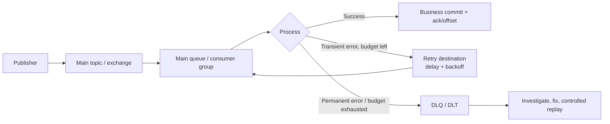
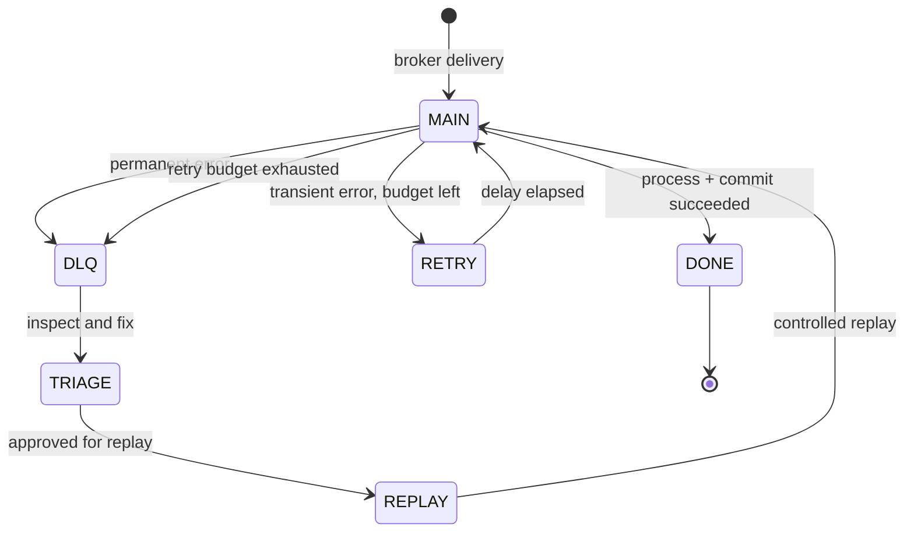
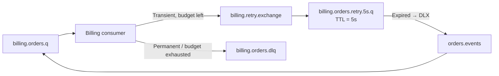
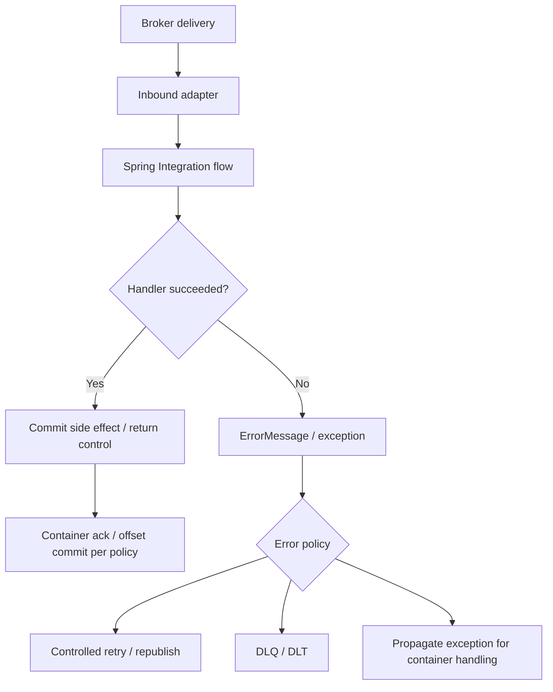

# Dead-Letter Queues and Retry Topics in Spring Integration

## 1. The problem: where do failed messages go?

In the **Message broker** chapter of the **SPRING_INTEGRATION_PATTERN** module, we learn to apply **Enterprise Integration Patterns** with Spring Integration to build loosely coupled, extensible message flows. Components such as Gateway, Router, Filter, Transformer, Splitter, Aggregator, retry, error channel, and correlation move data through processing steps; the broker handles receiving and delivering messages across systems.

When a consumer encounters an error, three common choices exist: retry immediately, retry after a delay, or move the message to quarantine for separate handling. Two commonly used tools are:

- **Dead-letter queue (DLQ)**: a queue receiving messages that are no longer processed on the main path per policy—for instance, after exhausting retries, being rejected without requeue, being invalid, or expiring.
- **Retry topic / retry queue**: an intermediate destination for messages eligible for reprocessing after a delay. Exact naming and mechanics depend on the broker; Kafka typically uses a *retry topic*, whereas RabbitMQ typically uses a *retry queue* with TTL/dead-letter exchange or a delayed-delivery mechanism.

Suppose the Billing service receives an `OrderPlaced` event. At that moment, Billing's database is temporarily unreachable. If the consumer immediately requeues and re-reads thousands of times per second, both broker and database can overload. Conversely, if a payload violates the schema and cannot be parsed, infinite retries will never fix the data.

We need an **error-handling policy** that gives transiently failing messages a chance to recover, while isolating unrecoverable messages and preventing data loss or duplicated business effects.



In this lesson, **DLQ/DLT** is where problematic messages are stored; **retry destination** is where the next attempt is delayed. The diagram illustrates the concept and does not imply every broker shares the same configuration or delivery semantics.

### Expected outcomes

After studying this lesson, you will be able to:

1. Distinguish transient errors, data errors, business rejections, and unknown-outcome errors.
2. Choose among in-consumer synchronous retries, broker-based retries, retry topics, and DLQ/DLT.
3. Configure an example RabbitMQ dead-letter exchange/queue and TTL retry queue with Spring Integration AMQP.
4. Understand how Spring Kafka supports retry topics and dead-letter topics, and how to connect a listener to a Spring Integration Gateway.
5. Avoid infinite requeue loops, message loss at ack boundaries, and duplicate effects upon redelivery.
6. Observe, test, and replay failed messages following a safe procedure.

## 2. Terms that should not be used interchangeably

| Concept | Purpose | Points to note |
| --- | --- | --- |
| **In-process retry** | Re-runs the handler within the same delivery | Can hold threads/consumers and increase processing latency |
| **Broker retry queue** | Temporarily holds a message before routing back to the main queue | RabbitMQ often uses TTL + DLX or delayed delivery |
| **Kafka retry topic** | Publishes a record to an intermediate topic for later consumption | Changes offset/partition handling and can lose relative ordering |
| **Dead-letter queue (DLQ)** | Stores messages no longer processed on the main path | Common queue terminology in RabbitMQ/JMS |
| **Dead-letter topic (DLT)** | Topic holding records that failed after retries | Common Kafka terminology; still a normal topic |
| **Reject/Nack** | Consumer notifies the broker that a delivery was not accepted | Requeue/dead-letter outcome depends on config and broker |
| **Ack / offset commit** | Records delivery/consumption progress | Does not by itself prove business side effects committed |
| **Poison message** | A message that always fails the handler under current code/contract | Needs isolation or data/code remediation |
| **Idempotent consumer** | Processes repeated deliveries of one logical event without multiplying side effects | Requires appropriate atomic state/key storage |

**RabbitMQ DLQ** is not identical to **Kafka DLT** in how the broker delivers and stores messages. In RabbitMQ, dead-lettering typically happens by routing from the source queue to a **dead-letter exchange (DLX)** and into a receiving queue. In Kafka, applications or frameworks normally **publish a new record** to a retry topic or DLT; Kafka does not automatically move a failed record to a DLT just because a listener throws an exception.

## 3. Classify errors before deciding to retry

You cannot design good retries if every exception is treated the same.

| Error group | Example | Recommended policy |
| --- | --- | --- |
| **Transient** | DB unavailable, brief network drop, temporary HTTP 503 | Bounded retry with backoff and time cap |
| **Validation/schema** | Malformed JSON, missing field, unsupported schema version | Do not retry indefinitely; move to DLQ/quarantine for investigation |
| **Business rejection** | Order already cancelled, ineligible for processing | Record business outcome; decide ack and rejection event per contract |
| **Transient concurrency/conflict** | Optimistic lock conflict or lock timeout | Can retry within bounds if operation is idempotent |
| **Unknown outcome** | Remote received payment command, but reply was lost | Reconcile by idempotency key before retrying a side-effecting command |
| **Programming bug** | `NullPointerException` from code bug, broken contract mapping | Alert and fix root cause; do not mask with infinite retries |

An `IOException` is not necessarily transient in every situation. A connect timeout **before sending a command** differs from a read timeout after the remote may have already committed. Policies must consider **business semantics and where side effects occur**, not just exception class names.

### Three questions for every error

1. **Can it recover on its own?** If only code or data fixes will make it succeed, send it to the DLQ/DLT.
2. **Is retrying safe?** If the handler already performed part of the business work, idempotency and durable state are required.
3. **How long may it retry?** Set max attempts, deadline, backoff, and resource limits.

Appropriate response states might be `PROCESSED`, `REJECTED`, `RETRY_SCHEDULED`, `DEAD_LETTERED`, and `UNKNOWN`. Never label a transaction `FAILED` when its actual outcome is undetermined.

## 4. Designing the lifecycle of a failed message

A target lifecycle:



Milestones worth storing or propagating:

- `eventId`/**operationId**: stable business identity of the message.
- `correlationId` and `traceId`: for tracking a flow and its attempts.
- `attempt`: attempt number under a **consistent definition**, such as initial processing being 1.
- `firstSeenAt`, `lastErrorAt`, `nextRetryAt`, and retry deadline.
- Standardized `errorCode`, `originTopic/queue`, `consumerName`, `schemaVersion`.
- Original payload or durable reference to it, with appropriate access control and retention.

Never use an unstandardized exception message as a retry key, since wording can change across versions. Never generate a fresh `eventId` on each retry of the same event; otherwise consumers cannot detect duplicates.

### Backoff and retry budget

Example retry policy: first attempt at `t=0`; on transient error, wait 5 seconds, then 30 seconds, then 2 minutes; once attempts are exhausted, move to DLQ. Total attempts and deadline must be clearly bounded.

| Attempt | Wait before this attempt | If it fails |
| --- | ---: | --- |
| 1 | 0 seconds | Schedule attempt 2 |
| 2 | 5 seconds | Schedule attempt 3 |
| 3 | 30 seconds | Schedule attempt 4 |
| 4 | 2 minutes | Move to DLQ |

Exponential backoff helps when downstream systems are overloaded; **jitter** prevents thousands of consumers from retrying at the exact same instant. A fixed-TTL retry queue provides an approximate delay; if exact schedules or multiple levels are needed, design an appropriate topology/consumer.

## 5. RabbitMQ: dead-letter exchanges and dead-letter queues

In RabbitMQ, dead-lettering typically occurs when a message is rejected/nacked without requeue, its TTL expires, the queue exceeds length limits, or in some cases when delivery limits on supported queue types are reached. The broker **does not create a DLQ automatically**; you must declare the DLX, target queue, and binding (or corresponding policy).

Illustrative flow:

```text
orders.events (topic exchange)
      |
      | routing key = order.placed
      v
billing.orders.q
      |
      | reject / nack requeue=false
      v
billing.dead.exchange (direct)
      |
      | routing key = billing.dead
      v
billing.orders.dlq
```

### 5.1. Declaring topology with Spring AMQP

In a Spring Boot app, Spring Integration and Spring AMQP are needed; Gradle example:

```groovy
dependencies {
    implementation 'org.springframework.boot:spring-boot-starter-integration'
    implementation 'org.springframework.boot:spring-boot-starter-amqp'
    implementation 'org.springframework.integration:spring-integration-amqp'
}
```

Java topology configuration:

```java
import org.springframework.amqp.core.Binding;
import org.springframework.amqp.core.BindingBuilder;
import org.springframework.amqp.core.DirectExchange;
import org.springframework.amqp.core.Queue;
import org.springframework.amqp.core.QueueBuilder;
import org.springframework.amqp.core.TopicExchange;
import org.springframework.context.annotation.Bean;
import org.springframework.context.annotation.Configuration;

@Configuration
public class BillingBrokerTopology {

    public static final String EVENTS_EXCHANGE = "orders.events";
    public static final String MAIN_QUEUE = "billing.orders.q";
    public static final String MAIN_ROUTING_KEY = "order.placed";
    public static final String DLX = "billing.dead.exchange";
    public static final String DLQ = "billing.orders.dlq";
    public static final String DEAD_ROUTING_KEY = "billing.dead";

    @Bean
    public TopicExchange ordersEventsExchange() {
        return new TopicExchange(EVENTS_EXCHANGE, true, false);
    }

    @Bean
    public DirectExchange billingDeadExchange() {
        return new DirectExchange(DLX, true, false);
    }

    @Bean
    public Queue billingOrdersQueue() {
        return QueueBuilder.durable(MAIN_QUEUE)
            .deadLetterExchange(DLX)
            .deadLetterRoutingKey(DEAD_ROUTING_KEY)
            .build();
    }

    @Bean
    public Queue billingDeadQueue() {
        return QueueBuilder.durable(DLQ).build();
    }

    @Bean
    public Binding ordersToBilling() {
        return BindingBuilder.bind(billingOrdersQueue())
            .to(ordersEventsExchange())
            .with(MAIN_ROUTING_KEY);
    }

    @Bean
    public Binding billingToDeadLetterQueue() {
        return BindingBuilder.bind(billingDeadQueue())
            .to(billingDeadExchange())
            .with(DEAD_ROUTING_KEY);
    }
}
```

`x-dead-letter-exchange` and `x-dead-letter-routing-key` on the source queue are set accordingly by the Spring AMQP builder. When a message is dead-lettered, it routes via the DLX; the DLQ is a queue bound to that exchange.

**Operational note:** arguments on an existing queue may not be modifiable by redeclaring it. In production, RabbitMQ policies are often useful for managing dead-letter configuration, and a migration plan is needed for live topologies. A durable queue does not guarantee every message was durably written: that also depends on publish mode, confirms, queue type, replication, and broker policies.

### 5.2. Consuming via a Spring Integration inbound adapter

Example using `SimpleMessageListenerContainer` with **container-side** `AUTO` acknowledgment: when processing finishes, the container acks per its mechanism; when an exception escapes the listener, the requeue/reject policy applies.

```java
import org.springframework.amqp.core.AcknowledgeMode;
import org.springframework.amqp.rabbit.connection.ConnectionFactory;
import org.springframework.amqp.rabbit.listener.SimpleMessageListenerContainer;
import org.springframework.context.annotation.Bean;
import org.springframework.context.annotation.Configuration;
import org.springframework.integration.amqp.dsl.Amqp;
import org.springframework.integration.config.EnableIntegration;
import org.springframework.integration.dsl.IntegrationFlow;

@Configuration
@EnableIntegration
public class BillingConsumerFlow {

    @Bean
    public SimpleMessageListenerContainer billingContainer(
            ConnectionFactory connectionFactory) {

        SimpleMessageListenerContainer container =
            new SimpleMessageListenerContainer(connectionFactory);

        container.setQueueNames(BillingBrokerTopology.MAIN_QUEUE);
        container.setAcknowledgeMode(AcknowledgeMode.AUTO);
        container.setDefaultRequeueRejected(false);
        container.setConcurrentConsumers(2);
        container.setPrefetchCount(10);
        return container;
    }

    @Bean
    public IntegrationFlow billingInboundFlow(
            SimpleMessageListenerContainer billingContainer,
            BillingMessageHandler handler) {

        return IntegrationFlow
            .from(Amqp.inboundAdapter(billingContainer))
            .handle(handler, "process")
            .get();
    }
}
```

Business handler definition:

```java
import org.springframework.stereotype.Component;

@Component
public class BillingMessageHandler {
    private final BillingUseCase billing;

    public BillingMessageHandler(BillingUseCase billing) {
        this.billing = billing;
    }

    public void process(String json) {
        // Parse + validate schema; throw exception if data is invalid.
        // BillingUseCase applies inbox/idempotency inside a transaction.
        billing.applyJsonEventOnce(json);
    }
}
```

`BillingUseCase` is the application business class to implement; the code above illustrates flow structure, not a standalone project. Production code requires content-type-appropriate converters, payload validation, and correlation IDs.

If `process` throws an exception and it propagates back to the listener container, `defaultRequeueRejected(false)` tells it **not to requeue failed deliveries back onto the main queue by default**. With the declared topology, deliveries rejected/nacked this way route via the DLX to the DLQ. Exactly which exceptions the adapter sends to an error channel, whether they are swallowed, and how the container acks/nacks **must be tested on the real configuration**. If an error flow catches and “swallows” the exception, the container may perceive processing as successful.

### 5.3. Distinguishing `AUTO` and `NONE`

Spring AMQP's `AcknowledgeMode.AUTO` means **the container decides ack/nack based on callback outcome**. It is **not** like AMQP `autoAck=true` or `AcknowledgeMode.NONE`, where the broker considers a message delivered without waiting for equivalent acknowledgment.

In business flows with a database, the standard choice is committing the transaction/idempotent side effect before container ack. If the process dies after DB commit but before ack, the broker may redeliver: **the consumer must tolerate duplicates**.

## 6. RabbitMQ retry queues using TTL and DLX

A DLQ is usually the final stop for unrecoverable errors or exhausted budgets. For transient errors, you can put messages into a **retry queue** to delay them and dead-letter them back to the main exchange once TTL expires.



This is an **error-handling architecture**: temporary retries go to the retry destination; terminal failures go to the DLQ. The two paths must be separated cleanly in application logic.

### 6.1. Declaring a retry destination

Example addition to RabbitMQ configuration:

```java
import org.springframework.amqp.core.Binding;
import org.springframework.amqp.core.BindingBuilder;
import org.springframework.amqp.core.DirectExchange;
import org.springframework.amqp.core.Queue;
import org.springframework.amqp.core.QueueBuilder;
import org.springframework.context.annotation.Bean;
import org.springframework.context.annotation.Configuration;

@Configuration
public class BillingRetryTopology {
    public static final String RETRY_EXCHANGE =
        "billing.retry.exchange";
    public static final String RETRY_QUEUE =
        "billing.orders.retry.5s.q";
    public static final String RETRY_ROUTING_KEY =
        "billing.retry.5s";

    @Bean
    public DirectExchange billingRetryExchange() {
        return new DirectExchange(RETRY_EXCHANGE, true, false);
    }

    @Bean
    public Queue billingRetryQueue() {
        return QueueBuilder.durable(RETRY_QUEUE)
            .ttl(5_000)
            .deadLetterExchange(BillingBrokerTopology.EVENTS_EXCHANGE)
            .deadLetterRoutingKey(BillingBrokerTopology.MAIN_ROUTING_KEY)
            .build();
    }

    @Bean
    public Binding billingRetryBinding() {
        return BindingBuilder.bind(billingRetryQueue())
            .to(billingRetryExchange())
            .with(RETRY_ROUTING_KEY);
    }
}
```

When a message is **explicitly published** to `billing.retry.exchange` with routing key `billing.retry.5s`, it enters the retry queue. When the TTL expires, the broker dead-letters it back to `orders.events` to return to `billing.orders.q`.

The 5-second duration is an **expected delay target**, not a millisecond-exact guarantee. Queue depth, broker state, and scheduling affect actual delivery timing. Tune TTL, queue capacity, throughput, and retention to match real load.

### 6.2. Who decides to route to the retry queue?

The setup in section 5 routes **rejections from the main queue to the DLQ**, so for delayed retries the application must **select the retry branch and publish to the retry exchange**. Merely creating a retry queue **does not automatically** send transient exceptions there.

Helper example illustrating publishing to the retry destination:

```java
import org.springframework.amqp.rabbit.core.RabbitTemplate;
import org.springframework.stereotype.Component;

@Component
public class BillingRetryPublisher {
    private final RabbitTemplate rabbitTemplate;

    public BillingRetryPublisher(RabbitTemplate rabbitTemplate) {
        this.rabbitTemplate = rabbitTemplate;
    }

    public void scheduleRetry(
            String originalJson,
            String eventId,
            int nextAttempt) {

        rabbitTemplate.convertAndSend(
            BillingRetryTopology.RETRY_EXCHANGE,
            BillingRetryTopology.RETRY_ROUTING_KEY,
            originalJson,
            amqpMessage -> {
                amqpMessage.getMessageProperties()
                    .setHeader("eventId", eventId);
                amqpMessage.getMessageProperties()
                    .setHeader("retryAttempt", nextAttempt);
                return amqpMessage;
            });
    }
}
```

In a real flow, a handler/Router/Recoverer classifies the exception and calls `scheduleRetry` **only if retry budget remains**. Copying the body must preserve the same event ID, schema, and required metadata; never pass tokens or unserializable headers to the broker.

**Critical trust boundary:** `convertAndSend` returning **does not prove** the retry message was stored and routed properly by the broker. If the consumer acks the original message and publishing the retry fails, work can be lost. For high-reliability flows, use publisher confirms/returns, publish-result handling policies, or a durable outbox before treating the original delivery as settled. If publishing the retry succeeds while the original ack is lost, duplicates can occur; inbox/idempotency is mandatory.

### 6.3. Avoiding infinite retry loops

If a main queue's DLX points straight to a retry queue, and the retry queue's expired TTL routes back to the main queue, poison messages can loop forever. RabbitMQ may supply the `x-death` header with dead-letter counts, yet this tracks **dead-letter events per queue/reason**, not a unified business counter across all processing attempts. A message freshly republished by the application can have different metadata from a natively dead-lettered message.

To stop on time, you should:

- Consistently define `attempt` from first receipt; keep it unchanged on redeliveries and increment it on **each new processing attempt**.
- Cap `maxAttempts` and `maxElapsedTime`.
- Separate permanent failures on the very first attempt from transient errors with remaining budget.
- When budget is exhausted, move to the terminal DLQ through a guaranteed path and record the reason.
- Use an idempotent consumer to tolerate duplicates across crash/ack windows.
- Monitor retry rates and DLQ growth to spot retry storms.

You can use multiple retry queues at 5-second, 30-second, and 2-minute tiers; orchestration selects the queue based on attempt count. **Never assume a single TTL queue automatically increases wait times on each failure.**

## 7. Kafka retry topics and dead-letter topics

In Kafka, data lives in topic partitions; consumer groups track progress via offsets. When a listener fails to process a record, retries do not happen automatically just because the broker or framework saw an exception. The application or framework must decide whether to wait/retry in place or **publish a new record** to a retry topic and eventually a DLT.

Conceptual example:

```text
billing.order-events
       |
       v
Billing listener (attempt 1)
       |
       +-- transient --> billing.order-events-retry-1000
                            |
                            v
                         attempt 2
                            |
                            +-- transient --> billing.order-events-retry-2000
                                                 |
                                                 v
                                              attempt 3
                                                 |
                                                 +-- exhausted --> billing.order-events-dlt
```

Topic names are illustrative; actual names are determined by framework config, suffixes, and topic-reuse strategies. Retry topics must exist or be created under permitted settings. The broker does not create a retry topic just because a name contains `retry`.

### 7.1. Distinguishing blocking and non-blocking retries

| Style | How it works | Consequence |
| --- | --- | --- |
| **Blocking retry** | Holds current record, waits, and re-invokes the listener before advancing | Can stall a partition/consumer; better for local ordering |
| **Non-blocking retry topic** | Publishes failed record to a retry topic and advances main topic offsets | Lets other messages keep flowing, but **does not preserve ordering** relative to the retrying record |
| **DLT** | Publishes exhausted records to an isolation topic | Needs dedicated operations, replay, and retention |

In domains requiring strict ordering (e.g., sequential per-account balance updates), non-blocking retry topics can let `BalanceChanged v2` process before `v1`. In that case, design sequences/versions, partitioning, or a more suitable retry strategy.

### 7.2. Example: Spring Kafka `@RetryableTopic` wired to Spring Integration

**Spring Kafka** provides non-blocking retry topics via `@RetryableTopic` on `@KafkaListener`. This is a feature of **Spring Kafka listener infrastructure**, not an annotation placed directly on arbitrary Spring Integration `IntegrationFlow`s.

You can have the Kafka listener receive records and invoke a Spring Integration messaging gateway to leverage Router, Transformer, Filter, and Service Activator patterns. To return exceptions to the listener for retry-topic handling, the gateway/handler path in this example stays **synchronous**.

Gateway:

```java
import org.springframework.integration.annotation.MessagingGateway;

@MessagingGateway(defaultRequestChannel = "billingFromKafka")
public interface BillingFlowGateway {
    void process(String eventJson);
}
```

Flow:

```java
import org.springframework.context.annotation.Bean;
import org.springframework.context.annotation.Configuration;
import org.springframework.integration.annotation.IntegrationComponentScan;
import org.springframework.integration.config.EnableIntegration;
import org.springframework.integration.dsl.IntegrationFlow;

@Configuration
@EnableIntegration
@IntegrationComponentScan
public class BillingFlowConfiguration {

    @Bean
    public IntegrationFlow billingProcessingFlow(
            BillingMessageHandler handler) {

        return IntegrationFlow
            .from("billingFromKafka")
            // Handler must throw an error when business logic has not succeeded.
            .handle(handler, "process")
            .get();
    }
}
```

Kafka listener with retry topic:

```java
import org.springframework.kafka.annotation.DltHandler;
import org.springframework.kafka.annotation.KafkaListener;
import org.springframework.kafka.annotation.RetryableTopic;
import org.springframework.kafka.support.KafkaHeaders;
import org.springframework.messaging.handler.annotation.Header;
import org.springframework.retry.annotation.Backoff;
import org.springframework.stereotype.Component;

@Component
public class BillingKafkaListener {

    private final BillingFlowGateway gateway;
    private final BillingQuarantineService quarantine;

    public BillingKafkaListener(
            BillingFlowGateway gateway,
            BillingQuarantineService quarantine) {
        this.gateway = gateway;
        this.quarantine = quarantine;
    }

    @RetryableTopic(
        attempts = "4",
        backoff = @Backoff(delay = 1_000, multiplier = 2.0),
        autoCreateTopics = "false"
    )
    @KafkaListener(
        topics = "billing.order-events",
        groupId = "billing"
    )
    public void onEvent(String json) {
        gateway.process(json);
    }

    @DltHandler
    public void onDlt(
            String json,
            @Header(KafkaHeaders.RECEIVED_TOPIC) String topic) {

        quarantine.record(topic, json);
    }
}
```

`BillingQuarantineService` is the business service to implement for storing details, tracing, and enabling investigation. Add Spring Kafka/Spring Retry dependencies and configure consumer, serializer/deserializer, topic/partition, listener container, and producer settings matching your version. With `autoCreateTopics=false`, retry/DLT topics must be declared/created **beforehand**; exact names and counts depend on Spring Kafka's topic suffix/reuse policy.

**Limitation of this example:** the annotation illustrates attempt-count/backoff retries without exception classification. In production, configure include/exclude rules or an error-classification policy supported by your Spring Kafka version so invalid schemas do not waste retries. Also ensure errors from the Spring Integration gateway/handler surface to the listener as classifiable exceptions; wrappers like `MessagingException` may require inspecting the cause chain.

### 7.3. When do retry topics fail to work as expected?

Common causes:

- Catching exceptions inside the listener and only logging; the listener returns normally, so the framework marks the record succeeded.
- Replacing the gateway with an async flow that returns immediately; the worker fails later after the Kafka listener already completed.
- Missing retry/DLT topics, missing publish/consume ACLs, or a serializer unable to re-emit the record.
- Mismatched consumer group/partition topology or lost retry metadata.
- Stacked retries at multiple layers multiplying total attempts unexpectedly.
- Applying non-blocking retries when business rules demand strict sequential ordering.

When using Spring Integration's Kafka inbound channel adapter directly (instead of `@KafkaListener`), configure the error flow, Kafka error handler/recoverer, and offset commits specifically for that adapter. Do not assume `@RetryableTopic` governs a standalone adapter just because the project includes Spring Kafka.

## 8. Spring Integration's error channel and broker settlement

Spring Integration provides `ErrorMessage` and `errorChannel` to route errors into a configured message flow. This is the right place to log, classify exceptions, increment metrics, raise alerts, or coordinate recovery. However, **messaging-layer error handling** and **broker-level ack/offset decisions** are two related yet distinct responsibilities.



An error handler looks like:

```java
import org.springframework.integration.annotation.ServiceActivator;
import org.springframework.messaging.support.ErrorMessage;
import org.springframework.stereotype.Component;

@Component
public class BillingErrorObserver {

    @ServiceActivator(inputChannel = "billingErrors")
    public void observe(ErrorMessage errorMessage) {
        Throwable error = errorMessage.getPayload();

        // Log error type, request/event ID, flow, attempt, timestamp.
        // Do not equate logging an error with a retry or nack.
    }
}
```

This example only shows how to observe an `ErrorMessage`; routing errors into `billingErrors` must be wired at the corresponding adapter/endpoint. A handler returning `void` or consuming the exception can stop errors from propagating to the container. In real designs, verify the **final broker outcome**: ack, requeue, dead-letter, or Kafka offset commit/republish—not just log entries.

## 9. Idempotency: mandatory when using retries

Retries are not reliable if the consumer can re-apply side effects on every delivery.

For example, Billing writes an invoice and then crashes before the broker receives the ack. The broker redelivers `OrderPlaced`. Without checking `eventId`, the invoice could be created twice.

### 9.1. Inbox in the same transaction as side effects

A PostgreSQL example:

```sql
CREATE TABLE billing_inbox (
    subscriber_id VARCHAR(80) NOT NULL,
    event_id VARCHAR(160) NOT NULL,
    processed_at TIMESTAMPTZ NOT NULL DEFAULT now(),
    PRIMARY KEY (subscriber_id, event_id)
);

CREATE TABLE billing_invoices (
    event_id VARCHAR(160) PRIMARY KEY,
    order_id VARCHAR(160) NOT NULL,
    amount_cents BIGINT NOT NULL
);
```

For each event, run within **one database transaction**:

```sql
INSERT INTO billing_inbox (subscriber_id, event_id)
VALUES ('billing', :eventId)
ON CONFLICT (subscriber_id, event_id) DO NOTHING;
```

Only when the insert creates a new row should you apply the side effect and commit the shared transaction. If inserting the invoice fails, roll back the inbox claim as well so redelivery can retry. If the inbox already contains the event ID, verify payload fingerprint/contract if needed and skip the duplicate effect.

An event ID must never be reused for different content. Apply appropriate `subscriberId`/tenant scoping, atomic constraints, and retention policies long enough to cover very late replays.

### 9.2. Errors of “processed but response not received”

If the consumer also calls a payment API, a read timeout can occur **after the remote already completed**. Billing's DB inbox does not prove the HTTP call's side effect occurred once. You need remote-supported idempotency keys, or operation states and query/reconciliation APIs.

Choose retry actions based on evidence:

- Evidence confirms request was never sent: safe to retry with the same key.
- Remote supports idempotency keys and key is still within validity window: controlled retry with the same key.
- Outcome is unknown and remote lacks deduplication: transition to `UNKNOWN` and reconcile before repeating the operation.

Never push an `UNKNOWN` payment command into a retry topic where a consumer would unconditionally issue a new payment request.

### 9.3. Outbox for critical retry publishes

If publishing to a retry topic/queue is a recovery step that **must not be lost**, close the gap between:

1. Writing business state or marking the message for retry.
2. Publishing the record to the retry destination.
3. Acking/committing progress on the original message.

Without an atomic transaction spanning database and broker, duplicates or message loss can occur if you simply invoke two APIs back to back. A transactional outbox records a durable “retry intent” in the local transaction and lets a publisher emit it reliably; the consumer still needs idempotency since publishing may repeat.

## 10. Retries and processing order

Example stream for a single order:

```text
OrderPlaced(orderId=O-1, version=1)
OrderPaid(orderId=O-1, version=2)
OrderCancelled(orderId=O-1, version=3)
```

If version 1 fails and moves to a retry topic, version 2 may advance on the main topic and get processed **before** version 1. The problem is not only duplicates, but also **reordering**.

Solutions:

- Use an aggregate key like `orderId` as partition key where suitable; note that retrying onto a different topic can still change cross-topic ordering.
- Attach `aggregateVersion` or a sequence number to events and check state update preconditions on the consumer.
- Buffer/reconcile early arrivals or design independent commands that do not depend on ordering.
- For domains requiring strict order, consider blocking retries or sequential processing backed by durable state.
- Do not rely on a shared retry queue to guarantee FIFO across multiple consumers and requeues.

## 11. Operating a DLQ/DLT: quarantine, not a dumping ground

A DLQ is useful only when people and systems monitor it.

### 11.1. Metadata to preserve

Every message routed to a DLQ/DLT should retain:

| Metadata | Meaning |
| --- | --- |
| `eventId`, `correlationId`, `tenantId` | Links message to business context and trace |
| Source topic/queue, partition/offset if available | Identifies origin |
| Payload/`schemaVersion` | Enables contract failure analysis |
| `errorCode`, exception class, timestamp | Classifies root cause |
| Attempts, first failure, last failure | Shows retry history |
| Consumer name/version | Identifies which code failed |
| Next action/owner | Establishes remediation and replay workflow |

RabbitMQ may attach `x-death` when dead-lettering; Kafka retry/DLT tooling typically adds headers for original topic, offset, and exception. Exact headers vary by version and config, so DLQ consumers must tolerate missing metadata. Never rely on a single header alone to infer business meaning.

**Security:** a DLQ can retain sensitive data longer than the main queue. Enforce view/replay access control, appropriate encryption, retention policies, and audit logs of who interacts with the data.

### 11.2. Triage workflow

1. **Detect**: alert when DLQ grows rapidly, message age rises, or error rate crosses thresholds.
2. **Isolate**: group by error code, event type, schema version, and producer/consumer version.
3. **Identify root cause**: missing data, bug, downstream outage, or misconfigured routing.
4. **Fix at the source**: patch code/schema/data or restore downstream before replaying.
5. **Dry-run or canary**: select a small sample to verify behavior after the fix.
6. **Controlled replay**: replay with the original event ID, rate limits, and audit logging.
7. **Reconcile**: verify final side effects, metrics, and that the DLQ does not spike again.

Never create a cron job that blindly “replays the entire DLQ every minute”: it turns poison messages into processing storms and duplicates side effects. A DLQ needs an owner, SLA, dashboard, and runbook.

### 11.3. Safe replay scenario

Suppose an `OrderPlaced` event landed in the DLQ because the consumer did not yet support `schemaVersion=2`. After deploying a version-2-capable consumer:

- Retrieve the event with its original `eventId`.
- Check beforehand via inbox/ledger whether an invoice was already created.
- Replay a small batch to the main destination or a reprocessing endpoint.
- Log an audit trail: who replayed, why, when, and how many items.
- Verify the consumer reads, processes, and acks cleanly; monitor duplicates and latency.
- Scale up the batch only after the canary achieves expected results.

When payloads contain personal data or financial details, never export raw payloads to personal laptops for debugging. Use an environment and access controls designed for triage.

## 12. Observability and alerting

A system with retry topics and DLQs must monitor **both the main flow's health and the recovery flow's health**.

Metrics worth collecting:

- Publish/consume counts and handler success counts on the main destination.
- Retry attempts, retry success rate, and budget-exhausted counts.
- Queue depth/age or Kafka consumer lag across main, retry, and DLT destinations.
- DLQ/DLT ingress rate and oldest-message age.
- Error counts grouped by transient/permanent/unknown outcome.
- Duplicate count blocked by inbox/idempotency.
- Publisher confirm/return errors, unroutable messages, and outbox backlog count.
- Latency from `occurredAt` to business completion, including retry delays.
- Consumer restarts, partition rebalances, and DB/downstream saturation.

Illustrative log sequence:

```text
08:00:00.000 eventId=evt-501 flow=billing attempt=1 result=DB_UNAVAILABLE
08:00:00.010 eventId=evt-501 action=RETRY_SCHEDULED delayMs=5000
08:00:05.042 eventId=evt-501 flow=billing attempt=2 result=DB_UNAVAILABLE
08:00:05.050 eventId=evt-501 action=RETRY_SCHEDULED delayMs=30000
08:00:35.110 eventId=evt-501 flow=billing attempt=3 result=PROCESSED
08:00:35.130 eventId=evt-501 state=ACKED correlationId=order-202
```

These are relative example timestamps; the system does not guarantee execution at the exact fifth second. Logs must record real timestamps and transport/partition/queue details to diagnose drift.

### Alerts should be actionable

- **DLQ growing continuously**: check contract/schema changes, recent releases, and systemic errors.
- **Retry backlog growing while DLQ stays flat**: downstream may be degraded or retry configuration may be stalling real progress.
- **High duplicate rate**: inspect broker redeliveries, consumer crashes, retry republishes, and ack gaps.
- **End-to-end latency climbing**: look beyond handler latency; include time messages spend in retry destinations.

## 13. Essential test matrix

Tests using only mock handlers cannot prove broker dead-lettering or commits work properly. Add integration tests with real RabbitMQ/Kafka or Testcontainers, a constraint-enforced database, and restart fault injection.

| Scenario | How to inject | What must be verified |
| --- | --- | --- |
| Valid message | Consumer processes and commits | Ack/offset advances; nothing enters DLQ |
| Schema-invalid payload | Send malformed JSON | Takes permanent failure path; no infinite retries |
| Temporary downstream outage | Briefly drop DB connectivity | Retries within budget; succeeds once recovered |
| Retries exhausted | Force repeated transient errors | Terminal DLQ/DLT with metadata and alert |
| TTL retry queue | Route message to retry queue | Not re-consumed immediately; returns to main after TTL |
| RabbitMQ missing DLX/binding | Deliberately misconfigure in test | Detects unroutable/lost recovery path |
| Duplicate delivery | Republish same `eventId` | Business side effect occurs only once |
| DB commit then crash before ack | Simulate kill after commit | Redelivery may happen; inbox blocks duplication |
| Retry publish succeeds, original ack fails | Simulate connection drop | Duplicate possible; idempotency protects state |
| Original ack before retry publish | Simulate failed retry publish | Test exposes message-loss risk and need for confirms/outbox |
| Kafka retry topic | Listener throws transient exception | Record traverses retry topics with backoff, then succeeds or hits DLT |
| Kafka retry with ordering | Fail v1 to retry while v2 succeeds | Consumer handles reordering or enforces ordering strategy |
| DLQ reprocess | Fix issue then replay same event ID | Audited, canaried, no duplicate side effects |
| Error channel “swallows error” | Handler fails, error flow only logs | Detects whether broker actually acks or dead-letters per policy |
| DLQ permissions/retention | Access with unauthorized role | Unauthorized users cannot read or replay |

### Example classifier unit test (JUnit 5)

A useful unit test validates policy logic before integrating with a broker. The sample below tests classification logic only; publisher/consumer behavior still requires separate integration tests.

```java
public enum ErrorClass {
    TRANSIENT,
    PERMANENT,
    UNKNOWN_OUTCOME
}

public enum RecoveryAction {
    RETRY,
    DEAD_LETTER,
    RECONCILE
}

public final class RecoveryPolicy {
    private final int maxAttempts;

    public RecoveryPolicy(int maxAttempts) {
        if (maxAttempts < 1) {
            throw new IllegalArgumentException("maxAttempts must be >= 1");
        }
        this.maxAttempts = maxAttempts;
    }

    public RecoveryAction decide(
            ErrorClass errorClass, int currentAttempt) {
        return switch (errorClass) {
            case PERMANENT -> RecoveryAction.DEAD_LETTER;
            case UNKNOWN_OUTCOME -> RecoveryAction.RECONCILE;
            case TRANSIENT ->
                currentAttempt < maxAttempts
                    ? RecoveryAction.RETRY
                    : RecoveryAction.DEAD_LETTER;
        };
    }
}
```

```java
import static org.junit.jupiter.api.Assertions.assertEquals;
import org.junit.jupiter.api.Test;

class RecoveryPolicyTest {
    private final RecoveryPolicy policy = new RecoveryPolicy(4);

    @Test
    void transientErrorRetriesUntilBudgetExhausted() {
        assertEquals(
            RecoveryAction.RETRY,
            policy.decide(ErrorClass.TRANSIENT, 1));
        assertEquals(
            RecoveryAction.DEAD_LETTER,
            policy.decide(ErrorClass.TRANSIENT, 4));
    }

    @Test
    void permanentFailureBypassesRetry() {
        assertEquals(
            RecoveryAction.DEAD_LETTER,
            policy.decide(ErrorClass.PERMANENT, 1));
    }

    @Test
    void unknownOutcomeRequiresReconciliation() {
        assertEquals(
            RecoveryAction.RECONCILE,
            policy.decide(ErrorClass.UNKNOWN_OUTCOME, 1));
    }
}
```

For a complete implementation, a classifier must translate adapter exceptions/causes into `ErrorClass` per contract. The flow also needs mechanisms to track attempt counts, publish safely to retry/DLQ, update state, and enforce idempotency. The unit test above **does not** prove broker durability or transaction correctness.

## 14. Common mistakes

**Throwing an exception and assuming the message goes to a DLQ automatically.** RabbitMQ requires DLX/queue/binding declarations and appropriate nack behavior; Kafka requires an error handler/recoverer or retry-topic infrastructure.

**Retrying every error with zero delay.** Poison messages loop infinitely, tie up threads, and overload downstream services.

**Counting `x-death` alone and treating it as business attempt count.** That header reflects queue/reason dead-letter events and may not exist as expected when applications republish manually.

**Acking the original message before confirming the retry was recorded.** If publishing the retry fails, work can be lost.

**Generating a new event ID when moving to a retry topic.** Consumers lose the ability to recognize the same logical event and may duplicate side effects.

**Catching errors in an error channel and accidentally acking.** Explicitly determine whether the error flow lets exceptions propagate back to the broker listener.

**Failing to isolate unknown outcomes of remote operations.** Blindly retrying a side-effecting command can cause double payments or transfers.

**Expecting a retry topic to preserve ordering.** Non-blocking retries allow later records to overtake failing records.

**Letting the DLQ grow indefinitely without an owner.** You need dashboards, alerts, retention, triage, canary replays, and audits.

**Testing only the happy path.** Crash windows after DB commit before ack, after retry publish before ack, and DLT transfer failures are what truly test design reliability.

## 15. Practice exercises

1. Set up a test RabbitMQ instance with `orders.events`, `billing.orders.q`, `billing.dead.exchange`, and `billing.orders.dlq`.
2. Make the Billing handler throw an exception on a schema-invalid payload. Verify the message lands in the DLQ per policy instead of looping endlessly.
3. Add `billing.orders.retry.5s.q` with TTL and a DLX pointing back to the main exchange. Publish a test message to the retry exchange and measure the actual delay.
4. Implement a `RecoveryPolicy` classifying permanent/transient/unknown errors. Retry transient failures only while attempts and deadline remain.
5. Add an inbox table with a unique constraint on `eventId`. Simulate redelivery and verify data is written only once.
6. Wire a Kafka listener to a Spring Integration Gateway; test `@RetryableTopic` in a test environment with pre-created retry/DLT topics.
7. Emit a failing v1 event followed by a valid v2 event for the same aggregate. Observe reordering under non-blocking retries and add version checks.
8. Build a DLQ replay procedure after fixing the consumer, recording operator, reason, and outcome.
9. Create a dashboard tracking main backlog, retry backlog, DLT/DLQ ingress, retry attempts, and end-to-end latency.

**Self-assessment question:** A consumer successfully wrote an invoice to the DB but crashed before acking; the broker redelivers the event. What prevents creating a second invoice? If the consumer also called an external payment API and only received a read timeout, why can't you automatically push a new payment command onto a retry topic without idempotency or reconciliation?

## Key takeaways

- **Retry destinations** serve recoverable errors; **DLQ/DLT** isolate messages that cannot proceed or have exhausted their budget.
- RabbitMQ primarily routes dead-letters via **DLX → DLQ**; TTL retry queues require designing the publish/return path and loop-termination logic.
- Kafka retry topics are topics holding records re-emitted by the framework/application; `@RetryableTopic` belongs to Spring Kafka listener infrastructure and must be configured and tested for your exact version.
- **Ack, offset commit, publisher confirm, and DB commit are distinct milestones**. Crash windows between them can lose or duplicate messages without safeguards.
- Retries are safe only with **idempotency**, durable state, and error-classification policies; unknown outcomes require reconciliation.
- Spring Integration Router, Filter, Transformer, Gateway, error channels, and correlation organize error flows, while reliability comes from business contracts, broker topology, transaction boundaries, and real-world testing.
