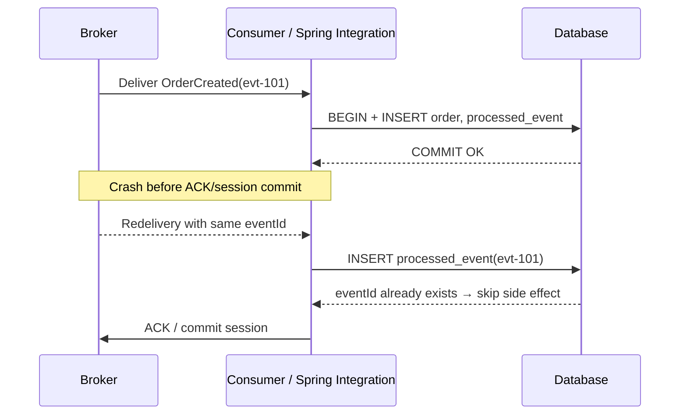
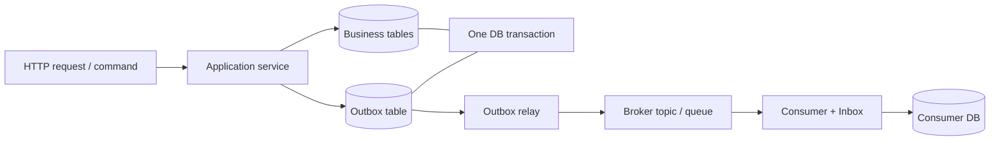
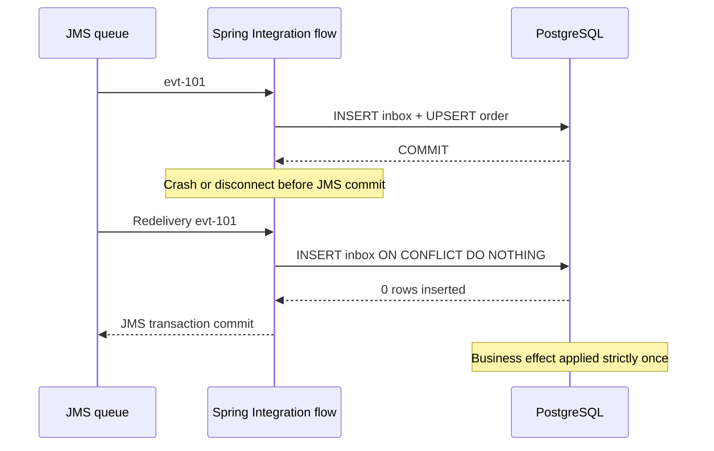

# Transactions Between Broker and Application

## 1. The problem: two systems, two commits

In an architecture using a **Message Broker**, applications exchange work over queues or topics instead of calling every service directly. With Spring Integration, an inbound adapter can receive a message, pass it through channels, apply Transformer, Router, Filter, and Service Activator steps, and emit results through an outbound adapter. This organization reduces coupling and scales processing flows; however, when both a **broker** and a **database (DB)** participate, the critical question is: *when is the system allowed to acknowledge that a message was processed successfully?*

For example, an order service receives `OrderCreated` from a broker, writes the order to PostgreSQL, and then acknowledges the message:

1. The broker delivers a message with `eventId = evt-101`.
2. The application starts a DB transaction and inserts the order.
3. The DB commits successfully.
4. The application acknowledges the message with the broker.
5. The broker marks processing complete.

If the process crashes **between step 3 and step 4**, the DB already contains the order, yet the broker may redeliver the message. Without duplicate protection in the application, the order could be charged or processed a second time. That is why you must understand transactions at the **broker–application boundary**, rather than merely placing `@Transactional` on a method.

This lesson belongs to the `SPRING_INTEGRATION_PATTERN` module: learning to implement Enterprise Integration Patterns with Spring Integration to build loosely coupled, extensible message flows. The focus is the transaction boundary with a broker; retries, error channels, correlation, testing, and observability are examined within that lifecycle.

**After this lesson, you should be able to:**

- Distinguish DB transactions, broker sessions/acknowledgments, and message-flow transactions.
- Identify failure windows between DB writes, message publishes, and broker commits/acks.
- Design **at-least-once + idempotent** consumers and **transactional outbox** producers.
- Understand the guarantee scope of JMS transactions, Kafka transactions, and the limits of “exactly once”.
- Test crashes, rollbacks, redeliveries, duplicates, and DLQs at real failure points.

## 2. Which resources does a transaction cover?

A transaction requires a **resource manager** (which maintains state) and a commit/rollback mechanism. In a message flow, resources can be independent of one another:

| Resource | Typical transaction unit | Commit/rollback affects |
| --- | --- | --- |
| Relational database | JDBC/JPA transaction | Data changes within that DB. |
| JMS broker | JMS transacted `Session` | Message receives/sends within that JMS session. |
| Kafka broker | Producer transaction and offsets included in the transaction | Produced Kafka records and consumed offsets committed in the **same Kafka transaction**, when properly configured. |
| Another HTTP/gRPC service | Usually no shared transaction | Remote calls may have already caused side effects even if the caller times out. |
| Spring Integration channel | Depends on implementation and threads | `DirectChannel` dispatches synchronously; `ExecutorChannel` or queues can switch threads, altering transaction scope. |

**`@Transactional` does not automatically create a single ACID transaction across DB + broker.** For example, `DataSourceTransactionManager` only manages JDBC connections; the broker has its own session/producer transaction. A true shared transaction can require XA/JTA (when both resources support enlistment and 2-phase commit management), incurring significant cost and deployment constraints. Most modern messaging architectures choose **local transactions + safe duplicate handling + outbox/inbox**.

### 2.1. Three concepts frequently confused

**Acknowledgment / offset commit:** marks message processing progress with the broker/consumer group. With JMS, acknowledgment can be tied to committing a transacted session; with Kafka, consumption position is tracked via offsets. Acking/committing too early can lose work after failures.

**DB commit:** confirms business changes as durable data. A successful DB commit does not mean the broker was also acknowledged.

**Publish confirmation / broker transaction commit:** confirms publishing a message to the broker or completing a broker transaction. This does not imply a DB commit unless an explicit transaction coordination mechanism is configured.

### 2.2. Visualizing the failure boundary



The key takeaway of the diagram: **redelivery is a behavior that can happen after the DB has committed**. Consumers must distinguish fresh messages from redeliveries using a durable event identifier.

## 3. Delivery semantics and failure-scenario matrix

| Confirmation strategy | Advantage | Consequence to accept |
| --- | --- | --- |
| Ack/offset commit **before** DB processing | Fewer duplicates from redelivery. | If the app crashes before DB commit, the message may be treated as processed: **lost work**. |
| Ack/offset commit **after** DB processing | Can retry when DB fails. | If the app crashes before ack, the message is redelivered: **duplicates**. |
| True shared transaction across resources | Can coordinate commit/rollback across participating resources. | Requires XA/JTA support and proper setup; operational overhead and complexity. |
| DB transaction + inbox, then ack | Redelivery causes no duplicate DB side effects. | Must store stable identifiers and respect idempotency limits. |

A widely chosen model is **at-least-once delivery with idempotent processing**. The broker may deliver the same message multiple times; the application ensures the business effect in the DB is applied at most once per `eventId` and per business consumer. That guarantee lives at the **application layer**, not an assumption that “the broker will never redeliver”.

Consumer failure-point checklist:

| Failure point | DB state | What can the broker do? | Required design response |
| --- | --- | --- | --- |
| Before DB commit | Not durably persisted; DB rolls back. | Redeliver. | Safe reprocessing. |
| After DB commit, before broker ack | Persisted. | Redeliver. | Inbox/idempotency blocks duplicates. |
| After successful broker ack | Persisted. | Normally not redelivered for that delivery; still possible on operational replay. | Do not assume “forever guaranteed never to duplicate”. |
| Exception caught by flow and returned normally | May be unwritten or partially written depending on transaction. | May consider message processed. | Do not swallow errors before retry/DLQ policy decides. |
| Consumer makes external non-DB RPC then rolls back | RPC side effect may have already happened. | Redeliver message. | Use RPC idempotency keys or compensation workflows. |

## 4. JMS transaction wrapping a Spring Integration inbound flow

With JMS, `sessionTransacted=true` runs message receipt inside a **local JMS transaction**: when the listener finishes normally and the session commits, the broker confirms the message; when the listener throws an error causing rollback, the broker may redeliver per policy. This applies only to the **JMS session** and JMS operations within that session.

In a flow using `DirectChannel` and synchronous processing, errors from a Service Activator propagate back to the message listener, allowing the JMS session to roll back. If processing moves to another thread (e.g., `ExecutorChannel`) before work finishes, the listener may return earlier than actual DB execution. The listener's transaction/ack then **no longer encloses** the asynchronous processing.

### 4.1. Consumer example: JMS inbound → Service Activator → PostgreSQL

Suppose queue `orders.in` contains simple `TextMessage` payloads formatted as `evt-101|order-42`. The `|`-delimited format is only to keep the lesson concise; production systems should use versioned schemas with `eventId`, `occurredAt`, `orderId`, and compatibility rules.

The example targets **Java 17+, Spring Boot 3.x, Spring Integration 6.x**, Spring JMS, and Spring JDBC, with a configured JMS `ConnectionFactory`, PostgreSQL `DataSource`, `JdbcTemplate`, and JDBC transaction manager.

```java
import jakarta.jms.ConnectionFactory;

import org.springframework.context.annotation.Bean;
import org.springframework.context.annotation.Configuration;
import org.springframework.integration.config.EnableIntegration;
import org.springframework.integration.dsl.IntegrationFlow;
import org.springframework.integration.jms.dsl.Jms;

@Configuration
@EnableIntegration
class OrderConsumerFlow {

    @Bean
    IntegrationFlow ordersInbound(ConnectionFactory connectionFactory,
                                  OrderProjectionService service) {
        return IntegrationFlow
                .from(Jms.messageDrivenChannelAdapter(connectionFactory)
                        .destination("orders.in")
                        .configureListenerContainer(
                                c -> c.sessionTransacted(true)))
                .handle(String.class, (payload, headers) -> {
                    service.apply(payload);
                    return null; // One-way consumer, produces no reply.
                })
                .get();
    }
}
```

`messageDrivenChannelAdapter` receives messages in an event-driven manner. The handler runs **on the same synchronous call thread** in the example above; do not insert an `ExecutorChannel` between the JMS listener and handler when relying on exception-driven JMS rollback.

This example uses a **JMS local transaction**; `@Transactional` on the underlying DB service is a separate transaction. The two transactions do not automatically merge into one.

### 4.2. Inbox/idempotency inside the same DB transaction as business logic

Create two PostgreSQL tables:

```sql
CREATE TABLE processed_event (
    event_id TEXT PRIMARY KEY,
    processed_at TIMESTAMPTZ NOT NULL DEFAULT CURRENT_TIMESTAMP
);

CREATE TABLE order_projection (
    order_id TEXT PRIMARY KEY,
    status TEXT NOT NULL
);
```

The `event_id` column has a `PRIMARY KEY` constraint; that is the DB-level guard against duplicate processing. For an inbox table shared across multiple business subscribers, use a composite key `(consumer_name, event_id)` so each subscriber can apply an event independently.

```java
import org.springframework.jdbc.core.JdbcTemplate;
import org.springframework.stereotype.Service;
import org.springframework.transaction.annotation.Transactional;

@Service
class OrderProjectionService {
    private final JdbcTemplate jdbc;

    OrderProjectionService(JdbcTemplate jdbc) {
        this.jdbc = jdbc;
    }

    @Transactional
    public void apply(String body) {
        int separator = body.indexOf('|');
        if (separator <= 0 || separator == body.length() - 1
                || body.indexOf('|', separator + 1) >= 0) {
            throw new IllegalArgumentException(
                    "Payload must be eventId|orderId");
        }

        String eventId = body.substring(0, separator);
        String orderId = body.substring(separator + 1);

        // INSERT and business change in the same DB transaction.
        int inserted = jdbc.update(
                "INSERT INTO processed_event(event_id) VALUES (?) " +
                "ON CONFLICT (event_id) DO NOTHING",
                eventId);

        if (inserted == 0) {
            return; // This event already committed successfully earlier.
        }

        jdbc.update(
                "INSERT INTO order_projection(order_id, status) " +
                "VALUES (?, ?) " +
                "ON CONFLICT (order_id) DO UPDATE " +
                "SET status = EXCLUDED.status",
                orderId, "RECEIVED");
    }
}
```

How it works:

1. Upon first receiving `evt-101`, the DB inserts into `processed_event` and upserts `order_projection`. `@Transactional` commits **both operations together**.
2. If the DB fails after the inbox insert but before the upsert, the transaction rolls back, leaving **neither the inbox nor business data committed**. The exception propagates to the listener; the JMS session can roll back so the broker redelivers.
3. If the DB commits successfully but the JMS session has not committed yet, the next redelivery is blocked by the `PRIMARY KEY` and skips the upsert. The listener returns normally, allowing the JMS session to commit.
4. Two consumers racing on a duplicate are still serialized by the DB unique constraint; avoid `SELECT ... WHERE NOT EXISTS` followed by insert because of race conditions.

**Limitation of this example:** upserting `status = RECEIVED` is a simple projection. In practice, if events arrive **out of order** (e.g., `OrderCancelled` before `OrderCreated`), idempotency by `eventId` **does not** solve ordering; you need versions/sequences or state-transition guards. If the same transaction also makes HTTP calls, sends emails, or processes payments outside the DB, those external side effects do not roll back with PostgreSQL.

**Configuration details to verify in practice:** `@Transactional` must be invoked through the Spring AOP proxy from another bean; the transaction manager must point to the right DB; the message path must remain synchronous if relying on JMS listener transactions as shown. Depending on your Spring Integration version, adapter/listener options can be configured via equivalent container beans.

### 4.3. Two local transactions do not make a global atomic commit

The normal sequence is:

```text
JMS listener starts session transaction
  -> Spring Integration passes message to handler
     -> OrderProjectionService @Transactional starts DB transaction
     -> INSERT inbox + UPDATE business data
     -> DB commits
  -> handler returns
JMS session commits (acks message)
```

Between DB commit and JMS commit there is always a window where a process failure can create duplicates. This is precisely why inbox/idempotency remains necessary even when both the **JMS session** and the **DB** use transactions.

Never slap on `@Transactional` and claim “exactly once between JMS and PostgreSQL”. Only a transaction manager that truly enlists both resources can pursue cross-resource atomic commits; this example deliberately uses **local transactions** and handles duplicates in the application.

## 5. Publishing messages after DB writes: Transactional Outbox

In the opposite direction, a service needs to **persist an order and emit `OrderCreated`**. Two naive orderings fail:

- **Publish first, DB commit second:** the broker receives the event while the DB rolls back; other systems observe an event for a nonexistent order.
- **DB commit first, publish second:** the DB has the order, but the process crashes before publishing; the event is lost.

Putting a broker publish call inside a JDBC transaction does not make the two systems commit together.

**Transactional Outbox** stores the outgoing message inside the **exact same DB transaction as the business data**. A separate relay reads unsent records and publishes them to the broker.



Illustrative schema:

```sql
CREATE TABLE outbox_event (
    event_id UUID PRIMARY KEY,
    aggregate_id TEXT NOT NULL,
    event_type TEXT NOT NULL,
    payload_json JSONB NOT NULL,
    created_at TIMESTAMPTZ NOT NULL DEFAULT CURRENT_TIMESTAMP,
    published_at TIMESTAMPTZ NULL
);

CREATE INDEX ix_outbox_pending
    ON outbox_event (created_at)
    WHERE published_at IS NULL;
```

Inside a `@Transactional` service method, persist the business change **and** insert into `outbox_event` using the same `DataSource` and transaction manager. If the transaction rolls back, both disappear. The relay performs:

1. Select a batch of `published_at IS NULL` records using a claim/lock mechanism so multiple relays do not pick the same row (e.g., PostgreSQL `FOR UPDATE SKIP LOCKED` or a timed lease).
2. Publish each event with its fixed `event_id`; consider publishing done only upon an appropriate producer/broker confirmation.
3. Update `published_at`, leaving unfinished events eligible for re-selection.
4. If a crash occurs **after publish but before updating `published_at`**, the relay republishes. Consumers must deduplicate via inbox/idempotency.

**An outbox guarantees you do not lose the intent to emit an event when the DB commits**, yet does not inherently guarantee an event is published only once. Design consumers to tolerate duplicates and monitor backlog (unsent event count, oldest event age, attempt counts).

When per-aggregate ordering is required, the relay needs an ordering/partition-key and sequence strategy; never infer global order from `created_at` alone across multiple workers or partitions.

## 6. What can Kafka transactions guarantee?

Kafka provides producer transactions and a mechanism to include **consumer offsets** inside the producer's transaction. In a `Kafka topic A → transform → Kafka topic B` pipeline, proper configuration ensures output records and input offsets commit together in the **same Kafka transaction**. If the transaction aborts, uncommitted output records remain invisible to downstream consumers configured with `isolation.level=read_committed`.

```text
Kafka input topic
  -> poll record at offset N
  -> transform / filter
  -> transactional producer writes output records
  -> send consumed offset N+1 into Kafka transaction
  -> Kafka transaction commit
```

If the transaction aborts, its outputs never become committed records and the offset is not committed. On rerun, the input can be re-read. This mechanism is very useful for **consume–transform–produce flows within Kafka**.

However:

- A Kafka transaction **does not automatically include** PostgreSQL, MySQL, or an independent HTTP API transaction.
- If the DB commits and then the Kafka transaction aborts, the message will be re-read; the DB needs idempotency.
- If the Kafka transaction commits and then the DB rolls back, synchronization is not protected by the producer transaction alone; an explicit ordering/coordination mechanism is required.
- “Exactly-once processing” in Kafka documentation refers to **the guarantee scope supported by Kafka**, not every non-broker side effect across the entire system.

With Spring Kafka and Spring Integration Kafka adapters, choose transaction managers, listener containers, producers, and `isolation.level` matching your library version. Never assume flipping one transaction flag suffices for Kafka + DB. When emitting events alongside DB commits, an outbox remains the easiest application-level pattern to verify; when processing purely Kafka → Kafka, Kafka transactions can fit well.

## 7. XA/JTA and when to consider distributed transactions

An **XA transaction** (with a JTA transaction manager and XA-capable resources) can coordinate multiple resources via prepare/commit to achieve atomicity within its supported scope. This requires:

- Compatible XA support in both the JMS broker/driver and DB driver.
- A transaction manager managing recovery, transaction logs, and crashes during commit.
- Policies for timeouts, locked resources, and recovery when one participant temporarily disconnects.
- Operational, failover, and recovery testing in a production-like environment.

Not every broker or client supports an XA transaction with a DB as desired; in particular, never treat a Kafka producer transaction as a universal XA resource. Where XA is unavailable, **never “fake” 2-phase commit** using two independent commit calls.

In most microservice systems, inbox/outbox with bounded retries and backlog monitoring is easier to scale, recover, and verify.

## 8. Retries, error channels, and dead-letter queues (DLQ)

A consumer does not only have “succeeded” and “errored” states. Classify failures:

| Error type | Example | Handling policy |
| --- | --- | --- |
| Transient | DB disconnect, timeout, brief broker/network glitch | Rollback, bounded redelivery with appropriate backoff/jitter. |
| Invalid data | Missing required field, incompatible schema | Do not retry forever; route to DLQ/quarantine with safe cause and context. |
| Permanent business error | Order invalid under explicit domain rules | Respond/route to dedicated business failure flow; record decision. |
| Unknown external non-DB side effect | HTTP timeout after server may have already processed | Use idempotency keys/status checks; never retry blindly. |
| Already-processed redelivery | `eventId` exists in inbox | No-op and ack/commit normally. |

In Spring Integration, an **error channel** is a routing mechanism for `ErrorMessage`s; it **does not replace transactions**. If a handler/flow catches an exception, logs it to an error channel, and finishes normally, the JMS listener may commit the message even though business logic failed. To trigger rollback, exceptions must propagate back to the listener/transaction scope, or an explicit policy must govern when ack is permitted.

Specify:

- Maximum redeliveries managed by the broker or listener container, delay intervals, exponential backoff, and jitter.
- DLQ transition point and metadata structure such as `eventId`, original destination, exception category, attempt count, and trace/correlation ID.
- Who reviews the DLQ, when replays happen, and whether replays preserve `eventId`/idempotency keys.
- When to temporarily pause consumption (pause consumer) to protect a dependency instead of churning messages through continuous retries.

In JMS, exact redelivery and DLQ mechanics vary by broker. In Kafka, retry topics/DLTs and offset commits work differently from JMS; configure them per the specific adapter/container and error policy rather than applying JMS acknowledgment rules to Kafka.

## 9. Correlation, observability, and crash testing

**Correlation ID** identifies which request/flow a message belongs to, whereas **idempotency key/event ID** determines whether a business effect was already applied. Both identifiers can coincide in a simple flow yet serve different purposes. In Splitter/Aggregator flows, one request can spawn multiple child messages sharing a correlation ID, while each **must carry a distinct event ID** if each causes a distinct effect.

Include the following in controlled traces and logs: event ID, correlation ID, broker destination, consumer group/subscriber, attempt/redelivery count, outcome, duration, transaction state at observation time, and DLQ reason. Never put sensitive payloads or customer IDs into high-cardinality metric labels.

Useful metrics: consumer lag/queue depth, redelivery count, DLQ count, duplicates blocked by inbox, DB rollbacks, outbox publish errors, unsent outbox record age, and end-to-end latency. A chart showing “N messages received” does not prove “N business operations durably processed”.

### 9.1. Mandatory test scenarios

| Scenario | How to set up | What to verify |
| --- | --- | --- |
| Single success | Send a fresh `evt-101`. | DB has exactly one effect; broker acked/committed. |
| DB failure before commit | Inject SQL exception between inbox insert and order update. | Both changes roll back; message can redeliver. |
| Crash after DB commit, before JMS commit | Inject fault right before broker ack/commit. | Message redelivers; inbox blocks duplicate effect. |
| Two consumers receive same event | Send duplicate or concurrent replay. | Unique constraint prevents double application. |
| Malformed event | Send payload missing `eventId`. | Not acked as success; routed to retry/DLQ per policy. |
| Outbox publish fails before broker ACK | Relay publish fails. | Outbox row stays unmarked for later retry. |
| Crash after broker ACK, before marking published | Inject crash right after publish confirmation. | Relay may republish; consumer remains idempotent. |
| Out-of-order events | Send higher version before lower version. | Projection enforces version/order policy, never overwriting newer state with older. |
| Thread-switching flow | Insert `ExecutorChannel` in flow-structure test. | Confirms transaction boundary changed; ack design must be adjusted. |
| DLQ and replay | Trigger permanent failures beyond cap, then fix and replay. | Preserves event ID, leaves audit trail, causes no duplicate side effects. |

Test with a real broker via Testcontainers or a dedicated integration environment and a real PostgreSQL instance to verify unique constraints, rollbacks, and redeliveries. Pure Java unit tests struggle to prove ack timing between **two resource managers**, so include at least several integration tests injecting faults right inside the failure windows.

### 9.2. Short example of “DB committed, not yet acked”



Checks should measure **actual business state changes** (such as valid record counts or balance increments), not merely count messages reported as successfully handled. Total messages received can exceed valid business effects because duplicates are normal under at-least-once delivery.

## 10. Pre-production design checklist

1. **Identify resources:** which DB, which broker, which queue/topic types, and which transaction manager governs each resource?
2. **Lock down the ack boundary:** when is the broker allowed to mark a message processed; do any thread switches or async steps cross that boundary?
3. **Define idempotency:** stable event IDs, unique inbox constraints, concurrency handling, dedup retention window, and any version/order policies?
4. **Choose publish pattern:** DB write + outbox emission, or Kafka-only pipeline with properly managed transactions and offsets.
5. **Define failure policy:** which errors retry, which go to DLQ, attempt caps, backoff, who may replay, and whether event IDs stay intact?
6. **Separate correlation from deduplication:** request/trace IDs serve tracing; event IDs ensure correctness across redeliveries.
7. **Verify with fault injection:** especially the two windows “DB commit before ack” and “broker publish before outbox mark”.
8. **Monitor recovery:** backlogs, redeliveries, duplicates, DLQs, outbox latency, and signs of inconsistent side effects.

When integrating a **Message Broker** into Spring Integration, transactions are most effective when you know **exactly which resource each governs and when it ends**. For an independent broker and DB, the resilient design is usually committing business data alongside an inbox/outbox in the DB, letting the broker redeliver/retry, and ensuring reprocessing never alters outcomes unexpectedly.
