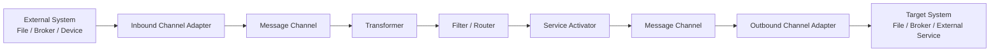
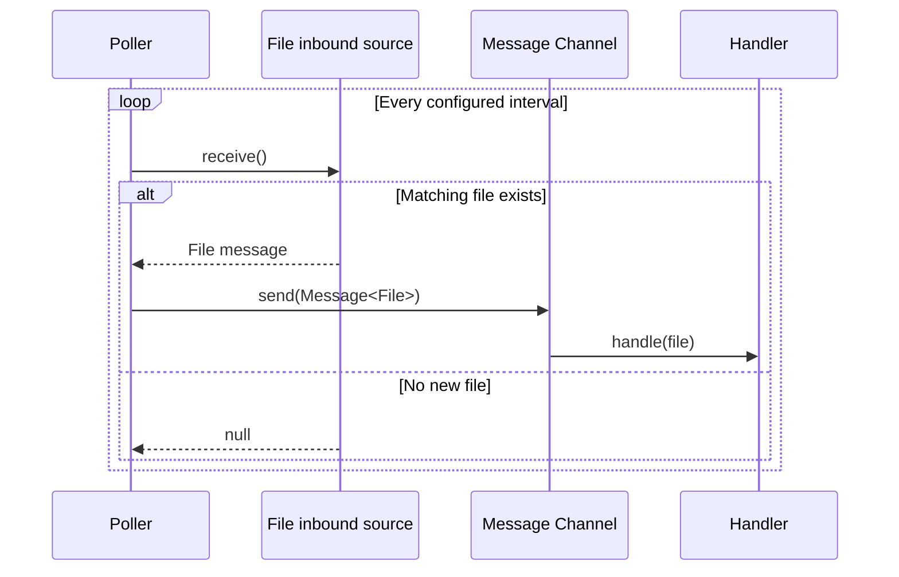
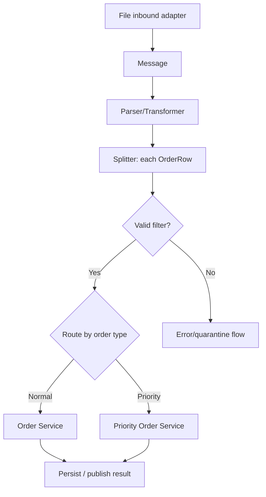
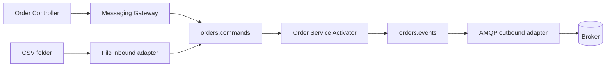

# Channel Adapter connects external systems to a message flow

In the **Channel adapter** chapter of the **SPRING_INTEGRATION_PATTERN** module, we learn how to bring data from external systems into a Spring Integration flow and send flow results out to the external environment. This is a core part of **Enterprise Integration Patterns (EIP)**: business components communicate through `Message` and `MessageChannel`, while dependencies on files, HTTP, brokers, or other protocols are placed in a **Channel Adapter**.

In an order-processing system, an application might need to read CSV files from a partner directory, convert each row into an inventory intake command, filter invalid data, route by order type, and then output a result file or publish an event to a broker. Channel Adapters serve as the entry and exit points of that entire workflow.

Lesson objectives:

- Explain the roles of **inbound** and **outbound channel adapters**, and distinguish them from **Messaging Gateway** and **Integration Gateway**.
- Distinguish **polling** inbound adapters from **message-driven** event-receiving adapters.
- Build a practical example using Spring Integration Java DSL with a **File inbound adapter**, message processing, and a **File outbound adapter**.
- Understand the meaning of payload, headers, converters, polling, retry, error channel, and delivery guarantees.
- Identify testing boundaries and common mistakes when connecting an external system to a message flow.

## 1. Why do we need Channel Adapters?

If every business service directly calls APIs, reads files, consumes JMS messages, or accesses dedicated devices, business code becomes tightly coupled to infrastructure. Changing a format from CSV to JSON or switching from files to AMQP can force large changes across many layers.

A Channel Adapter **places external-system communication logic at the boundary of the message flow**. Once a message enters the flow, intermediate steps can reuse familiar EIP components:

- **Transformer:** converts an external payload into a DTO/domain event.
- **Filter:** drops or rejects messages that do not satisfy rules.
- **Router:** directs messages to the appropriate processing branch.
- **Splitter:** splits a file or batch into multiple child messages.
- **Aggregator:** aggregates results that share the same correlation.
- **Service Activator:** executes business logic.
- **Error channel and retry:** handles errors within the proper boundaries with clear limits.

Diagram of two adapters surrounding a flow:



The main value lies in **separation of responsibilities**: the adapter knows the protocol and receive/send mechanisms, while internal handlers know the standardized message format and business rules.

However, an adapter does not automatically guarantee valid data, consistent transactions, or "exactly once" processing. Those guarantees also depend on the broker/file system, transactions, retries, and consumer idempotency.

## 2. Inbound adapters and outbound adapters

Channel Adapters are unidirectional:

| Component | Data flow | Responsibility | Example |
| --- | --- | --- | --- |
| **Inbound Channel Adapter** | External system → message flow | Receive/read external data; build a message and send it to an internal channel | Reading files, receiving JMS messages, receiving MQTT data |
| **Outbound Channel Adapter** | Message flow → external system | Receive an internal message and send/write data out to an external system | Writing files, publishing to AMQP, sending a JMS message |
| **Inbound Gateway** | External request → flow → external reply | Has a request–reply contract for each invocation | HTTP inbound gateway returning an HTTP response |
| **Outbound Gateway** | Flow → external request → reply into flow | Calls an external system and receives a corresponding result | HTTP outbound gateway calling a REST API |
| **Messaging Gateway** | Java method ↔ message flow | Gives a caller a Java interface to send messages and receive replies if the method expects one | `@MessagingGateway` |

**An Outbound Channel Adapter is not the same as an Outbound Gateway.** Sending successfully to a queue only proves that the send operation was accepted according to the transport's mechanism; it **does not automatically return a business result** from the consumer.

**An Inbound Channel Adapter does not automatically have an outbound reply channel.** If an HTTP client needs to receive a result within the same HTTP request, the appropriate choice is usually an **HTTP inbound gateway**. If only recording a one-way notification, an inbound adapter may make more sense.

Example:

```text
File system -> File inbound adapter -> orders.in -> business flow
business flow -> orders.events -> AMQP outbound adapter -> exchange
Java caller -> @MessagingGateway -> business flow -> Java return value
HTTP caller -> HTTP inbound gateway -> business flow -> HTTP response
```

All these components process messages, but their **success semantics and reply timing differ**.

## 3. Polling adapters and message-driven adapters

Not every external system proactively pushes data to the application. You must choose the receiving model that matches the data source.

### 3.1. Polling: actively checking the source

A **polling inbound adapter** uses a `MessageSource`: on each poll, the adapter attempts to fetch a message from the source. For example, reading new files in a directory or checking a database table for unprocessed records.



Important parameters:

| Property | Meaning |
| --- | --- |
| Fixed delay / fixed rate | Interval between poll cycles; has different consequences when processing is slow |
| `maxMessagesPerPoll` | Limits the number of messages received per poll cycle |
| Scheduler/thread pool | Where poll tasks run; limits concurrency and system capacity |
| File/filter state | Rules for which files to accept, which have already been received, and when re-delivery is allowed |
| Transaction/advice | How receiving/sending stages are wrapped when error handling is needed |
| Error channel | Destination for errors from the poller/flow per actual configuration |

Polling too frequently can increase wasteful I/O. Polling too infrequently increases latency. When processing is heavy, both receive limits and concurrency must be considered to avoid turning the poller into a bottleneck.

### 3.2. Message-driven: receiving when data arrives

A **message-driven inbound adapter** registers a listener/callback with the source. For example, an adapter receives deliveries from RabbitMQ or a JMS listener container and pushes the payload onto a Spring Integration channel. Processing frequency is driven primarily by external events, prefetch, and consumer capacity, rather than an application-side periodic poller.

```text
Broker delivery
    -> Listener container
    -> Inbound channel adapter
    -> MessageChannel
    -> Transformer / Router / Service Activator
```

In this case, you must pay attention to **ACK, NACK, redelivery, transaction, and backpressure** mechanisms enforced by the listener container/adapter and the broker. If a message is forwarded to an asynchronous channel and the listener finishes, delivery acknowledgement may occur before downstream business logic completes; design accordingly.

**Do not assume an adapter is polling solely based on the technology name.** A system may provide both a poll source and a listener, depending on the specific Spring Integration module.

## 4. Message envelope at the integration boundary

Spring Integration uses the `Message<T>` concept consisting of **payload** and **headers**.

```text
Message<File>
  payload:
    File("orders-2026-11-21.csv")
  headers:
    id: UUID
    timestamp: ...
    file_name: ...
    contentType: ... (if present)
    correlationId / traceId: ... (if propagated/mapped)
```

Information commonly examined:

- **Payload:** the business data handed to the next step. A file inbound adapter may create a payload of type `java.io.File`, not yet the parsed CSV content.
- **Headers:** metadata such as message identifier, file name, content type, and business keys if mapped.
- **Data type:** handlers after the adapter need to know whether the actual payload is `File`, `byte[]`, `String`, or a DTO.
- **Protocol boundary:** internal headers such as `replyChannel` typically cannot be serialized as a `MessageChannel` object over the network. You must explicitly map which fields are allowed to be exchanged.
- **Message ID and business identity:** a message's ID can change when messages are rebuilt. For deduplication/retries across systems, use a durable business key such as `eventId` or `importId`.

For example, a CSV file may contain many rows. The file inbound adapter may initially create **one** message carrying `File`; to process row by row, the flow must add a Transformer/parser or Splitter. A Channel Adapter does not automatically convert every data structure into domain objects.

## 5. Hands-on: connecting a CSV directory into a flow

Suppose a partner places `orders-001.csv` into the `data/inbox` directory. The application needs to check the source periodically and send the file to a service dedicated to importing orders. The example uses Java 17+, Spring Integration Core + File module, and Java DSL.

### 5.1. A simple inbound flow

```java
package example.imports;

import java.io.File;
import java.time.Duration;

import org.springframework.context.annotation.Bean;
import org.springframework.context.annotation.Configuration;
import org.springframework.integration.config.EnableIntegration;
import org.springframework.integration.dsl.IntegrationFlow;
import org.springframework.integration.dsl.Pollers;
import org.springframework.integration.file.dsl.Files;

@Configuration
@EnableIntegration
class OrderImportFlow {

    @Bean
    IntegrationFlow importOrderFiles(OrderFileImporter importer) {
        File inbox = new File("data/inbox");

        return IntegrationFlow
            .from(
                Files.inboundAdapter(inbox)
                    .autoCreateDirectory(true)
                    .patternFilter("*.csv"),
                endpoint -> endpoint.poller(
                    Pollers.fixedDelay(Duration.ofSeconds(5))
                        .maxMessagesPerPoll(10)
                )
            )
            .handle(File.class, (file, headers) -> {
                importer.importCsv(file);
                return null; // No reply created; this is a one-way flow.
            })
            .get();
    }
}

// Business component implemented by the application.
interface OrderFileImporter {
    void importCsv(File csvFile);
}
```

Step-by-step explanation:

1. `Files.inboundAdapter(inbox)` builds the file source for the inbound adapter.
2. `patternFilter("*.csv")` filters files by name. Non-CSV files are excluded from the source.
3. The poller runs approximately every 5 seconds, limited to at most 10 messages per poll.
4. For each accepted file, the flow sends a message with a `File` payload to the handler.
5. `OrderFileImporter` reads/parses the CSV, validates, and processes the business logic. Returning `null` from the handler illustrates that **no reply is emitted**.
6. Later, you can replace the service handler with Transformer → Splitter → Router while keeping the File inbound adapter as the entry port.

**Limitations of this example:** this is an illustrative file import configuration and does not yet guarantee exactly-once import. A real application must establish a **complete file** convention (for example, the partner writes to a temporary name, closes the file, then atomically renames it), a policy for moving succeeded/failed files, duplicate file detection, and crash recovery.

### 5.2. Adding a Transformer and branching logic

It can be extended as follows:



This is a **logical diagram**: a Filter dropping a message by default does not necessarily route the message to an error branch; if you want invalid data sent to quarantine, you must configure a discard channel or an explicit error-routing step.

If you parse the entire file and then split it into multiple rows, one invalid row raises a question: **roll back the whole file or only skip the invalid row?** That decision is part of the business contract of the importer and flow, not an automatic feature of the File inbound adapter.

## 6. Outbound Channel Adapter: sending results to external systems

A symmetrical case is when the system finishes processing an order and needs to export the result as a string into `data/outbox` for the partner to pick up.

```java
package example.exports;

import java.io.File;

import org.springframework.context.annotation.Bean;
import org.springframework.context.annotation.Configuration;
import org.springframework.integration.config.EnableIntegration;
import org.springframework.integration.dsl.IntegrationFlow;
import org.springframework.integration.file.dsl.Files;

@Configuration
@EnableIntegration
class OrderExportFlow {

    @Bean
    IntegrationFlow exportOrderResults() {
        return IntegrationFlow.from("orders.export.files")
            .handle(
                Files.outboundAdapter(new File("data/outbox"))
                    .autoCreateDirectory(true)
                    .fileNameGenerator(message ->
                        "export-" + message.getHeaders().getId() + ".txt")
            )
            .get();
    }
}
```

In this example, the flow expects the input message to contain a `String` payload or data that `FileWritingMessageHandler` can write. An upstream component must generate/serialize the content to export and send it to the `orders.export.files` channel.

Example of publishing a message from a component within the same Spring context:

```java
package example.exports;

import org.springframework.messaging.MessageChannel;
import org.springframework.messaging.support.MessageBuilder;

class ExportPublisher {
    private final MessageChannel exportChannel;

    ExportPublisher(MessageChannel exportChannel) {
        this.exportChannel = exportChannel;
    }

    void publish(String serializedOrder) {
        boolean accepted = exportChannel.send(
            MessageBuilder.withPayload(serializedOrder).build()
        );
        if (!accepted) {
            throw new IllegalStateException("Failed to send message to channel");
        }
    }
}
```

In real integration, the channel bean must be injected with the appropriate name/qualifier, for example the channel named `orders.export.files`. `MessageChannel.send()` returning success only reflects the send mechanism to the channel; on a synchronous channel the handler may already have executed, whereas on an asynchronous channel processing may continue afterward. Do not treat boolean `true` as a guarantee that the external partner has received and imported the file.

**Notes on safety and durability:**

- Generate unique file names or enforce anti-overwrite rules; the example above uses the message ID for illustration.
- When writing large files, consider writing to a temporary file and renaming upon completion so the receiver does not read an incomplete file.
- Configure directory permissions, disk capacity, write-failure handling, and file cleanup policies.
- If you need to know that the partner processed the data successfully, you must add a separate **business acknowledgement**, such as a response file or result event.

## 7. Distinguishing Channel Adapter and Messaging Gateway in the same system

A system may simultaneously use:



All inbound flows point toward order processing, but expectations differ:

| Source | What does the caller expect? | Appropriate component |
| --- | --- | --- |
| Java service sends a command and needs a DTO back | Reply corresponding to the call | `@MessagingGateway` |
| New files appear in a directory | Bring files into the flow periodically | File inbound channel adapter |
| RabbitMQ pushes events | Consumer listens for deliveries | AMQP inbound channel adapter |
| Application emits `OrderCreated` to broker | Send one-way event | AMQP outbound channel adapter |
| External service returns a response to an HTTP request | A reply correlated to the request | HTTP outbound gateway |

Good design means choosing the **integration semantics** first (one-way vs. request-reply), then selecting the corresponding endpoint/adapter. Merely renaming an outbound adapter to "gateway" does not make it wait for a reply.

## 8. Error handling and retry at the adapter boundary

Messages can fail at multiple points:

| Failure point | Example | Handling approach |
| --- | --- | --- |
| Inbound source | Locked file, missing read permissions, lost broker connection | Poller/listener must report errors, back off, or reconnect per policy |
| Payload conversion | Malformed CSV, missing JSON field | Validate, quarantine/DLQ, record reason; do not retry the same data infinitely |
| Business handler | Database temporarily unavailable | Bounded retry, backoff, transactions, and idempotency |
| Outbound adapter | File write failure, broker publish failure | Do not report completion before confirmation per outbound mechanism |
| Target system side | Partner has not processed the file even though it was exported | Separate technical delivery from business confirmation |

### 8.1. Synchronous vs. asynchronous effects on failure outcomes

If a `DirectChannel` connects the adapter to the service, handler execution typically happens on the sender's thread. Exceptions can propagate back to the poller or listener container. However, if there is an `ExecutorChannel` or `QueueChannel`, the initial stage may complete **handing off the message** while downstream steps are still running. This affects ACKs, transactions, and retry/redelivery behavior.

For example, with a broker inbound listener: if the listener acknowledges delivery right after handing off to an asynchronous channel, a downstream business error will not automatically cause the broker to redeliver. An at-least-once design must carefully consider ACK placement or a durable queue at the handoff boundary.

### 8.2. Bounded retry and permanent errors

**Retry is appropriate** for transient failures such as network timeouts or overloaded databases. **Retry is futile** for CSVs with invalid schemas or missing required fields if the data does not change.

```text
Inbound adapter
  -> validate
      -> OK -> process -> outbound adapter
      -> schema error -> quarantine + alert
  -> transient infrastructure error -> retry (bounded + backoff)
  -> limit exceeded -> error handling / DLQ / intervention
```

In Spring Integration, you can apply `RequestHandlerRetryAdvice` on the appropriate endpoint and route errors via `errorChannel`. However, when an error flow **swallows the exception**, the receiver may treat processing as successful. You must verify whether the exception actually reaches the adapter/listener, especially with broker ACKs.

### 8.3. File inbound has no broker ACK

A file system is not a message broker and does not provide the same ACK/NACK mechanisms. A file inbound adapter can use a once-only filter during its lifecycle, but **having emitted a message** does not mean the file was safely imported into the DB.

To ensure a recoverable file import workflow, you can design:

1. Partner writes to a staging directory and only moves to the inbox directory once writing is complete.
2. Importer computes a stable import key (file name combined with checksum or business ID).
3. Persist import status and data within an appropriate transaction.
4. On success, move the file to `processed`; on unfixable error, move to `rejected` along with the reason.
5. Run a recovery/reconciliation job for in-progress files, handling duplicates via an idempotency key.

Each system may choose a different workflow, but crash behavior at every step and file re-ingestion must be clearly defined.

## 9. Headers, serialization, and data safety

Moving messages across system boundaries is more than transferring a Java object:

- **Format:** specify CSV/JSON/Avro/byte[], encoding, timezone, and decimal rules.
- **Schema/version:** both sides may upgrade independently; compatibility policies are needed.
- **Header mapping:** transmit only meaningful, permitted headers; strip internal references/secrets that should not leave the system.
- **Identifiers:** use contractual `eventId`, `requestId`, `correlationId` for reconciliation. A single message's `MessageHeaders.ID` is not necessarily a durable transaction key.
- **Security:** restrict directory permissions, protect endpoints, authenticate brokers, use TLS when appropriate, and avoid logging payloads containing sensitive data.
- **Size control:** enforce limits on file size, row count, message size, timeouts, and consumer capacity to avoid overwhelming the system.

Example of an event contract after parsing a file:

```json
{
  "eventId": "order-import-20261121-001-row-17",
  "schemaVersion": 1,
  "source": "partner-csv",
  "order": {
    "orderId": "O-1042",
    "sku": "SKU-10",
    "quantity": 3
  }
}
```

This is a **system-defined domain event**, not the default payload of a File inbound adapter. Generating a stable event key should rely on actual data, especially if files can be renamed or re-ingested.

## 10. Monitoring Channel Adapter flows

When an adapter is running but data "does not arrive," measure the source, channel, and target:

| Metric / indicator | Question it helps answer |
| --- | --- |
| Pending file count, oldest file age | Is the poller slow or stuck? |
| Messages received/emitted per adapter | Is data crossing the system boundary? |
| End-to-end latency from source to completion | Is delay coming from the poller, channel, or handler? |
| Error count by exception/channel | Which step is failing? |
| Retry count, retry exhausted | Are errors repeating, and is backoff sufficient? |
| Quarantine/DLQ record count | Are there unprocessable messages? |
| Queue/consumer backlog | Is the receiver keeping up? |
| Duplicate count by `eventId` | Is re-delivered/re-read data causing duplicate side effects? |
| Output files / publish confirms | Did the target accept the send at transport level? |

Logs should include meaningful business tracking keys, timestamps, adapter/channel names, and outcomes. Avoid logging only "Received message" without knowing whether parsing, committing, and outbound emission succeeded.

## 11. Testing Channel Adapters at the right boundary

To verify a message flow, you can test **internal logic** by sending messages directly to channels, and test **adapters** with real or suitably simulated data/protocols.

| Scenario | Setup | Result to verify |
| --- | --- | --- |
| Valid file | Place a completed `*.csv` file in inbox | Poller picks up the file; importer processes it once per policy |
| File not matching filter | Place a `.tmp` or other file | No business message is created |
| Missing directory | Run against a new test directory | Auto-create policy is applied |
| Incomplete file | Simulate producer still writing | Incomplete data is not parsed thanks to staging protocol |
| Invalid CSV schema | Missing required field | Error is routed appropriately; no invalid order is created |
| Transient DB error | Importer throws error | Retried/recovered per policy without data loss |
| App restart | Restart after receiving file but before commit | Recovers cleanly without duplicate side effects |
| Outbound file success | Send `String` payload to export channel | File is created with expected name/content |
| Outbound file failure | Write permission denied or disk full | Failure is recorded; no false success reported |
| Broker redelivery | Consumer crashes before ACK | Message is redelivered; business logic is idempotent |
| Asynchronous channel | Use `ExecutorChannel` | Completion/ACK timing is properly verified |

When writing file integration tests, use temporary directories and wait for observable conditions (file appears, DB row exists, metrics update) with a timeout. Do not rely solely on fixed `Thread.sleep()` calls and assume everything has finished. When testing RabbitMQ/JMS, observe ACK/redelivery at the actual transport level rather than only invoking Java handlers.

### Sample end-to-end scenario

```text
Given:
  The data/inbox directory contains a complete orders-001.csv
  The file has two valid rows and one row rejected by rules
  IntegrationFlow polls the file
When:
  The poller runs and the importer reads the file
Then:
  Two valid orders are persisted with a stable import key
  The invalid row is recorded for investigation
  The system outputs a report file in data/outbox
  Restarting the application creates no duplicate orders
```

This scenario requires additional Transformer/Splitter, persistence, and error-handling steps beyond the two sample adapters. That is the strength of the design: **adapters act as connection ports**, while business contracts live in the components of the message flow.

## 12. Common design mistakes

**Confusing a channel adapter with a message channel.** An adapter connects to an external system; a channel moves messages between internal endpoints. Both are needed for a clear flow.

**Confusing an outbound adapter with an outbound gateway.** Emitting an event has no business reply; waiting for a remote response requires a gateway or a purposefully designed correlation flow.

**Assuming polling implies exactly-once processing.** Polling only decides when to attempt reading from a source; deduplication and recovery require durable state or idempotency.

**Reading partially written files.** A file inbound adapter can see a file before the producer finishes writing unless a staging/rename convention is used.

**Swallowing errors before the broker decides ACK.** An error flow that terminates normally may trick the listener into thinking the message succeeded even though business logic failed.

**Ignoring payload types.** The adapter emits `File`, while a handler casts to `String` or a DTO without conversion; runtime fails downstream.

**Putting slow tasks directly on the poller/consumer without bounds.** This increases latency and ties up resources; design concurrency, batching, and backpressure carefully.

**Assuming writing a file means the partner processed it.** File creation or broker publish acceptance does not confirm the receiver's business outcome.

**Having no duplicate-handling strategy.** Crashes, retries, or restarts can re-scan or re-deliver sources; operations with side effects must be idempotent.

## 13. Implementation checklist

1. Identify the external system and **integration semantics**: one-way or request-reply.
2. Choose **inbound/outbound adapter** or **gateway** based on expected results.
3. Define payload, header, and schema contracts at the boundary.
4. For polling, specify interval, messages per poll, filters, and seen-state tracking.
5. For message-driven, specify consumer concurrency, ACK/redelivery, and backpressure.
6. Add Transformer, Filter, Router, Splitter/Aggregator only when data processing genuinely needs them.
7. Configure timeouts, bounded retries, error channel, and appropriate quarantine/DLQ paths.
8. Design idempotency and crash recovery mechanisms, especially around DB writes or external API calls.
9. Add metrics/logging across source, adapter, channel, handler, and target.
10. Test both inside the flow and at the file/broker/remote boundary, including error and duplicate cases.

## Conclusion

A **Channel Adapter** is the bridge between **external systems** and a Spring Integration **message flow**. An **inbound adapter** brings external data into a channel; an **outbound adapter** sends data from a channel outward. They let the rest of the system focus on Transformer, Router, Filter, Splitter/Aggregator, and Service Activator. To make an integration flow truly reliable, choose polling vs. message-driven appropriately, define data contracts, control retries/errors, design idempotency, and test both transport boundaries and business effects.
