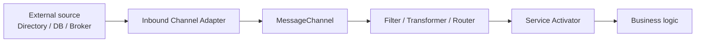
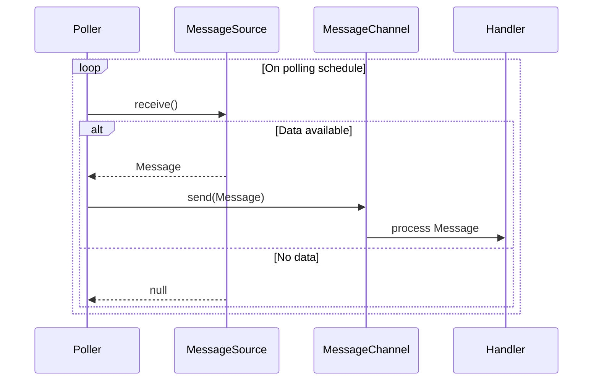
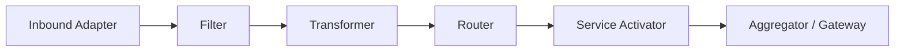

# Inbound channel adapter in Spring Integration

## 1. What problem does an inbound channel adapter solve?

In an integration system, data often originates outside the application: new files arrive in a directory, records sit in a database, messages arrive from a broker, or events are emitted by another service. These sources differ in access method, timing, and format. If every business processing step directly reads each source, the processing flow becomes tightly coupled to input technologies.

An **inbound channel adapter** sits at the **entry boundary** of Spring Integration. It receives or actively pulls data from an external system, builds a Spring Messaging `Message<?>`, and **sends it to a `MessageChannel`** for downstream endpoints to process. This is how the application implements the *Channel Adapter* pattern from Enterprise Integration Patterns (EIP): hiding the source's specific protocol or API and bringing data into a unified message flow.

For example, a system receives orders as `.txt` files. Instead of forcing the order-processing service to constantly scan a directory, we place an inbound file adapter that reads files and pushes messages onto a channel. Downstream, a Transformer can convert the content into order data, a Filter can drop invalid records, a Router can pick a branch, and a Service Activator can execute the business logic. None of these components need to know whether the data originally came from a directory or another source.

### Learning outcomes

After this lesson, you will be able to:

- Explain the role and position of an inbound channel adapter in an integration flow.
- Distinguish a **polling inbound adapter** from a **message-driven inbound adapter**, and an adapter from a gateway.
- Configure `@InboundChannelAdapter`, `MessageSource`, `@Poller`, and `MessageChannel` for a practical example.
- Choose strategies for handling duplicates, errors, heavy load, and operational monitoring suited to the data source.

## 2. Position in the messaging architecture



An inbound adapter's primary responsibility is to **bring data into the messaging system**. It does not necessarily understand the business semantics of the payload and **is not designed to wait for a return value back to the source**, unlike an inbound gateway.

Common components:

| Component | Role |
| --- | --- |
| External source | Where data resides or originates, such as files, queues, or network connections. |
| Inbound adapter | Reads/receives data and emits a `Message` onto a channel. |
| `MessageSource<T>` | Contract supplying messages to a **polling adapter**; its `receive()` method returns a message or `null` when no data is available. |
| `Poller` | Determines when to invoke the polling source and can limit the number of messages per poll. |
| `MessageChannel` | Internal conduit between producer and consumer, decoupling the source from processing. |
| Consuming endpoint | For example `@ServiceActivator`, Transformer, Filter, or Router receiving and processing messages. |

A `Message` consists of **payload** and **headers**. With a file inbound adapter, the payload is typically a `File` object representing the file path and metadata; to read the content or parse orders, the consumer must perform that step. Headers may carry metadata added by the adapter. Do not assume the payload is already a string or JSON.

## 3. Two mechanisms for bringing data into the system

### 3.1. Polling inbound channel adapter

For sources that must be actively checked (file directories, database tables queried periodically, etc.), the adapter typically uses a `MessageSource<?>` and a poller. Each time it is triggered, the poller calls `receive()`; if a message is returned, the adapter sends it to the channel; if the source has no data yet, the poll cycle ends or continues according to configuration.



Common parameters:

- `fixedDelay`: delay between executions of the polling task; appropriate when processing duration varies.
- `fixedRate`: schedules on a fixed periodic cadence; concurrency and load must be considered when processing takes longer.
- `cron`: explicitly selects execution times.
- `maxMessagesPerPoll`: caps the number of messages fetched in a single trigger; prevents an unbounded fetch cycle.

**Note:** A high poll rate does not guarantee high throughput. If the channel or consumer processes slowly, the poller still experiences backpressure from downstream layers; when using a `QueueChannel`, queue capacity and consumer count must be sized appropriately.

### 3.2. Message-driven inbound channel adapter

For sources capable of pushing events, a listener or callback can receive data as soon as an event arrives and emit a message onto a channel. Examples include adapters built on listener mechanisms for JMS/AMQP. This model does not require periodically scanning the source like `MessageSource`.

The difference lies in **how the adapter is triggered**, not its role in the flow: both polling and message-driven adapters bring messages from outside into a `MessageChannel`. With a broker, you must also consider acknowledgement, prefetch, concurrency, and transport-level redelivery mechanisms; delivery guarantees cannot be inferred merely from the name *inbound adapter*.

### 3.3. Distinguishing adapter, gateway, and outbound adapter

| Component | Interaction direction | Expects synchronous reply? | Scenario |
| --- | --- | --- | --- |
| **Inbound channel adapter** | External source → Channel | Usually **no** | Reading new files, receiving events from a broker. |
| **Inbound gateway** | External source → Channel → reply outward | **Yes**, request–reply model | HTTP request needing a response, RPC call. |
| **Outbound channel adapter** | Channel → external system | Usually **no** | Writing files, sending notifications to a broker. |
| **Outbound gateway** | Channel → external system → Channel | **Yes**, request–reply model | Calling an HTTP service and retrieving the result. |

An inbound adapter does not automatically turn into a gateway simply because an internal consumer produces a result. If the external protocol expects a response correlated to a request, choose an inbound gateway and configure an appropriate reply channel, timeout, and correlation.

## 4. Hands-on example: reading new files with a polling adapter

Suppose a service receives order files from the `./inbox` directory and routes them to a channel named `fileInputChannel`. The consumer receives the `File` and logs file details to the console. This simple example highlights the boundary between **receiving data** and **business processing**.

### 4.1. Dependencies

For a Spring Boot 3.x application using Java 17+ and Spring Boot dependency management, add the following Maven dependencies:

```xml
<dependencies>
    <dependency>
        <groupId>org.springframework.boot</groupId>
        <artifactId>spring-boot-starter-integration</artifactId>
    </dependency>
    <dependency>
        <groupId>org.springframework.integration</groupId>
        <artifactId>spring-integration-file</artifactId>
    </dependency>
</dependencies>
```

Spring Integration 6.x aligns with the Spring Framework 6 / Spring Boot 3 ecosystem. In real projects, use dependency versions managed by the Spring Boot BOM to avoid version mismatches.

### 4.2. Application configuration

Create `src/main/java/com/example/integration/ChannelAdapterApplication.java`:

```java
package com.example.integration;

import java.io.File;
import java.io.IOException;
import java.nio.file.Files;
import java.nio.file.Path;

import org.springframework.boot.SpringApplication;
import org.springframework.boot.autoconfigure.SpringBootApplication;
import org.springframework.context.annotation.Bean;
import org.springframework.integration.annotation.InboundChannelAdapter;
import org.springframework.integration.annotation.Poller;
import org.springframework.integration.annotation.ServiceActivator;
import org.springframework.integration.channel.DirectChannel;
import org.springframework.integration.core.MessageSource;
import org.springframework.integration.file.FileReadingMessageSource;
import org.springframework.integration.file.filters.AcceptOnceFileListFilter;
import org.springframework.integration.file.filters.CompositeFileListFilter;
import org.springframework.integration.file.filters.SimplePatternFileListFilter;
import org.springframework.messaging.MessageChannel;

@SpringBootApplication
public class ChannelAdapterApplication {

    public static void main(String[] args) {
        SpringApplication.run(ChannelAdapterApplication.class, args);
    }

    @Bean
    public MessageChannel fileInputChannel() {
        return new DirectChannel();
    }

    @Bean
    @InboundChannelAdapter(
        channel = "fileInputChannel",
        poller = @Poller(fixedDelay = "2000", maxMessagesPerPoll = "5")
    )
    public MessageSource<File> fileReadingMessageSource() throws IOException {
        Path inbox = Path.of("./inbox");
        Files.createDirectories(inbox);

        FileReadingMessageSource source = new FileReadingMessageSource();
        source.setDirectory(inbox.toFile());

        CompositeFileListFilter<File> filters = new CompositeFileListFilter<>();
        filters.addFilter(new SimplePatternFileListFilter("*.txt"));
        filters.addFilter(new AcceptOnceFileListFilter<>());
        source.setFilter(filters);

        return source;
    }

    @ServiceActivator(inputChannel = "fileInputChannel")
    public void processFile(File file) {
        System.out.println("Received: " + file.getName());
        // Next steps can read, validate, parse, and save orders.
    }
}
```

**Reading the configuration along the flow:**

1. `fileInputChannel()` creates a `DirectChannel`. This channel normally dispatches messages directly to subscribers on the same execution thread, so handler errors can affect the poll cycle.
2. `fileReadingMessageSource()` declares the directory source. `FileReadingMessageSource` supplies a message containing a `File` when a matching file is found.
3. `@InboundChannelAdapter` binds the source to `fileInputChannel`. `@Poller` configures a 2-second fixed delay and fetches at most 5 messages per poll.
4. `SimplePatternFileListFilter("*.txt")` selects only `.txt` files. `AcceptOnceFileListFilter` avoids re-selecting the same file already recorded within the filter's lifecycle.
5. `@ServiceActivator` registers a consumer for the channel. When a message arrives, Spring Integration passes the `File`-compatible payload to `processFile`.

`@InboundChannelAdapter` configures a **producer endpoint**. The `@Bean` method returns a `MessageSource`; the framework creates and manages polling and sends messages to the declared channel.

### 4.3. Running and observing

From the application root directory:

1. Start the application with `mvn spring-boot:run` (or run the main class in your IDE).
2. Create `inbox/order-001.txt` with any content, such as `orderId=123`.
3. Watch the console: after one poll cycle you should see `Received: order-001.txt`.
4. Add `inbox/order-002.txt`: the consumer receives the new file on the next poll cycle.
5. Create `inbox/note.json`: this file is ignored by the `*.txt` filter.

Within **the same application run**, this example will not repeatedly print a file already recorded by `AcceptOnceFileListFilter`. However, when **restarting the application**, the default in-memory filter state is lost, so old files remaining in the directory may be processed again.

Additionally, the consumer in the example only prints the file name; it does not yet move the file to an archive directory, confirm successful processing, persist state durably, or handle business errors.

## 5. Design decisions when bringing adapters into production systems

### 5.1. Choosing channels and load distribution

`DirectChannel` is simple, easy to observe, and suitable when consumers run quickly and synchronously. However, slow consumers prolong the poll cycle. If you need to decouple ingestion cadence from processing cadence, you can use a bounded `QueueChannel` with a dedicated consumer poller, or offload work to an appropriate queue/broker mechanism.

Do not assume replacing `DirectChannel` with an asynchronous channel solves every issue. Adding queues and worker threads requires redesigning message ordering, error capture points, transactions, backpressure, and graceful shutdown.

### 5.2. Avoiding reading partially written files

The `*.txt` filter only checks the file name; it does not prove the file has finished being written. If an upstream system writes directly into `inbox`, the poller may pick up the file before the producer finishes.

Two common approaches:

- The producer writes to a temporary file, closes it, and then performs an **atomic rename** to `.txt` on the same filesystem once finished.
- Select only files whose size/timestamp has remained stable for a configured window before admitting them into the flow.

Where high reliability is required, prefer an explicit handoff contract between the file producer and receiver.

### 5.3. Deduplication and restarts

`AcceptOnceFileListFilter` in the example is good for learning the basic mechanism, but its default filter state is stored in memory. It does not guarantee exactly-once behavior across restarts, processing failures, multiple instances, or crashes between *receiving* and *business completion*.

For production, consider:

- Filters storing durable metadata (for example, a persistent accept-once filter backed by an appropriate `MetadataStore`).
- Explicit states for reception and processing: new, in progress, completed, failed.
- An **idempotent** consumer keyed by business ID / file ID so reprocessing does not produce duplicate side effects.
- Moving/marking files upon success and having a retry policy or quarantine area for failed files.
- When running multiple instances, defining coordination, locking, or source partitioning so instances do not pick up the same file concurrently.

**Important warning:** filtering "file already seen" and processing "order succeeded" are two separate events. If the handler fails after the adapter marks the file as seen, the system needs a dedicated retry/recovery mechanism; an in-memory filter does not automatically reprocess it.

### 5.4. Errors, retry, and error channel

An inbound flow typically has two groups of errors:

| Error location | Example | Handling approach |
| --- | --- | --- |
| Fetching from source | Inaccessible directory, permission error, unresponsive DB | Log sufficient context, bound retries, monitor source health. |
| Processing after entering channel | Parse error, validation failure, business service error | Classify transient vs. permanent errors, bounded retries, dead-letter/quarantine, and idempotency. |

With a polling adapter, you can configure poller error handling and route `ErrorMessage` instances via `errorChannel`. How errors propagate also depends on channel type, executors, and async boundaries. Do not assume having an `errorChannel` automatically guarantees retries or returns the message to the source.

Errors caused by permanently invalid data should be handled decisively (for example, moving the file to an error area and recording the reason). Infinitely retrying the same bad file stalls the flow and generates noisy logs.

### 5.5. Choosing a polling schedule

Processing cadence should match source emission frequency and consumer capacity:

| Scenario | Consideration |
| --- | --- |
| Infrequently updated source, multi-second delay acceptable | Longer `fixedDelay` to reduce empty checks. |
| Bursty source traffic | Cap `maxMessagesPerPoll` and scale consumers; measure backlog before increasing poll rate. |
| Run only at scheduled times | `cron`, combined with overlap prevention. |
| Blocking operations in source or downstream | Set timeouts at the right layer, cap concurrency, and monitor processing time. |

Polling too aggressively puts unnecessary load on databases or remote APIs. Polling too rarely introduces ingestion latency. Measure actual behavior rather than picking intervals arbitrarily.

## 6. Testing and operational observability

In a real project, good tests verify the behavior of the **entire flow**, not just that `FileReadingMessageSource` was instantiated:

- **Happy path:** place a valid file, verify the consumer receives the right file and business data is persisted.
- **Input filtering:** place a `.json` or temp file, verify it is not processed.
- **Deduplication:** the same file is not processed twice in the same session; test restarts to evaluate persistent deduplication if enabled.
- **Processing errors:** make the consumer throw an error, observe retry, error channel, file state, and recovery capability.
- **Load:** push many files, measure backlog, latency from file readiness to completion, and resource usage.
- **Incomplete writes:** simulate a slow file writer to verify the completed-file handoff rule.

In production deployments, include at least metrics/alerts for messages received, messages succeeded/failed, processing latency, backlog, and time of last received data. Logs should include correlation keys like file name or order ID, while avoiding logging sensitive data verbatim.

## 7. Common misconceptions

**"The adapter will return results to the source system."** An inbound adapter is a one-way flow bringing messages into a channel. Sources requiring a response should use an inbound gateway.

**"Receiving a file means the file has finished processing."** Creating and sending `Message<File>` is only the first step. The handler can fail or execute asynchronously; a separate completion confirmation policy is required.

**"Using AcceptOnce guarantees exactly-once."** An in-memory filter only limits re-selection within that filter's scope; business guarantees require durable state and idempotency.

**"To speed things up, just lower fixedDelay."** If the bottleneck is in the consumer, increasing the poll frequency will not resolve the load. Measure processing duration, queued message counts, and resource limits.

**"Every source needs a poller."** Sources with listeners/callbacks can use message-driven inbound adapters; pollers are mainly for sources that must actively call `receive()`.

## 8. Relation to other Enterprise Integration Patterns

An inbound channel adapter is typically the **starting point** of an integration flow. After receiving data:



For example, an order file passes through a Filter to drop unqualified files, a Transformer to read contents and convert them into `Order` objects, a Router to branch by order type, and a Service Activator to execute business logic. Each step can be tested independently thanks to message/channel communication.

The inbound channel adapter is therefore the foundation for separating **how data enters the application** from **how the application processes data**, aligning with the Spring Integration Pattern module's goal of building loosely coupled, extensible, testable, and observable messaging flows.
