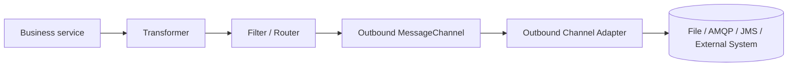
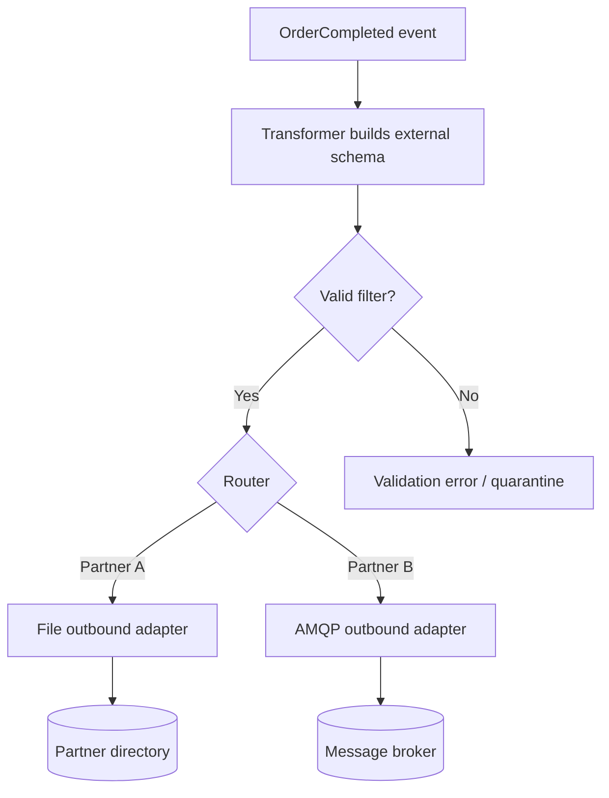
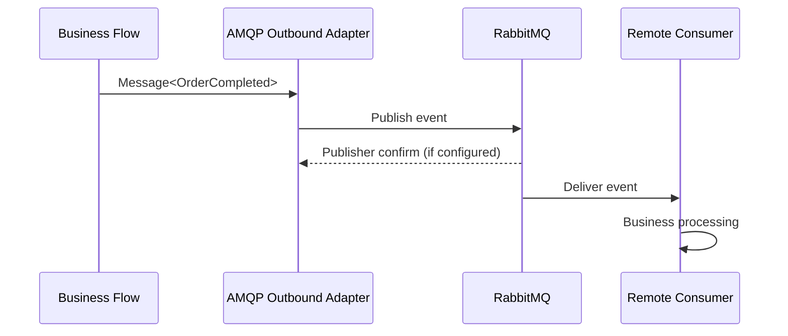
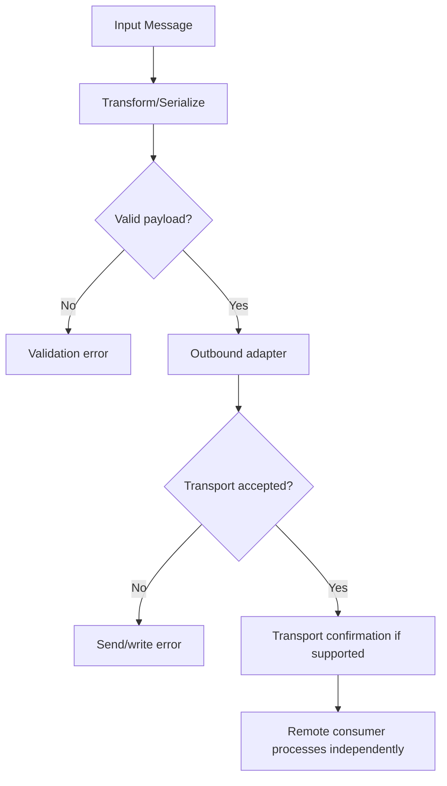
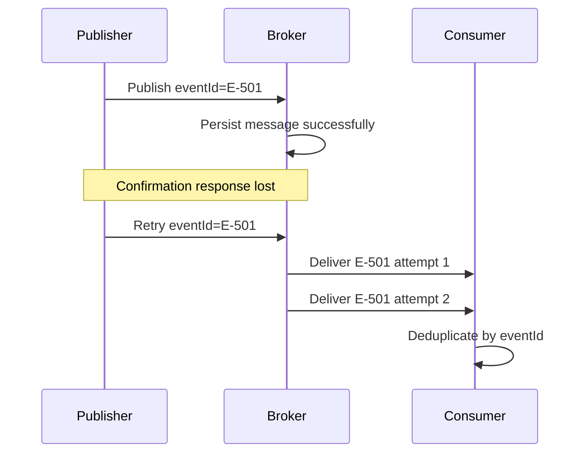
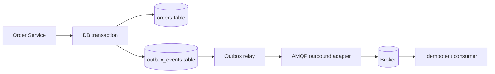

# Outbound channel adapter

In the **Channel adapter** chapter of the **SPRING_INTEGRATION_PATTERN** module, we explore how to send messages from a Spring Integration flow out to an external system. The module focuses on implementing **Enterprise Integration Patterns** with Spring Integration so that processing components remain loosely coupled to protocols and extensible through Router, Filter, Transformer, Splitter, Aggregator, Gateway, retry, error channel, and correlation. An **outbound channel adapter** is an endpoint that receives messages from an internal `MessageChannel` and performs an **outbound send or write operation**, typically with *one-way* semantics.

For example, an order-processing system confirms a transaction and then needs to publish an `OrderCompleted` event to RabbitMQ, send a record to JMS, or export a CSV file for a partner. In all three cases, business logic should focus on producing a **contract-compliant message**; the outbound channel adapter handles how the message is delivered to the target system.

After this lesson, you will be able to:

- Distinguish an outbound channel adapter from an inbound adapter, an outbound gateway, and a Messaging Gateway.
- Compose Transformer, Filter, Router, Service Activator, and an outbound adapter into a testable flow.
- Write Spring Integration Java DSL examples to **write files** and **publish AMQP messages**.
- Recognize the boundaries between `MessageChannel.send()`, transport-level send success, broker publisher confirms, and **business processing on the receiving system**.
- Design retries, error handling, idempotency, outbox, security, and observability for one-way outbound flows.

## 1. What is an outbound channel adapter?

In Enterprise Integration Patterns, a **Channel Adapter** turns interaction with an external resource or protocol into operations on a **Message Channel**. On the outbound side:



A message inside the application may carry:

```text
Message<OrderCompleted>
  payload:
    OrderCompleted(orderId="O-501", completedAt=...)
  headers:
    id
    timestamp
    eventId
    correlationId (if present)
    contentType (if present)
```

The outbound adapter receives the message from the channel, extracts the data to send, and uses an appropriate transport mechanism, such as writing a file or publishing to AMQP. The adapter **is not obligated to receive a business reply** from the target for each message.

This does not prevent the adapter from surfacing **technical** errors of the send/write operation—for example, missing file permissions, a lost broker connection, or serialization failure. However, a successful publish operation does not prove that a downstream consumer has updated its database.

### Three boundaries to distinguish

1. **Entering the internal channel:** did the internal messaging system accept `channel.send(message)`?
2. **Handing off to transport:** did the adapter write the file or deliver the message to the broker according to the configured mechanism?
3. **Receiver completes business processing:** did the consumer/partner process it successfully and commit changes?

These three milestones can occur at different times and require different confirmation mechanisms. If a workflow must know about the third milestone, design a separate result event, status reconciliation, or request-reply flow.

## 2. Distinguishing from similar endpoints

| Component | Processing direction | Business reply per request? | Example |
| --- | --- | --- | --- |
| **Inbound channel adapter** | External → message flow | Usually no | File inbound adapter reading data into the flow |
| **Outbound channel adapter** | Message flow → external | Usually no | Writing a result file, publishing `OrderCompleted` |
| **Outbound gateway** | Flow → external → flow | Has request-reply semantics | HTTP outbound gateway calling an API and receiving a response |
| **Inbound gateway** | External → flow → external | Has request-reply semantics | HTTP inbound gateway returning an HTTP response |
| **Messaging Gateway** | Java method ↔ message flow | Depends on method signature and contract | `@MessagingGateway` turning a Java call into a message |

For example, if a controller wants to **send a notification email** without waiting for the recipient to read it, an outbound adapter may fit. If the controller needs to **look up a price** from an external service and use the result immediately, an outbound gateway captures the requirement accurately.

**Be careful with the word "acknowledgement."** An outbound adapter successfully publishing to a broker may involve a publisher confirm; that is still not a business response from the consumer. A command sent through an outbound adapter that needs a result must have a reply flow with correlation or another asynchronous processing architecture.

## 3. Placing the adapter at the end of the flow and keeping handlers protocol-independent

A simple design:



Each step has a distinct responsibility:

- **Service Activator:** decides that a business task is complete and an event can be emitted.
- **Transformer:** produces the exact payload/serialization for the external contract. Do not assume a Java DTO can be sent verbatim to every broker or saved straight to a file.
- **Filter:** allows only valid or authorized data to be sent. If invalid messages must be investigated, configure a clear discard/error flow; a Filter dropping messages by default does not automatically send them to a DLQ.
- **Router:** selects the adapter by target type. When sending to multiple recipients, use a flow suitable for fan-out/multicast and define the outcome when only one destination fails.
- **Outbound adapter:** executes the transport call/write. Upstream flow steps do not need to know connection details once the message contract is agreed upon.

In this way, switching an export destination from files to a broker usually affects only the adapter and external mapping step. However, **delivery guarantees, retries, ordering, and transactions** still differ between the two transports and must be re-evaluated when switching.

## 4. Hands-on 1: File outbound channel adapter

Suppose an application needs to export processed data as CSV files in the `data/outbox` directory. The file outbound adapter receives a payload from the flow, chooses a filename, and writes to the file system.

### 4.1. Java DSL flow

Example with Java 17+, Spring Integration Core, and Spring Integration File:

```java
package example.exports;

import java.io.File;

import org.springframework.context.annotation.Bean;
import org.springframework.context.annotation.Configuration;
import org.springframework.integration.annotation.IntegrationComponentScan;
import org.springframework.integration.config.EnableIntegration;
import org.springframework.integration.dsl.IntegrationFlow;
import org.springframework.integration.file.dsl.Files;
import org.springframework.integration.file.support.FileExistsMode;

@Configuration
@EnableIntegration
@IntegrationComponentScan
class CsvExportIntegrationConfig {

    @Bean
    IntegrationFlow csvExportFlow() {
        return IntegrationFlow.from("exports.csv")
            .handle(
                Files.outboundAdapter(new File("data/outbox"))
                    .autoCreateDirectory(true)
                    .fileNameGenerator(message ->
                        "export-" + message.getHeaders().getId() + ".csv")
                    .fileExistsMode(FileExistsMode.FAIL)
            )
            .get();
    }
}
```

Meaning:

1. Channel `exports.csv` receives messages sent by an upstream component.
2. `Files.outboundAdapter(...)` configures the file-writing endpoint.
3. `autoCreateDirectory(true)` allows creating the target directory if needed.
4. `fileNameGenerator(...)` generates a filename per message; the example uses `MessageHeaders.ID` to avoid multiple messages writing to the same filename.
5. `FileExistsMode.FAIL` expresses a policy of **never overwriting an existing file**. A real application can choose another write mode if the contract requires it.
6. The handler at the end of the flow is a **one-way** endpoint; there is no reply DTO from the partner merely because the file was created.

**Note on data keys:** `MessageHeaders.ID` identifies a message at creation time. When the system retries by **creating a new message**, the ID can change. For idempotency across restarts, use a durable business key such as `exportId` for the filename or status record rather than relying solely on the message ID.

### 4.2. Sending data via a Java interface

If business code prefers invoking a method rather than constructing messages manually, you can place a **Messaging Gateway** in front of the channel:

```java
package example.exports;

import org.springframework.integration.annotation.MessagingGateway;

@MessagingGateway(defaultRequestChannel = "exports.csv")
interface CsvExportGateway {

    void writeCsv(String csvContent);
}
```

In caller code:

```java
String content = "orderId,total\nO-501,250000\n";
csvExportGateway.writeCsv(content);
```

`CsvExportGateway` is the Java interface that injects the payload into the message flow; the **file outbound adapter** is the component that actually writes the file. With a synchronous path like `DirectChannel`, exceptions from the file writing handler can typically propagate back to the caller. With an asynchronous channel, the method call may return before the file finishes writing.

The example uses a fixed CSV string for readability. A real application must properly escape commas, quotes, newlines, and encoding per CSV standards, avoiding raw concatenation of unvalidated input.

### 4.3. File integrity and handoff to the receiver

A file can become visible while it is still being written. If a partner begins reading too early, it may receive incomplete contents. Reliable designs typically require:

- Defining a temporary filename, writing to completion, and **renaming/moving** to a ready directory based on file system capabilities and handler configuration.
- Generating stable export names/keys to prevent unintended re-writes.
- Checking write permissions, disk space, file-exists policies, encoding, and size limits.
- Recording the business status of the export; a file's existence does not prove the partner imported it successfully.
- If a result from the partner is needed, building an inbound flow to receive an ACK file or status event.

Never assume every file system, operating system, or network share protocol supports atomic renames identically. Always verify the handoff policy in the target environment.

## 5. Hands-on 2: AMQP outbound adapter publishing events

In an event-driven architecture, a completed order can publish an `OrderCompleted` notification to RabbitMQ so other services can process it independently.

### 5.1. Event and contract

Example schema independent of the Java implementation:

```json
{
  "eventId": "order-completed-O-501-v1",
  "schemaVersion": 1,
  "eventType": "OrderCompleted",
  "payload": {
    "orderId": "O-501",
    "totalAmount": 250000,
    "currency": "VND"
  }
}
```

`eventId` is designed to be stable for **the same business event**, helping consumers deduplicate if the publisher resends. `schemaVersion` describes the published contract, not the Spring Integration version.

### 5.2. Flow using RabbitTemplate

The example below illustrates Spring Integration AMQP Java DSL. The application must provide an appropriate `RabbitTemplate`/`ConnectionFactory`; exchanges and bindings must be declared separately on RabbitMQ.

```java
package example.events;

import org.springframework.amqp.rabbit.core.RabbitTemplate;
import org.springframework.context.annotation.Bean;
import org.springframework.context.annotation.Configuration;
import org.springframework.integration.amqp.dsl.Amqp;
import org.springframework.integration.config.EnableIntegration;
import org.springframework.integration.dsl.IntegrationFlow;

@Configuration
@EnableIntegration
class OrderEventPublisherConfig {

    @Bean
    IntegrationFlow publishOrderEvents(RabbitTemplate rabbitTemplate) {
        return IntegrationFlow.from("events.order.completed")
            .handle(Amqp.outboundAdapter(rabbitTemplate)
                .exchangeName("orders.events")
                .routingKey("order.completed"))
            .get();
    }
}
```

This flow:

1. Receives messages from the `events.order.completed` channel.
2. Uses `RabbitTemplate` in the AMQP outbound adapter to publish to the `orders.events` exchange with routing key `order.completed`.
3. RabbitMQ evaluates bindings to decide which queues receive the message.
4. Consumers in other services receive the event and handle it under their own policies.

**Important dependency:** `RabbitTemplate` requires a message converter configured compatibly with the payload. If the producer wants to send JSON, serialize to an agreed representation or configure an appropriate JSON converter. Do not assume that just because the payload is a Java `record`, the broker will store proper JSON.

The AMQP outbound adapter does not automatically know whether consumers processed the message successfully. Even when publishing to an exchange succeeds, a message without a matching binding may **not be routed to any queue** depending on RabbitMQ configuration. When unroutable detection is needed, check Spring AMQP's `mandatory`/returns and publisher confirms mechanisms.

### 5.3. Outbound adapter vs. outbound gateway



There is no **business reply** arrow returning to the Adapter in this diagram. If a request requires a response from the remote consumer, use an **AMQP outbound gateway** or explicitly design a return path, correlation, and timeout.

## 6. Common types of outbound adapters

| Target | Common outbound endpoint | Payload and boundary considerations |
| --- | --- | --- |
| **File system** | File outbound channel adapter | File contents, filename, encoding, existing-file mode, atomic handoff |
| **RabbitMQ/AMQP** | AMQP outbound channel adapter | Exchange, routing key, converter, confirms/returns, message durability |
| **JMS** | JMS outbound channel adapter | Destination, delivery mode, transactions, type mapping |
| **Kafka** | Kafka outbound producer/handler per module version | Topic, key, partition, send result, ordering, callback |
| **MQTT** | MQTT outbound adapter | Topic, QoS, retained flag, reconnect/session |
| **Mail** | Mail outbound adapter | Recipient, subject/body, mail server, and delivery status |
| **SFTP/FTP** | Outbound file transfer adapter | Connection, target directory, temp writes, permissions, and retry |
| **HTTP** | HTTP outbound channel adapter (when used for one-way sends) | HTTP status, request factory, and transport response handling policy |

Depending on the Spring Integration version, factory/spec API names and send confirmation capabilities vary across endpoints. In implementation, use the proper module dependency, converter, and transport settings for the chosen adapter type.

## 7. One-way sending does not mean error-free

An important distinction: **not returning a business reply** is different from **not checking send results**.

Steps where failures can occur:



| Stage | Error example | Appropriate response |
| --- | --- | --- |
| Before adapter | Invalid JSON schema, missing `orderId` | Validate, route to data-error path, do not send |
| Serialization | Converter does not support payload type | Fix contract/converter; do not infinitely retry the raw message |
| File writing | Permission denied, disk full, file already exists | Report error, preserve state for retry |
| Broker publish | Connection lost, exchange does not exist | Bounded retry, investigate configuration |
| Broker routing | No matching binding/queue | Use returns/monitoring per broker mechanism |
| Remote consumer | Consumer fails after broker accepted event | Belongs to consumer/redelivery lifecycle; observe separately |

If business code needs to know "published to broker," design publisher confirms with appropriate callbacks/timeouts. If it needs to know "recipient finished processing," design a **business outcome message** or stateful workflow; publisher confirms do not solve that requirement.

## 8. Channel topology determines when errors are observed

When sending from a flow to an outbound adapter, the channel type between steps directly affects error propagation:

| Channel | Typical behavior | Consequence |
| --- | --- | --- |
| `DirectChannel` | Invokes handler synchronously on sender thread | Exceptions from the adapter can propagate back to the sender |
| `ExecutorChannel` | Offloads dispatch to an executor | Caller may complete before the adapter runs; errors occur on worker thread |
| `QueueChannel` | Enqueues message internally for consumer polling | `send()` may only prove queue insertion; queue durability must be considered |
| `PublishSubscribeChannel` | Broadcasts to multiple subscribers | One failing target can impact others depending on executor/error handling configuration |

Example:

```text
Business Service
  -> DirectChannel
  -> File outbound adapter
  -> (file written synchronously, or exception may propagate to caller)
```

Compared with:

```text
Business Service
  -> ExecutorChannel
  -> File outbound adapter
  -> (caller may finish before file has been written)
```

With asynchronous flows, you must have an **error channel** to receive failures, along with retry/monitoring and recovery policies. An in-memory queue does not automatically survive restarts.

**In particular:** if an inbound adapter from a broker hands off a delivery to an asynchronous channel and ACKs before the outbound adapter actually completes, an outbound failure may no longer trigger redelivery from the input broker. The system must establish a durable handoff point or design appropriate transactions/outbox mechanisms.

## 9. Retry, idempotency, and duplicate messages

A network failure can occur **after the broker has stored the message but before the producer receives confirmation**. At that moment, the publisher cannot tell whether the previous send succeeded or failed. Retrying can produce duplicate messages.



Sound designs usually include:

- **A stable business message key** such as `eventId` or `commandId`. Retries of the same event must preserve that key.
- **Bounded retries**, backoff, and classification between transient and permanent errors.
- **Consumer-side idempotency:** the same event ID must never produce business side effects twice.
- **Reconciliation capability:** when publish outcome is uncertain, inspect outbox/broker state or run recovery workflows rather than guessing.
- **Caution with side-effecting commands:** when sending order-placement or payment commands, enforce idempotency on the processing side and never treat a transport ACK as command completion.

### When to use RequestHandlerRetryAdvice?

Spring Integration supports attaching retry advice to suitable endpoints/handlers. Retries help with brief network glitches, but you must configure:

- Maximum attempts, backoff, and deadline.
- Exception classification; schema errors should not be retried verbatim.
- Exhaustion recovery: return error to caller, route to DLQ/quarantine, or mark outbox error state.
- Idempotency: the adapter may succeed in sending while the client still observes a connection error.

You cannot simply turn on retries and conclude messages will never be lost or sent twice.

## 10. Outbox pattern for emitting events after DB transactions commit

A common problem:

1. Service updates order status in the DB.
2. Service publishes `OrderCompleted` through an outbound adapter.
3. If the application crashes between the two steps, the database committed while the event never reached the broker.

Because the database and broker may not share a single distributed transaction, a common design is **Transactional Outbox**:



**Within the same DB transaction**, persist both the business change and an outbox record. A background relay reads unsent records, passes messages to the adapter, updates status based on appropriate publish guarantees, and retries on error. This makes events recoverable after crashes, though **the relay can still publish duplicates**, so consumers must be idempotent.

Example outbox table with minimal columns:

```sql
CREATE TABLE outbox_events (
    event_id VARCHAR(100) PRIMARY KEY,
    event_type VARCHAR(100) NOT NULL,
    payload_json TEXT NOT NULL,
    status VARCHAR(30) NOT NULL,
    created_at TIMESTAMP NOT NULL DEFAULT CURRENT_TIMESTAMP
);
```

An outbox record might hold:

```json
{
  "eventId": "order-completed-O-501-v1",
  "eventType": "OrderCompleted",
  "payloadJson": "{...}",
  "status": "PENDING"
}
```

For production operation, the relay also needs record claiming/locking across multiple instances, retry limits, poison-event handling, and marking published only after an appropriate signal. Marking `SENT` before the broker reliably accepts it risks losing messages; marking after broker acceptance can leave duplicates if a crash occurs before the DB update.

Outbox manages **atomicity between business state and intent to emit an event**, but does not by itself turn the entire pipeline into exactly-once.

## 11. Sending to multiple targets and handling partial success

Suppose an event must export a file for partner A and publish to RabbitMQ for partner B.

```text
Message<OrderCompleted>
    |
    +--> File outbound adapter ------> Partner A
    |
    +--> AMQP outbound adapter ------> Partner B
```

If writing the file succeeds while publishing to the broker fails, an exception in the flow cannot automatically roll back the file. Options to consider:

- **Per-target stateful fan-out:** store `eventId` alongside delivery outcomes for A and B; retry only the failed target.
- **Multiple subscribers via PublishSubscribeChannel:** useful for wiring components, but you must understand exception behavior and dispatch ordering.
- **Per-destination outbox:** each destination maintains its own delivery state and retries.
- **Saga/compensation:** when an external side effect must be undone, apply a contractual compensating action.

Do not expect multiple outbound adapters writing to independent external systems to participate in a single atomic transaction.

## 12. Headers, serialization, schema, and safety

Internal Java payloads are rarely the external wire format. Contracts must be defined at the **adapter boundary**:

| Aspect | Design question |
| --- | --- |
| **Payload** | Sending text, byte[], JSON, CSV, Avro, or another format? |
| **Schema/version** | Are `schemaVersion` and bilateral compatibility rules defined? |
| **Content type/encoding** | How does the receiver know how to parse? Is UTF-8 used? |
| **Routing key/filename/topic** | Derived from config or data, and do values need allowlisting? |
| **Correlation and event ID** | Which key lets the receiver recognize the same business action across retries? |
| **Header mapping** | Which internal headers are permitted onto the transport? |
| **Security** | How are credentials, TLS, ACLs, file permissions, and sensitive data protected? |
| **Load limits** | Limits on message/file size, throughput, timeouts, and rate limits? |

For example, the internal `replyChannel` header may hold a JVM `MessageChannel` object—not an address usable by an external system. Never serialize all of `MessageHeaders` straight to a broker/HTTP endpoint. Map only contractually allowed fields.

**Do not route based on arbitrary URLs or paths from unvalidated payloads.** If an incoming message controls filenames, topics, or recipients in an adapter, validate inputs, restrict allowed targets, and guard against path traversal/SSRF.

For CSV files, watch encoding, delimiter escaping, and leading characters that spreadsheet software might interpret as formulas. For JSON, validate required fields and numeric types; a converter running without exceptions does not guarantee a valid business contract.

## 13. Observing outbound adapters and confirming results

A single log line saying "message sent" is not enough to know which milestone succeeded. Collect signals across stages:

| Metric / log | Purpose |
| --- | --- |
| Messages entering outbound channel | Verify business logic emitted messages into the flow |
| Messages serialized/validated | Separate payload errors from transport errors |
| Send attempts, successes, failures | Measure technical adapter outcomes |
| Publisher confirms / returns (if supported) | Distinguish broker acceptance from unroutable messages |
| File creation/size/rename errors | Observe file handoffs |
| Retry count, retry exhausted | Detect failing targets or retry storms |
| Outbox backlog and oldest record age | Spot events stuck before publishing |
| Consumer processing result (if available) | Observe final business impact via a separate result channel |
| `eventId`, `correlationId`, trace ID | Correlate attempts and related systems |

An illustrative log:

```text
eventId=order-completed-O-501-v1
adapter=amqp-outbound
destination=orders.events/order.completed
stage=publish
outcome=ACCEPTED_BY_BROKER
attempt=2
```

Log `ACCEPTED_BY_BROKER` only when backed by an appropriate broker signal; when `RabbitTemplate` merely finishes the send call without observed publisher confirms, log a more accurate status like `SEND_RETURNED`. Do not log access tokens, payment details, or full payloads just to trace delivery.

## 14. Testing outbound adapters

Testing should be divided into three layers:

1. **Unit tests** for Transformer/Router/validator: verify payload and target selection without requiring a broker/file system.
2. **Adapter integration tests:** verify files are actually written or the broker receives the expected exchange/routing key/schema.
3. **End-to-end tests:** verify consumers/partners receive and process per contract, including business effects and retries.

| Scenario | Test approach | Expected outcome |
| --- | --- | --- |
| Valid file outbound | Send CSV to `exports.csv` channel using a temp directory | File created with expected name, content, and encoding |
| Existing file | Send two messages with the same filename under FAIL mode | Second write fails according to policy |
| No write permission | Use a non-writable directory | Exception/error flow is recorded |
| Successful AMQP publish | Test broker with exchange and binding | Message arrives in target queue with valid schema/headers |
| Missing binding | Broker accepts exchange publish but does not route | Detected via returns/monitoring when supported by config |
| Lost broker connection | Disconnect before/during publish | Bounded retries, error reported, recovery works |
| Duplicate publish | Retry with the same `eventId` | Consumer applies business side effects only once |
| Invalid schema | Missing required field | Not published; routed to error branch |
| Asynchronous channel | Insert an `ExecutorChannel` | Caller is not misled into assuming write/publish completed |
| Partial fan-out failure | File succeeds while broker fails | Per-target state is clear; only failed target retries |
| Crash between DB commit and publish | Restart relay after failure | Outbox recovers without losing emission intent |
| Crash after publish before `SENT` | Restart relay | May send duplicate, handled idempotently by consumer |

### Sample integration test scenario

```text
Given:
  exchange orders.events and a test queue bound with order.completed
  eventId = "order-completed-O-501-v1"
  outbound flow sends JSON over AMQP
When:
  application publishes the event
Then:
  broker receives the message with routing key order.completed
  payload parses according to the agreed schema
  eventId is preserved from flow to consumer
  consumer applies business logic once even if the same eventId is republished
```

For file systems, use temporary directories, send messages to the channel, and wait for observable conditions. For RabbitMQ, use a test broker / isolated topology to verify exchanges, bindings, and publisher confirms per policy. Avoid unit-testing only a mocked `RabbitTemplate.convertAndSend(...)` and concluding that all routing and delivery work end-to-end.

## 15. Common design mistakes

**Using an outbound channel adapter when the caller needs a synchronous result.** If you need a computation from a remote service and must return a DTO for the current request, use an outbound gateway or an explicit reply workflow.

**Assuming sending to a `MessageChannel` means delivery outside the app.** With asynchronous channels, `send()` may finish as soon as the message is queued in an in-JVM executor/queue.

**Equating publisher confirm with completed business processing.** Broker acceptance of a publish does not mean the consumer committed to its DB.

**Lacking an explicit schema/serializer.** The same Java object can become bytes, text, or another serialized form across adapters/converters; define a contract and test with real data.

**Retrying without preserving the event ID.** Generating a fresh UUID on retry prevents consumers from deduplicating, risking repeated side effects.

**Persisting to DB and publishing directly without recovery.** Crashing between commit and publish drops events; an outbox or equivalent recovery mechanism is required.

**Writing files directly into a directory actively polled by a partner.** The receiver may read incomplete files; establish a staging/handoff convention.

**Leaving fan-out uncontrolled.** One failing outbound adapter leaves inconsistent delivery states; track outcomes per destination.

**Retrying every error infinitely.** Bad schemas, invalid paths, or misspelled broker exchanges will keep failing; classify errors and bound retries.

**Not observing ACK/confirmation boundaries.** When incidents happen, you cannot tell whether a message entered the channel, was published, was routed, or was processed by the consumer.

## 16. Outbound channel adapter implementation checklist

1. Confirm whether the business flow needs **one-way delivery** or request-reply.
2. Select the right transport and adapter: file, AMQP, JMS, SFTP, MQTT, or another system.
3. Declare the inbound channel feeding the outbound adapter and any required Transformer/Router/Filter steps.
4. Standardize payload, schema version, content type, encoding, and routing/filename rules.
5. Design bounded retries, error classification, error channels, and recovery when the adapter fails.
6. Define completion semantics: channel entry, transport send, publisher confirm, or remote business effect.
7. Ensure durable idempotency keys across retries and crashes.
8. When publishing after a DB transaction, consider outbox or an equivalent durability mechanism.
9. Account for asynchronous channels, queue durability, backpressure, and slow sends.
10. When sending to multiple destinations, maintain per-destination delivery state and retries.
11. Add metrics/logs keyed by `eventId`, endpoint, attempt, errors, and backlog.
12. Test against real file/broker boundaries, including duplicates, disconnects, schema errors, partial fan-out, and restarts.

## Conclusion

An **outbound channel adapter** moves messages from a **Spring Integration message flow** to an external system and is the right component when a flow requires **one-way writing or sending**. It decouples business code from File, AMQP, JMS, and other protocols while Transformer, Router, Filter, and Service Activator continue handling data under Enterprise Integration Patterns. To make outbound delivery truly reliable, define data contracts, distinguish outcomes across channel/transport/consumer boundaries, govern retries and errors, design idempotency and outbox when needed, and test both the sending path and receiver effects.
