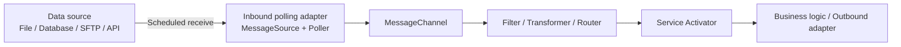

# Polling adapter and polling schedules in Spring Integration

## Lesson objectives

After this lesson, you will be able to:

- Explain what a **polling channel adapter** is and when you need to actively poll data instead of waiting for an external system to push messages.
- Distinguish an **inbound polling adapter**, a **polling consumer** on a `PollableChannel`, and an **event-driven inbound adapter**.
- Choose `fixedDelay`, `fixedRate`, or `cron` schedules, and understand the effects of `initialDelay` and `maxMessagesPerPoll`.
- Build a Spring Integration flow that reads data periodically using `MessageSource`, `@InboundChannelAdapter`, `@Poller`, and `@ServiceActivator`.
- Configure a file-polling schedule with Java DSL while recognizing the differences when polling databases, SFTP, or APIs.
- Design load control, error handling, retries, duplicate-read prevention, and polling progress observability.

In the **SPRING_INTEGRATION_PATTERN** module, we practice *Enterprise Integration Patterns* with Spring Integration to build loosely coupled, extensible message flows. The **Channel adapter** topic focuses on connecting the outside world to a `MessageChannel`. Polling adapters are especially useful when a data source cannot push events or when the application must control read frequency and record counts. Once inside the system, messages can still pass through Filter, Transformer, Router, Splitter, Aggregator, Gateway, retry, and error channels.

## 1. What problem does a polling adapter solve?

Suppose an accounting system exports CSV files into a directory every few minutes, or an `outbox_events` table stores events waiting to be sent. The source does not directly call an API on the consuming application. To process new records, the application must **actively check the source on a schedule**:



An **inbound polling adapter** combines two responsibilities:

1. **Message source** knows how to fetch the next item from the source, typically via `MessageSource.receive()`. When no data is available yet, it can return `null`.
2. **Poller** decides *when* to invoke the source and *how many* messages at most to fetch per cycle, then forwards messages to the input channel.

A polling schedule does not guarantee new data arrives right on time. If the poller runs every 10 seconds and the source has no data yet, that cycle may emit no messages. If one read runs too slowly, the actual schedule may also slip.

### 1.1. Comparison with event-driven adapters

| Characteristic | Polling inbound adapter | Event-driven inbound adapter |
| --- | --- | --- |
| Who initiates receiving data? | Application actively calls `receive()` on schedule | External system/callback/listener pushes messages |
| Examples | File directory, JDBC table, periodically scanned FTP/SFTP source | HTTP webhook, RabbitMQ/JMS listener, TCP receiver |
| When no data exists | A poll cycle may return `null` | No new callback to handle |
| Detection latency | Depends on poll interval and processing time | Depends on source emission/delivery mechanism |
| Load on source | May issue wasted queries when source is empty | Depends on incoming event rate and backpressure |
| Fault tolerance and duplicate reads | Needs state/cursor, ACK, or processed filter | Still requires transport ACK, retry, and idempotency |

Polling is a way of **acquiring messages**; it does not dictate whether downstream business logic must be synchronous or asynchronous. The adapter can send messages to a `DirectChannel` for immediate processing, an `ExecutorChannel` to hand off to workers, or a broker-backed flow.

## 2. Where are pollers used in Spring Integration?

Spring Integration has two places where polling happens that are easy to confuse:

| Scenario | Executing component | Meaning |
| --- | --- | --- |
| Reading data from an external source | `SourcePollingChannelAdapter` with `MessageSource` | Each poll tick invokes the source, retrieves messages, and sends them to the output channel |
| Reading messages already inside a pollable channel | `PollingConsumer` with `PollableChannel` (e.g. `QueueChannel`) | Each poll tick pulls messages from the channel and invokes the handler |
| Receiving messages from a push channel | `EventDrivenConsumer` with `SubscribableChannel` (e.g. `DirectChannel`) | Handler is invoked when a message is sent; no consumer poll schedule needed |

For example, placing a `ServiceActivator` after a `DirectChannel` **does not need a second poller**, because the polling schedule is already on the inbound adapter. If the adapter sends to a `QueueChannel` and the handler is attached via a polling consumer, there are **two scheduling rhythms**: the rhythm pulling from the external source and the rhythm pulling from the queue. Understand the latency and load of each layer before adding another poller.

The basic flow is illustrated as:

```text
TaskScheduler
    | every 2 seconds (fixedDelay, actual cadence depends on run duration)
    v
SourcePollingChannelAdapter
    | calls MessageSource.receive()
    | -- null --> ends cycle because no message is available
    | -- Message<PendingOrder> --> pendingOrders (DirectChannel)
                                     |
                                     v
                               Service Activator
                                     |
                                     v
                               Business processing
```

`TaskScheduler` schedules the poller. If the handler sits behind a `DirectChannel` and runs slowly, its processing time also consumes the poll cycle, because send/handle can run synchronously on the poller thread.

## 3. Choosing a polling schedule: fixed delay, fixed rate, or cron?

Three common strategies:

| Configuration | Interpretation | When to use | Caution |
| --- | --- | --- | --- |
| `fixedDelay = "2000"` | Waits roughly 2 seconds **after the previous run finishes** before starting the next | Steady sources, avoiding hammering when a run takes long | Interval between starts exceeds 2 seconds when processing takes time |
| `fixedRate = "2000"` | Targets periodic starts every 2 seconds | Needs near-constant cadence and predictable poll times | If the scheduler is overloaded, runs can still slip; does not imply parallelism by default |
| `cron = "0 */5 * * * *"` | At second 0 of every minute divisible by 5 | Clock-based jobs: check every 5 minutes, business-hours schedules | Timezones, DST, overlapping schedules, and application downtime |

**Fixed delay** is a sensible default for many inbound polling adapters because a slow run pushes back the next one, reducing the risk of continuously querying the source. **Fixed rate** fits when a steady check cadence is required and execution time is bounded. **Cron** fits requirements like "8 AM on weekdays" or "every 5 minutes by wall-clock time."

Spring cron typically uses **six fields**: `second minute hour day-of-month month day-of-week`. Examples:

```text
0 */5 * * * *       # Every 5 minutes, at second 0
0 0 8 * * MON-FRI  # 08:00 Monday to Friday
0 15 1 * * *       # 01:15 daily
```

With cron, evaluated times depend on the scheduler/trigger timezone. If the business requires Vietnam time, explicitly configure the scheduler or `CronTrigger` with `Asia/Ho_Chi_Minh` rather than relying on the host's default timezone. For regions with Daylight Saving Time, define policies for repeated or skipped hours. If the process is down at a cron trigger time, a standard poller **does not automatically backfill missed runs**; the data source or job state must support catch-up reads.

### 3.1. `initialDelay` and `maxMessagesPerPoll`

- `initialDelay` sets the wait time before the first poll for schedules that support this parameter.
- `maxMessagesPerPoll` caps **how many messages are received** in a single poll cycle (or source receive attempts per configuration), not the number of rows inside **one message's** payload.
- If `MessageSource.receive()` returns `null`, the poll cycle normally stops early since no more messages are available.
- Setting a reasonable cap lets the poller yield time to other tasks, preventing a constantly active source from starving resources via an overly long read loop.

**Estimation example:** with `fixedDelay = 2,000 ms` and `maxMessagesPerPoll = 5`, one cycle emits at most 5 messages. Assuming zero processing time and continuous data, the theoretical rate is about **2.5 messages/second**. If processing 5 messages takes 1 extra second, each cycle from start to next start takes roughly 3 seconds, lowering actual throughput. A single `Message<List<Row>>` containing 100 rows still counts as **one** message toward this limit.

## 4. Example 1: Inbound polling adapter reading a simulated data queue

To study the mechanism without a broker or database, we use an in-memory queue as the data source. The example targets **Java 17+, Spring Boot 3.x, Spring Integration 6.x** with the corresponding Spring Integration dependency. The `public` types live in separate Java files in the same package under Spring Boot component scanning.

The in-memory queue is **for learning only**: removing an item with `poll()` takes it out of memory; if the handler fails or the application restarts, the item can be lost. Later sections cover what must change for real systems.

### 4.1. Data definition

```java
// PendingOrder.java
import java.time.Instant;

public record PendingOrder(
        String orderId,
        Instant createdAt
) {}
```

### 4.2. Declaring the source, schedule, and input channel

```java
// OrderPollingConfiguration.java
import java.util.Queue;
import java.util.concurrent.ConcurrentLinkedQueue;

import org.springframework.context.annotation.Bean;
import org.springframework.context.annotation.Configuration;
import org.springframework.integration.annotation.InboundChannelAdapter;
import org.springframework.integration.annotation.Poller;
import org.springframework.integration.channel.DirectChannel;
import org.springframework.integration.config.EnableIntegration;
import org.springframework.integration.core.MessageSource;
import org.springframework.messaging.MessageChannel;
import org.springframework.messaging.support.MessageBuilder;

@Configuration
@EnableIntegration
public class OrderPollingConfiguration {
    private final Queue<PendingOrder> pending =
            new ConcurrentLinkedQueue<>();

    public void enqueue(PendingOrder order) {
        pending.add(order);
    }

    @Bean
    public MessageChannel pendingOrders() {
        return new DirectChannel();
    }

    @Bean
    @InboundChannelAdapter(
        channel = "pendingOrders",
        poller = @Poller(
            initialDelay = "500",
            fixedDelay = "2000",
            maxMessagesPerPoll = "5"
        )
    )
    public MessageSource<PendingOrder> orderMessageSource() {
        return () -> {
            PendingOrder order = pending.poll();
            return order == null
                    ? null
                    : MessageBuilder.withPayload(order).build();
        };
    }
}
```

How the components work together:

1. Spring creates the `orderMessageSource` bean as a `MessageSource<PendingOrder>` and an inbound endpoint via `@InboundChannelAdapter`.
2. The poller waits 500 ms initially, then fetches up to 5 messages per cycle with a 2,000 ms fixed delay between cycles.
3. Whenever `receive()` returns a `Message<PendingOrder>`, the endpoint sends it to `pendingOrders`.
4. When the queue is empty, `receive()` returns `null`; the poller ends the current cycle and waits for the next scheduled run.

Common pitfall: a method annotated with `@InboundChannelAdapter` in this example **returns a `MessageSource`** so Spring Integration actively calls `receive()` on schedule. Do not confuse it with `@ServiceActivator`, which is an endpoint that **handles messages already sent to a channel**.

### 4.3. Handling messages via Service Activator

```java
// OrderPollingHandler.java
import java.util.Queue;
import java.util.concurrent.ConcurrentLinkedQueue;

import org.springframework.integration.annotation.ServiceActivator;
import org.springframework.stereotype.Component;

@Component
public class OrderPollingHandler {
    private final Queue<String> processedIds =
            new ConcurrentLinkedQueue<>();

    @ServiceActivator(inputChannel = "pendingOrders")
    public void handle(PendingOrder order) {
        // Illustration: in production, replace with idempotent business logic.
        processedIds.add(order.orderId());
    }

    public boolean wasHandled(String orderId) {
        return processedIds.contains(orderId);
    }
}
```

This handler returns no reply because the flow is designed as **one-way**. Once the adapter reads and sends successfully, business logic runs on the poller thread because `DirectChannel` invokes subscribers synchronously. For heavy I/O tasks, factor in processing duration and concurrency rather than assuming polling a source is automatically asynchronous.

### 4.4. Externalizing the schedule via configuration

Real systems often need to adjust schedules without recompiling. For example, replace the poller annotation above with:

```java
@InboundChannelAdapter(
    channel = "pendingOrders",
    poller = @Poller(
        fixedDelay = "${orders.poll.delay-ms:2000}",
        maxMessagesPerPoll = "${orders.poll.batch-size:5}"
    )
)
```

Properties like `orders.poll.delay-ms` can then be supplied from application configuration. This snippet is a **replacement annotation**, not a second adapter declaration; having two adapters read the same source concurrently can unintentionally create competing reads.

To switch from fixed delay to cron (choose **one** configuration per endpoint):

```java
@InboundChannelAdapter(
    channel = "pendingOrders",
    poller = @Poller(
        cron = "0 */5 * * * *",
        maxMessagesPerPoll = "20"
    )
)
```

With this configuration, the poller executes one read cycle at every 5-minute mark. `maxMessagesPerPoll=20` does not mean the source is scanned continuously for 5 minutes; it caps how many messages are accepted in **a single cycle**.

## 5. Example 2: Polling a CSV directory with Java DSL

A more realistic scenario is scanning a directory for CSV files every 10 seconds. Spring Integration provides an inbound file adapter to bridge the file system and message flows.

```java
// CsvPollingFlowConfiguration.java
import java.io.File;
import java.time.Duration;

import org.springframework.context.annotation.Bean;
import org.springframework.context.annotation.Configuration;
import org.springframework.integration.dsl.IntegrationFlow;
import org.springframework.integration.dsl.Pollers;
import org.springframework.integration.file.dsl.Files;

@Configuration
public class CsvPollingFlowConfiguration {

    @Bean
    public IntegrationFlow csvPollingFlow() {
        return IntegrationFlow.from(
                Files.inboundAdapter(new File("./incoming"))
                    .autoCreateDirectory(true)
                    .patternFilter("*.csv"),
                endpoint -> endpoint.poller(
                    Pollers.fixedDelay(Duration.ofSeconds(10))
                        .maxMessagesPerPoll(10)
                )
            )
            .handle(File.class, (file, headers) -> {
                // Illustrates the adapter emitting a File; it does not parse CSV automatically.
                System.out.println("Detected: " + file.getName());
                return null;
            })
            .get();
    }
}
```

**Flow breakdown:**

- `Files.inboundAdapter(...)` creates a file message source. The typical payload in this example is `java.io.File`.
- `patternFilter("*.csv")` filters filenames; it does not verify that writing finished or that contents are valid.
- `Pollers.fixedDelay(Duration.ofSeconds(10))` sets the scan cadence.
- `maxMessagesPerPoll(10)` caps emitted messages/files at 10 per cycle when enough files exist.
- `handle(File.class, ...)` receives the `File`. Production logic must open, validate, parse, process, and record state explicitly.

This snippet only logs the filename to keep focus on polling. **Never treat printing the filename as proof that CSV data was durably saved or finished processing.**

### 5.1. Why is file polling prone to duplicate or partial reads?

An external process may still be writing `daily-orders.csv` while the poller scans. If the adapter opens the file too early, it sees partial data. The standard solution is for the producer to write a temporary file and **atomically rename** it to `.csv` once finished (where supported by the filesystem), or use a `.done` marker file and verify stability per business rules.

A file inbound adapter can use an *accept-once* filter to limit re-emitting a file within a process lifecycle. However, **an in-memory filter is not proof of business completion**, and its state is lost on restart. For stronger guarantees, consider a durable metadata store and a filter such as `FileSystemPersistentAcceptOnceFileListFilter`, paired with moving files to a processed directory only after the business transaction commits.

For SFTP/FTP, you must also account for in-progress uploads, modification-timestamp skew, disconnects, and remote-to-local file synchronization. A successful remote adapter poll does not mean downstream finished processing the file.

## 6. Polling a database or outbox: reads must be stateful

A common pattern is polling a table holding pending work:

```text
outbox_events
  id | payload | status     | available_at | attempt
  51 | {...}   | READY      | ...          | 0
  52 | {...}   | PROCESSING | ...          | 1
  53 | {...}   | DONE       | ...          | 1

Poller -> claim READY record -> process -> mark DONE
                             |
                             +-- failure --> retry with backoff / dead-letter
```

Running `SELECT ... WHERE status='READY'` and processing each message is **insufficient** when multiple instances poll simultaneously. Two instances can read the same row before either marks it as in-progress.

For PostgreSQL, an **illustrative work-claiming pattern** is:

```sql
WITH picked AS (
    SELECT id
    FROM outbox_events
    WHERE status = 'READY'
      AND available_at <= CURRENT_TIMESTAMP
    ORDER BY id
    FOR UPDATE SKIP LOCKED
    LIMIT :batch_size
)
UPDATE outbox_events AS e
SET status = 'PROCESSING',
    attempt = e.attempt + 1
FROM picked
WHERE e.id = picked.id
RETURNING e.id, e.payload, e.attempt;
```

This SQL is **PostgreSQL-specific**, not universally supported across all databases. The claim operation must run within an appropriate transaction so multiple workers never claim the same record concurrently. After claiming, the worker executes business logic and updates `DONE`; on failure, it transitions to a retryable state with a new `available_at` or moves to a dead-letter table.

**Production concerns to resolve:**

1. **Lease / recovery:** if a process dies after transitioning to `PROCESSING`, a lease timeout or recovery job is required so records do not stay stuck forever.
2. **Idempotency:** if a side effect ran before `DONE` was committed, the job may run again. Protect business actions with idempotency keys.
3. **Transaction boundaries:** never assume a single database transaction spans external APIs, files, or brokers. Polling + delivery may require the outbox pattern and independent delivery state.
4. **Batch size:** a poll can fetch 100 rows inside **one list-bearing message**, so `maxMessagesPerPoll` does not directly cap row count when `MessageSource` is batch-oriented.
5. **Indexes and load:** index `(status, available_at)` appropriately; overly aggressive poll schedules waste query capacity.

Spring Integration includes JDBC inbound polling components in its JDBC module, though exact configuration varies by library version and row mapping needs. Whether using a built-in adapter or a custom `MessageSource`, **poll scheduling and claim/ACK mechanics are two separate responsibilities**.

## 7. Throughput, backpressure, and worker count

The polling schedule directly affects processing load. For each cycle, weigh:

| Variable | Meaning |
| --- | --- |
| `T` | Pause between cycles or target launch interval |
| `M` | Maximum messages per cycle via `maxMessagesPerPoll` |
| `S` | Time for the source to read data and downstream to process a message |
| `W` | Number of workers actually able to process concurrently |
| `Q` | Number of messages/tasks waiting in queues |

For example, with `T = 2 seconds`, `M = 5`, and synchronous processing at 200 ms/message, emitting and processing 5 messages takes roughly 1 second excluding read I/O. With fixed delay, the time between consecutive cycle starts is roughly 3 seconds, yielding about **1.67 messages/second** under continuous load—lower than the 2.5 messages/second theoretical rate assuming zero processing time.

Dispatching messages to an `ExecutorChannel` frees the poller from waiting for all business work, but you must bound the thread pool, queue capacity, and backpressure. If the poller produces faster than downstream consumes, queues swell or the executor rejects messages. Never speed up the poller when queue lag metrics are already climbing steadily.

### 7.1. When should you adjust the polling schedule?

- **Growing backlog with spare CPU/IO:** consider lowering `fixedDelay` or raising `maxMessagesPerPoll` with measurement.
- **High database source load:** increase the pause, shrink batches, and add proper indexes and filtering predicates.
- **Slow downstream:** slow down ingestion or introduce durable queues, retry/backoff, and bulkheads.
- **Source is almost always empty:** poll less frequently or switch to push notifications if supported.
- **Strict wall-clock timing required:** use cron with an explicit timezone and persist state for post-downtime catch-up.

## 8. Poller errors and retry handling boundaries

Suppose the adapter reads a file/record and the handler throws an exception. The outcome depends on how the source records consumption:

| Source type | Risk when handler fails | Handling approach |
| --- | --- | --- |
| In-memory queue `poll()` | Item was already removed and can be lost | For illustration only; use durable sources and proper ACK/transactions in production |
| File with accept-once filter | File may be marked emitted without completing business logic | Move/update file state after success; persist metadata/checkpoints |
| Unclaimed JDBC table | Next poll may re-read; multiple workers read duplicates | Atomic claiming, idempotency, retry state |
| Claimed JDBC table without lease | Dead instance leaves `PROCESSING` records stuck | Lease timeouts, recovery, and bounded retries |
| SFTP/remote poll | Network drop or incomplete file download | Redownload mechanism, checksum/marker checks, persistent filters |

In Spring Integration, exceptions from polling tasks can be routed into error handling flows via `ErrorMessage`/`errorChannel` when configured appropriately. Do not assume every handler exception causes the source to **automatically return the message** or re-emit a record already deleted from the source.

A clear error-handling design includes:

1. Defining when the source considers data **received**, **in progress**, and **completed**.
2. Setting timeouts on I/O operations so a sluggish source cannot hang the poller.
3. Applying bounded retries with backoff for transient errors; never looping forever on malformed payloads.
4. Once retries are exhausted, moving failures to an inspected/dead-letter state with sufficient source IDs and correlation keys for reconciliation.
5. Protecting side-effect **idempotency** so redelivery or repeated polling never executes actions twice.

In Splitter/Aggregator flows, a single polled message can fan out into many child messages. Preserve `correlationId` and sequence headers; the poller only knows the root message was emitted, not whether every branch succeeded. If a Filter drops a message, ensure that matches the business contract; in request–reply flows, omitting a reply can cause timeouts.

## 9. Observing polling behavior

Do not watch only job execution counts. Track **what was read, how much, how long it took, and how far processing got**.

| Metric / log | Explanation |
| --- | --- |
| `poll.invocations` | Number of times the poller actually ran |
| `poll.empty` | Number of cycles that retrieved no messages |
| `poll.duration` | Duration of a poll cycle, including synchronous downstream time if any |
| `poll.messages` | Number of messages emitted per cycle |
| `source.read.errors` | Errors while reading from the source |
| `downstream.processing.errors` | Errors after a message was received |
| `pending/queue.depth` | Volume of pending work |
| `oldest.pending.age` | Age of the oldest waiting record |
| `retry.count` / `deadletter.count` | Reprocessing frequency and unrecoverable failures |
| `duplicate.suppressed` | Records skipped due to idempotency |

Include `requestId`, file ID/path, row ID, or job ID in tracing/logs for reconciliation, while avoiding logging personal data or full sensitive payloads. A poller running steadily while `oldest.pending.age` climbs continuously signals the system is falling behind, even if technical error counts are near zero.

## 10. Testing polling adapters

### 10.1. End-to-end in-memory data flow test

With `OrderPollingConfiguration` and `OrderPollingHandler` above, an integration test can enqueue an item, wait for the poller to process it, and assert the outcome:

```java
// OrderPollingFlowTest.java
import static org.assertj.core.api.Assertions.assertThat;

import java.time.Instant;
import java.util.concurrent.TimeUnit;

import org.junit.jupiter.api.Test;
import org.springframework.beans.factory.annotation.Autowired;
import org.springframework.boot.test.context.SpringBootTest;

@SpringBootTest
class OrderPollingFlowTest {
    @Autowired
    private OrderPollingConfiguration source;

    @Autowired
    private OrderPollingHandler handler;

    @Test
    void pollsAvailableOrderAndSendsItToHandler() throws Exception {
        String orderId = "ORD-" + System.nanoTime();
        source.enqueue(new PendingOrder(orderId, Instant.now()));

        long deadline = System.nanoTime() + TimeUnit.SECONDS.toNanos(7);
        while (!handler.wasHandled(orderId)
                && System.nanoTime() < deadline) {
            Thread.sleep(25);
        }

        assertThat(handler.wasHandled(orderId)).isTrue();
    }
}
```

This test uses a bounded wait to verify the source → channel → handler flow. It does not test durability or exactly-once guarantees against external systems. When using short intervals in tests, CI schedulers may lag; pick generous test budgets and avoid asserting exact wall-clock scheduler firing times.

### 10.2. Additional scenarios to verify

| Test case | Scenario | Expected outcome |
| --- | --- | --- |
| No data | `receive()` returns `null` | No dummy message emitted; scheduler keeps running |
| Exceeds batch size | Enqueue 12 items with `maxMessagesPerPoll=5` | At most 5 messages per cycle; subsequent cycles drain the rest |
| Slow handler | Processing exceeds expected interval | Measure actual latency; fixed delay does not outpace processing capacity |
| Multi-instance DB polling | Two instances attempt to claim the same record | A record is never claimed simultaneously by two instances under the chosen transaction |
| Restart | Stop process mid-processing | Catch-up/recovery runs via designed durable state |
| Partially written file | Producer has not renamed or written `.done` marker | Incomplete file is not processed |
| Transient error | API/SFTP/DB loses connectivity | Bounded retry/backoff; error recorded |
| Local-timezone cron | Time defined in business timezone | Triggers at expected time; post-downtime behavior defined |

In-memory queue tests cannot prove JDBC row claiming, AMQP ACKs, or SFTP file synchronization. Those properties require integration tests against real sources or suitable test containers.

## 11. Common design mistakes

**Confusing `maxMessagesPerPoll` with data batch size.** If one `receive()` call returns a message carrying 100 records, a limit of 5 messages can represent 500 records. Control batch sizes at both source and poller.

**Using fixed rate with a slow source and assuming parallel catch-up.** Concurrency depends on the scheduler/executor and endpoint setup; measure actual execution and explicitly bound concurrency rather than inferring from schedule names.

**Polling files as soon as a matching name appears.** A `.csv` extension does not prove writing finished. Use a temp-file → rename convention or explicit completion markers.

**Marking data processed immediately upon reading.** "Received from source" and "business transaction committed" are two distinct milestones. When a source can re-emit data, processing must be idempotent.

**Polling aggressively out of fear of latency.** Tightly polling an empty database wastes I/O; a queue or push mechanism fits better when supported by the source.

**Assuming cron automatically catches up missed runs after downtime.** Standard pollers only schedule while the process is alive. When catch-up is required, track cursors, timestamps, or pending job states in the source.

## 12. Implementation checklist

1. **What is the data source?** File, JDBC, SFTP, API, or a `PollableChannel`? Can push be used instead of polling?
2. **What does one message represent?** One file, one row, one batch, or an entire job? Distinguish clearly from `maxMessagesPerPoll`.
3. **When should it poll?** Fixed delay, fixed rate, or cron? Are timezone, initial delay, and post-downtime behavior clear?
4. **How does the source ensure durability?** Are checkpoints, persistent filters, claim/lease mechanics, and recovery in place?
5. **What happens on mid-flow failure?** Are retries, idempotency, dead-letter handling, and completion timestamps recorded accurately?
6. **Is load controlled?** Have batch limits, thread pools, queues, backpressure, and source query costs been measured?
7. **Is progress observable?** Are empty polls, message counts, latency, oldest pending age, retries, and errors tracked?
8. **Have boundaries been tested?** Empty source, large backlog, incomplete files, disconnects, multiple instances, and restarts?

## Conclusion

A **polling channel adapter** bridges data sources that must be actively read on a schedule, while the **poller** governs cadence and messages fetched per cycle. In Spring Integration, combining `MessageSource` with `@InboundChannelAdapter`/`@Poller` or Java DSL clearly implements the external source → message channel → business processing flow. Choosing fixed delay, fixed rate, or cron depends on target latency, source load, and actual processing duration. In production systems, the polling schedule is only the beginning: checkpoints, claim/ACK mechanics, deduplication, retries, backpressure, crash recovery, and monitoring are what ensure complete, reconcilable data processing.
