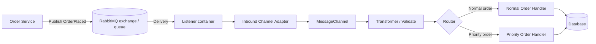
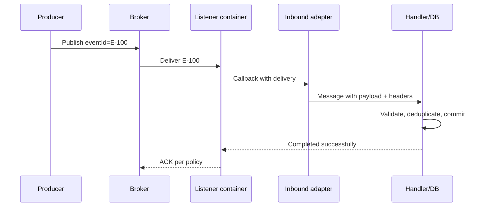
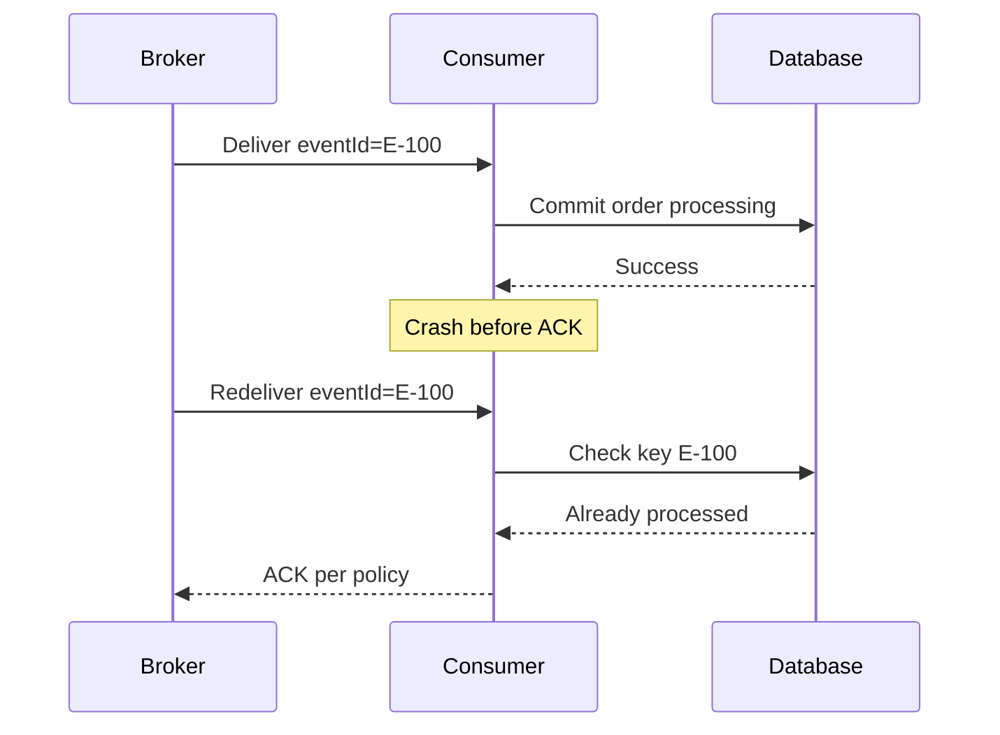
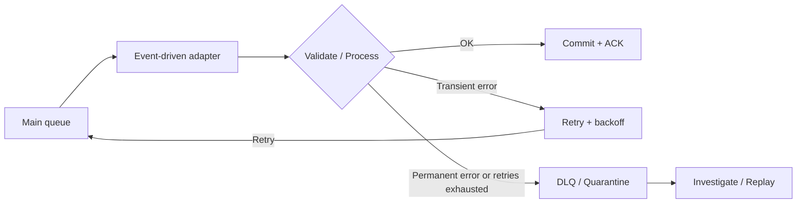

# Event-driven adapter

In the **Channel adapter** chapter of the **SPRING_INTEGRATION_PATTERN** module, we connect external event sources to a Spring Integration message flow. The module focuses on practicing **Enterprise Integration Patterns** (Router, Filter, Transformer, Splitter, Aggregator, Gateway), along with retry, error channels, correlation, testing, and observing processing branches. An **event-driven adapter** is the boundary component that reacts when a new message or event arrives, instead of continuously asking the data source whether data is available.

For example, when an order is created, a message broker sends an `OrderPlaced` event to a consumer. The inbound adapter receives the delivery, converts it into a `Message<?>`, and places it onto a Spring Integration `MessageChannel`. Subsequent steps can validate schemas, filter, route, persist to a database, or send notifications. Broker reception lives at the adapter; business rules stay in independent handlers.

After this lesson, you will be able to:

- Distinguish **event-driven/message-driven adapters**, **polling adapters**, **event-driven consumers**, and **request-reply gateways**.
- Explain the lifecycle of an event across the broker, inbound adapter, channel, and handler.
- Build an **AMQP inbound channel adapter** flow using Spring Integration Java DSL with a listener container.
- Properly design ACK placement, retries, redelivery, dead-letter queues (DLQ), idempotency, and error channels.
- Verify concurrency, ordering, backpressure, observability, and consumer failure scenarios.

## 1. What problem does an event-driven adapter solve?

When software must receive changes from an external system, there are two common approaches:

1. **Polling:** the application periodically checks the source—for example, scanning a directory every 5 seconds for new files.
2. **Event-driven:** the data source or an intermediary proactively signals incoming data—for example, a message broker pushes a delivery to a registered consumer.

With event-driven ingestion, message arrival timing is driven by source events and consumer readiness. Reaction time is typically lower since there is no poll interval to wait out, though queues, buffers, network latency, and rate controls still apply.



In the diagram, the **listener container** manages receiving deliveries from RabbitMQ; the **inbound adapter** bridges deliveries into Spring Integration's messaging system. Routers and handlers do not need to interact with AMQP channels directly to execute business logic.

Benefits of this separation:

- The event-producing service does not need the receiver to be online at publish time, provided the broker has appropriate storage/delivery mechanisms.
- Internal flows can swap Transformers or Routers without forcing producers to modify business code.
- Consumers can scale, backlogs can be monitored, and retries can be configured at the right boundary.
- Dedicated error paths can handle invalid events or infrastructure failures.

However, being event-driven **does not automatically create durability**, guarantee exactly-once processing, eliminate duplicate events, or turn a one-way adapter into RPC.

## 2. Concepts to distinguish

| Concept | How it works | Example in Spring Integration |
| --- | --- | --- |
| **Inbound channel adapter** | Brings data from an external system into a message flow, usually one-way | AMQP inbound channel adapter, JMS message-driven adapter |
| **Outbound channel adapter** | Sends internal messages out to an external system, usually one-way | AMQP outbound adapter publishing events |
| **Message-driven inbound adapter** | Invoked via callback/listener when external delivery arrives | AMQP listener container receiving messages from a broker |
| **Polling inbound adapter** | Actively queries a source at configured intervals | File inbound adapter with a Poller |
| **Event-driven consumer** | Handler triggered when a message traverses a push-capable channel, such as `SubscribableChannel` | Service Activator subscribed to a `DirectChannel` |
| **Polling consumer** | Handler actively pulls from a `PollableChannel` on a schedule | Consumer reading a `QueueChannel` with a Poller |
| **Inbound/outbound gateway** | Handles request-reply across a system boundary | HTTP inbound gateway and HTTP outbound gateway |

**Common confusion:** an "event-driven adapter" refers to how an external source triggers ingestion; an "event-driven consumer" is also an EIP concept **inside** the application, such as a handler invoked when a message reaches a `DirectChannel`. The two concepts are related but not identical.

Similarly, "event-driven" does not mandate RabbitMQ. HTTP webhooks, JMS listeners, MQTT subscribers, or SDK callbacks can all feed events into a message flow when supported and configured. Each source carries its own delivery and error semantics.

## 3. Polling vs. event-driven: choosing by source and requirements

| Criterion | Polling adapter | Event-driven adapter |
| --- | --- | --- |
| Who initiates reading? | Application-side scheduler | Source/transport notifies or pushes delivery |
| Latency | Affected by poll interval | Affected by broker, network, listener, and queues |
| Suitable sources | File systems, DB tables needing scans, endpoints supporting only periodic reads | Brokers, subscriptions, webhooks, callback-based sources |
| Load control | Poll interval, `maxMessagesPerPoll`, concurrency | Prefetch, consumer concurrency, flow control, broker policies |
| Recovery | Checkpoints, source filters/state, idempotency | Transport-specific ACK/offset/visibility timeout and idempotency |
| When source has no data | May still run empty polls | Typically no new deliveries |
| Risks | Missing changes between scans if checkpoints are wrong; wasted I/O | Duplicate messages, reordering, consumer backlog, or retry storms |

Choose based on the source's real capabilities. An API supporting only `GET /updates` may require polling even if the business calls it "receiving events." Conversely, a broker capable of pushing deliveries usually warrants a listener rather than polling a queue with an unnecessary timer.

With file systems, OS change notifications do not mean a file has finished being written. Watchers can be paired with stability checks or staging conventions depending on how files are produced.

## 4. Message lifecycle through an inbound event-driven adapter

A message moving from a broker into Spring Integration typically crosses these boundaries:



1. **Producer publish:** understand broker publisher confirms if the sender needs transport-level receipt guarantees.
2. **Broker ingestion/routing:** exchanges, topics, subscriptions, or queues determine which consumers receive the message.
3. **Listener receives delivery:** the container manages connections, callbacks, concurrency, and acknowledgements.
4. **Adapter builds Spring Message:** payload and metadata are converted into representations Spring Integration understands.
5. **Channel delivers message:** may be synchronous like `DirectChannel` or asynchronous like `ExecutorChannel`.
6. **Handler processes:** Transformer, Filter, Router, Service Activator, and persistence determine the business outcome.
7. **ACK/rollback/requeue:** container and broker enforce delivery handling policies according to success or failure.

A received delivery has not necessarily been persisted to the DB. An ACK only indicates the delivery finished under **consumer policy**, not that every related system completed its business work.

## 5. Hands-on Spring Integration with an AMQP inbound adapter

Let us build a consumer that receives `OrderPlaced` from RabbitMQ and processes the order. The example uses Java 17+, Spring Integration Java DSL, Spring Integration AMQP, and Spring AMQP; dependencies, queues/exchanges, and RabbitMQ connectivity must be configured in a real application.

### 5.1. Event contract

Example JSON emitted by the producer:

```json
{
  "eventId": "E-100",
  "orderId": "ORD-100",
  "customerTier": "PRIORITY",
  "amount": 120000
}
```

For the consumer, `eventId` is the stable key across redeliveries, while `orderId` is the business identifier. Never treat a broker delivery tag as a long-lived business key.

```java
package example.orders;

import java.math.BigDecimal;

public record OrderPlaced(
    String eventId,
    String orderId,
    String customerTier,
    BigDecimal amount
) {}
```

### 5.2. Configuring the listener container and integration flow

```java
package example.orders;

import org.springframework.amqp.core.AcknowledgeMode;
import org.springframework.amqp.rabbit.connection.ConnectionFactory;
import org.springframework.amqp.rabbit.listener.SimpleMessageListenerContainer;
import org.springframework.context.annotation.Bean;
import org.springframework.context.annotation.Configuration;
import org.springframework.integration.amqp.dsl.Amqp;
import org.springframework.integration.config.EnableIntegration;
import org.springframework.integration.dsl.IntegrationFlow;

@Configuration
@EnableIntegration
class OrderEventIntegrationConfig {

    @Bean
    SimpleMessageListenerContainer orderEventsContainer(
            ConnectionFactory connectionFactory) {
        var container = new SimpleMessageListenerContainer(connectionFactory);
        container.setQueueNames("orders.events");
        container.setAcknowledgeMode(AcknowledgeMode.AUTO);
        container.setDefaultRequeueRejected(false);
        container.setConcurrentConsumers(2);
        container.setMaxConcurrentConsumers(4);
        container.setPrefetchCount(10);
        return container;
    }

    @Bean
    IntegrationFlow orderEventsFlow(
            SimpleMessageListenerContainer orderEventsContainer,
            OrderEventProcessor processor) {
        return IntegrationFlow
            .from(Amqp.inboundAdapter(orderEventsContainer))
            .handle(message -> processor.process(message.getPayload()))
            .get();
    }
}
```

Here, `OrderEventProcessor` is an application-implemented bean responsible for **decoding, validating, and processing** the payload. The configuration above neither creates the `orders.events` queue nor creates a DLQ. If the queue does not exist, declare it via AMQP configuration or broker administration according to application policy.

**Checks before deployment:**

- `AcknowledgeMode.AUTO` on **Spring AMQP listener container** means the container manages ACKing after the listener completes successfully. It differs from RabbitMQ client's `autoAck=true`.
- `setDefaultRequeueRejected(false)` tells the container to reject failed messages without requeuing when exceptions reach the container; this can be overridden by exception type or other policies. Without dead-lettering on the broker, rejected messages may be dropped.
- `setConcurrentConsumers(2)` and `setMaxConcurrentConsumers(4)` are illustrative concurrency settings, not universal recommendations for every workload.
- `setPrefetchCount(10)` caps unacknowledged deliveries fetched ahead by a consumer; real settings must balance memory, processing duration, and fairness.
- The example flow runs processing inline on the listener call path. Inserting an asynchronous channel changes the meaning of ACK timing.

### 5.3. Decoding, validating, and processing the payload

The adapter may receive `byte[]` or `String` depending on the AMQP message converter and content type. To avoid assuming the message is already a DTO, an illustrative processor converts the payload to JSON and parses it:

```java
package example.orders;

import java.io.IOException;
import java.nio.charset.StandardCharsets;

import com.fasterxml.jackson.databind.ObjectMapper;
import org.springframework.stereotype.Service;

@Service
class OrderEventProcessor {

    private final ObjectMapper objectMapper;
    private final OrderApplicationService service;

    OrderEventProcessor(
            ObjectMapper objectMapper,
            OrderApplicationService service) {
        this.objectMapper = objectMapper;
        this.service = service;
    }

    public void process(Object payload) {
        byte[] bytes;
        if (payload instanceof byte[] rawBytes) {
            bytes = rawBytes;
        } else if (payload instanceof String text) {
            bytes = text.getBytes(StandardCharsets.UTF_8);
        } else {
            throw new IllegalArgumentException(
                "Unsupported event payload type: "
                    + payload.getClass().getName()
            );
        }

        try {
            OrderPlaced event = objectMapper.readValue(
                bytes, OrderPlaced.class
            );
            if (event.eventId() == null || event.eventId().isBlank()
                    || event.orderId() == null || event.orderId().isBlank()
                    || event.amount() == null) {
                throw new IllegalArgumentException(
                    "OrderPlaced is missing required fields"
                );
            }

            service.applyIdempotently(event);
        } catch (IOException exception) {
            throw new IllegalArgumentException(
                "Failed to read OrderPlaced JSON", exception
            );
        }
    }
}

// Business bean implemented separately with transaction and deduplication.
interface OrderApplicationService {
    void applyIdempotently(OrderPlaced event);
}
```

The example uses the Jackson `ObjectMapper` provided by the Spring context. If you configure an AMQP converter to deserialize JSON directly into `OrderPlaced`, you can drop manual conversion and receive a validated DTO, provided type mappings and trusted types are configured explicitly. Never trust arbitrary Java type headers sent from outside without evaluating deserialization risks.

`OrderApplicationService.applyIdempotently` must have an injected bean implementation in the application. When business effects touch a database, a common approach is saving `eventId` alongside data mutations in **the same transaction**, relying on a unique constraint to prevent duplicate execution. An exception must escape the handler whenever the container should treat the delivery as failed.

### 5.4. Why does the handler produce no reply?

This flow processes **one-way** events, so `.handle(message -> ...)` does not need to return a business reply. If the producer expects an immediate response per request, use an **AMQP inbound/outbound gateway** or design two correlated flows. Broker delivery and consumer ACK do not by themselves produce a response carrying results back to the producer.

## 6. Event-driven consumers inside the application

Incoming messages can continue across a `SubscribableChannel`. For example, configure a channel so handlers trigger immediately upon message arrival:

```java
import org.springframework.context.annotation.Bean;
import org.springframework.integration.channel.DirectChannel;
import org.springframework.messaging.MessageChannel;

@Bean
MessageChannel incomingEvents() {
    return new DirectChannel();
}
```

If the adapter pushes to `incomingEvents` and a Service Activator subscribes to it, the handler runs on the sender's thread per `DirectChannel` semantics. This is convenient when errors must propagate back to the listener to govern ACK/requeue decisions.

Conversely, an `ExecutorChannel` hands execution off to another thread. It decouples caller response latency from business logic, but also shifts the success boundary: **handing off the message** may succeed before the handler commits to the DB. Do not assume message-driven always means synchronous or always asynchronous; inspect the channel topology.

| Channel type | Typical behavior | Impact on event ingestion |
| --- | --- | --- |
| `DirectChannel` | Invokes subscriber synchronously on sender thread | Exceptions can propagate back to inbound adapter/listener |
| `ExecutorChannel` | Dispatches via executor to subscriber | Exceptions are handled on worker thread; ACK may happen early |
| `QueueChannel` | Buffers messages in an internal queue for later pickup | Needs a Poller/receiver; evaluate durability and backpressure |
| `PublishSubscribeChannel` | Broadcasts messages to multiple subscribers | Must define how far each subscriber must get before overall success |

An in-memory `MessageChannel` is not inherently durable across restarts. To prevent data loss between the adapter and downstream steps, choose appropriate delivery semantics, durable state, and transactions.

## 7. Acknowledgement, redelivery, and idempotency

An event-consuming service can crash at any moment:



This is why event-driven designs with **at-least-once delivery** must embrace redeliveries. An event can already have produced business side effects yet still be redelivered by the broker if the ACK was never recorded.

### 7.1. Distinguishing acknowledgement signals

| Signal | What is confirmed |
| --- | --- |
| Publisher confirm | Broker accepted the publish under the configured confirm mechanism |
| Consumer ACK | Delivery is considered processed under the receiving policy |
| NACK/reject | Delivery was not accepted; may be requeued or dead-lettered |
| Business outcome event | Business logic explicitly emits a result after completion |

These signals do not substitute for one another. An `ACK` does not mean downstream received a subsequent event, and a publisher confirm does not mean the consumer committed to its DB.

### 7.2. Implementing idempotency with a business key

For example, use a table with a unique key `(consumer_name, event_id)`:

```sql
CREATE TABLE processed_events (
    consumer_name VARCHAR(100) NOT NULL,
    event_id VARCHAR(100) NOT NULL,
    processed_at TIMESTAMP NOT NULL DEFAULT CURRENT_TIMESTAMP,
    PRIMARY KEY (consumer_name, event_id)
);
```

Transaction pseudocode:

```text
BEGIN DB TRANSACTION
  INSERT processed_events(consumer_name, event_id)
  IF ALREADY EXISTS:
      COMMIT
      RETURN  # Do not apply side effects a second time.

  APPLY BUSINESS CHANGE
  COMMIT
# Only after the handler finishes does the listener container acknowledge delivery.
```

Both the **processed marker** and the business mutation must roll back if the operation fails. When side effects hit external systems outside the DB transaction, use remote idempotency keys, outbox/inbox patterns, or compensating actions; a local database cannot magically guarantee "exactly once" across multiple systems.

### 7.3. MANUAL acknowledgement when truly needed

You can configure `AcknowledgeMode.MANUAL` to explicitly ACK/NACK deliveries via the RabbitMQ channel and delivery tag. This is not mandatory for every event-driven adapter. When using MANUAL:

- Acknowledge each delivery **after** business logic satisfies its success conditions.
- Never ACK inside a `finally` block covering error paths too.
- Never use a tag on a closed channel or ACK the same delivery twice.
- Define policies when callbacks run asynchronously or when the consumer crashes before ACKing.
- Understand that `basicNack(..., requeue=true)` can create a hot redelivery loop on permanent errors.

If processing is synchronous and exceptions propagate cleanly back to the listener container, `AUTO` mode is usually simpler to operate.

## 8. Retry, error channel, and dead-letter queue

Event-driven errors fall into at least three categories:

| Error category | Example | Typically appropriate behavior |
| --- | --- | --- |
| Permanent data error | Unparseable JSON, missing `eventId`, incompatible schema | Mark failed, send to DLQ/quarantine; do not retry verbatim infinitely |
| Transient infrastructure error | DB timeout, dependent service returns 503 | Bounded retries with backoff; route to error handling once exhausted |
| Uncertain state error | Timeout on remote write call, disconnect after commit | Check status/idempotency before retrying |

A sound retry strategy may include:

1. Retrying a few times inline in the handler for brief connection blips.
2. When still failing, routing to a delayed retry path with tracked attempt counts.
3. On invalid data or exhausted attempts, moving to a DLQ with failure reasons and correlation info.
4. After fixing the root cause, replaying in a controlled manner while preserving `eventId` for deduplication.



The diagram shows a **logical policy**, not a complete broker setup. RabbitMQ requires declaring dead-letter exchanges, routing keys, queues, and retry TTL/delayed-message strategies if retrying through the broker. With `setDefaultRequeueRejected(false)` and no dead-lettering configured, failed messages may be discarded instead of landing in a DLQ.

### 8.1. Error channels do not automatically NACK

In Spring Integration, exceptions can flow through `errorChannel`. If an error handler finishes normally without propagating failure back to the listener, the container may view the delivery as **successful** and ACK it. Sometimes that is intended (an invalid-schema message was persisted to quarantine), while other times it loses messages (business logic failed without being recorded anywhere).

Define each error path explicitly:

- Errors **resolved into a terminal handled state**: error payload durably saved or intentionally discarded, so ACKing is appropriate.
- Errors **requiring redelivery**: let the listener/broker know the delivery failed, or persist to a durable retry mechanism before ACKing the original message.
- Errors **exhausting retries**: move to DLQ/quarantine with metadata, confirming per broker/consumer setup.

Never wire an error channel solely for logging and assume every failure will trigger broker redelivery.

### 8.2. Distinguishing internal retries from broker redeliveries

**Retry advice** around a handler can retry multiple times within **a single delivery**. **Broker redelivery** occurs when the broker re-sends after reject/requeue, restart, or connection loss. These two counters are distinct and must be monitored separately; combining them carelessly can execute an event far more times than expected.

For commands with side effects like charging payments, reserving stock, or issuing invoices, implement idempotency before enabling retries.

## 9. Concurrency, ordering, and backpressure

Being event-driven does not guarantee events are processed in exact publish order. Actual order depends on partitions, queues, consumer counts, prefetch, retries, and per-handler execution time.

Suppose `E-1` and `E-2` belong to the same order:

```text
T1: broker delivers E-1 to consumer A
T2: broker delivers E-2 to consumer B
T3: consumer B finishes E-2 first
T4: consumer A finishes E-1 second
```

If business rules require sequential processing per key (such as `orderId`), design partitioning/routing or state-version checks. Never target "global ordering" across multiple consumers and retries if the underlying system does not guarantee it.

| Mechanism | Benefit | Risk / consideration |
| --- | --- | --- |
| Consumer concurrency | Boosts throughput when messages are independent | Can alter completion order |
| Prefetch | Cuts round-trips, keeps pipeline full | Many unacked deliveries; one consumer can hoard messages |
| Backpressure / rate limiting | Protects DB and downstream dependencies | Requires monitoring backlog and latency |
| Keyed partitioning | Preserves order within each partition | Can create hot keys or uneven load |
| Batch processing | Reduces overhead at high volume | Harder to isolate ACKs and partial failures |

**In-JVM queues and channels do not automatically provide end-to-end backpressure.** Measure broker capacity, memory, thread pools, connection pools, databases, and backlog size, then tune concurrency, prefetch, and timeouts accordingly.

## 10. Choosing event-driven technologies and delivery mechanisms

| External source | Event ingestion style | Characteristics to check |
| --- | --- | --- |
| RabbitMQ / AMQP | Listener container receiving deliveries | ACK/NACK, requeue, DLX/DLQ, prefetch, concurrency |
| JMS broker | Message listener and session | AUTO/CLIENT acknowledgement, transactions, redelivery policy |
| Kafka | Consumer-group-based listener | Offset commits, partition ordering, rebalances, retry/error handlers |
| MQTT | Subscription/callback | QoS, retained messages, sessions, reconnects, duplicates |
| HTTP webhook | HTTP request-receiving endpoint | Timely HTTP status responses, source authentication, idempotent handling |
| TCP/WebSocket | Callback/connection adapter | Framing, connections, reconnects, business ACKs if needed |

Module API names and configuration details depend on **Spring Integration and transport library versions**. An MQTT event-driven adapter does not share RabbitMQ's ACK semantics. Kafka offset commits also differ from RabbitMQ per-delivery ACKs; carry over the same **reliable-processing goals**, not verbatim configurations across transports.

HTTP webhooks still operate via request-response at the HTTP layer even when the payload represents an event. If you acknowledge HTTP receipt immediately and process asynchronously, ensure the message is durably stored before returning success whenever preventing event loss is required.

## 11. Observing event-driven flows

To pinpoint where events get stuck, measure state across the **broker**, **adapter/channel**, and **business handler**:

| Metric / log | Helps answer |
| --- | --- |
| Queue depth / lag | How many events are backed up? |
| Consumer count / active threads | Are enough consumers picking up deliveries? |
| Ready vs. unacknowledged | Still queued at broker, or delivered and awaiting ACK? |
| Delivery / redelivery / reject rate | Are there retry loops or recurring failures? |
| Handler latency p95/p99 | Which processing stage is the bottleneck? |
| Error count by category | Schema, connectivity, or business failures? |
| DLQ depth / oldest age | Are messages waiting for manual intervention? |
| Duplicate event count | How often is deduplication triggering? |
| End-to-end latency | How long from event creation to business completion? |

Propagate and log `eventId`, `orderId`, `correlationId`, or `traceId` when defined by contract. Never log raw customer payloads, tokens, or sensitive information just to identify an error. Internal Java headers also do not cross brokers or HTTP automatically without explicit mapping.

An illustrative log entry:

```text
eventId=E-100 orderId=ORD-100 source=rabbitmq.orders.events
stage=order-handler outcome=PROCESSED attempt=1 durationMs=42
```

Distinguish **event received**, **event business-committed**, and **delivery ACKed**. Without observing these milestones separately, failures between commit and ACK are hard to diagnose.

## 12. Testing event-driven adapters

Unit testing `OrderEventProcessor` is useful, yet it does not prove listener reception, ACKs, or broker redeliveries work. Test at both levels:

**Unit tests:** payload parsing, validation, mapping, routing, and idempotency on duplicate events.

**Integration tests:** broker connectivity, producer publish, listener delivery reception, exception propagation, ACK/requeue, DLQ, concurrency, and restarts.

| Scenario | How to simulate | Outcome to verify |
| --- | --- | --- |
| Valid event | Publish complete `OrderPlaced` JSON | Handler runs; DB holds expected state; delivery is ACKed |
| Malformed JSON event | Publish unparseable bytes | No business mutation; routed to DLQ/quarantine per policy |
| Event missing key | Omit `eventId` | Rejected in a controlled way |
| Transient DB failure | Make DB throw errors then recover | Bounded retries; eventually processed once at business level |
| Consumer crash before commit | Stop consumer while message is unacked | Broker can redeliver; no event lost |
| Consumer crash after commit before ACK | Trigger crash at ACK boundary | Redelivery creates no duplicate business effects |
| Duplicate event published | Send the same `eventId` twice | Unique key/idempotency blocks duplicate writes |
| Multiple consumers | Increase concurrency, publish many events | Every event processed; do not assume global completion order |
| Async channel | Insert `ExecutorChannel` after adapter | Verify ACK placement and error handling |
| Retry exhaustion | Dependency fails continuously | DLQ captures record and reason; no infinite requeue |
| Service restart | Stop/restart consumer | Remaining backlog processes per policy |

### 12.1. Testing a critical failure boundary

```text
Given:
  RabbitMQ queue orders.events holds eventId=E-100
  Consumer uses at-least-once, DB has deduplication key E-100
When:
  Consumer writes to DB successfully
  Consumer stops before sending ACK to broker
Then:
  Broker may redeliver E-100
  Re-running consumer does not create a second order
  Subsequent delivery is ACKed per policy
  Metrics can record the redelivery/duplicate
```

Verify both **delivery count** and **business effect count**. A message delivered twice can be expected behavior; success means data is never erroneously applied twice.

For asynchronous tests, wait on observable conditions (DB state, queue state, timed latches/test fixtures) rather than assuming fixed delays with `Thread.sleep()`. For broker tests, configure retry and dead-letter topologies close to production so ACK mistakes surface before deployment.

## 13. Common design mistakes

**Confusing an event-driven adapter with a polling adapter.** Registering a listener for deliveries and running a scheduled poller are two distinct mechanisms; misconfiguring them wastes resources or misses events.

**Confusing one-way messaging with request-reply.** A consumer ACK is not a processing result for the producer. When business logic needs a reply, build a gateway or a dedicated response/correlation contract.

**Pushing onto an async channel and ACKing too early.** A listener may complete right after handing a message off to another worker, even though that worker can still fail. Design durable handoff boundaries.

**Requeuing every permanent error.** Invalid JSON schemas will keep failing; immediate requeuing causes hot loops and floods logs.

**Lacking idempotency.** Consumers can die after committing and before ACKing; redelivery will cause duplicate effects without a business key.

**Treating the redelivered flag as enough to skip an event.** That flag does not prove business logic committed previously; always check processed state by event key.

**Ignoring out-of-order possibilities.** Multiple consumers, retries, and varying latencies can finish events out of publish order.

**Testing only handlers without testing the broker.** Fails to catch wrong queues/routing keys, missing DLX, converter bugs, consumer restarts, and ACK timing issues.

**Uncontrolled processing pressure.** High prefetch, many consumers, and a small DB pool shift backlog from the broker into application memory and threads.

## 14. Implementation checklist

1. Verify whether the source truly supports event-driven listeners/callbacks or only polling.
2. Choose inbound adapters and channels matching **one-way** or request-reply semantics.
3. Define external schemas, content types, versions, `eventId`, and validation rules.
4. Declare queues/subscriptions and transport routing/dead-letter policies.
5. Tune concurrency, prefetch, timeouts, and processing capacity against real load.
6. Choose AUTO/MANUAL ACK mode aligned with the processing path and transaction guarantees.
7. Audit every asynchronous channel, error channel, and retry advice before assuming broker redelivery works.
8. Enforce idempotency with durable business keys, especially on writes.
9. Classify transient vs. permanent errors; bound retries with backoff and DLQ/quarantine.
10. Measure backlog, unacked counts, redeliveries, DLQ depth, latency, and duplicates.
11. Test crashes before/after commit, schema failures, retry exhaustion, and replays.
12. Document operational runbooks: DLQ inspection, safe replay, rollbacks, and consumer upgrades.

## Conclusion

An **event-driven adapter** is the reactive bridge when external systems emit events and feeds them into a Spring Integration **message flow**. It lets you wire broker/subscription sources to Transformer, Router, Filter, Service Activator, and other patterns without mixing transport protocols into business code. For reliable flows, get ACK timing right, distinguish retries from redeliveries, bound failures, enforce idempotent processing, monitor backlogs, and test the boundaries across **delivery**, **commit**, and **acknowledgement**.
