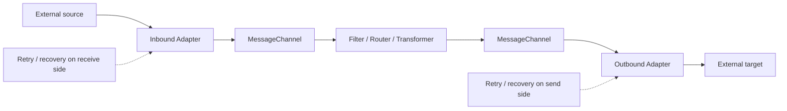
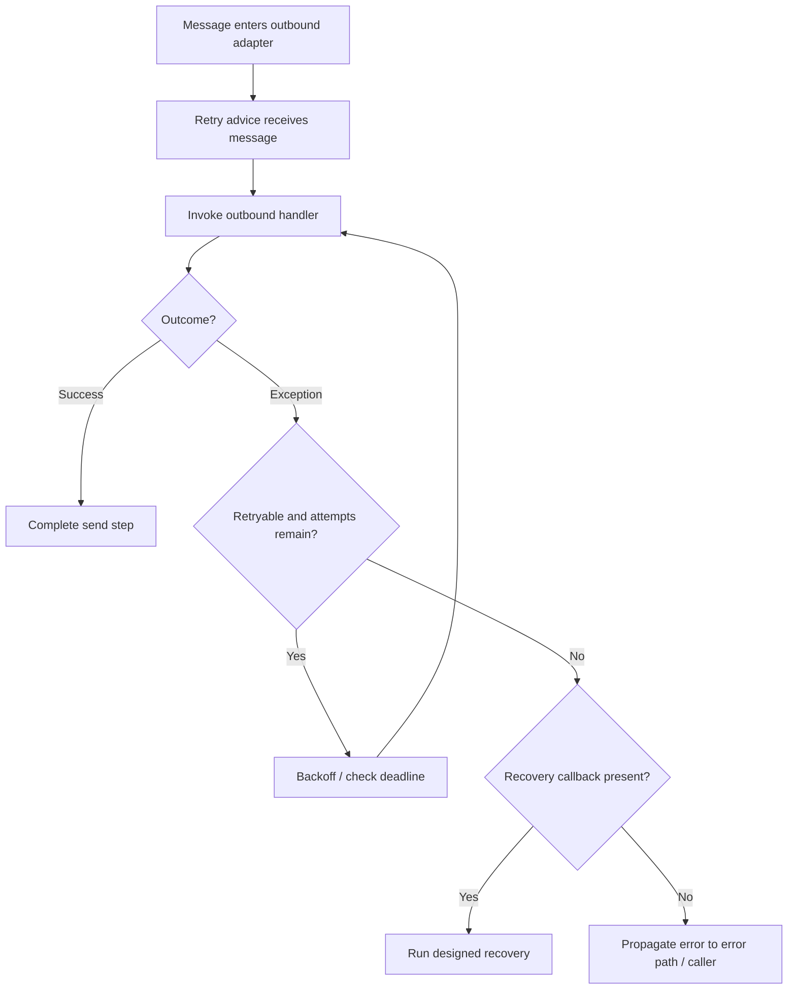
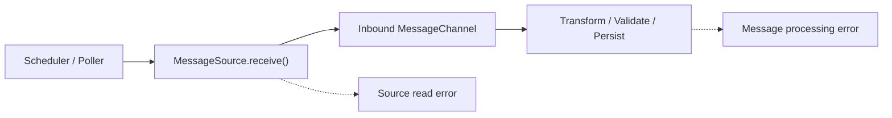
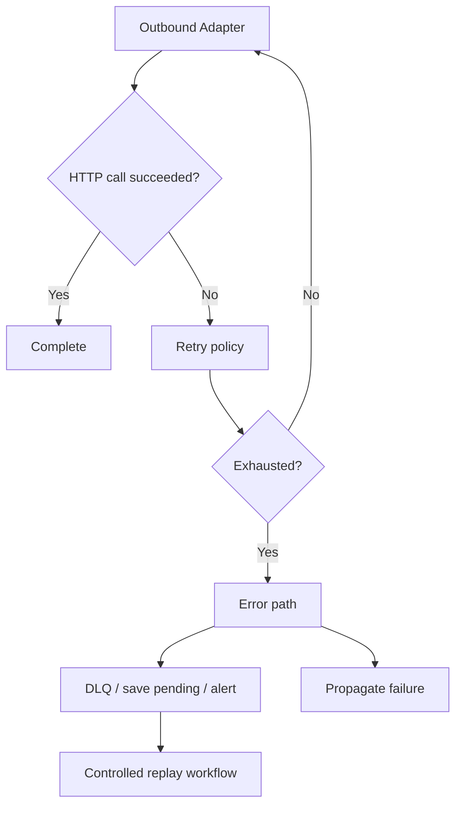

# Retry at the adapter boundary in Spring Integration

## 1. Why do we need retries at the adapter boundary?

In an integration system, business components frequently exchange data with external sources through **Channel Adapters**: reading files over SFTP, pulling records from a message broker, pushing data over HTTP, writing to third-party systems, or receiving changes from another service.

At these boundaries, failures happen even when business code is completely correct: temporary network drops, an API returning `503 Service Unavailable`, broker failover, brief storage locks, or request timeouts.

If a message is discarded on the very first failure, the system can lose required work. Conversely, retrying infinitely or retrying a payment-creation command without duplicate protection can cause congestion or corrupt data.

**Retry at the adapter boundary** means placing a retry policy around an external communication operation right where Spring Integration crosses from the internal message flow to an external source or target. The goal is to ride out *potentially transient* failures while preserving processing contracts, resource bounds, and business correctness.

This lesson belongs to the **Channel adapter** chapter of the **SPRING_INTEGRATION_PATTERN** module. The module focuses on implementing Enterprise Integration Patterns with Spring Integration: Router, Filter, Transformer, Splitter, Aggregator, Gateway, retry, error channel, and correlation, along with testing and observing every processing branch. Retry is part of that design—not a flag you flip once for all cases.

After this lesson, you will be able to:

- Identify the exact adapter boundary and where errors originate.
- Distinguish retries across **inbound adapters**, **outbound adapters**, handlers, and brokers.
- Configure `RequestHandlerRetryAdvice` for an HTTP outbound channel adapter.
- Choose retryable errors, `maxAttempts`, backoff, timeouts, and recovery.
- Explain why retries can create duplicates and how to apply idempotency.
- Test attempt counts, final exceptions, and post-exhaustion paths.

## 2. Which boundary is the adapter boundary?

A **Channel Adapter** connects an external system to the application's messaging system. In Spring Integration, one-way adapters typically take two forms:

- **Inbound Channel Adapter:** receives/pulls data from an external source and emits `Message<?>` onto an internal channel.
- **Outbound Channel Adapter:** takes a message from an internal channel and sends data to an external target; the adapter itself has no contract to return a business message like a gateway.

When a response from the target system is required, you typically use an **inbound/outbound Gateway** with request–reply semantics. Retry principles still apply, though reply contracts and timeouts must also be considered.



One crucial rule: **where the failure occurs determines where the retry wrapper belongs**.

For instance, retry advice around an outbound HTTP handler retries when that handler fails calling the API. It does not automatically retry an SFTP inbound adapter failing to fetch a file in `receive()`. Likewise, Kafka listener container retries do not replace idempotency in a database-writing Service Activator.

### Retry locations and responsibilities

| Location | Retried operation | Example failure | Common tool / mechanism |
|---|---|---|---|
| Inbound source / poller | Polling an external source or receiving data | SFTP disconnect, source read error | Poller/source-specific retry, poller advice, scheduler/error handling |
| Message handler / outbound adapter | Handling a message and sending outward | HTTP 503, timeout, connection error | `RequestHandlerRetryAdvice` / Spring Retry |
| Broker listener | Receiving and processing a delivery/record | Handler error or broker redelivery | Kafka, RabbitMQ, or JMS retry/error handler |
| Business service | Executing business logic, updating state | Optimistic lock or transient conflict | Business-layer transaction/retry |
| Entire workflow | Long-running multi-step sequence | A branch fails after multiple steps | Saga, compensation, job state, scheduler |

Do not stack multiple retry layers without calculating total execution counts. If an adapter tries three times and a listener tries four times, a single message could hit a remote endpoint up to **12 times** in certain scenarios.

## 3. Retry does not mean guaranteed once-only execution

Suppose an outbound adapter sends `POST /payments`:

1. Client sends the payment request.
2. Server persists the payment successfully.
3. Connection drops before the client receives the response.
4. Client observes a read timeout.
5. Adapter retries the request.

At step 3, the caller **cannot know for certain** whether the external action already occurred. Retrying can create a second payment unless the target system handles duplicate commands.

```mermaid
sequenceDiagram
    participant F as Integration Flow
    participant A as Outbound Adapter
    participant S as Remote Service
    participant DB as Remote Database
    F->>A: Payment command (operationId=pay-42)
    A->>S: POST /payments
    S->>DB: Record payment
    DB-->>S: Commit OK
    Note over A,S: Response lost on network
    A--xS: Read timeout
    Note over A: Retry may re-execute side effect
    A->>S: POST /payments (operationId=pay-42)
    S->>DB: Check idempotency key
    DB-->>S: Already processed; return prior result
    S-->>A: Valid response
```

Therefore distinguish:

- **Retry:** re-sending or re-executing an operation after an error.
- **At-least-once:** an operation may execute more than once.
- **Idempotency:** repeating the same request produces no extra side effects.
- **Exactly-once:** a guarantee whose scope and covered systems must be stated explicitly; it does not appear automatically just by using Spring Retry.

Retrying makes sense only when **repeating the action is safe** or duplicate consequences are controlled.

## 4. Classifying errors before retrying

Not every exception should be retried. An error from bad input or missing permissions rarely fixes itself when the identical request is re-sent a few hundred milliseconds later.

| Error | Retry? | Reason / action |
|---|---|---|
| HTTP `400 Bad Request` | Usually no | Malformed data or contract violation; fix the request |
| HTTP `401/403` | Never retry blindly | Check credentials, tokens, scopes, or permissions |
| HTTP `404` | Depends on contract | Resource may not be created yet, or permanent error |
| HTTP `408`, connect/read timeout | Possibly | Transient error, though remote result may already have committed |
| HTTP `429 Too Many Requests` | Possibly | Back off per policy and `Retry-After` if provided |
| HTTP `502/503/504` | Usually yes | Transient infra/upstream failure; cap attempts |
| HTTP `500` | Case-by-case | Could be a bug or transient fault; do not blindly retry every 500 |
| DNS/TCP/TLS error | Depends on cause | Transient network outage differs from invalid cert/hostname |
| Malformed JSON/schema | Usually no | Retrying cannot fix a contract mismatch |
| Validation exception | No | Input data must be fixed |
| Deadlock / optimistic lock | Possibly | When the transaction is safe to re-run |
| Expired auth token error | Possibly refresh token once | Needs explicit refresh logic, avoiding loops |

For adapters backed by an HTTP library, the root exception may be wrapped by Spring Messaging or Spring Integration exceptions. When classifying errors, inspect the **cause chain** and actual HTTP status code rather than checking only the outermost exception class.

### Retryable, non-retryable, and unknown

A good practice is dividing failures into three groups:

1. **Retryable:** known recoverable failures where repeating the operation is safe.
2. **Non-retryable:** invalid contract, missing permissions, malformed data, unsafe operations.
3. **Unknown:** remote outcome uncertain; look up status, reconcile, or intervene manually if side effects exist.

Never equate "unknown outcome" with "definitely did not succeed."

## 5. What belongs in a retry policy?

A complete policy answers at least these questions:

| Component | Question to answer |
|---|---|
| Retry condition | Which exceptions/statuses should be retried? |
| `maxAttempts` | Maximum total calls, including the initial attempt? |
| Backoff | How long to wait between attempts? |
| Jitter | Are retry times spread out across multiple instances? |
| Timeout/deadline | At what wall-clock limit do we stop regardless of remaining attempts? |
| Idempotency | Does repeating the request duplicate side effects? |
| Recovery | After the final failure, throw, save to DLQ, or schedule later handling? |
| Observability | Are attempts, latency, exceptions, and outcomes counted? |

### Counting attempts

If `maxAttempts = 3`, there are **at most three** total executions: the initial attempt plus at most two retries—not "three retries after the first attempt."

```text
attempt 1 -> transient error
  backoff 250 ms
attempt 2 -> transient error
  backoff 250 ms
attempt 3 -> success or final failure
```

### Backoff and jitter

Fixed backoff is easy to illustrate, yet many instances failing together and retrying at the same instant can trigger a **retry storm**. Under meaningful load, consider capped exponential backoff with jitter.

Illustrative wait schedule:

| Post-failure gap | Base exponential backoff | Illustrative jitter |
|---|---:|---|
| Before attempt 2 | 200 ms | 150–250 ms |
| Before attempt 3 | 400 ms | 300–500 ms |
| Before attempt 4 | 800 ms | 600–1,000 ms |

These are example policy values, not Spring Integration defaults. For HTTP 429, honor the provider's backoff hints per contract.

### Deadlines and timeout impact

A request with a 2-second connect timeout, 4-second read timeout, and three attempts can consume substantial time. Backoff adds on top of total duration.

With `DirectChannel`, retries can run **synchronously on the sending thread**. Raising `maxAttempts` or backoff blocks Gateways/callers longer. Configure appropriate HTTP client timeouts and total time budgets; a Messaging Gateway's `replyTimeout` does not automatically abort synchronous I/O already in flight.

## 6. Spring Integration example: retry at an HTTP outbound channel adapter

Let us build a flow that pushes order-creation requests to a partner API:

```text
OrderSubmissionService
    |
    v
ordersToPartner (DirectChannel)
    |
    v
HTTP Outbound Channel Adapter
    |
    +-- RequestHandlerRetryAdvice (max 3 attempts, fixed backoff)
    |
    v
POST https://partner.example/api/orders
```

This is a **one-way outbound channel adapter**: the application sends an outbound action and does not emit a business response message back into the flow like `Http.outboundGateway`. The adapter can still observe HTTP status codes or HTTP client exceptions while executing the request.

The example targets **Java 17+, Spring Boot 3.x, Spring Integration 6.x, and a compatible Spring Retry**. Include dependencies for Spring Integration, Spring Integration HTTP, Spring Retry, Spring Web/Jackson, and JUnit 5 if running tests.

### 6.1. DTO with a stable operation identifier

```java
// PartnerOrderCommand.java
package com.example.integration;

public record PartnerOrderCommand(
        String operationId,
        String orderId,
        String sku,
        int quantity
) {
}
```

Here `operationId` distinguishes **one business operation**. For example, if the request must retry, all attempts must keep the same `operationId` so the partner can prevent duplicate orders.

This works only if the partner API **actually supports deduplication** under an agreed contract. If the API expects a dedicated HTTP header like `Idempotency-Key`, configure outbound HTTP header mapping or an HTTP client interceptor; never assume arbitrary Spring Integration headers automatically become HTTP headers.

### 6.2. Creating the channel and retry advice

```java
// PartnerOutboundConfiguration.java
package com.example.integration;

import java.util.HashMap;
import java.util.Map;

import org.springframework.context.annotation.Bean;
import org.springframework.context.annotation.Configuration;
import org.springframework.http.HttpMethod;
import org.springframework.integration.channel.DirectChannel;
import org.springframework.integration.config.EnableIntegration;
import org.springframework.integration.dsl.IntegrationFlow;
import org.springframework.integration.handler.advice.RequestHandlerRetryAdvice;
import org.springframework.integration.http.dsl.Http;
import org.springframework.messaging.MessageChannel;
import org.springframework.retry.backoff.FixedBackOffPolicy;
import org.springframework.retry.policy.SimpleRetryPolicy;
import org.springframework.retry.support.RetryTemplate;
import org.springframework.web.client.HttpClientErrorException;
import org.springframework.web.client.HttpServerErrorException;
import org.springframework.web.client.ResourceAccessException;

@Configuration
@EnableIntegration
public class PartnerOutboundConfiguration {

    @Bean
    public MessageChannel ordersToPartner() {
        return new DirectChannel();
    }

    @Bean
    public RequestHandlerRetryAdvice partnerRetryAdvice() {
        Map<Class<? extends Throwable>, Boolean> retryable =
                new HashMap<>();

        // Transport errors or certain HTTP statuses that may be transient.
        retryable.put(ResourceAccessException.class, true);
        retryable.put(HttpServerErrorException.class, true);
        retryable.put(
                HttpClientErrorException.TooManyRequests.class,
                true);

        // Three attempts TOTAL (1 initial + up to 2 retries).
        // traverseCauses=true: inspect root causes if the handler wraps exceptions.
        SimpleRetryPolicy retryPolicy =
                new SimpleRetryPolicy(3, retryable, true);

        FixedBackOffPolicy backOff = new FixedBackOffPolicy();
        backOff.setBackOffPeriod(250L);

        RetryTemplate retryTemplate = new RetryTemplate();
        retryTemplate.setRetryPolicy(retryPolicy);
        retryTemplate.setBackOffPolicy(backOff);

        RequestHandlerRetryAdvice advice =
                new RequestHandlerRetryAdvice();
        advice.setRetryTemplate(retryTemplate);

        return advice;
    }

    @Bean
    public IntegrationFlow sendOrdersToPartner(
            RequestHandlerRetryAdvice partnerRetryAdvice) {
        return IntegrationFlow.from("ordersToPartner")
                .handle(
                    Http.outboundChannelAdapter(
                            "https://partner.example/api/orders")
                        .httpMethod(HttpMethod.POST),
                    endpoint -> endpoint.advice(partnerRetryAdvice)
                )
                .get();
    }
}
```

**Design explanation:**

- `DirectChannel` invokes the outbound handler synchronously.
- `Http.outboundChannelAdapter(...)` sends the payload via HTTP POST.
- `RequestHandlerRetryAdvice` wraps the message handler's execution.
- `SimpleRetryPolicy(3, retryable, true)` caps total attempts and inspects the cause chain.
- `FixedBackOffPolicy` inserts a delay between failed attempts.
- When an error is non-retryable or attempts are exhausted, the exception follows the endpoint/flow's error handling; no synthetic "success reply" is generated.

**Adjustments needed for production:** `HttpServerErrorException` covers HTTP 5xx broadly and may be wider than desired. Classify strictly per partner contract (e.g. only 502/503/504 rather than every 500), respect `Retry-After` if provided, and add jitter and an overall deadline. For order creation, verify idempotency support before retrying errors whose remote outcome is uncertain.

The hostname `partner.example` is illustrative only; load URLs and credentials from a trusted configuration source. Never hardcode secrets in source code or logs.

### 6.3. Sending messages from business code

```java
// OrderSubmissionService.java
package com.example.integration;

import org.springframework.beans.factory.annotation.Qualifier;
import org.springframework.messaging.MessageChannel;
import org.springframework.messaging.support.MessageBuilder;
import org.springframework.stereotype.Service;

@Service
public class OrderSubmissionService {

    private final MessageChannel outboundOrders;

    public OrderSubmissionService(
            @Qualifier("ordersToPartner") MessageChannel outboundOrders) {
        this.outboundOrders = outboundOrders;
    }

    public void submit(PartnerOrderCommand command) {
        if (command == null
                || command.operationId() == null
                || command.operationId().isBlank()
                || command.orderId() == null
                || command.orderId().isBlank()
                || command.quantity() <= 0) {
            throw new IllegalArgumentException("Invalid order command");
        }

        boolean sent = outboundOrders.send(
                MessageBuilder.withPayload(command).build());

        if (!sent) {
            throw new IllegalStateException(
                    "Cannot dispatch order to outbound adapter");
        }
    }
}
```

With `DirectChannel`, calling `send()` runs through the handler synchronously. If the HTTP client fails and retries end in an exception, that exception can propagate back to `submit()`. **The boolean return value of `send()` does not guarantee exactly-once remote side effects**, especially on connection drops or lost responses.

To run this in a real project, provide compatible beans and dependencies, an HTTP message converter for JSON requests, partner TLS/credentials, and a live endpoint. The sample URL is not a callable system.

### 6.4. When to use an HTTP outbound Gateway?

If the application **needs the partner's response body** to drive business decisions, use:

```java
Http.outboundGateway("https://partner.example/api/orders")
    .httpMethod(HttpMethod.POST)
    .expectedResponseType(PartnerOrderResponse.class)
```

This is a **replacement** for the one-way outbound channel adapter—never register a second competing handler on the same channel just to read responses.

A Gateway can emit a message carrying the HTTP response payload, and `RequestHandlerRetryAdvice` can still wrap the handler where appropriate. However, retrying request–reply operations also requires handling reply creation, status codes, timeouts, and duplicate responses if a request executes multiple times on the target.

## 7. How RequestHandlerRetryAdvice works

When a message handler is wrapped by `RequestHandlerRetryAdvice`, the general sequence is:

1. Receive the message.
2. Open a retry context per policy.
3. Invoke the handler.
4. If it succeeds, finish.
5. If it throws and the policy allows, wait for backoff and invoke again.
6. If the error is non-retryable or attempts are exhausted, run the recovery callback if configured; otherwise propagate the error through the flow's error mechanism.



### Stateful or stateless retry?

A **stateless** retry setup retries multiple times within the same handler invocation, fitting many synchronous operations. Some failures require rolling back a transaction and redelivering as a fresh invocation; those may call for stateful retry keyed by message identity or letting a broker/container manage redelivery.

Configure stateful retry only when you fully understand message identity, transaction boundaries, context cleanup, redelivery mechanics, and the specific API. You do not need stateful retry for a simple synchronous outbound HTTP call just to count attempts.

### Recovery callbacks must define clear semantics

Once attempts are exhausted, you can:

- Throw the exception for the caller or listener container to handle.
- Forward the message to a **DLQ/quarantine** flow with sanitized error metadata.
- Persist a `FAILED_RETRYABLE` status for a scheduler to pick up later.
- Return a structured error response to a request–reply Gateway per contract.

If a recovery callback merely logs and returns normally while sending failed, upstream layers may assume the message succeeded and commit/ACK too early—losing work. Recovery must make explicit whether the message was **successfully handled, handed off for deferred processing, or failed and propagated**.

## 8. How inbound adapter retry differs from outbound adapter retry

Not every adapter receives messages pushed by a caller. A **Polling Inbound Channel Adapter** runs periodically to read files, poll databases, fetch SFTP files, or call APIs for pending tasks.



There are two groups of errors:

- **Source read errors:** e.g., failing to connect to SFTP before any message is created. Retry advice on downstream handlers **does not** cover `receive()`.
- **Post-receive processing errors:** e.g., DB persistence fails, a Transformer throws, or a downstream outbound adapter is temporarily unavailable. Handler/flow policies can apply, provided you account for whether the source already marked the item as received/processed.

### Pollers and time limits

A poller should have an appropriate interval, `maxMessagesPerPoll` where needed, controlled poller concurrency, and observable error handling. When a poll fails, you can let the next scheduled poll try again or wrap the poll operation with advice. The choice depends on the source: re-polling a record already marked processed differs from re-reading a file not yet moved/archived.

For pollers, **RequestHandlerRetryAdvice on a Service Activator is not the same as retrying the whole poll cycle**. To handle failures before message creation, attach retries at the source/poller or use the adapter's specific retry mechanism.

### Acknowledgment, commit, and redelivery

When an inbound adapter consumes from Kafka/RabbitMQ/JMS, understand when the broker/container triggers ACK/commit:

- ACKing too early before downstream fails loses the chance to reprocess.
- Finishing processing and crashing before ACK can cause redelivery.
- Retrying in both the listener container and downstream handlers can multiply attempts unexpectedly.
- Routing failed records to a retry topic can break per-key/partition ordering as newer messages overtake older ones.

Never infer from the name "inbound adapter" that it guarantees exactly-once delivery or atomic commits with your database.

## 9. Coordinating error channels and retries

In Spring Integration, error handling depends on channel types, endpoints, and sync/async boundaries.

### Synchronous flows

With `DirectChannel` and a synchronous outbound handler, exceptions after retry exhaustion usually propagate back into the sending thread. The caller or listener container receives the failure and decides the next step.

### Asynchronous flows

With `ExecutorChannel` or pollers, exceptions may be wrapped into an `ErrorMessage` on an error channel per configuration. An error channel that simply logs and drops the exception does not automatically recreate the message or preserve upstream retry authority.



### When recovery sends to a DLQ

A solid DLQ workflow captures enough metadata to replay safely: `operationId`, entity ID, error code, attempt count, timestamp, trace/correlation ID, and payload version—while omitting raw credentials, secrets, or sensitive data in headers/exceptions.

**A DLQ is not automatic success.** Clarify who monitors it, who authorizes replay, how idempotency is preserved, and whether "pending" status must be reported back to the source system.

## 10. Avoiding stacked retries and lost ordering

Suppose a Kafka message flows through:

```text
Kafka Listener
    |
    +-- DefaultErrorHandler / retry container (4 attempts)
    |
    v
Spring Integration Flow
    |
    +-- RequestHandlerRetryAdvice (3 attempts)
    |
    v
HTTP Outbound Adapter
    |
    +-- HTTP client built-in retry (if enabled)
    |
    v
Remote API
```

If each layer retries the entire stack below it, remote calls multiply by the product of limits along with compounded backoffs. That is why you must **designate one primary retry owner** and document the exact behavior of every other layer.

### Ordering cases

For events sharing an `orderId`, if version 2 fails and moves to a retry queue, version 3 may be processed first. Consumers need version/gap detection or a per-key/partition blocking policy until v2 completes. Retries must never violate business invariants.

### Fan-out cases

If a Splitter dispatches multiple partner requests and an Aggregator collects results, decide whether retries happen **per child request** or **for the whole group**. Retrying the entire group risks re-sending branches that already succeeded. Each branch needs its own operation ID or idempotency handling; the Aggregator uses correlation and release strategies to determine when all results have arrived.

## 11. Idempotency: a prerequisite for safe retries

Suppose an outbound adapter sends an order-creation command with `operationId = "op-42"`. On timeout, the same command is re-sent.

The target system should behave as follows:

```text
Attempt 1:
  operationId = op-42
  server creates order P-900
  response is lost

Attempt 2:
  operationId = op-42
  server sees key already processed
  returns previous P-900 result without creating a new order
```

For this to work, the target system's contract must define how idempotency keys are recognized, retention windows, body comparison rules, responses when the same key carries a different payload, and how in-flight requests are handled.

### When operations cannot be idempotent

If a remote API lacks idempotency for a side-effecting action, consider:

- Querying status by business identifier before retrying.
- Using a partner confirmation/reconciliation workflow.
- Recording `UNKNOWN` status rather than blindly creating a new task.
- Designing sagas/compensation if consequences are reversible in the domain.
- Requiring manual intervention when safe verification is impossible.

**Note:** HTTP `GET` is expected to have no business side effects per HTTP standards, yet that still must be verified against the real API. `POST` is never idempotent by default.

## 12. Timeouts and circuit breakers as complementary mechanisms

Retries help only when faults can recover quickly. If a remote API is down for tens of minutes, aggressive retries worsen the outage.

A resilient design usually combines:

- **Timeouts:** prevent unbounded network waits.
- **Conditional retries:** bounded attempts for transient faults.
- **Backoff/jitter:** desynchronize retry bursts.
- **Circuit breaker:** temporarily halt calls to a continuously failing service and probe recovery per policy.
- **Bulkhead/concurrency limits:** prevent one slow partner from exhausting all threads or connections.
- **Rate limits:** respect the target system's serving capacity.
- **Fallbacks:** use only when alternative data preserves the business contract.

The ordering of retry and circuit breaker matters. If the breaker wraps **each attempt**, retries trip the breaker quickly. If the breaker wraps the entire retry sequence, it counts **one logical call**. Choose advice/filter ordering based on what you want to measure and how failures should surface.

## 13. Testing retries at the adapter boundary

A proper test does not just assert "the function was called three times." Verify that the retry policy triggers on the right exceptions, preserves request/idempotency keys across attempts, and executes recovery once exhausted.

### 13.1. Unit testing RetryTemplate behavior

JUnit 5 example illustrating success after two transient errors:

```java
// RetryPolicyTest.java
package com.example.integration;

import static org.junit.jupiter.api.Assertions.assertEquals;

import java.util.concurrent.atomic.AtomicInteger;

import org.junit.jupiter.api.Test;
import org.springframework.retry.backoff.NoBackOffPolicy;
import org.springframework.retry.policy.SimpleRetryPolicy;
import org.springframework.retry.support.RetryTemplate;

class RetryPolicyTest {

    @Test
    void succeedsOnThirdAttempt() {
        RetryTemplate retry = new RetryTemplate();
        retry.setRetryPolicy(new SimpleRetryPolicy(3));
        retry.setBackOffPolicy(new NoBackOffPolicy());

        AtomicInteger attempts = new AtomicInteger();

        String result = retry.execute(context -> {
            if (attempts.incrementAndGet() < 3) {
                throw new IllegalStateException("Temporary failure");
            }
            return "OK";
        });

        assertEquals("OK", result);
        assertEquals(3, attempts.get());
    }
}
```

This test only demonstrates Spring Retry's attempt counting; it **does not** prove the HTTP adapter is actually wrapped by advice or that HTTP 400 is not retried. Write integration tests to verify those behaviors.

### 13.2. Testing with an HTTP stub

Use an HTTP test server such as WireMock or MockWebServer to inspect real requests emitted by the outbound adapter. For instance, configure the stub to:

1. Return HTTP 503 on attempt 1.
2. Return HTTP 503 on attempt 2.
3. Return HTTP 200 on attempt 3.

Assertions to verify:

- Exactly three HTTP requests occurred.
- All three carried the identical `operationId` and business payload.
- Delays between attempts matched the backoff policy.
- The outbound flow completed once attempt 3 succeeded.
- No sensitive data or credentials appeared in test logs.

Next, test HTTP 400: the adapter must fail immediately under the retry policy with only **one** request.

### 13.3. Full test matrix

| Test case | What to verify |
|---|---|
| HTTP 200 on first try | Exactly one attempt; no backoff |
| HTTP 503 then 200 | Expected retry count, payload preserved |
| HTTP 400 | No retry per policy |
| HTTP 429 | Backoff / Retry-After honored per design |
| `maxAttempts` exhausted | Failure propagates or routes clearly to recovery |
| HTTP read timeout after remote commit | Duplicate request causes no second side effect |
| Certificate or hostname error | No pointless retries and TLS verification stays enabled |
| SFTP source fails before message creation | Retries happen at source/poller, not confused with handler advice |
| Kafka redelivery after DB commit | Consumer is idempotent; no duplicate state written |
| Multi-instance run | Backoff uses jitter to avoid retry storms |
| Retry + circuit breaker | Attempt counts and metrics match advice ordering |
| Multi-branch Splitter | Only failing branch retries; healthy branches are not needlessly re-sent |
| DLQ replay | Preserves operation ID with audit and reconciliation |

For operations with major side effects, test in an isolated environment against a mock server that **stores idempotency keys**, letting you simulate commits whose responses were lost.

## 14. Observing and operating retries

Every attempt needs metadata tying it back to the original logical invocation:

| Metadata | Purpose |
|---|---|
| `operationId` / `eventId` | Correlate retries of the same operation |
| `correlationId` | Trace messages across flow branches |
| `attemptNumber` | Identify which attempt number this is |
| `adapterName` / `destination` | Pinpoint which boundary failed |
| `exceptionType` / `httpStatus` | Classify root causes |
| `durationMs` | Spot slow remote calls |
| `retryDecision` | Retry, skip, recover, or fail |
| `outcome` | Success, exhausted, pending, or unknown |

Useful metrics include retryable error rate, average attempt count, exhaustion rate, p95/p99 latency, DLQ rate, queue lag, and circuit breaker state.

**Never log access tokens, API keys, cookies, or payloads with sensitive data.** Error messages can carry failed messages and headers; when storing to a DLQ, enforce redaction, access control, and retention policies.

### Distinguishing completed from handed-off

A message **successfully routed to a DLQ** does not mean the business task completed. Dashboards and upstream statuses should distinguish:

- `SUCCESS`: remote operation confirmed per contract.
- `PENDING_RETRY`: retry still scheduled.
- `UNKNOWN`: sent, remote side effect unknown.
- `FAILED_FINAL`: unrecoverable under policy.
- `QUARANTINED`: requires reconciliation or manual intervention.

## 15. Common mistakes

**Mistake 1 — Retrying every exception.** Validation errors and HTTP 401 will not vanish on retry. Classify specific exceptions and statuses.

**Mistake 2 — Confusing `maxAttempts = 3` with three retries after the first attempt.** It means three attempts total in the illustrative policy.

**Mistake 3 — Configuring retries while forgetting HTTP timeouts.** A hanging attempt ties up threads before retry even triggers.

**Mistake 4 — Using retries instead of idempotency.** When a response is lost, the remote server may already have committed. Retries alone do not prevent duplicates.

**Mistake 5 — Attaching advice to a downstream handler and thinking inbound reads are retried.** Failures in `receive()` need a source/poller-level policy.

**Mistake 6 — Stacking retries across broker, flow, and HTTP client without budgeting.** Call counts multiply, inflating latency and system load.

**Mistake 7 — Recovery that only logs and swallows errors.** Upstream may ACK the message and drop unfinished work.

**Mistake 8 — Ignoring ordering when routing failures to a retry topic.** Newer events can overtake older ones; add version/gap handling if ordering matters.

**Mistake 9 — Retrying an entire Splitter group when only one branch fails.** Succeeded branches may be re-sent; scope idempotency and retry boundaries per operation.

**Mistake 10 — Lacking metrics and a replay policy.** When messages pile up in the DLQ, nobody knows the cause, attempt counts, or safe recovery steps.

## 16. Process for designing adapter retries

1. **Define the operation:** does the adapter read, send one-way, or request–reply? Are there side effects?
2. **Identify the boundary:** do exceptions originate in `receive()`, handler, transport client, or broker listener?
3. **Classify errors:** retryable, non-retryable, and uncertain outcome.
4. **Set time bounds:** connect/read timeouts, deadlines, and backoff.
5. **Define attempts:** max count, jitter, and concurrency limits.
6. **Design idempotency:** operation IDs, deduplication, status reconciliation.
7. **Design recovery:** propagate, DLQ, scheduler, alerts, or compensation.
8. **Align acknowledgments:** never ACK prematurely, and tolerate redelivery.
9. **Preserve ordering/correlation:** especially with Router, Splitter, Aggregator, and retry topics.
10. **Test real failures:** post-commit timeouts, 429/503, non-retryable errors, crashes, and retry storms.
11. **Add observability:** metrics, scrubbed logs, tracing, and outcome statuses.
12. **Document the contract:** when callers may receive uncertain outcomes or deferred handling.

## 17. Review questions

1. How does the adapter boundary differ from an internal business Service Activator boundary?
2. Why does retry advice on an outbound handler not automatically retry inbound adapter `receive()` errors?
3. How is `maxAttempts = 3` counted?
4. How do HTTP 400, 429, 503, and read timeouts differ in retry decisions?
5. Why can retrying a side-effecting POST create duplicate data?
6. When is an idempotency key needed, and across which attempts must it stay stable?
7. How does `DirectChannel` affect caller blocking duration during backoff?
8. What roles do error channels, DLQs, and recovery callbacks play once retries are exhausted?
9. Why can stacking retries across a Kafka listener, Spring Integration advice, and HTTP client be dangerous?
10. When an event moves to a retry topic, how can per-key ordering be affected?
11. If one branch in a Splitter fails, what happens if you retry the whole group?
12. Which metrics and metadata prove whether a remote command succeeded or remains uncertain?

## 18. Pre-deployment checklist

- [ ] Identified inbound/outbound adapters and exact error origins.
- [ ] Defined lists of retryable, non-retryable, and reconciliation-needed exceptions/statuses.
- [ ] Configured `maxAttempts`, backoff, jitter, and timeouts/deadlines.
- [ ] Controlled total attempt budget across broker, flow, and HTTP client.
- [ ] Added operation IDs or idempotency keys for side-effecting operations.
- [ ] Defined behavior when responses are lost after remote commits succeed.
- [ ] Implemented observable recovery without blindly swallowing errors.
- [ ] Aligned inbound adapter ACK/commit with completion boundaries.
- [ ] Verified retry topics/DLQs do not break ordering of related events.
- [ ] Distinguished success, pending, unknown, and failed states.
- [ ] Tested retryable/non-retryable cases, retry exhaustion, duplicates, and replays.
- [ ] Verified logs/traces expose no credentials or sensitive data.
- [ ] Enforced concurrency/rate limits and protection when target services go down.

**Key takeaway:** Retries at the adapter boundary help integration flows survive transient faults when talking to external systems. Sound configuration specifies **which operations to retry, under what conditions, up to how many attempts, where failures go afterward, and whether repeating is safe**. Spring Integration and Spring Retry provide the mechanics; idempotency, acknowledgments, ordering, recovery, and testing determine whether the system is truly reliable.
