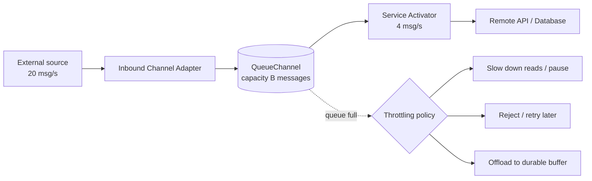
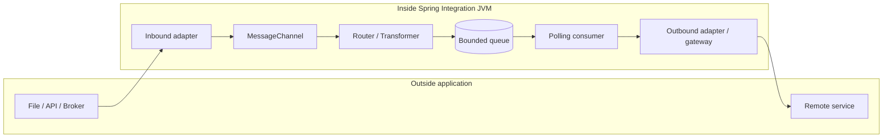
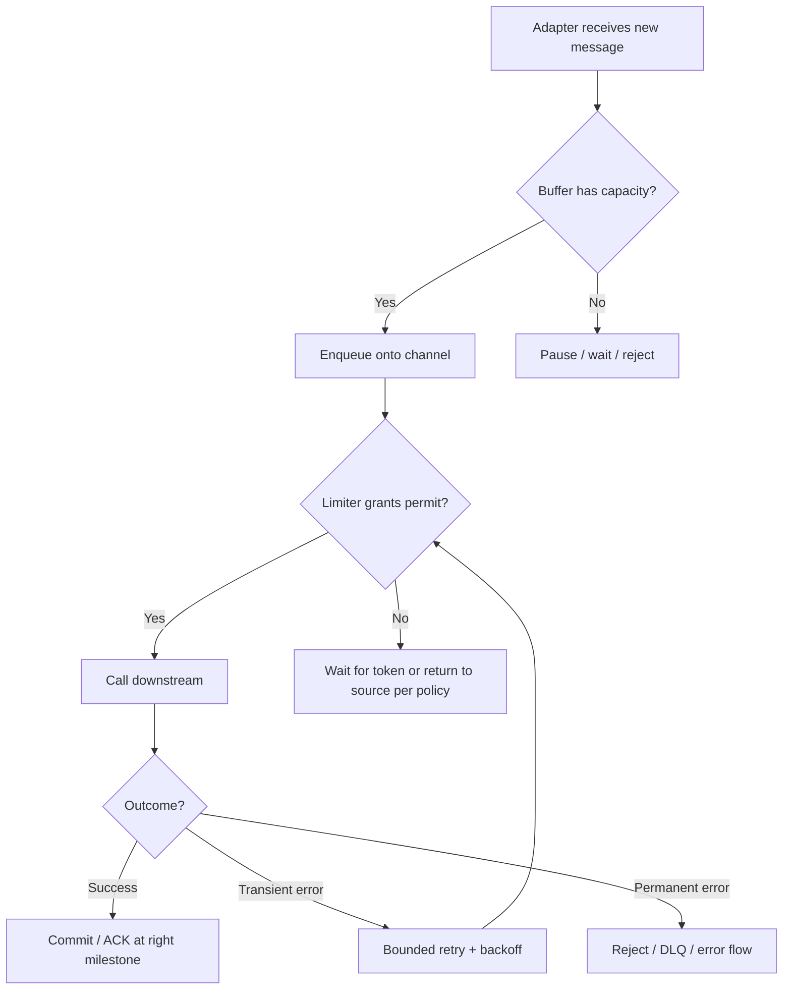
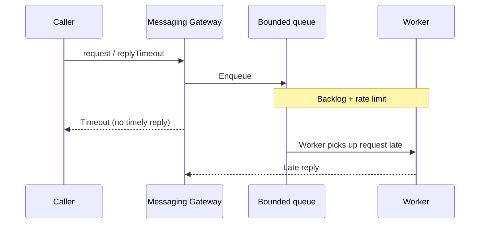

# Channel adapter — Backpressure and rate limiting in Spring Integration

## Learning objectives

After this lesson, you will be able to:

- Explain **backpressure**, **rate limiting**, **buffering**, and **load shedding** when a Channel Adapter connects an external system to a Spring Integration flow.
- Pinpoint bottlenecks when a source emits faster than downstream processes, and why an `ExecutorChannel` or in-memory queue alone cannot solve sustained overload.
- Configure `@InboundChannelAdapter` and `@Poller` to pace data ingestion, and use a bounded `QueueChannel` to manage queues.
- Distinguish input rate pacing from limiting actual outbound API/broker calls; know when a token bucket, semaphore, or shared cross-instance limiter is needed.
- Test queue-full behavior and clearly state rejection, retry, acknowledgement, timeout, and `correlationId` observability policies so messages are neither lost nor duplicated.

This lesson belongs to the **Channel adapter** chapter of the **SPRING_INTEGRATION_PATTERN** module. The module uses Enterprise Integration Patterns to compose Router, Filter, Transformer, Splitter, Aggregator, Gateway, retry, error channel, and correlation into loosely coupled, extensible, testable, and observable message flows. When an adapter reads from files, HTTP, databases, or Kafka/RabbitMQ, or pushes data to another system, source and target speeds often differ. That is where **backpressure and rate limiting** become concrete design requirements.

## 1. The problem: source faster than target

Suppose an inbound adapter receives an average of **20 messages/second**, while the processing service completes only **4 messages/second**. Without rate control or queue bounds, waiting messages can grow by roughly **16 messages/second** during steady load.



A queue with capacity 8 messages, truly ingesting 20 messages/second and draining 4 messages/second, fills in roughly **8 / (20 − 4) = 0.5 seconds** from empty. This estimate assumes uniform rates; in practice, burstiness, processing time variations, schedulers, and multiple consumers alter the numbers.

Queues **absorb short traffic spikes**. They cannot resolve sustained imbalance when target capacity stays below source speed.

### How does backpressure differ from rate limiting?

| Concept | Purpose | Example in Spring Integration |
| --- | --- | --- |
| **Backpressure** | When downstream lacks capacity, push pressure upstream to stop or slow sending | Bounded `QueueChannel` makes `send` block or fail on timeout; adapter pauses reads per source mechanics |
| **Rate limiting** | Cap event or request count over a time window | Poller reads one message every 250 ms; limiter permits at most 100 API requests/sec |
| **Buffering** | Temporarily hold messages to smooth traffic bursts | `QueueChannel(8)` or bounded broker queue with retention policies |
| **Concurrency limiting** | Cap simultaneous in-flight tasks | Bounded thread pool, semaphore capping 10 in-flight HTTP calls |
| **Load shedding** | Proactively reject/drop work under overload per accepted policy | Return HTTP 429/503, drop low-priority events, or route appropriately to DLQ |

**Backpressure does not automatically slow an external source.** A full `MessageChannel` can block the thread calling `send()`; however, if the source is a broker, HTTP push, or independent listener, you need matching mechanisms to **NACK/requeue, pause, suspend polling, or return errors**. Each adapter and transport has its own contract.

## 2. Where do Channel Adapters sit in the flow?

An **inbound channel adapter** turns external data into a Spring `Message` and sends it onto a `MessageChannel`. An **outbound channel adapter** receives a Spring Message and sends payload/headers to an external system; many such adapters are one-way, whereas an outbound **gateway** typically handles request–reply.



In design, look at least at three places:

1. **Before the inbound adapter:** can the source retain messages while the adapter pauses? If not, add suitable buffering or rejection feedback.
2. **Between endpoints:** do channels have appropriate capacity, send/wait timeouts, and consumers?
3. **Before the outbound adapter:** how many concurrent calls and calls per second can the target handle? Does it support `429 Retry-After`?

Do not just enlarge thread pools whenever a backlog appears. That pushes even more calls onto an already overloaded dependency, spiking latency and error rates.

## 3. Throttling tools in Spring Integration

### 3.1. Polling inbound adapter and `@Poller`

A polling inbound adapter **actively asks** the source whether new data is available. The poller can restrict poll frequency and messages retrieved per trigger:

```java
@InboundChannelAdapter(
    channel = "boundedJobs",
    poller = @Poller(fixedDelay = "50", maxMessagesPerPoll = "1")
)
public String nextJob() {
    return externalSource.poll();
}
```

Explanation:

- `fixedDelay = "50"`: the poller waits roughly 50 ms **after one poll finishes** before running the next. Values are milliseconds in this illustrative annotation setup.
- `maxMessagesPerPoll = "1"`: each poller trigger processes at most one message returned by the source.
- When the source returns `null`, the adapter knows no message is currently ready and creates no business message.
- If downstream sending blocks because a queue is full, the poll cycle stretches; actual cadence is no longer strictly 50 ms.

These settings provide **approximate poll-rate pacing**, not a precise global QPS cap. Even with one message per poll, multiple parallel instances polling the same source increase total messages/second. Enforcing a shared quota for an API or tenant requires a distributed limiter.

### 3.2. Bounded `QueueChannel`

`QueueChannel` is a `PollableChannel` with an optional capacity:

```java
@Bean("boundedJobs")
public QueueChannel boundedJobs() {
    return new QueueChannel(8);
}
```

When the queue is full, sender behavior depends on the overload/timeout used:

- `send(message, 0)` attempts a **non-blocking** send; if full, it returns `false`.
- `send(message, 500)` waits up to roughly 500 ms for space, then returns according to channel contract.
- `send(message)` and auto-configured endpoints can use different default timeouts; never assume they always fail fast when full.
- A message sitting in the queue is **not** processed yet. With the default in-memory queue, messages are lost if the JVM stops.

**Capacity** protects memory at **one specific queue**. It does not bound messages piling up in upstream systems, in-flight requests, or broker backlogs.

### 3.3. Polling consumer to pace processing

A Service Activator can poll a `QueueChannel` at its own cadence:

```java
@ServiceActivator(
    inputChannel = "boundedJobs",
    poller = @Poller(fixedDelay = "250", maxMessagesPerPoll = "1")
)
public void dispatch(String jobId) {
    downstreamService.process(jobId);
}
```

With one consumer, one message per poll, and `fixedDelay=250` ms, nominal completion rate **does not exceed roughly four cycles/second** when processing is very fast. Because fixed delay starts counting after the poll finishes, if the service takes 100 ms per run, actual throughput is even lower.

This is a simple way to **space out** calls when an outbound service processes sequentially. It does not by itself satisfy requirements like "allow bursts of 20 requests averaging 5 requests/sec," "200 requests/sec across 5 instances," or "at most 10 concurrent requests." Those require dedicated limiters/bulkheads.

### 3.4. How do `DirectChannel` and `ExecutorChannel` behave?

| Channel | When consumer is slow | Backpressure notes |
| --- | --- | --- |
| `DirectChannel` | Sending thread runs handler synchronously | Callers can block long; no dedicated buffer queue |
| Bounded `QueueChannel` | Messages wait for consumer polling; queue can fill | Can return `false` or block `send` up to timeout; needs source policy |
| `ExecutorChannel` | Handler runs on a separate executor | Executor and work queue can still grow; bound pool/queue and rejection policy |
| `PublishSubscribeChannel` | One message goes to multiple subscribers | One slow/failing subscriber can impact fan-out per executor/config |
| Broker queue | Messages reside outside the JVM per broker setup | Control unacked, prefetch, ACK/NACK, backlog, and quotas |

No single channel type automatically guarantees **end-to-end flow control** across services. Combine channels, adapters, transport policies, and target-side limits.

## 4. Example: inbound adapter, bounded queue, and separately paced consumer

Let us design an illustrative flow:

- `PendingJobSource` accepts job IDs into an internal queue (simulating an external source).
- `@InboundChannelAdapter` polls every 50 ms, at most one job per cycle, pushing into `boundedJobs`.
- `QueueChannel(8)` buffers at most eight messages.
- `@ServiceActivator` polls one job every 250 ms and processes it.
- When the downstream queue is full, inbound sends block or time out depending on endpoint settings; **pulling a job from the source must never be equated with processing it**.

Use Java 17 and Spring Boot with `spring-boot-starter-integration`. The example splits into three classes in the same package to demonstrate polling and queues; downstream handling simply logs so no external system is needed.

### 4.1. Configuring the channel and registering both endpoints

`FlowControlConfiguration.java`:

```java
import org.springframework.context.annotation.Bean;
import org.springframework.context.annotation.Configuration;
import org.springframework.integration.annotation.EnableIntegration;
import org.springframework.integration.channel.QueueChannel;

@Configuration
@EnableIntegration
public class FlowControlConfiguration {

    @Bean("boundedJobs")
    public QueueChannel boundedJobs() {
        return new QueueChannel(8);
    }

    @Bean
    public PendingJobSource pendingJobSource() {
        return new PendingJobSource();
    }

    @Bean
    public JobDispatcher jobDispatcher() {
        return new JobDispatcher();
    }
}
```

No intermediate `DirectChannel` is needed here; the adapter sends straight to the `boundedJobs` bean and the consumer polls that same channel.

### 4.2. Inbound adapter reading from the source

`PendingJobSource.java`:

```java
import java.util.concurrent.ArrayBlockingQueue;
import java.util.concurrent.BlockingQueue;

import org.springframework.integration.annotation.InboundChannelAdapter;
import org.springframework.integration.annotation.Poller;

public class PendingJobSource {

    // For illustration only; in-memory source is lost after restart.
    private final BlockingQueue<String> waiting =
        new ArrayBlockingQueue<>(200);

    public boolean offer(String jobId) {
        return waiting.offer(jobId);
    }

    @InboundChannelAdapter(
        channel = "boundedJobs",
        poller = @Poller(
            fixedDelay = "50",
            maxMessagesPerPoll = "1"
        )
    )
    public String nextJob() {
        return waiting.poll();  // null when no job is available
    }
}
```

`waiting` is also bounded to avoid an infinite upstream queue in the demo. `offer` returns `false` when the simulated source is full; callers must check the return value and reject, retry, or persist durably.

**Critical limitation:** `waiting.poll()` removes the job from RAM **before** the adapter successfully sends it to `boundedJobs`. If the JVM crashes or sending fails in between, the job is lost. Do not use this demo as a reliable delivery mechanism. When integrating real brokers, databases, or files, rely on the source's ACK/commit/rollback/re-read mechanics. For valuable business work, acknowledge the source only after reaching a contractually durable handoff point.

### 4.3. Consumer polling slower than the source

`JobDispatcher.java`:

```java
import org.springframework.integration.annotation.Poller;
import org.springframework.integration.annotation.ServiceActivator;

public class JobDispatcher {

    @ServiceActivator(
        inputChannel = "boundedJobs",
        poller = @Poller(
            fixedDelay = "250",
            maxMessagesPerPoll = "1"
        )
    )
    public void dispatch(String jobId) {
        // In a real system: call an API or execute business logic.
        System.out.println("Processed job: " + jobId);
    }
}
```

To feed a batch of jobs into the source inside a Spring Boot application:

```java
@Bean
ApplicationRunner seed(PendingJobSource source) {
    return args -> {
        for (int i = 1; i <= 40; i++) {
            boolean accepted = source.offer("JOB-" + i);
            if (!accepted) {
                throw new IllegalStateException(
                    "Source queue full at job " + i
                );
            }
        }
    };
}
```

`ApplicationRunner` is an optional bean inside a Spring Boot `@Configuration` class; import `org.springframework.boot.ApplicationRunner` and `org.springframework.context.annotation.Bean`. Successfully placing 40 jobs into `waiting` does **not** mean 40 jobs have been sent to the channel or processed.

In this example, nominal inbound speed is about 20 polls/second ideally, while the consumer completes roughly four polls/second when the handler is fast. `boundedJobs` tends to fill up. However, the adapter thread may block when sending to a full channel, slowing actual read speed. That is pressure propagation within the application, though **zero-loss guarantees** still require dedicated design as noted above.

### 4.4. Testing a full queue without waiting

This JUnit 5 test verifies capacity and non-blocking sends. It is decoupled from pollers, so results do not depend on scheduler timing:

```java
import static org.junit.jupiter.api.Assertions.assertEquals;
import static org.junit.jupiter.api.Assertions.assertFalse;
import static org.junit.jupiter.api.Assertions.assertNotNull;
import static org.junit.jupiter.api.Assertions.assertTrue;

import org.junit.jupiter.api.Test;
import org.springframework.integration.channel.QueueChannel;
import org.springframework.messaging.Message;
import org.springframework.messaging.support.MessageBuilder;

class BoundedChannelTest {

    @Test
    void rejectsNewMessageWhenCapacityIsExhausted() {
        QueueChannel channel = new QueueChannel(2);

        assertTrue(channel.send(
            MessageBuilder.withPayload("JOB-1").build(), 0));
        assertTrue(channel.send(
            MessageBuilder.withPayload("JOB-2").build(), 0));

        // No capacity left; sending with timeout=0 must return false.
        assertFalse(channel.send(
            MessageBuilder.withPayload("JOB-3").build(), 0));

        Message<?> first = channel.receive(0);
        assertNotNull(first);
        assertEquals("JOB-1", first.getPayload());

        // Once a slot opens, another job can be accepted.
        assertTrue(channel.send(
            MessageBuilder.withPayload("JOB-3").build(), 0));
    }
}
```

This test proves `QueueChannel` bounds queue length. It **does not prove** end-to-end QPS limits, post-processing ACKs, crash durability, or duplicate prevention on retry. Those properties require integration tests against real adapters/transports.

## 5. From poll pacing to real rate limiting

### 5.1. Why `fixedDelay` is not a global rate limiter

Consider the requirement "external API allows only 100 requests/second system-wide":

- One Spring Integration instance polling one message every 10 ms may emit roughly 100 cycles/second ideally, yet processing time fluctuates.
- Three identically configured instances can send nearly 300 cycles/second.
- A handler with two internal retries can issue **three HTTP requests per message** even though the poller emitted only one message.
- A message passing through a Splitter can spawn many calls, or a Router can fan out to multiple branches.

Therefore, enforce limits right at the **actual request-issuing point** (or across a group sharing a quota), counting retries and fan-out. Use a token bucket or distributed quota when multiple instances share one limit. Poller settings are only part of the solution.

### 5.2. Token bucket, leaky bucket, and semaphore

| Mechanism | Primary guarantee | When to use |
| --- | --- | --- |
| Poller via `fixedDelay` / `maxMessagesPerPoll` | Paces message reads at a specific endpoint | Simple polling sources with steady speeds |
| **Token bucket** | Bucket refills at a steady rate; permits bursts up to capacity | APIs with requests/sec quotas that allow bursts |
| **Leaky bucket / paced queue** | Drains work smoothly on schedule | Target services that dislike traffic bursts |
| **Semaphore / bulkhead** | Caps **concurrently executing** requests | Slow-responding APIs alongside separate QPS quotas |
| **Distributed limiter** | Shares quota across multiple JVMs | Multiple replicas sharing one provider limit |

Suppose a policy refills 10 tokens/second with a bucket capacity of 20 tokens. Initially a burst can consume up to 20 tokens; over time the average rate is capped by the refill rate. Yet **20 concurrent requests** is a separate dimension requiring a semaphore, because even a low average rate can bunch requests into a single instant.

Place the limiter before the HTTP call or AMQP publish, even inside a `@ServiceActivator` or outbound gateway. If the limiter cannot grant a permit before a deadline, **wait, schedule a retry, reject, or retain the message** under an explicit policy; avoid removing the message from the source and silently dropping it.

### 5.3. HTTP 429 and `Retry-After`

When a target API returns `429 Too Many Requests`, inspect the `Retry-After` header (seconds or HTTP date) and apply appropriate backoff. Still:

- Never retry infinitely inside the same handler while continuously throttled.
- Do not let multiple layers (Gateway, HTTP SDK, Spring Retry, queue consumer) all retry without a total attempt budget.
- Do not exceed business deadlines or caller `replyTimeout` on synchronous request–reply calls.
- For commands with side effects, retries must carry the same idempotency key; a read timeout does not prove the remote side never executed.
- Track retry counts, token wait durations, and 429 responses to see if quotas are the bottleneck.

For example, if an API caps at 50 requests/second and each message retries up to three times: if a limiter counts only **messages**, actual HTTP requests can still exceed the quota. Tokens must be acquired per **actual attempt**.

## 6. Policy when queues fill: block, reject, or offload?

When a buffer saturates, pick a strategy matching the source:

| Option | Advantage | Limitation / risk |
| --- | --- | --- |
| **Block sender with timeout** | Propagates backpressure if upstream can wait | Can tie up threads and cause thread starvation |
| **Reject / fail fast** | Bounds RAM and latency; signals overload clearly | Upstream must handle errors and retry safely |
| **Pause polling** | Proactively reduces load before pulling from source | Depends on adapter/source support; needs resume and monitoring |
| **Buffer on broker/durable store** | Keeps backlog outside JVM; supports crash/restart per config | Must manage backlog, storage quotas, TTL, and DLQ |
| **Intentional drop** | Protects system for non-critical data | Unacceptable for financial commands or mandatory events |

A common mistake is using `Executors.newCachedThreadPool()` or unbounded work queues to "solve overload." That merely moves the bottleneck into threads, heap, or downstream; under sustained load, memory and latency keep climbing.

Applying **CallerRunsPolicy** to a bounded executor forces the sender thread to run the task, creating a form of backpressure. However, with HTTP listeners, broker listeners, or poller schedulers, stalling the caller thread degrades responsiveness or triggers timeouts. Evaluate the call site and ACK contract before picking a policy.

### Rules for inbound adapters

Depending on the source, shedding or slowing load behaves very differently:

- **JDBC / file polling:** tune poll cadence and batch sizes; never mark records processed before successful handoff.
- **Kafka consumer:** consider pause/resume, records per poll, `max.poll.interval.ms`, offset commits, and keeping heartbeats alive during slow processing. Commit offsets only after safe processing milestones finish.
- **RabbitMQ listener:** tune `prefetch`, consumer counts, ACK/NACK/requeue, and DLQs. A full internal queue does not slow RabbitMQ if the listener already ACKed before processing.
- **HTTP inbound:** you cannot force clients to slow down solely with a `QueueChannel`; bound concurrency and return 429/503 (if permitted by API contract) with retry guidance.
- **Stream sources:** if an API supports demand signaling or pause/resume, propagate backpressure within transport capabilities. Never assume every Spring Integration adapter supports Reactive Streams backpressure automatically.

**Delivery principle:** any source with ACK/commit semantics must retain redelivery authority or durable persistence until downstream reaches a safe checkpoint. ACKing before durability is guaranteed risks losing work on crashes.

## 7. Relation to retry, error channel, and request–reply

### 7.1. Backpressure is not retry

Backpressure answers **how much or how fast to hold off sending more**. Retry answers **whether a failed attempt should be tried again**.



A well-run system bounds **new incoming messages**, **retries**, **concurrent calls**, and **backlog**. Slowing inbound ingestion alone still overwhelms targets if handlers retry without limits.

### 7.2. Error channel

In Spring Integration, `errorChannel` handles `ErrorMessage` instances in flows wired to route failures there. Behavior differs across synchronous and async paths:

- `DirectChannel` typically propagates handler exceptions synchronously to the caller.
- `ExecutorChannel` or polling endpoints run on separate threads; failures can route via configured error handlers / error channels.
- If a polling handler fails after pulling a message from an in-memory `QueueChannel`, verify retry/recovery logic; never assume the message returns to the queue automatically.
- Application error channels **do not replace** RabbitMQ NACK/requeue, Kafka offset commits, or database transactions.

When overload causes channel sends to fail, emit structured logs and route the message safely. Never swallow exceptions and mark the source message processed.

### 7.3. Gateway timeouts and late replies

A caller may wait at most 300 ms for a reply while the request sits in a queue for 1 second. The Gateway risks timing out before the handler builds a reply. If processing finishes asynchronously later, that response is a **late reply**:



A Gateway timeout does not automatically cancel work sitting in a queue. For request–reply over brokers, enforce correlation IDs, reply destinations, deadlines, and late-reply handling. For side-effecting commands, a caller retrying after timeout can execute the action twice without idempotency.

If business tasks routinely exceed synchronous wait budgets, split into asynchronous commands: return a `requestId`, persist state, and let callers poll or receive notifications later.

## 8. Sizing buffers and load limits

Let:

- `λ`: average arrival rate (messages/second).
- `μ`: sustainable consumer processing rate (messages/second).
- `B`: buffer capacity (messages).

If `λ > μ` continuously, backlog grows at roughly `λ − μ` messages/second until blocking or rejection kicks in. Estimated time to fill from an empty queue:

\[
t_{\text{full}} \approx \frac{B}{\lambda-\mu}
\]

For instance, `λ=20`, `μ=4`, `B=8` yields `t_full≈0.5` seconds, matching the opening example. When `λ < μ` long-term, the system can drain backlogs, though temporary bursts can still saturate buffers.

Little's Law (`L = λW`) helps estimate average in-system tasks in **steady state**, where `L` is in-system messages, `λ` is completed throughput, and `W` is average message residence time. Do not apply it directly to an overloaded system with unbounded backlog growth, nor treat averages alone as sufficient for capacity sizing.

In practice, inspect **p95/p99 latency**, queue depth over time, arrival bursts, worker counts, remote error/429 rates, and retry amplification. Size buffers around acceptable wait-time targets, not just available RAM.

## 9. Stress testing and resilience verification

Beyond `BoundedChannelTest`, write meaningful tests for:

1. **Saturation:** send a burst larger than `B`, verify the queue stays bounded and producers behave predictably when full.
2. **Rate limiting:** use a controllable clock/limiter in tests; assert *HTTP attempt* counts inside a time window rather than claiming exact QPS from `fixedDelay`.
3. **Slow downstream:** make the remote stub take 2 seconds per request; measure backlog, in-flight count, and caller wait time.
4. **HTTP 429:** simulate `Retry-After`; verify backoff and that total attempts stay within budget.
5. **Crash between source read and send:** verify no silent message loss, or explicitly document limits if an in-memory demo source is used.
6. **Crash after side effect before ACK:** verify redeliveries do not duplicate writes using idempotency keys or event IDs.
7. **Multi-instance:** scale replicas and assert global cluster limits rather than only per-poller limits.
8. **Request–reply:** force queue backlog beyond `replyTimeout`; observe timeouts and late replies without routing stale replies to new requests.

For RabbitMQ/Kafka, run integration tests against a real configured broker to verify actual ACKs/offsets. For HTTP, use MockWebServer or a stub server counting real requests. These tests belong to deeper integration and quality validation stages; this lesson focuses on mechanisms and design patterns.

### Operational metrics to monitor

| Group | Metric / signal | Meaning |
| --- | --- | --- |
| Source | Arrival rate, poll duration, source backlog | Is the source pushing faster than processing? |
| Channel | Queue depth, capacity utilization, `send()` block time, rejected sends | Has backpressure engaged or capacity been exceeded? |
| Consumer | Throughput, processing latency p95/p99, in-flight count | Is the bottleneck CPU, I/O, or concurrency limits? |
| Remote | 429/503 responses, connect/read timeouts, retry attempts | Dependency rate limits and overload |
| Delivery | ACK latency, redeliveries, DLQ, dedup hits | Are delivery mechanics losing or duplicating work? |
| Request–reply | Gateway timeouts, late replies, correlation mismatches | Are callers timing out or replies misrouting? |

Attach `correlationId`/`eventId` to logs and traces from inbound adapters through outbound gateways or broker consumers. Never log full payloads or secret headers just to debug overload.

## 10. Common mistakes

| Mistake | Consequence | Fix |
| --- | --- | --- |
| Using unbounded `QueueChannel` to "absorb" load | Growing memory, accumulating latency | Bounded queues, backpressure, or durable buffers |
| Treating `fixedDelay=100` as exactly 10 req/sec cluster-wide | Multiple replicas/retries exceed quota | Limit at attempt-issuing boundary with shared quota |
| Slowing inbound pace while handlers retry aggressively | Remote still gets flooded | Cap both attempts and backoff |
| Deleting/marking source items before checking queue capacity | Messages lost between read and send | ACK after safe checkpoint, retry/redelivery, or transactions |
| ACKing RabbitMQ before executor work completes | Messages lost when workers crash | ACK after commit or durable persistence |
| Treating `send()` returning `true` as "completed" | Confuses channel acceptance with business completion | Verify outcome at consumer or durable status |
| Adding threads when remote returns 429/503 | Increases pressure on overloaded remote | Limiters, bulkheads, backoff, circuit breakers |
| Assuming Gateway timeout cancels the request | Worker still executes side effects | Correlation, idempotency, late-reply policy |
| Dropping messages silently when full | Undetected data loss | Explicit drop policy, metrics, alerts, and DLQ if appropriate |
| Blocking scheduler threads in one poller | Other pollers stall or lag | Cap block times, size scheduler pools, isolate resources |

## 11. Practice exercises

**Exercise 1 — Measure consumption rate.** Run `PendingJobSource` and `JobDispatcher`. Submit 40 jobs, measure jobs processed per second and queue depth over time. Compare with the ~4 cycles/sec expectation for fast handlers.

**Exercise 2 — Adjust buffer size.** Change `QueueChannel(8)` to `QueueChannel(2)`. Verify non-blocking `send(message, 0)` fails once two items are queued and succeeds again after the consumer drains one.

**Exercise 3 — Outbound rate limiting.** Replace `System.out.println` with calls to a mock HTTP API permitting five requests/sec and returning 429 above that. Compare poller-only pacing against per-HTTP-attempt limiting.

**Exercise 4 — Multi-instance quota.** Simulate three worker instances calling an API with a cluster-wide quota. Design a shared token bucket/quota and explain why three local limiters fall short.

**Exercise 5 — Failures and ACKs.** Use a test broker. Trigger a crash after the handler writes to the DB and before ACKing. Implement redelivery with `eventId` and transactional deduplication.

**Exercise 6 — Congested request–reply.** Give the gateway a 500 ms timeout while queue backlog delays processing past one second. Log correlation IDs, detect late replies, and design an asynchronous status-polling alternative.

**Completion criteria:** explain where pressure originates, how upstream detects or is rejected by it, where capacity and rate limits apply, when ACK/commit is safe, and what happens if sources or workers crash.

## 12. Key takeaways

- **Backpressure** throttles upstream when downstream falls behind; **rate limiting** caps request rates; **buffering** absorbs only temporary spikes; **load shedding** intentionally rejects/drops load per contract.
- `@InboundChannelAdapter` with `@Poller` paces ingestion; bounded `QueueChannel` caps backlog within a single JVM. Neither automatically enforces a cluster-wide QPS quota.
- `maxMessagesPerPoll` caps messages per **single trigger**, while `fixedDelay` sets the pause between triggers; actual throughput still depends on processing duration and concurrency.
- With brokers or APIs at boundaries, coordinate pause, ACK/NACK, commits, retries, error channels, correlation, idempotency, and deadlines; a full internal queue does not solve delivery semantics on its own.
- Measure queue depth, latency, retry attempts, and 429/503s at actual request boundaries. If `λ > μ` persists, reduce inbound load, scale target capacity within limits, or adjust business demand.
