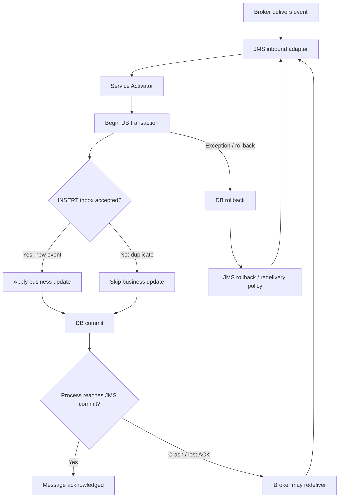
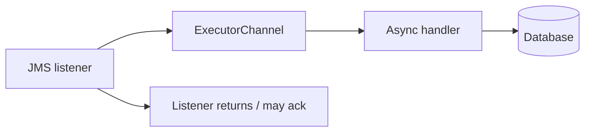

# Idempotency when adapters redeliver

## 1. Context: a single event can be received multiple times

In Spring Integration, a **Channel Adapter** connects external systems (message brokers, files, FTP/SFTP, databases, etc.) to a `Message` flow. An inbound adapter pulls or receives data and converts it into messages across channels; an outbound adapter sends messages to a target system. Downstream, `Filter`, `Transformer`, `Router`, `Service Activator`, or other endpoints process them under Enterprise Integration Patterns (EIP).

When an inbound adapter connects to a broker, **the exact same business event** can be redelivered (*redelivery*). If a handler adds loyalty points, deducts inventory, or generates an invoice on every invocation, one event can mutate data multiple times even though the producer intended a single effect.

**Idempotency** is the property where applying the same operation multiple times yields **the same business outcome as applying it once**, within the designed key and retention scope. For example, for the event `evt-501: grant 50 points to account A`, a second execution must not add another 50 points.

This lesson belongs to the **Channel adapter** chapter of the `SPRING_INTEGRATION_PATTERN` module, which teaches implementing Router, Filter, Transformer, Splitter, Aggregator, Gateway, retry, error channel, and correlation in loosely coupled, testable, and observable Spring Integration flows. The focus is protecting data when an adapter re-emits a message; transactions and retries are examined at the **message ingestion boundary**.

After this lesson, you will be able to:

- Explain why redelivery happens even after a consumer successfully writes to the DB.
- Choose a **stable idempotency identifier**, keeping delivery IDs and correlation IDs separate.
- Use a **transactional inbox** and unique constraints to prevent duplicate processing, even across concurrent consumers.
- Understand the role, benefits, and limits of `IdempotentReceiverInterceptor`, `MetadataStore`, and polling adapter filters.
- Test crashes, retries, duplicates, asynchronous handling, and observe deduplication effectiveness.

## 2. What is redelivery, and how does it differ from a duplicate?

**Redelivery** occurs when the source system re-sends the same message/event because reliable confirmation never arrived—due to timeouts, consumer shutdowns, transaction rollbacks, broker rebalances, or retry policies. A **duplicate** is a repeated processing attempt of the same *business intent*; duplicates can stem from redeliveries, producer retries, outbox relay re-publishing, or manual replays.

In system design, never conflate these two:

| Phenomenon | What is observed | Meaning |
| --- | --- | --- |
| Broker redelivery | The same message arrives at a consumer again after a prior failed ACK/commit. | Re-sending is typically managed by the broker/container. |
| Producer duplicate | Two distinct messages sharing the same `eventId` or business intent. | Deduplication relies on an application-defined ID. |
| Operational replay | Operators replay events from a DLQ, older Kafka offset, or archive. | Can happen long after the initial processing. |
| Internal retry | Handler or RPC call is retried within a single delivery. | Does not necessarily involve a new broker redelivery. |

Common sources:

- **JMS/AMQP:** consumer has not acknowledged, transacted session rolls back, connection drops before ACK/commit, or the broker requeues the message.
- **Kafka:** consumer performed a side effect before committing the offset; another consumer takes over the partition on rebalance or restart.
- **Polling adapters** like file/SFTP/JDBC: re-polling the same source without a watermark/checkpoint, reset filters, or non-durable "already seen" state.
- **HTTP/webhook adapters:** the sender retries when no clear response arrives even though the server processed the request.

### 2.1. Classic failure window

```mermaid
sequenceDiagram
    participant B as Broker
    participant A as Inbound channel adapter
    participant H as Service Activator
    participant D as PostgreSQL
    B->>A: Deliver evt-501
    A->>H: Message(evt-501)
    H->>D: Commit +50 points and save evt-501
    D-->>H: COMMIT OK
    Note over A,B: Process crashes before broker ACK
    B->>A: Redeliver evt-501
    A->>H: Message(evt-501) second time
    H->>D: Check key evt-501
    D-->>H: Already processed; do not add again
    H-->>A: Success
    A-->>B: ACK / commit
```

Whenever you have a **DB transaction** and an independent **broker transaction/ACK**, there is always a window where the DB commits while the broker never learns of success. Redelivery in that window is expected recovery behavior. An idempotent consumer's job is to make it **safe**.

## 3. Choosing a business-accurate idempotency key

Deduplication depends on **how two deliveries are recognized as representing the same effect**.

For a `LoyaltyPointsGranted` event, the key might be `(consumerName, eventId)`. For a "create payment" API, the key might be `(merchantId, idempotencyKey)` plus a request-content hash to detect same-key/different-payload conflicts. For versioned state updates, you may also need `aggregateId` and `sequence` to handle ordering.

| Identifier | Suitable role | Warning |
| --- | --- | --- |
| Producer-assigned `eventId` preserved on retry/replay | Identifies one business event across deliveries. | Needs uniqueness rules and protection against ID changes on replay. |
| `(consumerName, eventId)` | Allows multiple independent business consumers to process the same event. | Do not use a single global lock if two consumers have distinct effects. |
| `orderId` or `paymentId` | Identifies a business entity. | One entity can have many valid events, so it is rarely enough for event dedup. |
| Spring Integration `MessageHeaders.ID` | Tracks a message instance created inside an integration flow. | Can be regenerated across conversions/deliveries; do not use as a stable dedup key. |
| Broker delivery tag / consumer offset | Tracks a delivery attempt or read position. | Does not represent the same business intent across independent publishes. |
| `correlationId` / trace ID | Links request branches, split/aggregate groups, and traces. | Many distinct events can share one correlation ID. |

**Rule:** the idempotency key must exist *before* the message enters the adapter and survive retries, redeliveries, DLQ moves, and replays. If the producer lacks an event ID, derive the key from immutable business fields with a clear collision policy; avoid hashing the entire payload when timestamps, attempt counts, or trace fields vary per emission.

Example:

```json
{
  "eventId": "evt-501",
  "eventType": "LoyaltyPointsGranted",
  "accountId": "A-17",
  "points": 50,
  "occurredAt": "2026-11-21T05:00:00Z",
  "correlationId": "checkout-88"
}
```

If this event is delivered three times, all three must carry the same `eventId`. A *separate* event granting another 50 points to the same account must carry a different `eventId`.

## 4. Choosing where to enforce idempotency

Multiple layers can detect previously seen messages:

| Mechanism | Best fit | Main limitation |
| --- | --- | --- |
| **Transactional inbox** (DB unique constraint + business update in the same transaction) | Side effect is a DB update needing once-only execution per key. | Does not automatically include HTTP/email/other DBs in the same ACID transaction. |
| `IdempotentReceiverInterceptor` + `MetadataStore` | Blocks or marks duplicate messages at an endpoint, convenient for metadata-based policies. | Recording dedup markers may not share a transaction with business side effects. |
| Accept-once / persistent filter on polling adapter | Avoids re-polling the same source file/record. | "Seen at source" does not mean "processed successfully"; needs recovery policies. |
| Natural idempotency | E.g. `SET status='PAID'` instead of `INCREMENT count`, conditional/versioned updates. | Insufficient when the handler has other side effects. |
| Target API unique key | Prevents duplicates when calling external payment/RPC APIs. | Requires the target API to store results / recognize repeated requests. |

**Which layer is decisive?** When a handler mutates a DB, the reliable approach is placing "mark event processed" **inside the same DB transaction as the mutation itself**. Upstream filters/interceptors help cut load, yet should only be viewed as supplementary if their state lacks atomic commitment with the business change.

Depending on the domain, duplicate *deliveries* may be acceptable as long as duplicate *effects* are prevented. Measure those two separately.

## 5. Complete example: JMS inbound adapter + transactional inbox

Suppose a broker sends text messages to queue `loyalty.grants` with content:

```text
evt-501|A-17|50
```

The application must add 50 points to `A-17` once, even if the message is redelivered. The example uses Java 17+, Spring Boot 3.x, Spring Integration 6.x, Spring JMS, Spring JDBC, and PostgreSQL. `ConnectionFactory`, `DataSource`, `JdbcTemplate`, and a JDBC transaction manager must be configured in a real application.

### 5.1. Schema for business state and inbox

```sql
CREATE TABLE loyalty_wallet (
    account_id TEXT PRIMARY KEY,
    points BIGINT NOT NULL DEFAULT 0
);

CREATE TABLE processed_message (
    consumer_name TEXT NOT NULL,
    event_id TEXT NOT NULL,
    processed_at TIMESTAMPTZ NOT NULL DEFAULT CURRENT_TIMESTAMP,
    PRIMARY KEY (consumer_name, event_id)
);
```

The `processed_message` table is the **inbox**. Its primary key constraint guards both cases: a consumer receiving the message again after a crash, and two concurrent consumers picking up copies of the event simultaneously.

Pick a stable consumer name such as `loyalty-points-projector`. Never use a random hostname or instance ID, or each replica will create its own keyspace and fail to deduplicate across the group.

### 5.2. Deduplicating via unique-constrained insert

```java
import org.springframework.jdbc.core.JdbcTemplate;
import org.springframework.stereotype.Service;
import org.springframework.transaction.annotation.Transactional;

@Service
public class LoyaltyGrantService {

    private static final String CONSUMER = "loyalty-points-projector";
    private final JdbcTemplate jdbc;

    public LoyaltyGrantService(JdbcTemplate jdbc) {
        this.jdbc = jdbc;
    }

    @Transactional
    public void apply(String payload) {
        // Simple demo; production should use a versioned DTO/schema.
        String[] columns = payload.split("\\|", -1);
        if (columns.length != 3
                || columns[0].isBlank()
                || columns[1].isBlank()) {
            throw new IllegalArgumentException("Invalid loyalty event");
        }

        String eventId = columns[0];
        String accountId = columns[1];
        long points = Long.parseLong(columns[2]);

        if (points <= 0) {
            throw new IllegalArgumentException("points must be positive");
        }

        // Dedup and business update must share the same DB transaction.
        int claimed = jdbc.update(
                "INSERT INTO processed_message(consumer_name, event_id) " +
                "VALUES (?, ?) ON CONFLICT DO NOTHING",
                CONSUMER, eventId);

        if (claimed == 0) {
            return;  // Event committed earlier; do not grant points again.
        }

        jdbc.update(
                "INSERT INTO loyalty_wallet(account_id, points) " +
                "VALUES (?, ?) " +
                "ON CONFLICT (account_id) DO UPDATE " +
                "SET points = loyalty_wallet.points + EXCLUDED.points",
                accountId, points);
    }
}
```

Both `INSERT processed_message` and `INSERT/UPDATE loyalty_wallet` must reside in **the same transaction**. If updating the wallet fails, the transaction rolls back the dedup marker so the next delivery can retry. If the DB commits and the app dies before the broker ACK, the next delivery hits the duplicate key and skips adding points a second time.

The code simplifies payload formatting to focus on atomicity. For untrusted events, add schema validation, size limits, source authentication, point-overflow checks, and detection of **same `eventId` with different payload** (e.g., store and compare a payload hash). If an event affects multiple tables, place all related mutations inside that same transaction.

### 5.3. JMS message-driven channel adapter

```java
import jakarta.jms.ConnectionFactory;
import org.springframework.context.annotation.Bean;
import org.springframework.context.annotation.Configuration;
import org.springframework.integration.config.EnableIntegration;
import org.springframework.integration.dsl.IntegrationFlow;
import org.springframework.integration.jms.dsl.Jms;

@Configuration
@EnableIntegration
public class LoyaltyInboundFlow {

    @Bean
    IntegrationFlow loyaltyGrantsInbound(
            ConnectionFactory connectionFactory,
            LoyaltyGrantService service) {

        return IntegrationFlow
                .from(Jms.messageDrivenChannelAdapter(connectionFactory)
                        .destination("loyalty.grants")
                        .configureListenerContainer(
                                c -> c.sessionTransacted(true)))
                .handle(String.class, (payload, headers) -> {
                    service.apply(payload);
                    return null; // One-way consumer; emits no reply.
                })
                .get();
    }
}
```

The adapter receives a JMS text message, converts it to a Spring Integration message, and executes the handler synchronously. `sessionTransacted(true)` illustrates a **JMS local transaction**: if the listener succeeds, the JMS session commits; if an exception escapes to the listener, the session can roll back and the broker redelivers per broker/container configuration.

`@Transactional` on `LoyaltyGrantService` manages a **separate DB transaction**. Calls to the service must go through the Spring transaction proxy (here, the bean injected into the flow), the transaction manager must use the right `DataSource`, and DB errors must not be swallowed before reaching the listener.

### 5.4. Two independent commits and the redelivery point



Interpretation table:

| Failure timing | DB state | Next action |
| --- | --- | --- |
| Before `INSERT inbox` | No effects yet. | Redelivery processes as a fresh message. |
| After inbox insert, before DB commit | Both inbox and business update roll back on transaction failure. | Redelivery retries in full. |
| After DB commit, before JMS commit | Inbox and business update are durable. | Redelivery sees the existing key and skips the business effect. |
| After JMS commit | Broker confirmed the delivery. | No further processing for that delivery; manual replays remain protected if `eventId` is preserved. |

Do not assume `sessionTransacted(true)` and `@Transactional` form a single unified XA transaction. The transactional inbox is the mechanism that **bridges the gap between the two commits**.

## 6. Idempotent Receiver and MetadataStore in Spring Integration

Spring Integration supports the **Idempotent Receiver pattern**, often combining `IdempotentReceiverInterceptor` and `MetadataStoreSelector`. The idea is extracting a stable key from a message, checking/marking it in a `MetadataStore`, and deciding whether to process or discard/redirect duplicates.

Conceptual pipeline:

```text
Inbound adapter
  -> enrich headers: eventId from payload or original header
  -> IdempotentReceiverInterceptor
       -> MetadataStore(key=consumerName:eventId)
       -> new key: allow processing
       -> existing key: mark or discard duplicate per configuration
  -> Handler
```

Common stores:

- `SimpleMetadataStore`: handy for single-JVM testing; unsuitable when markers must survive restarts or span multiple instances.
- `JdbcMetadataStore` or `RedisMetadataStore`: stores metadata externally, better suited for sharing across instances. Verify atomic compare-and-set guarantees of the implementation and store setup.
- `ConcurrentMetadataStore` defines conditional operations (such as put-if-absent) to handle key races; **two separate read-then-write operations** are not safe deduplication when workers run concurrently.

### 6.1. Why an interceptor does not replace a transactional inbox

Suppose an interceptor writes `eventId=evt-501` to Redis **before** the handler updates PostgreSQL. Then the handler fails and the DB transaction rolls back. If the Redis marker remains, redelivery may be treated as a duplicate and skipped **even though the business action never completed**.

The reverse can also happen: DB commit succeeds while metadata fails to persist durably, causing redelivery and re-execution of business logic.

Choose one of the properly guaranteed approaches:

1. Keep the dedup record in the same DB transaction as the business mutation (as in section 5), using the interceptor only as an optional early filter to save load when correctness is unaffected.
2. Design a claim mechanism with `PROCESSING` / `COMPLETED` states, lease expiration, and explicit recovery, marking `COMPLETED` only when the business transaction actually commits.
3. If downstream side effects are inherently idempotent, the interceptor can serve as an optimization while the target layer still validates the idempotency key.

**Never treat a "message seen" record as proof of "successfully processed."** Precisely define when metadata is written and how crashes are recovered.

### 6.2. Keys and dedup retention windows

Metadata or inbox rows cannot be purged after an arbitrarily short TTL if the broker allows delayed retries or operators replay older events. Retention policies must account for:

- Broker message retention, maximum retry window, and DLQ retention.
- Permitted operational replay window.
- Data retention compliance and table/store growth costs.
- Risk of producers later reusing the same key.

If a dedup record expires while an old copy can still arrive, the system may reprocess it. For financial data or critical side effects, consider permanent business keys, explicit compaction/tombstone policies, or retaining records long enough for correctness.

## 7. Polling adapters: receiving the same source multiple times

Not every channel adapter sits on a broker with acknowledgements. With **File Reading**, FTP/SFTP, or JDBC polling adapters, a source can be read multiple times due to restarts, non-persistent filters, or reset watermarks.

Spring Integration offers *accept-once filters*, whose persistent variants store keys in a metadata store. These filters reduce re-polling the same file, yet **"file acquired"** differs from **"file contents processed successfully."**

Example pipeline:

```text
SFTP inbound synchronizer / polling adapter
  -> accept-once filter marks file
  -> local file message
  -> parser
  -> update PostgreSQL
```

If the filter marks the file "seen" and the parser or DB fails afterward, subsequent polls may skip the file. Recovery depends on the adapter and rollback/requeue policy; switching to a persistent filter does not automatically yield at-least-once processing.

**Sound design for file/SFTP:**

- Identify files properly: path + version/hash/checksum or an upstream-assigned batch ID. Relying solely on filename breaks when upstream overwrites a file using the same name.
- Persist **business-processed state** in the DB in the same transaction as target data; for per-row side effects, consider keys like `(fileId, rowId)`.
- Move or mark files complete **after** business commit, with recovery if the move/mark step fails; filesystem operations do not join JDBC transactions automatically.
- For large datasets, manage checkpoints, chunk sizes, retries, and resume behavior; partially processed files need an explicit progress model.
- Distinguish filters preventing duplicate polls from an inbox preventing **duplicate business effects**.

Similarly, if a JDBC polling source simply runs `SELECT WHERE processed=false` and updates `processed=true` without safe locking or claiming, multiple instances can fetch the same row. Use DB-level transactional locking/claiming paired with target-side idempotency.

## 8. Retry, error channels, and transaction boundaries

Idempotency and retry complement each other: **retry** gives transient faults another chance to succeed; **idempotency** stops retries from producing extra side effects. Misconfiguration, however, can lose messages or retry forever.

| Error type | Example | Handling approach |
| --- | --- | --- |
| Transient error | DB timeout, network drop, lock timeout | Allow rollback, bounded redelivery, and backoff. |
| Permanent payload error | Missing `eventId`, bad schema, negative points | Do not retry infinitely; route to DLQ/quarantine per policy. |
| Committed duplicate | Inbox already holds `(consumerName,eventId)` | Skip business update and allow ACK/commit to succeed. |
| Same ID, different payload | Producer improperly reused a key | Record conflict; never silently treat two distinct events as one. |
| External side effect with unknown outcome | HTTP timeout when downstream may have processed | Pass the same idempotency key downstream or query status. |

### 8.1. Error channels can affect acknowledgements

With a message-driven adapter and synchronous `DirectChannel`, exceptions can propagate back to the listener; unless handled as success, the broker session typically rolls back or invokes its error policy.

If a flow catches the exception, forwards to `errorChannel`, and **returns normally**, the listener may treat processing as complete and commit/ACK. A Spring Integration `ErrorMessage` is an error representation for routing—**not an automatic broker rollback**.

Before using an error flow, decide among three outcomes:

1. **Handled successfully:** allow ACK/commit.
2. **Transient error needing redelivery:** let the error return to the listener/transaction boundary and apply retry policy.
3. **Poison message safely moved to DLQ/quarantine:** acknowledge the source message per designed strategy to avoid infinite loops. Since DLQ publishing and source ACKs may touch two separate resources, still account for the failure window between them.

### 8.2. When channels become asynchronous

`DirectChannel` invokes handlers on the sender thread, generally propagating exceptions back to the adapter inside the listener scope. `ExecutorChannel`, `QueueChannel`, or async handoffs can run handlers after the listener returns, meaning inbound transactions/ACKs no longer wait for business DB commits.



If you choose async processing, build a **durable handoff**: for example, the adapter persists the message into a durable internal inbox/queue before ACKing, and workers process and update state in separate transactions. Never drop an `ExecutorChannel` into a synchronous flow and assume acknowledgements still happen after all side effects.

### 8.3. Ordering, correlation, and separating effects

An inbox stops the **same event ID** from being processed multiple times. It does not automatically handle:

- Events for the same aggregate arriving out of order (e.g. `OrderCancelled` before `OrderCreated`).
- Two events with different IDs representing the same business action due to a buggy producer.
- External email, HTTP, payment, or secondary DB side effects outside the same transaction.

To guard ordering, use `aggregateId` + `version/sequence` with state-comparison rules. With Splitter/Aggregator, multiple child messages may share a `correlationId` yet require distinct idempotency keys per side effect; never collapse them all under one correlation ID.

For outbound APIs supporting idempotency keys, reuse the same key across retries and verify the target's result-retention contract. When business rules require emitting an event after a DB commit, use a **transactional outbox**: save the publish intent in the same DB transaction, publish asynchronously, accept duplicate publishes, and require downstream consumers to be idempotent.

## 9. Testing at failure points, not just "deliver twice"

Verify both the **DB layer** and the **adapter/ACK layer**. Unit testing `apply()` is helpful, yet cannot prove broker redelivery when a transaction commit fails.

| Scenario | Test action | Assertion required |
| --- | --- | --- |
| First-time event | Send `evt-501|A-17|50`. | `loyalty_wallet.points` increases by 50 and inbox holds one key. |
| Duplicate after success | Re-send the same `eventId`. | Points do not increase further; message ACKs cleanly. |
| DB exception before commit | Inject SQL error after inbox insert. | Both inbox and wallet roll back; redelivery succeeds later. |
| Crash after DB commit, before broker ACK | Inject fault at listener boundary. | Redelivery is blocked by inbox key; points are not doubled. |
| Two workers race on same event | Have two consumers process copies concurrently. | Unique constraint lets only one transaction apply effects. |
| Invalid payload | Send negative points or missing event ID. | Inbox does not mark completed; enters retry/DLQ per policy. |
| Same key, different payload | Same event ID, different point amount. | System detects conflict when payload hash check is enabled. |
| Polling restart | Restart file adapter, re-read old file. | No duplicate side effects created in DB. |
| Async boundary | Insert `ExecutorChannel` with fault injection. | Observe early ACK and apply durable handoff if required. |
| DLQ replay days later | Re-submit message with old event ID. | Dedup retention still protects against duplicates with replay audit trail. |

An integration test can use a test JMS broker and PostgreSQL Testcontainers, deliberately crashing at both boundaries: before DB commit, and after DB commit / before JMS commit. Measure **how many times the business effect actually happened**, not just how many times the handler was invoked.

### 9.1. Verifiable invariants

For a valid `(consumerName, eventId)` key:

- If the business update transaction **did not commit**, no durable `COMPLETED` marker exists in the inbox for that transaction.
- Once committed, subsequent deliveries apply no further business changes for that event.
- Two concurrent instances cannot both commit effects for the same key.
- The broker can redeliver while the application preserves accurate data.
- A new event with a new event ID still processes normally, even with the same `accountId`.

These are pragmatic test criteria for an idempotent consumer within **a single DB**. Never claim "end-to-end exactly-once" if external side effects across other services lack protection.

## 10. Operational observability and deployment checklist

Track metrics and logs by adapter name, consumer, and business type, including: messages received, first-time processed count, skipped duplicates, DB rollback rate, redelivery count, payload errors, DLQ counts, latency from broker emit to DB commit, and inbox table size/age.

**Distinguish duplicates from failures:** a duplicate caught after a prior success can be normal recovery; a sudden spike in duplicates signals continuous consumer crashes, late ACKs, or duplicate producer emits. Never put `eventId` or `accountId` into high-cardinality metric labels; keep those identifiers in structured logs and traces for reconciliation.

Pre-production checklist:

1. **Redelivery source:** which adapter, broker/file/polling mechanism, ACK/commit condition, or checkpoint applies?
2. **Stable key:** how does the producer preserve `eventId` across retries, replays, DLQs, and tracing?
3. **Atomicity boundary:** do dedup records and business updates share the same DB transaction? Do errors roll back both?
4. **Concurrency:** does a unique constraint or atomic claim stop multiple instances from applying effects twice?
5. **External side effects:** do API/payment/email calls carry idempotency keys, outboxes, or status checks?
6. **Retry and DLQ:** which errors retry, which quarantine, and are backoff and replay windows explicit?
7. **Asynchrony:** `DirectChannel` or `ExecutorChannel`; when does adapter ACK happen relative to DB commit?
8. **Retention:** are dedup markers retained long enough for every legitimate replay?
9. **Observability and testing:** did you test crashes between DB commit and broker ACK, concurrent duplicates, and redelivery-spike alerts?

The core principle when adapters redeliver is **accepting that messages can arrive multiple times and protecting business effects with keys, transactions, and explicit duplicate-handling rules**. Spring Integration routes and coordinates messages across endpoints; correctness under repeated delivery must be enforced consistently at your data boundary and the adapter's acknowledgement protocol.
