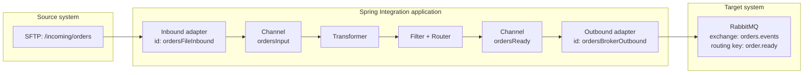
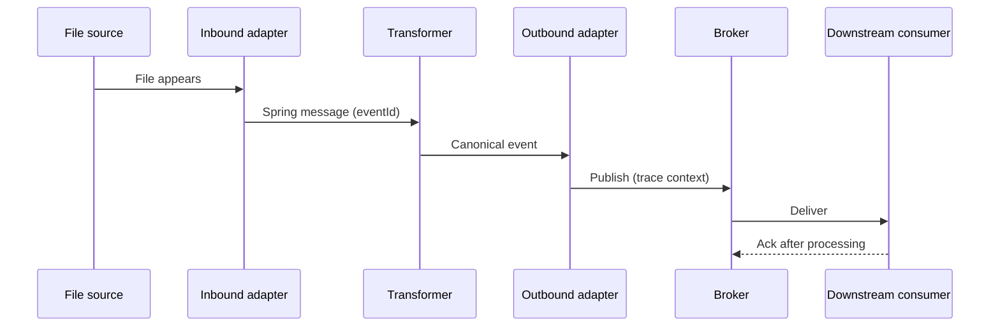
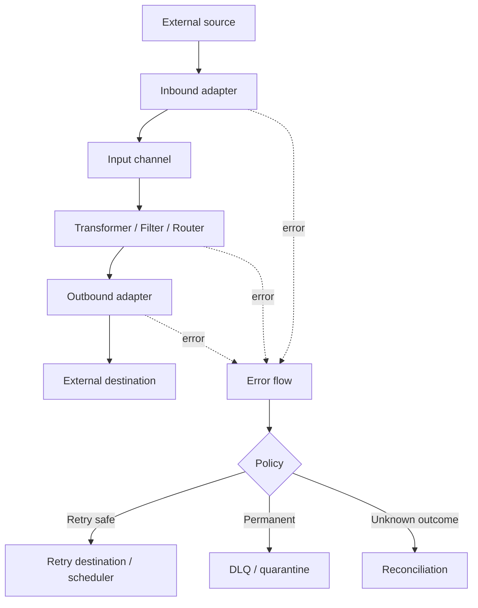

# Tracking adapter sources and destinations in Spring Integration

## 1. Why do we need to know where messages come from and where they go?

In the **Channel adapter** chapter of the **SPRING_INTEGRATION_PATTERN** module, we learn how to connect external systems to Spring Integration **Enterprise Integration Patterns** flows. Router, Filter, Transformer, Splitter, Aggregator, Gateway, retry, error channel, and correlation handle multi-step message processing, while the **channel adapter** bridges an external protocol or resource to an internal message channel.

For example, an application reads order files from an SFTP directory, validates data, transforms formats, and sends results to RabbitMQ. When a partner reports missing orders, merely knowing "the app is still running" is not enough. Operators need to determine:

- Which adapter picked up the data? What is the actual source—directory, queue, topic, HTTP endpoint, or query?
- When did the adapter last see data? Is it actively polling, stopped, failing authentication, or simply idle with no new inputs?
- Which channel received the message? Was it dropped by a Filter, routed to another branch by a Router, or did a Transformer throw an exception?
- Which adapter sent it out? What is the target—exchange/routing key, queue, bucket, directory, or URL?
- Does a successful send at the adapter layer mean the target system persisted or processed it successfully?
- If processing retried or redelivered, how do we recognize the same business event?

**Tracking adapter sources and destinations** covers both *configured topology* and *runtime behavior*: adapter IDs, source/destination identities, message identities, timestamps, errors, metrics, and confirmation boundaries.

### Learning outcomes

After this lesson, you will be able to:

1. Identify **inbound** and **outbound** directions, distinguishing external sources/destinations from internal channels.
2. Assign stable identifiers to adapters and sources/destinations for logs, metrics, and traces.
3. Build a Spring Integration Java DSL example that reads files, transforms contents, and writes to another target.
4. Use channel interceptors, message history, Micrometer/Actuator, and tracing appropriately to observe message paths.
5. Diagnose poller issues, error channels, backpressure, duplicates, lost replies, and outbound send failures.
6. Design dashboards, alerts, and tests proving messages reached the intended boundary.

## 2. Source, destination, adapter, and channel are distinct entities

### 2.1. Inbound channel adapter

An inbound adapter **receives/reads** external data and **emits** a Spring `Message<?>` onto an internal channel.

```text
External source       Inbound adapter           Message channel
SFTP / file / JMS  --> read/receive/convert --> ordersInput
HTTP / AMQP / DB
```

In this case:

- **Actual source**: a directory, queue, endpoint, query, or system supplying messages.
- **Adapter**: the Spring Integration component connecting that source into the message flow.
- **Internal destination of the inbound adapter**: the message channel to which the adapter sends messages, e.g. `ordersInput`.
- **Downstream consumer**: Filter, Transformer, Router, Service Activator, or another handler subscribed to the channel.

Do not call `ordersInput` an "external source"; it is merely a message-passing boundary **inside the application**.

### 2.2. Outbound channel adapter

An outbound adapter **receives** a Spring message from an internal channel and **sends/writes** data outward.

```text
Message channel      Outbound adapter          External target
ordersReady      --> convert/send/write  --> Kafka / RabbitMQ / file / HTTP
```

In this case:

- **Internal source of the outbound adapter**: the channel, e.g. `ordersReady`.
- **Adapter**: the endpoint receiving the message and invoking the external client or resource.
- **Actual destination**: topic + partition/key, exchange + routing key, queue, URL, target directory, database table, or equivalent external system.
- **Delivery evidence**: outcome at the adapter and protocol layers; inspect whether it represents a local enqueue, network write, broker confirm, transaction commit, or business reply.

### 2.3. Full diagram



The diagram captures **two kinds of information** to retain:

1. **Topology**: bean IDs, channel names, adapter types, and mappings from endpoints to external resources.
2. **Runtime evidence**: that a message with a specific `eventId` was polled/received, traversed specific steps, ran at a timestamp, and received a given response or confirmation.

Topology only proves a path **can** exist. Logs, traces, metrics, and business state verify how far a concrete message **actually** traveled.

## 3. Adapters do not all operate the same way

### 3.1. Polling inbound adapter

File, SFTP, JDBC, and many other sources rely on pollers:

```text
Scheduler --> Poller --> MessageSource.receive()
                         |--> data available: publish Message
                         +--> no data: null / idle
```

What to observe:

- Whether the adapter/poller is running or stopped.
- Last poll timestamp, poll duration, and poll count.
- Timestamp of last emitted message and messages per poll.
- Exceptions accessing the source, connecting, parsing, or sending to the channel.
- Pending record/file backlog, if measurable for the protocol.
- `maxMessagesPerPoll`, poll interval, and scheduler lag.

**A poll returning no data is not automatically an error.** However, if SLAs expect data every five minutes, 40 minutes without a message warrants an alert. Distinguish *legitimately quiet sources* from *broken or unreadable adapters*.

### 3.2. Message-driven inbound adapter

AMQP, JMS, Kafka, and certain other protocols use listeners that receive messages pushed by brokers. They do not necessarily use a Spring Integration poller like the file adapter.

What to track:

- Connection/session/container and subscriber/consumer state.
- Queue depth, consumer lag, unacked deliveries, or offsets.
- Received message counts, ACK/NACK/requeue, redeliveries, and DLQ/DLT counts.
- Consumer concurrency, prefetch, partition assignments, and rebalance status (depending on broker).
- Deserialization/conversion errors and downstream handler errors.

With Kafka, knowing "which topic is read" is rarely enough: track **consumer group, partition, offset**, and key. With RabbitMQ, track exchange, queue binding, and routing key. Every broker has distinct semantics; never apply a single ACK assumption across all adapters.

### 3.3. Outbound adapter vs. outbound gateway

- An **outbound channel adapter** typically sends data without waiting for a business reply on the same flow.
- An **outbound gateway** fits when request–reply is needed to handle responses from an external system.

For example, an HTTP outbound gateway returns an API response; an outbound adapter may only write or send without returning business data to the caller. Even so, **the send method returning** does not prove the external side succeeded. Read the contract of the adapter/client and protocol, including transactions, publisher confirms, and acknowledgements.

## 4. Minimum identity set for an adapter flow

Do not rely solely on `MessageHeaders.ID` as a business identity: new messages can be created by Transformers, retries, or republishes. Instead, separate them clearly:

| Identifier | Example | Purpose |
| --- | --- | --- |
| `adapterId` | `ordersFileInbound` | Identifies the component in Spring context/topology |
| `sourceId` | `partnerA.orders.inbound` | Logical identifier of the external source |
| `destinationId` | `billing.events.rabbit` | Logical identifier of the target system |
| `messageId` | Spring message ID header | Tracks a single message instance inside the flow |
| `eventId` | `evt-501` | Identifies the business event for deduplication |
| `correlationId` | `order-781` | Links messages belonging to the same workflow |
| `traceId` / `spanId` | Tracing values | Traces a single execution journey |
| `attempt` | `1`, `2`, ... | Distinguishes retry/reprocessing attempts |

**Source ID and destination ID should be stable logical names**, mapped to concrete URLs/topics/queues/paths via a configuration registry. Never put credentials, sensitive query strings, full payloads, or personal data into metric labels.

A minimal observability record:

```json
{
  "eventId": "evt-501",
  "correlationId": "order-781",
  "adapterId": "ordersFileInbound",
  "sourceId": "partnerA.orders.inbound",
  "internalChannel": "ordersInput",
  "stage": "ADAPTER_RECEIVED",
  "outcome": "SUCCESS",
  "timestamp": "2026-11-21T03:00:00Z"
}
```

This is an **illustrative application log contract**, not a default log payload automatically emitted by Spring Integration.

## 5. Example: tracking inbound and outbound file adapters with Java DSL

To make every boundary visible, the example uses **local directories** as source and destination. When moving to SFTP, JDBC, AMQP, or Kafka, source/destination details and delivery confirmations change, while monitoring principles stay the same.

Assume Java 17+ and Spring Integration with file, core, logging, and Micrometer/Actuator modules if desired. Paths `/data/orders/in` and `/data/orders/archive` are illustrative; they must exist with read/write permissions at runtime and be adjusted for Windows/Linux environments.

### 5.1. Illustrative dependency declarations

```groovy
dependencies {
    implementation 'org.springframework.boot:spring-boot-starter-integration'
    implementation 'org.springframework.integration:spring-integration-file'
    implementation 'org.springframework.boot:spring-boot-starter-actuator'
    implementation 'io.micrometer:micrometer-registry-prometheus'
}
```

Use an appropriate Spring Boot BOM to manage versions. Example beans can sit in a Spring-scanned package; using `DirectChannel` runs downstream processing synchronously on the sending thread.

### 5.2. Identifying channels and the inbound adapter

```java
import java.io.File;
import java.time.Duration;

import org.springframework.context.annotation.Bean;
import org.springframework.context.annotation.Configuration;
import org.springframework.integration.channel.DirectChannel;
import org.springframework.integration.config.EnableIntegration;
import org.springframework.integration.dsl.IntegrationFlow;
import org.springframework.integration.dsl.Pollers;
import org.springframework.integration.file.dsl.Files;
import org.springframework.messaging.MessageChannel;

@Configuration
@EnableIntegration
public class FileAdapterFlows {

    @Bean("ordersInput")
    public MessageChannel ordersInput() {
        return new DirectChannel();
    }

    @Bean("ordersReady")
    public MessageChannel ordersReady() {
        return new DirectChannel();
    }

    @Bean
    public IntegrationFlow ordersFileInboundFlow() {
        return IntegrationFlow
            .from(
                Files.inboundAdapter(new File("/data/orders/in"))
                    .patternFilter("*.json"),
                endpoint -> endpoint
                    .id("ordersFileInbound")
                    .poller(Pollers.fixedDelay(Duration.ofSeconds(5)))
            )
            .enrichHeaders(headers -> headers
                .header("source.adapterId", "ordersFileInbound")
                .header("source.id", "partnerA.orders.inbound")
                .headerFunction(
                    "source.fileName",
                    message -> ((File) message.getPayload()).getName()
                )
            )
            .channel("ordersInput")
            .get();
    }
}
```

Explanation:

- `Files.inboundAdapter(...)` reads files matching the pattern from the source directory, creating messages with a `File` payload.
- The poller runs on a fixed delay to scan the source periodically.
- `id("ordersFileInbound")` gives the endpoint a stable name in graphs, logs, and supported metrics.
- Headers `source.adapterId` and `source.id` are **application-added metadata**. Spring Integration does not generate headers with these names automatically.
- `source.fileName` aids observability without logging full absolute file paths.
- Messages move from the adapter to the internal `ordersInput` channel.

Having received a file once does not guarantee it will never be reprocessed. File filters, metadata stores, restarts, renames, locks, and partially written partner files all affect duplicates and integrity. For SFTP/remote sources, add file-ready rules, atomic renames, or persistent metadata filters as needed.

### 5.3. Transformer and outbound channel

Add a flow that reads UTF-8 file contents and sends the string to `ordersReady`:

```java
import java.io.File;
import java.io.IOException;
import java.io.UncheckedIOException;
import java.nio.charset.StandardCharsets;

import org.springframework.context.annotation.Bean;
import org.springframework.context.annotation.Configuration;
import org.springframework.integration.dsl.IntegrationFlow;

@Configuration
public class FileProcessingFlow {

    @Bean
    public IntegrationFlow readOrderFileFlow() {
        return IntegrationFlow
            .from("ordersInput")
            .transform(File.class, file -> {
                try {
                    return java.nio.file.Files.readString(
                        file.toPath(), StandardCharsets.UTF_8
                    );
                } catch (IOException ex) {
                    throw new UncheckedIOException(ex);
                }
            })
            .channel("ordersReady")
            .get();
    }
}
```

This flow only converts `File` to `String`; it does not yet validate JSON schemas or manage business transactions. In production, add Filter/Transformer/Validator steps and error routing per contract. A file-reading exception can surface as a poller/endpoint error; configure error handling at the right boundary.

### 5.4. Outbound file adapter and destination identification

```java
import java.io.File;

import org.springframework.context.annotation.Bean;
import org.springframework.context.annotation.Configuration;
import org.springframework.integration.dsl.IntegrationFlow;
import org.springframework.integration.file.dsl.Files;

@Configuration
public class ArchiveAdapterFlow {

    @Bean
    public IntegrationFlow archiveOutboundFlow() {
        return IntegrationFlow
            .from("ordersReady")
            .enrichHeaders(headers -> headers
                .header("destination.adapterId", "ordersArchiveOutbound")
                .header("destination.id", "orders.archive.filesystem")
            )
            .handle(
                Files.outboundAdapter(new File("/data/orders/archive"))
                    .fileNameGenerator(message ->
                        "processed-" +
                        message.getHeaders().get(
                            "source.fileName", String.class
                        )
                    ),
                endpoint -> endpoint.id("ordersArchiveOutbound")
            )
            .get();
    }
}
```

When running, the flow reads files from the input directory, converts contents to a String, and writes files named `processed-<original-filename>` into the archive directory.

Key notes:

- This is a **single-source, single-destination** example illustrating metadata tagging at both boundaries.
- Headers added by `enrichHeaders` attach to the message; not all outbound adapters forward every header across brokers or protocols. Across network boundaries, configure header mappers explicitly if needed.
- Filenames must be validated/sanitized in real applications (especially if derived from external input); never trust arbitrary filenames.
- Re-running the same file can cause filename collisions. Pick an explicit file-exists policy: fail, controlled replace, or versioned names. Never assume re-writes are safe or idempotent.
- File write success proves the app interacted with the filesystem per contract; it does not prove another process read and processed that file.
- For important data, consider temp-file writes followed by atomic renames where supported, checksums, and persistent processing state.

### 5.5. What can be verified from the example

| Location | Evidence collected | What is not yet guaranteed |
| --- | --- | --- |
| Poller `ordersFileInbound` | A poll/read produced a file | File is complete per partner contract |
| Channel `ordersInput` | Message entered the channel | Transformer completed |
| File-reading handler | Content read into a String | JSON is business-valid |
| Channel `ordersReady` | Payload ready for dispatch | Target filesystem finished writing |
| Adapter `ordersArchiveOutbound` | Write succeeded or threw exception | Downstream system consumed the file |

**Never equate messages received with business tasks completed.** Every step is a separate boundary to measure.

## 6. Structured logging at boundaries

### 6.1. Naming operational events

A concise, consistent set of names:

| Event | When emitted | Useful fields |
| --- | --- | --- |
| `ADAPTER_POLL_STARTED` | A poll cycle begins | adapterId, sourceId, timestamp |
| `ADAPTER_MESSAGE_RECEIVED` | Inbound adapter emits a message | eventId, sourceId, messageId |
| `CHANNEL_HANDOFF` | Sent across an internal channel | channelId, messageId, correlationId |
| `ADAPTER_SEND_STARTED` | Outbound adapter prepares to send | adapterId, destinationId |
| `ADAPTER_SEND_COMPLETED` | Adapter/client layer confirms send per contract | outcome, duration, destinationId |
| `ADAPTER_SEND_FAILED` | Outbound send/write failed | errorCode, attempt, destinationId |
| `BUSINESS_COMPLETED` | Business side effect committed | eventId, businessState, duration |

These event names are **developer-defined logging conventions**. Do not expect Spring Integration to log these exact fields automatically.

Every event should carry a timestamp, component identity, and correlation info. When the same event ID retries multiple times, include `attempt` or delivery ID so attempts are never confused.

### 6.2. ChannelInterceptor for observing handoffs

`ChannelInterceptor` lets you observe message channel activity without forcing every handler to log manually.

```java
import org.slf4j.Logger;
import org.slf4j.LoggerFactory;
import org.springframework.messaging.Message;
import org.springframework.messaging.MessageChannel;
import org.springframework.messaging.support.ChannelInterceptor;

public final class AdapterHandoffLoggingInterceptor
        implements ChannelInterceptor {

    private static final Logger log =
        LoggerFactory.getLogger(AdapterHandoffLoggingInterceptor.class);

    @Override
    public Message<?> preSend(
            Message<?> message,
            MessageChannel channel) {

        log.info(
            "stage=CHANNEL_HANDOFF messageId={} sourceId={} destinationId={}",
            message.getHeaders().getId(),
            message.getHeaders().get("source.id"),
            message.getHeaders().get("destination.id")
        );
        return message;
    }
}
```

Attach the interceptor to an application-managed channel:

```java
@Bean("ordersInput")
public MessageChannel ordersInput() {
    DirectChannel channel = new DirectChannel();
    channel.addInterceptor(new AdapterHandoffLoggingInterceptor());
    return channel;
}
```

This is a **replacement** for the `ordersInput()` bean in section 5.2; do not register two beans with the same name.

What the interceptor proves: a message entered the channel's `preSend` hook. It **does not** prove the downstream handler finished, nor that a remote broker confirmed storage. To observe send completion, examine lifecycle callbacks like `afterSendCompletion` alongside send status, keeping the specific channel's boundaries in mind.

Avoid logging full payloads or performing heavy work inside an interceptor. A blocking synchronous interceptor slows every message traversing the channel.

### 6.3. WireTap for audit branches

The **Wire Tap pattern** copies messages to an observation channel while the main flow keeps its own path.

```text
ordersInput ---> Transformer ---> ordersReady
     |
     +---- wire tap ----> auditEvents ---> Audit handler
```

You can attach a wire tap via interceptors or DSL configuration. Keep in mind:

- A synchronous tap on the sending thread adds latency to the main flow.
- Offloading the tap to an async channel reduces impact, but requires bounding queue capacity, handling audit write failures, and accounting for potential audit loss.
- A tap does not make auditing atomic with consumer side effects.
- Messages with sensitive data take an extra branch; restrict content and access controls.

For mandatory, zero-loss audit requirements, use durable persistence (such as outbox/transactions) rather than relying solely on an in-memory wire tap.

## 7. Message history: seeing which components a message visited

Spring Integration can record **message history** in message headers when enabled and supported by participating components. An illustrative setup:

```java
import org.springframework.context.annotation.Configuration;
import org.springframework.integration.config.EnableMessageHistory;

@Configuration
@EnableMessageHistory
public class MessageHistoryConfiguration {
}
```

Message history lets you inspect a journey like:

```text
ordersFileInbound
  -> ordersInput
  -> readOrderFileFlow
  -> ordersReady
  -> ordersArchiveOutbound
```

That list illustrates the **expected path**, not a literal dump of the header. Exact contents and formatting vary by component, Spring Integration version, and tracking configuration.

Understand its limits:

- History is not full distributed tracing: messages crossing RabbitMQ/Kafka/HTTP can be rebuilt or lose headers across protocol boundaries.
- Recording history on every message grows header size, processing overhead, and risks leaking internal topology if headers are forwarded externally.
- History answers "which components did it visit," not whether business logic committed at each step.
- Under high throughput, toggle selectively and measure overhead before broad rollout.

For end-to-end tracing across multiple applications, combine internal history with event IDs, correlation IDs, and distributed tracing.

## 8. Micrometer, Actuator, and Integration Graph

Spring Integration provides monitoring extension points, and Spring Boot Actuator/Micrometer can expose runtime metrics and endpoints. Exact metric names and coverage vary by Spring Integration, Spring Boot, and Micrometer versions, dependencies, and management settings.

### 8.1. Illustrative Actuator configuration

```yaml
management:
  endpoints:
    web:
      exposure:
        include: health,info,metrics,prometheus,integrationgraph
```

With the matching dependencies and configuration in place, commonly used endpoints include:

- `/actuator/health`: health of the application and components with health indicators.
- `/actuator/metrics`: inspect metrics registered at runtime.
- `/actuator/prometheus`: scrape metrics via the Prometheus registry, if configured.
- `/actuator/integrationgraph`: view the Spring Integration component graph when supported and enabled.

**Verify at runtime**, because adding a name to `exposure.include` alone does not activate an endpoint without its dependencies, auto-configuration, and enablement conditions. Never expose management or topology endpoints publicly on the Internet; enforce authentication, authorization, and network restrictions—especially since the graph reveals queue, channel, and endpoint names.

### 8.2. Using Integration Graph to locate sources/destinations

The graph lets you inspect structure:

1. Locate component ID `ordersFileInbound`.
2. Follow the edge from the adapter to channel `ordersInput`.
3. Follow the Transformer/Handler step to `ordersReady`.
4. Locate endpoint `ordersArchiveOutbound`.
5. Cross-reference those IDs against your config registry to find logical sources/destinations and actual connector addresses.

The graph is great for checking which beans and flows **are registered**; the graph alone cannot tell you whether messages are flowing or whether a broker received data.

When adapters generate child components automatically, names may derive from bean/flow IDs. Assign stable IDs to application-managed endpoints so tracing across environments and deployments stays consistent.

### 8.3. Metrics to watch

| Measurement group | Examples | Question answered |
| --- | --- | --- |
| **Ingress** | Inbound messages emitted per adapter | Is the source sending data? |
| **Poller** | Poll count, duration, empty polls, errors | Is the polling adapter running steadily? |
| **Handoff** | Send success/failure, channel latency | Are messages stalling inside internal flows? |
| **Processing** | Handler duration, exceptions, retry count | Which stage is slow or failing? |
| **Egress** | Send attempts, errors, timeouts, broker confirms | Is the destination accepting per contract? |
| **Backlog** | Queue depth, unacked count, lag, oldest age | Is work piling up? |
| **Business** | Successfully persisted orders, final statuses | Did data produce the intended effect? |

Some Spring Integration versions emit `spring.integration.*` metrics, yet **never hard-code metric names, tags, or types solely from examples**. Query `/actuator/metrics` and your actual registry to confirm names and dimensions. Many domain-specific signals—empty polls, external queue lag, DLQ counts, and business commits—must come from broker/client instrumentation or business code.

### 8.4. Designing safe metric tags

Use low-cardinality, stable tags:

```text
adapter_id="ordersFileInbound"
adapter_type="file-inbound"
source_id="partnerA.orders.inbound"
destination_id="orders.archive.filesystem"
outcome="success"
```

Avoid putting `eventId`, `orderId`, `traceId`, random filenames, or URLs with tokens into metric labels. They explode into millions of time series and drive up monitoring costs. Keep dynamic identifiers in logs and traces with appropriate sampling and retention.

### 8.5. Suggested dashboard

A dashboard for a source → destination flow should show:

- **Ingress rate**: items received per source ID per minute.
- **Idle age**: time since last receipt, compared against expected source schedules.
- **Processing rate**: messages succeeded vs. failed.
- **Egress rate**: successful sends per destination ID.
- **End-to-end latency**: from `occurredAt` to business completion, including queueing and polling delays.
- **Backlog**: queue depth/lag, unread files, outbox items.
- **Error distribution**: errors across source reads, parsing, transformation, routing, sending, and target failures.
- **Duplicates/retries**: attempt counts, redeliveries, DLQ/DLT counts, duplicates blocked by idempotency.

Example reconciliation across boundaries within a single observation window:

```text
ingress_count = 10 000
business_completed = 9 920
business_rejected = 40
in_flight = 30
unexplained_gap = 10
```

Never conclude "80 messages were lost" from subtracting two raw counters when retries, duplicates, or in-flight messages exist. Accurate reconciliation requires standardizing the **unit of count**: logical event ID, delivery attempt, or business record. The arithmetic above shows 10 unexplained events, which holds only when categories are disjoint, deduplicated, and aligned to the same reconciliation window.

## 9. Distributed tracing: crossing adapters and network boundaries

A trace can span multiple spans:



When Micrometer Observation/Tracing or OpenTelemetry is wired properly, spans and traces connect boundaries whenever trace context propagates across supported headers/protocols. Verify propagation mappings for your specific AMQP, Kafka, JMS, HTTP, SFTP, or custom adapters.

**Not every adapter propagates trace context automatically.** In particular, messages created by a file poller typically start a *new root trace* unless the file itself carries a trace ID. To link with upstream work, embed an event ID or correlation ID inside file contents or external metadata.

Distinguish:

- **Trace**: timing of operations across one or more applications.
- **Message history**: component traversal record on a message inside a Spring Integration flow.
- **Business audit**: proof of which business action executed and its final outcome.

A complete trace does not prove an external transaction committed unless a span/event explicitly recorded that commit under a valid contract.

## 10. Tracking sources/destinations by adapter type

### 10.1. File/SFTP inbound and file/SFTP outbound

| What to observe | Inbound | Outbound |
| --- | --- | --- |
| Source/destination | Host and logical directory / pattern | Logical directory / remote folder |
| Status | Connection, auth, poller, file-ready | Connection, write permissions, rename |
| Progress | Pending files, new files, processed files | Files written, write errors |
| Duplicates | Metadata store, filename/size/checksum | Idempotency key, overwrite policy |
| Success | File received/read per contract | File written/renamed per contract |

Never log full SFTP URLs containing credentials. Use a stable `sourceId` and look up real hosts/paths from configuration or a secrets manager.

A large file may still be mid-write by a partner when the poller spots it. Enforce file-readiness strategies like staging + atomic rename, locks, or stability filters. A poller seeing a file does not mean its contents are complete.

### 10.2. AMQP/RabbitMQ

Inbound:

- Queue name, consumer ID/container, connection/vhost, and consumer count.
- Deliveries, ACK/NACK, requeue, unacked count, redeliveries.
- Queue depth and DLQ count.

Outbound:

- Exchange, routing key, destination mapping, and publisher connection.
- Publisher confirm/return when the app needs broker publish confirmation.
- Unroutable messages, NACKs, timeouts, or connection resets.

A publisher confirm **does not equal consumer completion**. Also separate queues from exchanges: outbound adapters usually publish to an exchange, while bindings decide which queues receive the message.

### 10.3. Kafka

Inbound:

- Topic, consumer group, partition, and offset.
- Consumer lag, rebalances, deserialization errors, and retry/DLT counts.
- Event creation time vs. consumer processing time.

Outbound:

- Topic, partition key, producer acknowledgement, and delivery exceptions.
- Retries, duplicates, ordering, and transaction semantics.

Note that committed offsets do not necessarily match business commits unless ACK/transaction boundaries align properly. Retry topics can alter record ordering within the same aggregate.

### 10.4. JDBC

Inbound polling typically queries rows:

- Logical query ID, data source ID, poll duration, row count, and watermark/high-water mark.
- Transaction isolation, lock contention, exceptions, and skipped records.
- Marking mechanisms ("fetched" vs. "processed") to prevent duplicates across restarts.

Outbound writes must track transaction commits/rollbacks, row counts, constraint violations, and idempotency. A "JDBC call returned update count" does not prove another downstream service has consumed the data.

### 10.5. HTTP

HTTP inbound/outbound tracks request path/method/status, connect/response timeouts, and latency. For an outbound gateway, responses feed into a reply flow; for a one-way adapter, separate network errors from business responses. Never put query strings with secrets, Authorization headers, or sensitive payloads into metrics.

### 10.6. JMS

Monitor destination queue/topic, listener container, session/transaction, redelivery count, dead-letter policy, and selectors if any. Provider semantics and ACK/transaction modes must be verified against the exact broker in use.

## 11. Error channel and retry: locating where messages stop

A flow can suffer multiple kinds of errors:



### 11.1. Source failures

For example, a file adapter lacks read permissions or a Kafka adapter cannot connect to the broker. Distinguish:

- Poller **has not run**.
- Poller ran, and source **had no data**.
- Poller ran and **errored accessing the source**.
- Message was received, yet **failed sending to channel** due to capacity/exception.

An alert saying "no messages for 20 minutes" omits the cause; pair it with poller/connection liveness and source-access errors.

### 11.2. Mid-flow failures

Filters drop messages per policy, Routers pick another branch, Transformers throw exceptions, Splitters fan out branches, or Aggregators await full groups. Thus, **a counter mismatch between source and destination does not automatically mean message loss**.

To reconcile accurately, define:

- Which messages are **allowed to be dropped** and why.
- How many outputs a single input can produce through a Splitter.
- When an Aggregator releases results, and whether partial results are allowed.
- Which correlation ID links branches.
- What the terminal outcome is for every logical event.

### 11.3. Destination failures

An outbound adapter can fail during:

- Payload serialization/conversion.
- Acquiring a connection or sending the request.
- Broker publish rejection / unroutable delivery.
- HTTP timeout after the remote may already have committed.
- Partial file write or DB transaction rollback.

Timing out waiting for a response does not mean the remote avoided executing side effects. On retry, preserve `eventId` or idempotency keys and reconcile uncertain states before re-issuing write operations.

### 11.4. Error channels do not automatically finish workflows

Spring Integration offers `ErrorMessage`/`errorChannel` and endpoint retry advice. An error flow can log, emit metrics, route to a DLQ, or synthesize an error reply. However:

- Synchronous errors over `DirectChannel` propagate down the call stack.
- Errors on `ExecutorChannel`/listeners may need dedicated error handlers at the async boundary.
- An error handler that logs and returns normally can mislead upstream into treating the message as succeeded.
- If an error flow generates a reply after the caller timed out, it arrives as a late reply.

Verify real **ACK/NACK, offset commits, transactions, and reply deliveries**, not just an `ERROR` line in logs.

## 12. Choosing SLOs and alerts aligned with sources/destinations

Adapter-related SLOs should measure from **data readiness at the source** to **verified outcome at the destination**, not just one handler's execution time.

Example policies:

| Indicator | Interpretation | Action on breach |
| --- | --- | --- |
| Source freshness | How long ago the adapter last saw fresh data | Check source, poller, and upstream emission schedule |
| Poll success ratio | Error-free polls / total polls | Check connections, credentials, and scheduler |
| Ingress throughput | Logical events received per minute | Compare against expected traffic |
| End-to-end latency p95 | Time from emission to final verified outcome | Find queue/handler/target bottlenecks |
| Egress failure ratio | Send failure rate per destination | Check downstream/broker |
| Oldest backlog age | Age of the oldest waiting message/file | Scale, recover, or throttle source |
| Unexplained event count | Events without a valid outcome past deadline | Reconcile and alert on potential loss |
| DLQ/DLT count | Quarantined messages | Triage and perform controlled replay |

A hypothetical target: 1,000 orders/minute, p95 end-to-end under 2 minutes, and alerting if any event lacks an outcome after 10 minutes. Tune numbers to business needs, capacity, and source behavior.

Silent-source alerts must account for business hours, holidays, and batch schedules; queue-backlog alerts should evaluate both **message age** and **drain rate**, not raw counts alone.

### Measuring latency without mixing timestamps

Three common milestones:

```text
occurredAt   : when the business event actually occurred
ingestedAt   : when the inbound adapter ingested it into the app
completedAt  : when target processing finished per contract
```

From these:

- **Ingress delay** = `ingestedAt - occurredAt`.
- **Processing + egress delay** = `completedAt - ingestedAt`.
- **End-to-end latency** = `completedAt - occurredAt`.

When clocks skew across systems or events lack trustworthy timestamps, document clock-skew margins and use broker metrics or monotonic per-process clocks when measuring internal durations.

## 13. Testing by source and destination

Do not write a single unit test that invokes a handler successfully and conclude the adapter works. Test across real boundaries using test resources (temp directories, test brokers, or Testcontainers) when verifying integration behavior.

| Scenario | Input | What to verify |
| --- | --- | --- |
| Valid file poll | Place a JSON file in inbound directory | Adapter emits message with expected source ID and filename |
| No files | Empty directory | Poller keeps running with zero business errors |
| Incomplete file | Write file in multiple chunks | File-ready policy prevents premature parsing |
| Unreadable file | Bad permissions or I/O exception | Inbound adapter surfaces error; not treated as no-data |
| Transformer failure | Invalid encoding in file | Error flow captures failing step and source ID |
| Filter drops message | Invalid business data | Emits `REJECTED` outcome or follows clear drop policy |
| Router branches | Distinct event types | Reaches intended destination |
| Outbound write success | Valid payload | Archive file created with expected name and contents |
| Outbound write error | Target lacks write permission | Observable failure; no false success reported |
| Retry after error | Re-send same logical event | Preserves event ID with no duplicate side effects |
| Crash after commit before ACK | Stop worker at boundary | Redelivery handled idempotently |
| Unroutable broker message | Exchange lacks matching binding | Publisher return/alert fires per config |
| Channel interceptor | Send message across channel | Logs right message ID/source ID without leaking payload |
| Message history | Enable history in test env | Traces internal components as supported |
| Metrics/graph | Run with Actuator/Micrometer | Endpoints/metrics actually appear and are secured |
| Trace across broker | Publish and consume | Trace/correlation propagates or falls back to business ID |

### 13.1. A test worth more than "the file exists"

For the section 5 flow, an integration test should:

1. Create a source file in a temporary directory wired to the adapter.
2. Wait with a bounded timeout rather than fixed `Thread.sleep` calls near CI margins.
3. Verify the archived file holds the expected content.
4. Verify logs/observability events show both inbound and outbound IDs.
5. Revoke write permissions or simulate target failure; verify errors are classified cleanly rather than reported as success.
6. Reprocess the same file or restart the app; verify explicit duplicate handling.

For CI portability, inject source/destination paths from config or environment rather than hardcoding `/data/orders`. Temp-directory tests verify file adapters well, yet never replace broker/HTTP tests where real publisher confirms, acknowledgements, or timeouts matter.

### 13.2. Verifying sources and destinations are mapped accurately

When multiple adapters of the same type exist, configuration tests should check:

- Every adapter has a distinct ID with no bean-name collisions.
- Source IDs match the directories/queues/topics defined in config.
- Destination IDs match real clients/exchanges/routing keys.
- Flows connect the right input/output channels without crossing tenants.
- Credentials and policies load from secure config and never appear in logs.
- Every declared channel has appropriate subscribers or bridges.

These verify **topology**, distinct from runtime tests proving messages move properly. Large systems need both.

## 14. Incident runbook: data missing at destination

Suppose Billing reports never receiving event `evt-501` from the adapter.

**Step 1 — Verify the source.** Did the data ever appear in the input SFTP directory, queue, or topic? Check the logical source name, config version, read permissions, and emission time.

**Step 2 — Verify the inbound adapter.** Is the adapter running, when did it last poll, and were there connection or deserialization errors? Search logs for `eventId`/`sourceId` and check ingress counters.

**Step 3 — Trace channels and mid-flow patterns.** Inspect history/traces, Filter, Router, and Splitter/Aggregator. Was the event dropped by rule or waiting inside an incomplete group?

**Step 4 — Verify the outbound adapter.** Inspect logical destination, actual routing key or path, payload conversion errors, retries, and publisher confirms/returns if applicable.

**Step 5 — Verify the target system.** Which queue did the broker route to? Did consumers receive, process, ACK, or dead-letter it? For HTTP/DB, is there a confirmed record or result?

**Step 6 — Reconcile before replaying.** Use event IDs/idempotency keys and business state to avoid duplicate side effects. Whenever outcomes are uncertain, query status before re-issuing commands.

**Step 7 — Remediate and monitor.** Fix the source, config, code, or target; replay bounded batches if safe; confirm backlog drops, latency normalizes, and no new errors appear.

### Signals that easily mislead troubleshooting

| Signal | Hasty conclusion | Additional check needed |
| --- | --- | --- |
| No ingress log | Source has no data | Log sampling, poller state, connections, read permissions |
| Message seen on input channel | Work finished | Handlers, Filters, Routers, transactions |
| Outbound adapter returns normally | Downstream processed it | Confirms, ACKs, replies, DB commits, and business status |
| Queue depth is 0 | No messages lost | DLQ, unacked messages, consumer lag, event outcomes |
| Same event ID logged twice | Processed twice | Redelivery/retry vs. idempotent effect check |
| Gateway timeout | Remote failed | Remote state and reconciliation result |

## 15. Practice exercises

1. Build an inbound file adapter reading `*.json` with ID `ordersFileInbound` feeding `ordersInput`.
2. Add a Transformer turning `File` into String and routing to an outbound file adapter with ID `ordersArchiveOutbound`.
3. Enrich headers with `source.id`, `source.fileName`, and `destination.id`, logging structured events at both boundaries without printing full payloads.
4. Attach a `ChannelInterceptor` to `ordersInput`; observe the gap between `preSend` firing and outbound file creation completing.
5. Enable message history and inspect the component trail; explain why history alone cannot prove remote commits.
6. Enable Actuator and inspect `metrics`/`integrationgraph` in your actual version; build a mapping table of adapter ID → channel → source/destination.
7. Simulate outbound file write failures, build an error flow, and emit metrics separating inbound errors from outbound errors.
8. Swap the outbound file adapter for AMQP/Kafka in a test environment; add metrics for confirms, retries, DLQs, and cross-broker correlation.
9. Trigger redelivery of the same event; verify duplicate protection runs before any side effect.
10. Write a short runbook explaining how to diagnose rising ingress alongside flat egress.

**Self-assessment question:** An event appears in `ordersInput` logs, yet the partner sees nothing at the destination. What evidence do you need to pinpoint whether the fault lies in the Transformer, outbound adapter, broker routing, or target consumer? Why is an `ADAPTER_SEND_COMPLETED` timestamp alone insufficient to conclude the business effect succeeded?

## Key takeaways

- An **inbound adapter** pulls/receives external data onto an internal channel; an **outbound adapter** takes messages from an internal channel and sends them to an external destination.
- Tracking adapters requires both configured topology and runtime evidence; a channel name alone does not describe an external resource.
- Adapter IDs, source/destination IDs, event IDs, correlation IDs, and trace IDs solve distinct problems and should be standardized consistently.
- Channel interceptors, Wire Taps, message history, Micrometer/Actuator, and distributed tracing offer complementary views; none replaces final business state.
- Polling, message-driven, and outbound adapters confirm at different milestones; measure actual poll results, ACKs/offsets, confirms, transactions, and replies.
- On retries, redeliveries, or uncertain outcomes, enforce idempotency and reconciliation before triggering new side effects.
- A system is truly observable only when metrics, logs, traces, dashboards, alerts, and tests answer: **which source sent the message, which steps did it cross, which destination received it, and to what level was the outcome verified?**
