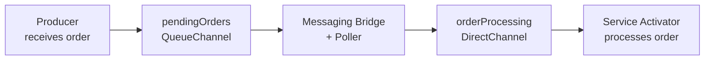
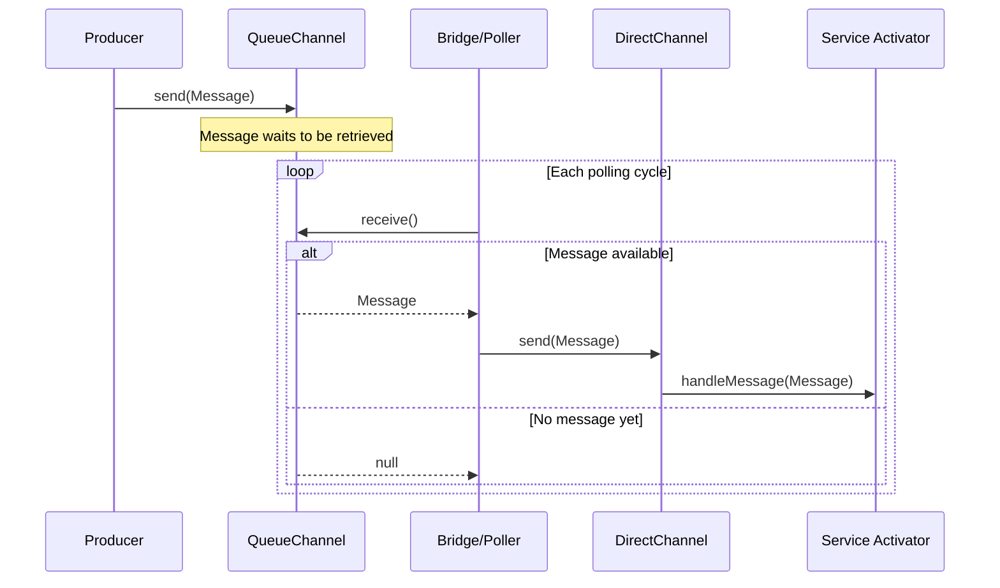
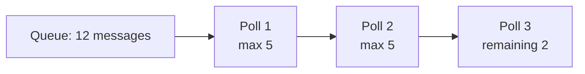
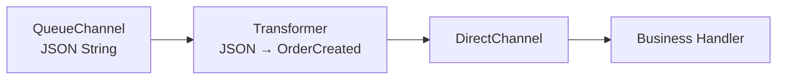

# Message Bridge Connecting Two Compatible Channels in Spring Integration

## 1. What is a Message Bridge?

In **Enterprise Integration Patterns (EIP)**, a *Messaging Bridge* is an endpoint that receives a message from one channel and forwards it to another channel. In Spring Integration, a bridge connects two `MessageChannel`s when the data is already in a suitable form to continue without requiring any business transformation.

For example, order data that has already been normalized into a message is placed into a `QueueChannel`. On the processing side, components such as `Filter`, `Router`, and `Service Activator` only need to subscribe via a `DirectChannel`. A **Bridge** sits between the two channels: it pulls messages from the queue on a polling schedule and forwards them to the processing channel. Consumers do not need to know how the queue is read.



This is a lesson in the **Bridge** chapter of the **SPRING_INTEGRATION_PATTERN** module, continuing the organization of EIP flows using channels, adapters, routers, filters, and other endpoints. The goal is to understand precisely **when two channels can be connected directly**, how to configure a bridge, how to test the message path, and how to recognize the operational limits of this connection.

After this lesson, you will be able to:

- Distinguish a bridge from a transformer, router, gateway, and channel adapter.
- Connect a `PollableChannel` to a `SubscribableChannel` using `@BridgeFrom` or Java DSL.
- Use a poller and `maxMessagesPerPoll` to limit the number of messages forwarded per poll.
- Verify payloads, headers, error flows, and behavior under increased load.
- Know when you need deduplication, durable storage, or data transformation outside the bridge.

## 2. Role and Boundary of Responsibility

Spring Integration represents data as a `Message<?>` consisting of:

- **Payload**: the main content, such as `OrderCreated`, `String`, `byte[]`, or `File`.
- **Headers**: metadata, such as `correlationId`, trace keys, event type, and timestamp.

A message bridge is a **forwarding endpoint** between an input channel and an output channel. A bridge does not sanitize payloads on its own, parse JSON into Java objects, select branches based on business conditions, or send requests to external systems in a request–reply model.

| Component | Primary Function | When Appropriate |
| --- | --- | --- |
| **Message Bridge** | Forwards messages between two channels | Data is sufficiently compatible; only need to connect two flow segments or add a polling cadence. |
| **Transformer** | Changes payload structure, type, or representation | Downstream expects `Order`, while upstream emits a JSON `String`. |
| **Filter** | Allows or discards messages based on a condition | Accept only valid orders. |
| **Router** | Selects a target channel/branch based on content or headers | Route orders by region or status. |
| **Channel Adapter** | Moves data into or out of the application boundary | Read files, receive broker messages, send data to external systems. |
| **Gateway** | Provides a request–reply communication point | The caller needs a corresponding response result. |

A simple bridge can usually forward messages without transforming the payload. However, **it does not provide by default** data transformation, deduplication, durable transaction logging, business retries, or exactly-once delivery.

### When are two channels considered “compatible”?

`MessageChannel` is a generic abstraction, so “compatible” here does not just mean that two beans share the Java `MessageChannel` type. You must examine the **data and behavioral contract** of both flow segments.

| Aspect | Questions to Check |
| --- | --- |
| Payload | Does the downstream consumer understand the type, structure, and encoding sent by the producer? |
| Headers | Are required keys such as `correlationId` or routing keys preserved? |
| Receiving Mechanism | Is the input channel pollable or subscribable; does the endpoint have an appropriate poller? |
| Load and Timing | Can downstream keep up with the rate at which the bridge forwards messages? |
| Errors and Transactions | When downstream fails, is the message retried, retained, or lost under the current configuration? |
| Destination | Is there a consumer subscribed to the target channel, and is the channel name correct? |

**Compatible example:** upstream and downstream both use an `OrderCreated` payload, the required headers are already present, and only the message receiving cadence needs to change.

**Incompatible example:** upstream sends a `String` containing CSV while the consumer requires `OrderCreated`. In this case, you need a Transformer or an appropriate parse/validate step before processing. A bridge does not automatically convert CSV into a Java object.

## 3. How Does a Bridge Work?

A bridge has its input attached to a source channel and its output attached to a target channel. In Spring Integration, `BridgeHandler` is the dedicated handler for this forwarding. The framework provides configuration options such as `@BridgeFrom`, `@BridgeTo`, `@ServiceActivator` combined with `BridgeHandler`, or Java DSL `.bridge()`.

### 3.1. PollableChannel → SubscribableChannel

This is the most prominent case:

- `PollableChannel`, such as `QueueChannel`, stores messages so a consumer can call `receive()` to retrieve them.
- `SubscribableChannel`, such as `DirectChannel`, pushes messages to subscribed handlers.
- The bridge sits in between and uses a **poller** to pull messages from the queue. Once retrieved, it sends the message to the target channel.



**Key point:** the downstream consumer only listens on `DirectChannel`. It does not write its own polling schedule to check `QueueChannel`.

### 3.2. SubscribableChannel → SubscribableChannel

A bridge can also connect two channels that both support subscribers, for example an input `DirectChannel` to an output `DirectChannel`. In that case, a poller is typically not needed on the bridge because the input already actively dispatches messages to its subscriber.

This case is useful when two parts of an application are designed as independent flows with clear channel boundaries. If you only need a simple sequential flow and there is no boundary to manage, sharing a channel may be cleaner than adding a bridge endpoint.

### 3.3. Is polling message transformation?

No. A poller specifies *when and how many messages* are received from a pollable source; a transformer modifies the data. If the consumer needs intentional changes to the payload or headers, use a Transformer before or after the bridge according to the flow's contract.

## 4. Hands-on Example with Java Configuration

Build an illustrative order intake flow:

1. The producer sends a message with payload `ORDER-001` to `pendingOrders`.
2. `pendingOrders` is a `QueueChannel` with a capacity of 100.
3. The bridge uses a poller to periodically pull up to 5 messages per poll and forward them to `orderProcessing`.
4. `orderProcessing` is a `DirectChannel`; a Service Activator receives the message and prints the payload along with `correlationId`.

The example uses Java 17 or later and Spring Boot with Spring Integration. In a Spring Boot project, use the dependency management/BOM matching your deployed Boot version.

### 4.1. Maven Dependencies

```xml
<dependencies>
    <dependency>
        <groupId>org.springframework.boot</groupId>
        <artifactId>spring-boot-starter-integration</artifactId>
    </dependency>
</dependencies>
```

This example only uses core Spring Integration channels and endpoints, without needing adapters for files or brokers yet.

### 4.2. Configuring the Bridge with @BridgeFrom

Place the `OrderBridgeConfiguration.java` class in a package scanned by Spring Boot component scanning:

```java
package com.example.integration;

import org.springframework.boot.CommandLineRunner;
import org.springframework.context.annotation.Bean;
import org.springframework.context.annotation.Configuration;
import org.springframework.beans.factory.annotation.Qualifier;
import org.springframework.integration.annotation.BridgeFrom;
import org.springframework.integration.annotation.Poller;
import org.springframework.integration.annotation.ServiceActivator;
import org.springframework.integration.channel.DirectChannel;
import org.springframework.integration.channel.QueueChannel;
import org.springframework.integration.config.EnableIntegration;
import org.springframework.messaging.Message;
import org.springframework.messaging.MessageChannel;
import org.springframework.messaging.MessageHandler;
import org.springframework.messaging.PollableChannel;
import org.springframework.messaging.SubscribableChannel;
import org.springframework.messaging.support.MessageBuilder;

@Configuration
@EnableIntegration
public class OrderBridgeConfiguration {

    @Bean
    public PollableChannel pendingOrders() {
        return new QueueChannel(100);
    }

    @Bean
    @BridgeFrom(
        value = "pendingOrders",
        poller = @Poller(fixedDelay = "1000", maxMessagesPerPoll = "5")
    )
    public SubscribableChannel orderProcessing() {
        return new DirectChannel();
    }

    @Bean
    @ServiceActivator(inputChannel = "orderProcessing")
    public MessageHandler orderHandler() {
        return message -> System.out.printf(
            "Received payload=%s, correlationId=%s%n",
            message.getPayload(),
            message.getHeaders().get("correlationId")
        );
    }

    @Bean
    public CommandLineRunner sampleProducer(
            @Qualifier("pendingOrders") MessageChannel pendingOrders) {
        return args -> {
            Message<String> order = MessageBuilder
                    .withPayload("ORDER-001")
                    .setHeader("correlationId", "corr-001")
                    .build();

            if (!pendingOrders.send(order)) {
                throw new IllegalStateException("Queue did not accept message");
            }
        };
    }
}
```

To run the application, use a main class in the same root package:

```java
package com.example.integration;

import org.springframework.boot.SpringApplication;
import org.springframework.boot.autoconfigure.SpringBootApplication;

@SpringBootApplication
public class BridgeApplication {

    public static void main(String[] args) {
        SpringApplication.run(BridgeApplication.class, args);
    }
}
```

Start the application with `mvn spring-boot:run` (if the project already has a complete Maven setup). After the producer sends the message and the poller runs, the console will show a line similar to:

```text
Received payload=ORDER-001, correlationId=corr-001
```

The exact timing depends on the poller schedule and application startup.

### 4.3. Explaining Each Component

- `pendingOrders()` creates a `QueueChannel`, allowing the producer to place messages into the queue and the consumer to retrieve them at its own pace. A capacity of 100 limits the number of waiting messages in the example's queue.
- `@BridgeFrom("pendingOrders")` is placed on the **target** channel bean `orderProcessing`; Spring Integration creates a bridge that receives from `pendingOrders` and sends to `orderProcessing`.
- `@Poller(fixedDelay = "1000", maxMessagesPerPoll = "5")` configures polling cycles with a 1,000 ms delay and up to 5 messages per poll. This is a **per-poll** limit, not a hard SLA of “exactly 5 messages/second”.
- `orderProcessing()` returns a `DirectChannel`, so when the bridge sends successfully, the handler is typically invoked synchronously on the sending thread.
- `@ServiceActivator` registers a consumer that receives `Message` from the target channel. The payload and `correlationId` header pass through the bridge without a transformation step.
- `CommandLineRunner` is only used to generate a sample message at startup. In a real application, the producer could be a file-reading adapter, HTTP endpoint, broker listener, or business component.

**Note:** The example above uses standard Java configuration. Do not define another bridge connecting the same two channels in the same context, because multiple consumers/bridges reading from the same source will alter message distribution.

## 5. Two Alternative Configuration Approaches for the Same Goal

### 5.1. Spring Integration Java DSL

You can replace the `@BridgeFrom` declaration with an explicit DSL flow. When using this approach, declare the two channel beans separately without placing `@BridgeFrom` on the target channel:

```java
@Bean
public IntegrationFlow bridgeFlow() {
    return IntegrationFlow.from("pendingOrders")
            .bridge(e -> e.poller(
                    Pollers.fixedDelay(1000).maxMessagesPerPoll(5)))
            .channel("orderProcessing")
            .get();
}
```

The types used belong to `org.springframework.integration.dsl.IntegrationFlow` and `org.springframework.integration.dsl.Pollers`. The DSL is well suited when the connection is one segment of a larger flow, such as subsequently chaining the queue to a Transformer, Filter, or Router.

### 5.2. XML Bridge

For projects using XML configuration in Spring Integration, the equivalent expression is:

```xml
<int:bridge input-channel="pendingOrders"
            output-channel="orderProcessing">
    <int:poller fixed-delay="1000" max-messages-per-poll="5"/>
</int:bridge>
```

The snippet uses Spring Integration's `int` namespace; the corresponding namespace/schema must be declared in the full XML configuration. It directly represents the two channels and the poller in between.

### 5.3. Using BridgeHandler

In endpoint-handler style Java configuration, you can use `BridgeHandler` together with `@ServiceActivator`:

```java
@Bean
@ServiceActivator(
    inputChannel = "pendingOrders",
    poller = @Poller(fixedDelay = "1000", maxMessagesPerPoll = "5")
)
public BridgeHandler bridgeHandler() {
    BridgeHandler bridge = new BridgeHandler();
    bridge.setOutputChannelName("orderProcessing");
    return bridge;
}
```

`BridgeHandler` belongs to `org.springframework.integration.handler.BridgeHandler`. This approach explicitly specifies the handler, though it is usually more verbose than `@BridgeFrom` or the DSL.

**The three approaches above are alternatives**, not three bridges to enable simultaneously. If you configure multiple independent bridges reading from the same `QueueChannel`, messages in the queue will be received by competing consumers; do not assume each bridge receives a copy of every message.

## 6. Bridge and Forwarding Rate Limits

When a bridge receives messages from a `PollableChannel`, the poller controls the reading schedule. Key parameters to note:

| Property | Effect | Example |
| --- | --- | --- |
| `fixedDelay` | Delay between polling executions | 1,000 ms. |
| `fixedRate` | Scheduled at a fixed periodic rate | Every 5,000 ms. |
| `cron` | Triggers according to a cron schedule expression | Run during specific time windows. |
| `maxMessagesPerPoll` | Limits the number of messages fetched per poller trigger | 5 messages/poll. |

If there are 12 messages in the queue and `maxMessagesPerPoll=5`, a sequence of polls can fetch up to 5, then 5, then 2 messages, **assuming** no new messages arrive, no errors occur, and the consumer keeps up. This is only an example of per-poll limits; total time also depends on the scheduler and downstream processing time.



Do not treat a poller as an exact per-second rate-limiting system. If you need to enforce API quotas, requests per time window, or load distribution across multiple instances, add a rate-limiting/backpressure mechanism designed for that requirement.

### Backpressure and Capacity

`QueueChannel(100)` bounds the number of messages buffered in memory. When the queue is full, the producer must handle the `send()` result or choose an appropriate wait, retry, or error strategy. Do not simply increase capacity indefinitely if downstream processing is slow: measure backlog and wait times instead.

On the other hand, when a bridge sends to a `DirectChannel`, the handler typically executes synchronously. If the handler takes a long time or throws an error, the polling cycle may be prolonged or errors may propagate back to the polling endpoint. Switching to an asynchronous channel changes completion timing, where errors are reported, and shutdown management requirements.

## 7. Guarantees That a Bridge Does Not Provide Automatically

### 7.1. Message Delivery and Crash Recovery

The `QueueChannel` in the example is in-memory; queued data does not automatically survive process termination. Nor does a bridge write a transaction log or turn pulling from a queue and running business logic into an atomic transaction.

A message may already have been taken from the queue while downstream processing fails. Recovery depends on the channel type, transaction manager, advice/retry, error flow, and source system. If high reliability is needed, consider a durable broker, message store, bounded retries, dead-letter handling, and idempotent processing.

### 7.2. Headers and Correlation

A bridge is used when you want to **forward an existing message**, so information such as the payload, `correlationId` header, and tracking keys are carried across the channel boundary. However, interceptors, additional components, or message reconstruction elsewhere in the flow can affect metadata. In tests, verify the headers required by the contract rather than assuming every message object preserves the same Java object identity.

A bridge does not generate or manage `correlationId` according to business rules. With a Splitter/Aggregator, if messages need to be grouped, correlation and sequence information must be created, preserved, and handled by the relevant endpoints.

### 7.3. No Automatic Data Transformation

If the queue holds `Message<String>` while the consumer expects an `OrderCreated` payload, a plain bridge will not parse the data automatically. An appropriate flow could be:



When transformation is needed, use a Transformer as the endpoint dedicated to that job. If you only need to connect two flow segments that accept the same payload, a bridge is the cleaner choice.

### 7.4. No Automatic Request–Reply

A bridge is not a Gateway. Even if a message carries a `replyChannel` header, forwarding it through a bridge does not turn it into a synchronous call with a response by default. When no specific output channel is configured, `BridgeHandler` can fall back to the `replyChannel` in the message if that header is present; if neither is available, output routing fails. For flows requiring a call with a return value, design a Gateway with appropriate reply channel, timeout, and error handling.

## 8. Testing the Message Path

When deploying a bridge in a real project, test the **path from the source channel to the target handler**. Scenarios to verify include:

| Scenario | Expected Behavior |
| --- | --- |
| Send a `Message<String>` to `pendingOrders` | Handler `orderHandler` receives the exact payload and `correlationId`. |
| No messages in the queue | Poller runs without fabricating messages or invoking the handler unnecessarily. |
| Put more than 5 messages into the queue | Each poll receives at most 5; remaining messages wait for subsequent polls. |
| Slow consumer | Latency increases; monitor backlog and processing time. |
| Consumer throws an exception | Observe the configured error flow/retry; do not assume the message automatically returns to the queue. |
| Producer keeps sending when the queue is full | The `send` result or timeout is handled explicitly. |

An integration test can use a `CountDownLatch` or a test result queue to wait for the consumer to be invoked, then assert the payload and headers. Avoid using fixed `Thread.sleep()` calls to “guess” polling times, as tests can become flaky on slower machines.

Useful metrics include **messages received**, **messages successfully forwarded**, **downstream errors**, **queued message count**, **end-to-end latency**, and **empty poll counts**. With multiple instances, align on how the source is partitioned and how processed messages are counted so metrics are not miscounted.

## 9. Common Configuration Mistakes

**Wrong channel name:** `@BridgeFrom(value = "pendingOrders")` must reference the exact source bean; `@ServiceActivator(inputChannel = "orderProcessing")` must point to the target channel. A wrong name can prevent the application context from creating the endpoint or prevent messages from reaching the intended destination.

**Forgetting a poller for a pollable source:** `QueueChannel` does not actively push messages like `DirectChannel`. An endpoint receiving from it needs an appropriate polling mechanism.

**Adding multiple bridges on the same queue:** A queue uses competing-consumer semantics. Two bridges reading the same queue usually split messages between them rather than multicasting. If you want broadcasting, design a `PublishSubscribeChannel` or an appropriate distribution architecture.

**Assuming exact time-based throttling:** `maxMessagesPerPoll` bounds the number of messages per poll cycle; it does not guarantee a fixed rate over every one-second interval.

**Ignoring downstream errors:** Forwarding does not replace retries, transactions, or idempotency. You must design appropriate recovery, especially when the data source carries business value.

**Using a bridge when data is incompatible:** A bridge does not convert payloads from CSV to JSON, from `String` to a domain object, or change schemas. Use a Transformer when data modification is genuinely required.

## 10. Summary and Self-Check Questions

A Message Bridge is an endpoint that **connects two compatible channels**, commonly transferring messages from a `PollableChannel` to a `SubscribableChannel`. The poller schedule and per-poll message limit live on the bridge, while downstream consumers depend only on the target channel. In Spring Integration Pattern architecture, this structure separates message intake/throttling from Filter, Transformer, Router, Service Activator, and business steps.

Try answering these three questions before finishing the lesson:

1. Why does a `QueueChannel` usually need a poller when connected to a `DirectChannel`, whereas two `DirectChannel`s can be connected through a bridge without a poller?
2. When a producer sends a JSON `String` payload but the consumer expects `OrderCreated`, why is simply adding a bridge not enough?
3. If a handler behind a bridge throws an error after a message has left the queue, what mechanisms determine whether the message can be reprocessed?

**Official Reference:** [Spring Integration Reference — Messaging Bridge](https://docs.spring.io/spring-integration/reference/bridge.html). The configurations here use the APIs documented in Spring Integration: `@BridgeFrom`, `@BridgeTo`, `BridgeHandler`, and Java DSL `.bridge()`.
