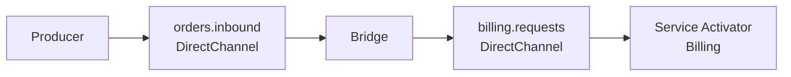
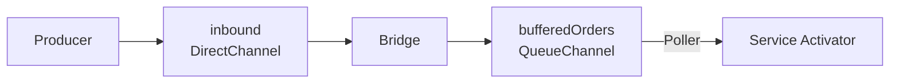
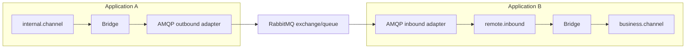
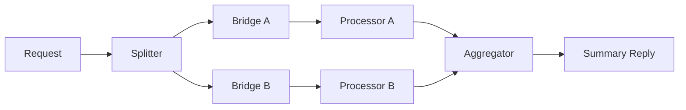

# Bridge Between an Internal Channel and Another Channel in Spring Integration

## Lesson Objectives

After this lesson, you will be able to:

- Explain the **Bridge pattern** and the role of `BridgeHandler` when forwarding a message from an input channel to an output channel in Spring Integration.
- Distinguish a Bridge from `Service Activator`, `Transformer`, `Router`, `Gateway`, and **Channel Adapter**.
- Build a forwarding flow between two `DirectChannel`s using Java DSL and verify that payloads/headers reach the right consumer.
- Choose how to connect a `DirectChannel` with a `QueueChannel` or `ExecutorChannel`, understanding synchronization points, queue bounds, and pollers.
- Analyze the preservation of `replyChannel`, `errorChannel`, correlation ID, and sequence headers when request–reply, Splitter, or Aggregator is involved.
- Design connection points to brokers or external systems and handle errors, retries, duplicates, backpressure, and tracing intentionally.

The **Bridge** topic belongs to the **SPRING_INTEGRATION_PATTERN** module, where we practice *Enterprise Integration Patterns* with Spring Integration to build loosely coupled, extensible message flows. A Bridge allows connecting segments of a message flow without forcing the producer to know downstream logic. When combined with Router, Filter, Transformer, Splitter, Aggregator, Gateway, retry, error channel, and correlation, the Bridge typically acts as a **forwarding** point while other endpoints handle business logic.

## 1. What Problem Does the Bridge Pattern Solve?

Suppose a system receives order events into channel `orders.inbound`. The intake team owns this channel; the billing team owns channel `billing.requests`. If the producer sends directly to the processing team's channel, every change in the downstream flow structure forces the producer to know internal details.

A Bridge creates an explicit connection step:



A **Bridge** is an endpoint that receives a message from a source channel and forwards it to a target channel. It is not responsible for calculating orders, changing payload schemas, deciding among multiple branches, or guaranteeing that a message has been durably persisted.

In Spring Integration, `BridgeHandler` implements this forwarding role; Java DSL can declare it with `.bridge()`. A Bridge normally forwards message contents (payload and necessary headers) according to the framework's message-handling mechanism. However, **do not treat a Bridge as a byte-by-byte immutability contract or assume it automatically serializes every header over a network**; verify the headers your flow actually depends on.

The advantage is that the relationship between two channels is expressed explicitly in configuration. The two channels can belong to two independently developed flow segments while the Bridge is responsible for connecting them.

### 1.1. A Bridge Does Not Create a Transport Outside the JVM

A Bridge connects **Spring Integration message channels** inside a flow. If the destination is RabbitMQ, Kafka, JMS, HTTP, or SFTP outside the process, you need an **outbound channel adapter/gateway** to package, connect, and transmit data over the appropriate protocol. On the receiving side, an **inbound adapter** turns incoming data back into a Spring `Message<?>`.

```text
Within a single process:
  channel A -> BridgeHandler -> channel B

Between two processes:
  channel A -> outbound adapter -> broker/HTTP -> inbound adapter -> channel B
           (a Bridge may sit before/after an adapter to organize the flow)
```

With this distinction, we avoid mistakenly assigning a Bridge responsibilities that only a transport/broker or adapter can provide: serialization, network retries, acknowledgments, persistence, authentication, and delivery semantics.

## 2. Bridge Compared to Other Endpoints

| Component | Primary Responsibility | How It Differs from a Bridge |
| --- | --- | --- |
| **Bridge** | Forwards messages between two channels | Purpose is connecting flow segments; requires no payload transformation |
| **Service Activator** | Invokes a business method upon receiving a message | Can return a result, produce side effects, or throw errors |
| **Transformer** | Converts payload/headers/format | Responsible for producing a new representation per contract |
| **Router** | Chooses one or more target channels based on conditions | Decides routing direction; a Bridge usually has a configured destination |
| **Filter** | Passes or discards messages | Applies acceptance conditions; a Bridge does not filter by business rules |
| **Gateway** | Provides a calling interface and can wait for a reply | Establishes a request–reply contract and caller lifecycle |
| **Channel Adapter** | Moves data into/out of Spring Integration via external systems | Has its own protocol and transport mapping |
| **Splitter / Aggregator** | Splits into multiple messages / aggregates grouped messages | Manages counts, correlation, and completion conditions |

If the goal is solely to connect two existing channels, using a Bridge makes that intent explicit in configuration. If you truly need to alter content, use a Transformer. If you need to choose a destination by event type, use a Router. If you need to send messages to a broker, use an outbound adapter.

## 3. Basic Example: Bridge Between Two DirectChannels

The example below uses **Java 17+, Spring Boot 3.x, and Spring Integration 6.x**. It requires the appropriate Spring Integration dependency for your application; place `public` classes in separate Java files within a package scanned by Spring Boot.

The flow has two internal channels: `incomingOrders` and `readyForBilling`. The producer only knows the first channel, while the business handler only subscribes to the second.

### 3.1. Business Data

```java
// OrderAccepted.java
public record OrderAccepted(
        String orderId,
        long amountMinorUnit
) {}
```

`amountMinorUnit` represents money in its smallest unit (for example, dong for VND) so the example avoids floating-point rounding errors. This value is only for illustrating the channel mechanism; the Bridge itself does not care about the record structure.

### 3.2. Declaring Two Channels and the Bridge

```java
// OrderBridgeConfiguration.java
import org.springframework.context.annotation.Bean;
import org.springframework.context.annotation.Configuration;
import org.springframework.integration.channel.DirectChannel;
import org.springframework.integration.config.EnableIntegration;
import org.springframework.integration.dsl.IntegrationFlow;
import org.springframework.messaging.MessageChannel;

@Configuration
@EnableIntegration
public class OrderBridgeConfiguration {

    @Bean
    public MessageChannel incomingOrders() {
        return new DirectChannel();
    }

    @Bean
    public MessageChannel readyForBilling() {
        return new DirectChannel();
    }

    @Bean
    public IntegrationFlow orderBridgeFlow() {
        return IntegrationFlow.from("incomingOrders")
            .bridge()
            .channel("readyForBilling")
            .get();
    }
}
```

`IntegrationFlow.from("incomingOrders")` registers the receiving point from the source channel. `.bridge()` creates the Bridge step in the flow; `.channel("readyForBilling")` specifies the next channel. When Spring initializes the flow, the subscriber on `incomingOrders` forwards messages to `readyForBilling`.

**Attention:** the configuration uses `DirectChannel` on both sides. With normal handlers, a `send()` call can execute across the Bridge to the target channel's handler on the **same thread**. A Bridge **does not start an executor on its own** and does not guarantee asynchronous delivery.

### 3.3. Consumer Behind the Bridge

```java
// BillingCollector.java
import java.util.Map;
import java.util.concurrent.ConcurrentHashMap;
import org.springframework.integration.annotation.ServiceActivator;
import org.springframework.messaging.Message;
import org.springframework.stereotype.Component;

@Component
public class BillingCollector {
    private final Map<String, String> observedRequestIds =
        new ConcurrentHashMap<>();

    @ServiceActivator(inputChannel = "readyForBilling")
    public void handle(Message<OrderAccepted> message) {
        OrderAccepted order = message.getPayload();
        String requestId = message.getHeaders().get(
            "requestId", String.class);

        observedRequestIds.put(order.orderId(), requestId);
        // In production, replace with idempotent business processing.
    }

    public String requestIdFor(String orderId) {
        return observedRequestIds.get(orderId);
    }
}
```

The consumer receives `Message<OrderAccepted>` to inspect headers. `requestId` is generated by the producer in this example for tracing. Because the Bridge does not transform the payload, the handler receives the same `OrderAccepted` type. However, when crossing an adapter out of the process, explicit header mapping is required; do not rely on internal object-passing semantics.

### 3.4. Producer Sending Messages to the Source Channel

```java
// OrderPublisher.java
import org.springframework.beans.factory.annotation.Qualifier;
import org.springframework.messaging.MessageChannel;
import org.springframework.messaging.support.MessageBuilder;
import org.springframework.stereotype.Component;

@Component
public class OrderPublisher {
    private final MessageChannel channel;

    public OrderPublisher(
            @Qualifier("incomingOrders") MessageChannel channel) {
        this.channel = channel;
    }

    public void publish(String orderId) {
        boolean accepted = channel.send(
            MessageBuilder.withPayload(new OrderAccepted(orderId, 120000L))
                .setHeader("requestId", "req-" + orderId)
                .build()
        );
        if (!accepted) {
            throw new IllegalStateException("ORDER_SEND_REJECTED");
        }
    }
}
```

After calling `publish("O-101")`, the message follows this path:

```text
OrderPublisher
  -> incomingOrders
  -> orderBridgeFlow / BridgeHandler
  -> readyForBilling
  -> BillingCollector.handle(...)
```

`send() == true` means the channel accepted the send operation under its contract. In the synchronous `DirectChannel` path of this example, the handler has typically already been invoked before `send()` returns; if a segment is replaced by an `ExecutorChannel` or a queue, `send() == true` no longer proves that downstream business logic has completed.

## 4. Connecting DirectChannel to QueueChannel: A Bridge Does Not Drain a Queue by Itself

Suppose the producer sends quickly while the handler needs to process in batches. You can place a `QueueChannel` after the Bridge:



This is an **independent alternative configuration** compared to the example in Section 3. Do not register two Bridges simultaneously on the same source channel unless you intentionally want load distribution or fan-out.

### 4.1. Example Configuration

```java
// BufferedBridgeConfiguration.java
import org.springframework.context.annotation.Bean;
import org.springframework.context.annotation.Configuration;
import org.springframework.integration.channel.DirectChannel;
import org.springframework.integration.channel.QueueChannel;
import org.springframework.integration.config.EnableIntegration;
import org.springframework.integration.dsl.IntegrationFlow;
import org.springframework.messaging.MessageChannel;
import org.springframework.messaging.PollableChannel;

@Configuration
@EnableIntegration
public class BufferedBridgeConfiguration {

    @Bean
    public MessageChannel bufferedIngress() {
        return new DirectChannel();
    }

    @Bean
    public PollableChannel bufferedOrders() {
        return new QueueChannel(100);
    }

    @Bean
    public IntegrationFlow bridgeIntoBuffer() {
        return IntegrationFlow.from("bufferedIngress")
            .bridge()
            .channel("bufferedOrders")
            .get();
    }
}
```

`QueueChannel(100)` is an **in-memory** queue holding up to 100 messages. The Bridge places messages into the queue; it does not ensure a consumer pulls them out. Because `QueueChannel` is a `PollableChannel`, a poller/consumer is needed downstream.

### 4.2. Consumer Using a Poller

```java
// BufferedOrderHandler.java
import org.springframework.integration.annotation.Poller;
import org.springframework.integration.annotation.ServiceActivator;
import org.springframework.stereotype.Component;

@Component
public class BufferedOrderHandler {

    @ServiceActivator(
        inputChannel = "bufferedOrders",
        poller = @Poller(
            fixedDelay = "500",
            maxMessagesPerPoll = "5"
        )
    )
    public void process(OrderAccepted order) {
        // Processing may be slow; the source is polled on a schedule.
        System.out.println("Billing order: " + order.orderId());
    }
}
```

Here, the **Bridge only forwards messages**, while the **polling consumer** invokes the handler on a schedule. `fixedDelay = 500 ms` sets the pause between polls; `maxMessagesPerPoll = 5` limits the number of messages per poll, subject to other characteristics of the source and scheduler.

### 4.3. Risks with an Internal Buffer

| Scenario | Behavior to Anticipate |
| --- | --- |
| Queue is full | `send` may block or fail depending on timeout/policy; configure wait limits and rejection handling |
| Handler slower than producer | Backlog grows; actual latency exceeds the time the Bridge takes to forward |
| Process restarts | The `QueueChannel` in the example does not guarantee message recovery after a restart |
| Handler throws an exception | Impact depends on the consumer, error flow, and transaction; messages do not automatically return to the queue by default |
| Multiple consumers read the same queue | Each message is typically picked up by one consumer; this is not Publish–Subscribe |

To achieve durability and recovery across restarts, you need an appropriate transport/store, completion acknowledgment policy, and idempotency. Simply placing a Bridge before a QueueChannel does not turn an in-memory queue into a message broker.

## 5. Connecting to ExecutorChannel: The Asynchronous Step Lives in the Channel

If the target is an `ExecutorChannel`, the channel dispatches work to an executor to run on another thread:

```text
producer thread
    |
    v
DirectChannel -- Bridge --> ExecutorChannel
                             |
                             v
                        worker thread
                             |
                             v
                       Service Activator
```

An **independent** configuration example for another flow:

```java
// AsyncBridgeConfiguration.java
import org.springframework.context.annotation.Bean;
import org.springframework.context.annotation.Configuration;
import org.springframework.integration.channel.DirectChannel;
import org.springframework.integration.channel.ExecutorChannel;
import org.springframework.integration.config.EnableIntegration;
import org.springframework.integration.dsl.IntegrationFlow;
import org.springframework.messaging.MessageChannel;
import org.springframework.scheduling.concurrent.ThreadPoolTaskExecutor;

@Configuration
@EnableIntegration
public class AsyncBridgeConfiguration {

    @Bean
    public ThreadPoolTaskExecutor bridgeExecutor() {
        ThreadPoolTaskExecutor executor = new ThreadPoolTaskExecutor();
        executor.setCorePoolSize(2);
        executor.setMaxPoolSize(4);
        executor.setQueueCapacity(50);
        executor.setThreadNamePrefix("bridge-worker-");
        return executor;
    }

    @Bean
    public MessageChannel asyncIngress() {
        return new DirectChannel();
    }

    @Bean
    public MessageChannel asyncWork() {
        return new ExecutorChannel(bridgeExecutor());
    }

    @Bean
    public IntegrationFlow bridgeToAsyncWork() {
        return IntegrationFlow.from("asyncIngress")
            .bridge()
            .channel("asyncWork")
            .get();
    }
}
```

**Asynchrony comes from `ExecutorChannel`, not from the Bridge.** `maxPoolSize` and `queueCapacity` make task handoff bounded; if processing is slow and the upstream source sends too fast, the application may reject tasks or experience growing latency. The return of `send()` on the producer thread does not mean the handler has succeeded.

Nor does a Bridge propagate transactions across threads: if a request is sent within an open transaction, the worker may run under a different transaction boundary. When business logic requires exactly-once semantics or durable writes, define separate commit points, retries, and completion states.

## 6. Bridge and Channel Adapters with Brokers or External Services

“Another channel” can be another internal channel, or a **communication channel in an external system**. The two cases do not share the same mechanism:

### 6.1. Internal Channel Case

```text
JVM A:
  internalChannel -> BridgeHandler -> processingChannel
```

Both channels are Spring `MessageChannel`s within the same application context or properly wired contexts. They share a process and can pass Java objects directly.

### 6.2. Broker Case



The **outbound adapter** selects the exchange/routing key, converts payload/headers into a sendable message, connects to RabbitMQ, and applies transport rules. The **inbound adapter** receives messages from the broker and places them onto an internal channel. The Bridges at both ends only organize the internal flow; they do not implement the network protocol.

Logical structure example:

```text
Application A
  order.events.internal
       -> Bridge
       -> toRabbitChannel
       -> AMQP outbound adapter(exchange="orders.events")

RabbitMQ
  orders.events exchange
       -> queue for consumer

Application B
  AMQP inbound adapter(queue="orders.billing")
       -> fromRabbitChannel
       -> Bridge
       -> billing.channel
       -> Service Activator
```

To make this a working flow, you also must configure exchanges, queues, bindings, converters, authentication, acknowledgments, retries, dead-letter handling, and operational options. These are **responsibilities of the adapter and broker**, not of `BridgeHandler`.

### 6.3. Headers to Preserve Across Process Boundaries

| Metadata | At an Internal Bridge | Through a Broker/Adapter |
| --- | --- | --- |
| Payload | Forwarded along the message flow | Must be serialized/deserialized; schema between producer and consumer must align |
| Business `requestId` | Can be kept in header/payload | Should be explicitly mapped for tracing, reconciliation, and idempotency |
| `correlationId` | Can serve internal Splitter/Aggregator or request–reply | Must decide which broker header it maps to, who generates it, and who restores it |
| `replyChannel` | Can be an internal `MessageChannel` object | Cannot be sent over the network as a raw Java object; use an appropriate reply destination/correlation |
| `errorChannel` | Defines the error path within the same flow | Remote errors require dedicated retry, dead-letter, or error response strategies |
| `sequenceNumber` / `sequenceSize` | Supports message grouping after a Splitter | If the Aggregator is in another process, group header mapping must be verified |
| `traceId` | Helps trace the message | Propagate trace context according to observability conventions and security policies |

If the goal is **request–reply**, the producer must know when and how to receive the response. A Bridge does not create a reply destination or a pending-request table. Use an appropriate Gateway/request–reply adapter or a custom protocol with correlation IDs, deadlines, and late-reply handling.

## 7. Precautions When a Bridge Is Inside a Request–Reply Flow

A request passing through a Bridge may still need to return to the caller:

```text
Caller -> Messaging Gateway -> requestChannel
                               |
                               v
                             Bridge
                               |
                               v
                           workerChannel
                               |
                               v
                          Service Activator
                               |
                               v
                       caller's replyChannel
```

Within the same process, the `replyChannel` header set by the Gateway can be used by Spring Integration endpoints to route the response. When adding a Bridge, you must preserve the reply path or configure an appropriate output channel so the result reaches the Gateway. The Bridge only forwards the request to the worker; **Service Activator/Gateway** defines the request–reply contract.

### 7.1. Example of Recognizing Lost-Header Risk

Suppose a handler constructs a new message while omitting required headers:

```java
Message<?> replacement = MessageBuilder
    .withPayload(original.getPayload())
    .build();
// For illustration only: replacement intentionally omits copying headers.
```

If this message replaces the request on the way to the Service Activator and no explicit reply path is configured, the caller may wait until `replyTimeout` expires. In Spring Integration, standard endpoints typically propagate/merge headers according to framework mechanisms, whereas adapters or custom handlers can alter them. When building a new message, identify which headers must be forwarded and which cannot be serialized.

### 7.2. Correlation with Splitter and Aggregator

An incoming message can be split into multiple items, routed through different Bridges, and then aggregated into a group:



A Bridge does not determine group size, correlation strategy, or release conditions. When one branch is slow, a Filter drops a message, or processing crosses a broker, the Aggregator may wait until enough replies arrive or the group timeout expires. If `CORRELATION_ID`, `SEQUENCE_NUMBER`, or `SEQUENCE_SIZE` is lost during mapping, aggregation can behave incorrectly or fail to complete.

**Distinction:** an Aggregator's correlation identifies a group of messages; correlation in an RPC over a broker identifies a single request–reply round trip. They may be related, but must not be assumed to be the same field with the same meaning.

## 8. Errors, Backpressure, and Delivery Behavior

A Bridge is neither a retry engine nor a buffer. When a flow segment fails, the outcome depends on the channel type and downstream endpoints.

| Scenario | With `DirectChannel` | With `QueueChannel` / `ExecutorChannel` |
| --- | --- | --- |
| Downstream handler throws exception | Typically propagates on the same call stack to the sender | May happen after the sender has already been accepted; requires an appropriate error flow |
| Slow consumer | Sender may block during processing | Backlog or worker wait time increases |
| Channel has no valid subscriber | May cause a dispatch error | Queue may accept messages without a consumer yet; executor needs a handler to dispatch |
| Process restart | No durability guarantee | In-memory queue/executor does not recover data automatically either |
| Resource limits | Sender thread bears the cost | Queue capacity, thread pool, and rejection policy must be configured explicitly |

**Error channel:** asynchronous components can wrap exceptions into an `ErrorMessage` sent to `errorChannel` when properly configured. Do not assume errors from a Bridge or every handler always go to an error queue automatically; in synchronous flows, exceptions may propagate directly back to the caller.

**Retry:** if a message travels across a Bridge to an adapter and the broker returns a transient error, retries must attach to the boundary that can genuinely fail. Retrying an operation with side effects without idempotency can create duplicates. With file/JDBC sources, know when a record is marked as read and when business processing is truly complete.

**Backpressure:** a `DirectChannel` adds no queue; it exerts backpressure on the sender when the handler is slow. `QueueChannel` buffers finitely and `ExecutorChannel` hands work off to a thread pool; both options require capacity, timeouts, and metrics. A Bridge does not throttle the sending rate for you.

### 8.1. When Is Using a Bridge Beneficial?

| Need | Is a Bridge Suitable? | Suggestion |
| --- | --- | --- |
| Connect two `IntegrationFlow` segments in the same process | Yes | A Bridge keeps channel boundaries clear |
| Switch from one input channel to an existing output channel | Yes | Preserves the payload/header contract |
| Add routing by message type | Not sufficient | Use a Router or Filter |
| Convert `OrderEvent` into a different JSON schema | Not sufficient | Use a Transformer/converter |
| Send messages to RabbitMQ or an HTTP API | Not sufficient | Use an outbound channel adapter/gateway |
| Periodically read data from DB/SFTP | Not sufficient | Use an inbound polling adapter and poller |
| Return a synchronous response to the caller | A Bridge can be one segment in the flow | Gateway, Service Activator, and reply/error contract are the core |
| Guarantee message survival across restarts | A Bridge does not provide this | Use an appropriate broker/message store/transaction |

## 9. Testing an Internal Bridge

Using the classes from Section 3, an integration test can verify that a message with its payload and headers is delivered to the expected consumer. The test uses a Spring Boot context containing `OrderBridgeConfiguration`, `BillingCollector`, and `OrderPublisher`.

```java
// OrderBridgeFlowTest.java
import static org.assertj.core.api.Assertions.assertThat;

import java.util.UUID;
import org.junit.jupiter.api.Test;
import org.springframework.beans.factory.annotation.Autowired;
import org.springframework.boot.test.context.SpringBootTest;

@SpringBootTest
class OrderBridgeFlowTest {

    @Autowired
    private OrderPublisher publisher;

    @Autowired
    private BillingCollector collector;

    @Test
    void forwardsMessageAndRequestHeader() {
        String orderId = "O-" + UUID.randomUUID();

        publisher.publish(orderId);

        // With two DirectChannels and a synchronous handler,
        // the message reaches BillingCollector before publish returns.
        assertThat(collector.requestIdFor(orderId))
            .isEqualTo("req-" + orderId);
    }
}
```

This test verifies the flow's essential behavior: **the right destination and the right header**. It does not prove Bridge durability, retry capability, or correlation across a broker.

### 9.1. Additional Test Cases Based on Architecture

1. **Target channel has no handler:** confirm the error is detected and recorded according to the actual dispatch mechanism.
2. **Slow downstream processing:** with DirectChannel, observe how long `send()` is held; with ExecutorChannel, measure worker latency.
3. **Full queue:** create a backlog exceeding capacity, and verify blocking/timeout/rejection policy and metrics.
4. **Request–reply headers:** send a request with `replyChannel`, verifying the result still returns to the caller after crossing the Bridge.
5. **Group correlation:** send two Splitter/Aggregator groups concurrently, reorder branches, and ensure groups are not mixed.
6. **Error after async boundary:** worker throws an exception; the error flow receives the event or the caller receives the error status as contracted.
7. **Across a broker:** use an integration test with a real broker/testcontainer, verifying header mapping and redelivery; do not use a DirectChannel test to conclude transport safety.

## 10. Operational Observability

In large systems, a Bridge makes flow boundaries visible but does not identify latency sources on its own. Measure both the channels before and after the Bridge, as well as adapters and consumers.

| Metric / Trace Field | Purpose |
| --- | --- |
| `messageId`, `requestId` | Distinguish a specific message and business operation |
| `correlationId`, `traceId` | Correlate processing branches and link logs across services |
| Messages received/sent at each endpoint | Locate message loss or bottlenecks |
| `send()` duration on `DirectChannel` | Surface synchronous downstream latency |
| Queue depth / oldest message age | Detect backlog behind a Bridge |
| Executor active threads / rejected tasks | Detect async overload |
| Error count, retry count, dead-letter count | Assess processing pipeline health |
| End-to-end latency from producer to consumer | Measure real business impact |

For brokers, record exchange/queue/topic, delivery attempt, and business IDs in compliance with security policies; avoid logging full sensitive payloads. When using Spring Integration management/metrics, meaningful channel and endpoint names make flow analysis on dashboards clearer.

## 11. Design Exercise

Suppose an order is received over HTTP: one branch calculates fees immediately, and another branch publishes an event to a broker to update a dashboard:

```text
HTTP inbound gateway
  |
  v
validation.channel
  |
  +---- Router / Publish-Subscribe ----> pricing.channel -> Service Activator -> reply
  |
  +---- event.channel -> Bridge -> outbound.rabbit.channel -> AMQP adapter
```

Answer for yourself:

1. Which channel needs a **reply** to the HTTP caller, and which only needs to emit an event?
2. If publishing the event fails after the order has committed, should you use a transactional outbox or another recovery mechanism?
3. If `event.channel` is replaced with a `QueueChannel`, who is the consumer and how do you prevent the internal queue from filling up?
4. If fee calculation is moved to an `ExecutorChannel`, what timeout does the Gateway need and how should late replies be handled?
5. When adding a Splitter to send events to three destinations, where do the correlation ID and release condition live?

A good approach is to let the Bridge clearly connect internal channels, delegate branching to Router/Publish–Subscribe, delegate RabbitMQ transport to the outbound adapter, and keep the request–reply contract at the Gateway/Service Activator.

## 12. Production Readiness Checklist for a Bridge

1. **Are there truly two channel boundaries to connect?** If not, use an endpoint matching the business logic instead of adding a Bridge merely to add steps.
2. **What are the channel types on both ends?** Direct, Queue, Executor, or publish–subscribe? Do threads, pollers, and latency change?
3. **Which headers must be preserved?** How are `requestId`, `replyChannel`, `errorChannel`, correlation, and sequence metadata handled?
4. **Is there a process boundary?** If so, are outbound/inbound adapters and transport mappings fully configured?
5. **Where do errors and retries live?** When an adapter throws an error or a queue fills up, who handles it and is there a risk of duplicate side effects?
6. **Are resources bounded?** Are executor limits, queue capacities, timeouts, backpressure, and overload policies configured?
7. **Have critical behaviors been tested?** Headers, reply routing, error paths, ordering, concurrency, and restart recovery?

## Conclusion

The **Bridge pattern** connects a source channel to a target channel in Spring Integration, linking flow segments without introducing business logic into the forwarding step. With `DirectChannel`, a Bridge typically preserves synchronous execution; with `QueueChannel` or `ExecutorChannel`, queuing, asynchrony, and resource bounds come from the **target channel** and its consumer. When the destination is a broker or an external application, add a **channel adapter/gateway** to handle transport, serialization, acknowledgments, and retries. A well-placed Bridge makes Router, Transformer, Aggregator, Gateway, and Service Activator flows clearer, while still requiring explicit design for correlation, error channels, and business delivery guarantees.
