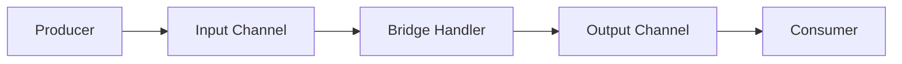
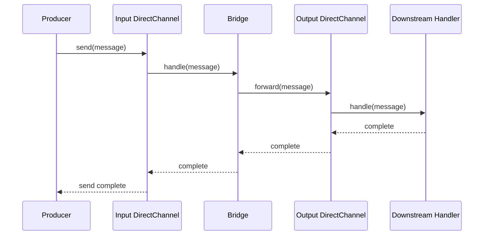
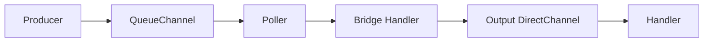
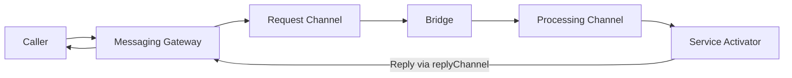
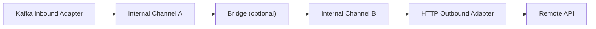

# Bridge Without Message Transformation in Spring Integration

## 1. Problem to Solve

In an integration system, a flow may receive a message from module A and need to pass the exact message to module B. For example, an order-processing system has a `validatedOrders` channel that receives validated orders and an `ordersToDispatch` channel that dispatches them to subsequent steps. Between the two channels, you only need to **connect the message path**, without changing the payload, modifying headers, or computing new data.

This is the use case for the **Bridge** pattern in Enterprise Integration Patterns: connecting two segments of a messaging system so messages continue flowing through while the bridge itself performs no content transformation.

In **Spring Integration**, a Bridge is implemented by a message handler responsible for forwarding messages from an input channel to an output channel. The **Bridge Without Message Transformation** lesson belongs to the **Bridge** chapter of the **SPRING_INTEGRATION_PATTERN** module. The module aims to build loosely coupled, extensible integration flows using Router, Filter, Transformer, Splitter, Aggregator, Gateway, retry, error channel, correlation, and flow testing and observability practices.

After this lesson, you will be able to:

- Explain precisely what “without message transformation” means.
- Distinguish a Bridge from a Transformer, Router, Filter, Wire Tap, and Gateway.
- Use Spring Integration Java DSL to connect two named channels through a Bridge.
- Verify that payload, message headers, and business data are forwarded intact.
- Understand the role of channel types, concurrency, pollers, and interceptors on flow behavior.
- Identify when a Bridge is appropriate and when adding a Bridge is unnecessary.

## 2. What Is a Bridge?

In EIP, a **Messaging Bridge** is a connection point between two messaging systems or two messaging flow segments. At the **Spring Integration Bridge handler** level, it has a simple job: receive a `Message<?>` at its input and forward that message to its configured output.



Along this path, the Bridge **does not actively**:

- Convert a payload from DTO A to DTO B.
- Convert JSON to XML or vice versa.
- Add a new business field to the payload.
- Add/remove/edit headers like a Header Enricher or Header Filter.
- Branch based on content like a Router.
- Decide whether to drop a message by condition like a Filter.
- Generate a new reply for a request on its own.
- Durably persist or retry messages on its own.

If the source supplies:

```text
payload = OrderCommand(orderId="O-42", quantity=2)
headers:
  businessCorrelationId = "req-42"
  source = "order-service"
```

then the message forwarded by the Bridge **carries the same payload content and headers** in a simple configuration without interceptors or other endpoints intervening.

### “No Transformation” Does Not Mean “Nothing Happens”

A Bridge is still **an endpoint in the topology**. It receives the message, resolves the output channel, and forwards the message. That behavior affects routing path, execution thread, delivery timing, and how errors propagate.

On the other hand, components **around** the Bridge can still alter the message or processing semantics:

- A channel interceptor can return a different message from `preSend`.
- A converter/serializer crossing a broker or external transport can create a new message after deserialization.
- A downstream Transformer or Header Enricher can produce new content.
- An asynchronous channel can change completion ordering.
- A message store or queue can introduce an additional persistence boundary.

Therefore, state it accurately: **The Bridge handler performs no business transformation on payloads or headers; end-to-end behavior still depends on the channels and endpoints the message traverses.**

## 3. Components in a Bridge Flow

| Component | Role |
|---|---|
| **Input channel** | Channel from which the Bridge subscribes or receives messages. |
| **Bridge handler** | Receives the message and forwards it to the output. |
| **Output channel** | Channel receiving the forwarded message. |
| **Producer** | Component sending messages to the input. |
| **Consumer** | Component subscribing to/receiving from the output and continuing processing. |
| **Channel interceptor** | Optional; can observe, reject, or replace messages at channel boundaries. |
| **Poller** | Needed in certain topologies using a `PollableChannel` to pull messages and invoke the Bridge. |

Unlike a `Transformer`, a Bridge is not responsible for defining a mapping function `Message<A> → Message<B>`. Unlike a `Router`, a Bridge does not choose among multiple outputs based on content. If the output channel is a `PublishSubscribeChannel`, sending to multiple subscribers is behavior **of that channel type**, not the Bridge duplicating messages under a branching algorithm.

### What Is the Structure of a Message?

Spring Messaging uses the `Message<T>` interface consisting of:

- `payload`: the data carried by the message.
- `headers`: metadata such as `id`, `timestamp`, correlation or routing details, and application metadata.

Example of creating a message:

```java
import org.springframework.messaging.Message;
import org.springframework.messaging.support.MessageBuilder;

Message<String> original = MessageBuilder.withPayload("O-42")
        .setHeader("businessCorrelationId", "req-42")
        .setHeader("source", "order-service")
        .build();
```

The Bridge has no business reason to change `"O-42"` to another code or overwrite `businessCorrelationId`. Note that Spring Messaging messages are generally immutable at the wrapper and header-map level, **but the payload may reference a mutable object**. The fact that a Bridge does not deep-copy the payload does not make a mutable payload automatically thread-safe when multiple threads or subscribers read/write concurrently.

## 4. Complete Example with Java DSL

Suppose an application has two flows managed by two teams:

1. **Input:** send validated `OrderCommand`s into `validatedOrders`.
2. **Output:** a downstream consumer subscribes to `ordersToDispatch`.

We connect them with a Bridge and verify the message arrives with unmodified payload/headers.

The example uses Java 17+, Spring Integration 6.x, compatible Spring Framework/Spring Test, and JUnit 5. This is a single-application example without needing a message broker or HTTP server.

### 4.1. Data Model

```java
// OrderCommand.java
package com.example.bridge;

public record OrderCommand(
        String orderId,
        String sku,
        int quantity
) {
}
```

A record is a good fit because fields have no setters; however, nested objects inside a record still require care if mutable.

### 4.2. Declaring Channels and the Bridge IntegrationFlow

```java
// BridgeConfiguration.java
package com.example.bridge;

import org.springframework.context.annotation.Bean;
import org.springframework.context.annotation.Configuration;
import org.springframework.integration.channel.DirectChannel;
import org.springframework.integration.config.EnableIntegration;
import org.springframework.integration.dsl.IntegrationFlow;

@Configuration
@EnableIntegration
public class BridgeConfiguration {

    @Bean
    public DirectChannel validatedOrders() {
        return new DirectChannel();
    }

    @Bean
    public DirectChannel ordersToDispatch() {
        return new DirectChannel();
    }

    @Bean
    public IntegrationFlow orderBridgeFlow() {
        return IntegrationFlow.from("validatedOrders")
                .bridge()
                .channel("ordersToDispatch")
                .get();
    }
}
```

Explanation:

1. `validatedOrders` is the input channel.
2. `IntegrationFlow.from("validatedOrders")` registers the flow's entry point.
3. `.bridge()` adds a Bridge endpoint to forward messages.
4. `.channel("ordersToDispatch")` sets the output channel for the Bridge step.
5. A downstream component can subscribe to or receive messages from `ordersToDispatch`.

This configuration contains no `.transform(...)`, `.filter(...)`, or header-modification logic. In the simple case, the Bridge forwards the same logical message from channel A to channel B.

**Operational requirement:** with a `DirectChannel`, there must be a subscriber on the output channel when a message is sent. If no downstream handler is subscribed, sending can throw `MessageDeliveryException` rather than silently buffering the message. A Bridge does not turn a `DirectChannel` into a queue.

### 4.3. Sending a Message from the Producer

```java
// Example usage within the same Spring ApplicationContext.
import org.springframework.messaging.Message;
import org.springframework.messaging.MessageChannel;
import org.springframework.messaging.support.MessageBuilder;

OrderCommand command = new OrderCommand("O-42", "BOOK-01", 2);

Message<OrderCommand> message = MessageBuilder.withPayload(command)
        .setHeader("businessCorrelationId", "req-42")
        .setHeader("source", "order-service")
        .build();

inputChannel.send(message);
```

Here `inputChannel` is the `validatedOrders` bean injected into the producer. The message contains only business data and metadata prepared before reaching the Bridge.

### 4.4. Testing Payload and Headers

We use `SpringJUnitConfig` to initialize the exact Spring Integration configuration and register an observer subscriber on the output.

```java
// BridgeConfigurationTest.java
package com.example.bridge;

import static org.junit.jupiter.api.Assertions.*;

import java.util.concurrent.atomic.AtomicReference;

import org.junit.jupiter.api.Test;
import org.springframework.beans.factory.annotation.Autowired;
import org.springframework.beans.factory.annotation.Qualifier;
import org.springframework.integration.channel.DirectChannel;
import org.springframework.messaging.Message;
import org.springframework.messaging.MessageHandler;
import org.springframework.messaging.support.MessageBuilder;
import org.springframework.test.context.junit.jupiter.SpringJUnitConfig;

@SpringJUnitConfig(BridgeConfiguration.class)
class BridgeConfigurationTest {

    @Autowired
    @Qualifier("validatedOrders")
    DirectChannel input;

    @Autowired
    @Qualifier("ordersToDispatch")
    DirectChannel output;

    @Test
    void forwardsPayloadAndHeadersWithoutBusinessTransformation() {
        AtomicReference<Message<?>> captured = new AtomicReference<>();
        MessageHandler observer = captured::set;

        output.subscribe(observer);
        try {
            OrderCommand command =
                    new OrderCommand("O-42", "BOOK-01", 2);

            Message<OrderCommand> original = MessageBuilder
                    .withPayload(command)
                    .setHeader("businessCorrelationId", "req-42")
                    .setHeader("source", "order-service")
                    .build();

            assertTrue(input.send(original));

            Message<?> forwarded = captured.get();
            assertNotNull(forwarded);
            assertEquals(command, forwarded.getPayload());
            assertEquals(
                    "req-42",
                    forwarded.getHeaders().get("businessCorrelationId"));
            assertEquals(
                    "order-service",
                    forwarded.getHeaders().get("source"));

            // In this DirectChannel topology without interceptors,
            // the Bridge forwards the message without regenerating id/timestamp.
            assertEquals(
                    original.getHeaders().getId(),
                    forwarded.getHeaders().getId());
            assertEquals(
                    original.getHeaders().getTimestamp(),
                    forwarded.getHeaders().getTimestamp());
        } finally {
            output.unsubscribe(observer);
        }
    }
}
```

The test verifies the **actual path in this configuration**: payload is unchanged, application metadata is preserved, and ID/timestamp are not actively regenerated by the Bridge. It does not prove that every future topology preserves the same Java object identity; adding an interceptor, serializer, or transport may yield a different message instance even when business meaning stays unchanged.

If using Spring Boot Test instead of `SpringJUnitConfig`, ensure `BridgeConfiguration` is included in the application context and no other consumer competes on the same `DirectChannel` during the test. Because the subscriber is registered temporarily, the test unsubscribes it in `finally` to avoid affecting other tests.

### 4.5. Why You Should Not Assert Only Object Reference Equality

Some direct configurations may forward the exact same `Message<?>` instance, but the real functional requirement is typically **preserving the payload and meaningful headers**.

If you only test `assertSame(original, forwarded)`, later adding a valid interceptor that creates a new message wrapper could break the test even though the business contract still holds. Conversely, checking only the same instance without checking downstream side effects can miss other bugs.

Choose assertions matching the contract: payload, required headers, output channel, delivery count, and behavior when downstream is unavailable.

## 5. How Bridge Differs from Transformer, Filter, Router, and Other Patterns

| Pattern | Primary Purpose | Modifies Message Content? | Example |
|---|---|---|---|
| **Bridge** | Connects input and output channels, forwards messages | Not intentionally | `validatedOrders → ordersToDispatch` |
| **Transformer** | Transforms payload type/value or message | Yes, potentially | `OrderDTO → PartnerOrderRequest` |
| **Header Enricher** | Adds/replaces metadata in headers | Yes | Add tenant or correlation |
| **Header Filter** | Removes certain headers | Yes | Strip token before leaving boundary |
| **Filter** | Keeps or drops messages by condition | Not necessarily modifying, but can block messages | Drop invalid orders |
| **Router** | Selects destination based on criteria | Does not necessarily modify payload | Route orders to VN/EU branch |
| **Splitter** | Splits one message into multiple parts | Can produce multiple new messages | Split item list |
| **Aggregator** | Combines multiple messages into one result | Can produce a new result | Aggregate item results |
| **Wire Tap** | Copies an observation message to a secondary channel | Not meant to alter main flow | Send metadata to audit |
| **Messaging Gateway** | Bridges Java calls to message flows, supports request–reply | Maps method/message | `quote(request)` |
| **Channel Adapter** | Connects external systems to one side of a flow | Protocol- and mapping-dependent | HTTP outbound adapter |

A Bridge is especially suitable when you need to **connect separately defined channels** without introducing business logic at the junction. If you need to change data structure, use a Transformer. If you need to pick one of several destinations, use a Router. If you want to tap a copy of a message for audit/metrics while the main flow continues, consider a Wire Tap.

### Are a Bridge and a Channel Name Equivalent?

A channel is a **delivery address**. A Bridge is a **message-handling endpoint** connecting an input address to an output address. Placing two channel names next to each other in a diagram does not automatically move messages from one channel to the other.

In Java DSL, `.bridge().channel("ordersToDispatch")` explicitly represents the forwarding endpoint. If the producer can send directly to `ordersToDispatch` and no independent topology boundary is required, you may **not need a Bridge**. Do not add a Bridge merely to increase component count without a design purpose.

## 6. Bridge Preserves Payload, Yet Can Change Processing Timing

### 6.1. DirectChannel → Bridge → DirectChannel

In the example, both input and output are `DirectChannel`s. The message moves through the Bridge to the downstream subscriber on the same synchronous call path, provided no interceptor or other component introduces an async boundary.



With this path, a slow downstream handler or thrown exception directly affects the producer's `send()` call. **A Bridge is not a buffer.**

### 6.2. Output Is an ExecutorChannel

If the output channel uses an executor, the message can be handed off to another thread. The Bridge still does not alter the payload, but downstream work may execute asynchronously and finish after the producer moves on.

With multiple workers, the **completion** order of two messages can differ from the **send** order. Ordering requirements per `orderId` must be protected via key partitioning, serialization, or version checks; a Bridge does not enforce this automatically.

### 6.3. Output Is a QueueChannel

If the Bridge forwards into a `QueueChannel`, the queue temporarily holds messages for downstream polling/receiving. Queuing, capacity, send/receive timeouts, and pollers coordinate consumption. The Bridge still only forwards.

At that point you must decide:

- Does the queue have bounded capacity?
- When full, how long will sending wait or how will it fail?
- How many consumers/pollers read concurrently?
- Is persistence across restarts needed?
- If a consumer fails after taking a message from the queue, how is it retried or recovered?

An in-memory `QueueChannel` does not automatically provide durability like a broker or transactional message store.

### 6.4. Input Is a PollableChannel

When the input is a `PollableChannel` such as `QueueChannel`, the Bridge can be driven by a **polling consumer** instead of direct subscription. The poller decides when to pull messages and how many per poll.

Logical diagram:



Configuration example **replacing** the Section 4 flow if the input is actually a queue:

```java
// Illustrative fragment used when validatedOrders is a QueueChannel.
@Bean
public IntegrationFlow queueBridgeFlow() {
    return IntegrationFlow
            .from("validatedOrders",
                    endpoint -> endpoint.poller(
                            Pollers.fixedDelay(250)))
            .bridge()
            .channel("ordersToDispatch")
            .get();
}
```

Import `org.springframework.integration.dsl.Pollers` and configure a `QueueChannel` bean named `validatedOrders`. Do not register both Bridge flows competing for the same input in one example. The snippet only illustrates where the poller is placed for a pollable source; configuration details may depend on the Spring Integration version.

**In summary:** concurrency, buffering, and ordering come from the channel, poller, or downstream handler—not from any transformation feature of the Bridge.

## 7. Are Headers Always Preserved?

### 7.1. At the Spring Integration Bridge Handler

In a simple flow, the Bridge forwards the message to the output; business headers travel with the message and are not enriched or stripped by the Bridge itself.

Headers commonly worth tracking:

| Header | Why Keep It? |
|---|---|
| `id`, `timestamp` | Identify and observe messages in internal flows |
| `businessCorrelationId` | Tie steps belonging to the same business request |
| `correlationId` | Useful for message groups in an Aggregator |
| `sequenceNumber` / `sequenceSize` | Used in certain Splitter/Aggregator flows |
| `replyChannel` | Reply destination in internal request–reply |
| `errorChannel` | Error channel usable by processing context |
| Application metadata | Tenant, data source, version, controlled trace context |

A Bridge does not intentionally drop `replyChannel` just because it bridges two channels; that is helpful when a Bridge sits on an internal request–reply branch. However, whether downstream **produces a reply** still depends on the handler after the Bridge.

### 7.2. Why Do Headers Sometimes Differ After a Bridge?

If you observe `MessageHeaders` changing, check:

1. Does the input channel have any `ChannelInterceptor`?
2. Does the output channel have an interceptor that returns a new message, alters headers, or rejects messages?
3. Is there a Transformer, Header Enricher, Header Filter, or mapping component running before/after the Bridge?
4. Is there an adapter bridging to HTTP, Kafka, AMQP, JMS, or another system?
5. Is the message serialized and deserialized at a transport boundary?
6. Does application code call `MessageBuilder.withPayload(...)` without copying required headers?

Example of a Transformer constructing a new message:

```java
Message<?> transformed = MessageBuilder
        .withPayload(newPayload)
        .copyHeaders(incoming.getHeaders())
        .build();
```

That is code in a transformation or mapping step, **not Bridge behavior**. For external transports, avoid blindly copying every header either: `replyChannel` and `errorChannel` may hold JVM-local objects, and credentials must be protected.

### 7.3. Be Careful with Mutable Payloads

If a Bridge sends a mutable object such as an `ArrayList` to multiple subscribers, subscribers may see the same instance and mutations in one subscriber can affect another.

Prefer immutable DTOs/records whose inner fields are also protected, or make explicit copies **where business logic actually requires copying**. A Bridge has no contract to deep-copy payloads.

## 8. Does a Bridge Preserve Message Ordering?

A Bridge is not designed to sort or sequence messages. It simply forwards in the order it receives handling invocations.

With a single producer sending sequentially through a `DirectChannel` and one synchronous downstream handler, invocations can execute in the same order. However, this does not generalize to a global ordering guarantee when:

- Multiple producers send concurrently to the same channel.
- The input has multiple consumers or the output uses multiple threads.
- An `ExecutorChannel` and asynchronous processing are involved.
- Broker retries or redeliveries occur.
- Downstream spawns an async task and returns early.
- A Router or Splitter sends related messages down different branches.

If business logic requires an order to process v1 → v2 → v3, use an ordering key, sequence/version, and idempotency where state is committed. A Bridge **will not restore** order that was inverted elsewhere.

## 9. Bridge in a Request–Reply Flow

A Bridge can sit between a Messaging Gateway and a replying handler:



If the request carries a `replyChannel` header and the flow does not lose that header, the final handler can produce a reply that the framework routes back to where the Gateway is waiting. The Bridge neither transforms the request nor **creates a reply on its own**.

Scenarios to diagnose:

- Downstream handler returns `null` or only logs and exits.
- The Bridge's output channel has no subscriber.
- A step after the Bridge drops `replyChannel`.
- Reply times out because the handler is too slow.
- The flow fans out into multiple branches without an Aggregator to emit a single final result.

The Bridge is responsible only for the **message path**. The request–reply design must decide who emits the reply and how errors/timeouts are handled.

## 10. A Bridge Is Not an Automatic Network or Broker Bridge

The name “bridge” can mislead learners into thinking adding `.bridge()` alone sends messages across two JVMs or from Kafka to RabbitMQ. That is **not true** for the Spring Integration Bridge handler.

The Bridge handler connects **MessageChannels within one application context**. To communicate over a network, use the appropriate endpoints: HTTP inbound/outbound gateways, AMQP/Kafka adapters, JMS, or other transports.

In practice, bridging from Kafka to HTTP typically involves:



At the Kafka/HTTP boundaries live serialization, acknowledgments, error handling, and security. A Bridge between two internal channels does not handle those responsibilities.

If you only need to connect the Kafka adapter's output directly to the HTTP adapter and have no need to separate topology or instrument an intermediate endpoint, you can configure both on the same channel without a Bridge.

## 11. Error Handling, Retries, and Backpressure

### 11.1. When Output Has No Consumer

With `DirectChannel`, if the output has no subscriber, sending a message can fail with a delivery-type exception. A Bridge does not hold messages aside until a consumer appears.

How to investigate:

1. Check whether the `ordersToDispatch` bean is created.
2. Check whether the downstream endpoint subscribes to the exact channel name.
3. Check whether component scanning or `@EnableIntegration` is active.
4. Check whether an endpoint is stopped or misconfigured.
5. Check the exception and the caller/poller's error-handling path.

### 11.2. When a Downstream Consumer Throws an Exception

With a synchronous `DirectChannel → Bridge → DirectChannel` path, exceptions from downstream can propagate back to the producer. When a poller or async boundary is present, exceptions can be routed to `errorChannel` as configured.

Do not treat `.bridge()` as a retry policy. When retries are needed, attach advice or retry mechanisms to the handler/adapter whose operation can fail, and decide how to handle exhausted retries.

### 11.3. Backpressure

A Bridge has no buffer of its own. If the output channel blocks or downstream is slow, upstream feels pressure through the send operation. With a queue or async channel, pressure shifts into queue backlog, worker saturation, or buffer overflow risk.

Consider:

- Output channel acceptance capacity.
- Send timeouts.
- Queue size and worker count.
- Concurrency and ordering correctness.
- Policy when the queue is full.
- How to pause/throttle the producer and recover when downstream becomes ready.

### 11.4. Idempotency and Duplicates

A Bridge does not intentionally create business duplicates, yet duplicates can still arise from producers, broker retries/redeliveries, or consumers reprocessing after a crash. If downstream writes to a database or calls an API with side effects, use a business-scoped event ID/idempotency key.

## 12. When Should You Use a Bridge?

### Appropriate Cases

**1. Connecting named channels owned by two modules.** The intake module ends at `validatedOrders`, and the next processing module starts at `ordersToDispatch`. A Bridge provides an explicit connecting endpoint.

**2. Clarifying topology boundaries.** Two flow segments can be configured or controlled independently. The Bridge makes the junction visible in the infrastructure diagram.

**3. Forwarding from a pollable channel to an output.** A polling consumer pulls messages from a queue and the Bridge forwards them to the target channel. The poller establishes the timing boundary; the Bridge handles forwarding.

**4. Separating an observation point.** A Bridge can serve as a named endpoint for observing flow traffic. Still, latency, throughput, and error metrics must be designed explicitly; the Bridge does not add business metrics automatically.

**5. Changing channel topology while keeping payload intact.** For example, changing the receiving channel from DirectChannel to ExecutorChannel to adjust the execution model while the Bridge continues forwarding.

### Cases Where You Should Not Use It

- Need to change DTO or format: use a Transformer.
- Need to filter by business rules: use a Filter.
- Need conditional routing: use a Router.
- Need to send a copy to an audit channel: consider a Wire Tap.
- Need to connect to an external system: use a transport Adapter/Gateway.
- Need a buffer/durable queue: choose an appropriate QueueChannel/message store/broker.
- Producer can send directly to the target channel with no separate topology boundary: a Bridge may bring no real benefit.

## 13. Observing the Flow Without Transforming Messages

When monitoring a Bridge in production, track:

| Data | Purpose |
|---|---|
| Messages received at input | Measure input throughput |
| Messages forwarded to output | Identify send failures |
| Send operation completion time | Measure synchronous downstream impact |
| Exceptions / delivery failures | Detect missing subscribers and flow errors |
| Queue depth or executor saturation | Monitor congestion across async/queue boundaries |
| Business correlation ID | Trace a message from producer through consumer |
| Event ID / version | Diagnose duplicates and business ordering |

Do not log entire payloads and headers just to prove a Bridge didn't modify data, especially when PII or credentials are present. Log controlled identifiers, endpoint name, timestamp, size, and outcome instead.

### Meaningful Naming

A name like `validatedOrdersToDispatchBridge` helps when reading metrics or troubleshooting, though logic should not depend directly on the bean name. In the DSL example, the endpoint is created inside the flow; if you need to observe by a fixed endpoint ID, configure the endpoint ID using the DSL API for your version.

## 14. Testing Critical Scenarios

In addition to the payload/header test in Section 4, test these scenarios:

| Scenario | Expected Outcome |
|---|---|
| Single valid message | Arrives at the expected output with required payload/headers |
| Multiple sequential messages | Each message is forwarded according to the declared topology |
| Output DirectChannel has no subscriber | Delivery failure is detected, not silently treated as stored |
| Downstream throws an exception | Error propagates synchronously or to the configured error channel |
| Output has an interceptor | Clarifies whether the interceptor alters the message |
| Mutable payload | Do not expect the Bridge to deep-copy |
| Output ExecutorChannel | Separates async execution; check ordering if required |
| Input QueueChannel with poller | Messages are polled and forwarded on schedule |
| Request–reply through Bridge | Terminal handler produces reply properly; Bridge does not fabricate one |
| Broker redelivery | Downstream consumer is idempotent; do not assume Bridge deduplicates |

### Concurrency Testing Suggestion

When replacing `DirectChannel` with an executor or queue, send multiple messages carrying `orderId` and `version` and assert the outcome **at commit time**, rather than only checking arrival order. If per-key ordering is required, detect stale updates via version checks.

### Interceptor Testing Suggestion

Attach a controlled `ChannelInterceptor` on the output channel that adds a test header. Then verify that the header was added by the **interceptor**, not by the Bridge. This test helps learners separate handler responsibility from channel configuration.

## 15. Common Misconceptions

**Misconception 1: A Bridge is a no-op Transformer.** A Bridge is responsible for connecting channels, whereas a Transformer has a content-mapping contract. Avoid using a Transformer just to `return message` when the goal is connecting two channels.

**Misconception 2: A Bridge creates a new message with a new ID.** In a simple internal topology, a Bridge forwards the message without actively modifying headers. If the ID changes, inspect interceptors or steps that reconstruct messages.

**Misconception 3: A Bridge guarantees delivery.** It does not create durable queues, acknowledgments, or retry mechanisms. Delivery semantics come from channels, adapters, brokers, and error handling.

**Misconception 4: A Bridge preserves order even with an output thread pool.** Thread pools can reorder completions. To protect an aggregate's invariants, design per-key ordering/versioning.

**Misconception 5: A Bridge is equivalent to a Wire Tap.** A Bridge forwards along the main processing path; a Wire Tap sends a copy to a side channel for observation without replacing the main flow.

**Misconception 6: A Bridge directly connects two brokers over the network.** Spring Integration's Bridge handles messages inside the application context; communicating with external brokers requires corresponding adapters.

**Misconception 7: Unchanged payload means it is definitely safe for multiple subscribers to mutate.** Mutable payloads can still suffer from shared-reference side effects; prefer immutable data and explicit contracts.

**Misconception 8: A Bridge answers a Gateway call by itself.** It preserves the request path; the reply must be produced by a downstream handler according to the contract.

## 16. Review Questions

1. What operation does a Bridge perform when receiving a `Message<?>`?
2. In a simple configuration, how do payload and business headers change after crossing a Bridge?
3. Why should “no transformation” not be equated with “no change in processing order”?
4. How can a channel interceptor make a message look different after a Bridge?
5. How does a Bridge differ in responsibility from a Transformer, Router, and Wire Tap?
6. Why is using a Bridge insufficient to send messages across two JVMs?
7. If an output `DirectChannel` has no subscriber, what can happen?
8. If the input is a `QueueChannel`, what component is needed for a Bridge to receive messages periodically?
9. Does a Bridge automatically generate a reply for a Messaging Gateway?
10. When the output is an `ExecutorChannel`, what changes regarding threads and ordering?
11. Why is `Message<?>` wrapper immutability insufficient to protect a mutable list payload?
12. Which test assertions prove that a Bridge does not actively transform data?

## 17. Bridge Design Checklist

- [ ] Clearly identified why a Bridge endpoint is needed between two channels.
- [ ] Input and output channels have clear names, types, and responsibilities.
- [ ] Flow only forwards messages without embedding business transformation logic in the Bridge.
- [ ] Headers required for correlation, reply, and tracing are preserved per contract.
- [ ] Evaluated interceptors, serializers, and other endpoints that might alter messages.
- [ ] Output has a consumer or appropriate queue/polling mechanism.
- [ ] Synchronous/asynchronous boundaries and their impact on callers are understood.
- [ ] Error handling and retries exist at the actual points of failure.
- [ ] No assumptions that a Bridge durably persists, deep-copies, deduplicates, or guarantees ordering.
- [ ] Tested payload, headers, delivery failures, and request–reply paths if used.
- [ ] Metrics/logs with sensitive data filtered are in place to monitor the flow.
- [ ] When crossing outside the JVM, dedicated adapters/gateways and transports are chosen.

**Takeaway:** A Bridge in Spring Integration is a **connector between message channels**. It forwards messages without actively transforming payloads and headers, helping separate topology segments and keep integration flows clear. Capabilities such as storage, retries, conditional routing, format conversion, multithreading, and network communication belong to other channels or endpoints. When designing and testing, separate the Bridge's responsibility from the end-to-end message path.
