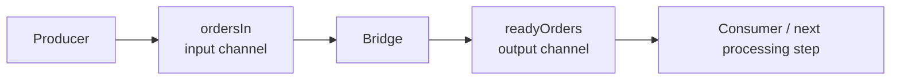
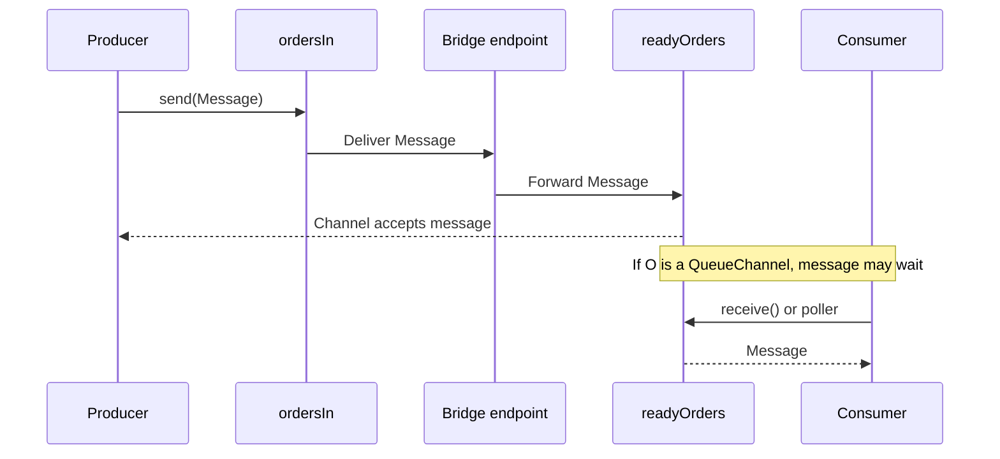
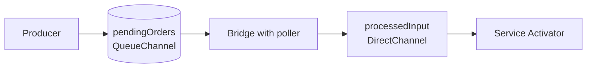
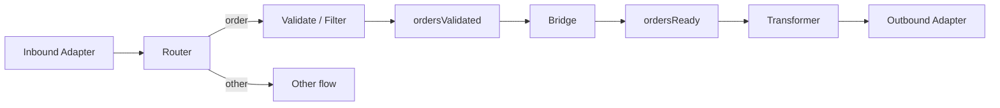
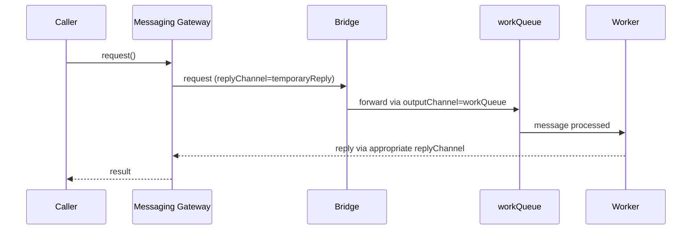
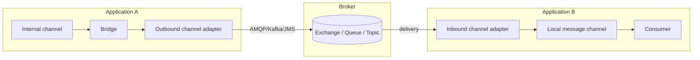

# Bridge — Bridge with an Output Channel in Spring Integration

## Learning Objectives

After this lesson, you will be able to:

- Explain how a **Bridge** connects `MessageChannel`s in Enterprise Integration Patterns and why a Bridge typically does not alter the business content of a message.
- Identify the meaning of **`outputChannel` on a Bridge endpoint**; distinguish it from `inputChannel` and a request's `replyChannel` header.
- Declare a Bridge in Spring Integration Java DSL to forward messages from a `DirectChannel` to a `QueueChannel`; write tests confirming payload and headers reach the intended destination.
- Know when a poller is required when the input channel is a `PollableChannel`, and analyze differences among `DirectChannel`, `QueueChannel`, `ExecutorChannel`, and `PublishSubscribeChannel` outputs.
- Analyze forwarding failures, timeouts, backpressure, correlation, error channels, durability, and limitations of a Bridge when integrating with a message broker.

This lesson belongs to the **Bridge** chapter of the **SPRING_INTEGRATION_PATTERN** module. The module focuses on practicing Enterprise Integration Patterns with Spring Integration to build loosely coupled, extensible message flows combining Router, Filter, Transformer, Splitter, Aggregator, Gateway, retry, error channel, and correlation, while testing and observing processing branches. The topic here is **Bridge with an output channel**: a routing endpoint that forwards messages from a source channel to an explicitly configured target channel.

## 1. What Is a Bridge?

In Spring Integration, a **Bridge** is an intermediary component that connects two channels by receiving a `Message` from an input channel and forwarding it to an output channel. A Bridge is typically used when you want to connect flow segments without writing business logic or transforming the payload.



A message consists of a **payload** and **headers**. If a producer sends `OrderPlaced(orderId="ORD-100")` with `correlationId="req-42"`, the Bridge attempts to forward the message with pass-through semantics; from a business perspective, there is no “convert `OrderPlaced` into another type” step inside the Bridge.

This differs from the following components:

| Component | Responsibility |
| --- | --- |
| **Bridge** | Connects a source channel to a target channel; typically forwards messages as-is |
| **Transformer** | Produces a different payload/message representation according to a conversion rule |
| **Filter** | Allows a message to proceed or drops it based on a condition |
| **Router** | Determines the target channel based on content/headers or routing rules |
| **Service Activator** | Invokes business logic, optionally emitting a result |
| **Channel Adapter** | Connects a Spring Message flow to an external source/destination outside the application |
| **Messaging Gateway** | Provides a request–reply interface for callers or an integrated system |

A Bridge does not open network connections, call APIs, or add durable queues on its own. It is an **endpoint inside Spring Integration**; actual delivery behavior depends on the surrounding channel types and endpoints.

### When Do You Need a Bridge?

Some common scenarios:

1. **Connecting two branches owned by different configuration groups.** The intake group publishes to `ordersIn`, the processing group reads from `readyOrders`, and the Bridge acts as the explicit connector.
2. **Connecting a synchronous channel to a buffered channel.** The producer goes through a `DirectChannel`; the Bridge moves messages to a `QueueChannel` so downstream can process at its own pace.
3. **Connecting a polling channel to a downstream flow.** A Bridge with a poller pulls messages from the input channel and sends them to another channel.
4. **Placing an observation point or operational policy** at the boundary between two flow segments, such as assigning an endpoint ID, adding logging/tracing, or configuring error handling.

If an independent endpoint is not needed, Java DSL can sometimes connect steps with `.channel("...")` without an explicit Bridge. Choosing an explicit Bridge is helpful when you want to make the junction's responsibility clear, tune a poller, or test the forwarding path independently.

## 2. Input Channel, Output Channel, and replyChannel

These three terms sound similar but serve different roles:

| Concept | Where It Lives | Role |
| --- | --- | --- |
| **Input channel** | Endpoint configuration or source of `IntegrationFlow` | Channel from which the Bridge **receives** messages |
| **Output channel** | Bridge/endpoint configuration or the subsequent `.channel(...)` step | Channel to which the Bridge **forwards/emits results** |
| **`replyChannel`** | Header on a **request message** | Channel where the caller wants to receive the reply in a request–reply flow when an endpoint has no higher-priority explicit output path |

Example:

```text
                         message headers:
                         correlationId = req-42
                         replyChannel  = callerReplies
                                      |
Producer -> ordersIn -> Bridge -------+----> readyOrders -> Consumer
                         |
                         +-- outputChannel = readyOrders
```

Here, the **Bridge has a fixed output channel configured as `readyOrders`**. The message goes to `readyOrders` even though the request carries `replyChannel=callerReplies`. The `replyChannel` header can still be preserved for downstream request–reply steps to use per their contract; however, **this junction** does not send a result directly into `callerReplies`.

Practical rules:

- For an endpoint capable of emitting reply messages, an **explicitly configured output channel** determines where that endpoint emits.
- When an endpoint has no explicit output channel, reply-producing components can fall back to the incoming message's `replyChannel`, if present and valid.
- A Bridge with a fixed output channel is **forwarding to a predefined branch**. It does not equate to “a reply has been sent back to the caller.”
- To build a request–reply path, examine the **entire flow**, especially the terminal handler producing the reply, each step's output channel, and whether `replyChannel` is preserved.

**Note:** do not rely on framework headers or `MessageHeaders.ID` always having the same object identity after every endpoint. What needs verification is the payload, **essential business headers to preserve** (such as `correlationId`), and the message's actual destination.

## 3. Bridge Mechanism in Spring Integration

Spring Integration provides `BridgeHandler` for forwarding. In Java DSL, you can use `.bridge()` inside `IntegrationFlow`. A Bridge is an endpoint capable of emitting messages to its output channel.

Conceptual flow:



The diagram highlights two distinct moments:

1. **Forwarding succeeded:** the Bridge delivered the message to the target channel under the `send` contract.
2. **Business processing completed:** the consumer actually pulled the message, processed it, and (if applicable) committed data or emitted a reply.

If the output is a `QueueChannel`, these two moments are usually decoupled. If the output is a `DirectChannel` and the subscriber runs synchronously, the Bridge may remain on the sending thread until the subscriber finishes processing.

### Does a Bridge Keep the Message Unchanged?

In terms of **business responsibility**, a Bridge is not a Transformer: it is used for forwarding. Still, across a full flow, messages passing through channels, interceptors, header enrichers, filters, or adapters can be reconstructed or have metadata modified by their own mechanisms. Therefore:

- Do not require `messageA == messageB` (same Java reference) as a business contract condition.
- Verify that the payload and critical headers remain accurate at the destination, such as `eventId` and `correlationId`.
- Do not assume a Bridge performs serialization or provides persistence on its own.
- If an interceptor or another step alters headers, inspect that component instead of attributing it to the Bridge.

## 4. Complete Example: Bridge from DirectChannel to QueueChannel

Problem: a producer submits order-processing commands to `ordersIn`. We want to connect to `readyOrders`, where a consumer reads on demand. The Bridge does not inspect or modify `orderId`; business Filter/Transformer steps can be placed before or after the junction.

The example uses Spring Integration Java DSL with Java 17 and compatible Spring Framework/Spring Integration. A Spring Integration dependency is needed in the project, typically via the Spring Boot starter:

```groovy
dependencies {
    implementation 'org.springframework.boot:spring-boot-starter-integration'
    testImplementation 'org.springframework.boot:spring-boot-starter-test'
}
```

### 4.1. Defining Channels and the Bridge

`BridgeOutputConfiguration.java`:

```java
import org.springframework.context.annotation.Bean;
import org.springframework.context.annotation.Configuration;
import org.springframework.integration.annotation.EnableIntegration;
import org.springframework.integration.channel.DirectChannel;
import org.springframework.integration.channel.QueueChannel;
import org.springframework.integration.dsl.IntegrationFlow;
import org.springframework.messaging.MessageChannel;

@Configuration
@EnableIntegration
public class BridgeOutputConfiguration {

    @Bean("ordersIn")
    public MessageChannel ordersIn() {
        return new DirectChannel();
    }

    @Bean("readyOrders")
    public QueueChannel readyOrders() {
        return new QueueChannel(10);
    }

    @Bean
    public IntegrationFlow ordersBridgeFlow() {
        return IntegrationFlow.from("ordersIn")
            .bridge()
            .channel("readyOrders")
            .get();
    }
}
```

Meaning of the configuration:

- `ordersIn` is a `DirectChannel`; it delivers messages to the Bridge's subscriber within the JVM.
- `.bridge()` adds the forwarding endpoint without modifying the business payload.
- `.channel("readyOrders")` specifies the **output channel** of the forwarding step.
- `readyOrders` is a `QueueChannel` with capacity 10, holding messages waiting for a consumer to pull.
- If no consumer is present yet, messages can wait in the queue until read; finite capacity protects memory here, though it does not persist across restarts.

We can express the same intent using an explicit `BridgeHandler` in an **alternative configuration**:

```java
// Choose either this or .bridge() above; do not register both
// as competing consumers on the same ordersIn.
@Bean
public IntegrationFlow ordersBridgeFlow() {
    return IntegrationFlow.from("ordersIn")
        .handle(new org.springframework.integration.handler.BridgeHandler())
        .channel("readyOrders")
        .get();
}
```

In both options, the endpoint sends to `readyOrders`. `BridgeHandler` explicitly states the forwarding handler; `.bridge()` is more concise. The alternative above is for the **same flow**, not a second bean to register simultaneously.

### 4.2. Producer Sending Messages

An application component can inject `ordersIn`:

```java
import org.springframework.beans.factory.annotation.Qualifier;
import org.springframework.messaging.MessageChannel;
import org.springframework.messaging.MessageHeaders;
import org.springframework.messaging.support.MessageBuilder;
import org.springframework.stereotype.Component;

@Component
public class OrderProducer {

    private final MessageChannel ordersIn;

    public OrderProducer(
            @Qualifier("ordersIn") MessageChannel ordersIn) {
        this.ordersIn = ordersIn;
    }

    public void submit(String orderId) {
        boolean accepted = ordersIn.send(
            MessageBuilder.withPayload(orderId)
                .setHeader("correlationId", "corr-" + orderId)
                .setHeader("eventType", "order.requested")
                .build()
        );

        if (!accepted) {
            throw new IllegalStateException(
                "Message was not accepted by ordersIn"
            );
        }
    }
}
```

`OrderProducer.submit("ORD-100")` only confirms that the message was accepted into the flow according to `send()` semantics. It **does not prove** that a consumer has finished processing `ORD-100`. With `readyOrders` having capacity 10, if the queue fills up, sending may block, return failure, or raise an error depending on overload, timeouts, and endpoints. Real applications therefore need an explicit policy under congestion.

### 4.3. Consumer Reading Messages from the Output Channel

When the target channel is a `QueueChannel`, a consumer can actively receive:

```java
import org.springframework.beans.factory.annotation.Qualifier;
import org.springframework.integration.channel.QueueChannel;
import org.springframework.messaging.Message;
import org.springframework.stereotype.Component;

@Component
public class OrderQueueReader {

    private final QueueChannel readyOrders;

    public OrderQueueReader(
            @Qualifier("readyOrders") QueueChannel readyOrders) {
        this.readyOrders = readyOrders;
    }

    public String receiveOne() {
        Message<?> message = readyOrders.receive(1_000);
        if (message == null) {
            return null; // No message within the wait timeout.
        }

        String orderId = (String) message.getPayload();
        // Business validation/processing starts only here.
        return orderId;
    }
}
```

`receive(1_000)` waits up to about one second from the call. This is a `PollableChannel` API; `DirectChannel` does not expose `receive()`.

Manual calls can be replaced by a **polling Service Activator**:

```java
@ServiceActivator(
    inputChannel = "readyOrders",
    poller = @Poller(fixedDelay = "200", maxMessagesPerPoll = "1")
)
public void process(String orderId) {
    orderService.process(orderId);
}
```

The snippet above only illustrates an alternative consumer approach; it requires importing `org.springframework.integration.annotation.ServiceActivator` and `org.springframework.integration.annotation.Poller`, as well as defining `orderService`. If you run this polling consumer in the same test context, it will compete with `OrderQueueReader` for messages; choose **one consumption model per scenario**.

### 4.4. Testing a Bridge with an Output Channel

The test uses JUnit 5 and Spring Test to verify that the message goes to **`readyOrders` instead of the channel placed in the `replyChannel` header**. This proves the Bridge's fixed output channel takes effect.

`BridgeOutputIntegrationTest.java`:

```java
import static org.junit.jupiter.api.Assertions.assertEquals;
import static org.junit.jupiter.api.Assertions.assertNotNull;
import static org.junit.jupiter.api.Assertions.assertNull;
import static org.junit.jupiter.api.Assertions.assertTrue;

import org.junit.jupiter.api.Test;
import org.springframework.beans.factory.annotation.Autowired;
import org.springframework.beans.factory.annotation.Qualifier;
import org.springframework.integration.channel.QueueChannel;
import org.springframework.messaging.Message;
import org.springframework.messaging.MessageChannel;
import org.springframework.messaging.MessageHeaders;
import org.springframework.messaging.support.MessageBuilder;
import org.springframework.test.context.junit.jupiter.SpringJUnitConfig;

@SpringJUnitConfig(BridgeOutputConfiguration.class)
class BridgeOutputIntegrationTest {

    @Autowired
    @Qualifier("ordersIn")
    MessageChannel ordersIn;

    @Autowired
    @Qualifier("readyOrders")
    QueueChannel readyOrders;

    @Test
    void forwardsToConfiguredOutputChannelAndKeepsCorrelation() {
        QueueChannel unusedReplies = new QueueChannel(1);

        Message<String> request = MessageBuilder
            .withPayload("ORD-100")
            .setHeader("correlationId", "corr-100")
            .setHeader("eventType", "order.requested")
            .setHeader(MessageHeaders.REPLY_CHANNEL, unusedReplies)
            .build();

        assertTrue(ordersIn.send(request));

        Message<?> forwarded = readyOrders.receive(1_000);
        assertNotNull(forwarded);
        assertEquals("ORD-100", forwarded.getPayload());
        assertEquals(
            "corr-100", forwarded.getHeaders().get("correlationId"));
        assertEquals(
            "order.requested", forwarded.getHeaders().get("eventType"));

        // The Bridge is configured with outputChannel=readyOrders.
        assertNull(unusedReplies.receive(0));
    }
}
```

**This test confirms:** the Bridge pushed the message onto the configured channel, the payload was not transformed, and business headers were preserved at the destination. It does not verify business processing after `readyOrders`, durability, or behavior across a broker.

To test an output channel leading to a `DirectChannel` with a synchronous subscriber, configure the target as a `DirectChannel` and register a receiving handler. The test will observe the handler being invoked, though you must still distinguish that from an external system completing business work.

## 5. Output Channel Determines the Semantics of the Next Step

The Bridge forwards the message; the **target channel** determines many operational characteristics.

| Output Channel | When the Bridge Forwards | Impact on Caller and Consumer |
| --- | --- | --- |
| `DirectChannel` | Invokes subscriber synchronously on the sending thread (default) | Consumer exceptions can propagate back; caller can be blocked until handler finishes |
| `QueueChannel` | Enqueues message waiting for `receive()`/poller | Producer can finish before business processing; capacity and send timeouts matter |
| `ExecutorChannel` | Hands processing off to an executor | Error/completion responsibility shifts to async mechanisms; pool/queue must be bounded |
| `PublishSubscribeChannel` | Dispatches to subscribers of the channel | Can fan out to multiple handlers; error handling depends on executor and configuration |
| Channel wired to outbound adapter | Adapter transmits message externally | Must address transport, retries, publisher confirms, ACKs, and header mapping separately |

Do not treat `outputChannel` as “storing the outcome.” If the output is an in-memory `QueueChannel`, queued data can be lost when the JVM stops. If using a broker, durability depends on queues, delivery modes, confirmations, transactions, and adapter/broker policies.

### Bridge and Backpressure

Suppose the Bridge feeds a `QueueChannel(10)`, yet the consumer only processes 2 messages/second while the producer sends 12 messages/second. Backlog grows at about 10 messages/second, and the queue can fill up very quickly.

```text
Producer 12 msg/s -> Bridge -> QueueChannel(capacity=10)
                                         |
                                         +-> Consumer 2 msg/s
                                         |
                                         +-> Queue full: needs send/wait/error policy
```

When the output channel is full, sending from the Bridge can block or fail. The initial `send()` does not always return `false` in every scenario: a synchronous handler can throw an exception, and endpoints with configured timeouts alter wait durations. Check the channel and endpoint contracts rather than inferring from the name “Bridge.”

Solutions can include inbound throttling, outbound rate limiting, pausing supported sources, scaling consumer capacity, durable queues, and bounded retries. Increase capacity only if the goal is absorbing short bursts; a continuously growing backlog will not be solved by a larger buffer.

## 6. Bridge Reading from a PollableChannel: Why Is a Poller Required?

The earlier example had **input = DirectChannel**, where the Bridge triggers when the producer sends a message. If the source is a `QueueChannel`, messages wait in the queue and **an active polling consumer is required** for the Bridge to run.

Diagram:



An independent Java DSL option:

```java
import org.springframework.context.annotation.Bean;
import org.springframework.integration.channel.QueueChannel;
import org.springframework.integration.dsl.IntegrationFlow;
import org.springframework.integration.dsl.Pollers;

@Bean("pendingOrders")
public QueueChannel pendingOrders() {
    return new QueueChannel(50);
}

@Bean
public IntegrationFlow pendingOrdersBridgeFlow() {
    return IntegrationFlow.from(
            "pendingOrders",
            spec -> spec.poller(
                Pollers.fixedDelay(200).maxMessagesPerPoll(5)
            )
        )
        .bridge()
        .channel("processedInput")
        .get();
}
```

This snippet assumes a `processedInput` channel bean and an appropriate subscriber already exist; it illustrates a **different flow** from the `ordersIn → readyOrders` example in Section 4.

Notes:

- `fixedDelay(200)` is the poller trigger interval, not an exact guarantee of messages per second; actual throughput also depends on processing time and the executor/scheduler.
- `maxMessagesPerPoll(5)` caps the number of messages processed per poll cycle, not a system-wide throughput ceiling.
- If the Bridge polls a message from the source queue and then fails to send to the output, whether the message returns to the queue is **not automatically guaranteed**. Retry/recovery requires an explicit mechanism matching the source, transaction, or persistent store.
- When a source queue has multiple consumers, those consumers may compete for messages. Control concurrency if ordering is a business requirement.

## 7. Bridge with an Output Channel in a Flow with Router, Filter, and Transformer

A Bridge is useful when business steps are split into manageable segments:



For instance, an application receives commands, a Router selects the order branch, and a Filter lets only valid IDs through. A Bridge connects `ordersValidated` to `ordersReady`. After the Bridge, a Transformer can build the payload for a shipping API and an outbound adapter performs the call.

Clear responsibilities:

- Router decides **which branch** to take.
- Filter decides **which messages** qualify to continue.
- Transformer decides **what format** the next step uses.
- Bridge decides **which channel connects to which channel**, preserving the message's business meaning.
- Outbound adapter decides **which protocol** delivers the message to an external system.

Do not turn a Bridge into a Service Activator containing validation or HTTP call logic just to keep an endpoint “named bridge.” If business processing is needed, use the component with the right responsibility so the flow stays transparent and testable.

### When Is an Explicit Bridge Unnecessary?

If you only want to connect endpoints inside a **single IntegrationFlow** and do not need a separate junction, Java DSL can do so by chaining channels within the flow. An explicit Bridge fits when connecting pre-existing channels, when you want a separately named/monitored endpoint, or when a consumer polls a channel holding buffered messages.

You do not need to insert a Bridge after **every** channel; adding too many pass-through endpoints makes configuration harder to follow without adding processing value.

## 8. Request–Reply: outputChannel Can Alter the Response Path

Suppose a caller invokes `@MessagingGateway` and awaits a reply:



In this model, the Bridge **does not return a business reply**. It forwards the request to `workQueue`. Only the worker processing it afterward emits the reply based on `replyChannel` or the output path configured on the worker step.

Common mistakes:

1. **Bridge without an explicit output channel.** Output routing may fall back to the `replyChannel` header, sending the message to an unintended channel.
2. **Bridge has a fixed output channel different from what the caller awaits.** The caller receives no reply if the downstream flow lacks a handler that returns a result properly.
3. **A Transformer builds a new message and drops headers.** `replyChannel` and `correlationId` may be lost; define rules to preserve critical headers.
4. **Slow worker processing from the queue.** The Gateway may time out before a reply is produced; an arriving result afterward is a **late reply**.
5. **Reply channel shared across multiple callers.** Correlation/dispatcher logic is needed to avoid delivering responses to the wrong caller.

To implement reliable RPC, clearly distinguish the **request path fixed by the Bridge** from the **reply path managed by the Gateway/worker**. When calling across a broker or another service, use a transport-appropriate reply destination and correlation ID; internal `MessageChannel` references do not automatically translate into network addresses.

## 9. Error Handling, Retries, and Delivery Semantics

### Synchronous and Asynchronous Errors

| Point of Failure | Where Observed | Action Required |
| --- | --- | --- |
| Input `DirectChannel` has no subscriber or Bridge fails | Producer's `send()` call may receive an exception | Catch error, log, and decide appropriate retry |
| Output `DirectChannel` has a handler throwing an exception | May propagate back up the synchronous call chain | Use explicit error handling; do not blindly retry side effects |
| Output `QueueChannel` is full | Bridge may block/timeout or report a send failure | Apply rate limits, buffering, send policy, and backpressure |
| Bridge polls source then output send fails | Poller thread / error handler | Define retry, transaction, or storage for unsent messages |
| Downstream fails asynchronously | Error channel, logs, listeners, or transport mechanisms | Ensure observability and proper recovery |
| Downstream broker bridge cannot connect | Outbound adapter/transport | Bounded retries, publisher confirms, and outbox if needed |

### Error Channel Does Not Replace the Output Path

`outputChannel` is the **normal** message path. `errorChannel` is the mechanism for receiving `ErrorMessage` in flows that support it and are configured to route errors there. A Bridge does not turn an output channel into an error channel.

With synchronous processing, exceptions typically unwind up the call stack. With polling/asynchronous endpoints, errors can be sent to an error channel via framework mechanisms. Check the endpoint type and configuration rather than assuming every exception automatically goes to an `errorChannel` bean.

When retrying:

- Decide whether retry lives at the **Bridge**, consumer, outbound adapter, or broker; avoid uncontrolled stacked retries across layers.
- Keep `eventId`/`idempotencyKey` stable across attempts if processing has side effects.
- If resending after the output already received the message but an acknowledgment was lost, the consumer may receive a **duplicate** message.
- In distributed systems, an internal Bridge does not provide exactly-once delivery on its own. Use deduplication and transactions/outbox/inbox per the business contract when required.

### Correlation and Observability Traces

A log/tracing record at a junction may contain:

```json
{
  "event": "bridge_forward",
  "endpoint": "ordersBridgeFlow",
  "inputChannel": "ordersIn",
  "outputChannel": "readyOrders",
  "eventId": "evt-42",
  "correlationId": "req-42"
}
```

This is a **custom-designed log sample**, not a log format automatically emitted verbatim by Spring Integration. You can use message history, wire taps, Micrometer/observations, or channel interceptors depending on configuration to trace paths, while avoiding logging payloads or headers containing secrets.

Measure messages received at input, successful forwards, output send failures, queue depth, send wait times, downstream processing times, and reply timeouts/late replies. A forwarded message is not necessarily a completed business operation: metrics should reflect each stage accurately.

## 10. Does a Bridge Directly Connect Two Microservices?

**Not with `.bridge()` alone.** A `BridgeHandler` forwards between `MessageChannel`s within one Spring Integration application context. Two applications in different JVMs require a transport mechanism:



Adapters convert Spring Messages to the wire protocol, serializer, and header mappings before sending to the broker; the receiving side performs the reverse. At that boundary, pay attention to:

- Internal channels are distinct from broker queues/topics; two beans with the same name in two JVMs do not automatically connect.
- The `replyChannel` header is internal state; across a transport, use a contracted reply destination/correlation ID.
- Publisher confirms do not mean the consumer committed business state; acknowledgments and redelivery have their own lifecycles.
- Brokers can redeliver messages; consumers need idempotency/deduplication when side effects may repeat.
- If zero-loss event publishing after a DB commit is required, consider a transactional outbox and a publisher with appropriate confirmation.

A Bridge with an output channel is a local routing step within this overall architecture, not a replacement for adapters or brokers.

## 11. Testing and Extended Practice

Starting from the configuration in Section 4, complete these exercises:

**Exercise 1 — Verify output path.** Attach a `replyChannel` other than `readyOrders` to the request. Send to `ordersIn`, and verify `readyOrders` receives the message while the reply queue remains empty, similar to the JUnit test.

**Exercise 2 — Test a DirectChannel output.** Replace `readyOrders` with a `DirectChannel` and a synchronous subscriber. Make the handler sleep for 300 ms; measure the duration of `ordersIn.send()` and explain why the producer can be blocked.

**Exercise 3 — Test a full QueueChannel output.** Use capacity 2 without starting a consumer. Send multiple messages with an explicit timeout policy; observe send behavior and how to protect the system from unbounded sending.

**Exercise 4 — Bridge from a PollableChannel.** Implement the flow `pendingOrders → Bridge with poller → processedInput`, setting `fixedDelay` and `maxMessagesPerPoll`. Stop the consumer and observe the backlog and errors when output refuses messages.

**Exercise 5 — Correlation across steps.** Place a Router/Transformer behind the Bridge. Verify that the payload is transformed at the Transformer while `correlationId` remains preserved through the final processing step.

**Exercise 6 — Request–reply and late replies.** Have a Messaging Gateway send through a Bridge into a queue; make the worker take longer than `replyTimeout`. Distinguish request forwarded, worker completed, and whether the caller received a reply.

**Exercise 7 — Crossing the application boundary.** Add an outbound adapter pushing messages from the output channel to a RabbitMQ queue. Verify header mapping, publisher confirms, and consumer receipt; point out where the Bridge sits in the end-to-end diagram.

**Completion criteria:** given a message with payload and `correlationId`, identify the input channel, Bridge endpoint, output channel, and consumer; verify the exact delivery path, distinguish successful forwarding from completed processing, and explain how overload/errors are handled per channel type.

## 12. Common Mistakes

| Mistake | Consequence | Fix |
| --- | --- | --- |
| Treating a Bridge as a Transformer | Expecting the Bridge to change payload or add business data | Use a Transformer/Header Enricher when content changes are needed |
| Confusing `outputChannel` with `replyChannel` | Messages go elsewhere or caller receives no reply | Define request routing and reply routing separately |
| Using `QueueChannel` as input without a poller | Messages pile up; Bridge never runs | Configure an appropriate polling consumer/endpoint |
| Output `QueueChannel` has no consumer | Messages wait forever or queue fills up | Register a consumer, monitor queue depth, and set an overload policy |
| Output `DirectChannel` has no subscriber | Forwarding fails with no receiving endpoint | Register a handler or choose an appropriate channel |
| Treating forwarding as completed business work | Marking success prematurely | Separate metrics for forward, consume, commit, and ACK |
| Assuming `replyChannel` always overrides fixed output | Misrouting or bypassing intended processing path | Check endpoint configuration and test routing with another `replyChannel` |
| Assuming a Bridge establishes a broker connection | Services still do not exchange data | Use explicit outbound/inbound adapters and transports |
| Blindly retrying a Bridge after timeout | Side effects may duplicate if the message was already received | Use idempotency, correlation, and bounded retry/recovery |
| Ignoring errors in asynchronous endpoints | Errors go unnoticed, queues stall, or tasks disappear | Configure error channel, logs/metrics, and proper recovery/transactions |

## 13. Key Takeaways

- A Bridge is a **message-forwarding endpoint** suited for connecting two `MessageChannel`s in Spring Integration.
- `inputChannel` specifies where the Bridge receives; **`outputChannel` specifies where the Bridge emits**. A request's `replyChannel` header serves a different role and does not override an explicitly configured output channel.
- `.bridge().channel("readyOrders")` in Java DSL is one way to declare a Bridge and its output channel. With a `QueueChannel` input, a poller is required to pull data.
- Synchrony, buffering, concurrency, and error behavior depend heavily on the **output channel type** and downstream subscribers; successful forwarding does not mean business processing is complete.
- For request–reply, brokers, retries, and asynchronous errors, design correlation, timeouts, acknowledgments, idempotency, and observability end-to-end across the entire flow.
