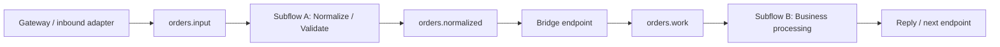
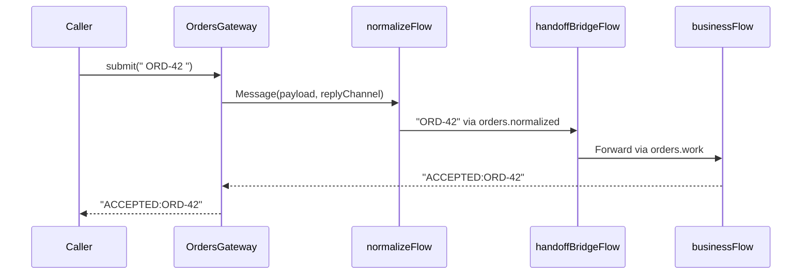

# Bridge to Separate Subflows

## 1. Problem: A Long Flow That Is Hard to Change

In Spring Integration, a system often receives a message from a `Messaging Gateway` or `Channel Adapter`, then sequentially normalizes, validates, routes, invokes a service, and returns a result. When the entire processing chain is declared in one large `IntegrationFlow`, locating failures, modifying a stage, or reusing a processing segment becomes difficult.

For example, an order intake service needs three clear parts:

1. **Intake and normalization:** receive the order code from the gateway, trim whitespace, validate input.
2. **Internal handoff:** forward the valid message to the input channel of the business processing segment.
3. **Processing:** record the order or return a status to the caller.

The **Bridge** pattern in Enterprise Integration Patterns (EIP) provides an endpoint that transfers messages from **one channel to another channel**. When used to connect two or more independent `IntegrationFlow`s, it creates a transparent handoff point between parts of a flow.

This lesson belongs to the **Bridge** chapter of the `SPRING_INTEGRATION_PATTERN` module, where EIPs are practiced using Spring Integration to build loosely coupled, extensible, testable, and observable message flows. Alongside Bridge, the module covers Router, Filter, Transformer, Splitter, Aggregator, Gateway, retry, error channel, and correlation. This lesson focuses on **Bridge to separate subflows**, without using Bridge as a catch-all term for routing or external service connectivity.

**Learning objectives:** After this lesson, you will be able to distinguish a Bridge from channels and other EIP endpoints; split a flow into multiple `IntegrationFlow`s with clear channel contracts; control synchrony/asynchrony, replies, exceptions, and transactions at the handoff point; and write tests verifying both connected sides work properly.

## 2. What Is a Bridge and When Is It Useful?

A **Bridge** receives a `Message<?>` from an input channel and forwards it to an output channel. In Spring Integration, this endpoint is represented by `BridgeHandler`; Java DSL provides the `.bridge()` operator. A Bridge should not be used to modify payloads, classify content, or automatically persist messages durably.



The path in the diagram is a chain of **channels and endpoints within the same application**. Separating subflows here means separating responsibilities and configurations of `IntegrationFlow`s; it does not implicitly create a new process, a network connection, or a durable queue.

### 2.1. Situations Where You Should Consider a Bridge

| Situation | How Bridge Helps | What to Check |
| --- | --- | --- |
| Flow is too long, hard to own | Split into segments with separate input/output channels. | Consistent channel naming and payload/header definitions. |
| Two code teams need a module boundary | Provides a fixed handoff point, easy to observe and change internally on either side. | Avoid circular dependencies between modules. |
| Connecting `DirectChannel` to `ExecutorChannel` | Organizes the transition to a different execution mode when the target channel is configured asynchronously. | Transactions, ACKs, errors, and replies can change semantics. |
| Moving messages from `QueueChannel` to the next flow | Configures a polling endpoint to drain the queue and forward. | Must configure poller, queue capacity, and full-queue policy. |
| Need to test each processing segment | Can send messages directly to a subflow's input channel and assert results. | End-to-end integration tests are still needed. |

A Bridge only forwards from one point to a configured destination. When you need **content-based branching**, use a Router; when you need **delivery to multiple subscribers**, choose an appropriate publish–subscribe channel; when you need **payload transformation**, use a Transformer.

## 3. Concepts: Channel, Bridge, Subflow, and Endpoint

In Spring Integration, a `Message` has a payload and headers; `MessageChannel` determines how messages are handed off; an endpoint consumes or produces messages according to its role.

| Component | Responsibility | Does It Alter Message Meaning? |
| --- | --- | --- |
| `DirectChannel` | Delivers messages to a subscriber on the current calling thread. | Not intentionally; handlers at other steps may transform. |
| `ExecutorChannel` | Dispatches message delivery work to an executor. | Does not alter data on its own, but changes thread and transaction scope. |
| `QueueChannel` | Holds messages in a queue for a consumer to poll. | Does not alter data; introduces buffering and deferred handoff. |
| `BridgeHandler` | Forwards messages from an input channel to an output channel. | Does not actively transform payloads. |
| `Transformer` | Converts payload/message representation. | Yes. |
| `Router` | Selects target channel(s) based on conditions. | Chooses routes rather than simply wiring a fixed connection. |
| `IntegrationFlow` | Describes a chain of channels and endpoints. | Depends on the endpoints inside. |

**Subflow** has two usages that should be distinguished:

- In this lesson, “separating subflows” means organizing **multiple `IntegrationFlow` beans** and connecting them via channels/Bridges. Each flow can be read, modified, or tested in its own scope.
- In some Java DSL configurations, `subFlowMapping(...)` defines **nested branches inside a Router or another endpoint**. That is a branching mechanism and does not mean each segment is joined by a Bridge.

In simple cases, `.channel("next.channel")` is enough to connect endpoints. Use an explicit Bridge when you want this forwarding point to have its own name, role, endpoint configuration, and observability.

### 3.1. What a Bridge Does Not Provide Automatically

A Bridge **does not** automatically provide retries, timeouts, load balancing, message storage, transactions, exactly-once delivery guarantees, or new correlation IDs. Those characteristics come from channels, endpoints/containers, transaction managers, brokers, or error-handling policies surrounding it.

When both input and output are `DirectChannel`, the call can proceed **synchronously on the same thread**. Adding a Bridge does not make the flow run concurrently; it only adds a forwarding endpoint.

## 4. Spring Integration Java DSL Example: Splitting into Three Flows

Suppose an application exposes a synchronous API:

```text
ordersGateway.submit("  ORD-42  ") -> "ACCEPTED:ORD-42"
```

We use three flows:

1. `normalizeFlow`: takes a `String` payload, normalizes it, and sends it to `orders.normalized`.
2. `handoffBridgeFlow`: receives from `orders.normalized` and bridges to `orders.work`.
3. `businessFlow`: executes business logic and returns a reply to the gateway.

The example uses Java 17+, Spring Boot 3.x, and Spring Integration 6.x; core dependencies include Spring Integration and gateway scanning. Code snippets can reside in the same package or be split into separate Java files following project conventions.

### 4.1. Defining Channels and IntegrationFlows

```java
import org.springframework.context.annotation.Bean;
import org.springframework.context.annotation.Configuration;
import org.springframework.integration.annotation.IntegrationComponentScan;
import org.springframework.integration.channel.DirectChannel;
import org.springframework.integration.config.EnableIntegration;
import org.springframework.integration.dsl.IntegrationFlow;
import org.springframework.messaging.MessageChannel;

@Configuration
@EnableIntegration
@IntegrationComponentScan
public class OrdersBridgeConfiguration {

    @Bean("orders.input")
    MessageChannel ordersInput() {
        return new DirectChannel();
    }

    @Bean("orders.normalized")
    MessageChannel ordersNormalized() {
        return new DirectChannel();
    }

    @Bean("orders.work")
    MessageChannel ordersWork() {
        return new DirectChannel();
    }

    @Bean
    IntegrationFlow normalizeFlow() {
        return IntegrationFlow.from("orders.input")
                .transform(String.class, String::trim)
                .channel("orders.normalized")
                .get();
    }

    @Bean
    IntegrationFlow handoffBridgeFlow() {
        return IntegrationFlow.from("orders.normalized")
                .bridge(e -> e.id("ordersHandoffBridge"))
                .channel("orders.work")
                .get();
    }

    @Bean
    IntegrationFlow businessFlow(OrderProcessingService service) {
        return IntegrationFlow.from("orders.work")
                .handle(String.class, (orderId, headers) ->
                        service.accept(orderId))
                .get();
    }
}
```

```java
import org.springframework.stereotype.Service;

@Service
public class OrderProcessingService {

    public String accept(String orderId) {
        if (orderId == null || orderId.isBlank()) {
            throw new IllegalArgumentException("Order ID is required");
        }

        // Example using a string response; in production you can invoke
        // a repository or domain service here.
        return "ACCEPTED:" + orderId;
    }
}
```

In a real project, if `@Configuration` does not automatically scan `@Service` classes, enable component scanning or declare `OrderProcessingService` as a bean. The example separates classes to illustrate roles; putting everything into a single Java source file is not required.

**Analyzing the three flows:**

- `normalizeFlow` owns intake: it receives the payload, calls `String::trim`, and outputs to the contract channel `orders.normalized`. It knows nothing about downstream order processing details.
- `handoffBridgeFlow` owns an endpoint named `ordersHandoffBridge`. Its input channel is `orders.normalized`, and its output channel is `orders.work`. There is no payload-mutation logic inside the Bridge.
- `businessFlow` owns business logic. Here, the handler returns a `String`, and Spring Integration uses the original request's reply context to route the result back to the gateway.

Channel names act as contracts between flows. If you rename a channel on one side without updating the other, messages will not reach the expected consumer; centralize channel name constants/definitions as the project grows.

### 4.2. Messaging Gateway Calling Across Subflows

```java
import org.springframework.integration.annotation.Gateway;
import org.springframework.integration.annotation.MessagingGateway;

@MessagingGateway(defaultRequestChannel = "orders.input")
public interface OrdersGateway {

    @Gateway(replyTimeout = "3000")
    String submit(String orderId);
}
```

In this example the channels are `DirectChannel`s, so the gateway calls across the flows along the same synchronous execution path. Calling `submit("  ORD-42  ")` yields `"ORD-42"` after the Transformer, and the handler returns `"ACCEPTED:ORD-42"`.

`replyTimeout` limits how long the gateway waits for a reply; it **does not** guarantee interrupting a blocking handler on the same thread. For blocking HTTP/DB/RPC calls inside `businessFlow`, configure timeouts at the client, transaction, or I/O layer.

**Reply note:** A Bridge does not generate a reply by itself. If `businessFlow` is designed as one-way and the handler returns `null`, a gateway with return type `String` can block indefinitely or until `replyTimeout` expires. Therefore, distinguish fire-and-forget pipelines from request–reply when defining channel contracts.

### 4.3. Execution Diagram and Boundary of Responsibilities



The Bridge and channels are used to separate **flow organization**. All flows still live within the same Spring application; connecting to another application or broker requires the corresponding channel adapter/gateway and re-evaluating serialization, network errors, and delivery semantics.

## 5. When to Use Only Channels vs. an Explicit Bridge

Suppose a flow currently looks like this:

```java
@Bean
IntegrationFlow compactFlow(OrderProcessingService service) {
    return IntegrationFlow.from("orders.input")
            .transform(String.class, String::trim)
            .handle(String.class, (id, headers) -> service.accept(id))
            .get();
}
```

For very short flows, a single continuous flow is usually easiest to read. When normalization, classification, validation, and business processing become distinct stages, splitting them into separate `IntegrationFlow` beans can help.

| Organization Style | Benefits | Trade-offs / Cost |
| --- | --- | --- |
| Single continuous `IntegrationFlow` | Fewer endpoints, easy to follow for small pipelines. | Long flows can accumulate multiple responsibilities. |
| Multiple `IntegrationFlow`s sharing channel names | Convenient modularization, reduces coupling between stages. | Must keep channel names and types consistent. |
| Multiple `IntegrationFlow`s with explicit Bridge | Clear, meaningful handoff point; easy to name/instrument/test. | Adds configuration and an endpoint; does not make the system async by itself. |
| Real broker/channel adapters in between | Separates applications and deployment lifecycles; supports network delivery. | Introduces serialization, ACKs, retries, ordering, and broker operations. |

Do not mechanically insert a Bridge between every pair of endpoints. A Bridge is most useful when **the boundary between two segments is a concept worth naming** (such as `orders.normalized → orders.work`) or when transitioning to a different channel type.

## 6. Changing Channel Types: Synchronous, Asynchronous, and Buffered

The Bridge forwards messages to its configured output channel. Subsequent execution behavior depends primarily on the **channel type** and the target channel's consumers.

### 6.1. DirectChannel: Traversing Multiple Flows on the Same Thread

In the Section 4 example, `orders.input`, `orders.normalized`, and `orders.work` are `DirectChannel`s. When a message is sent, the framework invokes the subscriber synchronously. An exception from a downstream handler can propagate back to the upstream caller if no endpoint catches and redirects errors.

This allows the flows to participate in **the same transaction scope started by the caller/listener**, provided the transaction uses thread-bound context and all stages stay on the same thread. However, **a Bridge does not create a transaction by itself**; for DB rollbacks, configure a transaction manager and transaction boundary appropriately.

### 6.2. ExecutorChannel: Switching to Asynchronous Processing

If you want `businessFlow` to run on a thread pool, you can **replace the `orders.work` bean** in the example with an `ExecutorChannel`:

```java
import java.util.concurrent.Executor;

import org.springframework.context.annotation.Bean;
import org.springframework.integration.channel.ExecutorChannel;
import org.springframework.messaging.MessageChannel;

@Bean("orders.work")
MessageChannel ordersWork(Executor ordersExecutor) {
    return new ExecutorChannel(ordersExecutor);
}
```

`ordersExecutor` must be an `Executor` bean configured with explicit pool size, queue capacity, and rejection policy; the snippet above is an **alternative variant**, not a duplicate bean declared alongside the original.

When `orders.work` is an `ExecutorChannel`:

- The handler may execute on another thread; an upstream thread-bound DB transaction **does not propagate across automatically**.
- Exceptions are no longer guaranteed to be thrown directly back to the listener/caller on the sending thread; examine `errorChannel` mechanisms and async error handling.
- A synchronous Gateway can still wait for a reply via `replyChannel`, though it may time out before the handler finishes.
- An inbound broker listener might acknowledge handing the message off to the executor before business work actually commits. If zero-loss guarantees are required, use a durable handoff or appropriate acknowledgment mechanism.

Choose `ExecutorChannel` for concurrency and thread isolation needs, **not** merely to “make code splitting look cleaner.”

### 6.3. QueueChannel: Buffering with a Polling Consumer

A `QueueChannel` is a `PollableChannel`. Sending a message to the queue stores it for a consumer to pull later; there is no immediate push to a subscriber as with `DirectChannel`.

Alternative variant **replacing the Section 4 bridge**, wiring `orders.normalized` to a queue and using a poller to forward to `orders.work`:

```java
import org.springframework.context.annotation.Bean;
import org.springframework.integration.channel.QueueChannel;
import org.springframework.integration.dsl.IntegrationFlow;
import org.springframework.integration.dsl.Pollers;
import org.springframework.messaging.PollableChannel;

@Bean("orders.buffer")
PollableChannel ordersBuffer() {
    return new QueueChannel(100); // In-memory queue, capacity = 100
}

@Bean
IntegrationFlow normalizeToBufferBridge() {
    return IntegrationFlow.from("orders.normalized")
            .bridge()
            .channel("orders.buffer")
            .get();
}

@Bean
IntegrationFlow bufferToWorkBridge() {
    return IntegrationFlow
            .from("orders.buffer",
                    e -> e.poller(Pollers.fixedDelay(250)
                            .maxMessagesPerPoll(10)))
            .bridge()
            .channel("orders.work")
            .get();
}
```

When using this variant, **remove the old `handoffBridgeFlow`** to avoid two consumers both receiving from `orders.normalized`. A `DirectChannel` with multiple subscribers can dispatch messages to one subscriber per dispatch strategy rather than broadcasting to all.

`QueueChannel(100)` in the example is an **in-memory** queue and is not durable if the application stops. When the queue is full, sending can fail or follow a wait policy; decide capacity, backpressure, send failures, and restart behavior. For durability requirements, use a message store or appropriate broker along with idempotency/ACK policies.

**Especially with Gateways:** When the producer returns before a queue or executor completes business processing, the reply may arrive later than `replyTimeout`. That is a change in request–reply semantics that must be tested, not a Bridge bug.

### 6.4. Quick Decision Table

| Output Channel Type | Handoff | Cross-Thread Transaction | Typically Used When |
| --- | --- | --- | --- |
| `DirectChannel` | Invokes subscriber directly. | Can retain thread-bound context. | Synchronous pipeline where errors should propagate to caller. |
| `ExecutorChannel` | Hands work to an executor. | Does not retain sending thread's transaction. | Need concurrency and execution resource isolation. |
| `QueueChannel` | Places into a queue for later polling. | Normally detached from sending thread. | Need buffering and active pacing of processing rate. |
| Broker via adapter | Transports through an external system. | No cross-process DB transaction by default. | Decoupled services with dedicated durability and delivery semantics. |

## 7. Errors, Replies, Headers, and Correlation Across a Bridge

### 7.1. Bridge Forwards Messages; It Does Not Decide Business Outcomes

In the synchronous case, a downstream handler throwing an exception can cause the `Messaging Gateway` or inbound listener at the start of the flow to see the error. If upstream is inside a transaction, whether the exception triggers a rollback depends on transaction configuration and whether the exception is swallowed.

A Bridge does not rewrite payloads to represent errors and does not generate `ErrorMessage`s on its own. If an async flow exists, errors can be published to `errorChannel` according to framework/endpoint error configuration. Do not assume errors automatically route to one shared channel in every integration flow style.

For JMS/AMQP/Kafka sources, **acknowledgment, offset commit, and redelivery depend on the inbound adapter/container**. Especially when an async boundary sits between the adapter and the handler, the adapter handing off to a channel does not mean the downstream DB has committed. Design retries, error flows, and idempotency accordingly.

### 7.2. Headers Handed Off Across the Bridge Point

A message may carry headers such as `correlationId`, `replyChannel`, `errorChannel`, or trace context. In a standard Bridge setup, the handler **forwards the message** without actively modifying the payload; headers used for replies/correlation continue traveling along as the message moves through the flow.

However, a Transformer, header enricher, gateway, or adapter before/after the Bridge can create a new message or alter headers. Therefore, test critical header values at **both input and output** of the handoff point. Do not use a message instance's `MessageHeaders.ID` as an idempotency key if messages can be reconstructed during retries/redeliveries.

Example message:

```text
payload = "ORD-42"
headers = {
    correlationId: "checkout-987",
    replyChannel: <reply channel managed by gateway>,
    errorChannel: <configured error channel>
}
```

A Bridge does not generate `correlationId` or perform fan-out on its own. If using Splitter followed by Aggregator, ensure correlation and sequence headers carry valid semantics both before and after the Bridge.

### 7.3. Avoid Creating Infinite Bridge Cycles

A misconfiguration can create a loop:

```text
orders.a -> Bridge 1 -> orders.b -> Bridge 2 -> orders.a -> ...
```

With `DirectChannel`, a loop can cause repeated recursive calls and exhaust resources. With queued channels, a loop can create unbounded congestion. If business logic genuinely needs a feedback loop, define explicit stopping conditions, a state machine, and verifiable hop limits.

## 8. How to Test When Splitting Subflows

Distinguish three testing layers:

1. **Business component unit test:** call `OrderProcessingService.accept(...)` directly to verify validation and return values.
2. **Per-subflow integration test:** send messages to a contract channel and verify the flow consumes and handles payloads/headers properly.
3. **End-to-end integration test:** invoke the gateway or send from an inbound adapter, verifying the full path across the Bridge, replies, exceptions, and deadlines if async.

Example testing the request–reply path in Section 4's `DirectChannel` setup with JUnit 5 and Spring Test:

```java
import static org.junit.jupiter.api.Assertions.assertEquals;

import org.junit.jupiter.api.Test;
import org.springframework.beans.factory.annotation.Autowired;
import org.springframework.test.context.junit.jupiter.SpringJUnitConfig;

@SpringJUnitConfig(classes = {
        OrdersBridgeConfiguration.class,
        OrderProcessingService.class
})
class OrdersBridgeIntegrationTest {

    @Autowired
    private OrdersGateway gateway;

    @Test
    void bridgeConnectsNormalizeAndBusinessFlow() {
        assertEquals("ACCEPTED:ORD-42",
                gateway.submit("  ORD-42  "));
    }
}
```

In a real environment, the test context must register `OrdersGateway` via `@IntegrationComponentScan` and include all required channel/flow beans. The test above illustrates the path **Gateway → Transformer → Bridge → Handler → Reply**; it does not prove acknowledgment or timeout behavior of asynchronous adapters.

### 8.1. Test Case Matrix

| Scenario | How to Trigger | Expected Outcome |
| --- | --- | --- |
| Valid payload | `"  ORD-42  "` | Bridge forwards; handler receives `ORD-42`, gateway receives reply. |
| Invalid payload | Blank string or malformed ID | Handler rejects; with DirectChannel, error propagates per request–reply mechanics. |
| Missing subscriber on output channel | Intentionally omit `businessFlow` in a test config | Message fails to reach business logic; configuration error is detected rather than treated as success. |
| Multiple subscribers on `DirectChannel` | Attach a second consumer to the same input | Do not assume broadcast; verify dispatcher behavior and distribution intent. |
| Correlation headers | Add `correlationId`/trace header | Values are preserved across the handoff, unless an endpoint is configured to modify them. |
| Saturated executor | Use a small pool/queue and send many messages | Verify rejection, error flow, and business completion rate. |
| Full QueueChannel | Send beyond capacity | Verify backpressure, send failure, and no silent message loss. |
| Gateway timeout | Introduce slow processing after an async hop | Gateway may time out; define handling for late arrivals. |
| Transaction rollback | Throw DB error in synchronous handler | Verify rollback within the actually configured transaction scope. |
| Restart with in-memory queue | Stop application while messages remain in queue | Recognize in-memory queues do not guarantee recovery; use store/broker if needed. |

### 8.2. Observing the Handoff Point

An endpoint name like `ordersHandoffBridge` helps distinguish normalization, Bridge, and processing in logs/metrics. You can place interceptors, channel instrumentation, tracing, or latency tracking at this boundary, while avoiding logging sensitive payloads at every hop.

Track: messages entering each channel, successful/failed handler executions, latency before/after the Bridge, thread pool queue/rejections (if `ExecutorChannel`), queued message backlog (if `QueueChannel`), and message age from intake to completion. A Bridge does not emit complete metrics on its own; observability depends on application instrumentation.

## 9. Common Architectural Mistakes and Fixes

**Mistake 1 — Treating a Bridge as a Router.** Designing a Bridge and expecting it to select channels by order type. A Bridge has a fixed output. If input conditions determine the route, use a Router before the handoff point or conditional subflow mappings.

**Mistake 2 — Treating a channel name as a sufficient API.** Two subflows both reference `orders.work`, yet one sends a `String` while the other expects a DTO. Define a contract covering payload, headers, error taxonomy, data versioning, and minimal contract tests.

**Mistake 3 — Using a Bridge to “improve performance” without choosing the right channel type.** With `DirectChannel`, a Bridge remains synchronous. For concurrency, consider `ExecutorChannel`, executor sizing, and error policy; for buffering, consider `QueueChannel`/broker and data durability.

**Mistake 4 — Switching to async while keeping old transaction assumptions.** A listener returns after pushing a message to a queue; the DB transaction runs later. A crash can lose work. Use durable handoff, proper ACKs, and consumer idempotency.

**Mistake 5 — Using one shared channel across multiple flows expecting fan-out.** A `DirectChannel` with multiple subscribers can pick a single subscriber per dispatch. If every subscriber must receive a copy, evaluate `PublishSubscribeChannel` and per-branch delivery guarantees.

**Mistake 6 — Swallowing exceptions and returning success.** An endpoint using `try/catch` that only logs without returning an error can cause the gateway to receive an invalid result or an inbound adapter to ACK prematurely. Define which exceptions propagate, retry, or route to an error flow.

**Mistake 7 — Creating Bridge loops or blind wiring.** Similar channel names and multiple flows subscribing to them can cause cycles, double processing, or missing subscribers. Diagram the channel graph and test the full route to catch them.

**Mistake 8 — Forgetting the reply in a request–reply flow.** If the final handler returns `null`, a gateway expecting `String` may time out. Separate one-way endpoints from reply-producing endpoints, and define each subflow's output contract.

## 10. Checklist for Applying a Bridge to Separate Subflows

Before promoting your design to an integration environment, check:

1. **Business boundaries:** Does each `IntegrationFlow` have a single, easily described responsibility?
2. **Channel names:** Do input/output channel names on both sides match and stay consistently declared?
3. **Message contract:** Are payload types, required headers, correlation, and error semantics documented?
4. **Purposeful Bridge:** Does the forwarding point genuinely aid modularization/observability or switch channel types?
5. **Synchronous/asynchronous:** Is the target channel Direct, Executor, Queue, or a broker adapter? How does that affect threads, replies, and transactions?
6. **Error handling:** Do exceptions route to the expected caller/listener, error flow, or DLQ as designed?
7. **ACK and durability:** If data comes from a broker, is there an async handoff that could trigger ACK before business commit?
8. **Correctness:** Are side effects idempotent under retries/redelivery or fan-out duplicates?
9. **Testing:** Are gateway-to-handler paths, header propagation, missing subscribers, timeouts, and error branches tested?
10. **Operations:** Are metrics/tracing enabled for the Bridge and channels, with queue/pool bounds and backlog alerts when async?

A Bridge fits when a Spring Integration flow needs to be split into segments with independent channel contracts and a **fixed, understandable handoff point**. To establish reliability, performance, or consistency, you must still evaluate channel types, transaction boundaries, and error handling. Combined intentionally, a Bridge keeps integration structure clear while preserving message flow across subflows.
