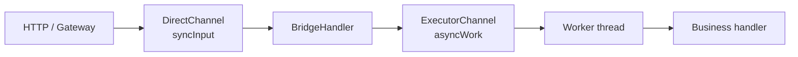
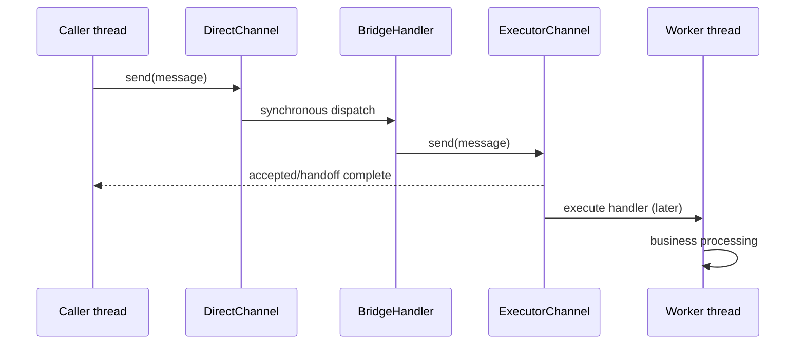
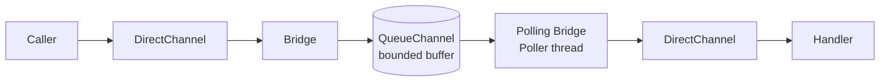
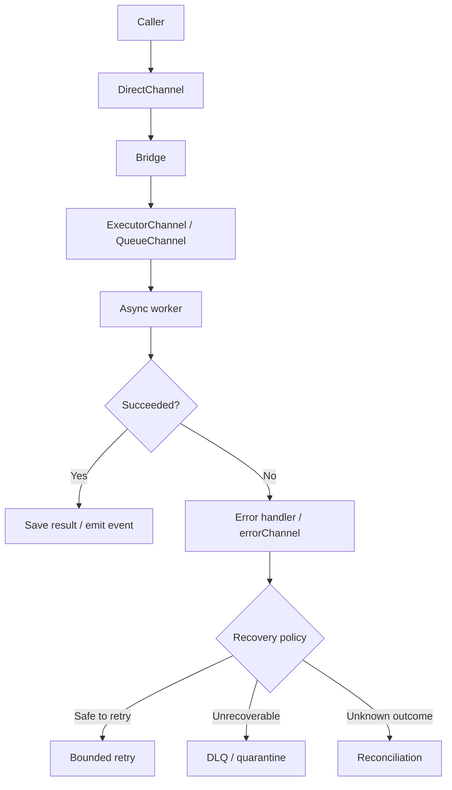

# Bridge Between Sync and Async Channels in Spring Integration

## 1. When Should You Connect a Synchronous Channel to an Asynchronous Channel?

In the **Bridge** chapter of the **SPRING_INTEGRATION_PATTERN** module, we learn how to connect message flows with Spring Integration to apply **Enterprise Integration Patterns (EIP)**. The module also uses Router, Filter, Transformer, Splitter, Aggregator, Gateway, retry, error channel, and correlation; therefore, understanding **message paths** and **execution boundaries** is foundational for error handling and scaling systems.

Suppose an API receives an order-status update request. It needs to validate the data and then hand off updating data, sending notifications, and writing audit records to a worker flow. The API does not want to hold the HTTP thread waiting for all processing to finish.

The initial model uses `DirectChannel`:

```text
HTTP request
    |
    v
Messaging Gateway
    |
    v
DirectChannel --> Handler A --> Handler B --> Handler C
                         (same thread as the sender)
```

If handler B calls a slow two-second service, the gateway call can be blocked for two seconds. We can introduce an asynchronous boundary by forwarding messages to an `ExecutorChannel` or buffering through a `QueueChannel`, then using a **Bridge** to connect the channels:



This lesson aims to answer three questions:

1. **What does a Bridge do?** It forwards messages from one channel to another channel without adding business transformation logic.
2. **What actually creates asynchrony?** The channel type, executor, or poller—not the Bridge itself.
3. **What changes at the boundary?** Threads, transactions, exception catching, when the caller stops waiting, processing order, queue pressure, and observability.

By the end of this lesson, you will be able to write two common topologies: `DirectChannel → Bridge → ExecutorChannel` and `DirectChannel → Bridge → QueueChannel → polling Bridge → DirectChannel`; and know how to test, operate, and choose the right topology.

## 2. Distinguishing Bridge, Channel, and Handler

### 2.1. Bridge Is an Enterprise Integration Pattern

A **Messaging Bridge** connects two channels that serve distinct roles in a topology. In Spring Integration, a bridge endpoint can use `BridgeHandler` to receive messages from one channel and send them to an output channel.

A simple bridge normally does not need to modify the payload. Its purpose lies in **connecting two flow segments**, creating a clear boundary between sender and receiver.

```text
Channel A --> [ Bridge ] --> Channel B
```

If the payload must convert from JSON to a domain object, use a **Transformer**. If you need to choose one of multiple destinations, use a **Router**. If you need to discard messages by rule, use a **Filter**. If you need business processing, use a **Service Activator**. A Bridge fits when the primary goal is **connecting channels**.

### 2.2. A Bridge Does Not Create a New Thread by Itself

Suppose both ends are `DirectChannel`s:

```text
Caller thread --> DirectChannel A --> Bridge --> DirectChannel B --> Handler
                  (normally everything runs on the caller thread)
```

The Bridge adds an endpoint in the topology, yet does not switch to another thread by itself. Asynchrony appears when the downstream channel has an asynchronous dispatch mechanism or an independently running polling consumer.

### 2.3. Key Channels to Distinguish

| Channel | Mechanism | Thread Running Next Handler | Characteristics to Watch |
| --- | --- | --- | --- |
| `DirectChannel` | Invokes subscriber directly via synchronous dispatcher | Usually the sending thread | Exceptions can unwind up the call stack; transactions can continue on the same thread |
| `ExecutorChannel` | Hands tasks off to a `TaskExecutor` | Usually a worker thread when executor accepts the task | Does not propagate transaction/thread-local by default; can reject under overload |
| `QueueChannel` | Buffers messages in a queue | Does not invoke handler on enqueue; needs poller/receiver to pull | Has capacity, blocking/timeout when full, needs polling and recovery mechanisms |
| `PriorityChannel` | Buffers messages by priority | Consumer/poller pulls later | Can alter FIFO ordering |
| `PublishSubscribeChannel` | Dispatches to multiple subscribers | Synchronous or asynchronous depending on executor | One message can trigger multiple processing branches |
| `FluxMessageChannel` | Channel with reactive semantics | Depends on subscriber/scheduler/reactive pipeline | Must understand demand/backpressure and reactive lifecycle |

**Do not infer asynchrony from the name Bridge.** Look at the output channel type, executor, poller, and execution flow.

## 3. Two Common Sync → Async Connection Patterns

### 3.1. Option A: DirectChannel → Bridge → ExecutorChannel



**Meaning:** if the executor has accepted the task and does not run it on the caller thread itself, the send call can return before the handler completes. Business execution happens in the worker.

Notes:

- `ExecutorChannel` is not a broker and does not guarantee durability across restarts.
- The executor's queue and rejection policy determine what happens under overload.
- If the executor uses `CallerRunsPolicy` or runs tasks directly on the calling thread, the task may execute on the caller thread. Therefore, **never guarantee a new thread is always used** without knowing the executor configuration.
- Completion of the send call **does not mean** the handler has committed data.

### 3.2. Option B: DirectChannel → Bridge → QueueChannel → polling Bridge → DirectChannel



**Meaning:** the first Bridge places the message into a queue; a poller pulls the message to run the second Bridge and pass it to the handler. The caller can return once the message is enqueued, while the handler runs on the poller thread afterward.

This approach is useful when you need to **buffer load** and pace message retrieval. Unlike `ExecutorChannel`, `QueueChannel` holds messages before a polling consumer retrieves them. However, a standard `QueueChannel` is still an in-memory structure; for crash recovery across restarts, use persistence or an appropriate broker.

### 3.3. Quick Comparison

| Criterion | Bridge → ExecutorChannel | Bridge → QueueChannel + Poller |
| --- | --- | --- |
| Primary goal | Offload work to an executor | Buffer and pace processing rate |
| Where backlog lives | Executor queue, if configured | QueueChannel |
| Active consumer | TaskExecutor dispatch | Poller calling `receive()` |
| Under overload | Executor can reject or apply policy | Queue is full; `send` can wait or fail depending on timeout |
| Parallelism | Executor pool | Poller/task executor and consumer concurrency config |
| Rate control | Pool size, queue capacity, rejection | Poll interval, max messages per poll, poller concurrency |
| Data across restarts | Usually non-durable | Basic QueueChannel is non-durable |
| Original transaction | Does not propagate to worker automatically | Does not propagate to poller thread automatically |
| Completion order | Can reorder with multiple workers | Depends on poller and downstream concurrency |

## 4. Hands-on Example: Bridge from DirectChannel to ExecutorChannel

Suppose a gateway receives an order-processing command. The goal is to **offload work to a worker**. This illustrative app uses Java 17+ and Spring Integration with Java DSL configuration; place each `public` type in its own Java file when implementing.

### 4.1. Data Model

```java
public record ProcessOrderCommand(
    String eventId,
    String orderId,
    long amountCents
) {}
```

`eventId` is a business identifier stable across retries/redeliveries; `orderId` links events belonging to the same order. A Spring message also has `MessageHeaders.ID`, but message IDs can change when building new messages, so do not use it as the sole idempotency key.

### 4.2. Declaring Channels and Executor

```java
import org.springframework.context.annotation.Bean;
import org.springframework.context.annotation.Configuration;
import org.springframework.integration.annotation.IntegrationComponentScan;
import org.springframework.integration.channel.DirectChannel;
import org.springframework.integration.channel.ExecutorChannel;
import org.springframework.integration.config.EnableIntegration;
import org.springframework.messaging.MessageChannel;
import org.springframework.scheduling.concurrent.ThreadPoolTaskExecutor;

@Configuration
@EnableIntegration
@IntegrationComponentScan
public class OrderBridgeChannels {

    @Bean("syncOrders")
    public MessageChannel syncOrders() {
        return new DirectChannel();
    }

    @Bean
    public ThreadPoolTaskExecutor orderWorkExecutor() {
        ThreadPoolTaskExecutor executor = new ThreadPoolTaskExecutor();
        executor.setCorePoolSize(4);
        executor.setMaxPoolSize(8);
        executor.setQueueCapacity(100);
        executor.setThreadNamePrefix("order-work-");
        // Spring manages initialization and shutdown of the executor bean.
        return executor;
    }

    @Bean("asyncOrders")
    public MessageChannel asyncOrders(
            ThreadPoolTaskExecutor orderWorkExecutor) {
        return new ExecutorChannel(orderWorkExecutor);
    }
}
```

In this example:

- `syncOrders` dispatches synchronously to the Bridge.
- `asyncOrders` hands tasks off to `orderWorkExecutor`.
- The pool has 4 core threads, up to 8 threads, and a queue capacity of 100. With standard `ThreadPoolExecutor`, tasks are queued before the pool scales up to max; tune based on measurements.
- The executor is a finite resource. If the queue fills and capacity is exhausted, sends can be rejected; the caller needs an overload policy.

**Remember:** `ExecutorChannel` does not make work a durable job. If the process dies after accepting work but before the handler finishes, tasks in the executor queue can be lost.

### 4.3. Connecting Two Channels with a Bridge

```java
import org.springframework.context.annotation.Bean;
import org.springframework.context.annotation.Configuration;
import org.springframework.integration.dsl.IntegrationFlow;

@Configuration
public class OrderBridgeFlow {

    @Bean
    public IntegrationFlow syncToAsyncOrderBridge() {
        return IntegrationFlow
            .from("syncOrders")
            .bridge(endpoint -> endpoint.id("syncAsyncOrderBridge"))
            .channel("asyncOrders")
            .get();
    }
}
```

Step-by-step explanation:

1. `from("syncOrders")` registers the endpoint reading from the synchronous channel.
2. `bridge(...)` declares the `BridgeHandler` performing forwarding.
3. `id("syncAsyncOrderBridge")` names the endpoint for easier graph, log, and metric tracing.
4. `channel("asyncOrders")` chooses the `ExecutorChannel` as the output channel.
5. The message is passed to the executor; business logic in the consumer of `asyncOrders` executes according to executor scheduling.

You could write a flow connecting channels directly without extra layers, but a Bridge explicitly states the intent to connect two channels and provides a manageable, observable endpoint.

### 4.4. Handler Executing on the Worker

```java
import org.springframework.integration.annotation.ServiceActivator;
import org.springframework.messaging.Message;
import org.springframework.stereotype.Component;

@Component
public class OrderWorker {

    private final OrderUseCase useCase;

    public OrderWorker(OrderUseCase useCase) {
        this.useCase = useCase;
    }

    @ServiceActivator(inputChannel = "asyncOrders")
    public void process(Message<ProcessOrderCommand> message) {
        ProcessOrderCommand command = message.getPayload();

        // In production: idempotent processing by eventId.
        useCase.processOnce(command);

        // Use correlated logging/metrics; do not print sensitive payloads.
    }
}
```

`OrderUseCase` is an application-implemented business class. If it writes data, `processOnce` should run with an idempotency key and appropriate transaction, because duplicates can still arrive when external systems resend requests.

### 4.5. Caller-Side Gateway

```java
import org.springframework.integration.annotation.MessagingGateway;

@MessagingGateway(defaultRequestChannel = "syncOrders")
public interface OrderWorkGateway {
    void submit(ProcessOrderCommand command);
}
```

Call example:

```java
gateway.submit(new ProcessOrderCommand(
    "evt-1024", "ord-589", 250_000
));
```

With a `void` gateway, the call is designed for **one-way dispatch**: the caller does not expect an immediate business reply. Once the executor accepts the task, the method can return while the handler continues running.

However, what “sent” means must be stated accurately:

- You can assert that **the channel send completed according to channel mechanics at that moment**.
- You cannot assert that the handler finished processing or that the database committed.
- You cannot assert that the work will survive a restart.
- An error occurring *after dispatch to the worker* will not automatically turn into an exception from the already-returned `submit` call.

If the API must promise that accepted work is guaranteed to run even across restarts, use a broker or persistent job store/transactional outbox with processing state and idempotency.

## 5. Buffered Example: Bridge to QueueChannel Then Polling Bridge

`QueueChannel` is useful when you want to separate two flow segments with an explicit queue and pace consumption.

### 5.1. Configuring the Channels

```java
import org.springframework.context.annotation.Bean;
import org.springframework.context.annotation.Configuration;
import org.springframework.integration.channel.DirectChannel;
import org.springframework.integration.channel.QueueChannel;
import org.springframework.messaging.MessageChannel;
import org.springframework.messaging.PollableChannel;

@Configuration
public class BufferedBridgeChannels {

    @Bean("bufferedIngress")
    public MessageChannel bufferedIngress() {
        return new DirectChannel();
    }

    @Bean("orderBuffer")
    public PollableChannel orderBuffer() {
        return new QueueChannel(200);
    }

    @Bean("bufferedWorkerInput")
    public MessageChannel bufferedWorkerInput() {
        return new DirectChannel();
    }
}
```

Here, `orderBuffer` has a capacity of 200 messages. It can buffer short bursts when the producer outpaces the consumer, though if backlog exceeds long-term capacity, the queue will eventually fill up.

### 5.2. Bridge Pushing Messages into QueueChannel

```java
import org.springframework.context.annotation.Bean;
import org.springframework.context.annotation.Configuration;
import org.springframework.integration.dsl.IntegrationFlow;

@Configuration
public class BufferedIngressBridge {

    @Bean
    public IntegrationFlow ingressToBuffer() {
        return IntegrationFlow
            .from("bufferedIngress")
            .bridge(endpoint -> endpoint.id("ingressBufferBridge"))
            .channel("orderBuffer")
            .get();
    }
}
```

When the Bridge sends to `orderBuffer`, the channel enqueues the message under its `send` policy. If the buffer is full, sending can block or fail depending on timeout. Configure wait limits and overload handling at the sender; never let HTTP requests hang indefinitely due to a full queue.

### 5.3. Polling Bridge Pulling Messages Out

```java
import java.time.Duration;

import org.springframework.context.annotation.Bean;
import org.springframework.context.annotation.Configuration;
import org.springframework.integration.dsl.IntegrationFlow;
import org.springframework.integration.dsl.Pollers;

@Configuration
public class BufferedEgressBridge {

    @Bean
    public IntegrationFlow bufferToWorker() {
        return IntegrationFlow
            .from("orderBuffer")
            .bridge(endpoint -> endpoint
                .id("bufferWorkerBridge")
                .poller(
                    Pollers.fixedDelay(Duration.ofMillis(250))
                        .maxMessagesPerPoll(10)
                )
            )
            .channel("bufferedWorkerInput")
            .get();
    }
}
```

This is a **polling bridge**: the poller runs independently of the original thread, pulls messages from the `QueueChannel`, and forwards them through the Bridge into `bufferedWorkerInput`.

`maxMessagesPerPoll(10)` caps the number of receives/executions per poll, rather than guaranteeing exactly 10 messages every cycle. Actual cadence depends on handler duration, scheduler, queue, and system load.

### 5.4. Handler Behind the Poller

```java
import org.springframework.integration.annotation.ServiceActivator;
import org.springframework.stereotype.Component;

@Component
public class BufferedOrderWorker {

    private final OrderUseCase useCase;

    public BufferedOrderWorker(OrderUseCase useCase) {
        this.useCase = useCase;
    }

    @ServiceActivator(inputChannel = "bufferedWorkerInput")
    public void process(ProcessOrderCommand command) {
        useCase.processOnce(command);
    }
}
```

In this topology, the handler receives from a `DirectChannel` and typically executes **on the polling thread**. Thus asynchrony comes from separating producer and consumer with `QueueChannel`/poller, not from `bufferedWorkerInput` being asynchronous by itself.

The configurations in Section 4 and Section 5 are **two independent options**. When building a sample app, pick one topology or ensure distinct channel, bean, and consumer names; avoid accidentally subscribing two consumers to process the same command.

### 5.5. What Happens When the Poller Pulls a Message and the Handler Fails

An in-memory `QueueChannel` generally does not provide the guarantees of a durable broker:

- A message already pulled from the queue by the poller does not automatically return to the queue if the downstream handler throws an exception.
- An exception at a polling endpoint can route to error handling depending on configuration; whether to requeue, retry, discard, or move to persistent storage must be decided by the application.
- Across a restart, pending items in `QueueChannel` have no persistence guarantee like a durable broker.
- QueueChannel capacity limits waiting items, but does not automatically create retries, deduplication, or business transactions.

If messages cannot be lost, consider a `JDBC-backed MessageStore` with appropriate channel configuration or move to a broker with durable ACK/redelivery. Read the chosen technology's semantics carefully: durable storage alone still does not guarantee an external side effect happens only once.

## 6. Thread Boundary: The Most Important Shift

### 6.1. Threads Before and After the Bridge

With `DirectChannel → Bridge → DirectChannel`:

```text
http-nio-8080-exec-1
  -> syncInput.send()
  -> BridgeHandler
  -> anotherDirectChannel.send()
  -> businessHandler
```

With `DirectChannel → Bridge → ExecutorChannel`:

```text
http-nio-8080-exec-1
  -> syncInput.send()
  -> BridgeHandler
  -> executor accepts task
  <- send() returns

order-work-1
  -> businessHandler
```

With `QueueChannel + Polling Bridge`:

```text
http-nio-8080-exec-1
  -> bufferedIngress.send()
  -> BridgeHandler
  -> QueueChannel.enqueue()
  <- send() returns

scheduling-1
  -> QueueChannel.receive()
  -> BridgeHandler
  -> bufferedWorkerInput.send()
  -> businessHandler
```

Thread names are illustrative, not strict standards. Measure and log actual threads when testing.

### 6.2. ThreadLocal, Transactions, and Security Context

Several Java contexts are commonly bound to a thread:

- Active Spring transaction.
- Application `ThreadLocal` values.
- Logging MDC.
- Security context when using a thread-local model.
- Trace/span context in some observability libraries.

When crossing an `ExecutorChannel` or poller thread, these contexts are **not propagated by default**. A Bridge forwards message payload/headers via standard messaging, yet it **is not a mechanism for copying every ThreadLocal**.

If the worker needs:

1. **A new transaction**: open one on the worker service/handler with `@Transactional` and design a separate commit boundary.
2. **Caller identity**: pass authenticated/authorized identity via a secure contract rather than blindly trusting external headers.
3. **Correlation/tracing**: pass IDs and use appropriate instrumentation or executor context propagation, backed by tests.
4. **Logging MDC**: set/restore it inside the worker and clear it cleanly to avoid leaking context across thread-pool tasks.

Do not blindly copy the entire `SecurityContext` or transaction context from an HTTP thread by default. Workers have their own lifecycle and security constraints; pass only the minimal required data intentionally.

### 6.3. A Single Transaction Does Not Span an Async Bridge

Suppose:

```text
HTTP transaction T1
  -> DirectChannel
  -> Bridge
  -> ExecutorChannel
       -> Worker transaction T2
```

Transaction T1 on the caller thread and T2 on the worker are two independent transactions when the worker starts its own transaction. T1 committing does not mean T2 commits. T1 rolling back does not automatically roll back effects already committed in T2.

Therefore, if business rules require **saving an order and scheduling processing durably together**, use a transactional outbox, broker, or appropriate transaction/storage pattern rather than assuming an async Bridge “carries” the transaction across.

## 7. Exception Propagation and Error Channel

### 7.1. Exceptions Before the Async Boundary

Errors occurring when:

- Gateway/producer builds an invalid message.
- Bridge cannot send to the output channel.
- Executor rejects the task immediately during `send`.
- QueueChannel is full and send times out.

…can return to the caller depending on channel/gateway type and configuration. These are **handoff-phase** failures.

### 7.2. Exceptions After the Async Boundary

Errors occurring when the worker executes:

- Handler throws a business exception.
- Database timeout or rollback.
- Outbound adapter fails to send.
- Downstream Transformer, Router, or Aggregator fails.

…happen when the caller may already have received a “work accepted” outcome. An exception on the worker cannot automatically unwind onto a call stack that has already finished.



Spring Integration provides `ErrorMessage` and `errorChannel` to handle errors on endpoints/adapters that support message error handling. Still, merely configuring a global error channel **does not guarantee every exception on every channel type arrives there automatically**. Verify the error handler at the actual executor, poller, or broker-listener boundary.

### 7.3. Error Flows Should Preserve Message Identity

An error message typically wraps a `Throwable`, and depending on the source may carry the failed/original message to recover correlation.

```java
import org.springframework.integration.annotation.ServiceActivator;
import org.springframework.messaging.MessagingException;
import org.springframework.messaging.Message;
import org.springframework.messaging.support.ErrorMessage;
import org.springframework.stereotype.Component;

@Component
public class WorkErrorObserver {

    @ServiceActivator(inputChannel = "workErrors")
    public void observe(ErrorMessage errorMessage) {
        Throwable failure = errorMessage.getPayload();

        Message<?> original = errorMessage.getOriginalMessage();
        if (original == null
                && failure instanceof MessagingException me) {
            original = me.getFailedMessage();
        }

        Object eventId = original != null
            ? original.getHeaders().get("eventId")
            : null;

        // Record error type, eventId, stage, attempt.
        // Choose retry/quarantine using a separate policy.
    }
}
```

This is an **example handler for an error channel named `workErrors`**; wire the corresponding endpoint/boundary error configuration to that channel. This `void` method only observes—it **does not retry, generate a reply, or guarantee ACK/NACK**.

If data must survive restarts, error logs alone are insufficient. You need persistent state storage or a broker with appropriate delivery policies.

## 8. Request–Reply Crossing a Sync → Async Bridge

A Bridge can still forward messages belonging to a request–reply flow. In Spring Integration, a gateway can await a response via reply channel metadata; a normal Bridge forwards the message for downstream processing.

Example price-check request:

```text
Caller -> Messaging Gateway
          -> DirectChannel
          -> Bridge
          -> ExecutorChannel
          -> Pricing Handler
          -> gateway's replyChannel
          -> Caller
```

Distinguish clearly:

- **Asynchronous dispatch**: caller uses a `void` gateway, expecting no direct business reply.
- **Request–reply with async execution**: gateway still waits for a reply while the handler runs on a worker thread. The caller remains blocked **waiting for the result**, unless the external API exposes another status-polling pattern.

### 8.1. Gateway Returning a Reply

```java
public record PriceCheck(String requestId, String sku) {}

public record PriceReply(
    String requestId,
    long priceCents,
    String status
) {}
```

```java
import org.springframework.integration.annotation.MessagingGateway;

@MessagingGateway(
    defaultRequestChannel = "priceSyncInput",
    defaultReplyTimeout = "1500"
)
public interface PriceGateway {
    PriceReply checkPrice(PriceCheck request);
}
```

Suppose `priceSyncInput` bridges to an `ExecutorChannel` and the handler produces a `PriceReply`. The gateway waits up to its reply timeout after sending the request.

**Timeout does not mean the handler was canceled.** If the handler takes 2 seconds while the gateway waits 1.5 seconds, the caller will miss the reply deadline even though the worker keeps running. With an object return type, the gateway may return `null` when no reply arrives in time or throw exceptions for other errors depending on configuration. Callers must handle timeouts, dispatch failures, and indeterminate business states.

### 8.2. Header Care When Building New Messages

A simple Bridge forwards messages and relevant headers per Spring Integration mechanics. Yet a custom Transformer or network adapter can build a new message and lose `replyChannel`, `errorChannel`, or correlation headers.

If request–reply runs **within the same application**, the gateway-provided reply channel can be used. If requests cross a **broker/service boundary**, do not pass internal Java `MessageChannel` objects as network metadata; use protocol-serializable reply destinations and correlation IDs.

### 8.3. When Should You Return `202 Accepted` and Track Progress?

For long-running work, instead of holding an HTTP request waiting on a worker, you can:

1. Confirm the request has been **durably saved** with a `requestId`.
2. Return an “accepted for processing” response per contract.
3. Have the worker execute and update status.
4. Let the client poll `GET /operations/{requestId}` or receive a completion callback/event.
5. Ensure retries with the same `requestId` do not duplicate side effects.

Only return an “accepted” status with corresponding guarantees when an appropriate intake store exists. Plain Bridge + ExecutorChannel only schedules work in memory and cannot promise execution after a restart.

## 9. Backpressure, Capacity, and Resource Limits

### 9.1. Asynchrony Does Not Create Infinite Capacity

Suppose a producer sends 1,000 messages/second while workers process at most 600 messages/second. The 400 messages/second gap grows the backlog by about 24,000 messages in one minute if unbounded and unthrottled. `ExecutorChannel`/`QueueChannel` **do not solve** sustained throughput mismatches.

Configure:

- Bounded queue capacity and worker count.
- Policy when full: fail fast, wait with timeout, or spill to durable storage.
- Maximum processing duration and safe cancellation where business rules allow.
- Retry counts and backoff.
- Send quotas and admission control at ingress.
- Dashboards for backlog depth and oldest message age, not just CPU usage.

### 9.2. Executor Rejection and Caller-Runs Policy

When the executor queue is full:

- `AbortPolicy` or equivalent rejection: `execute` can throw a rejection exception, causing sends to fail.
- `CallerRunsPolicy`: can execute the task on the caller thread, providing backpressure while breaking the assumption that “the handler always runs asynchronously.”
- A policy that silently discards tasks is extremely dangerous if the caller believes work was accepted.

In sensitive workflows, state the policy explicitly in code and test it. Avoid unbounded queues, which turn task rejection into out-of-memory failures and unbounded latency.

### 9.3. QueueChannel Capacity Does Not Replace a Durable Queue

`QueueChannel(200)` has a capacity of 200, but when the process stops, remaining items are not preserved. If “accepted means guaranteed to be processed” is a business contract, consider a durable message store or broker with explicit durability commitments.

A flow can combine:

```text
DirectChannel -> Bridge -> Durable broker adapter
                                   |
                                   v
                           Broker / message store
                                   |
                                   v
                       Inbound adapter -> Handler
```

Here, the broker forms the durable boundary per actual configuration. The Bridge only connects the message flow; it **does not replace** publisher confirms, consumer ACKs, or transactions.

## 10. Message Ordering and Parallelism

In a purely synchronous `DirectChannel` flow, handlers can execute in the order of each `send` call. Even then, if multiple threads send concurrently, global ordering must still be examined.

When crossing an `ExecutorChannel` with multiple workers:

```text
Message A -> worker-1 -> processes 800 ms
Message B -> worker-2 -> processes 100 ms
                              |
                              +--> B may finish before A
```

With `QueueChannel` plus multiple pollers/workers, dequeue order and **business-effect completion** order can also diverge.

If business logic requires ordering per `orderId`, you can:

- Attach `aggregateVersion`/sequence, validate it, and reject or defer out-of-order updates.
- Partition by business key and process sequentially within each partition.
- Restrict to a single consumer where strict FIFO is required, trading off parallelism.
- Design idempotent operations capable of reconciling late events.

Never assume a Bridge maintains “exactly once” or “global FIFO” once crossing into an executor. Those properties depend on channel structure, scheduling, and business logic.

## 11. Retries, Idempotency, and Indeterminate Outcomes

### 11.1. Why Retries After a Bridge Can Create Duplicates

Scenario:

1. Caller sends `eventId=evt-301` to `syncOrders`.
2. Bridge forwards to the executor; caller receives a dispatch success result.
3. Worker commits data successfully, yet the reply/connection drops or the app crashes.
4. Caller does not know the outcome and retries the same operation.
5. Without deduplication in the handler, business side effects happen twice.

Use a stable `eventId` or `idempotencyKey` and enforce it atomically where side effects occur—for example, a database unique constraint within the same transaction as the write.

### 11.2. Distinguishing Failure Modes

| Situation | What Is Known? | Appropriate Response |
| --- | --- | --- |
| Executor rejects immediately before processing | Task was not accepted by the executor via this path | Report overload / controlled retry |
| QueueChannel is full and send fails | Message was not successfully enqueued on that attempt | Apply admission control or durable storage |
| Worker throws a validation exception | Request is invalid | Record rejected status; do not retry indefinitely |
| Worker hits transient DB error before commit | Transaction did not commit if rollback is confirmed | Bounded retry if within deadline |
| HTTP call from worker hits read timeout | Remote side may have committed | Reconcile or retry with idempotency key when provider supports it |
| Worker commits, then process dies before reporting | Side effect may already exist | Query state and deduplicate |
| Gateway times out waiting for reply | Caller missed the reply deadline | Cannot infer business failure yet |

### 11.3. Retry Advice Differs from Broker Redelivery

`RequestHandlerRetryAdvice` can retry a handler within its execution scope. Broker redelivery occurs when the transport redelivers a message per ACK/offset policy. A Bridge provides neither on its own. If multiple retry layers exist, cap total attempts, record attempt counts, and avoid blindly retrying non-idempotent operations.

When code throws an exception at an async boundary, an error channel can support orchestration policies, yet **it does not automatically roll back an already completed remote operation**. Compensation requires a dedicated business action with an idempotency key and state checks.

## 12. Correlation, Observability, and Message History

### 12.1. Metadata to Carry

| Field | Role | Stable Across Retries? |
| --- | --- | --- |
| `eventId` | Business event key, deduplication | Yes |
| `requestId` | Business call/operation key | Yes when retrying the same operation |
| `correlationId` | Links steps, branches, and replies | Per correlation contract |
| `traceId` | Traces one execution across systems | Can vary per attempt |
| `messageId` | Identifies Spring message instance | Can change when rebuilding messages |
| `attempt` | Processing attempt count | Increments per policy |
| `originChannel` | Logical input channel | For operations |
| `targetChannel` | Logical output channel | For operations |

A Bridge forwards messages via messaging mechanics; headers can pass through internal channel hops, though not all ThreadLocal/tracing contexts or headers cross network boundaries automatically. Across thread boundaries, instrument the executor/poller or use fields inside the message to initialize log/tracing context during processing.

### 12.2. Logging Before and After the Async Boundary

Illustrative timeline:

```text
09:00:00.000 thread=http-1       eventId=evt-301 stage=RECEIVED
09:00:00.003 thread=http-1       eventId=evt-301 stage=BRIDGE_HANDOFF
09:00:00.005 thread=http-1       eventId=evt-301 stage=ENQUEUED
09:00:00.021 thread=order-work-1 eventId=evt-301 stage=PROCESSING
09:00:00.125 thread=order-work-1 eventId=evt-301 stage=COMMITTED
```

`BRIDGE_HANDOFF` and `ENQUEUED` are application-defined log labels. They do not prove `COMMITTED`. Measure **handoff latency**, **queue wait**, **handler duration**, and **end-to-end latency**.

### 12.3. Integration Graph and Metrics

Spring Integration and Spring Boot Actuator/Micrometer can expose information about components, channels, and message handlers depending on dependencies, versions, and configuration.

Illustrative Actuator configuration:

```yaml
management:
  endpoints:
    web:
      exposure:
        include: health,info,metrics,prometheus,integrationgraph
```

When the runtime environment enables the corresponding endpoints, you can inspect:

- Bridge endpoint `syncAsyncOrderBridge` connecting `syncOrders` to `asyncOrders`.
- Message counts traversing channels.
- Handler duration and failure counts.
- Executor active threads, queue depth, and rejections.
- Message backlog, oldest message age, and operation time-to-complete.

Exact metric/tag names vary with Spring Integration, Micrometer, and instrumentation config. Inspect `/actuator/metrics` at runtime rather than assuming a metric always exists. Protect Actuator endpoints from unauthorized access because the graph can expose internal topology.

### 12.4. Message History and Tracing

Spring Integration message history can record components a message traverses when enabled. Example configuration:

```java
import org.springframework.context.annotation.Configuration;
import org.springframework.integration.config.EnableMessageHistory;

@Configuration
@EnableMessageHistory
public class MessageHistoryConfig {
}
```

History helps identify the Bridge, channels, and handlers inside an application, but it is **not** proof of database commit or a complete distributed trace. For flows crossing brokers or HTTP, maintain correlation using protocol-supported IDs/metadata.

## 13. Testing the Sync → Async Boundary

A good test proves **observable behavior**, not merely that a bean has type `ExecutorChannel`.

### 13.1. Test Matrix

| Scenario | How to Set Up | What to Verify |
| --- | --- | --- |
| Bridge between two DirectChannels | Build Direct → Bridge → Direct flow | Handler runs synchronously on caller thread in default setup |
| Bridge to ExecutorChannel | Hold handler with a latch | Caller completes handoff before handler latch is released |
| Executor rejection | Fill pool and queue | Caller receives dispatch/overload error per policy |
| Caller-runs policy | Configure caller-runs executor | Handler can execute on caller thread; do not assume strict async |
| Bounded QueueChannel | Push more than slot count | Send waits/times out/rejects as configured |
| Polling Bridge | Pause or block poller | Producer enqueues up to capacity; handler runs only when poller pulls |
| Worker handler exception | Throw error after async boundary | Caller does not receive exception after submit returns; error flow observes it |
| Transaction | Roll back caller after handoff | Worker does not automatically roll back with caller transaction |
| Reply timeout | Async handler returns past deadline | Caller handles timeout; handler may still be running |
| Ordering | Two messages with different durations | Completion order can invert under parallelism |
| Duplicate | Resend same `eventId` | Side effect occurs only once when idempotent |
| Process restart | Pending work in memory | Exposes durability limits and chosen recovery mechanism |
| Correlation/tracing | Log across two threads | `eventId` stays consistent; trace context propagates per config |
| Metrics and graph | Enable instrumentation | Bridge/channels appear properly; avoid high-cardinality dynamic IDs as metric labels |

### 13.2. Using CountDownLatch to Verify Async Handoff

A more reliable technique than `Thread.sleep(100)` is using two `CountDownLatch`es in a test handler:

- `started` confirms the worker entered the handler.
- `release` holds the handler from completing.
- The test calls the gateway on an appropriate thread and awaits `started` within a test timeout.
- While `release` is still closed, assert that `void submit` already returned per policy.
- Then open `release` and await handler completion; count down latches in `finally` to avoid hanging tests.

Illustrative code:

```java
import java.util.concurrent.CountDownLatch;
import java.util.concurrent.TimeUnit;

public final class BlockingTestHandler {

    final CountDownLatch started = new CountDownLatch(1);
    final CountDownLatch release = new CountDownLatch(1);
    final CountDownLatch done = new CountDownLatch(1);

    public void handle(ProcessOrderCommand command)
            throws InterruptedException {
        started.countDown();
        try {
            if (!release.await(5, TimeUnit.SECONDS)) {
                throw new IllegalStateException("Test release timed out");
            }
        } finally {
            done.countDown();
        }
    }
}
```

When wiring into an integration test, subscribe this handler to the async channel in a **dedicated test context**, avoiding duplicate subscriptions with production handlers. To genuinely prove handoff, wait for `started` first, then assert the gateway call returned while `release` is still held. If the executor lacks available workers or triggers caller-runs, the test will exhibit different behavior.

### 13.3. Testing a QueueChannel with a Poller

With `QueueChannel`, separate three conditions:

1. **Enqueued**: message is in the queue; producer has returned.
2. **Dequeued**: poller retrieved the message.
3. **Completed**: handler committed business state.

A test can pause the poller or slow the handler to verify queue depth and full-capacity behavior. Avoid `Thread.sleep` with tight scheduler margins in CI; use latches, Awaitility, or bounded wait conditions.

### 13.4. What Unit Tests Do Not Prove

A unit test of `BridgeHandler` does not prove:

- Tasks are durably persisted across process crashes.
- Transactions or security contexts propagate accurately across threads.
- Retries or broker ACKs happen as expected.
- Completion order across a multithreaded executor.
- Caller visibility into worker failures after `submit` returns.

Those guarantees require integration tests with real executors/pollers and, where applicable, real brokers/databases in the test environment.

## 14. Common Design Mistakes

**Thinking a Bridge creates asynchrony on its own.** A Bridge connects channels; you need `ExecutorChannel`, `QueueChannel` plus poller, or a corresponding async mechanism to change execution semantics.

**Thinking `void submit` returning means work is finished.** It reflects only the send boundary for the current topology. If business completion guarantees are needed, build separate state/notification/reply contracts.

**Using an executor with an unbounded queue.** Producers can build huge backlogs, increasing memory usage and wait times. Add capacity bounds, backpressure, and alerts.

**Assuming an HTTP transaction carries into the worker.** Thread-bound transactions do not automatically cross async boundaries. Open dedicated transactions and persist intent durably when needed.

**Catching exceptions only at the caller.** Exceptions in handlers running after handoff need error handling at the worker/poller boundary and observability via event IDs.

**Treating an in-memory QueueChannel like a durable broker.** If the process dies, queued messages can be lost. Be explicit about durability and recovery plans.

**Expecting all messages to finish in the same order.** Multiple workers, retries, and variable processing times can reorder completions. Add sequence/version checks where needed.

**Retrying without idempotency.** When a handler already committed and the response was lost, resending can create duplicates.

**Equating reply timeout with handler cancellation.** The gateway stopping its wait does not mean side effects were rolled back.

**Declaring an error channel without testing the real error path.** Error flow configuration must be verified at the actual boundary alongside appropriate handling/ACK/retry policies.

## 15. Practice Exercises

1. Build `DirectChannel(syncOrders) → Bridge → ExecutorChannel(asyncOrders)` and assign a stable ID to the bridge.
2. Use `CountDownLatch` in the handler to prove `void submit` on the gateway returns before the handler finishes.
3. Configure a small-capacity executor; send many messages and observe rejections/backpressure.
4. Create a `QueueChannel(200)` version with a polling Bridge, measuring queue depth and buffer residence time.
5. Have the handler throw an exception after handoff; observe error handling on the worker/poller and confirm the already-returned caller does not receive that exception directly.
6. Roll back the caller's transaction after handoff; observe the independent worker transaction.
7. Add a request–reply gateway over `ExecutorChannel` with `replyTimeout`; simulate a late reply.
8. Add `eventId` and database idempotency. Resend the same logical operation and verify the side effect executes only once.
9. Build a dashboard for throughput, error rate, executor saturation, queue wait, and p95 end-to-end latency.
10. Write a runbook explaining when to migrate from an in-memory queue to a broker or persistent message store.

**Self-assessment question:** A `BridgeHandler` forwarded a message into `ExecutorChannel` and the gateway returned success; a few seconds later the worker failed to write data and the application restarted. What did the system guarantee, what is missing to avoid losing the command, and how can the caller look up the request's outcome?

## Key Takeaways

- A **Bridge** connects two message channels; it does not switch threads, perform business transformations, or provide durability on its own.
- `DirectChannel → Bridge → ExecutorChannel` offloads processing to an executor when the executor dispatches asynchronously; account for rejections and caller-runs policies.
- `DirectChannel → Bridge → QueueChannel → polling Bridge` buffers messages and decouples the producer from the poller/consumer; the basic queue is in-memory.
- Async boundaries change exception propagation, transactions, thread-local context, ordering, and when a send call is considered complete.
- With request–reply, a gateway can still await a reply after the handler moves to a worker; timeouts do not automatically cancel downstream work.
- Retries and redeliveries require event ID/idempotency, reconcilable error flows, and cross-thread observability to verify business outcomes.
- Choose channel types and recovery policies according to **durability, throughput, deadlines, and business contracts**; test both handoff and final processing.
