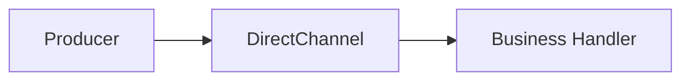
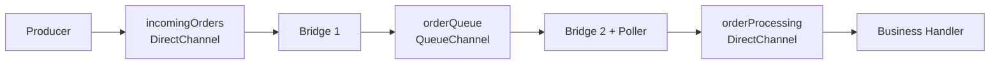
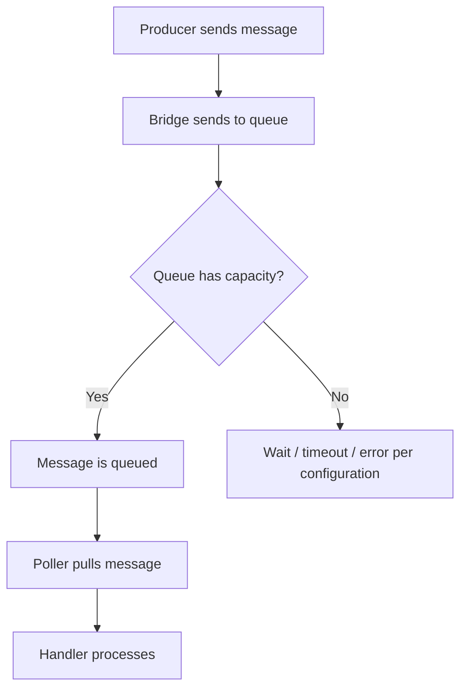
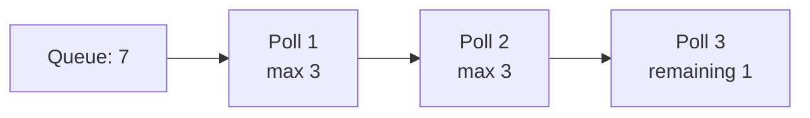
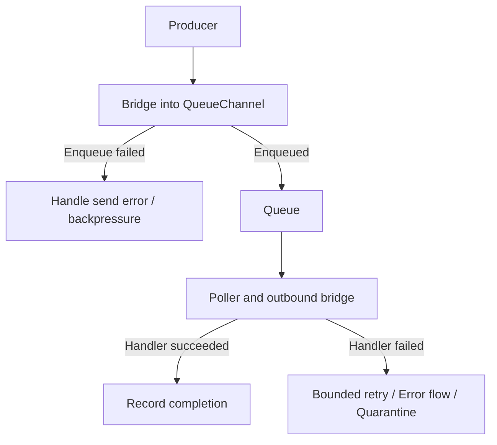

# Bridge Across a Queue and Semantic Changes in Spring Integration

## 1. Why Placing a Queue Between Two Channels Matters

In Enterprise Integration Patterns, a **Message Bridge** connects two messaging channels. The bridge itself typically forwards payloads and headers without performing data transformation. However, when one of the two channels is a **`QueueChannel`**, the execution semantics of the entire flow change significantly.

Consider two topologies:

**Direct synchronous flow:**



**Flow going through a queue:**



In the first flow, the producer sends a message through `DirectChannel` and the handler normally runs immediately on the **`send()` calling thread**. In the second flow, the producer can complete the operation of **placing the message into the queue** before the handler actually starts. A poller later pulls the message from the queue, the bridge forwards it to the processing channel, and the handler runs in the context of that polling cycle.

Therefore, **“Bridge across a queue and semantic changes”** is not just about wiring two channels together. It is about **changing the timing and error contract** of the message flow: when something counts as received, when it is truly completed, who is responsible for retries, and where backlogs are managed.

This lesson belongs to the **Bridge** chapter in the **SPRING_INTEGRATION_PATTERN** module. These concepts support building loosely coupled, extensible EIP flows combining Filter, Transformer, Router, Splitter, Aggregator, Gateway, and retry/error-channel/correlation strategies.

### Learning Outcomes

After this lesson, you will be able to:

- Explain the difference between synchronous handoff and handoff across a `QueueChannel`.
- Configure two bridges to connect `DirectChannel → QueueChannel → DirectChannel` in Spring Integration.
- Understand what the `send()` result means when the business handler runs in a later polling cycle.
- Design queue bounds, pollers, processing order, error handling, and idempotency.
- Plan tests for failure and backlog scenarios before putting a queued bridge into production.

## 2. What Responsibilities Do Message Bridge and QueueChannel Have?

### 2.1. Bridge Forwards Messages

A bridge has `MessageChannel`s as its input and output. It takes the incoming message and sends it to the target channel without business logic such as parsing JSON, validating orders, or branching. `BridgeHandler` is the dedicated handler in Spring Integration; a bridge can be configured via `@BridgeFrom`, `@BridgeTo`, Java DSL, or XML.

Putting a bridge in a flow does not mean creating a new execution thread. **The channel and its consumption mechanism** determine whether a flow segment runs synchronously, requires polling, or runs on an executor.

### 2.2. QueueChannel Stores Messages for Active Retrieval

`QueueChannel` implements `PollableChannel`: producers can `send()` messages into the queue, while consumers call `receive()` to pull messages out. A queue **does not push** messages to subscribed handlers like `DirectChannel`. Therefore, an endpoint consuming from a `QueueChannel` typically needs a **poller**.

By default, `QueueChannel` serves as an internal queue. In an example using `new QueueChannel(20)`, the queue holds at most 20 items; do not assume this queue is durable across restarts. For durability, design an appropriate message store or broker and verify transaction mechanics.

### 2.3. A Pair of Bridges Flanking the Queue

A clear way to express this:

1. **Bridge 1:** receives messages from `incomingOrders` (`DirectChannel`) and sends them into `orderQueue` (`QueueChannel`).
2. **Bridge 2:** uses a poller to receive messages from `orderQueue` and sends them to `orderProcessing` (`DirectChannel`).
3. The business handler subscribes to `orderProcessing`.

Neither bridge transforms the payload. The “semantic change” comes from `orderQueue` holding the message until a different consumption moment and the poller establishing a pacing boundary.

## 3. Semantics That Change When Adding a Queue

| Aspect | `DirectChannel → Handler` | `DirectChannel → Bridge → QueueChannel → Bridge/Poller → Handler` |
| --- | --- | --- |
| **Execution timing** | Handler typically runs inside the `send()` call. | Handler can run in a subsequent polling cycle. |
| **Execution thread** | Typically the producer's thread. | Downstream handler typically runs on the poller thread. |
| **Meaning of successful send** | With a synchronous flow, `send()` usually completes only after the handler returns. | Producer may only know the message was **accepted into the queue**, not that business processing succeeded. |
| **Handler errors** | Exceptions can propagate directly back to the caller. | Exceptions occur on the poller; they are not returned by default to the earlier queue sender. |
| **Load pacing** | Producer and consumer load are tightly coupled. | Queue creates a buffer; poller and capacity shape backlog/throughput. |
| **Ordering** | Depends on channels and handlers in the flow. | Queue generally dequeues in arrival order, yet **completion** order also depends on consumer count/concurrency. |
| **Transactions** | Can share the caller's context if components join the same transaction. | Enqueuing and post-poll processing can be in two separate contexts/transactions. |
| **Durability** | No durability guarantee from `DirectChannel` alone. | In-memory `QueueChannel` does not survive crashes or restarts automatically either. |

### 3.1. “Sent” Differs from “Processed Successfully”

With `DirectChannel` and a synchronous handler, when the producer sends a message without an exception, the producer may observe that the handler has returned. Even so, that **does not automatically prove** external side effects committed if business logic performs additional asynchronous actions.

With `QueueChannel`, the distinction is even clearer:

```text
T0  Producer send(order) to incomingOrders
T1  Bridge 1 moves it into orderQueue
T2  Producer's send(order) can complete
T3  Poller pulls order from orderQueue
T4  Bridge 2 forwards to orderProcessing
T5  Handler writes data or calls external service
T6  Handler succeeds or fails
```

Between **T2** and **T6**, the producer has no proof that business processing completed. A “sent successfully” log should therefore be understood as **sent/queued successfully**, not “order processed.”

### 3.2. Asynchronous Across Time, Yet Still Containing Synchronous Segments

A queued system introduces a temporal processing boundary:

- The **producer → Bridge 1 → QueueChannel** segment can remain synchronous up to the completion of enqueueing.
- The **poller → Bridge 2 → DirectChannel → handler** segment is typically synchronous within the polling cycle.

As a result, handler errors can propagate to the poller thread of the **second segment**, but no longer propagate directly to the already-completed `send()` call of the **first segment**.

This differs from the simplistic claim that “everything through a queue runs in parallel.” The actual number of threads, pollers, and consumers determines parallelism.

### 3.3. Buffer Limits and Backpressure

A finite-capacity queue is a **buffer**, not extra business processing capacity. If messages arrive faster than handlers complete them, backlog grows until hitting capacity.

When the queue is full, sending to the queue can block, return failure, or throw an exception depending on timeouts and send path. Explicitly define timeout settings and how the producer reacts; a timeout applied on an upstream channel does not automatically guarantee the exact same timeout applies at every internal forwarding hop.



## 4. Hands-on Example: DirectChannel → QueueChannel → DirectChannel

Suppose an application receives order IDs and places them into a queue for small-batch processing. The example uses Java 17+, Spring Boot 3.x, and compatible Spring Integration 6.x APIs; when using newer versions, check the BOM and API documentation for your project.

### 4.1. Maven Dependency

```xml
<dependencies>
    <dependency>
        <groupId>org.springframework.boot</groupId>
        <artifactId>spring-boot-starter-integration</artifactId>
    </dependency>
</dependencies>
```

This example uses internal channels and endpoints only, so dependencies for File, Kafka, AMQP, or JDBC are not needed yet.

### 4.2. Configuring Two Bridges with @BridgeFrom

Create `BufferedBridgeConfiguration.java` in a package scanned by Spring Boot:

```java
package com.example.integration;

import org.springframework.context.annotation.Bean;
import org.springframework.context.annotation.Configuration;
import org.springframework.integration.annotation.BridgeFrom;
import org.springframework.integration.annotation.Poller;
import org.springframework.integration.annotation.ServiceActivator;
import org.springframework.integration.channel.DirectChannel;
import org.springframework.integration.channel.QueueChannel;
import org.springframework.integration.config.EnableIntegration;
import org.springframework.messaging.MessageChannel;
import org.springframework.messaging.MessageHandler;
import org.springframework.messaging.PollableChannel;
import org.springframework.messaging.SubscribableChannel;

@Configuration
@EnableIntegration
public class BufferedBridgeConfiguration {

    // Producer sends messages here.
    @Bean
    public MessageChannel incomingOrders() {
        return new DirectChannel();
    }

    // Bridge 1: incomingOrders -> orderQueue.
    @Bean
    @BridgeFrom("incomingOrders")
    public PollableChannel orderQueue() {
        return new QueueChannel(20);
    }

    // Bridge 2: orderQueue -> orderProcessing.
    @Bean
    @BridgeFrom(
        value = "orderQueue",
        poller = @Poller(fixedDelay = "1000", maxMessagesPerPoll = "3")
    )
    public SubscribableChannel orderProcessing() {
        return new DirectChannel();
    }

    @Bean
    @ServiceActivator(inputChannel = "orderProcessing")
    public MessageHandler handleOrder() {
        return message -> System.out.printf(
            "Processed payload=%s, correlationId=%s, thread=%s%n",
            message.getPayload(),
            message.getHeaders().get("correlationId"),
            Thread.currentThread().getName()
        );
    }
}
```

In this example:

- `incomingOrders` receives messages from the producer.
- Bridge 1 forwards the message unchanged into `orderQueue`. The queue has capacity 20 and is in-memory.
- `@BridgeFrom` on `orderProcessing` creates a bridge receiving from the queue via a poller. The poller runs with a 1,000 ms fixed delay and forwards at most 3 messages per poll.
- The handler on `orderProcessing` processes messages once the poller pulls them from the queue and sends them onto the `DirectChannel`.
- The `correlationId` header helps trace steps. A Bridge is not a component that generates business correlation IDs; the example sets the header at the producer.

### 4.3. Generating Sample Data

Create the application class `BufferedBridgeApplication.java`:

```java
package com.example.integration;

import org.springframework.beans.factory.annotation.Qualifier;
import org.springframework.boot.CommandLineRunner;
import org.springframework.boot.SpringApplication;
import org.springframework.boot.autoconfigure.SpringBootApplication;
import org.springframework.context.annotation.Bean;
import org.springframework.messaging.MessageChannel;
import org.springframework.messaging.support.MessageBuilder;

@SpringBootApplication
public class BufferedBridgeApplication {

    public static void main(String[] args) {
        SpringApplication.run(BufferedBridgeApplication.class, args);
    }

    @Bean
    public CommandLineRunner submitOrders(
            @Qualifier("incomingOrders") MessageChannel input) {
        return args -> {
            for (int index = 1; index <= 7; index++) {
                String orderId = "ORDER-" + index;
                boolean accepted = input.send(
                    MessageBuilder.withPayload(orderId)
                        .setHeader("correlationId", "run-001")
                        .build()
                );

                System.out.printf(
                    "Sent order=%s, accepted=%s%n", orderId, accepted
                );
            }
        };
    }
}
```

Run `mvn spring-boot:run` in a Maven project with the Spring Boot plugin configured, or run `BufferedBridgeApplication` directly from your IDE. Observed logs look like:

```text
Sent order=ORDER-1, accepted=true
Sent order=ORDER-2, accepted=true
...
Sent order=ORDER-7, accepted=true
Processed payload=ORDER-1, correlationId=run-001, thread=...
Processed payload=ORDER-2, correlationId=run-001, thread=...
...
```

Do not rely on the absolute ordering between **the two groups of log lines**. The poller can interleave with the producer depending on scheduler timing and system speed. With an uncontended queue and a sequential consumer, messages are pulled in enqueue order; still, global log order is not a timing guarantee.

### 4.4. Are One Bridge and One Queue Enough?

If the producer sends directly to `QueueChannel`, you can omit Bridge 1 and keep the polled bridge feeding the processing channel. If the consumer can poll the queue directly and needs no separate channel, you might not even need Bridge 2.

This lesson uses **two bridges** to clearly show connecting three segments `DirectChannel → QueueChannel → DirectChannel` and each endpoint's responsibility. Do not add bridges merely to inflate component count in a diagram. Each endpoint should serve a clear pacing or boundary role.

## 5. Poller Pacing the Forwarding Rate

When reading a queue, the poller determines the schedule and how many messages can be received per poll.

| Configuration | Meaning | Keep in Mind |
| --- | --- | --- |
| `fixedDelay = "1000"` | Sets a 1,000 ms delay between polling executions. | Long processing durations delay subsequent polls. |
| `maxMessagesPerPoll = "3"` | Pulls at most 3 messages per poll. | Does not guarantee always processing exactly 3 messages/second. |
| `cron` | Triggers at scheduled calendar points. | Suited for time-windowed work. |
| Executor / task scheduler | Affects which thread runs the poller. | Increased concurrency can change completion order and error handling. |

For example, if the queue holds 7 messages before polling starts, with no new messages, no errors, and a single sequential poller:



This illustrates a **per-poll** limit, not a guaranteed throughput number. If the handler is slow or downstream is congested, actual throughput can be significantly lower.

To improve throughput, measure processing time, backlog, consumer count, and end-to-end latency. Increasing `maxMessagesPerPoll` or lowering `fixedDelay` does not help if the handler or target system is already saturated.

## 6. Semantic Changes in Message Ordering

A `QueueChannel` normally provides FIFO ordering for enqueue/dequeue operations. However, **queue FIFO does not mean in-order business completion** in every configuration.

### Single Poller and Synchronous Handler

If a single poller processes sequentially over a `DirectChannel`, messages are pulled from the queue in arrival order. When the handler finishes one message before moving to the next, completion order typically mirrors dequeue order.

### Multiple Consumers or Asynchronous Processing

When multiple endpoints poll the same queue, multiple tasks run concurrently, or the handler offloads work to an executor, **ORDER-2** can finish before **ORDER-1** despite being dequeued later. The queue can still be FIFO at dequeue time while completion order differs.

If business logic requires per-customer/per-order ordering, you may need key-based partitioning, per-key concurrency limits, or dedicated sequence/ordering checks. A Bridge does not enforce those rules automatically.

## 7. Semantic Changes in Errors and Transactions

### 7.1. Errors Before the Queue Differ from Errors After the Queue

Distinguish two cases:

**Errors in producer → queue:** queue is full, send fails, channel has no subscriber, or the bridge fails during enqueue. The caller can observe the `send()` return value or an exception on that send attempt, depending on configuration.

**Errors in poller → handler:** the message has already been dequeued, and then parsing fails, the database errors, or a downstream service times out. The upstream producer has usually already returned; this error must be handled on the polling branch via retries, an error flow, or an appropriate recovery procedure.



**Do not equate** “the queue accepted the message” with “business processing succeeded.” To report final outcomes to the caller, design a reply channel or track processing status; when synchronous request–reply is required, consider a Gateway with appropriate timeouts and correlation.

### 7.2. Does a Message Leaving the Queue Automatically Return on Handler Failure?

Do not assume so. With the in-memory queue in the example, the poll operation typically removes the message from the queue before the handler runs. A Bridge does not automatically apply retries, undo side effects, or push failed messages back.

Actual behavior depends on the queue/message store type, transaction manager, poller advice, error handler, and downstream components. When reliability is needed, explicitly design:

1. Which transient errors are retried, how many times, and with what interval.
2. Which permanent errors go to dead-letter/quarantine with a recorded reason.
3. Where completion is recorded, and whether reprocessing a message causes duplicate side effects.
4. How data is recovered if the application dies between poll and commit.

If stateful retries without message loss are required, verify with crash/restart tests against a real persistent store and transaction setup. Merely swapping `DirectChannel` for `QueueChannel` does not give at-least-once or exactly-once delivery.

### 7.3. Transaction and Thread Context

Transactions are bound to the current thread in many common setups. When a producer sends a message to a queue and a poller processes it later on another thread, the producer's transaction does not automatically carry over to the poller thread.

Likewise, MDC, `ThreadLocal`, security context, or thread-bound tracing information do not cross this boundary automatically. Values needed by the handler should be placed in **message headers or payload** following data security rules, or propagated via an appropriate integration mechanism.

If the processing step requires a new transaction, configure transaction advice/transaction manager around the consuming endpoint and verify exact commit/rollback boundaries.

## 8. Planning Backpressure and Capacity

Suppose a producer sends an average of 40 messages/second, while the handler completes only 25 messages/second. At those steady average rates, the backlog grows by roughly **15 messages per second** until the queue hits capacity or ingress drops.

```text
Average incoming rate       = 40 messages/second
Completed processing rate   = 25 messages/second
Backlog growth approx.      = 15 messages/second
```

This is an illustrative calculation assuming constant average rates, not a measurement from the Java example.

With a queue capacity of 20, a sustained mismatch cannot be absorbed. Address it by scaling downstream capacity, throttling incoming traffic, tuning polling schedules, applying rejection/wait policies, or using durable buffering designed for the workload.

### Metrics Worth Measuring

- Successful and failed enqueue counts.
- Current queue depth/backlog and wait time before dequeue.
- Messages started, succeeded, and failed in the handler.
- Elapsed time from producer send to handler completion.
- Empty polls, failed polls, retries, and messages routed to error handling.
- Frequency of full-queue conditions and producer send latency.

When monitoring, standardize definitions for **accepted**, **started**, **completed**, and **failed** so metrics are never misleading.

## 9. Distinguishing a Queued Bridge from Related EIPs

| Problem | Appropriate Pattern or Component | Explanation |
| --- | --- | --- |
| Decouple producer and consumer pacing | **Message Bridge + QueueChannel + Poller** | Shifts handoff timing between two flow segments. |
| Convert JSON into `Order` | **Transformer** | Changes payload/schema. |
| Let only valid orders pass | **Filter** | Decides whether a message proceeds or is discarded. |
| Split processing by order type | **Router** | Chooses target branch/channel. |
| Split an order into items and gather results | **Splitter / Aggregator** | Requires correlation/sequence, timeouts, and completion strategy. |
| Communication needing a return result to caller | **Gateway** | Provides request–reply, timeouts, and reply channel. |
| Receive/send data with external systems | **Inbound/Outbound Channel Adapter** | Bridges external protocol boundaries. |

A Bridge helps connect flow segments sharing compatible message shapes. If both sides are incompatible in payload or headers, use a Transformer or dedicated endpoint; a bridge is not a schema-conversion mechanism.

## 10. Testing Semantics Before and After Adding a Queue

Do not just test “did the message eventually reach the handler?” Test **changes in timing, error behavior, and state**.

### 10.1. Scenarios to Include

| Scenario | What to Verify |
| --- | --- |
| Single valid message | Handler receives the exact payload and `correlationId` header. |
| More messages than `maxMessagesPerPoll` | Messages are delivered across multiple polls; queue drains gradually. |
| Producer sends while handler has not run yet | “Accepted/queued” status is distinguished from “completed.” |
| Slow handler | Backlog and latency grow; producer can continue sending up to capacity limit. |
| Full queue | Explicit error/timeout or wait policy triggers; producer does not silently drop messages. |
| Handler throws an exception | Error flow and retries are observed on the poller branch; already-returned producer does not receive it. |
| Application restart | With an in-memory queue, do not assume unprocessed messages are retained. |
| Two concurrent consumers | Verify dequeue order and completion order against business requirements. |

### 10.2. Integration Testing Tips

You can use Spring Boot Test with Spring Integration Test, `CountDownLatch`, a probe handler, or a test channel to observe messages pulled from the queue. For error and concurrency tests, use latches or bounded wait conditions rather than fixed `Thread.sleep()` calls that assume the poller has run.

A helpful strategy is recording test collector events when:

1. Producer finishes `send()`.
2. Handler begins.
3. Handler completes or throws an error.

From these three timestamps, tests can confirm the flow shifted from synchronous execution to post-poll execution and verify exact business state.

## 11. Common Misconceptions

**“Putting a queue in the middle means messages are durable.”** An in-memory `QueueChannel` does not survive application death by default. Durability requires designing and testing an appropriate persistence layer.

**“`send()` returning `true` means business processing succeeded.”** With a queue, it may only confirm delivery into the buffer. The handler might not have run yet or may fail later.

**“The Bridge automatically retries messages when a handler fails.”** A Bridge forwards messages. Retries and recovery must be configured separately alongside error classification and idempotency policies.

**“A queue always preserves processing order.”** Dequeue FIFO does not guarantee completion order if multiple consumers or asynchronous steps exist.

**“Adding a queue always increases throughput.”** A queue only absorbs temporary load spikes. Long-term throughput depends on downstream processing capacity and resources.

**“Just set the poller as fast as possible.”** Overly aggressive polling creates many empty polls or increases system pressure; choose polling frequency based on allowable latency and measured processing rate.

## 12. Self-Check Knowledge Questions

1. In `DirectChannel → Bridge → QueueChannel → Bridge/Poller → DirectChannel`, do the producer's send call and the handler run on the same thread or can they run on different threads? Why?
2. When `send()` returns success yet the handler fails in a later polling cycle, how should the application represent those two states?
3. If a queue has capacity 20 and arrival rate persistently exceeds processing rate, what happens? What mitigation strategies are viable?
4. If the system must guarantee orders for the same customer are processed in order, what points beyond `QueueChannel` itself must be controlled?
5. Why does a bridge across a queue not replace a Transformer, Gateway, or retry policy?

**Key takeaway:** Bridging across a queue introduces a **processing-time boundary**, affecting how errors, transactions, ordering, and backpressure behave and are observed. When designing Spring Integration flows, clearly define “received,” “processing,” and “completed,” then choose channels, pollers, and recovery mechanisms accordingly.

**References:** [Spring Integration Reference — Messaging Bridge](https://docs.spring.io/spring-integration/reference/bridge.html), [Spring Integration Reference — Message Channels](https://docs.spring.io/spring-integration/reference/channel.html).
