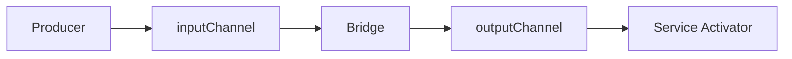
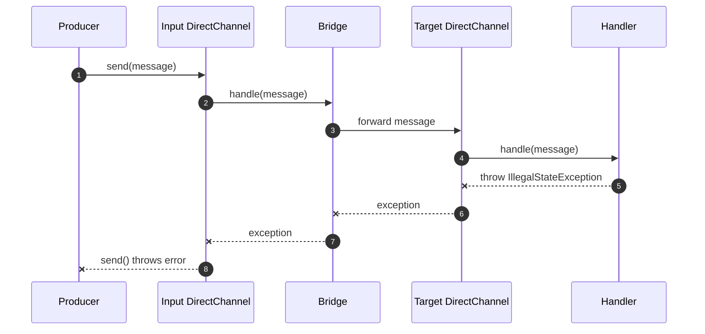
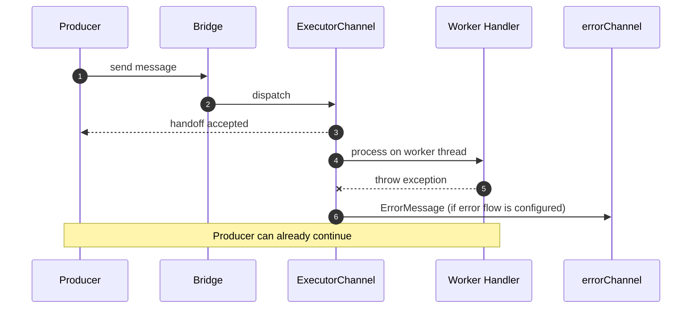

# Bridge Error Propagation in Spring Integration

## Lesson Objectives

After this lesson, you will be able to:

- Explain how a **Bridge** forwards messages between two channels and why **exception** paths depend on channel types and synchronous/asynchronous boundaries.
- Distinguish errors when **sending to a channel**, errors from a **handler behind the Bridge**, errors while **awaiting a reply**, and errors after a message reaches a broker.
- Predict when the sender receives an exception directly, when an error becomes an `ErrorMessage` on `errorChannel`, and when a caller only observes a timeout.
- Write a Java Spring Integration example using `DirectChannel`, `ExecutorChannel`, `IntegrationFlow.bridge()`, `@ServiceActivator`, and an explicit error channel.
- Independently test synchronous error propagation and asynchronous error forwarding, including preserving `requestId` for reconciliation.
- Design retries, idempotency, correlation, monitoring, and error handling when a Bridge connects to an adapter/broker.

This lesson belongs to the **Bridge** chapter of the **SPRING_INTEGRATION_PATTERN** module. The module practices *Enterprise Integration Patterns* with Spring Integration to build loosely coupled, extensible message flows. When flows combine Router, Filter, Transformer, Splitter, Aggregator, Gateway, retry, error channel, and correlation, understanding how errors behave across a Bridge is essential to handling failures in the right place without leaving callers hanging indefinitely or losing trace information.

## 1. The Bridge Forwards Messages; Who Is Responsible for Forwarding Errors?

The **Bridge pattern** connects a source channel to a target channel without requiring business payload transformation. In Spring Integration, `BridgeHandler` is the forwarding endpoint; in Java DSL, we usually declare `.bridge()`.



From a business perspective, a Bridge is usually “transparent”: the target handler receives the request content sent by the producer. Yet when an error occurs, you cannot naively assume “the Bridge will propagate the exception straight back in reverse.” What determines behavior is **which thread throws the error**, **whether the send operation has already completed**, and **whether endpoints/channels configure error handling**.

Ask four questions:

1. Does the exception occur **inside the `send()` call itself** or after the message has been handed off to another worker?
2. Is the target channel a `DirectChannel`, `QueueChannel`, `ExecutorChannel`, or an adapter to a broker?
3. Does the message carry a valid `errorChannel`, or is there a configured default error flow?
4. Does the caller require a **business reply**, or does it only care that the message was accepted?

**A Bridge is not a retry mechanism, dead-letter queue, rollback mechanism, or cross-system delivery guarantee.** Those responsibilities must be configured on handlers, channels, adapters, transactions, and brokers at each specific boundary.

## 2. Three Error Paths to Distinguish

| Path | When the Error Occurs | What the Sender Usually Sees | Who Handles Next |
| --- | --- | --- | --- |
| **Synchronous:** `DirectChannel → Bridge → DirectChannel` | Target handler throws an exception on the same call stack | `send()` may throw an exception, typically wrapped by Spring Messaging/Integration | Caller or error handling wrapping the call site |
| **Asynchronous:** `DirectChannel → Bridge → ExecutorChannel` | Handler runs on a worker and throws after handoff | `send()` may already have returned success; exception does not automatically return to producer thread | Error flow using `errorChannel`, or executor/channel error handling |
| **With a broker:** `Bridge → outbound adapter → broker → consumer` | Publish fails, consumer processing fails, or reply is lost | Depends on stage: direct publish error, nack/confirm, error event, or timeout | Adapter, broker, retry/dead-letter, consumer, and request–reply contract |

### 2.1. Synchronous: Exceptions Can Unwind Back to `send()`



`DirectChannel` invokes subscribers synchronously on the sender's thread. If a handler behind the Bridge throws an error, the exception can propagate back to the caller on the same call stack, possibly wrapped in `MessageHandlingException` or `MessageDeliveryException` depending on location and dispatch mechanics.

An error **does not automatically turn into an `ErrorMessage`** on a global `errorChannel` merely because the application declares an error channel. For synchronous handling, callers typically catch the exception or attach appropriate advice/error handling at the intake point.

### 2.2. Asynchronous: Errors Belong to the Worker Lifecycle



With `ExecutorChannel`, handler errors can be turned into an `ErrorMessage` sent to the channel specified by the `MessageHeaders.ERROR_CHANNEL` header or a configured default error-channel mechanism. Without a valid receiver, errors may be logged or fail on the worker without the caller receiving any business feedback.

**Do not confuse “sent successfully” with “processed successfully.”** `send()` succeeding across an async boundary usually proves only that the message was accepted for dispatch; the actual handler may fail immediately afterward.

### 2.3. Send Failures vs. Processing Failures

Even before the handler runs, forwarding through a Bridge can fail:

- The target channel is a `DirectChannel` with no matching subscriber.
- A bounded `QueueChannel` is full or the send timeout expires.
- An `ExecutorChannel` cannot submit work because the overloaded executor rejects it.
- The target adapter fails to connect, serialize the payload, or publish to the broker.

Failures **occurring during dispatch** can surface on the sending thread. Failures occurring after handoff appear in error flows or external system state. Therefore, track **send/dispatch failures** separately from **handler failures**.

## 3. Java Example: Two Similar Bridges, Two Different Error Paths

This example uses **Java 17+, Spring Boot 3.x, and Spring Integration 6.x**. Place `public` classes/records in separate Java files within a package scanned by Spring Boot. Requires Spring Integration and Spring Boot Test dependencies. The goal is observing thread boundaries; no HTTP service, RabbitMQ, or database is needed.

### 3.1. Work Item Contract

```java
// WorkItem.java
public record WorkItem(
        String requestId,
        boolean simulateFailure
) {}
```

`requestId` is a producer-supplied business key for reconciliation in logs and error flows. It differs from `MessageHeaders.ID` or correlation IDs used by Splitter/Aggregator.

### 3.2. Configuring Two Flows and an Error Inbox Channel

```java
// BridgeErrorConfiguration.java
import org.springframework.beans.factory.annotation.Qualifier;
import org.springframework.context.annotation.Bean;
import org.springframework.context.annotation.Configuration;
import org.springframework.integration.channel.DirectChannel;
import org.springframework.integration.channel.ExecutorChannel;
import org.springframework.integration.channel.QueueChannel;
import org.springframework.integration.config.EnableIntegration;
import org.springframework.integration.dsl.IntegrationFlow;
import org.springframework.messaging.MessageChannel;
import org.springframework.scheduling.concurrent.ThreadPoolTaskExecutor;

@Configuration
@EnableIntegration
public class BridgeErrorConfiguration {

    @Bean("syncIngress")
    public MessageChannel syncIngress() {
        return new DirectChannel();
    }

    @Bean("syncWork")
    public MessageChannel syncWork() {
        return new DirectChannel();
    }

    @Bean
    public IntegrationFlow syncBridgeFlow() {
        return IntegrationFlow.from("syncIngress")
            .bridge()
            .channel("syncWork")
            .get();
    }

    @Bean("bridgeExecutor")
    public ThreadPoolTaskExecutor bridgeExecutor() {
        ThreadPoolTaskExecutor executor = new ThreadPoolTaskExecutor();
        executor.setCorePoolSize(2);
        executor.setMaxPoolSize(4);
        executor.setQueueCapacity(20);
        executor.setThreadNamePrefix("bridge-errors-");
        return executor;
    }

    @Bean("asyncIngress")
    public MessageChannel asyncIngress() {
        return new DirectChannel();
    }

    @Bean("asyncWork")
    public MessageChannel asyncWork(
            @Qualifier("bridgeExecutor") ThreadPoolTaskExecutor executor) {
        return new ExecutorChannel(executor);
    }

    @Bean
    public IntegrationFlow asyncBridgeFlow() {
        return IntegrationFlow.from("asyncIngress")
            .bridge()
            .channel("asyncWork")
            .get();
    }

    @Bean("bridgeErrorInbox")
    public QueueChannel bridgeErrorInbox() {
        // In-memory inbox so tests can actively receive ErrorMessage.
        return new QueueChannel(20);
    }
}
```

Here there are two **independent** flows:

- `syncIngress → Bridge → syncWork`: both channels are synchronous.
- `asyncIngress → Bridge → asyncWork`: the Bridge still runs on the sending thread, while `asyncWork` hands the message off to the executor.

`bridgeErrorInbox` is a `QueueChannel` reserved for this example/test. Placing errors into an in-memory queue does not create a durable error store; in production you need an error-handling consumer, audit storage, or durable messaging infrastructure if required by the business.

### 3.3. Two Service Activators Throwing Controlled Errors

```java
// WorkHandlers.java
import org.springframework.integration.annotation.ServiceActivator;
import org.springframework.stereotype.Component;

@Component
public class WorkHandlers {

    @ServiceActivator(inputChannel = "syncWork")
    public void processSync(WorkItem item) {
        if (item.simulateFailure()) {
            throw new IllegalStateException(
                "SYNC_BUSINESS_FAILURE id=" + item.requestId());
        }
        // Succeeds under one-way contract.
    }

    @ServiceActivator(inputChannel = "asyncWork")
    public void processAsync(WorkItem item) {
        if (item.simulateFailure()) {
            throw new IllegalStateException(
                "ASYNC_BUSINESS_FAILURE id=" + item.requestId());
        }
        // Succeeds under one-way contract.
    }
}
```

Both handlers intentionally throw `IllegalStateException` when `simulateFailure=true`. The errors in the business handlers are identical; **how the caller observes the error differs because the target channels differ**.

### 3.4. Producer Sending Messages and Specifying the Error Channel

```java
// WorkPublisher.java
import org.springframework.beans.factory.annotation.Qualifier;
import org.springframework.integration.channel.QueueChannel;
import org.springframework.messaging.MessageChannel;
import org.springframework.messaging.MessageHeaders;
import org.springframework.messaging.support.MessageBuilder;
import org.springframework.stereotype.Component;

@Component
public class WorkPublisher {
    private final MessageChannel syncIngress;
    private final MessageChannel asyncIngress;
    private final QueueChannel bridgeErrorInbox;

    public WorkPublisher(
            @Qualifier("syncIngress") MessageChannel syncIngress,
            @Qualifier("asyncIngress") MessageChannel asyncIngress,
            @Qualifier("bridgeErrorInbox") QueueChannel bridgeErrorInbox) {
        this.syncIngress = syncIngress;
        this.asyncIngress = asyncIngress;
        this.bridgeErrorInbox = bridgeErrorInbox;
    }

    public boolean publishSync(String requestId) {
        return syncIngress.send(
            MessageBuilder.withPayload(new WorkItem(requestId, true))
                .setHeader("requestId", requestId)
                .build()
        );
    }

    public boolean publishAsync(String requestId) {
        return asyncIngress.send(
            MessageBuilder.withPayload(new WorkItem(requestId, true))
                .setHeader("requestId", requestId)
                .setHeader(
                    MessageHeaders.ERROR_CHANNEL, bridgeErrorInbox)
                .build()
        );
    }
}
```

`publishSync(...)` will generally not return a boolean `true` when the handler throws, because `send()` throws an exception. `publishAsync(...)` can return `true` once the message is handed to the executor; the handler's exception is routed along the asynchronous error path.

The `MessageHeaders.ERROR_CHANNEL` header in this example holds a `MessageChannel` object because both ends run **within the same JVM**. Never send this raw Java object over RabbitMQ/Kafka/JMS; across process boundaries, use an error identifier or reply destination per adapter/protocol.

## 4. Testing Synchronous Errors

An integration test can prove that an exception from a handler behind a Bridge reaches the `send()` caller.

```java
// BridgeErrorFlowTest.java (synchronous test part)
import static org.assertj.core.api.Assertions.assertThat;
import static org.assertj.core.api.Assertions.catchThrowable;

import org.junit.jupiter.api.Test;
import org.springframework.beans.factory.annotation.Autowired;
import org.springframework.boot.test.context.SpringBootTest;

@SpringBootTest
class BridgeErrorFlowTest {
    @Autowired
    private WorkPublisher publisher;

    private static Throwable deepestCause(Throwable error) {
        Throwable current = error;
        while (current.getCause() != null && current.getCause() != current) {
            current = current.getCause();
        }
        return current;
    }

    @Test
    void syncBridgePropagatesDownstreamFailureToSender() {
        Throwable thrown = catchThrowable(() ->
            publisher.publishSync("SYNC-101"));

        assertThat(thrown).isNotNull();
        assertThat(deepestCause(thrown))
            .isInstanceOf(IllegalStateException.class)
            .hasMessageContaining("SYNC_BUSINESS_FAILURE");
    }
}
```

This is a meaningful check: the error originates in `WorkHandlers.processSync`, yet the caller invoking `WorkPublisher.publishSync` observes it. The test inspects the root cause rather than asserting an exact wrapper type, since the framework can wrap exceptions during message dispatch.

**If you change `syncWork` to an `ExecutorChannel`**, expecting “the exception is thrown directly back to the caller” no longer holds. In that case, you must assert on `ErrorMessage` or an asynchronous completion signal.

## 5. Testing Asynchronous Errors via Error Channel

With `asyncWork`, the test must wait for an **error message** on `bridgeErrorInbox`, rather than expecting `publishAsync(...)` to throw the handler's exception.

Add the following imports to `BridgeErrorFlowTest.java` from Section 4:

```java
import org.springframework.beans.factory.annotation.Qualifier;
import org.springframework.integration.channel.QueueChannel;
import org.springframework.messaging.Message;
import org.springframework.messaging.support.ErrorMessage;
```

And add the field and test method to that same test class:

```java
@Autowired
@Qualifier("bridgeErrorInbox")
private QueueChannel bridgeErrorInbox;

@Test
void asyncBridgePublishesFailureAsErrorMessage() {
    // Placed before publish to reduce the risk of the test reading stale errors.
    boolean accepted = publisher.publishAsync("ASYNC-101");
    assertThat(accepted).isTrue();

    Message<?> error = bridgeErrorInbox.receive(5_000);

    assertThat(error).isInstanceOf(ErrorMessage.class);
    Throwable failure = ((ErrorMessage) error).getPayload();
    assertThat(deepestCause(failure))
        .isInstanceOf(IllegalStateException.class)
        .hasMessageContaining("ASYNC_BUSINESS_FAILURE");
}
```

**What is verified:** the send to `asyncIngress` was accepted and a worker processing failure was delivered to the specified error channel. The test does not require the handler to finish before `send()` returns, nor does it claim that placing the error into a queue ensures durable persistence.

For parallel test execution or contexts with multiple producers, replace the shared queue with a **per-message error channel** or filter/verify `requestId` on the failed message before asserting. Do not rely on “the first `ErrorMessage` in the queue always belongs to the current test” if multiple tests can emit errors concurrently.

### 5.1. What Does an ErrorMessage Contain?

When Spring Integration sends an error to an error channel, the message is typically an `ErrorMessage` carrying a `Throwable` as its payload; the `Throwable` may be a `MessagingException`/`MessageHandlingException` referencing the **failed message**. Depending on the error path, `ErrorMessage` may also contain the original message.

When handling errors, extract at least:

| Field | Meaning |
| --- | --- |
| Root cause / exception type | Classify business, I/O, timeout, or data conversion errors |
| Failed message / original message if present | Locate the failing request |
| `requestId` or business operation ID | Correlate with logs, audit, and prior results |
| Endpoint/channel name | Identify whether failure occurred at Bridge, channel dispatch, or handler |
| Attempt count, deadline | Distinguish retryable errors from expired ones |
| Trace ID | Follow the message across multiple endpoints or applications |

Do not assume every `ErrorMessage` holds a failed message in the exact same place; a send failure before an endpoint receives a message can have a different exception shape than a failure inside an executed Service Activator. Error handlers should check types and nulls safely.

## 6. What Happens When No Error Channel Is Configured?

Spring Integration provides a **global `errorChannel`** in standard setups, though whether an exception goes there depends on the endpoint and async boundary. Common scenarios:

| Case | Expected Behavior |
| --- | --- |
| `DirectChannel` with a throwing handler | Exception unwinds up the call stack; global error channel does not catch every exception automatically |
| `ExecutorChannel` with a valid `errorChannel` header | Can send an `ErrorMessage` to the specified channel |
| `ExecutorChannel` without an `errorChannel` header | Default mechanism can route to the global `errorChannel` when configured; ensure a subscriber observes it |
| `QueueChannel` with a polling consumer | Error occurs during poll; uses the poller/endpoint's configured error handling |
| Handler catches the error and returns a failure result | No unhandled exception remains for an error channel; establish an explicit result convention |
| Error handler itself throws an exception | Error-handling failures can be logged, bubble up, or cause loops depending on configuration |

If a global error channel exists without any consuming handler, the system may only log errors or lose business failure signals for callers. For stable operations, build an **error-handling path with an active consumer**, such as recording audits, updating job status, and raising alerts, along with bounded error retention.

### 6.1. Example Error Consumer Instead of an Observation Queue

A production application can route error messages to a dedicated channel and Service Activator:

```java
// Independent example from bridgeErrorInbox used in tests.
import org.springframework.integration.annotation.ServiceActivator;
import org.springframework.messaging.support.ErrorMessage;
import org.springframework.stereotype.Component;

@Component
public class BridgeErrorLogger {
    @ServiceActivator(inputChannel = "operationalErrors")
    public void handle(ErrorMessage error) {
        Throwable failure = error.getPayload();
        // Classify failure, extract requestId if present in
        // failed/original message, record audit/metrics, and decide retry.
        System.err.println(
            "Bridge downstream failure: " + failure.getClass().getName());
    }
}
```

This assumes `operationalErrors` is configured as a channel and message/endpoint errors are routed to it. Printing to stderr **only illustrates where error handling sits**, not a production audit or retry system. If the error must return to the caller, the error handler must fulfill the proper **response contract** rather than only logging.

## 7. Bridge in Request–Reply: Errors Must Not Become Mysterious Timeouts

A Gateway waiting for a reply can pass through a Bridge:

```text
API caller -> Messaging Gateway -> requestChannel
                                   |
                                 Bridge
                                   |
                               workChannel
                                   |
                           Service Activator
                                   |
                              replyChannel
                                   |
                             Gateway -> caller
```

If a synchronous handler throws an exception, the Gateway can observe the error directly on the call path. If the boundary after the Bridge is async, worker errors must be routed back under the proper **error/reply contract**; if they are merely logged or sent to an error channel unrelated to the request, the Gateway may block until `replyTimeout`.

A request can carry:

- `replyChannel`: destination for the **business result**.
- `errorChannel`: destination for **technical errors** if supported by the error flow.
- `requestId`: application-generated key for reconciliation and tracing.
- `correlationId`: linking key in flows that group messages, such as Splitter/Aggregator or broker RPC.

These fields **do not substitute for one another**. A Bridge can forward headers within the same process; when rebuilding messages or crossing an adapter to a broker, decide which headers are preserved and how they map to transport format.

### 7.1. “Error Resulting in No Reply” Needs an Explicit Policy

Suppose a Filter sits after a Bridge and drops a message. If the caller is waiting for a reply, no handler returning a result can cause the Gateway to time out even without an exception. Likewise, a Router sending a message to a branch with no consumer or an Aggregator never receiving all parts can cause a timeout.

A sound contract defines all outcomes:

| Outcome | What Does the Caller/API Receive? |
| --- | --- |
| Success | Reply payload corresponding to the request |
| Predictable business error | Structured error reply, such as `INVALID_ORDER` |
| Recoverable infrastructure error | Bounded retry or explicit error reply |
| No reply before deadline | Timeout with request ID for lookup/reconciliation |
| Reply arrives after caller expired | Handle late reply; never match it to a subsequent request |

Do not let an error flow swallow every exception and only log if the business promises **every request terminates with a clear status**.

## 8. Bridge Across a Broker: Publish Errors and Processing Errors Are Two Separate Contracts

When a Bridge connects to an outbound adapter, it still only forwards messages inside Spring Integration:


At this boundary, distinguish:

1. **Errors before or during publish:** the adapter fails to serialize the payload, connect to the broker, or obtain publish confirmation per the selected confirm mode. If publishing is synchronous on the sending thread, the error can return to the sender; if confirms arrive later, handle them via callbacks/events or dedicated state.
2. **Errors after broker acceptance:** the producer may have succeeded by ACK/confirm criteria, yet the consumer can fail later. Consumer errors do not automatically unwind back through the producer application's Bridge.
3. **Errors delivering replies:** in broker-based request–reply, responses can be lost or arrive past the deadline. Proper `replyTo`/correlation IDs and a late-reply policy are needed.
4. **Errors after side effects committed:** redelivery can re-run the operation. Use idempotency and reconciliation rather than simply increasing retries.

The `errorChannel` inside an application context is not a global channel spanning processes. Brokers have their own ACK/NACK, requeue, dead-letter, and durability mechanisms; configure them at the adapter and consumer. To send errors from a remote process back to the requester, send an **error response/message** over the agreed protocol.

### 8.1. When a Bridge Forwards to a QueueChannel

If the target channel is a `QueueChannel`, the Bridge only places the message into the queue:

```text
DirectChannel -> Bridge -> QueueChannel -- PollingConsumer --> Handler
                                |
                      Handler error occurs
                      in a subsequent poll
```

An in-memory `QueueChannel` does not provide durability or rollback by itself. When a polling consumer pulls a message and throws an error, check how the poller, transaction, and source/message store handle the received message. Do not assume a handler exception automatically puts the message back into the queue or returns to the original sending thread.

## 9. Where Should Retries Live to Avoid Duplicate Processing?

**Retry is a decision based on failure type and task boundary**, not a built-in feature of a Bridge. For example:

| Retry Location | Can Recover From | Risk |
| --- | --- | --- |
| Retry when send is rejected due to transient error | Resending when source/target recovers | Message may already have been accepted before caller knew the outcome |
| Retry around Service Activator | Transient failures inside business handler | May repeat side effects if the previous attempt committed |
| Broker redelivery | Consumer dies before ACK or NACK/requeues | Same message can be reprocessed |
| Retry entire Gateway request | RPC timeout, network interruption | First attempt's outcome is unknown; may execute twice |

In Spring Integration, advice such as `RequestHandlerRetryAdvice` can be attached to appropriate endpoints to bound attempts and backoff. It is configured on the handler endpoint—do not misunderstand it as the Bridge automatically retrying all downstream errors. For async retries, if all attempts fail, still route the **final failure** to an error flow or update job status.

**Idempotency** protects an operation from executing twice when a message is redelivered. For instance, invoice creation uses `operationId` as a unique key, recording processing status and the created invoice in the same transaction; if the same key arrives again, return the stored result. An in-memory `HashSet` or non-atomic “check-then-insert” is insufficient when multiple workers run concurrently.

## 10. Testing What a Bridge Does Not Guarantee

Beyond the two tests in Sections 4–5, an error integration test suite should cover:

| Scenario | How to Trigger | Expected Outcome |
| --- | --- | --- |
| Synchronous handler throws error | `DirectChannel` on both ends | Caller `send()` sees the exception; does not silently turn into a timeout |
| Asynchronous handler throws error | `ExecutorChannel` after Bridge | Error flow receives `ErrorMessage`; send acceptance is not mistaken for business success |
| Target channel has no subscriber | Build channel with no handler attached | Dispatch failure is detected/recorded |
| Overloaded executor | Finite thread pool and queue; exceed capacity | Rejection policy or backpressure is observed |
| Full QueueChannel | No consumer; send beyond capacity | Sender blocks/times out/fails as configured |
| Gateway awaits reply while handler fails | Async flow with Gateway | Caller receives contracted error status or reconcilable timeout |
| Transformer drops headers | Build new message missing `requestId`/`errorChannel` | Error flow detects missing correlation instead of misattributing |
| Retries and side effects | After commit, simulate replay with same `operationId` | No second side effect occurs |
| Broker accepts, consumer fails | Integration test with real broker/testcontainer | Consumer retry/dead-letter works; producer does not falsely assume business completion |

### 10.1. Testing Error Correlation Specifically

With multiple concurrent requests, errors must be linked back to the right request. When using `ErrorMessage`, send one message with `requestId="R-1"` and another with `requestId="R-2"`, intentionally failing R-2's handler first. The error consumer must distinguish R-1/R-2 failures via the **failed message/original message or forwarded business key**.

Never assign the first error to the first request by send order. When an error consumer can no longer determine the request ID, log the error as missing correlation and send it to a dedicated reconciliation stream rather than guessing.

## 11. Monitoring Error Propagation in Production

Since a Bridge typically adds little new logic, root-cause analysis must span **both sides**:

| Metric / Tracked Field | Purpose |
| --- | --- |
| `requestId`, `traceId`, `messageId` | Link producer, Bridge, handler, and error flow |
| `sourceChannel` / `destinationChannel` | Identify which flow segment is forwarding |
| `send.duration` / `send.failure` | Detect blocking or failures right at dispatch |
| `handler.duration` / `handler.failure` | Detect slow or failing business handlers |
| `errorChannel.received` / `error.unhandled` | See whether errors are handled or dropped |
| `executor.active` / `executor.rejected` | Spot overload behind an async Bridge |
| `queue.depth` / `oldest.message.age` | Spot backlog behind a Bridge to a PollableChannel |
| `retry.count` / `deadletter.count` | Separate transient glitches from unprocessable messages |
| `gateway.timeout` / `late.reply` | Identify requests not finishing on time |

Logging with the specific endpoint/channel and request ID is far more useful than a generic “Bridge failed” line. Avoid logging full sensitive payloads or exceptions containing tokens, passwords, or personal data. Metrics for **send success** and **business success** must remain two distinct measurements whenever an async boundary exists.

## 12. Common Misconceptions

**“The Bridge will catch and log every exception.”** False: with a synchronous `DirectChannel`, exceptions can propagate straight to the caller; with an `ExecutorChannel`, errors can surface on an error channel. A Bridge does not act as a catch-all.

**“Configuring `errorChannel` sends every synchronous error there too.”** Not by default. `DirectChannel` normally throws exceptions up the call stack; place error handling at the right endpoint and verify actual flow behavior.

**“`send()` returning `true` means downstream finished processing.”** That may hold temporally in a simple synchronous flow, yet is false when messages are handed off via an executor, queue, or broker.

**“A Bridge connects directly to RabbitMQ without an adapter.”** A Bridge connects Spring Integration channels; adapters handle protocol, serialization, acknowledgments, and cross-process header mapping.

**“An exception across a Bridge automatically becomes a Gateway reply.”** Not guaranteed. Explicitly design reply/error routing, timeouts, and correlation—especially with Router, Filter, Splitter, or Aggregator.

**“Retrying after an error is always safe.”** When downstream has side effects and the prior attempt's outcome is indeterminate, retries can duplicate work. Require idempotency and deadlines before retrying.

## 13. Design Exercise

Consider an order intake system:

```text
orderGateway
   |
   v
incomingOrders (DirectChannel)
   |
 Bridge
   |
   +--> validatedOrders (ExecutorChannel) --> Billing Service
                                             |
                                             +--> success / error
```

Answer:

1. If Billing throws an exception on the worker, can the thread calling the Gateway catch that exception directly?
2. If Billing committed yet the reply did not return in time, which key prevents creating two invoices on retry?
3. When the producer receives `send() == true`, which business state is **not yet proven**?
4. If `errorChannel` receives an `ErrorMessage` while the caller is awaiting a reply, what additional component/contract is needed so the caller receives the error for the right request?
5. If `validatedOrders` is changed to a `QueueChannel`, what is responsible for polling, retries, and crash recovery?

A sound design keeps the Bridge in a forwarding role, chooses channel types to match concurrency needs, places error handlers at boundaries where failures can occur, and preserves request ID/correlation to reconcile every outcome. Operations with side effects require idempotency and bounded retries.

## Conclusion

**Bridge error propagation** is not a separate mechanism for “passing exceptions backward through a Bridge”; it is the error behavior of **the entire message flow segment**. With `DirectChannel`, downstream failures typically surface directly on the send call; with `ExecutorChannel` or a polling consumer, failures occur after the handoff boundary and must be handled via `errorChannel` or an appropriate error flow. When a Bridge connects to an adapter/broker, publish failures, consumer failures, timeouts, and late replies each have their own lifecycle. To make Spring Integration systems testable, observable, and extensible, separate send acceptance from business completion, preserve correlation, define error-response contracts, and apply retries and idempotency at the right boundaries.
