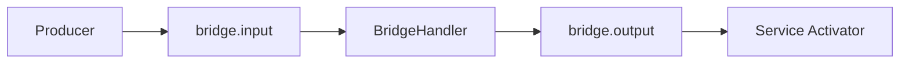
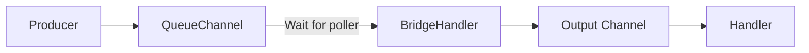
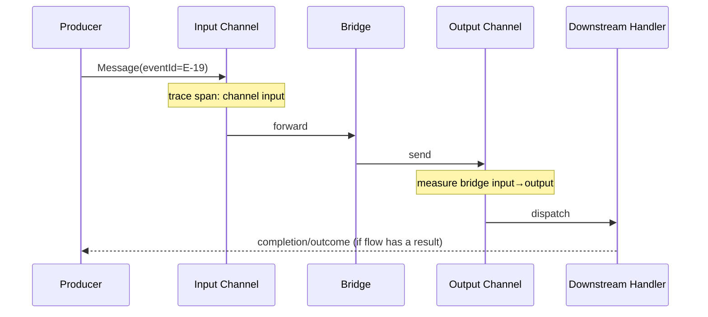

# Measuring Bridge Latency

In the **Bridge** chapter of the **SPRING_INTEGRATION_PATTERN** module, we use Spring Integration to connect `MessageChannel`s and coordinate **Enterprise Integration Patterns** such as Router, Filter, Transformer, Splitter, Aggregator, and Gateway. A Bridge is a simple endpoint: it receives a message from one channel and forwards it to another channel without needing business payload transformation. When a system has multiple branches, queues, and pollers, operators need to answer: **How much latency does the Bridge add?**

This question is easily misunderstood. A message can sit in a `QueueChannel` for tens of milliseconds before the Bridge is triggered by a poller, while the forwarding inside the Bridge itself takes very little time. If you only measure from producer send to consumer receipt, you observe **end-to-end segment latency**, and cannot attribute it specifically to the Bridge.

This lesson focuses on **measurement design**, **isolating each latency source**, **Java DSL and Micrometer practice**, **reading p50/p95/p99 results**, **baselining**, and **testing under increased load**. The examples stay within a single JVM to use a monotonic clock; when measuring across multiple processes, adapt collection and time synchronization accordingly.

## 1. How Does a Bridge Forward Messages?

Spring Integration uses a Bridge to connect channels without needing a new business handler. A typical topology:



With a simple Java DSL snippet:

```java
import org.springframework.context.annotation.Bean;
import org.springframework.context.annotation.Configuration;
import org.springframework.integration.config.EnableIntegration;
import org.springframework.integration.dsl.IntegrationFlow;

@Configuration
@EnableIntegration
class BasicBridgeFlow {

    @Bean
    IntegrationFlow bridgeFlow() {
        return IntegrationFlow.from("bridge.input")
            .bridge()
            .channel("bridge.output")
            .get();
    }
}
```

In this example, `bridge.input` and `bridge.output` serve as channel names in the integration flow. If both are synchronous send/receive channels (such as `DirectChannel`), forwarding usually happens inline on the call path. The Bridge does not call a REST API or deserialize data.

If the input is a `QueueChannel` and the Bridge receives via a **poller**, the flow introduces a scheduled waiting phase:



**Key point:** queue/poller wait time can far exceed the Bridge's logical overhead. When reporting numbers, always state the channel types and poller configuration.

## 2. Decomposing Latency into Meaningful Components

A pass across a Bridge can be split into milestones:

| Milestone | Description | Measurement Tool |
| --- | --- | --- |
| `t0` | Message arrives at the input to measure | `ChannelInterceptor.preSend` on input |
| `t1` | Message is pulled from the queue, if any | `ChannelInterceptor.postReceive` of `PollableChannel` |
| `t2` | Message is about to be sent to output channel | `ChannelInterceptor.preSend` on output |
| `t3` | Downstream handler starts processing | Instrumentation in handler |
| `t4` | Downstream handler finishes | Handler instrumentation or timer |

Derived durations:

- **Input → output latency:** `L_bridge_path = t2 - t0`. If input is a queue, this **includes** queue/poller wait time.
- **Queue/poller wait:** `L_wait = t1 - t0`, meaningful only when receiving from a `PollableChannel` with a well-defined receive boundary.
- **Forwarding after dequeue:** `L_forward = t2 - t1`. This includes endpoint dispatch, interceptors, and sending to output; closer to Bridge overhead.
- **Time to downstream start:** `L_downstream_start = t3 - t2`. If output is an async channel, this can reflect executor/queue wait time.
- **Downstream processing:** `L_handler = t4 - t3`.
- **End-to-end completion latency:** `L_end_to_end = t4 - t0`.

```text
t0             t1         t2               t3           t4
|--- queue wait --|--forward--|--dispatch wait--|--business--|
                 (if any)
```

Do not measure `t4 - t0` and name the metric `bridge.processing.time`; that is **the entire flow duration**. Nor should you treat `t2 - t1` as pure `BridgeHandler` CPU time: interceptors, dispatch, and framework runtime are still included in that interval.

### Three Metrics to Report Separately

| Metric | Question Answered | Usage |
| --- | --- | --- |
| `bridge.input_to_output` | How long from arrival at input until entering output? | Monitor integration segment latency |
| `bridge.queue_wait` | How long did the message wait in the queue/poller? | Detect backlog, poll schedule, and consumer capacity |
| `bridge.forward` | After the poller pulls it, how long did forwarding take? | Evaluate endpoint/forwarding overhead |

In configurations without a queue, `bridge.queue_wait` does not apply. Never record it as zero and mix it with queued samples when comparing percentiles.

## 3. Which Clock Should You Use?

Latency is an **elapsed duration** between two events. Within the same JVM, `System.nanoTime()` is the right choice for elapsed intervals because it is monotonic for elapsed-time measurement. Its return value is not a Unix timestamp and **must never be sent to another machine for direct subtraction**.

```java
long start = System.nanoTime();
// perform the step to measure
long elapsedNanos = System.nanoTime() - start;
```

By contrast, `System.currentTimeMillis()` and `Instant.now()` are useful for wall-clock timestamps, yet the OS clock can be adjusted by NTP or administrators. Measuring short intervals with two wall-clock timestamps can produce jitter or negative values on clock adjustments.

| Measurement Scope | Recommended Clock | Limitations |
| --- | --- | --- |
| Two points in the same JVM | `System.nanoTime()` or Micrometer `Timer.Sample` | Does not represent a global timestamp |
| Same message across threads **in the same JVM** | `System.nanoTime()` can still compute differences | Must carry start mark with the message or linked state |
| Across HTTP/broker between **multiple processes** | Spans/tracing + proper clock sync; per-side metrics | Never subtract `nanoTime` from two JVMs |
| Investigating history of when messages were created/received | `Instant.now()` per component | Must account for clock skew across hosts |

You cannot claim the difference between timestamps on producer and consumer is Bridge overhead if they belong to two systems with separate clocks.

## 4. Example: Measuring Input → Output with ChannelInterceptor and Micrometer

We use two interceptors:

1. An interceptor on `bridge.input` attaches `bridgeStartedNano` right before the message is sent into input.
2. An interceptor on `bridge.output` computes the elapsed duration until the message is about to enter output, recording it into a Micrometer `Timer`.

The standalone example below assumes the application already has Spring Integration Core and a Micrometer `MeterRegistry`. The entire measurement stays within **one JVM**.

```java
package example.bridge;

import java.util.concurrent.TimeUnit;

import io.micrometer.core.instrument.MeterRegistry;
import io.micrometer.core.instrument.Timer;
import org.springframework.context.annotation.Bean;
import org.springframework.context.annotation.Configuration;
import org.springframework.integration.channel.DirectChannel;
import org.springframework.integration.config.EnableIntegration;
import org.springframework.integration.dsl.IntegrationFlow;
import org.springframework.messaging.Message;
import org.springframework.messaging.MessageChannel;
import org.springframework.messaging.support.ChannelInterceptor;
import org.springframework.messaging.support.MessageBuilder;

@Configuration
@EnableIntegration
class BridgeLatencyConfiguration {

    private static final String START_HEADER = "bridgeStartedNano";

    @Bean(name = "bridge.input")
    DirectChannel bridgeInput() {
        var channel = new DirectChannel();

        channel.addInterceptor(new ChannelInterceptor() {
            @Override
            public Message<?> preSend(Message<?> message, MessageChannel ch) {
                return MessageBuilder.fromMessage(message)
                    .setHeader(START_HEADER, System.nanoTime())
                    .build();
            }
        });

        return channel;
    }

    @Bean(name = "bridge.output")
    DirectChannel bridgeOutput(MeterRegistry registry) {
        var timer = Timer.builder("demo.bridge.input_to_output")
            .description("Elapsed time between input and output preSend")
            .publishPercentileHistogram()
            .register(registry);

        var channel = new DirectChannel();

        channel.addInterceptor(new ChannelInterceptor() {
            @Override
            public Message<?> preSend(Message<?> message, MessageChannel ch) {
                Long start = message.getHeaders().get(
                    START_HEADER, Long.class
                );

                if (start != null) {
                    long elapsed = System.nanoTime() - start;
                    if (elapsed >= 0) {
                        timer.record(elapsed, TimeUnit.NANOSECONDS);
                    }
                }

                return message;
            }
        });

        return channel;
    }

    @Bean
    IntegrationFlow bridgeFlow() {
        return IntegrationFlow.from("bridge.input")
            .bridge()
            .channel("bridge.output")
            .get();
    }

    @Bean
    IntegrationFlow outputFlow() {
        return IntegrationFlow.from("bridge.output")
            .handle(String.class, (payload, headers) -> {
                // Simple test handler: produces no reply.
                return null;
            })
            .get();
    }
}
```

Sending messages through a bean in the same Spring context:

```java
package example.bridge;

import org.springframework.beans.factory.annotation.Qualifier;
import org.springframework.messaging.MessageChannel;
import org.springframework.messaging.support.MessageBuilder;
import org.springframework.stereotype.Component;

@Component
class BridgeSender {
    private final MessageChannel input;

    BridgeSender(@Qualifier("bridge.input") MessageChannel input) {
        this.input = input;
    }

    boolean send(String payload) {
        return input.send(
            MessageBuilder.withPayload(payload).build()
        );
    }
}
```

Explanation of the measurement:

- `preSend` on input runs **before** the input channel dispatches to the Bridge.
- `preSend` on output runs **before** the output channel dispatches to the downstream handler.
- Thus the timer captures **the span from input entry to just before output dispatch**. It excludes downstream handler execution time.
- Building a new message to attach a header and recording metrics also adds overhead. This measurement pattern is useful for flow observability; for microbenchmarking `BridgeHandler` itself, subtract or baseline instrumentation overhead.
- A nanosecond header is for **intra-JVM use only**. Never forward this header over HTTP/brokers or use it as a metric tag.
- The example does not explicitly handle messages sent to output without the measurement header: the metric simply records no sample there. In production, add a missing-timestamp counter so data cannot skew silently.

**Runtime prerequisite:** a `MeterRegistry` bean must be configured (for example via Micrometer/Spring Boot Actuator or manual registration). Histograms/percentiles depend on the registry and monitoring backend. `publishPercentileHistogram()` registers appropriate distribution buckets per Micrometer config; it does not make dashboards appear automatically.

## 5. Bridge with QueueChannel and Poller: Measurement Must Isolate Queue Wait

When the input is a `QueueChannel`, the bridge runs on the poller's schedule. Example:

```java
package example.bridge;

import java.time.Duration;

import org.springframework.context.annotation.Bean;
import org.springframework.context.annotation.Configuration;
import org.springframework.integration.channel.QueueChannel;
import org.springframework.integration.dsl.IntegrationFlow;
import org.springframework.integration.dsl.Pollers;

@Configuration
class PolledBridgeConfiguration {

    @Bean(name = "bridge.queue")
    QueueChannel bridgeQueue() {
        return new QueueChannel(1000);
    }

    @Bean
    IntegrationFlow polledBridgeFlow() {
        return IntegrationFlow.from(
                "bridge.queue",
                endpoint -> endpoint.poller(
                    Pollers.fixedDelay(Duration.ofMillis(100))
                        .maxMessagesPerPoll(10)
                )
            )
            .bridge()
            .channel("bridge.output")
            .get();
    }
}
```

This flow merely illustrates another version of bridge input (replacing the synchronous `bridge.input` flow above). In practice, choose one clear topology and avoid running two flows competing for the same messages just to gather numbers.

Suppose the poller has an interval of roughly 100 ms and a message arrives right after a poll. The message may wait nearly that entire interval before being pulled, on top of backlog, CPU load, and scheduling delays. You cannot deduce exact latency from `fixedDelay(100ms)` alone because delay depends on poll cadence and workload.

### Measuring Enqueue → Dequeue Separately

Attach an interceptor on `QueueChannel`, using milestones:

- `preSend`: attach `queueEnqueueNano` as the message enters the queue.
- `postReceive`: after the poller receives a message, attach `queueDequeueNano`.
- Output `preSend`: compute `dequeue - enqueue` and `output - dequeue`.

Pseudocode (variable names clearly show measurement points):

```java
// Illustrative logic, not a complete @Bean configuration.
@Override
public Message<?> preSend(Message<?> message, MessageChannel channel) {
    return MessageBuilder.fromMessage(message)
        .setHeader("queueEnqueueNano", System.nanoTime())
        .build();
}

@Override
public Message<?> postReceive(Message<?> message, MessageChannel channel) {
    if (message == null) {
        return null;
    }
    return MessageBuilder.fromMessage(message)
        .setHeader("queueDequeueNano", System.nanoTime())
        .build();
}

// At output preSend:
long queueWait = dequeueNano - enqueueNano;
long forwardTime = outputNano - dequeueNano;
```

With `QueueChannel`, `postReceive` is appropriate for observing right after the poller pulls a message. Do not apply `postReceive` directly to a `DirectChannel`, which has no poll-style `receive()` operation.

**Important limitation:** interceptor milestones measure around framework operations, not exact broker/filesystem confirmations. They must also be attached and collected along the same path; messages dropped by a router or failing before output will lack `forwardTime`. Therefore, alongside timers, maintain counters for **received, forwarded, dropped, and errors**.

## 6. Why Not Measure Using `postSend`?

`ChannelInterceptor.postSend(message, channel, sent)` runs **after** the `send()` call. With `DirectChannel`, sending can include the entire execution time of a synchronous subscriber.

Example:

```text
producer -> input DirectChannel -> BridgeHandler
         -> output DirectChannel -> slowHandler (sleep 500 ms)
```

If you time from before `input.send(...)` until `send(...)` returns, a ~500 ms measurement reflects the slow handler, even though the Bridge forwarded almost instantaneously.

When the goal is **Bridge-only latency**, place start and stop points **before downstream starts processing**, such as `preSend` on both channels. When the goal is **producer-to-business-completion latency**, measure end-to-end separately and name the metric accordingly.

Similarly:

- `afterSendCompletion` helps capture success/failure of the send operation, yet does not isolate Bridge from handler.
- Queue `postReceive` helps measure queue wait, yet is not a valid stop point for a non-queued synchronous flow.
- AOP around `BridgeHandler` can measure method execution time, yet results are affected by framework dispatch, advice, and downstream send; define the exact interceptor/AOP boundary carefully.

## 7. Designing a Controlled Benchmark

A measurement is useful only if it separates Bridge overhead from channel and instrumentation overhead. Measure at least three comparable setups:

| Scenario | Topology | Question |
| --- | --- | --- |
| **A – baseline** | Producer → DirectChannel → Handler | How long do send/dispatch/handler take on their own? |
| **B – sync bridge** | Producer → DirectChannel → Bridge → DirectChannel → Handler | How much does adding a Bridge and a forwarding channel add? |
| **C – polling bridge** | Producer → QueueChannel → Poller → Bridge → DirectChannel → Handler | How much do the queue and poller contribute? |

Keep conditions identical wherever possible: payload, message count, handler, JVM version, heap, warm-up, metrics collector, GC config, and load level.

### Execution Sequence

1. **Warm up the JVM:** send enough messages before collecting stats to minimize class loading/JIT effects.
2. **Baseline A:** capture throughput and latency without a Bridge.
3. **Scenario B:** capture the same metrics with a synchronous Bridge inserted.
4. **Scenario C:** switch to `QueueChannel`/poller, recording queue depth and poll times as well.
5. **Rotate run order:** avoid mistaking thermal throttling, contention, or GC for topology efficiency.
6. **Repeat and keep distributions:** report sample count, p50/p95/p99, max, throughput, errors, GC pauses, and CPU; never rely on a single average.

**Note:** subtracting the p99 of two sample sets is not the p99 of per-message overhead. To quantify overhead differences statistically, use a valid control or paired-sampling design and state inference limits.

### Reducing Noise When Measuring Very Short Segments

- Never log per message on the hot path; synchronous logging can dwarf Bridge overhead.
- Avoid measuring with a debugger or breakpoints pausing threads.
- Never measure on the very first runs of a fresh JVM; JIT/GC skews results.
- At microsecond scales, run large sample counts and account for clock calls, header creation, and metric export overhead.
- Use bounded-cardinality metric labels like `bridge=order-to-billing`, `channelType=direct`. **Never** attach `messageId`, `orderId`, or `requestId` as tags due to excessive cardinality.
- When using multiple executors, record thread pool sizes and load contention levels.

## 8. How to Read p50, p95, p99, and Throughput

A system handling 100,000 messages can have a low mean while a small fraction suffers high latency due to queue backlog. Therefore:

- **p50:** half the samples finish at or faster than this value; reflects typical behavior.
- **p95:** highlights the tail of the slowest 5% of messages.
- **p99:** tracks tail latency, sensitive to GC, lock contention, backlogs, and scheduling.
- **Throughput:** messages processed per second; always read alongside latency.
- **Error/drop count:** never summarize only successful messages and conclude the flow has low latency.
- **Queue depth/age:** explains why latency climbs when arrival rate exceeds processing rate.

The hypothetical table below **only illustrates how to analyze results, not real benchmark numbers**:

| Topology | p50 input→output | p95 input→output | Conclusion You Can Draw |
| --- | ---: | ---: | --- |
| Bridge on DirectChannel | 0.08 ms | 0.30 ms | Fast synchronous path in this illustrative test |
| Bridge after QueueChannel + Poller | 45 ms | 130 ms | Total latency rose sharply; measure queue wait and poller |
| Same queue under higher load | 95 ms | 420 ms | Backlog/saturation likely dominates tail latency |

Do not conclude from this table that `BridgeHandler` itself spent 130 ms. Most of it likely comes from poller or queue wait time. Inspect `queueWait` and `forwardTime` to be sure.

## 9. Factors That Make a Bridge Look Slow

| Factor | Observable Symptom | Investigation Action |
| --- | --- | --- |
| **Poll interval too long** | Latency varies close to the poll period | Shorten/tune interval and check polling overhead |
| **Queue backlog** | Queue depth grows; p95/p99 climb with load | Measure input/output rates, capacity, and consumer concurrency |
| **Executor saturation** | Tasks wait in executor; many threads busy | Check queue size and thread pool metrics |
| **Slow downstream handler** | `postSend` is slow while output `preSend` stays fast | Measure downstream latency separately |
| **GC pause** | Multiple metrics spike simultaneously | Correlate GC logs/metrics with latency timestamps |
| **Lock/contention** | Tail latency spikes despite moderate CPU | Inspect thread dumps/profilers when needed |
| **Heavy interceptor/serialization** | Adding instrumentation drops throughput | Compare runs with/without instrumentation |
| **External broker/network** | High end-to-end latency, low internal bridge segment | Measure inbound/outbound transport separately |
| **Too many tiny messages** | Per-message fixed overhead becomes significant | Evaluate appropriate batching without breaking semantics |

A Bridge does not make a flow asynchronous merely by sitting between two channels; **channel types** and endpoints/pollers determine whether sending is synchronous or queued.

## 10. When Should You Analyze Traces?

Metrics such as Micrometer Timers answer the aggregate question “where is the Bridge segment slow” across a distribution. **Tracing** helps when inspecting the journey of a single specific message:



Keep in mind:

- `traceId` links spans across components; it **does not make the Bridge faster or slower by itself**.
- With `DirectChannel`, multiple spans can nest on the same thread.
- Across `QueueChannel` or an executor, context propagation is required to preserve the same trace.
- Across JMS/AMQP/HTTP, trace headers must be mapped per transport policy. Never pass raw Java thread-local objects or `nanoTime` across process boundaries.
- Different Spring Integration/Micrometer versions have different observation mechanisms; when enabled, inspect where instrumentation creates spans/timers so you do not double-count.

If you only need system-wide p95/p99 monitoring, low-cardinality meters are usually enough. If you need to investigate a single slow order, traces with contract IDs are much more useful than logging entire payloads.

## 11. Optimizing After Identifying the True Latency Source

Order your fixes based on data:

**If queue wait is high:** tune poller interval, `maxMessagesPerPoll`, concurrency, and worker count to match arrival rate; check whether backlog exceeds processing capacity. Increasing consumer count can break completion ordering or increase resource contention.

**If forward time is high:** inspect interceptors, advice, converters, thread contention, and output channel dispatch mechanics. A basic Bridge performs no payload transformation; unusually high overhead often comes from attached components.

**If downstream is slow:** measure the DB/API/handler separately. Never shorten poll intervals to mask a database-bound handler, as that may simply increase queued contention.

**If Bridge overhead is genuinely unnecessary:** consider wiring the two components directly when topology separation, lifecycle independence, or operational boundaries are no longer needed. Yet keep the Bridge if it provides a clean boundary for routing, channel isolation, or observability; performance is only one architectural criterion.

**If high throughput is required:** measure latency under realistic load, in-flight message counts, and batching effects. Optimizing p50 in a microbenchmark may not lower p99 under heavy load.

## 12. Designing Latency Measurement Tests

A Bridge latency test must avoid overly tight absolute time thresholds because JVMs and CI runners have variable load.

| Test | Method | What to Verify |
| --- | --- | --- |
| **Bridge preserves payload/headers** | Send message with business ID through sync flow | Downstream receives exact payload and required headers |
| **Timer records samples** | Send N messages to input, await N at output | Meter records valid samples without unexpected drops |
| **Excludes downstream** | Intentionally slow downstream | `input→output` metric does not jump with downstream slowness if measured properly |
| **Queue wait isolated** | Controlled QueueChannel + poller | Both `enqueue→dequeue` and `dequeue→output` are measured |
| **Backlog** | Send faster than processing rate | Queue depth/latency rise and are observed |
| **Downstream errors** | Handler throws exception | Error count increments; timer is not treated as full-flow business success |
| **Messages missing timestamp** | Send to output via another path | Missing-start is detected; no bogus samples recorded |
| **Multithreaded** | Concurrent executor/consumers | Timestamps are never mixed across messages |
| **GC/CI variance** | Run multiple iterations | Avoid failing builds on isolated external spikes |
| **Metrics disabled** | Without MeterRegistry/observation | Message behavior still matches application config |

### Verification Example with CountDownLatch

In an integration test, use a counting handler and `CountDownLatch` to await completion instead of a fixed `Thread.sleep`:

```java
import java.util.concurrent.CountDownLatch;
import java.util.concurrent.TimeUnit;
import java.util.concurrent.atomic.AtomicInteger;

CountDownLatch received = new CountDownLatch(100);
AtomicInteger handled = new AtomicInteger();

void onMessage(String payload) {
    handled.incrementAndGet();
    received.countDown();
}

// In test: send 100 messages to input.
boolean allReceived = received.await(5, TimeUnit.SECONDS);
if (!allReceived) {
    throw new AssertionError("Missing messages at output");
}
if (handled.get() != 100) {
    throw new AssertionError("Message count mismatch");
}
```

This is an **illustrative test-harness fragment**, not a complete test bean; the application must register `onMessage` as the output handler and send exactly 100 messages. When checking the timer, compare recorded sample count with messages passing output; when querying histograms from a monitoring backend, account for scrape/export intervals. Avoid asserting hard thresholds like “Bridge is always under 1 ms” across arbitrary CI machines.

### Performance Testing and Functional Testing Are Two Different Activities

- **Functional tests** confirm messages travel the right channels without losing payloads/headers, and that exceptions and correlation match the contract.
- **Performance tests** run many messages at a defined load, collect latency/throughput distributions, compare against a baseline, and document the environment.
- **Load/stress tests** probe saturation, queue depth, GC, backpressure, tail latency, and recovery when load exceeds normal bounds.

A flow passing functional tests can still lag under heavy backlog; a flow with low p50 can still drop messages on error paths if handling is missing.

## 13. Common Mistakes

**Using `System.currentTimeMillis()` to time a very fast Bridge.** Resolution and wall-clock adjustments add noise; use a monotonic clock inside the same JVM.

**Subtracting `System.nanoTime()` across two processes.** These values share no common origin and do not represent cross-machine elapsed time.

**Timing `send()` including downstream handlers.** On `DirectChannel`, `send()` can execute the entire synchronous chain. Define exact `preSend` boundaries.

**Blaming all `QueueChannel` latency on the Bridge.** Poller intervals, backlog, and scheduling usually dominate. Separate `queueWait` from `forwardTime`.

**Measuring only averages.** p95/p99, throughput, and error counts reveal the messages affected most severely.

**Measuring by logging every message.** Log I/O can slow the system down substantially and distort measurements.

**Using message IDs as metric tags.** Tag cardinality explosion consumes memory and monitoring resources; use only bounded-cardinality tags.

**Measuring only messages reaching output.** Filtered, dropped, or failed messages vanish from samples, making latency look artificially good while masking completion rates.

**Comparing scenarios with different handlers or loads.** Without an equivalent baseline, Bridge cost cannot be isolated.

**Confusing a Bridge with a remote gateway.** A Bridge moves messages between channels; if input/output connect to brokers or remote adapters, transport and serialization are separate stages to measure.

## 14. Checklist for Measuring Bridge Latency

1. Identify the topology: `DirectChannel`, `ExecutorChannel`, `QueueChannel`, poller, and downstream handler.
2. Specify **input, output, and latency definition** before naming metrics.
3. Use `System.nanoTime()` for intervals within one JVM; across processes, use tracing/proper clock sync.
4. Place instrumentation where it does not accidentally include downstream when measuring only the Bridge.
5. With queues/pollers, measure `enqueue→dequeue` and `dequeue→output` separately.
6. Collect sample count, p50, p95, p99, throughput, queue depth, and error/drop counts.
7. Keep tags low-cardinality; never attach message IDs to meter tags.
8. Run a no-Bridge baseline and a Bridged scenario under equivalent conditions.
9. Warm up the JVM, repeat runs, and monitor CPU/GC/thread contention.
10. Distinguish instrumentation overhead from real flow latency.
11. Test success paths, error paths, dropped messages, and concurrency.
12. Explicitly label reports as **internal Bridge measurement**, **queue + Bridge**, or **end-to-end**.

## Conclusion

**Measuring Bridge latency** in Spring Integration requires defining exact measurement boundaries. A Bridge usually only forwards messages, whereas `QueueChannel`, pollers, executors, and downstream handlers can add substantial waiting time. By timestamping at input/output channels, separating queue wait from forward time, recording Micrometer Timers, and comparing against a baseline, you can pinpoint latency sources and optimize on evidence. Reliable results always accompany topology details, test load, p95/p99 distributions, error rates, and measurement boundaries.
